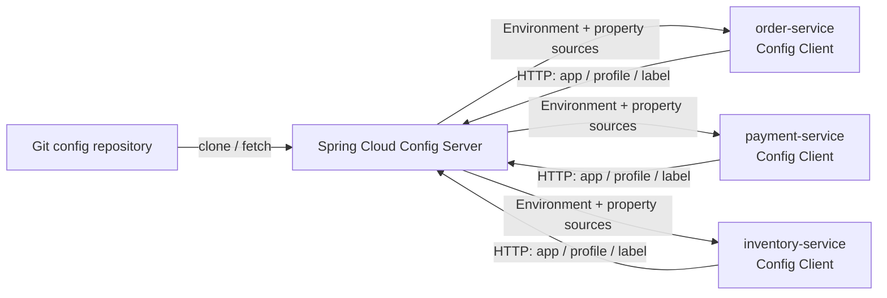
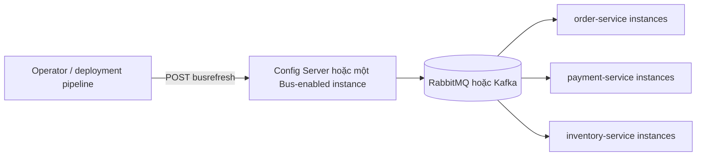

# Kiến thức nền và trình tự học từ cấu hình cục bộ đến phân tán

## 1. Bức tranh tổng quan

`SPRING_CLOUD_CONFIGURATION` tập trung vào việc tổ chức cấu hình cho nhiều ứng dụng Spring Boot bằng Spring Cloud Config Server và Spring Cloud Config Client. Mục tiêu là đưa cấu hình dùng chung và cấu hình riêng của từng dịch vụ vào một nguồn có thể quản lý phiên bản, sau đó phân phối chúng đến các ứng dụng theo môi trường chạy.

Khi một ứng dụng còn nhỏ, cấu hình thường nằm trong `application.yml` hoặc `application.properties` của chính ứng dụng. Cách làm này dễ hiểu và phù hợp khi chỉ có một dịch vụ. Khi hệ thống có nhiều dịch vụ, nhiều môi trường và nhiều nhóm vận hành, cấu hình bắt đầu trở thành một phần của kiến trúc: phải biết giá trị nào áp dụng cho dịch vụ nào, môi trường nào, phiên bản cấu hình nào; ai được phép thay đổi; thay đổi được phát đến các tiến trình đang chạy ra sao; và có thể quay lui thế nào khi xảy ra sự cố.

Spring Cloud Config giải quyết phần quản lý và phân phối cấu hình đó. Config Server đọc cấu hình từ một backend như Git và cung cấp nó qua HTTP. Config Client của mỗi ứng dụng liên hệ với server để lấy cấu hình trong quá trình khởi động. Profile chọn nhóm cấu hình theo môi trường hoặc mục đích chạy; label chọn nhánh, tag hoặc phiên bản cụ thể của nguồn cấu hình.

Config Server không tự động biến mọi thay đổi thành an toàn. Hệ thống vẫn cần quy tắc về thứ tự ưu tiên, bảo vệ bí mật, quyền truy cập, kiểm tra thay đổi, refresh và rollback. Những nội dung này là một phần của thiết kế vận hành, không phải công việc phụ sau khi cài đặt thư viện.

## 2. Vì sao cần chuyển từ cấu hình cục bộ sang cấu hình tập trung?

Giả sử một hệ thống có ba ứng dụng `order-service`, `payment-service` và `inventory-service`, cùng chạy ở môi trường `dev`, `staging` và `prod`. Mỗi ứng dụng cần địa chỉ cơ sở dữ liệu, thời gian timeout, mức log và một số cờ tính năng.

Nếu mỗi ứng dụng tự giữ toàn bộ cấu hình, nhóm phát triển phải cập nhật nhiều nơi khi một giá trị dùng chung thay đổi. Các bản triển khai có thể vô tình dùng những giá trị khác nhau. Một thay đổi nhỏ như tăng timeout cũng có thể đòi hỏi đóng gói và triển khai lại nhiều ứng dụng, dù mã nguồn của chúng không thay đổi.

Kho cấu hình tập trung giúp:

- Quản lý cấu hình chung và cấu hình riêng theo từng ứng dụng trong một quy trình thống nhất.
- Theo dõi lịch sử thay đổi bằng Git, biết ai thay đổi, thay đổi gì và có thể quay về commit trước.
- Tách cấu hình theo môi trường bằng profile, đồng thời chọn phiên bản cấu hình bằng label.
- Phân phối cấu hình qua mạng đến nhiều ứng dụng mà không phải sao chép thủ công các file cấu hình.
- Kết hợp quy trình review, kiểm tra tự động và phân quyền của Git với quy trình phát hành phần mềm.

Cấu hình tập trung cũng tạo ra một phụ thuộc mới: ứng dụng cần truy cập Config Server khi khởi động hoặc khi làm mới cấu hình. Vì vậy phải thiết kế khả năng sẵn sàng, xác thực, kết nối mạng và hành vi khi server không truy cập được.

## 3. Các thành phần và trách nhiệm

| Thành phần | Trách nhiệm |
|---|---|
| Config repository | Lưu file cấu hình, lịch sử thay đổi và các nhánh hoặc tag trong Git. |
| Config Server | Đọc cấu hình từ backend, kết hợp các nguồn theo ứng dụng/profile/label và cung cấp kết quả qua HTTP. |
| Config Client | Yêu cầu cấu hình từ Config Server và đưa các giá trị nhận được vào Spring `Environment` của ứng dụng. |
| Profile | Chọn nhóm cấu hình phù hợp, thường tương ứng với `dev`, `staging`, `prod` hoặc một chế độ chạy. |
| Label | Chọn phiên bản của kho cấu hình, thường là tên branch, tag hoặc commit được backend hỗ trợ. |
| Actuator | Cung cấp các endpoint quản trị như health và refresh khi được cấu hình và bảo vệ phù hợp. |
| Spring Cloud Bus | Phát sự kiện qua message broker để nhiều Config Client có thể nhận lệnh làm mới cấu hình. |

Sơ đồ luồng cơ bản:



Config Server không cần biết nghiệp vụ của từng dịch vụ. Nó nhận các tham số định danh cấu hình, truy vấn backend rồi trả về các property source. Config Client chịu trách nhiệm nạp những property source đó vào môi trường cấu hình của ứng dụng.

## 4. Cấu hình được tìm và phân phối như thế nào?

Một yêu cầu cấu hình thường được xác định bởi ba thông tin:

- **Application**: tên ứng dụng, thông thường lấy từ `spring.application.name`.
- **Profile**: profile đang hoạt động, thông thường lấy từ `spring.profiles.active`.
- **Label**: phiên bản của kho cấu hình mà client muốn đọc.

Ví dụ, `order-service` chạy với profile `staging` và label `release-2026-11` sẽ yêu cầu cấu hình tương ứng với bộ ba đó. Config Server dùng các giá trị này để tìm file trong repository và tạo một `Environment` gồm nhiều property source.

### 4.1. Tổ chức file trong Git

Một repository đơn giản có thể được tổ chức như sau:

```text
config-repo/
├── application.yml
├── application-dev.yml
├── application-prod.yml
├── order-service.yml
├── order-service-dev.yml
├── order-service-prod.yml
├── payment-service.yml
├── payment-service-dev.yml
└── payment-service-prod.yml
```

Ý nghĩa thường gặp:

- `application.yml`: giá trị mặc định dùng chung cho các ứng dụng.
- `application-dev.yml`: giá trị dùng chung khi profile `dev` được chọn.
- `order-service.yml`: cấu hình mặc định riêng cho `order-service`.
- `order-service-prod.yml`: cấu hình riêng của `order-service` khi chạy với profile `prod`.

Tên file phải khớp với application và profile mà client yêu cầu. Có thể chia repository thành các thư mục con và cấu hình `search-paths` ở Config Server. Khi số lượng ứng dụng hoặc môi trường tăng lên, nên thống nhất quy ước đặt tên và cấu trúc thư mục để tránh file trùng ý nghĩa hoặc khó tìm.

Ví dụ file `application.yml`:

```yaml
logging:
  level:
    root: INFO

spring:
  jackson:
    default-property-inclusion: non_null
```

Ví dụ file `order-service-dev.yml`:

```yaml
server:
  port: 8081

orders:
  reservation-timeout: 5s
  allow-test-payments: true
```

Ví dụ chỉ nhằm minh họa cấu trúc. Giá trị kết nối thật, mật khẩu, token và khóa mã hóa không nên được ghi trực tiếp vào các file cấu hình thông thường trong Git.

### 4.2. Profile và label giải quyết hai câu hỏi khác nhau

Profile trả lời câu hỏi: **ứng dụng đang chạy trong chế độ hoặc môi trường nào?** Một ứng dụng có thể dùng profile `dev`, `test`, `staging` hoặc `prod`. Các profile có thể được kết hợp nếu thiết kế cấu hình cho phép, nhưng cần kiểm soát thứ tự kích hoạt để tránh ghi đè ngoài dự kiến.

Label trả lời câu hỏi: **ứng dụng đang đọc phiên bản nào của kho cấu hình?** Với Git backend, label thường là branch, tag hoặc commit. Dùng branch phát triển giúp cấu hình tiếp tục thay đổi; dùng tag hoặc commit cố định giúp một lần phát hành tham chiếu đến một phiên bản cấu hình có thể tái lập.

Ví dụ: `order-service` có thể chạy profile `prod` và đọc label `release-2026-11`. Một dịch vụ khác có thể dùng cùng profile nhưng label khác trong giai đoạn thử nghiệm. Không nên mặc định rằng profile `prod` tự động trỏ đến một phiên bản Git bất biến; profile và label là hai lựa chọn độc lập.

## 5. Thiết lập Config Server và Config Client

Các ví dụ dưới đây dùng cú pháp Config Data của Spring Boot hiện đại. Phiên bản Spring Boot và Spring Cloud phải được chọn theo bảng tương thích của Spring Cloud release train tương ứng. Nên khai báo Spring Cloud BOM trong dependency management để các module Spring Cloud dùng cùng một dòng phiên bản; tránh tự ghép các phiên bản thư viện không tương thích.

### 5.1. Config Server

Thêm dependency `spring-cloud-config-server`, sau đó bật vai trò Config Server trong lớp ứng dụng:

```java
@SpringBootApplication
@EnableConfigServer
public class ConfigServerApplication {
    public static void main(String[] args) {
        SpringApplication.run(ConfigServerApplication.class, args);
    }
}
```

Cấu hình tối thiểu cho Git backend có thể như sau:

```yaml
server:
  port: 8888

spring:
  application:
    name: config-server
  cloud:
    config:
      server:
        git:
          uri: ${CONFIG_REPO_URI}
          default-label: main
          clone-on-start: true
```

`CONFIG_REPO_URI` được cấp từ môi trường triển khai, chẳng hạn biến môi trường hoặc secret store. Nếu repository riêng tư, thông tin xác thực Git phải được cung cấp qua cơ chế bảo mật của môi trường. Không commit token hoặc mật khẩu vào repository cấu hình hay mã nguồn của Config Server.

`clone-on-start: true` yêu cầu server thử clone repository khi khởi động, nhờ đó lỗi URI hoặc quyền truy cập có thể được phát hiện sớm. Trong triển khai thực tế, cần bổ sung health check, log phù hợp, timeout, chính sách retry và phương án chạy nhiều instance nếu yêu cầu sẵn sàng cao.

### 5.2. Config Client

Mỗi ứng dụng cần dependency `spring-cloud-starter-config`. Với Config Data, client có thể khai báo:

```yaml
spring:
  application:
    name: order-service
  profiles:
    active: dev
  config:
    import: "configserver:http://localhost:8888"
  cloud:
    config:
      label: main
```

Khi khởi động, client dùng tên `order-service`, profile `dev` và label `main` để yêu cầu cấu hình. Trong môi trường triển khai, địa chỉ Config Server và profile cần được truyền bằng cấu hình phù hợp với môi trường đó.

Nếu muốn ứng dụng có thể khởi động khi Config Server tạm thời không sẵn sàng và vẫn có cấu hình dự phòng cục bộ, có thể dùng:

```yaml
spring:
  config:
    import: "optional:configserver:http://localhost:8888"
```

Từ khóa `optional:` cho phép bỏ qua nguồn cấu hình từ Config Server khi không lấy được cấu hình. Điều đó chỉ hợp lý nếu cấu hình cục bộ đủ an toàn để ứng dụng hoạt động. Với dịch vụ yêu cầu cấu hình tập trung bắt buộc, nên để import không optional để ứng dụng dừng khởi động khi không lấy được cấu hình thiết yếu. Quyết định này cần được đưa ra theo yêu cầu sẵn sàng và an toàn của từng dịch vụ.

Các dự án Spring Cloud Config cũ có thể dùng cơ chế bootstrap với `bootstrap.yml` và bootstrap starter. Đó là cách cấu hình thuộc thế hệ trước. Với Spring Boot hỗ trợ Config Data, `spring.config.import` là cách khai báo chuẩn. Không nên trộn hai cơ chế một cách tùy tiện; hãy kiểm tra tài liệu của đúng cặp phiên bản Spring Boot/Spring Cloud đang dùng.

### 5.3. Kiểm tra endpoint cấu hình

Với server chạy ở cổng `8888`, có thể kiểm tra một bộ cấu hình bằng endpoint dạng:

```text
GET http://localhost:8888/order-service/dev/main
```

Endpoint này trả về một `Environment` mô tả application, profile, label và các property source được tìm thấy. Đây là cách hữu ích để kiểm tra Config Server có tìm đúng repository, file, profile và label hay không trước khi điều tra phía ứng dụng.

Khi client không nhận được giá trị mong đợi, hãy kiểm tra lần lượt tên ứng dụng, profile đang hoạt động, label, đường dẫn tìm kiếm của Git backend, quyền đọc repository và kết quả endpoint. Việc kiểm tra có thứ tự giúp phân biệt lỗi định tuyến cấu hình với lỗi do ứng dụng đọc hoặc ghi đè property.

## 6. Thứ tự ưu tiên và cách xác định giá trị cuối cùng

Một property có thể xuất hiện ở nhiều nơi: cấu hình chung, cấu hình theo profile, cấu hình riêng của ứng dụng, file cục bộ, biến môi trường hoặc tham số dòng lệnh. Giá trị mà ứng dụng sử dụng phụ thuộc vào thứ tự các property source trong Spring `Environment`.

Cần phân biệt hai tầng ưu tiên.

### 6.1. Ưu tiên khi ghép file trong Config repository

Ở tầng repository, cấu hình thường được tổ chức từ chung đến cụ thể:

| Phạm vi | Ví dụ | Mục đích |
|---|---|---|
| Chung, mặc định | `application.yml` | Giá trị mặc định cho nhiều ứng dụng. |
| Chung theo profile | `application-prod.yml` | Giá trị chung khi chạy profile `prod`. |
| Riêng ứng dụng | `order-service.yml` | Giá trị mặc định chỉ dành cho `order-service`. |
| Riêng ứng dụng và profile | `order-service-prod.yml` | Giá trị cụ thể cho `order-service` ở `prod`. |

Quy tắc ghép chính xác còn phụ thuộc backend, search path và phiên bản Spring Cloud Config. Khi cùng một khóa xuất hiện ở nhiều file, không nên suy luận chỉ từ tên file; hãy xem thứ tự property source mà endpoint trả về và kiểm chứng trên đúng phiên bản đang chạy. Nếu kích hoạt nhiều profile, thứ tự profile cũng có thể làm thay đổi kết quả; profile được xử lý sau thường có cơ hội ghi đè profile trước.

### 6.2. Ưu tiên giữa các property source của ứng dụng

Sau khi cấu hình từ server được nạp, nó trở thành một phần của Spring `Environment`. Spring Boot có thứ tự ưu tiên property source riêng. Tham số dòng lệnh, thuộc tính hệ thống JVM và biến môi trường thường có độ ưu tiên cao hơn các file cấu hình thông thường. Vị trí import Config Data và các thiết lập override của Config Server cũng ảnh hưởng đến việc cấu hình từ xa có thể bị ghi đè bởi cấu hình cục bộ hay không.

Vì vậy, không nên áp dụng một câu nói đơn giản như “cấu hình Git luôn thắng” hoặc “file local luôn thắng” cho mọi dự án. Cần xác định thứ tự trong bối cảnh cụ thể:

1. Xác nhận application, profile và label mà client thực sự gửi.
2. Xem các property source Config Server trả về và thứ tự của chúng.
3. Xác định vị trí `spring.config.import` và các file cấu hình cục bộ được nạp.
4. Kiểm tra biến môi trường, JVM system properties và tham số dòng lệnh trong môi trường triển khai.
5. Kiểm tra các thiết lập như `spring.cloud.config.allowOverride`, `spring.cloud.config.overrideNone` hoặc `spring.cloud.config.overrideSystemProperties` nếu hệ thống có sử dụng chúng. Các cờ này cần được cấu hình có chủ đích ở đúng nơi theo tài liệu của phiên bản đang dùng.

Actuator có thể hỗ trợ kiểm tra `Environment` và các thuộc tính đã bind, nhưng endpoint hiển thị cấu hình có thể tiết lộ dữ liệu nhạy cảm. Chỉ bật và truy cập chúng qua kênh quản trị đã xác thực, giới hạn quyền và lọc dữ liệu phù hợp. Không đưa toàn bộ kết quả chứa bí mật vào log hoặc ticket công khai.

## 7. Làm mới cấu hình khi ứng dụng đang chạy

Config Client lấy cấu hình trong quá trình khởi động. Nếu file trong Git thay đổi sau đó, tiến trình đang chạy không tự động biết rằng repository đã có commit mới. Cần một cơ chế refresh để ứng dụng đọc lại hoặc áp dụng giá trị mới.

### 7.1. Refresh một ứng dụng

Spring Boot Actuator cung cấp endpoint refresh khi ứng dụng có dependency và cấu hình phù hợp. Ví dụ:

```yaml
management:
  endpoints:
    web:
      exposure:
        include: health,info,refresh
```

Sau khi cập nhật cấu hình trong Git và bảo đảm Config Server đã thấy phiên bản mới, gửi yêu cầu `POST` đến `/actuator/refresh` của client để yêu cầu làm mới. Các bean cần được tạo lại theo cơ chế refresh có thể dùng `@RefreshScope`:

```java
@Component
@RefreshScope
public class CheckoutPolicy {
    @Value("${checkout.reservation-timeout:10s}")
    private Duration reservationTimeout;

    public Duration reservationTimeout() {
        return reservationTimeout;
    }
}
```

`@RefreshScope` tạo proxy và cho phép bean được khởi tạo lại khi refresh scope bị làm mới. Không phải mọi trạng thái trong ứng dụng đều tự cập nhật an toàn. Những đối tượng giữ kết nối, cache, thread hoặc trạng thái nội bộ có thể cần logic cập nhật riêng hoặc cần khởi động lại. Hãy thử nghiệm hành vi của từng loại cấu hình trước khi coi refresh là thay thế hoàn toàn cho restart.

Endpoint quản trị như `/actuator/refresh` có khả năng thay đổi hành vi dịch vụ. Không được công khai endpoint này trên Internet mà không có xác thực và phân quyền. Chỉ expose đúng endpoint cần thiết; không bật toàn bộ Actuator endpoint theo thói quen.

### 7.2. Spring Cloud Bus cho nhiều ứng dụng

Nếu có hàng chục hoặc hàng trăm Config Client, gọi refresh từng instance sẽ khó vận hành. Spring Cloud Bus cho phép phát một sự kiện qua message broker để các instance đang kết nối nhận thông báo và thực hiện refresh.

Kiến trúc tổng quát:



Ứng dụng tham gia Bus cần dependency tương ứng, ví dụ `spring-cloud-starter-bus-amqp` cho RabbitMQ hoặc `spring-cloud-starter-bus-kafka` cho Kafka, cùng cấu hình kết nối broker. Khi endpoint Bus được bật và bảo vệ, một yêu cầu `POST /actuator/busrefresh` có thể phát sự kiện refresh đến các ứng dụng tham gia Bus. Khả năng định tuyến đến một dịch vụ hoặc nhóm instance phụ thuộc cấu hình destination và phiên bản đang sử dụng.

Bus giúp phân phối tín hiệu refresh, nhưng không thay thế Git và Config Server. Repository vẫn là nguồn cấu hình; Config Server vẫn cung cấp nội dung; Bus chỉ giúp thông báo đến các client rằng cần làm mới. Cần giám sát broker, xử lý client mất kết nối, tránh phát sự kiện lặp không cần thiết và xác minh rằng mọi instance đã áp dụng phiên bản mong muốn.

## 8. Bảo vệ bí mật và kiểm soát truy cập

Cấu hình thường chứa thông tin nhạy cảm như mật khẩu cơ sở dữ liệu, token, khóa API và chứng thư. Việc đưa cấu hình vào Git giúp quản lý thay đổi tốt hơn nhưng cũng làm cho phạm vi ảnh hưởng của một lần lộ quyền truy cập lớn hơn. Repository cấu hình phải được xem là tài sản nhạy cảm.

Các nguyên tắc cơ bản:

- Không commit bí mật dạng rõ vào repository, kể cả repository private.
- Ưu tiên secret manager hoặc hệ thống quản lý bí mật chuyên dụng để cấp phát và luân chuyển secret.
- Nếu dùng cơ chế mã hóa của Spring Cloud Config, có thể lưu giá trị mã hóa với tiền tố `{cipher}` để server giải mã theo cấu hình khóa. Khóa mã hóa phải được quản lý ngoài Git, giới hạn người truy cập, có kế hoạch luân chuyển và sao lưu an toàn.
- Dùng HTTPS cho kết nối client-server và bảo vệ endpoint Config Server bằng cơ chế xác thực, phân quyền phù hợp; cân nhắc mTLS khi yêu cầu bảo mật mạng đòi hỏi.
- Giới hạn quyền đọc repository theo nguyên tắc tối thiểu. Tách quyền đọc cấu hình khỏi quyền thay đổi cấu hình.
- Không để endpoint debug hoặc Actuator tiết lộ secret; kiểm tra log, trace và thông báo lỗi để tránh ghi giá trị nhạy cảm.

Mã hóa giá trị trong Git không giải quyết toàn bộ bài toán bí mật. Người có quyền truy cập khóa giải mã hoặc endpoint trả về cấu hình vẫn có thể đọc giá trị rõ. Cần quản lý vòng đời của khóa, quyền của service account, audit truy cập và quy trình xử lý khi nghi ngờ bị lộ.

## 9. Quản trị thay đổi cấu hình

Một commit cấu hình có thể ảnh hưởng đến nhiều dịch vụ mà không cần thay đổi mã nguồn. Vì vậy, quy trình thay đổi cấu hình cần có mức kiểm soát tương xứng với mức độ ảnh hưởng.

Một quy trình thực tế có thể gồm:

1. **Tạo thay đổi có thể review**: cập nhật file đúng ứng dụng/profile, mô tả lý do và phạm vi ảnh hưởng trong pull request.
2. **Kiểm tra tự động**: xác thực YAML, schema, kiểu dữ liệu, khóa bắt buộc và quy tắc đặt tên; kiểm tra secret bị commit nhầm.
3. **Review theo quyền sở hữu**: yêu cầu người phụ trách dịch vụ hoặc môi trường phê duyệt thay đổi có ảnh hưởng đến họ.
4. **Phát hành có kiểm soát**: dùng branch hoặc tag phù hợp; kiểm tra trước ở môi trường thấp hơn rồi mới đưa đến môi trường sản xuất.
5. **Theo dõi sau phát hành**: quan sát lỗi khởi động, lỗi kết nối, log, metric và trạng thái refresh của các instance.
6. **Rollback có dấu vết**: revert commit hoặc chuyển về label đã biết là tốt; ghi nhận nguyên nhân và tác động của lần rollback.

Với môi trường production, tag hoặc commit cố định thường giúp tái lập chính xác cấu hình của một lần phát hành. Nếu dùng branch di động, cần hiểu rằng cùng một tên label có thể trỏ đến nội dung khác nhau theo thời gian. Quy trình triển khai nên ghi lại commit cấu hình thực tế đã được sử dụng.

Không nên gộp mọi thay đổi cấu hình vào một commit lớn khó review. Chia thay đổi theo dịch vụ hoặc mục đích, đặt tên commit rõ ràng và có kế hoạch triển khai. Với thay đổi có thể gây gián đoạn như đổi địa chỉ database, đổi schema hoặc giảm timeout, cần phối hợp thứ tự phát hành giữa cấu hình và phiên bản ứng dụng.

## 10. Vận hành và các lỗi thường gặp

Config Server trở thành một dịch vụ hạ tầng quan trọng. Khi thiết kế triển khai, cần xem xét:

- **Sẵn sàng**: nhiều instance, health check, cân bằng tải và phương án phục hồi khi Git hoặc mạng gặp sự cố.
- **Khởi động**: quyết định client phải fail-fast hay được phép dùng cấu hình cục bộ khi server không sẵn sàng.
- **Độ trễ và retry**: đặt timeout, retry có giới hạn và backoff; tránh để nhiều client retry đồng loạt gây quá tải.
- **Quyền truy cập**: xác thực client, bảo vệ server và broker, giới hạn endpoint quản trị.
- **Quan sát**: theo dõi lỗi đọc Git, thời gian phản hồi, lần refresh, label/commit đang dùng và lỗi bind cấu hình.
- **Tính tái lập**: lưu lại profile, label và commit cấu hình tương ứng với mỗi lần triển khai.

| Triệu chứng | Nguyên nhân cần kiểm tra |
|---|---|
| Client không kết nối được Config Server | URL, DNS, cổng, TLS, firewall, xác thực hoặc Config Server chưa sẵn sàng. |
| Server trả về cấu hình rỗng hoặc thiếu khóa | `spring.application.name`, profile, label, tên file, search path hoặc quyền đọc Git. |
| Giá trị cuối khác với file mong đợi | Property source khác có ưu tiên cao hơn, profile được kích hoạt thêm, biến môi trường hoặc tham số dòng lệnh đang ghi đè. |
| Thay đổi Git không xuất hiện ở client | Server chưa thấy commit mới, client chưa refresh, label vẫn trỏ đến phiên bản cũ hoặc bean chưa hỗ trợ refresh. |
| Chỉ một số instance nhận cấu hình mới | Instance mất kết nối Bus, broker hoặc destination sai, refresh thất bại hay các instance dùng label khác nhau. |
| Ứng dụng khởi động thất bại sau khi đổi cấu hình | Giá trị sai kiểu, thiếu khóa bắt buộc, secret không giải mã được hoặc dịch vụ phụ thuộc chưa sẵn sàng. |

Khi điều tra, hãy so sánh ba lớp: nội dung trong Git, `Environment` Config Server trả về và giá trị ứng dụng thực sự sử dụng. Ba lớp này giúp khoanh vùng lỗi nhanh hơn việc thay đổi nhiều file cùng lúc.

## 11. Trình tự học và thực hành đề xuất

Nên học theo từng nấc để luôn hiểu giá trị cấu hình đi từ đâu đến ứng dụng như thế nào.

### Bước 1: Hiểu cấu hình cục bộ của Spring Boot

Tạo một ứng dụng Spring Boot nhỏ dùng `application.yml`, profile `dev` và `prod`, `@Value` hoặc `@ConfigurationProperties`. Thử đặt cùng một khóa ở file chung, file profile và biến môi trường để quan sát cách Spring Boot chọn giá trị.

**Kết quả cần đạt:** giải thích được `Environment`, property source, profile và cách kiểm tra giá trị đã bind.

### Bước 2: Tạo repository cấu hình Git

Tạo repository riêng chứa `application.yml`, `application-dev.yml` và file theo tên một dịch vụ. Thay đổi một giá trị, commit và so sánh lịch sử. Tập dùng branch và tag để hiểu label gắn với phiên bản cấu hình ra sao.

**Kết quả cần đạt:** tổ chức được cấu hình chung, cấu hình riêng và cấu hình theo môi trường.

### Bước 3: Dựng Config Server

Thêm dependency Config Server, bật `@EnableConfigServer`, trỏ Git backend đến repository thử nghiệm và gọi endpoint theo application/profile/label. Kiểm tra cả trường hợp label hoặc file không tồn tại.

**Kết quả cần đạt:** biết server tìm file nào và trả về các property source nào.

### Bước 4: Kết nối một hoặc nhiều Config Client

Thêm Config Client, khai báo `spring.application.name` và `spring.config.import`, sau đó chạy hai ứng dụng với tên hoặc profile khác nhau. Quan sát chúng nhận được cấu hình chung và cấu hình riêng.

**Kết quả cần đạt:** giải thích được luồng khởi động và vai trò của application, profile, label.

### Bước 5: Thử nghiệm thứ tự ưu tiên

Đặt cùng một khóa trong `application.yml`, file profile, file theo ứng dụng, biến môi trường và tham số dòng lệnh. Thay đổi vị trí import hoặc thiết lập override trong môi trường thử nghiệm để quan sát kết quả.

**Kết quả cần đạt:** tìm được nguồn tạo ra giá trị cuối và giải thích được vì sao nguồn đó thắng.

### Bước 6: Làm mới cấu hình

Thay đổi giá trị trong Git, kiểm tra server nhận commit mới, gọi refresh trên một client và xác minh bean được cập nhật. Sau đó thêm Bus và broker để phát sự kiện đến nhiều instance.

**Kết quả cần đạt:** phân biệt được lấy cấu hình khi khởi động, refresh cục bộ và refresh qua Bus.

### Bước 7: Bảo mật và quản trị phát hành

Bật xác thực, HTTPS trong môi trường phù hợp, giới hạn endpoint Actuator, thử cơ chế secret manager hoặc mã hóa, thiết lập pull request và kiểm tra tự động. Thực hành phát hành bằng label cố định và rollback về phiên bản cấu hình trước.

**Kết quả cần đạt:** có thể mô tả quy trình thay đổi cấu hình an toàn, có kiểm toán và có khả năng phục hồi.

## 12. Tự kiểm tra mức độ hiểu

Sau khi hoàn thành phần tổng quan, hãy tự trả lời các câu hỏi sau:

1. Config Server, Config Client và Git repository đảm nhiệm những vai trò nào?
2. `spring.application.name`, active profile và label được dùng ở bước nào của quá trình lấy cấu hình?
3. Khi nào nên dùng `optional:configserver:` và khi nào ứng dụng nên fail-fast?
4. Vì sao không thể kết luận file local luôn ghi đè hoặc luôn bị ghi đè bởi cấu hình từ xa?
5. Thay đổi trong Git có tự cập nhật bean của một ứng dụng đang chạy không? Cần cơ chế nào?
6. Spring Cloud Bus khác gì so với Config Server và Config Client?
7. Vì sao mã hóa giá trị trong Git vẫn cần quản lý khóa và quyền truy cập endpoint?
8. Làm thế nào để xác định chính xác phiên bản cấu hình mà một lần triển khai đang sử dụng?

Nếu trả lời được các câu hỏi này và hoàn thành các bước thực hành, người học đã có nền tảng để đi sâu vào cấu hình Git backend, profile/label, property source precedence, refresh, Bus, bảo mật và quy trình vận hành Spring Cloud Config trong hệ thống nhiều dịch vụ.
