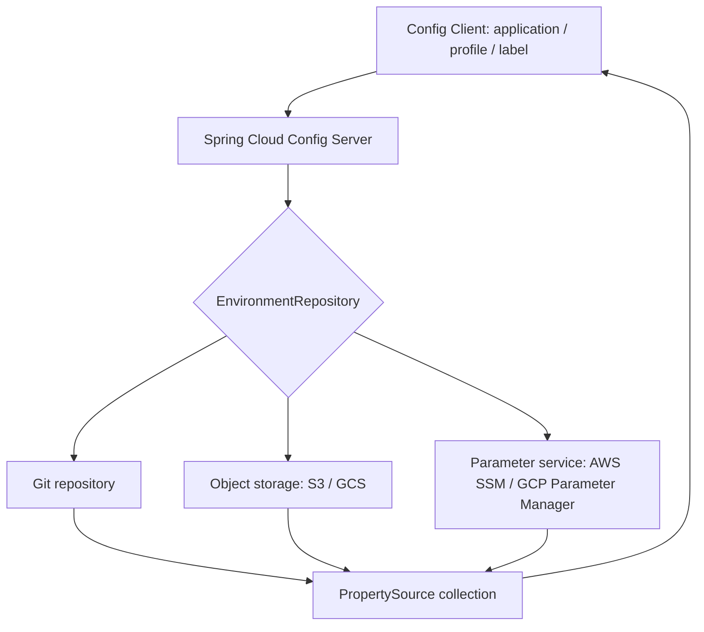

# Kho đối tượng và dịch vụ tham số đám mây: hỗ trợ theo phiên bản

Spring Cloud Config Server không bắt buộc phải đọc cấu hình từ Git. Nó làm việc với một abstraction tên `EnvironmentRepository`, nên có thể lấy property source từ những backend khác như object storage hoặc dịch vụ quản lý tham số của nhà cung cấp cloud. Các lựa chọn này hữu ích khi tổ chức muốn lưu file cấu hình trong bucket, quản lý từng property bằng API cloud hoặc dùng danh tính workload và IAM thay cho credential Git.

Khả năng hỗ trợ phụ thuộc vào phiên bản Spring Cloud Config, thư viện cloud client và Spring profile được kích hoạt. Vì vậy, cần kiểm tra tài liệu đúng release train trước khi thêm dependency hoặc copy cấu hình. Bài này tập trung vào bốn ví dụ được tài liệu Spring Cloud Config mô tả: AWS S3, AWS Systems Manager Parameter Store, Google Cloud Storage và Google Cloud Parameter Manager.

## Mục tiêu học tập

Sau bài này, bạn có thể:

- Phân biệt object storage với dịch vụ lưu từng tham số cấu hình.
- Chọn backend phù hợp với cách tổ chức và phát hành cấu hình.
- Nhận biết profile, dependency và property prefix cần thiết cho từng backend.
- Hiểu cách application, profile, label hoặc version được ánh xạ trong từng dịch vụ.
- Cấu hình xác thực bằng IAM role, Application Default Credentials hoặc danh tính workload.
- Kiểm tra mức hỗ trợ theo phiên bản Spring Cloud Config và tránh nhầm backend server với tích hợp cấu hình trực tiếp ở client.

## `EnvironmentRepository` giữ vai trò gì?

Config Server nhận yêu cầu theo ba thông tin chính: application, profile và label. Backend được cấu hình sẽ tìm dữ liệu tương ứng và trả về các `PropertySource`. Config Client vẫn gọi API Config Server như trước; việc thay Git bằng S3, Parameter Store hoặc GCS không buộc client thay đổi cách đọc cấu hình nếu hợp đồng thuộc tính vẫn được giữ ổn định.



Object storage thường chứa file cấu hình hoàn chỉnh như YAML, properties hoặc JSON. Parameter service thường lưu các giá trị theo từng key, có phân cấp, nhãn hoặc version. Hai mô hình này khác nhau về cách đặt tên, tìm kiếm, giới hạn kích thước, phiên bản và phân quyền.

## So sánh các lựa chọn

| Backend | Kiểu dữ liệu chính | Cách phân nhóm | Cơ chế xác thực thường dùng |
|---|---|---|---|
| AWS S3 | File `.yml`, `.yaml`, `.properties`, `.json` trong bucket | Tên file, thư mục, label và search paths | AWS Default Credential Provider Chain, thường là IAM role |
| AWS Systems Manager Parameter Store | Các parameter key/value trong hierarchy | Prefix, application, profile separator và parameter version | AWS Default Credential Provider Chain, IAM policy |
| Google Cloud Storage | File cấu hình trong bucket | Label, application, profile, directory layout và search paths | Application Default Credentials (ADC) |
| Google Cloud Parameter Manager | Parameter có tên, payload và labels | Label ứng dụng, label profile, location và version parameter | ADC và IAM |

S3 và GCS phù hợp khi nhóm muốn tiếp tục quản lý cấu hình dưới dạng file. Parameter Store và Parameter Manager phù hợp khi muốn quản lý giá trị riêng lẻ, cấp quyền theo parameter và tích hợp với dịch vụ quản trị tham số của cloud.

## Hỗ trợ theo phiên bản Spring Cloud Config

Không nên suy ra backend có sẵn chỉ từ việc SDK của nhà cung cấp tồn tại. Backend cần được Spring Cloud Config cung cấp implementation, nhận diện dependency và kích hoạt đúng Spring profile.

Theo tài liệu Spring Cloud Config được đối chiếu khi biên soạn:

| Backend | Dòng tài liệu có mô tả hỗ trợ | Dependency bổ sung | Spring profile |
|---|---|---|---|
| AWS S3 | Có trong tài liệu 4.1.x, 4.2.x, 4.3.x và 5.0.x | `software.amazon.awssdk:s3` | `awss3` |
| AWS Parameter Store | Có trong tài liệu 4.1.x, 4.2.x, 4.3.x và 5.0.x | `software.amazon.awssdk:ssm` | `awsparamstore` |
| Google Cloud Storage | Được mô tả trong tài liệu 5.1.x | `com.google.cloud:google-cloud-storage` | `gcs` |
| Google Cloud Parameter Manager | Được mô tả trong tài liệu 5.1.x | `com.google.cloud:google-cloud-parameter-manager` | `parameter-manager` |

Bảng trên phản ánh những dòng tài liệu đã kiểm tra, không thay thế ma trận tương thích của dự án. Khi dùng một bản vá cụ thể, hãy mở tài liệu đúng phiên bản và xác nhận backend, dependency, property prefix cùng Spring profile thực sự có mặt. Nếu đang ở dòng 4.x hoặc 5.0.x, không tự thêm cấu hình `gcs` hay `parameter-manager` chỉ vì ví dụ 5.1.x có chúng.

Spring Cloud Config Server vẫn cần dependency nền `spring-cloud-config-server`. Các SDK cloud là dependency bổ sung cho module server. Hãy quản lý phiên bản Spring Cloud bằng BOM tương thích với Spring Boot; phiên bản AWS SDK và Google Cloud libraries cũng cần được quản lý bằng BOM tương ứng hoặc cơ chế dependency management của dự án. Không chọn ngẫu nhiên phiên bản SDK mới nhất rồi giả định tương thích với mọi release train.

## AWS S3: lưu file cấu hình trong bucket

AWS S3 backend phù hợp khi nhóm muốn lưu các file YAML, properties hoặc JSON trong bucket. Theo tài liệu Spring Cloud Config, backend được kích hoạt khi profile `awss3` hoạt động và AWS S3 SDK có trên classpath.

### Dependency Maven

```xml
<dependency>
    <groupId>software.amazon.awssdk</groupId>
    <artifactId>s3</artifactId>
</dependency>
```

Phiên bản SDK cần được quản lý bởi AWS SDK BOM hoặc dependency management đã chọn. Không hard-code nhiều phiên bản AWS SDK khác nhau trong cùng một ứng dụng.

### Cấu hình Config Server

```yaml
spring:
  profiles:
    active: awss3
  cloud:
    config:
      server:
        awss3:
          region: ap-southeast-1
          bucket: platform-config
          useDirectoryLayout: true
```

Các thuộc tính chính:

- `region`: AWS Region chứa bucket.
- `bucket`: tên bucket lưu file cấu hình.
- `endpoint`: có thể ghi đè endpoint S3 mặc định, ví dụ khi dùng endpoint tương thích S3.
- `useDirectoryLayout`: bật cấu trúc thư mục theo ứng dụng.
- `search-paths`: chỉ định các đường dẫn tìm file, có thể chứa `{application}`, `{profile}` và `{label}`.

Backend tìm file theo quy ước tên như `{application}-{profile}.yml`, `{application}-{profile}.properties` hoặc `{application}-{profile}.json`. Khi bật directory layout, có thể tổ chức object dưới thư mục tên ứng dụng. Label có thể được dùng như thành phần đường dẫn để phân biệt bộ cấu hình.

Ví dụ bucket:

```text
platform-config/
├── order-service/
│   ├── application.yml
│   ├── application-prod.yml
│   └── application-test.yml
└── inventory-service/
    ├── application.yml
    └── application-prod.yml
```

S3 backend dùng AWS Default Credential Provider Chain. Trong production, nên dùng IAM role gắn với workload hoặc EC2/ECS/EKS role phù hợp thay vì lưu access key dài hạn trong YAML. Tài liệu backend cũng mô tả hỗ trợ bucket versioning và encryption; tuy nhiên cách ánh xạ label của Config Server vẫn cần được kiểm tra riêng, không nên coi label của S3 mặc nhiên tương đương Git branch hoặc tag.

## AWS Systems Manager Parameter Store: lưu từng tham số

AWS Parameter Store phù hợp khi cấu hình được quản lý dưới dạng từng parameter trong một hierarchy. Backend của Config Server dùng AWS SDK for SSM và Spring profile `awsparamstore`.

### Dependency Maven

```xml
<dependency>
    <groupId>software.amazon.awssdk</groupId>
    <artifactId>ssm</artifactId>
</dependency>
```

### Cấu hình Config Server

```yaml
spring:
  profiles:
    active: awsparamstore
  cloud:
    config:
      server:
        awsparamstore:
          region: ap-southeast-1
          prefix: /config
          profile-separator: '-'
          recursive: true
          decrypt-values: true
          max-results: 10
```

Một số thuộc tính quan trọng:

- `prefix`: cấp đầu của hierarchy, mặc định là `/config`.
- `profile-separator`: ký tự phân tách tên context và profile, mặc định là dấu gạch ngang.
- `recursive`: đọc các parameter bên dưới hierarchy.
- `decrypt-values`: yêu cầu giải mã giá trị được mã hóa, ví dụ `SecureString`, theo quyền KMS/SSM của danh tính chạy server.
- `max-results`: số lượng parameter tối đa trong một lần gọi; tài liệu quy định giá trị trong khoảng 1 đến 10.
- `region` và `endpoint`: chọn AWS Region hoặc endpoint API cần sử dụng.

Ví dụ các parameter có thể được tổ chức như sau:

```text
/config/application/orders.default-currency
/config/application-prod/orders.tax-region
/config/order-service/orders.max-items
/config/order-service-prod/orders.payment-timeout
```

Hierarchy `/application` chứa giá trị dùng chung. Tên application và profile được ánh xạ vào các context tương ứng; profile separator quyết định cách ghép tên. Hãy kiểm tra chính xác quy tắc đặt tên trong tài liệu phiên bản đang chạy và gọi Config Server API để xác nhận parameter nào được đưa vào `PropertySource`.

AWS credentials được phân giải qua Default Credential Provider Chain. IAM policy nên giới hạn quyền đọc đúng path cần thiết và quyền giải mã KMS khi sử dụng SecureString. `decrypt-values: true` không tự cấp quyền giải mã; danh tính của Config Server vẫn cần quyền SSM và KMS tương ứng.

Parameter Store có version cho từng parameter. Backend mặc định lấy version mới nhất; điều này khác với việc pin toàn bộ bộ cấu hình vào một Git commit. Nếu cần triển khai có thể tái lập, hãy thiết kế quy trình phát hành và ghi nhận phiên bản parameter đã sử dụng.

## Google Cloud Storage: file cấu hình trong bucket

Google Cloud Storage backend được mô tả trong tài liệu Spring Cloud Config 5.1.x. Backend được đăng ký khi profile `gcs` hoạt động và thư viện Google Cloud Storage có trên classpath.

### Dependency Maven

```xml
<dependency>
    <groupId>com.google.cloud</groupId>
    <artifactId>google-cloud-storage</artifactId>
</dependency>
```

### Cấu hình Config Server

```yaml
spring:
  profiles:
    active: gcs
  cloud:
    config:
      server:
        gcs:
          bucket: platform-config
          project-id: platform-prod
          use-directory-layout: false
          search-paths:
            - '{application}'
            - '{application}/{profile}'
```

`bucket` là trường bắt buộc. `project-id` có thể được cung cấp tường minh hoặc để Google Cloud client library phân giải theo cơ chế mặc định. `use-directory-layout` chọn cách tra cứu theo thư mục; `search-paths` hỗ trợ placeholder `{application}`, `{profile}` và `{label}`.

Backend hỗ trợ file `.properties`, `.json`, `.yml` và `.yaml`. Cách tìm kiếm được xây dựng từ label, application và profile; khi khai báo search paths, các mẫu này quyết định những file được đưa vào kết quả.

Google Cloud client library dùng Application Default Credentials (ADC). Trên môi trường cloud, nên gắn service account hoặc workload identity cho Config Server và cấp quyền tối thiểu để liệt kê/đọc object trong bucket. Tránh đưa service account key JSON vào repository hoặc image.

## Google Cloud Parameter Manager: parameter có labels

Google Cloud Parameter Manager backend cũng được mô tả trong tài liệu Spring Cloud Config 5.1.x. Khác với GCS lưu file, Parameter Manager lưu parameter và dùng labels để ánh xạ application/profile của Config Server.

### Dependency Maven

```xml
<dependency>
    <groupId>com.google.cloud</groupId>
    <artifactId>google-cloud-parameter-manager</artifactId>
</dependency>
```

### Cấu hình Config Server

```yaml
spring:
  profiles:
    active: parameter-manager
  cloud:
    config:
      server:
        gcp-parameter-manager:
          project-id: platform-prod
          location: global
          application-label: application
          profile-label: profile
          default-label: main
```

Các thuộc tính:

- `project-id`: Google Cloud project chứa parameters; cần khai báo.
- `location`: vị trí Parameter Manager, mặc định là `global`.
- `application-label`: tên label dùng để khớp application, mặc định `application`.
- `profile-label`: tên label dùng để khớp profile, mặc định `profile`.
- `default-label`: label Config Server trả về khi client không truyền label, mặc định `main`.
- `order`: thứ tự của repository khi được dùng trong composite repository.

Parameter được lọc theo label application và profile. Khi client yêu cầu một ứng dụng cụ thể, các parameter có application label `application` cũng được đưa vào để cung cấp cấu hình dùng chung. Profile mặc định có thể được thêm trước các profile được yêu cầu.

Một điểm cần lưu ý về phiên bản: backend đọc version mới nhất của từng parameter và đưa payload đã render thành property value. `default-label` là label mặc định của Config Server; không nên hiểu rằng nó tự động pin toàn bộ Parameter Manager vào một snapshot bất biến như Git commit. Nếu cần tái lập chính xác, cần thiết kế cách phát hành/ghi nhận version parameter riêng.

Client của Parameter Manager sử dụng ADC. Service account hoặc workload identity của Config Server cần quyền liệt kê và đọc parameter trong đúng project/location.

## Không nhầm Config Server backend với client-side integration

Một số thư viện cloud tích hợp trực tiếp vào Spring Boot client để thêm `PropertySource` lúc khởi động. Ví dụ Spring Cloud AWS có module Parameter Store Config cho client. Mô hình này khác với AWS Parameter Store backend của Config Server:

| Mô hình | Ai gọi dịch vụ cloud? | Luồng cấu hình |
|---|---|---|
| Config Server backend | Config Server | Cloud service → Config Server → Config Client |
| Client-side integration | Từng ứng dụng Spring Boot | Cloud service → từng Config Client |

Hai cách có khác biệt về dependency, property prefix, bootstrap/Config Data API, phân quyền và điểm kiểm soát tập trung. Không lấy dependency hoặc thuộc tính của client-side integration để cấu hình cho `EnvironmentRepository` ở Config Server. Hãy đọc đúng tài liệu sản phẩm và phiên bản đang triển khai.

## Chọn backend theo nhu cầu

| Nhu cầu | Lựa chọn thường phù hợp | Lý do |
|---|---|---|
| Muốn giữ cấu hình dưới dạng YAML/properties và quản lý file | S3 hoặc GCS | Cách tổ chức file quen thuộc; có bucket, directory layout và search paths |
| Muốn từng thuộc tính có path, version và IAM policy | AWS Parameter Store | Parameter hierarchy, versioning và SecureString |
| Muốn ánh xạ parameter theo application/profile labels trên GCP | Google Cloud Parameter Manager | Mô hình labels và payload theo parameter |
| Cần review thay đổi bằng pull request, commit và tag | Git | Lịch sử thay đổi và label theo branch/tag/commit rõ ràng |
| Cần secret chuyên dụng | Secret Manager/Vault hoặc backend secret phù hợp | Có quyền truy cập, rotation và audit theo secret |

Object storage không tự trở thành secret manager. Bucket có thể được mã hóa và versioning, nhưng vẫn cần IAM, policy, audit, backup và quy trình xoay khóa. Parameter Store có thể chứa SecureString, nhưng cần phân quyền KMS và hiểu giới hạn, quota, kích thước cũng như chi phí API của dịch vụ.

## Cấu hình xác thực và bảo mật

Config Server là thành phần có quyền đọc dữ liệu cấu hình cho nhiều ứng dụng, nên danh tính của nó cần được quản lý chặt:

- Với AWS, ưu tiên IAM role/workload identity và Default Credential Provider Chain. Không lưu access key dài hạn trong `application.yml`.
- Với Google Cloud, ưu tiên ADC dựa trên service account hoặc Workload Identity. Không đóng gói key JSON trong container image.
- Giới hạn quyền đọc theo bucket, prefix, parameter path, project và location cần thiết.
- Chỉ bật giải mã SecureString khi ứng dụng thực sự cần; cấp quyền KMS theo đúng key và operation.
- Không đưa secret vào tên parameter, label hoặc log. Không ghi payload nhạy cảm trong access log hay exception.
- Bảo vệ API Config Server bằng TLS, xác thực và phân quyền theo ứng dụng/môi trường.
- Kiểm tra mã hóa at rest, versioning, retention, audit và backup theo chính sách của cloud provider.

Khi dùng nhiều môi trường, nên tách bucket hoặc path/project và IAM policy tương ứng. Một Config Server phục vụ nhiều application cần tránh dùng danh tính có quyền đọc mọi tài nguyên production nếu chỉ một số repository hoặc project là cần thiết.

## Kiểm tra backend sau khi cấu hình

Sau khi thêm dependency và kích hoạt profile, kiểm tra từ chính môi trường chạy Config Server:

1. Xác nhận dependency tree có SDK cần thiết và không có xung đột phiên bản.
2. Kiểm tra Spring profile backend thực sự được kích hoạt (`awss3`, `awsparamstore`, `gcs` hoặc `parameter-manager`).
3. Xác minh region/project/location/bucket/prefix và danh tính workload.
4. Kiểm tra IAM/ADC có quyền list và read đúng tài nguyên; với SecureString, kiểm tra thêm quyền KMS.
5. Tạo một cấu hình thử nghiệm không nhạy cảm cho `application` và một application cụ thể.
6. Gọi Config Server API theo application/profile/label và kiểm tra `propertySources` cùng giá trị trả về.
7. Thay đổi một giá trị trong môi trường thử nghiệm, chờ hoặc kích hoạt cơ chế cập nhật phù hợp, rồi xác nhận backend trả về phiên bản mong muốn.
8. Kiểm tra lỗi quyền, parameter không tồn tại, bucket rỗng, timeout và giới hạn API.

Ví dụ kiểm tra endpoint chung của Config Server:

```bash
curl -i http://localhost:8888/order-service/prod/main
```

Nếu phản hồi rỗng hoặc thiếu property, kiểm tra cách backend ánh xạ application/profile/label và layout của dữ liệu. Với parameter service, kiểm tra path/labels và version parameter; với object storage, kiểm tra object key, directory layout, search paths và label. Không giả định cách ánh xạ của S3, GCS, SSM và Parameter Manager giống nhau.

## Lưu ý về phiên bản và nâng cấp

Khi nâng Spring Boot hoặc Spring Cloud release train, hãy kiểm tra lại:

- Backend còn được đăng ký trong phiên bản mới không và Spring profile kích hoạt có thay đổi không.
- Dependency cloud client có còn đúng artifact/group ID và tương thích với Java/Spring Boot không.
- Property prefix, tên thuộc tính và kiểu dữ liệu có thay đổi không.
- Cách ánh xạ label, profile separator, directory layout và search path có thay đổi không.
- Cơ chế credential mặc định và quyền IAM/ADC có còn hợp lệ không.
- Các giới hạn API, phân trang, timeout và retry có đáp ứng quy mô mới không.

Không nâng SDK cloud riêng lẻ mà bỏ qua BOM và ma trận tương thích. Khi backend mới chỉ xuất hiện trong tài liệu release train mới hơn, cần nâng cấp theo lộ trình tương thích của Spring Boot/Spring Cloud hoặc chọn backend đã được hỗ trợ trong phiên bản hiện tại.

## Kết luận

Spring Cloud Config có thể đọc cấu hình từ object storage và cloud parameter services thông qua các `EnvironmentRepository` tương ứng. AWS S3 và GCS lưu file cấu hình; AWS Parameter Store và Google Cloud Parameter Manager lưu các tham số theo hierarchy hoặc labels. Mỗi backend có dependency, Spring profile, cách xác thực và quy tắc ánh xạ application/profile/label riêng.

Hãy kiểm tra tài liệu theo đúng phiên bản trước khi triển khai. Quản lý BOM và SDK đồng bộ, cấp quyền theo workload, kiểm thử API từ Config Server và ghi nhận semantics version/label của backend giúp việc chuyển nguồn lưu trữ không làm thay đổi hợp đồng cấu hình mà các ứng dụng đang sử dụng.

## Tài liệu tham khảo

- [Spring Cloud Config – AWS S3 Backend](https://docs.spring.io/spring-cloud-config/reference/server/environment-repository/aws-s3-backend.html)
- [Spring Cloud Config – AWS Parameter Store Backend](https://docs.spring.io/spring-cloud-config/reference/server/environment-repository/aws-parameter-store-backend.html)
- [Spring Cloud Config – Google Cloud Storage Backend](https://docs.spring.io/spring-cloud-config/reference/server/environment-repository/gcp-storage-backend.html)
- [Spring Cloud Config – Google Cloud Parameter Manager Backend](https://docs.spring.io/spring-cloud-config/reference/server/environment-repository/gcp-parameter-manager-backend.html)
- [Spring Cloud Config – Environment Repository](https://docs.spring.io/spring-cloud-config/reference/server/environment-repository.html)
