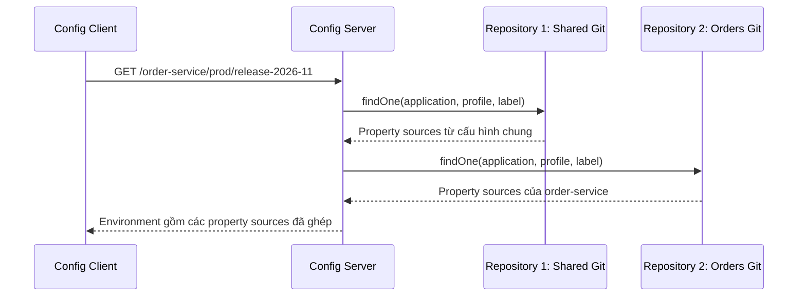

# Khai báo composite profile và danh sách repository

## 1. Composite repository giải quyết vấn đề gì?

Spring Cloud Config Server thường đọc cấu hình từ một backend, chẳng hạn một Git repository. Khi hệ thống cần kết hợp nhiều nguồn — ví dụ cấu hình nền tảng trong Git, cấu hình riêng của nhóm trong một Git repository khác và secret lấy từ Vault — có thể dùng composite environment repository.

Composite repository gọi nhiều `EnvironmentRepository`, kết hợp các property source mà chúng trả về rồi cung cấp một `Environment` cho Config Client. Client vẫn gửi một yêu cầu theo application, profile và label; Config Server dùng cùng yêu cầu đó để lấy dữ liệu từ các nguồn thành phần.

Ví dụ một nền tảng có thể tổ chức:

- Repository chung chứa timeout, logging và cấu hình thư viện nội bộ.
- Repository của nhóm đơn hàng chứa thuộc tính riêng cho `order-service`.
- Một backend secret chứa thông tin nhạy cảm mà ứng dụng được phép sử dụng.

Thay vì buộc mọi giá trị nằm trong một kho, composite repository cho phép ghép các nguồn thành một kết quả cấu hình. Tuy nhiên, ghép nguồn cũng làm tăng độ phức tạp về thứ tự ưu tiên, khả năng sẵn sàng, quyền truy cập và tính tương thích của label. Cần thiết kế các yếu tố này trước khi đưa vào production.

## 2. Phân biệt composite profile của server và profile của client

Tên `composite` dễ gây nhầm với profile `dev`, `test` hoặc `prod` của ứng dụng. Đây là hai khái niệm ở hai phía khác nhau:

| Khái niệm | Được cấu hình ở đâu? | Mục đích |
|---|---|---|
| Config Server profile `composite` | Runtime Environment của Config Server, thường qua `spring.profiles.active` | Kích hoạt composite environment repository và danh sách backend thành phần. |
| Config Client profile `dev`, `staging`, `prod` | Ứng dụng client, thường qua `spring.profiles.active` | Chọn bộ cấu hình theo môi trường hoặc chế độ chạy của ứng dụng. |
| Config Client label | Client request hoặc cấu hình client | Chọn revision/label mà các backend hỗ trợ. |

Ví dụ, Config Server có thể chạy với profile `composite`, trong khi một client yêu cầu application `order-service`, profile `prod` và label `release-2026-11`.

`composite` không phải là tên môi trường của client và cũng không thay thế profile `prod`. Nó điều khiển cách Config Server ghép các nguồn repository. Các backend thành phần vẫn nhận thông tin application/profile/label của yêu cầu để tìm dữ liệu phù hợp.

## 3. Khai báo composite profile và danh sách repository

Để bật composite environment repository, kích hoạt profile `composite` ở Config Server và khai báo danh sách dưới `spring.cloud.config.server.composite`.

Ví dụ ghép hai Git repository:

```yaml
spring:
  application:
    name: config-server
  profiles:
    active: composite
  cloud:
    config:
      server:
        composite:
          - type: git
            uri: https://git.example.com/platform/shared-config.git
            default-label: main
            search-paths:
              - common
          - type: git
            uri: https://git.example.com/teams/orders-config.git
            default-label: main
            search-paths:
              - '{application}'
```

Trong ví dụ:

- `spring.profiles.active: composite` kích hoạt cơ chế composite ở server.
- `spring.cloud.config.server.composite` là danh sách các nguồn được ghép.
- `type: git` chọn Git environment repository cho từng phần tử.
- `uri` xác định repository nguồn của phần tử đó.
- `default-label` chỉ định label mặc định cho Git repository tương ứng.
- `search-paths` giới hạn các thư mục mà backend Git tìm file.

Mỗi phần tử có cấu hình riêng theo loại backend. Ví dụ Git dùng `uri`, `default-label`, `search-paths`; một backend khác như Vault hoặc CredHub có tập thuộc tính kết nối và xác thực riêng. Không sao chép các thuộc tính Git sang backend khác nếu backend đó không hỗ trợ.

Các giá trị URI và credential nên được truyền qua biến môi trường hoặc secret manager. Với repository private, mỗi Git backend cần credential phù hợp và quyền đọc tối thiểu.

## 4. Luồng xử lý một yêu cầu composite



Mỗi backend thành phần được yêu cầu tìm cấu hình cho cùng application/profile/label. Config Server sau đó ghép các property source thành phản hồi. Client nhận một `Environment` tổng hợp; client không cần biết mỗi khóa đến từ repository nào để thực hiện bind, nhưng thông tin property source trong phản hồi hữu ích khi kiểm tra và điều tra.

Nếu một nguồn không thể truy cập, kết quả composite có thể không đầy đủ. Hành vi khi có lỗi được điều khiển bởi chính sách `fail-on-composite-error`, sẽ được trình bày ở phần sau.

## 5. Thứ tự repository quyết định ưu tiên

Thứ tự các phần tử trong danh sách composite rất quan trọng. Theo quy tắc composite của Spring Cloud Config, repository được khai báo trước có độ ưu tiên cao hơn repository khai báo sau khi cùng một khóa xuất hiện ở nhiều nguồn.

Ví dụ:

```yaml
spring:
  profiles:
    active: composite
  cloud:
    config:
      server:
        composite:
          - type: git
            uri: https://git.example.com/platform/shared-config.git
          - type: git
            uri: https://git.example.com/teams/orders-config.git
```

Giả sử cả hai repository đều chứa khóa `platform.http.read-timeout`:

| Nguồn | Giá trị |
|---|---|
| Repository thứ nhất: `shared-config` | `8s` |
| Repository thứ hai: `orders-config` | `12s` |

Với thứ tự trên, giá trị từ repository thứ nhất có ưu tiên cao hơn. Nếu muốn cấu hình riêng của nhóm ghi đè mặc định chung, hãy đặt repository nhóm trước repository chung:

```yaml
spring:
  profiles:
    active: composite
  cloud:
    config:
      server:
        composite:
          - type: git
            uri: https://git.example.com/teams/orders-config.git
          - type: git
            uri: https://git.example.com/platform/shared-config.git
```

Không nên chỉ dựa vào thứ tự YAML để suy đoán giá trị cuối. Hãy gọi endpoint, xem danh sách property source trả về và kiểm tra giá trị mà Config Client thực sự bind được. Các nguồn khác của Spring Boot client như biến môi trường, JVM system property và tham số dòng lệnh vẫn có thể ảnh hưởng giá trị cuối trong `Environment` của client.

## 6. Khai báo backend khác loại

Composite không giới hạn ở Git. Có thể kết hợp các loại `EnvironmentRepository` mà phiên bản Spring Cloud Config đang dùng hỗ trợ, chẳng hạn Git, SVN, Vault hoặc CredHub.

Ví dụ khung cấu hình kết hợp Git với Vault:

```yaml
spring:
  profiles:
    active: composite
  cloud:
    config:
      server:
        composite:
          - type: git
            uri: ${CONFIG_GIT_URI}
            default-label: main
          - type: vault
            host: ${VAULT_HOST}
            port: ${VAULT_PORT:8200}
            scheme: https
            backend: secret
            profile-separator: '/'
```

Đây là khung minh họa về cách đặt nhiều loại backend trong danh sách. Các thuộc tính kết nối Vault, cách xác thực, mount path, KV version và cách đặt secret phải khớp với cấu hình Vault thực tế cũng như phiên bản Spring Cloud Config. Không sử dụng nguyên xi ví dụ nếu chưa xác minh các thuộc tính backend của release train đang triển khai.

Một cách tổ chức có thể là để Git giữ các giá trị không nhạy cảm và Vault giữ secret. Khi ghép hai nguồn, cần xác định rõ khóa nào thuộc nguồn nào. Nếu cùng một khóa xuất hiện ở cả Git và Vault, thứ tự composite sẽ quyết định nguồn nào được ưu tiên. Tránh đưa một secret vào Git chỉ để làm giá trị dự phòng.

## 7. Composite khác gì với nhiều repository Git định tuyến theo pattern?

Spring Cloud Config hỗ trợ nhiều Git repository trong một Git backend thông qua `spring.cloud.config.server.git.repos`. Cơ chế này khác với composite repository.

| Tiêu chí | Git `repos` theo pattern | Composite repository |
|---|---|---|
| Mục tiêu | Chọn repository phù hợp với application/profile pattern. | Ghép kết quả từ nhiều repository thành một Environment. |
| Phạm vi áp dụng | Thường định tuyến một yêu cầu đến repository phù hợp. | Nhiều nguồn thành phần được truy vấn cho cùng yêu cầu. |
| Nguồn cấu hình | Các Git repository được quản lý trong cùng Git backend. | Có thể gồm nhiều loại EnvironmentRepository. |
| Trường hợp phù hợp | Mỗi dịch vụ hoặc nhóm có kho cấu hình riêng. | Một client cần cấu hình nền tảng cộng với các nguồn bổ sung. |
| Rủi ro chính | Pattern chọn nhầm repository hoặc không có repository phù hợp. | Xung đột khóa, lỗi một nguồn làm hỏng toàn bộ request, lộ dữ liệu giữa phạm vi. |

Ví dụ, nếu `order-service` chỉ cần đọc `orders-config` và `payment-service` chỉ cần đọc `payments-config`, định tuyến Git theo pattern thường phù hợp hơn. Nếu mọi client đều cần cấu hình nền tảng chung cộng với một nguồn khác, composite có thể phù hợp.

Không dùng composite như một cơ chế phân quyền. Nếu mọi request đều được ghép với một repository chứa secret của riêng `payment-service`, cần chứng minh rằng các client khác không thể nhận được property source đó. Khi cần cô lập theo ứng dụng, hãy dùng định tuyến repository và authorization phù hợp thay vì phát tất cả nguồn cho mọi client.

## 8. Xử lý lỗi của một repository thành phần

Theo mặc định, nếu một repository thành phần trong composite bị lỗi, toàn bộ request có thể thất bại. Cách này phù hợp khi mọi nguồn đều bắt buộc để tạo cấu hình hợp lệ.

Có thể cấu hình:

```yaml
spring:
  cloud:
    config:
      server:
        fail-on-composite-error: false
```

Khi đặt `false`, Config Server có thể bỏ qua lỗi của một repository thành phần và tiếp tục dùng các nguồn còn lại. Cần cân nhắc rất kỹ trước khi dùng:

- Nếu repository chứa giá trị mặc định hoặc cấu hình không thiết yếu, chấp nhận phản hồi một phần có thể hữu ích.
- Nếu repository chứa secret, endpoint dịch vụ hoặc giới hạn an toàn bắt buộc, bỏ qua lỗi có thể khiến client khởi động với cấu hình thiếu hoặc không an toàn.
- Client có thể vẫn nhận HTTP response thành công dù một nguồn quan trọng không được nạp; vì vậy cần metric, log và cảnh báo rõ ràng về repository lỗi.
- Các khóa bắt buộc nên được kiểm tra ở client bằng validation, chẳng hạn `@Validated` với `@ConfigurationProperties`.

Trong production, hãy chọn chính sách theo mức độ bắt buộc của từng nguồn. Với cấu hình quan trọng để dịch vụ hoạt động an toàn, fail-fast thường dễ phát hiện vấn đề hơn việc tiếp tục với cấu hình một phần.

## 9. Label và profile phải tương thích giữa các nguồn

Client gửi một application, profile và label cho yêu cầu composite. Mỗi backend thành phần phải xử lý yêu cầu đó theo cách được hỗ trợ bởi backend của nó.

Với nhiều Git repository, nên bảo đảm các repository có branch/tag/commit phù hợp với label mà client yêu cầu. Ví dụ, nếu client yêu cầu `release-2026-11`, repository chung và repository riêng đều cần có label tương ứng hoặc có chính sách label rõ ràng cho từng backend. Không giả định một branch tồn tại ở repository này cũng tồn tại ở repository khác.

Với backend không dùng Git, ý nghĩa của label có thể khác hoặc được xử lý theo cơ chế riêng. Hãy kiểm tra tài liệu của loại backend đó và thử endpoint với application/profile/label thực tế. Nếu backend không hỗ trợ cùng ngữ nghĩa label, cần thiết kế cách phân phối phiên bản phù hợp trước khi ghép nó vào composite.

Profile client như `dev` hoặc `prod` cũng được dùng để tìm dữ liệu trong các backend thành phần. Hãy thống nhất tên profile và cấu trúc file/secret giữa các nguồn. Nếu một repository dùng `production` còn repository khác dùng `prod`, kết quả ghép có thể thiếu một phần cấu hình mà không dễ nhận ra nếu không kiểm tra property source.

## 10. Bảo mật và phạm vi dữ liệu được ghép

Composite có thể làm tăng phạm vi dữ liệu mà một client nhận được. Nếu một repository chứa cấu hình chỉ dành cho một ứng dụng nhưng được đưa vào danh sách composite dùng chung, các request khác cũng có thể truy vấn repository đó theo application/profile tương ứng.

Áp dụng các nguyên tắc sau:

- Chỉ đưa vào composite những nguồn mà các client thuộc phạm vi đó được phép đọc.
- Tách nguồn secret theo ứng dụng/nhóm hoặc dùng cơ chế authorization để ngăn client đọc dữ liệu không thuộc quyền.
- Cấp credential riêng và quyền đọc tối thiểu cho từng backend.
- Bảo vệ Config Server bằng HTTPS, xác thực và phân quyền; không coi tên application do client gửi là bằng chứng danh tính.
- Không ghi nội dung secret từ phản hồi composite vào log hoặc trace.
- Theo dõi lỗi và độ trễ riêng của từng repository để phát hiện nguồn bị lỗi hoặc bị chậm.
- Quản lý khóa mã hóa, token và thông tin kết nối backend bên ngoài Git repository cấu hình.

Đặc biệt, composite là cơ chế kết hợp property source, không phải bộ lọc bảo mật. Việc chia repository thành nhiều mục trong danh sách không tự động giới hạn client nào được nhận mục nào.

## 11. Kiểm tra kết quả composite

Config Server cung cấp endpoint theo dạng:

```text
GET /{application}/{profile}/{label}
```

Ví dụ:

```text
GET https://config.example.internal/order-service/prod/release-2026-11
```

Phản hồi `Environment` giúp xác nhận các nguồn đã được ghép. Khi kiểm tra, hãy chú ý:

1. `name`, `profiles` và `label` có đúng với yêu cầu không.
2. Các property source có xuất hiện từ từng repository dự kiến không.
3. Thứ tự property source có phản ánh thứ tự ưu tiên mong muốn không.
4. Một khóa trùng tên có giá trị cuối đúng theo chính sách không.
5. Có repository nào lỗi hoặc bị bỏ qua do `fail-on-composite-error` không.
6. Có dữ liệu nhạy cảm từ nguồn không thuộc phạm vi client hay không.

Sau đó chạy Config Client và kiểm tra giá trị bind vào `@ConfigurationProperties` hoặc `Environment`. Phản hồi Config Server cho biết các property source từ xa; giá trị cuối ở client còn chịu ảnh hưởng từ các nguồn cấu hình khác của Spring Boot.

Không expose endpoint chẩn đoán hoặc phản hồi cấu hình cho người không có quyền. Nếu cần chia sẻ kết quả điều tra, hãy che secret và token.

## 12. Lỗi thường gặp

| Triệu chứng | Nguyên nhân cần kiểm tra | Hướng xử lý |
|---|---|---|
| Config Server không kích hoạt composite | Chưa active profile `composite` hoặc cấu hình composite không được nạp. | Kiểm tra runtime profile và cấu hình server. |
| Chỉ nhận cấu hình từ một nguồn | Danh sách composite sai cấu trúc, backend type không được hỗ trợ hoặc profile composite không hoạt động. | Kiểm tra từng phần tử và log khởi động. |
| Giá trị bị repository khác ghi đè | Thứ tự danh sách không đúng chính sách ưu tiên. | Đặt nguồn cần ưu tiên cao hơn lên trước và kiểm tra property source. |
| Request thất bại dù một repository hoạt động | Một backend thành phần lỗi; mặc định composite có thể fail toàn bộ request. | Kiểm tra URI, credential, quyền, label và `fail-on-composite-error`. |
| Một phần cấu hình bị thiếu nhưng request thành công | Đang bỏ qua lỗi repository hoặc một backend không tìm thấy file/profile. | Kiểm tra log/metric từng backend và validation khóa bắt buộc ở client. |
| Label hợp lệ ở repository này nhưng không tồn tại ở repository khác | Các Git repository không có cùng branch/tag/commit. | Đồng bộ label hoặc chọn chính sách phiên bản tương thích cho mọi nguồn. |
| Client nhận secret ngoài phạm vi | Composite đưa repository nhạy cảm vào danh sách nguồn dùng chung. | Tách nguồn theo ứng dụng, giới hạn authorization và không phát secret cho client không có quyền. |

Khi điều tra, hãy kiểm tra lần lượt runtime profile của server, cấu trúc danh sách, từng backend, application/profile/label, thứ tự property source và chính sách lỗi. Tránh thay đổi nhiều repository cùng lúc trước khi xác định nguồn gây ra vấn đề.

## 13. Bài thực hành

### Bước 1: Tạo hai Git repository

Tạo repository `shared-config` chứa `application.yml` và repository `orders-config` chứa `order-service-prod.yml`. Dùng cùng branch `main` ở cả hai repository.

**Kết quả cần đạt:** hai nguồn có nội dung độc lập và đều có thể được Config Server đọc.

### Bước 2: Bật composite profile

Kích hoạt `spring.profiles.active: composite`, khai báo hai phần tử `type: git` trong `spring.cloud.config.server.composite` và cấu hình URI cho từng nguồn.

**Kết quả cần đạt:** Config Server khởi động với composite environment repository.

### Bước 3: Kiểm tra property source

Gọi endpoint `order-service/prod/main`, xác nhận property source từ cả hai repository và kiểm tra khóa dùng chung.

**Kết quả cần đạt:** hiểu thứ tự ưu tiên và cách giá trị trùng khóa được chọn.

### Bước 4: Đảo thứ tự repository

Đổi thứ tự hai phần tử composite, gọi lại endpoint và so sánh giá trị trùng khóa.

**Kết quả cần đạt:** quan sát tác động của thứ tự danh sách đến độ ưu tiên.

### Bước 5: Thử lỗi một nguồn

Trong môi trường thử nghiệm, làm cho một repository không truy cập được. Quan sát hành vi mặc định, sau đó thử `fail-on-composite-error: false` và xác định property source nào còn lại.

**Kết quả cần đạt:** hiểu trade-off giữa fail-fast và phản hồi cấu hình một phần.

### Bước 6: Rà soát quyền và label

Kiểm tra mỗi repository có label mà client yêu cầu, credential chỉ đọc và không chứa secret ngoài phạm vi client. Thử yêu cầu một application không thuộc nhóm orders.

**Kết quả cần đạt:** xác minh tính tương thích label và phạm vi dữ liệu được phép ghép.

## 14. Tự kiểm tra

1. Composite environment repository giải quyết vấn đề gì?
2. Vì sao Config Server profile `composite` khác profile `prod` của client?
3. Danh sách `spring.cloud.config.server.composite` được khai báo như thế nào?
4. Thứ tự repository ảnh hưởng đến ưu tiên property source ra sao?
5. Composite khác gì với `spring.cloud.config.server.git.repos` theo pattern?
6. `fail-on-composite-error` ảnh hưởng thế nào khi một backend thành phần gặp lỗi?
7. Vì sao cần kiểm tra label ở tất cả Git repository thành phần?
8. Vì sao composite không thể được xem là cơ chế phân quyền dữ liệu?
9. Cần kiểm tra những gì trong phản hồi `Environment` để xác minh kết quả ghép?

Khi hoàn thành bài thực hành, người học có thể kích hoạt composite profile ở Config Server, khai báo danh sách backend, kiểm soát thứ tự ưu tiên và xử lý lỗi cũng như phạm vi bảo mật khi nhiều nguồn cấu hình được ghép thành một Environment.

## Tài liệu tham khảo

- [Spring Cloud Config – Environment Repositories](https://docs.spring.io/spring-cloud-config/reference/server/environment-repository.html): composite environment repository và cách kết hợp nhiều backend.
- [Spring Cloud Config – Git Backend](https://docs.spring.io/spring-cloud-config/reference/server/environment-repository/git-backend.html): cấu hình Git repository, label, search path và các thuộc tính backend.
