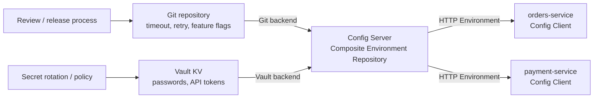

# Kết hợp Git cho cấu hình thường với kho bí mật

Trong một hệ thống Spring Cloud Config, cấu hình vận hành thông thường và thông tin bí mật có vòng đời khác nhau. Các giá trị như timeout, retry, feature flag hoặc địa chỉ dịch vụ thường cần review cùng mã nguồn và có thể quản lý trong Git. Mật khẩu cơ sở dữ liệu, API token, private key và credential cần được lưu trong một hệ thống quản lý bí mật có kiểm soát truy cập, luân chuyển và audit.

Spring Cloud Config Server hỗ trợ composite Environment Repository để tổng hợp cấu hình từ nhiều backend trong cùng một request. Có thể dùng Git cho cấu hình thông thường và Vault cho secret. Config Client vẫn gọi một Config Server duy nhất; server chịu trách nhiệm đọc từng nguồn, kết hợp property source và trả Environment cho ứng dụng.

Bài này trình bày cách tổ chức Git và Vault, cấu hình composite repository, quản lý thứ tự ưu tiên, cấp quyền đọc secret, kiểm tra response và vận hành thay đổi. Ví dụ dùng HashiCorp Vault với KV secrets engine; chi tiết cấu hình cần khớp release train Spring Cloud đang triển khai.

## 1. Kiến trúc Git kết hợp Vault

Một kiến trúc cơ bản có ba thành phần:

- **Git repository** lưu cấu hình không nhạy cảm, được review bằng pull request và có lịch sử commit.
- **Vault** lưu secret, áp dụng policy để giới hạn đường dẫn và thao tác mà Config Server được phép đọc.
- **Config Server** kết nối cả Git và Vault, hợp nhất kết quả theo application/profile rồi cung cấp Environment cho Config Client.

Luồng dữ liệu:



Client không cần biết secret được lấy từ Vault hay cấu hình thông thường được lấy từ Git. Client chỉ biết Config Server và nhận các property source đã được kết hợp. Điều này giữ cho ứng dụng có một điểm tích hợp thống nhất, trong khi quyền truy cập vào từng backend được quản lý ở phía server.

Config Server trở thành ranh giới bảo mật quan trọng: bất kỳ client nào được phép lấy cấu hình có thể nhận cả những secret thuộc phạm vi application/profile mà server trả về. Vì vậy, việc xác thực client và giới hạn secret theo đúng ứng dụng là bắt buộc.

## 2. Phân loại dữ liệu trước khi đưa vào backend

Trước khi cấu hình composite repository, hãy thống nhất loại dữ liệu nào thuộc Git và loại nào thuộc Vault.

| Dữ liệu | Nơi lưu phù hợp | Ví dụ |
| --- | --- | --- |
| Timeout, retry, pool size | Git | `orders.http.read-timeout: 10s` |
| Feature flag không nhạy cảm | Git | `orders.new-checkout-enabled: true` |
| Địa chỉ endpoint nội bộ không chứa credential | Git | `payment.provider-url` |
| Database password | Vault | `orders.db.password` |
| API token, client secret | Vault | `payment.provider.api-key` |
| Private key hoặc credential nhạy cảm | Vault hoặc secret manager | Khóa ký, token truy cập |

Không nên đưa secret vào Git chỉ vì file được đặt trong repository riêng tư. Git history có thể giữ lại giá trị cũ sau khi file bị xóa; bản sao repository, fork, artifact và log CI cũng có thể lưu dấu vết. Khi một secret đã bị commit, cần xem nó như đã lộ, thu hồi hoặc rotate secret và làm sạch lịch sử theo quy trình bảo mật của tổ chức.

Ngược lại, không cần chuyển mọi thuộc tính sang Vault. Các giá trị không nhạy cảm được review cùng mã nguồn thường dễ quản trị trong Git hơn. Tách theo tính chất và vòng đời giúp giảm quyền truy cập Vault, đồng thời giữ thay đổi cấu hình thông thường trong quy trình review quen thuộc.

## 3. Tổ chức Git repository cho cấu hình thông thường

Ví dụ repository:

```text
config-repo/
├── application.yml
├── application-prod.yml
├── orders-service.yml
├── orders-service-prod.yml
├── payment-service.yml
└── payment-service-prod.yml
```

File `orders-service-prod.yml` có thể chứa:

```yaml
orders:
  http:
    connect-timeout: 2s
    read-timeout: 10s
  retry:
    max-attempts: 4
  database:
    url: jdbc:postgresql://orders-db.internal:5432/orders
    username: orders_app
```

File chỉ lưu URL và username nếu các giá trị đó không bị phân loại là bí mật trong chính sách của tổ chức. Password không được ghi ở đây; nó sẽ được lấy từ Vault.

File `payment-service-prod.yml` có thể chứa:

```yaml
payment:
  provider:
    base-url: https://payments.example.internal
    connect-timeout: 3s
    read-timeout: 8s
```

Dùng tên file theo application và profile giúp Config Server chọn đúng phần cấu hình. Các file chung như `application.yml` có thể chứa giá trị mặc định dùng cho nhiều ứng dụng. Các file cụ thể chỉ nên ghi đè thuộc tính thực sự khác biệt.

## 4. Tổ chức secret trong Vault

Với Vault KV secrets engine, có thể tổ chức secret theo application và profile. Ví dụ dùng mount tên `secret`:

```text
secret/
├── application/
│   └── prod
├── orders-service/
│   └── prod
└── payment-service/
    └── prod
```

Các secret dùng chung có thể đặt ở đường dẫn application; secret riêng cho một dịch vụ đặt ở đường dẫn service tương ứng. Với KV version 2, dữ liệu được lưu theo version và có thể được đọc lại theo lịch sử của engine, tùy policy và cấu hình retention.

Ví dụ ghi secret cho dịch vụ đơn hàng bằng Vault CLI:

```bash
vault kv put secret/orders-service/prod \
  db-password='replace-with-managed-secret' \
  reporting-api-token='replace-with-managed-token'
```

Ví dụ cho dịch vụ thanh toán:

```bash
vault kv put secret/payment-service/prod \
  provider-api-key='replace-with-managed-secret'
```

Các chuỗi trên chỉ là giá trị minh họa; không đặt secret thật trực tiếp vào lịch sử shell, tài liệu hoặc chat. Trong môi trường thực tế, dùng cơ chế nhập secret an toàn, secret injection của nền tảng hoặc quy trình quản lý credential đã được phê duyệt.

Nếu bật KV v2, xác nhận mount `secret` thực sự được cấu hình ở phiên bản 2. Cách ghi bằng `vault kv put` vẫn dùng đường dẫn logic `secret/orders-service/prod`; Vault tự ánh xạ sang API path nội bộ của KV v2.

## 5. Cấu hình composite repository trong Config Server

Ứng dụng Config Server cần dependency cho Config Server và Vault backend theo phiên bản Spring Cloud đang sử dụng. Thông thường dự án cần `spring-cloud-config-server` và thư viện Spring Vault tương thích (ví dụ `spring-vault-core`). Kiểm tra dependency management của release train thay vì tự chọn các phiên bản thư viện độc lập.

Một cấu hình minh họa:

```yaml
server:
  port: 8888

spring:
  application:
    name: config-server
  cloud:
    config:
      server:
        composite:
          - type: vault
            host: vault
            port: 8200
            scheme: http
            backend: secret
            default-key: application
            profile-separator: /
            kv-version: 2
            authentication: TOKEN
            token: ${VAULT_TOKEN}
            order: 1
          - type: git
            uri: https://git.example.com/platform/config-repo.git
            default-label: main
            clone-on-start: true
            order: 2
        fail-on-composite-error: true
```

Cấu hình này minh họa một composite repository gồm Vault và Git:

- `type: vault` chọn Vault Environment Repository.
- `host`, `port`, `scheme` xác định địa chỉ Vault mà Config Server kết nối.
- `backend: secret` là tên KV mount.
- `default-key: application` xác định key mặc định dùng cho cấu hình chung trong Vault.
- `profile-separator` quy định cách phân tách application và profile trong đường dẫn Vault.
- `kv-version: 2` khai báo phiên bản KV engine.
- `authentication: TOKEN` dùng token để xác thực trong ví dụ.
- `token` lấy từ biến môi trường; không commit giá trị token.
- `order` xác định mức ưu tiên của repository.
- `fail-on-composite-error: true` giữ hành vi thất bại khi một repository thành phần không truy cập được.

Cấu trúc và thuộc tính chính xác cần đối chiếu với phiên bản Spring Cloud Config. Nếu cấu hình composite bằng profile-specific YAML hoặc environment variables, hãy kiểm tra cấu hình đã bind vào đúng repository và không vô tình kích hoạt thêm backend riêng ngoài composite.

Trong ví dụ, Vault có `order: 1` và Git có `order: 2`, nên secret từ Vault được ưu tiên cao hơn nếu hai nguồn cùng cung cấp một key. Dù vậy, thiết kế tốt nhất là tránh để hai backend cùng sở hữu một key. Đặt tên key rõ ràng và tách phạm vi giúp giảm phụ thuộc vào precedence.

## 6. Cách Config Server kết hợp các nguồn

Khi Config Client yêu cầu:

```text
/orders-service/prod/main
```

Config Server gửi cùng ngữ cảnh application/profile đến các repository thành phần. Git backend đọc revision được chọn bởi label; Vault backend đọc các secret path phù hợp với application/profile. Các kết quả được đưa vào Environment như những property source riêng biệt.

Ví dụ response rút gọn:

```json
{
  "name": "orders-service",
  "profiles": ["prod"],
  "label": "main",
  "propertySources": [
    {
      "name": "vault:secret/orders-service/prod",
      "source": {
        "orders.db.password": "********",
        "orders.reporting-api-token": "********"
      }
    },
    {
      "name": "git:https://git.example.com/platform/config-repo.git/orders-service-prod.yml",
      "source": {
        "orders.http.read-timeout": "10s",
        "orders.retry.max-attempts": 4,
        "orders.database.url": "jdbc:postgresql://orders-db.internal:5432/orders",
        "orders.database.username": "orders_app"
      }
    }
  ]
}
```

Đây là minh họa cấu trúc, không phải response nguyên văn hoặc bảo đảm tên property source giống nhau ở mọi phiên bản. Giá trị secret thực tế có thể xuất hiện trong response nếu client được phép nhận nó; không dựa vào dấu che trong ví dụ để giả định Config Server tự động ẩn mọi secret.

Cần hiểu ba lớp lựa chọn:

1. Application và profile xác định cấu hình mà các backend cần tìm.
2. Label chọn revision Git; Vault không có Git branch/tag tương đương trong cùng request.
3. Order của repository quyết định precedence khi các nguồn cung cấp cùng key.

Label của Config Server không ghim version Vault. Nếu dùng KV v2, Vault có cơ chế version riêng; muốn tái hiện đúng một lần triển khai, cần ghi nhận cả Git revision lẫn Vault secret version hoặc metadata liên quan.

## 7. Đặt tên thuộc tính và binding ở Config Client

Sau khi composite Environment được trả về, Config Client sử dụng các key như cấu hình bình thường. Ví dụ client có thể bind nhóm database:

```java
@ConfigurationProperties(prefix = "orders.database")
public record OrdersDatabaseProperties(
        String url,
        String username,
        String password) {
}
```

Đăng ký lớp cấu hình bằng `@ConfigurationPropertiesScan` hoặc `@EnableConfigurationProperties`:

```java
@SpringBootApplication
@ConfigurationPropertiesScan
public class OrdersApplication {
    public static void main(String[] args) {
        SpringApplication.run(OrdersApplication.class, args);
    }
}
```

Config Client chỉ cần biết Config Server:

```yaml
spring:
  application:
    name: orders-service
  profiles:
    active: prod
  config:
    import: "configserver:http://config-server:8888"
```

Ứng dụng không cần cài Vault token chỉ để lấy cấu hình qua Config Server. Credential đọc Vault được giữ ở Config Server. Điều này giảm số nơi cần cấp quyền trực tiếp vào Vault, nhưng cũng có nghĩa Config Server phải kiểm soát chặt client nào được nhận property source nào.

Không expose `password` qua endpoint ứng dụng, log, exception hoặc Actuator không cần thiết. Không ghi toàn bộ đối tượng `OrdersDatabaseProperties` vào log để debug. Hãy dùng giá trị chỉ ở thành phần cần kết nối database và giữ nó trong bộ nhớ ở phạm vi tối thiểu.

## 8. Cấp quyền Vault theo nguyên tắc tối thiểu

Config Server cần quyền đọc secret của các application mà nó phục vụ. Không nên dùng root token lâu dài hoặc một token có quyền quản trị toàn bộ Vault.

Ví dụ policy KV v2 chỉ cấp quyền đọc dữ liệu của các đường dẫn cần thiết:

```hcl
path "secret/data/application/*" {
  capabilities = ["read"]
}

path "secret/data/orders-service/*" {
  capabilities = ["read"]
}

path "secret/data/payment-service/*" {
  capabilities = ["read"]
}
```

Policy thực tế cần điều chỉnh theo cấu trúc path, KV version, secret dùng chung và cơ chế xác thực. Nếu Config Server chỉ phục vụ một nhóm ứng dụng, không cấp quyền đọc toàn bộ mount. Nếu các team cần tách biệt mạnh, cân nhắc dùng mount hoặc identity riêng.

Các phương thức xác thực thường gặp:

- **Token**: dễ dùng trong lab, nhưng token phải được bảo vệ, giới hạn TTL và policy.
- **AppRole**: phù hợp một số workload server; quản lý RoleID và SecretID an toàn.
- **Kubernetes auth**: phù hợp khi Config Server chạy trong Kubernetes và có thể xác thực bằng service account.
- **Cloud auth**: dùng identity của nền tảng cloud nếu Vault và môi trường triển khai hỗ trợ.

Không đưa token vào Dockerfile, image layer, Git hoặc file YAML commit vào repository. Dùng secret store của nền tảng triển khai để inject biến môi trường hoặc mount credential vào runtime. Cấp token riêng cho từng môi trường và rotate khi có thay đổi nhân sự, sự cố hoặc hết vòng đời.

## 9. Khi một repository thành phần gặp lỗi

Composite repository phải truy cập nhiều backend để tạo Environment. Nếu một backend không khả dụng, kết quả có thể thiếu một phần cấu hình.

Mặc định, `fail-on-composite-error` được bật để request thất bại nếu một repository thành phần gặp lỗi. Đây là hành vi phù hợp khi secret là bắt buộc: Config Server không nên trả cấu hình có vẻ đầy đủ nhưng thiếu password hoặc token.

Có thể cấu hình không thất bại toàn bộ khi một repository thành phần lỗi, nhưng điều đó có thể khiến ứng dụng nhận Environment không đầy đủ. Với hệ thống cần secret, không nên bật chế độ bỏ qua lỗi chỉ để tăng khả năng sẵn sàng nếu chưa có phương án fallback an toàn.

| Sự cố | Rủi ro nếu trả cấu hình một phần | Hành động |
| --- | --- | --- |
| Vault tạm thời không truy cập được | Client thiếu password/token và có thể khởi động lỗi hoặc dùng giá trị sai | Giữ fail-fast, kiểm tra health Vault và credential |
| Git không truy cập được | Client thiếu timeout, retry hoặc endpoint mới nhất | Kiểm tra Git network, credential và revision |
| Policy Vault bị thu hẹp sai | Một số path trả lỗi permission denied | Kiểm tra policy và audit log |
| Một key trùng giữa Git và Vault | Giá trị bị nguồn ưu tiên cao ghi đè | Tách ownership hoặc điều chỉnh order có kiểm thử |
| Secret path không tồn tại | Property bắt buộc không được cung cấp | Xác nhận application/profile/path và validation |

Nếu tổ chức quyết định dùng chế độ cho phép composite trả kết quả một phần, cần xác định backend nào được phép vắng mặt, ứng dụng xử lý thiếu dữ liệu ra sao và cách giám sát. Không được coi một response HTTP thành công là bằng chứng mọi secret cần thiết đều đã có; phải validate cấu hình ở client.

## 10. Kiểm tra composite Environment

Gọi endpoint Config Server với application, profile và label:

```bash
curl http://localhost:8888/orders-service/prod/main
```

Kiểm tra:

- `name`, `profiles` có đúng application/profile không.
- `label` và Git revision có đúng bản cấu hình cần phát hành không.
- Có property source đến từ Vault và Git không.
- Key thông thường đến từ Git, key secret đến từ Vault như thiết kế không.
- Thứ tự property source có đúng với policy precedence không.

Không lưu response chứa secret vào file chia sẻ, ticket hoặc artifact CI. Nếu cần kiểm tra bằng script, chỉ in metadata, tên property source và sự hiện diện của key; không in giá trị secret.

Có thể dùng Actuator `health` để theo dõi trạng thái server và các thành phần phụ thuộc nếu health indicator tương ứng được cấu hình. Endpoint `env` và `configprops` có thể hỗ trợ chẩn đoán phía client nhưng có nguy cơ tiết lộ thông tin nhạy cảm. Chỉ expose trong mạng quản trị và áp dụng xác thực, phân quyền, sanitization phù hợp.

## 11. Rotate secret và refresh ứng dụng

Khi secret cần thay đổi, ví dụ password database sắp hết hạn, quy trình nên có các bước:

1. Tạo credential mới trong hệ thống đích hoặc database.
2. Ghi giá trị mới vào đúng path trong Vault.
3. Xác nhận Config Server đọc được secret mới từ Vault.
4. Kích hoạt refresh cho client hoặc rollout instance theo kế hoạch.
5. Xác nhận các instance đã kết nối thành công bằng credential mới.
6. Thu hồi credential cũ sau khi toàn bộ workload đã chuyển đổi.

Nếu dùng Vault KV v2, mỗi lần ghi có thể tạo một version mới. Lưu metadata/version của secret đã áp dụng để phục vụ audit và rollback. Rollback secret cần cân nhắc trạng thái của hệ thống đích; khôi phục giá trị cũ trong Vault không có ích nếu credential cũ đã bị thu hồi.

Config Server không tự đẩy secret mới vào các client đang chạy chỉ vì Vault có version mới. Có thể dùng endpoint refresh của client hoặc Spring Cloud Bus để phát sự kiện đến nhiều instance. Bean giữ secret cần có vòng đời phù hợp với refresh; connection pool hoặc client SDK có thể cần tái tạo kết nối. Hãy kiểm tra hành vi thực tế và theo dõi lỗi xác thực sau khi rotate.

Với password có quy trình đổi ở database, cân nhắc chiến lược chuyển đổi hai credential hoặc khoảng thời gian overlap để tránh downtime. Việc cập nhật secret và việc cập nhật dịch vụ sử dụng secret là hai thao tác cần phối hợp.

## 12. Những lỗi thường gặp

| Hiện tượng | Nguyên nhân có thể | Cách xử lý |
| --- | --- | --- |
| Config Server không khởi động với composite | Sai type, thiếu dependency backend hoặc cấu hình không bind được | Kiểm tra dependency và log khởi động |
| Git có cấu hình nhưng response không thấy | URI, label, profile hoặc quyền Git sai | Gọi endpoint Git riêng trong môi trường kiểm tra và xem log server |
| Secret không xuất hiện | Sai Vault mount/path, profile separator hoặc policy | Xác nhận KV version, path và token policy |
| Vault trả permission denied | Token không có quyền đọc path KV v2 tương ứng | Kiểm tra policy path `secret/data/...` và auth method |
| Một nguồn ghi đè nguồn khác | Order không đúng hoặc key bị trùng | Xem thứ tự property source và điều chỉnh ownership/order |
| Request thất bại khi Vault tạm dừng | Composite fail-fast | Khôi phục Vault; chỉ thay đổi fail policy khi đã thiết kế fallback |
| Client không nhận secret mới | Chưa refresh hoặc bean không hỗ trợ refresh | Phát refresh event và xác nhận từng instance |
| Secret bị lộ trong log | In toàn bộ Environment hoặc bean cấu hình | Loại bỏ log giá trị và giới hạn endpoint chẩn đoán |

## 13. Nguyên tắc vận hành Git và Vault cùng nhau

- Để cấu hình thông thường trong Git, có review, commit và tag phát hành.
- Để password, token và private key trong Vault hoặc secret manager.
- Dùng composite repository để Config Server tổng hợp dữ liệu cho cùng application/profile.
- Đặt thứ tự ưu tiên rõ ràng; tránh cùng một key được quản lý ở cả Git và Vault.
- Giữ `fail-on-composite-error` bật khi thiếu secret có thể khiến ứng dụng hoạt động sai hoặc không an toàn.
- Giữ Vault credential ở runtime của Config Server và cấp policy đọc tối thiểu.
- Ghi nhận cả Git revision và Vault secret version khi cần tái hiện một lần triển khai.
- Bảo vệ Config Server vì đây là nơi tập trung cả cấu hình và secret.
- Rotate secret theo quy trình phối hợp giữa Vault, hệ thống đích và các client.
- Xác nhận từng instance đã refresh hoặc rollout thành công trước khi thu hồi credential cũ.

Composite repository giúp tách vòng đời của cấu hình thường và secret mà vẫn giữ một điểm truy cập thống nhất cho ứng dụng. Git cung cấp lịch sử review và revision cho các thay đổi cấu hình; Vault quản lý dữ liệu nhạy cảm cùng policy và version riêng; Config Server chịu trách nhiệm tổng hợp, áp dụng precedence và phân phối đúng phạm vi. Khi kiểm soát tốt quyền truy cập, lỗi backend và refresh, nhiều ứng dụng Spring Boot có thể nhận cấu hình nhất quán mà secret vẫn được quản lý theo quy trình chuyên biệt.

