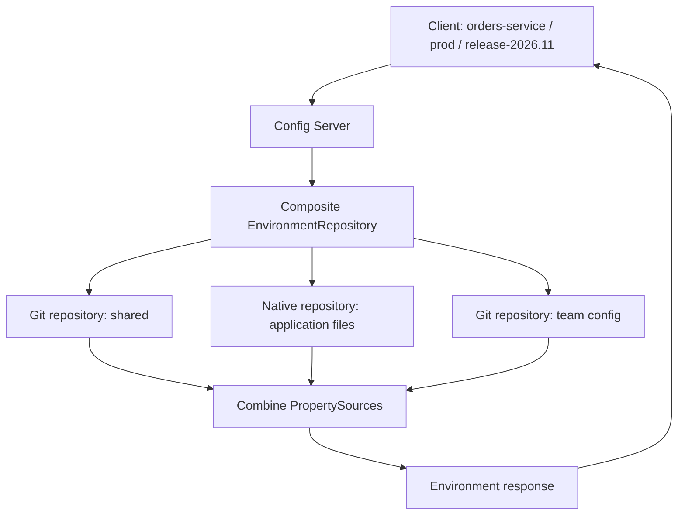

# Phạm vi áp dụng application, profile và label ở từng backend

Composite repository cho phép một Spring Cloud Config Server đọc cấu hình từ nhiều backend rồi kết hợp kết quả thành một `Environment` trả về cho client. Một yêu cầu cấu hình vẫn được xác định bằng ba thông tin: **application**, **profile** và **label**. Khi dùng composite, ba thông tin này được chuyển đến từng `EnvironmentRepository` thành phần; mỗi backend dùng chúng theo cách phù hợp với kiểu lưu trữ của mình.

Điều cần nắm vững là composite không tự tạo ra một bộ application/profile/label độc lập cho từng backend. Trong cấu hình composite thông thường, một yêu cầu từ client được phân phối đến các repository thành phần với cùng bộ selector. Backend có thể ánh xạ selector đó vào tên file, thư mục, nhánh Git hoặc phiên bản tài nguyên theo quy tắc riêng. Nếu các backend diễn giải selector không thống nhất, kết quả có thể thiếu nguồn, lỗi khi truy xuất hoặc tạo ra các giá trị khó dự đoán.

## 1. Composite repository nhận một yêu cầu và gọi nhiều backend

Client gọi Config Server bằng endpoint có dạng:

```text
/{application}/{profile}/{label}
```

Ví dụ:

```text
http://localhost:8888/orders-service/prod/release-2026.11
```

Yêu cầu này mang ba selector:

- `application = orders-service`
- `profile = prod`
- `label = release-2026.11`

Composite repository chuyển các selector đó tới từng repository thành phần. Mỗi repository tìm dữ liệu phù hợp rồi trả về một `Environment` hoặc các property source để composite tổng hợp. Config Server kết hợp các nguồn theo thứ tự ưu tiên được cấu hình và trả một phản hồi chung.



Từng backend nhận cùng application, profile và label, nhưng cách backend tìm dữ liệu phụ thuộc implementation và cấu hình riêng của backend đó.

## 2. Phạm vi của application

`application` định danh ứng dụng mà client cần cấu hình. Giá trị thường lấy từ `spring.application.name`, ví dụ `orders-service`, `inventory-service` hoặc `billing-api`.

Trong composite, cùng một application được chuyển tới tất cả repository thành phần. Mỗi backend có thể sử dụng tên đó theo cách khác nhau:

| Backend | Cách application thường được ánh xạ |
|---|---|
| Git | Tên file như `orders-service.yml`, `orders-service-prod.yml`; có thể kết hợp với `search-paths` và `{application}`. |
| Native | Tên file trong filesystem/classpath hoặc placeholder `{application}` trong `search-locations`. |
| Backend theo đường dẫn như Vault | Thành phần tên ứng dụng có thể tham gia tạo path hoặc key theo quy ước của backend. |

Ví dụ, hai Git repository có thể cùng chứa cấu hình cho `orders-service`, nhưng phục vụ hai phạm vi khác nhau:

```text
shared-config/
└── orders-service.yml

team-config/
└── orders-service.yml
```

Repository `shared-config` có thể chứa thuộc tính dùng chung do nền tảng quản lý; `team-config` chứa phần cấu hình do nhóm orders quản lý. Cả hai vẫn nhận application `orders-service`. Việc chúng có cùng tên file không gây xung đột ở cấp file vì chúng nằm ở hai repository khác nhau; xung đột khóa được giải quyết theo thứ tự property source khi composite tổng hợp.

Nếu một backend dùng tên ứng dụng khác với tên client, cần có quy ước ánh xạ rõ ràng hoặc một implementation tùy chỉnh. Composite thông thường không tự suy ra rằng `orders-service` ở repository A phải tương ứng với `order-api` ở repository B.

## 3. Phạm vi của profile

`profile` mô tả nhóm cấu hình mà client đang yêu cầu, thường là môi trường `dev`, `test`, `staging` hoặc `prod`. Composite chuyển cùng profile hoặc danh sách profile được yêu cầu đến các backend thành phần.

Mỗi backend tự diễn giải profile theo cơ chế lưu trữ của mình:

- Git tìm các file có hậu tố profile, ví dụ `application-prod.yml` và `orders-service-prod.yml`.
- Native tìm tài liệu theo tên file hoặc thư mục được tạo từ placeholder `{profile}` trong `search-locations`.
- Backend dựa trên path có thể đưa profile vào đường dẫn hoặc tên secret theo quy tắc riêng.

Ví dụ một Git repository:

```text
shared-config/
├── application.yml
└── application-prod.yml
```

Và một Native repository:

```text
/etc/config-server/team-config/
└── orders-service/
    ├── orders-service.yml
    └── orders-service-prod.yml
```

Khi client yêu cầu `orders-service/prod`, Git backend có thể lấy cấu hình chung theo profile `prod`, còn Native backend lấy file riêng của ứng dụng ở profile `prod`. Hai backend cùng xử lý một profile nhưng không cần có cấu trúc thư mục giống nhau.

### Nhiều profile

Nếu client yêu cầu nhiều profile, chẳng hạn `prod,region-apac`, composite chuyển danh sách profile đó tới từng backend. Mỗi backend cần có khả năng tìm và kết hợp tài liệu tương ứng. Thứ tự profile có thể ảnh hưởng kết quả, vì vậy nên thống nhất cách sử dụng nhiều profile và xác minh trường `profiles` cùng danh sách `propertySources` trong phản hồi.

Không nên giả định backend nào cũng hỗ trợ nhiều profile giống nhau. Với backend có quy tắc đặt tên hoặc path riêng, hãy kiểm tra cách implementation xử lý danh sách profile và separator đang dùng.

## 4. Phạm vi của label

`label` chọn phiên bản hoặc phạm vi tài nguyên trong backend. Composite chuyển label được client yêu cầu tới các repository thành phần; ý nghĩa của label phụ thuộc loại backend:

| Backend | Ý nghĩa thường gặp của label |
|---|---|
| Git | Branch, tag hoặc commit được dùng để đọc repository. |
| Native | Có thể dùng `{label}` trong `search-locations` để chọn thư mục/tài nguyên; label không tự tạo lịch sử version. |
| Backend khác | Có thể ánh xạ sang phiên bản, path hoặc không có ý nghĩa tương đương Git; cần kiểm tra tài liệu của implementation cụ thể. |

Ví dụ, với hai Git repository trong cùng composite, nếu client gửi label `release-2026.11`, cả hai repository cần có thể phục vụ label đó theo cấu hình của chúng. Nếu một repository chỉ có branch `main` mà không có tag/branch tương ứng, yêu cầu có thể thất bại hoặc không trả đủ nguồn theo hành vi backend.

Với Native backend, có thể dùng label trong đường dẫn:

```yaml
spring:
  cloud:
    config:
      server:
        native:
          search-locations:
            - file:/etc/config-repo/{application}/{profile}/{label}
```

Khi đó, request `orders-service/prod/release-2026.11` được ánh xạ tới thư mục tương ứng. Tuy nhiên, đây chỉ là quy ước đường dẫn do cấu hình tạo ra; hệ thống file không tự bảo đảm thư mục đó là một phiên bản bất biến hoặc có thể rollback.

### Quy tắc label trong composite

Trong cấu hình composite thông thường, client gửi một label cho toàn bộ yêu cầu. Không nên giả định mỗi repository có thể nhận một label độc lập chỉ bằng cách khai báo nhiều backend. Cách an toàn là thống nhất tên branch/tag giữa các Git repository hoặc chọn một label phát hành có mặt ở tất cả nguồn cần thiết.

Nếu các backend cần chu kỳ phát hành hoặc tên nhánh hoàn toàn khác nhau, hãy thiết kế một quy ước ánh xạ rõ ràng, sử dụng repository adapter tùy chỉnh hoặc tách thành các endpoint/Config Server phù hợp. Tránh dựa vào các default label khác nhau mà không kiểm tra hành vi của phiên bản Spring Cloud Config đang dùng.

## 5. Ví dụ composite gồm hai Git backend

Giả sử tổ chức muốn tách cấu hình nền tảng và cấu hình nhóm dịch vụ thành hai repository:

```text
shared-config/
├── application.yml
├── application-prod.yml
└── orders-service.yml

team-orders-config/
├── orders-service.yml
└── orders-service-prod.yml
```

Khai báo composite trong Config Server:

```yaml
spring:
  cloud:
    config:
      server:
        composite:
          - type: git
            uri: https://git.example.com/platform/shared-config.git
            default-label: main
            search-paths:
              - .
          - type: git
            uri: https://git.example.com/teams/orders-config.git
            default-label: main
            search-paths:
              - .
```

Với client yêu cầu:

```text
/orders-service/prod/main
```

cả hai Git backend đều được hỏi về application `orders-service`, profile `prod` và label `main`. Backend thứ nhất cung cấp cấu hình nền tảng, backend thứ hai cung cấp cấu hình nhóm orders.

Thứ tự trong danh sách composite có ý nghĩa đối với độ ưu tiên. Repository đứng trước có độ ưu tiên cao hơn repository đứng sau khi có khóa trùng nhau. Vì vậy, nếu chính sách của tổ chức muốn nhóm dịch vụ được quyền ghi đè cấu hình nền tảng, cần sắp xếp thứ tự hoặc tổ chức property source theo đúng mục tiêu và kiểm tra kết quả thực tế. Không nên dựa vào tên repository để suy ra thứ tự ưu tiên.

Các Git backend nên có label chung như `main` hoặc các tag phát hành đồng bộ. Nếu một backend cần branch riêng, cần xác minh cách yêu cầu label chung được giải quyết trước khi triển khai.

## 6. Ví dụ composite kết hợp Git và Native

Một mô hình khác là lấy cấu hình chuẩn từ Git, đồng thời bổ sung cấu hình theo môi trường từ filesystem:

```yaml
spring:
  cloud:
    config:
      server:
        composite:
          - type: git
            uri: https://git.example.com/platform/shared-config.git
            default-label: main
          - type: native
            search-locations:
              - file:/etc/config-server/{application}/{profile}
```

Với request `orders-service/prod/main`:

- Git backend nhận `orders-service`, `prod`, `main` và đọc cấu hình dùng chung theo file/profile trên label Git.
- Native backend nhận cùng application, profile và label; `search-locations` ánh xạ application/profile thành thư mục filesystem. Trong ví dụ này label không xuất hiện trong đường dẫn nên không chọn một phiên bản Native riêng.

Điều đó có nghĩa Git backend có thể được pin theo branch/tag, còn Native backend đọc nội dung tại thư mục được mount hiện tại. Hai nguồn cùng tham gia một Environment, nhưng mức độ versioning và khả năng rollback khác nhau. Nếu cần một lần triển khai tái lập hoàn toàn, hãy version hóa snapshot Native hoặc đưa cấu hình đó vào backend có lịch sử phiên bản.

Khi cùng một khóa xuất hiện trong Git và Native, thứ tự composite quyết định nguồn nào có ưu tiên cao hơn. Hãy kiểm tra phản hồi Environment để xác minh thứ tự `propertySources` và giá trị được chọn.

## 7. Bảng ma trận selector theo backend

Bảng sau tóm tắt cách cùng một request được ánh xạ ở các loại backend phổ biến:

| Selector | Git backend | Native backend | Lưu ý trong composite |
|---|---|---|---|
| Application | Tên file và search path | Tên file, thư mục hoặc `{application}` | Cùng application được chuyển tới từng backend. |
| Profile | Hậu tố file như `-prod` | Hậu tố file hoặc `{profile}` trong path | Cùng profile/danh sách profile; mỗi backend có cách tìm riêng. |
| Label | Branch, tag, commit | `{label}` trong path nếu được cấu hình | Một label request chung; không mặc định có label riêng cho từng backend. |
| Thứ tự ưu tiên | Property source do Git repository tạo | Property source từ resource tìm thấy | Thứ tự backend trong composite ảnh hưởng mức ưu tiên khi trùng khóa. |
| Version metadata | Có thể phản ánh commit Git | Không tự có commit ID | Metadata và rollback phụ thuộc backend. |

Đối với backend khác như Vault hoặc các repository tùy chỉnh, cần xác định rõ cách implementation ánh xạ application/profile/label. Không nên suy luận rằng label luôn là branch Git hoặc rằng mọi backend đều có cùng khả năng chọn phiên bản.

## 8. Khi selector không tương thích giữa các backend

Các lỗi thường xuất hiện khi một backend không thể xử lý cùng selector với các backend còn lại:

| Hiện tượng | Nguyên nhân có thể | Cách xử lý |
|---|---|---|
| Composite request lỗi khi dùng label phát hành | Một Git repository không có branch/tag/commit tương ứng. | Đồng bộ label giữa các repository hoặc dùng quy ước phát hành chung. |
| Thiếu cấu hình riêng của ứng dụng | Một backend đặt file theo tên khác hoặc thiếu `{application}` trong search path. | Kiểm tra tên application và layout của từng backend. |
| Chỉ thiếu cấu hình production | Backend không có file hậu tố profile hoặc path profile không khớp. | Kiểm tra profile client gửi và tên file/path tương ứng. |
| Native trả cấu hình từ thư mục không mong muốn | `{label}` hoặc `{profile}` được ánh xạ sai, đường dẫn tương đối thay đổi. | Dùng đường dẫn rõ ràng và kiểm tra path sau khi thay placeholder. |
| Giá trị bị backend khác ghi đè | Khóa trùng nhau và thứ tự composite không như mong đợi. | Kiểm tra thứ tự repository và `propertySources`. |
| Một nguồn thay đổi nhưng nguồn kia không đổi | Các backend có vòng đời cập nhật/versioning khác nhau. | Ghi nhận phiên bản từng nguồn và quản lý release đồng bộ. |

Khi lỗi xảy ra, hãy kiểm tra cùng một bộ selector ở từng backend nếu có thể. Đối chiếu application, profile, label, phiên bản và tài liệu được tìm thấy sẽ giúp xác định backend nào không tương thích.

## 9. Kiểm tra Environment trả về

Gọi Environment API của Config Server với đúng selector client đang dùng:

```bash
curl -i http://localhost:8888/orders-service/prod/main
```

Trong phản hồi JSON, kiểm tra:

- `name`: application mà server đã xử lý.
- `profiles`: profile hoặc danh sách profile đã được áp dụng.
- `label`: label mà request đã chọn.
- `version` và `state`: metadata phiên bản/trạng thái nếu backend cung cấp.
- `propertySources`: tên từng nguồn và thứ tự của chúng.

Để kiểm tra khóa bị ghi đè, tìm khóa đó trong tất cả property source và ghi lại backend hoặc file nguồn. Tên property source thường chứa đường dẫn hoặc định danh repository giúp truy ra nguồn gốc.

Nếu cần biết một backend cụ thể có được gọi hay không, kết hợp Environment response với log của Config Server. Một phản hồi thiếu property source có thể do file không tồn tại, selector không khớp, backend không truy cập được hoặc cách repository xử lý dữ liệu; cần xem exception gốc trước khi kết luận.

## 10. Nguyên tắc thiết kế selector trong composite

Để composite dễ dự đoán và dễ vận hành:

1. **Thống nhất application name:** dùng cùng tên dịch vụ trong client, file cấu hình và path của các backend.
2. **Chuẩn hóa profile:** thống nhất `dev`, `test`, `staging`, `prod`; tránh để mỗi repository dùng tên khác nhau cho cùng môi trường.
3. **Chuẩn hóa label:** với nhiều Git repository, tạo branch/tag tương ứng hoặc quy ước release chung. Đối với backend không có label tự nhiên, ghi rõ cách ánh xạ hoặc giới hạn của nó.
4. **Giữ layout dễ nhận diện:** đặt file và thư mục theo application/profile nhất quán, dùng search path có chủ đích.
5. **Thiết kế thứ tự ưu tiên:** xác định backend nào có quyền ghi đè khi trùng khóa, rồi xác minh bằng phản hồi Environment.
6. **Quản lý phiên bản từng nguồn:** composite không làm các backend tự động có cùng lịch sử commit. Ghi lại version của từng nguồn khi phát hành.
7. **Kiểm tra khả năng tương thích:** thử request đại diện cho từng application/profile/label quan trọng trước khi đưa thay đổi vào production.

Nếu mỗi backend cần bộ selector hoàn toàn khác nhau, hãy xem lại ranh giới của composite. Có thể tách Config Server theo miền cấu hình hoặc triển khai adapter tùy chỉnh để ánh xạ yêu cầu theo quy tắc được kiểm soát. Cách ánh xạ cần được kiểm thử và ghi tài liệu để tránh kết quả không nhất quán.

## 11. Tổng kết

- Composite repository nhận một yêu cầu application/profile/label và chuyển cùng bộ selector đến từng backend thành phần.
- Application xác định dịch vụ; profile xác định nhóm cấu hình; label chọn phiên bản hoặc tài nguyên theo khả năng của backend.
- Git thường diễn giải label là branch/tag/commit; Native chỉ dùng label khi search location được cấu hình để ánh xạ nó vào tài nguyên.
- Các backend có thể dùng layout file, path và quy tắc tìm kiếm khác nhau dù nhận cùng selector.
- Một yêu cầu composite thông thường không cấp một label độc lập cho từng backend; cần chuẩn hóa label hoặc thiết kế ánh xạ tùy chỉnh.
- Thứ tự repository trong composite ảnh hưởng độ ưu tiên khi khóa trùng nhau; kiểm tra `propertySources` để xác nhận.
- Ghi nhận phiên bản từng backend và kiểm tra các tổ hợp application/profile/label trọng yếu để cấu hình có thể truy vết và tái lập.
