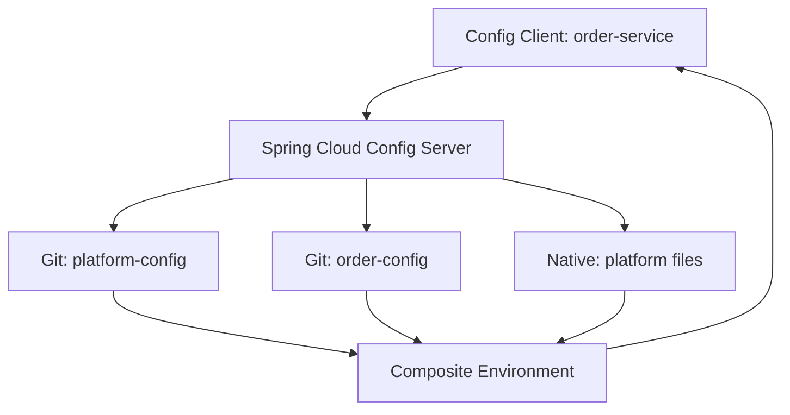

# `failOnCompositeError` và đánh đổi khi chỉ một nguồn bị lỗi

Spring Cloud Config Server có thể ghép nhiều nguồn cấu hình thành một Environment thông qua **composite environment repository**. Ví dụ, một repository Git chứa cấu hình dùng chung, một Git repository khác chứa cấu hình riêng của dịch vụ và một native repository cung cấp các thuộc tính do nền tảng quản lý. Cách ghép này giúp một Config Client nhận cấu hình từ nhiều nơi qua cùng một API.

Khi composite có nhiều nguồn, một câu hỏi vận hành quan trọng là: nếu một nguồn không truy cập được thì Config Server có nên từ chối toàn bộ request hay vẫn trả dữ liệu từ các nguồn còn lại? Thuộc tính `spring.cloud.config.server.failOnCompositeError` điều khiển lựa chọn này.

- Mặc định `true`: lỗi ở một repository làm request composite thất bại. Đây là cách xử lý fail-fast, ưu tiên tính đầy đủ của cấu hình.
- Đặt `false`: Config Server bỏ qua repository bị lỗi và tiếp tục tổng hợp kết quả từ các repository còn lại. Request có thể thành công với một Environment chỉ có một phần nguồn.

Lựa chọn này là đánh đổi giữa **tính đầy đủ** và **khả năng tiếp tục phục vụ**. Chế độ bỏ qua lỗi có thể tăng khả năng sẵn sàng, nhưng cũng có thể khiến ứng dụng khởi động với cấu hình thiếu mà không nhận ra ngay.

## 1. Composite repository hoạt động như thế nào?

Composite repository cho phép Config Server truy vấn nhiều `EnvironmentRepository` rồi kết hợp các property source thành một Environment. Các backend có thể cùng loại hoặc khác loại, tùy những loại repository và phiên bản Spring Cloud Config đang sử dụng.

Ví dụ, một hệ thống có thể chia cấu hình thành:

- Git repository `platform-config`: thuộc tính dùng chung cho nhiều ứng dụng.
- Git repository `order-config`: thuộc tính riêng cho `order-service`.
- Native repository: các thuộc tính do nhóm nền tảng quản lý trên filesystem.



Client vẫn gửi một request theo application, profile và label. Config Server gọi từng repository, nhận các property source, sau đó kết hợp chúng theo thứ tự cấu hình. Client không cần tự gọi ba backend.

## 2. Cấu hình composite nhiều nguồn

Một cấu hình minh họa dùng hai Git repository và một native repository:

```yaml
spring:
  profiles:
    active: composite
  cloud:
    config:
      server:
        failOnCompositeError: true
        composite:
          - type: git
            uri: https://git.example.internal/platform/platform-config.git
            defaultLabel: main
          - type: git
            uri: https://git.example.internal/commerce/order-config.git
            defaultLabel: main
          - type: native
            searchLocations:
              - file:/srv/config/platform
```

Ví dụ thể hiện cách phân loại nguồn; tên thuộc tính và khả năng của từng backend cần được xác minh theo phiên bản Spring Cloud Config đang dùng. Với Git repository, `uri` phải trỏ tới repository Git hợp lệ. Với native repository, `searchLocations` trỏ tới thư mục chứa file cấu hình.

Khi `failOnCompositeError` không được khai báo, hành vi mặc định là fail-fast (`true`). Có thể cấu hình tường minh để người vận hành và người review thấy rõ chính sách khi một nguồn gặp sự cố.

## 3. Thứ tự repository quyết định độ ưu tiên

Trong composite repository, thứ tự các mục trong danh sách có ý nghĩa. Repository được liệt kê trước có độ ưu tiên cao hơn khi nhiều nguồn cùng cung cấp một key. Vì vậy, cần sắp xếp nguồn theo ý nghĩa của dữ liệu, không chỉ theo thứ tự tiện tay.

Ví dụ:

```yaml
spring:
  profiles:
    active: composite
  cloud:
    config:
      server:
        composite:
          - type: git
            uri: https://git.example.internal/platform/platform-config.git
          - type: git
            uri: https://git.example.internal/commerce/order-config.git
```

Nếu cả hai repository khai báo `checkout.timeout`, giá trị từ `platform-config` có ưu tiên cao hơn vì nó đứng trước. Nếu key chỉ xuất hiện trong `order-config`, giá trị riêng của dịch vụ vẫn có thể được sử dụng.

| Repository | `checkout.timeout` | `logging.level.root` |
|---|---:|---|
| `platform-config` (thứ nhất) | `2s` | `INFO` |
| `order-config` (thứ hai) | `5s` | `DEBUG` |
| Giá trị có hiệu lực từ composite | `2s` | `INFO` |

Không nên dựa vào thứ tự này để tạo cơ chế bảo mật. Một repository ưu tiên thấp vẫn có thể được trả về như một property source; thứ tự ưu tiên quyết định giá trị được phân giải khi trùng key, không tự giới hạn client nào được đọc nguồn đó.

Khi thay đổi thứ tự repository, cần xem đây là thay đổi hành vi cấu hình. Một key trước đây lấy từ dịch vụ có thể bắt đầu lấy từ nguồn dùng chung hoặc ngược lại. Hãy kiểm thử các key trùng và xem response Environment thực tế.

## 4. `failOnCompositeError=true`: yêu cầu mọi nguồn phải sẵn sàng

Đây là hành vi mặc định. Nếu một repository trong composite ném lỗi khi Config Server truy vấn, request tổng hợp bị xem là thất bại, kể cả khi các repository khác đã trả dữ liệu thành công.

Ví dụ composite có ba nguồn:

| Nguồn | Trạng thái |
|---|---|
| Git cấu hình chung | Thành công |
| Git cấu hình ứng dụng | Timeout |
| Native platform files | Thành công |

Với `failOnCompositeError: true`, Config Server không trả một Environment thành công được ghép từ hai nguồn còn lại. Client nhận lỗi từ request cấu hình và có thể thực hiện retry hoặc fail khi khởi động, tùy chính sách của ứng dụng.

### Khi nào nên dùng fail-fast?

Chọn `true` khi mọi repository đều chứa dữ liệu cần thiết để ứng dụng hoạt động đúng, hoặc khi không thể chứng minh cấu hình từ các nguồn còn lại là đầy đủ. Ví dụ:

- Một repository chứa endpoint hoặc routing bắt buộc cho dịch vụ.
- Một nguồn chứa policy cần áp dụng đồng nhất và không được phép thiếu.
- Các nguồn cùng nhau tạo thành một bộ cấu hình nhất quán; thiếu một nguồn có thể làm thay đổi hành vi ngoài dự kiến.
- Tổ chức muốn lỗi backend xuất hiện rõ trong quá trình triển khai thay vì để ứng dụng chạy với cấu hình không đầy đủ.

Fail-fast có thể làm giảm khả năng phục vụ khi một backend phụ thuộc bị gián đoạn. Tuy nhiên, nếu thiếu nguồn cấu hình có thể khiến ứng dụng xử lý sai request, truy cập sai tài nguyên hoặc vi phạm chính sách, từ chối request là lựa chọn an toàn hơn.

## 5. `failOnCompositeError=false`: tiếp tục với các nguồn còn hoạt động

Khi đặt `false`, Config Server có thể bỏ qua repository bị lỗi và tổng hợp Environment từ những repository truy cập được.

```yaml
spring:
  profiles:
    active: composite
  cloud:
    config:
      server:
        failOnCompositeError: false
        composite:
          - type: git
            uri: https://git.example.internal/platform/platform-config.git
          - type: git
            uri: https://git.example.internal/commerce/order-config.git
          - type: native
            searchLocations:
              - file:/srv/config/platform
```

Giả sử `order-config` tạm thời không truy cập được nhưng `platform-config` và native repository vẫn hoạt động. Config Server có thể trả Environment chứa property source từ hai nguồn còn lại.

Điều này hữu ích khi các repository có mức độ quan trọng khác nhau và nguồn bị lỗi chỉ cung cấp thuộc tính bổ sung không bắt buộc. Ứng dụng vẫn có thể nhận cấu hình đủ để tiếp tục hoạt động.

Tuy nhiên, `false` không tự tạo giá trị dự phòng cho key bị thiếu. Nếu repository bị lỗi chứa `checkout.timeout=5s`, Config Server không tự lấy lại giá trị cũ từ cache trừ khi hệ thống có cơ chế cache riêng được thiết kế. Client có thể nhận giá trị từ nguồn khác hoặc không nhận key đó.

## 6. Partial Environment có thể gây lỗi âm thầm

Nguy cơ lớn nhất của chế độ bỏ qua lỗi là request vẫn trả thành công trong khi một phần cấu hình đã biến mất.

Ví dụ:

| Key | Nguồn có thẩm quyền | Khi nguồn hoạt động | Khi nguồn lỗi và bị bỏ qua |
|---|---|---|---|
| `logging.level.root` | Git chung | `INFO` | Có thể không còn key hoặc nhận giá trị mặc định khác |
| `checkout.timeout` | Git riêng của order | `5s` | Có thể thiếu hoặc lấy giá trị từ nguồn khác |
| `platform.region` | Native platform | `ap-southeast-1` | Có thể thiếu hoặc không đúng vùng |

Nếu `order-service` nhận `200` nhưng thiếu `checkout.timeout`, ứng dụng có thể dùng default trong code hoặc một giá trị local. Hệ thống vẫn khởi động, nhưng hành vi có thể khác với cấu hình mà nhóm đã kiểm thử.

Một điểm quan trọng: `failOnCompositeError=false` chỉ xử lý lỗi truy vấn repository. Nó không phát hiện được mọi tình huống cấu hình không đầy đủ. Ví dụ repository truy cập thành công nhưng file bị xóa, profile không có thuộc tính cần thiết hoặc key bị viết sai; đó có thể là kết quả hợp lệ về mặt kỹ thuật và không kích hoạt composite error.

Vì vậy, cần phân biệt:

- **Repository failure:** không thể truy cập hoặc đọc nguồn; `failOnCompositeError` điều khiển cách xử lý lỗi này.
- **Missing property:** repository hoạt động nhưng không có key mong đợi; cần schema validation hoặc kiểm tra hợp đồng cấu hình.
- **Invalid value:** key có mặt nhưng giá trị sai kiểu hoặc ngoài giới hạn; cần validation riêng.

## 7. So sánh hai chính sách

| Tiêu chí | `true` (mặc định) | `false` |
|---|---|---|
| Một repository bị lỗi | Toàn bộ request composite thất bại | Bỏ qua nguồn lỗi và tiếp tục với nguồn còn lại |
| Tính đầy đủ | Buộc mọi nguồn truy vấn thành công | Có thể trả Environment một phần |
| Khả năng tiếp tục phục vụ | Thấp hơn khi backend phụ thuộc lỗi | Cao hơn nếu còn nguồn đủ dùng |
| Phát hiện lỗi backend | Lộ rõ qua lỗi request | Có thể chỉ xuất hiện trong log/metric của server |
| Rủi ro chính | Một nguồn lỗi làm gián đoạn mọi client | Ứng dụng nhận cấu hình thiếu hoặc fallback ngoài ý muốn |
| Phù hợp | Nguồn đều bắt buộc hoặc tính nhất quán quan trọng | Nguồn tùy chọn, có fallback đã kiểm chứng |

Không có một giá trị phù hợp cho mọi hệ thống. Hãy quyết định theo mức độ bắt buộc của từng repository và hậu quả khi thuộc tính từ nguồn đó không xuất hiện.

## 8. Cách thiết kế composite để giảm rủi ro

Trước khi đặt `failOnCompositeError=false`, hãy phân loại từng nguồn:

| Loại nguồn | Ví dụ | Chính sách thường phù hợp |
|---|---|---|
| Bắt buộc | Endpoint thanh toán, policy định tuyến, giới hạn an toàn | Fail-fast hoặc tách thành Config Server riêng có chính sách nghiêm ngặt |
| Bổ sung | Metadata mô tả, dashboard link, một số nhãn vận hành | Có thể bỏ qua nếu client có default hợp lệ |
| Có thể fallback | Giá trị có bản sao được kiểm soát ở nguồn khác | Có thể tiếp tục sau khi kiểm chứng precedence và fallback |
| Nhạy cảm | Credential, private key, token | Quản lý qua secret manager với policy riêng; không dựa vào composite để xử lý lỗi bí mật |

Một số nguyên tắc hữu ích:

1. Không ghép mọi nguồn chỉ vì có thể ghép. Chỉ thêm nguồn khi có lý do về quyền sở hữu hoặc vòng đời dữ liệu.
2. Đặt nguồn có thẩm quyền cao hơn ở vị trí phù hợp trong danh sách và tài liệu hóa các key trùng.
3. Giữ cấu hình bắt buộc trong một nguồn có tính sẵn sàng cao hoặc dùng chính sách fail-fast.
4. Nếu nguồn có thể bỏ qua, xác định rõ default hợp lệ và cách phát hiện khi key không xuất hiện.
5. Không giả định một repository thành công nghĩa là mọi key cần thiết đều có mặt.
6. Tránh lưu cùng một key với giá trị khác nhau ở nhiều nguồn nếu không có lý do rõ ràng.

Nếu một nguồn là tùy chọn về mặt nghiệp vụ nhưng lại nằm chung composite với nhiều nguồn bắt buộc, `failOnCompositeError=false` có thể làm các nguồn bắt buộc khác bị ảnh hưởng bởi partial response. Trong trường hợp đó, cân nhắc tách các nguồn có mức độ quan trọng khác nhau thành Config Server hoặc endpoint riêng.

## 9. Quan sát và cảnh báo khi nguồn bị bỏ qua

Khi `failOnCompositeError=false`, request có thể thành công dù một repository đã lỗi. Vì vậy, chỉ theo dõi tỷ lệ HTTP 2xx ở Config Server là chưa đủ.

Nên theo dõi:

- Log lỗi theo từng repository, gồm tên nguồn và loại lỗi, nhưng không ghi credential hoặc nội dung bí mật.
- Số lần timeout, lỗi kết nối, lỗi xác thực và lỗi đọc repository.
- Thời gian truy vấn từng backend và tổng thời gian tạo Environment.
- Tỷ lệ request composite có repository bị bỏ qua.
- Sự hiện diện của các key bắt buộc trong response hoặc trong smoke test client.
- Trạng thái đồng bộ Git, commit/label mà mỗi backend đã phục vụ.

Thiết lập cảnh báo khi một repository bị lỗi lặp lại, kể cả khi Config Server vẫn trả 200. Nếu có nhiều replica Config Server, cần quan sát lỗi theo từng replica vì chúng có thể có trạng thái cache hoặc filesystem khác nhau.

## 10. Kiểm thử hành vi khi một nguồn bị lỗi

Trước khi đưa composite vào production, cần mô phỏng ít nhất các trường hợp sau:

| Tình huống | Kỳ vọng với `true` | Kỳ vọng với `false` |
|---|---|---|
| Tất cả repository hoạt động | Trả Environment tổng hợp | Trả Environment tổng hợp |
| Một repository timeout | Request thất bại | Trả dữ liệu từ nguồn thành công còn lại |
| Một repository bị từ chối quyền | Request thất bại | Bỏ qua nguồn lỗi; phát cảnh báo |
| Tất cả repository đều lỗi | Request thất bại | Request cũng không thể tạo Environment hữu ích và phải báo lỗi |
| Một repository hoạt động nhưng thiếu key bắt buộc | Có thể vẫn trả thành công nếu không có exception | Có thể vẫn trả thành công nếu không có exception |
| Hai nguồn có cùng key | Nguồn ưu tiên cao hơn thắng | Nguồn ưu tiên cao hơn thắng nếu cả hai nguồn đều thành công |

Tình huống thiếu key cho thấy vì sao cần kiểm tra schema và contract độc lập với `failOnCompositeError`. Thuộc tính này không phải bộ xác thực nội dung.

### Ví dụ kiểm thử thủ công

1. Gọi endpoint Config Server khi mọi repository hoạt động; ghi nhận metadata và danh sách property source.
2. Tạm thời làm một repository không truy cập được trong môi trường kiểm thử, chẳng hạn dùng URI sai hoặc chặn kết nối theo cách có kiểm soát.
3. Gọi lại endpoint với `failOnCompositeError=true`; xác nhận request thất bại.
4. Đặt `failOnCompositeError=false`, khởi động lại hoặc triển khai lại Config Server theo cách cấu hình; gọi lại endpoint.
5. Xác nhận property source của nguồn lỗi vắng mặt, các nguồn còn lại vẫn được trả về và log có ghi nhận lỗi.
6. Kiểm tra các key bắt buộc; xác nhận client không vô tình dùng default ngoài dự kiến.
7. Khôi phục repository và xác nhận composite trở lại trạng thái đầy đủ.

Không thực hiện thử nghiệm gây lỗi backend trên production chỉ để xác minh hành vi. Dùng môi trường kiểm thử có dữ liệu giả và không chứa bí mật thật.

## 11. Ví dụ quyết định chính sách

Giả sử `order-service` nhận cấu hình từ hai repository:

- `platform-config` chứa `platform.region` và `platform.request-id-header`.
- `order-config` chứa `checkout.timeout`, `checkout.max-retries` và `payment.provider`.

Nếu `order-config` không truy cập được, việc vẫn trả cấu hình từ `platform-config` không đủ để `order-service` xử lý checkout đúng. Nếu ứng dụng có default cho một số key nhưng `payment.provider` là bắt buộc, `failOnCompositeError=false` có thể khiến ứng dụng khởi động với cấu hình thiếu hoặc sai.

Trong tình huống này, có thể chọn một trong các hướng:

- Giữ `failOnCompositeError=true` để ứng dụng nhận lỗi rõ khi nguồn cấu hình dịch vụ không sẵn sàng.
- Tách nguồn metadata tùy chọn khỏi nguồn cấu hình nghiệp vụ bắt buộc, để lỗi của metadata không làm gián đoạn phần còn lại.
- Nếu cho phép tiếp tục, bổ sung kiểm tra bắt buộc `payment.provider` và các key cần thiết trước khi ứng dụng nhận traffic.

Quyết định phải dựa trên hành vi an toàn khi key thiếu, không chỉ dựa trên mong muốn tăng tỷ lệ HTTP 200.

## 12. Mục tiêu cần đạt sau bài học

Sau bài này, người học cần có khả năng:

- Giải thích được cách Composite Environment Repository kết hợp nhiều nguồn cấu hình.
- Mô tả được `failOnCompositeError=true` và `false` khi một repository phát sinh lỗi.
- Phân tích được đánh đổi giữa fail-fast và khả năng trả về partial Environment.
- Giải thích được thứ tự repository ảnh hưởng tới độ ưu tiên khi nhiều nguồn khai báo cùng key.
- Phân biệt repository failure với missing property và invalid value.
- Thiết kế chính sách bắt buộc/tùy chọn, fallback và validation cho từng nguồn.
- Xây dựng kiểm thử lỗi backend, giám sát và cảnh báo khi một nguồn bị bỏ qua.

**Tự kiểm tra:** Một composite gồm Git chung, Git riêng của dịch vụ và native platform files. Git riêng bị timeout trong khi hai nguồn còn lại hoạt động. Hãy dự đoán kết quả khi `failOnCompositeError=true` và `false`, giải thích nguy cơ khi client vẫn nhận HTTP 200 nhưng thiếu `payment.provider`, và đề xuất cách giám sát để phát hiện partial Environment.
