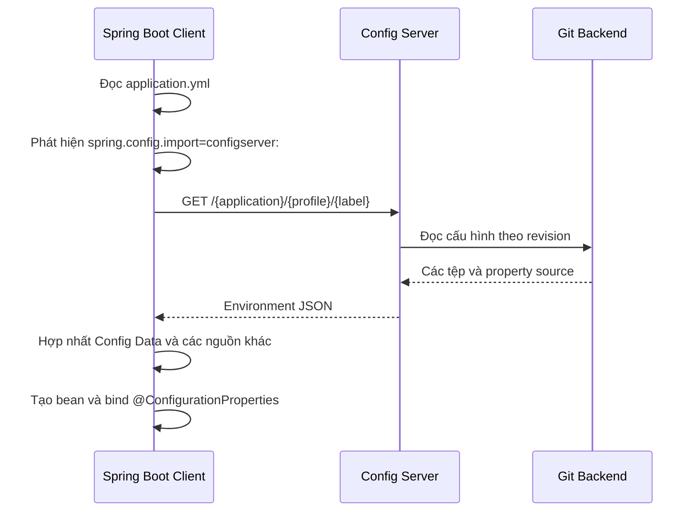

# Kết nối Config Server bằng spring.config.import=configserver:

Spring Cloud Config Client cho phép ứng dụng Spring Boot lấy cấu hình từ một Config Server trong giai đoạn nạp cấu hình. Với cơ chế Config Data của Spring Boot, ứng dụng khai báo `spring.config.import` với location bắt đầu bằng `configserver:`. Config Client dùng location này để kết nối tới server, yêu cầu cấu hình theo application, profile và label, rồi đưa các property source nhận được vào Spring `Environment`.

Cách tích hợp này giúp ứng dụng lấy cấu hình tập trung ngay trong quá trình khởi động, trước khi các bean nghiệp vụ được tạo. Nhờ vậy, các bean như `@ConfigurationProperties` có thể nhận giá trị từ xa ngay ở lần bind đầu tiên.

## 1. Thêm dependency Config Client

Ứng dụng cần starter `spring-cloud-starter-config`. Phiên bản Spring Cloud phải tương thích với phiên bản Spring Boot và nên được quản lý bằng BOM `spring-cloud-dependencies`.

Maven:

```xml
<dependency>
    <groupId>org.springframework.cloud</groupId>
    <artifactId>spring-cloud-starter-config</artifactId>
</dependency>
```

Gradle:

```kotlin
dependencies {
    implementation("org.springframework.cloud:spring-cloud-starter-config")
}
```

Starter cung cấp thành phần để Spring Boot nhận diện location `configserver:` và nạp dữ liệu từ Spring Cloud Config Server. Ứng dụng client không cần thêm dependency `spring-cloud-config-server`; dependency đó dành cho ứng dụng đóng vai trò cung cấp cấu hình.

## 2. Khai báo spring.config.import

Trong `application.yml`, khai báo Config Server bằng `spring.config.import`:

```yaml
spring:
  application:
    name: billing-api
  config:
    import: "optional:configserver:http://localhost:8888"
```

Location có ba phần cần nhận biết:

- `configserver:` là tiền tố để Config Data nhận diện đây là nguồn cấu hình từ Spring Cloud Config.
- `http://localhost:8888` là địa chỉ Config Server trong ví dụ.
- `optional:` là tiền tố tùy chọn cho phép ứng dụng tiếp tục khởi động nếu nguồn cấu hình từ xa không thể được nạp.

Nếu muốn Config Server là nguồn bắt buộc, bỏ `optional:`:

```yaml
spring:
  config:
    import: "configserver:http://config-server:8888"
```

Với import bắt buộc, lỗi kết nối hoặc lỗi nạp cấu hình sẽ làm quá trình khởi động thất bại. Đây thường là lựa chọn phù hợp khi ứng dụng không thể hoạt động an toàn nếu thiếu cấu hình trung tâm. Với import optional, ứng dụng có thể khởi động bằng các nguồn cấu hình còn lại; chỉ dùng khi các giá trị mặc định cục bộ đủ an toàn và ứng dụng có thể hoạt động trong trạng thái đó.

Không cần tạo `bootstrap.yml` chỉ để bật Config Client theo Config Data import. Đây là cơ chế tích hợp hiện đại của Spring Boot. Dự án cũ dùng bootstrap context có thể cần cách cấu hình khác; tránh trộn hai cơ chế nếu chưa xác định rõ lý do tương thích.

## 3. URI Config Server và giá trị mặc định

Có thể đặt URI ngay trong location:

```yaml
spring:
  config:
    import: "configserver:http://config-server:8888"
```

Hoặc dùng `configserver:` mà không ghi URI và cấu hình địa chỉ bằng `spring.cloud.config.uri`:

```yaml
spring:
  cloud:
    config:
      uri: http://config-server:8888
  config:
    import: "configserver:"
```

Nếu không chỉ định URI ở cả hai nơi, Config Client thường dùng địa chỉ mặc định `http://localhost:8888`. Cách này tiện khi chạy local, nhưng môi trường triển khai nên khai báo rõ hostname và port của Config Server.

Địa chỉ trong `spring.config.import` gắn trực tiếp với location được nạp. Nếu dùng nhiều môi trường, có thể cung cấp URI bằng biến môi trường hoặc cấu hình triển khai:

```yaml
spring:
  config:
    import: "optional:configserver:${CONFIG_SERVER_URL:http://localhost:8888}"
```

Biến `CONFIG_SERVER_URL` có thể được đặt theo môi trường chạy. Không đưa credential vào URL nếu có thể cấu hình xác thực riêng; URL có thể xuất hiện trong log, danh sách process hoặc thông tin chẩn đoán.

## 4. Chọn application, profile và label

Config Client gửi bộ ba application, profile và label để Config Server tìm đúng tập cấu hình. Có thể khai báo chúng cùng import:

```yaml
spring:
  application:
    name: billing-api
  profiles:
    active: prod
  cloud:
    config:
      label: release-2026
  config:
    import: "configserver:http://config-server:8888"
```

Các thuộc tính có ý nghĩa:

| Thuộc tính | Ý nghĩa |
| --- | --- |
| `spring.application.name` | Tên application mặc định mà client yêu cầu, ở đây là `billing-api` |
| `spring.profiles.active` | Profile đang hoạt động, ở đây là `prod` |
| `spring.cloud.config.label` | Git branch, tag hoặc revision được yêu cầu, ở đây là `release-2026` |
| `spring.cloud.config.name` | Có thể ghi đè tên application dùng riêng cho truy vấn Config Server |
| `spring.cloud.config.profile` | Có thể ghi đè profile dùng cho truy vấn Config Server |

Nếu không đặt tên riêng, client dùng `spring.application.name`. Nếu không có profile đang hoạt động, Config Server thường được hỏi với profile `default`. Nếu không khai báo label, server có thể dùng label mặc định đã cấu hình. Đối với production, nên chọn profile và label tường minh để kết quả có thể truy vết.

## 5. Config Data import diễn ra khi nào?

Spring Boot xử lý Config Data trong giai đoạn chuẩn bị `Environment`, trước khi tạo phần lớn bean ứng dụng. Config Client nhận diện location `configserver:`, liên hệ Config Server và nạp các property source trả về. Sau đó, quá trình tạo bean và bind cấu hình tiếp tục với `Environment` đã có dữ liệu từ xa.

Luồng khởi động tổng quát:



Do Config Server được gọi trong giai đoạn nạp cấu hình, địa chỉ, DNS, TLS, xác thực và khả năng sẵn sàng của server đều có thể ảnh hưởng tới startup. Nếu import bắt buộc, client cần lấy được cấu hình trước khi khởi động thành công.

## 6. Thứ tự ưu tiên với cấu hình local và cấu hình từ xa

Khi một Config Data import được khai báo trong một tài liệu cấu hình, các giá trị từ nguồn được import có độ ưu tiên cao hơn tài liệu đã khai báo import đó. Điều này cho phép Config Server cung cấp giá trị trung tâm thay cho mặc định local trong cùng tài liệu.

Ví dụ local:

```yaml
acme:
  billing:
    connect-timeout: 2s

spring:
  config:
    import: "configserver:http://config-server:8888"
```

Nếu Config Server cũng cung cấp `acme.billing.connect-timeout`, giá trị từ nguồn được import sẽ ghi đè giá trị trong tài liệu này. Các nguồn có độ ưu tiên cao hơn trong Spring Boot, chẳng hạn biến môi trường, system property và tham số dòng lệnh, vẫn có thể ghi đè cấu hình đã nạp từ xa.

Khi nhiều Config Data location được import, thứ tự khai báo và thứ tự các tài liệu ảnh hưởng tới việc nguồn nào thắng khi có khóa trùng. Hãy kiểm tra `Environment` thực tế thay vì giả định rằng mọi giá trị từ Git luôn thắng mọi nguồn khác.

## 7. Optional hay mandatory?

Lựa chọn `optional:` là quyết định về khả năng ứng dụng được phép khởi động khi không lấy được cấu hình từ xa.

| Chế độ | Khi Config Server không khả dụng | Phù hợp khi |
| --- | --- | --- |
| `optional:configserver:` | Có thể tiếp tục với các nguồn cấu hình còn lại | Cấu hình từ xa bổ sung tùy chọn và local fallback an toàn |
| `configserver:` | Startup thất bại nếu không nạp được nguồn bắt buộc | Cấu hình trung tâm chứa giá trị thiết yếu để ứng dụng hoạt động đúng |

Ví dụ, một dịch vụ thanh toán không nên tự khởi động với endpoint hoặc chính sách bảo mật mặc định chưa được xác nhận. Với dịch vụ đó, import bắt buộc thường an toàn hơn. Một công cụ local hoặc một ứng dụng demo có thể dùng optional nếu có bộ cấu hình local đầy đủ.

`optional:` không có nghĩa mọi lỗi về cấu hình đều được bỏ qua. Ứng dụng vẫn có thể lỗi do validation, kiểu dữ liệu không hợp lệ hoặc thiếu thuộc tính bắt buộc sau khi tất cả nguồn cấu hình được xử lý. Cần dùng validation cho `@ConfigurationProperties` để phát hiện cấu hình thiếu hoặc sai ngay lúc startup.

## 8. Chờ Config Server sẵn sàng và xử lý lỗi kết nối

Trong triển khai phân tán, Config Client có thể khởi động trước khi Config Server sẵn sàng. Với import bắt buộc, tình huống này có thể làm client thất bại. Cần thiết kế thứ tự triển khai, readiness probe và retry phù hợp.

Các điểm cần kiểm tra:

- DNS và hostname Config Server có phân giải được từ môi trường chạy client không?
- Port và network policy có cho phép kết nối không?
- Config Server đã sẵn sàng đọc backend Git hoặc composite repository chưa?
- Git credential, TLS certificate và quyền đọc repository có hợp lệ không?
- Application, profile và label mà client yêu cầu có tồn tại không?

Spring Cloud Config Client hỗ trợ cấu hình retry khi cần chờ Config Server khởi động hoặc phục hồi. Cách khai báo và dependency cần thiết phụ thuộc phiên bản Spring Cloud; hãy kiểm tra tài liệu của release train đang dùng. Không nên dùng retry vô hạn hoặc khoảng retry quá ngắn vì có thể làm tăng tải khi Config Server hoặc Git đang gặp sự cố.

Nếu dùng optional import, vẫn nên phát cảnh báo khi nguồn từ xa không được nạp. Nếu không giám sát, ứng dụng có thể khởi động bằng giá trị mặc định local mà nhóm vận hành không nhận ra cấu hình trung tâm đang bị mất.

## 9. Xác thực và bảo vệ kết nối

Config Server có thể trả về URL nội bộ, thông tin kết nối hoặc dữ liệu nhạy cảm. Kết nối client-server cần dùng TLS và cơ chế xác thực phù hợp. Nếu server yêu cầu HTTP Basic authentication, Config Client có thể được cấu hình bằng username/password qua cấu hình bên ngoài hoặc biến môi trường theo thuộc tính được hỗ trợ của phiên bản đang dùng.

Ví dụ truyền thông tin nhạy cảm qua placeholder:

```yaml
spring:
  cloud:
    config:
      username: ${CONFIG_SERVER_USERNAME}
      password: ${CONFIG_SERVER_PASSWORD}
  config:
    import: "configserver:https://config-server.internal:8888"
```

Không commit username/password thật vào Git. Cấp quyền đọc tối thiểu cho từng client, bảo vệ secret bằng secret manager và không tắt kiểm tra chứng thư TLS trong production. Cũng cần bảo vệ endpoint Config Server vì client có thể nhận được toàn bộ property source mà quyền truy cập của nó cho phép.

## 10. Kiểm tra kết nối từ Config Client

Trước tiên, kiểm tra trực tiếp endpoint của Config Server bằng application, profile và label dự kiến:

```bash
curl -i "https://config-server.internal:8888/billing-api/prod/release-2026"
```

Nếu response thành công, kiểm tra `name`, `profiles`, `label`, `version` và `propertySources`. Sau đó khởi động Config Client và quan sát log để xác nhận Config Data import đã được xử lý.

Một bean cấu hình có thể dùng để kiểm tra việc bind:

```java
@ConfigurationProperties(prefix = "acme.billing")
@Validated
public record BillingProperties(
        @NotNull Duration connectTimeout,
        @Min(1) int retryMaxAttempts
) {}
```

Đăng ký bằng `@ConfigurationPropertiesScan` hoặc `@EnableConfigurationProperties`. Nếu giá trị bind không đúng, kiểm tra lần lượt:

1. Client có thực sự dùng `spring.config.import` đúng URI không?
2. Request có gửi đúng application, profile và label không?
3. Config Server có trả về property source chứa khóa cần thiết không?
4. Nguồn local, biến môi trường hoặc tham số dòng lệnh có ghi đè giá trị từ xa không?
5. Giá trị có chuyển đổi được sang kiểu Java và vượt qua validation không?

Không bật hoặc công khai endpoint chẩn đoán như `env` và `configprops` trên môi trường không tin cậy. Các endpoint này có thể tiết lộ tên khóa, nguồn cấu hình hoặc dữ liệu nhạy cảm nếu không được bảo vệ đúng cách.

## 11. Các lỗi thường gặp

| Triệu chứng | Nguyên nhân cần kiểm tra |
| --- | --- |
| `No spring.config.import property has been defined` hoặc client không tải Config Data | Thiếu `spring.config.import` hoặc thiếu starter Config Client |
| Không kết nối được Config Server | URI, DNS, port, TLS, network policy hoặc xác thực |
| Startup thất bại khi server tạm thời chưa sẵn sàng | Import bắt buộc nhưng chưa có retry hoặc thứ tự triển khai chưa phù hợp |
| Ứng dụng chạy nhưng dùng giá trị local | Import optional bị bỏ qua, hoặc nguồn ưu tiên cao hơn ghi đè |
| Không tìm thấy cấu hình ứng dụng | `spring.application.name`, `spring.cloud.config.name`, profile hoặc label sai |
| Thuộc tính có trong response nhưng bean không nhận đúng | Tên property, relaxed binding, conversion, validation hoặc bean registration |

Hãy đọc lỗi gốc và log Config Data trước khi thay đổi nhiều thuộc tính cùng lúc. Một response Config Server đúng nhưng bean bind sai là vấn đề ở client `Environment` hoặc binder; ngược lại, response thiếu property source cần được xử lý ở server, Git repository hoặc bộ ba truy vấn.

## 12. Quy trình triển khai đề xuất

1. Chọn phiên bản Spring Boot và Spring Cloud tương thích; import BOM Spring Cloud.
2. Thêm `spring-cloud-starter-config` vào Config Client.
3. Khai báo `spring.application.name`, profile và label theo môi trường triển khai.
4. Khai báo `spring.config.import` với URI Config Server rõ ràng.
5. Chọn optional hay mandatory dựa trên việc ứng dụng có thể hoạt động an toàn khi thiếu cấu hình từ xa hay không.
6. Thiết lập TLS, xác thực và secret bên ngoài repository.
7. Kiểm tra endpoint Config Server trước khi khởi động client.
8. Kiểm tra log Config Data, response metadata và giá trị đã bind.
9. Thiết lập retry, readiness và cảnh báo cho tình huống Config Server không khả dụng.

Với `spring.config.import=configserver:`, Config Client tích hợp việc lấy cấu hình tập trung vào chính quy trình nạp cấu hình của Spring Boot. Khi URI, application, profile, label và chính sách optional/mandatory được khai báo rõ ràng, ứng dụng có thể khởi động với tập cấu hình đúng, phát hiện sớm lỗi kết nối và duy trì cách vận hành nhất quán giữa các môi trường.
