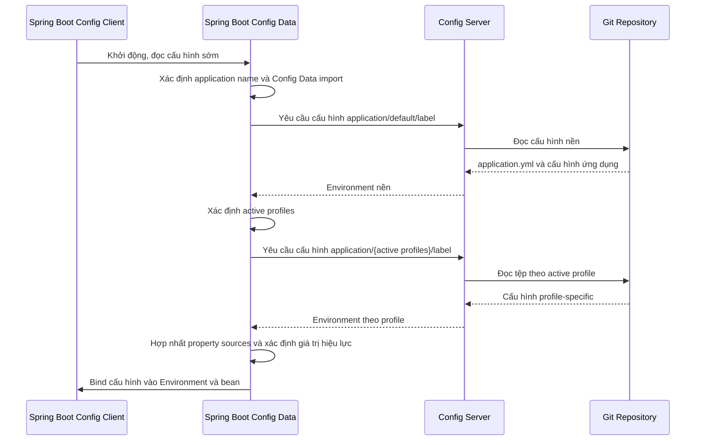

# Quá trình nạp profile mặc định rồi nạp profile được kích hoạt

Khi một ứng dụng Spring Boot dùng Spring Cloud Config Client, cấu hình từ xa thường được nạp theo hai giai đoạn trong Config Data API: client lấy cấu hình nền với profile `default`, sau đó lấy cấu hình dành cho các profile đang hoạt động như `dev`, `staging` hoặc `prod`. Cách nạp này giúp ứng dụng có một bộ giá trị chung trước khi áp dụng các giá trị chuyên biệt cho môi trường.

Để hiểu đúng quá trình, cần phân biệt profile `default` dùng làm cấu hình nền với danh sách active profile của Spring Boot. Khi ứng dụng kích hoạt `prod`, điều đó không có nghĩa `default` cũng trở thành một active profile. Config Client vẫn có thể truy vấn cấu hình nền `default` trước, rồi truy vấn profile `prod` để bổ sung và ghi đè các giá trị phù hợp.

## 1. Mục tiêu học tập

Sau bài học, bạn có thể:

- Giải thích vì sao Config Client nạp cấu hình nền theo profile `default` trước khi nạp cấu hình của active profile.
- Phân biệt default profile của Spring Boot với active profile như `dev` hoặc `prod`.
- Mô tả các bước từ lúc ứng dụng khởi động, đọc `spring.config.import`, xác định profile đến lúc bind cấu hình vào bean.
- Tổ chức các tệp cấu hình dùng chung và theo profile trong Git repository.
- Hiểu cách giá trị theo profile ghi đè giá trị nền và cách nhiều active profile tương tác.
- Cấu hình Config Client bằng Config Data API và xử lý trường hợp Config Server không truy cập được.
- Chẩn đoán lỗi khi client gửi sai application/profile hoặc không nhận được cấu hình mong muốn.

## 2. Hai khái niệm cần phân biệt: default profile và active profile

### Default profile

Spring Boot có profile mặc định tên là `default`. Khi ứng dụng không kích hoạt profile nào, profile mặc định được dùng. Có thể thay tên profile mặc định bằng thuộc tính `spring.profiles.default`.

Ví dụ:

```yaml
spring:
  profiles:
    default: local
```

Nếu không có active profile khác, ứng dụng sử dụng `local` làm profile mặc định theo cấu hình trên. Đây là quy tắc profile của Spring Boot.

### Active profile

Active profile xác định nhóm cấu hình đang áp dụng cho một lần chạy. Ví dụ:

```yaml
spring:
  profiles:
    active: prod
```

Ứng dụng sẽ hoạt động với profile `prod`. Giá trị này thường được truyền qua file cấu hình, biến môi trường `SPRING_PROFILES_ACTIVE` hoặc tham số dòng lệnh.

Có thể kích hoạt nhiều profile:

```yaml
spring:
  profiles:
    active: prod,region-apac
```

Khi có nhiều profile, Spring Boot áp dụng các nguồn cấu hình theo thứ tự profile. Nếu nhiều profile cùng khai báo một khóa, profile xuất hiện sau trong danh sách active thường có độ ưu tiên cao hơn đối với khóa trùng nhau.

### Vì sao vẫn có bước nạp `default` khi đã active `prod`?

Trong luồng Config Data của Spring Cloud Config Client, client truy vấn cấu hình nền theo profile `default` trước, rồi truy vấn cấu hình theo các active profile. Đây là cách lấy nhiều lớp cấu hình từ Config Server. Nó không đồng nghĩa với việc `default` được thêm vào danh sách active profile của ứng dụng.

Có thể hình dung:

- `default`: cung cấp giá trị nền để các ứng dụng dùng chung.
- `prod`: cung cấp giá trị riêng khi ứng dụng chạy production.
- `region-apac`: cung cấp phần ghi đè hoặc bổ sung theo khu vực.

## 3. Luồng nạp cấu hình từ lúc khởi động

Với Config Data API, ứng dụng thường khai báo `spring.config.import` để kết nối Config Server. Quá trình khái quát như sau:



Các bước chính:

1. Ứng dụng bắt đầu khởi động và đọc các nguồn cấu hình sớm cần thiết để biết tên ứng dụng, địa chỉ Config Server và Config Data import.
2. Config Client lấy cấu hình nền theo profile `default` từ Config Server.
3. Spring Boot xác định các active profile sau khi xử lý các nguồn cấu hình liên quan.
4. Config Client yêu cầu cấu hình theo các active profile, ví dụ `prod` hoặc `prod,region-apac`.
5. Spring Boot kết hợp các property source theo quy tắc Config Data và thứ tự ưu tiên.
6. Các thuộc tính hiệu lực được sử dụng trong `Environment`, sau đó bind vào `@ConfigurationProperties`, `@Value` và các thành phần cần cấu hình.

Số request và chi tiết xử lý có thể phụ thuộc phiên bản Spring Cloud Config, cách cấu hình import và các profile được kích hoạt. Khi cần chẩn đoán, hãy quan sát log Config Client và request thực tế đến Config Server thay vì giả định mọi phiên bản có cùng số request.

## 4. Cấu hình Config Client bằng Config Data API

Với các phiên bản Spring Boot hiện đại, cách cấu hình được khuyến nghị là dùng `spring.config.import`.

Ví dụ ứng dụng `order-service` chạy ở production:

```yaml
spring:
  application:
    name: order-service
  profiles:
    active: prod
  config:
    import: "configserver:http://localhost:8888"
```

Client dùng `order-service` làm application name và kết nối Config Server tại `http://localhost:8888`. Khi khởi động, client lấy cấu hình nền rồi lấy cấu hình theo profile `prod`.

Nếu Config Server không phải phụ thuộc bắt buộc để ứng dụng khởi động, có thể thêm tiền tố `optional:`:

```yaml
spring:
  config:
    import: "optional:configserver:http://localhost:8888"
```

Khi import là optional, ứng dụng có thể tiếp tục khởi động nếu Config Server không truy cập được. Chỉ nên dùng khi ứng dụng có cấu hình dự phòng an toàn và vẫn hoạt động đúng nếu thiếu cấu hình từ xa. Với các giá trị bắt buộc như URL dịch vụ thanh toán hoặc thông số kết nối database production, việc bỏ qua Config Server có thể khiến ứng dụng khởi động với cấu hình sai; trong trường hợp đó nên để lỗi được phát hiện ngay khi khởi động.

Nếu cần cấu hình timeout, retry hoặc label, đặt chúng trong namespace `spring.cloud.config` theo phiên bản Spring Cloud đang sử dụng. Các giá trị như application name, địa chỉ server và import phải có sẵn đủ sớm để client có thể tạo request đầu tiên.

## 5. Tổ chức file trong Git repository

Một repository có thể tổ chức cấu hình nền và cấu hình theo profile như sau:

```text
config-repo/
├── application.yml
├── application-prod.yml
├── application-region-apac.yml
├── order-service.yml
├── order-service-prod.yml
├── order-service-region-apac.yml
└── payment-service.yml
```

Ý nghĩa:

- `application.yml`: thuộc tính nền dùng chung cho các ứng dụng.
- `application-prod.yml`: thuộc tính chung khi ứng dụng chạy profile `prod`.
- `application-region-apac.yml`: thuộc tính chung theo profile khu vực.
- `order-service.yml`: thuộc tính riêng của `order-service`, không phụ thuộc profile cụ thể.
- `order-service-prod.yml`: thuộc tính riêng của `order-service` khi chạy production.
- `order-service-region-apac.yml`: thuộc tính riêng theo khu vực của `order-service`.

Ví dụ `application.yml`:

```yaml
platform:
  http:
    connect-timeout: 2s
    read-timeout: 5s
  logging:
    level: INFO
```

Ví dụ `order-service.yml`:

```yaml
order:
  fulfillment:
    max-batch-size: 50
```

Ví dụ `order-service-prod.yml`:

```yaml
spring:
  datasource:
    url: jdbc:postgresql://orders-db.internal:5432/orders

platform:
  http:
    read-timeout: 8s

order:
  fulfillment:
    max-batch-size: 100
```

Khi `order-service` chạy profile `prod`, các giá trị chung và riêng của ứng dụng được tổng hợp cùng phần cấu hình production. Giá trị `platform.http.read-timeout` trong tệp profile có thể ghi đè giá trị nền `5s`; `connect-timeout` vẫn được lấy từ cấu hình nền nếu không có nguồn nào khác ghi đè.

Không cần sao chép toàn bộ cấu hình nền vào mọi tệp profile. Chỉ khai báo các khóa thực sự cần khác biệt để giảm trùng lặp và tránh sai lệch giữa môi trường.

## 6. Ví dụ quá trình nạp `default` rồi `prod`

Giả sử client có:

```yaml
spring:
  application:
    name: order-service
  profiles:
    active: prod
  config:
    import: "configserver:http://config-server:8888"
```

Ở giai đoạn nạp nền, client yêu cầu cấu hình `order-service` với profile `default`. Server có thể trả về các nguồn như `application.yml` và `order-service.yml`.

Ví dụ cấu hình nền:

```yaml
platform:
  http:
    read-timeout: 5s
  logging:
    level: INFO

order:
  fulfillment:
    max-batch-size: 50
```

Sau đó client yêu cầu profile `prod`. Server trả thêm các nguồn profile-specific như `application-prod.yml` và `order-service-prod.yml` nếu chúng tồn tại.

Ví dụ cấu hình production:

```yaml
platform:
  http:
    read-timeout: 8s

order:
  fulfillment:
    max-batch-size: 100
```

Khi hợp nhất, các khóa trùng được lấy theo nguồn có ưu tiên cao hơn. Kết quả mong muốn trong ví dụ:

| Khóa | Giá trị nền | Giá trị `prod` | Giá trị hiệu lực |
| --- | --- | --- | --- |
| `platform.http.read-timeout` | `5s` | `8s` | `8s` |
| `platform.logging.level` | `INFO` | Không khai báo | `INFO` |
| `order.fulfillment.max-batch-size` | `50` | `100` | `100` |

Ví dụ này minh họa nguyên tắc cấu hình profile-specific ghi đè giá trị nền. Trong một ứng dụng thực tế, giá trị hiệu lực còn chịu ảnh hưởng bởi thứ tự property source, cấu hình cục bộ, biến môi trường, tham số dòng lệnh và chính sách override đã thiết lập. Khi có xung đột, hãy kiểm tra `Environment` thực tế của client.

## 7. Khi không khai báo active profile

Nếu ứng dụng không có active profile, Spring Boot sử dụng default profile. Theo mặc định, tên của profile đó là `default`.

Ví dụ:

```yaml
spring:
  application:
    name: order-service
  config:
    import: "configserver:http://config-server:8888"
```

Trong trường hợp này, client không yêu cầu cấu hình cho `prod` hay `dev`. Các giá trị nền được dùng, cùng với những cấu hình phù hợp với default profile nếu có.

Nếu muốn thay profile mặc định:

```yaml
spring:
  profiles:
    default: local
```

Khi không có active profile, `local` được dùng làm default profile theo thiết lập này. Cần thống nhất tên profile mặc định giữa cách chạy ứng dụng và cấu trúc repository để tránh việc client yêu cầu một profile nhưng nhóm lại chuẩn bị tệp cho profile khác.

## 8. Khi có nhiều active profile

Một ứng dụng có thể cần kết hợp profile môi trường và profile theo khu vực hoặc tính năng:

```yaml
spring:
  profiles:
    active: prod,region-apac
```

Config Client gửi danh sách profile để Config Server tìm các nguồn cấu hình tương ứng. Các nguồn nền vẫn có thể cung cấp giá trị chung; các profile được kích hoạt cung cấp giá trị riêng. Nếu `prod` và `region-apac` cùng khai báo một khóa, thứ tự active profile có thể quyết định giá trị cuối cùng, trong đó profile đứng sau có độ ưu tiên cao hơn theo quy tắc Spring Boot.

Ví dụ:

```yaml
# application-prod.yml
platform:
  currency:
    default: USD
```

```yaml
# application-region-apac.yml
platform:
  currency:
    default: SGD
```

Với `spring.profiles.active=prod,region-apac`, giá trị theo khu vực có thể ghi đè giá trị production chung thành `SGD`. Nếu muốn production luôn thắng, hãy sắp xếp profile hoặc thiết kế khóa/phạm vi sao cho kết quả không phụ thuộc vào một ghi đè ngoài ý muốn.

Không nên tạo quá nhiều profile để biểu diễn mọi tổ hợp cấu hình. Khi số chiều môi trường, khu vực và tính năng tăng, số lượng tổ hợp có thể trở nên khó kiểm soát. Hãy giữ profile cho những nhóm cấu hình có vòng đời và mục đích rõ ràng.

## 9. Profile có thể được kích hoạt từ nhiều nguồn

Active profile có thể đến từ:

- `spring.profiles.active` trong cấu hình cục bộ không phụ thuộc profile.
- Biến môi trường `SPRING_PROFILES_ACTIVE`.
- Tham số dòng lệnh `--spring.profiles.active=prod`.
- Các cơ chế include hoặc profile group của Spring Boot.

Ví dụ dùng biến môi trường:

```bash
SPRING_PROFILES_ACTIVE=prod,region-apac java -jar order-service.jar
```

Hoặc dùng tham số dòng lệnh:

```bash
java -jar order-service.jar --spring.profiles.active=prod
```

Các nguồn cấu hình có thứ tự ưu tiên riêng. Tham số dòng lệnh và biến môi trường có thể ghi đè giá trị trong file cấu hình. Khi ứng dụng bất ngờ nạp `dev` thay vì `prod`, cần kiểm tra môi trường chạy và tham số khởi động, không chỉ xem Git repository.

`spring.profiles.active` và `spring.profiles.default` là các thuộc tính điều khiển profile. Không đặt chúng trong tài liệu cấu hình chỉ được kích hoạt bởi một profile cụ thể; cần khai báo ở nguồn không phụ thuộc profile hoặc nguồn ngoài phù hợp để tránh vòng lặp xác định profile.

## 10. Tên application ảnh hưởng đến tệp nào được nạp

Config Client dùng `spring.application.name` làm application name nếu không có cấu hình tên Config Client riêng. Ví dụ:

```yaml
spring:
  application:
    name: payment-service
```

Server sẽ tìm cấu hình chung và cấu hình riêng cho `payment-service`. Nếu tên application sai, server có thể vẫn trả về các thuộc tính chung nhưng không trả đúng các file dành riêng cho dịch vụ.

Hãy kiểm tra:

- Tên trong `spring.application.name` có khớp tên file cấu hình riêng không.
- Tên application được dùng thống nhất trong log, request và repository.
- Các ứng dụng không vô tình dùng chung một application name nếu cần cấu hình riêng.
- Config Server có nhận đúng profile và label từ client không.

Ví dụ request:

```text
GET /payment-service/prod/main
```

Request này yêu cầu cấu hình `payment-service`, profile `prod`, label `main`. Nếu client đang gửi `order-service`, các tệp `payment-service*.yml` sẽ không được chọn cho request đó.

## 11. Cấu hình từ xa và giá trị hiệu lực

Sau khi Config Client nhận cấu hình nền và profile-specific, Spring Boot hợp nhất chúng với các nguồn cấu hình khác. Những nguồn này có thể bao gồm:

- Config Data từ Config Server.
- `application.yml` hoặc file profile-specific đóng gói trong ứng dụng.
- File cấu hình bên ngoài container hoặc máy chủ.
- Biến môi trường.
- Java system properties.
- Tham số dòng lệnh.
- Giá trị mặc định được khai báo trong mã hoặc lớp cấu hình.

Thứ tự ưu tiên chính xác phụ thuộc cách ứng dụng khai báo Config Data import và phiên bản Spring Boot/Spring Cloud. Không nên mặc định mọi thuộc tính từ xa luôn thắng biến môi trường hoặc file cục bộ. Khi một giá trị không đúng như mong đợi:

1. Gọi endpoint Config Server với đúng application/profile/label để kiểm tra property source mà server trả về.
2. Kiểm tra log Config Client để xác nhận request nền và request profile-specific.
3. Kiểm tra nguồn cục bộ, biến môi trường và tham số dòng lệnh có khai báo trùng khóa không.
4. Nếu Actuator `env` được bật, kiểm tra nguồn của thuộc tính trong `Environment` và bảo vệ endpoint này bằng xác thực/phân quyền.
5. Kiểm tra kiểu dữ liệu và validation của `@ConfigurationProperties`.

Ví dụ, Git có thể trả `platform.http.read-timeout=8s` cho profile `prod`, nhưng biến môi trường `PLATFORM_HTTP_READ_TIMEOUT=12s` hoặc một tham số dòng lệnh có thể làm giá trị hiệu lực khác đi tùy thứ tự nguồn cấu hình. Hãy kiểm tra nguồn thực tế thay vì suy luận chỉ từ nội dung YAML trên Git.

## 12. Bind cấu hình sau khi nạp profile

Khi các property source đã được hợp nhất, ứng dụng có thể đọc giá trị bằng `@ConfigurationProperties` hoặc `@Value`. Với nhóm thuộc tính có cấu trúc, nên dùng `@ConfigurationProperties`.

Ví dụ:

```java
import java.time.Duration;

import org.springframework.boot.context.properties.ConfigurationProperties;

@ConfigurationProperties(prefix = "platform.http")
public record HttpProperties(
        Duration connectTimeout,
        Duration readTimeout) {
}
```

Đăng ký cấu hình bằng `@ConfigurationPropertiesScan` hoặc `@EnableConfigurationProperties(HttpProperties.class)`. Sau khi bind, component sử dụng `HttpProperties` nhận giá trị hiệu lực đã được chọn từ các nguồn cấu hình.

Nếu profile `prod` không khai báo `connect-timeout`, giá trị nền vẫn có thể được sử dụng. Nếu không có nguồn nào khai báo một thuộc tính bắt buộc, ứng dụng nên phát hiện thiếu cấu hình bằng validation hoặc kiểm tra khởi động thay vì âm thầm dùng giá trị không an toàn.

## 13. Legacy bootstrap và Config Data API

Các dự án Spring Cloud Config cũ có thể dùng `bootstrap.yml` hoặc `bootstrap.properties` cùng cơ chế bootstrap context. Với các dự án Spring Boot hiện đại, `spring.config.import` là cách tích hợp Config Server qua Config Data API.

Ví dụ Config Data API:

```yaml
spring:
  application:
    name: order-service
  config:
    import: "configserver:http://config-server:8888"
```

Ví dụ legacy bootstrap:

```yaml
spring:
  application:
    name: order-service
  cloud:
    config:
      uri: http://config-server:8888
```

Đoạn legacy chỉ có tác dụng khi dự án đã bật cơ chế bootstrap tương ứng, ví dụ thêm dependency `spring-cloud-starter-bootstrap` theo hướng dẫn của phiên bản đang dùng. Không trộn hai cơ chế một cách tùy tiện vì chúng có vòng đời nạp cấu hình và cách thiết lập khác nhau.

Khi đọc tài liệu hoặc xử lý lỗi, trước hết xác định dự án dùng Config Data API hay bootstrap context. Tên thuộc tính và tùy chọn retry/fail-fast có thể khác nhau giữa các dòng phiên bản.

## 14. Xử lý khi Config Server không sẵn sàng

Config Client cần lấy được các thuộc tính cần thiết để ứng dụng khởi động. Có hai chính sách thường gặp:

- **Bắt buộc Config Server:** nếu không lấy được cấu hình, ứng dụng dừng khởi động. Cách này phù hợp khi cấu hình từ xa là nguồn bắt buộc và thiếu cấu hình có thể gây lỗi nghiêm trọng.
- **Optional import:** ứng dụng tiếp tục khởi động nếu không kết nối được Config Server. Chỉ phù hợp khi có giá trị dự phòng đã được kiểm thử và an toàn.

Ví dụ optional:

```yaml
spring:
  config:
    import: "optional:configserver:http://config-server:8888"
```

Ví dụ required:

```yaml
spring:
  config:
    import: "configserver:http://config-server:8888"
```

Với môi trường production, hãy xác định rõ ứng dụng có thể chạy đúng nếu không nhận cấu hình mới hay không. Không nên dùng optional chỉ để bỏ qua lỗi mạng nếu các giá trị như database URL, endpoint thanh toán hoặc chính sách bảo mật bắt buộc phải lấy từ server.

Nếu dùng retry khi Config Server tạm thời chưa sẵn sàng, hãy cấu hình theo hướng dẫn của phiên bản Spring Cloud Config và kiểm tra dependency hỗ trợ retry. Retry giúp vượt qua gián đoạn ngắn; nó không thay thế health check, giám sát và khả năng sẵn sàng của Config Server.

## 15. Chẩn đoán lỗi nạp profile

| Biểu hiện | Nguyên nhân có thể | Cách kiểm tra |
| --- | --- | --- |
| Client chỉ nhận cấu hình nền, thiếu cấu hình `prod` | Active profile không được kích hoạt hoặc request không gửi profile mong muốn | Kiểm tra `SPRING_PROFILES_ACTIVE`, tham số dòng lệnh và log request |
| Client nhận cấu hình của dịch vụ khác | `spring.application.name` sai hoặc bị override | Kiểm tra tên application thực tế và URL request |
| Profile `default` được dùng ngoài dự kiến | Không có active profile hoặc biến môi trường không được truyền vào container | Kiểm tra active/default profiles trong `Environment` |
| Giá trị profile không ghi đè giá trị nền | Khóa bị khai báo ở nguồn có ưu tiên cao hơn hoặc thứ tự property source khác dự kiến | Kiểm tra property source từ Config Server và Actuator `env` |
| Một số khóa có giá trị khác giữa các lần chạy | Active profile, label hoặc biến môi trường khác nhau | Ghi nhận application/profile/label và môi trường khởi động |
| Client không kết nối được Config Server | Sai URI, DNS, port, TLS, authentication hoặc server chưa sẵn sàng | Kiểm tra log, network và endpoint Config Server |
| Ứng dụng chạy dù không lấy được cấu hình | Import có tiền tố `optional:` hoặc cơ chế fallback đang bật | Kiểm tra `spring.config.import` và giá trị fallback |
| Cấu hình bind lỗi | Sai kiểu, thiếu thuộc tính bắt buộc hoặc YAML không hợp lệ | Kiểm tra response, kiểu dữ liệu và validation |

Khi điều tra, hãy ghi lại application name, active profile, label, Config Server URI và phiên bản Spring Boot/Spring Cloud. Các thông tin này giúp tái hiện chính xác request mà client đã gửi.

## 16. Quy trình kiểm tra quá trình nạp cấu hình

1. Kiểm tra JDK và phiên bản Spring Boot/Spring Cloud đã chọn tương thích.
2. Xác nhận `spring.application.name` đúng với tên dịch vụ trong repository.
3. Xác nhận `spring.config.import` trỏ đúng Config Server và có chính sách optional/required phù hợp.
4. Kiểm tra active profile từ file, biến môi trường hoặc tham số khởi động.
5. Gọi API Config Server cho profile `default` và profile đang hoạt động để kiểm tra nguồn trả về.
6. Kiểm tra các file chung và file theo application/profile trong repository.
7. Khởi động client và quan sát log để xác nhận thứ tự lấy cấu hình.
8. Kiểm tra giá trị hiệu lực trong `Environment` và bean cấu hình.
9. Thử thay đổi một giá trị nền và một giá trị profile-specific để xác nhận ghi đè đúng.
10. Ghi lại application/profile/label và kết quả kiểm thử cho môi trường triển khai.

## 17. Checklist trước khi triển khai Config Client

- [ ] `spring.application.name` được khai báo đúng.
- [ ] `spring.config.import` trỏ đến Config Server đúng môi trường.
- [ ] Đã hiểu client nạp cấu hình nền `default` trước cấu hình active profile.
- [ ] Đã phân biệt default profile của Spring Boot với active profile.
- [ ] Active profile được truyền rõ ràng trong môi trường chạy.
- [ ] Repository có các tệp cấu hình chung và profile-specific phù hợp.
- [ ] Thứ tự nhiều active profile đã được xác định và kiểm thử.
- [ ] Giá trị hiệu lực không bị override ngoài ý muốn từ biến môi trường hoặc tham số dòng lệnh.
- [ ] Chính sách optional/required phản ánh đúng mức độ bắt buộc của cấu hình từ xa.
- [ ] Các thuộc tính được bind bằng kiểu dữ liệu phù hợp và có validation cần thiết.
- [ ] Endpoint chẩn đoán cấu hình được bảo vệ.
- [ ] Log khởi động đủ để xác định application/profile/label nhưng không tiết lộ bí mật.

Nạp cấu hình theo profile giúp một ứng dụng dùng giá trị nền chung rồi áp dụng phần cấu hình riêng cho môi trường đang chạy. Khi phân biệt đúng profile `default` với active profile, khai báo `spring.config.import` chính xác và kiểm tra property source hiệu lực, Config Client có thể nhận cấu hình nhất quán từ Config Server ngay trong quá trình khởi động.

## 18. Tài liệu tham khảo

- [Spring Cloud Config Client — Config Data Import](https://docs.spring.io/spring-cloud-config/reference/client.html)
- [Spring Boot — Profiles](https://docs.spring.io/spring-boot/reference/features/profiles.html)
- [Spring Boot — Externalized Configuration](https://docs.spring.io/spring-boot/reference/features/external-config.html)
