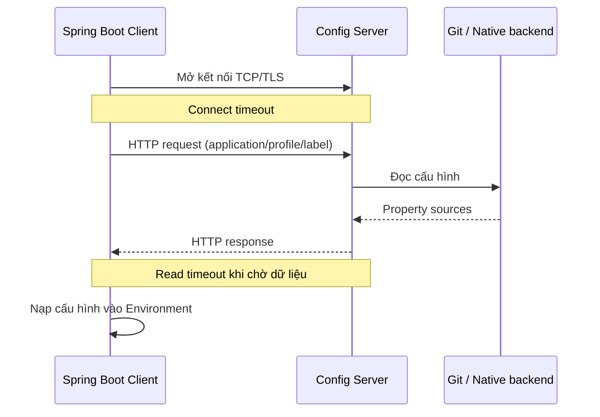

# Giới hạn thời gian kết nối và thời gian đọc phản hồi

Spring Cloud Config Client lấy cấu hình từ Config Server trong quá trình khởi động hoặc nạp cấu hình. Nếu server không phản hồi, kết nối mạng chậm hoặc backend phía server xử lý lâu, ứng dụng có thể phải chờ trước khi báo lỗi. Hai giới hạn thời gian quan trọng giúp kiểm soát việc chờ này là **connect timeout** và **read timeout**.

Connect timeout giới hạn thời gian thiết lập kết nối đến Config Server. Read timeout giới hạn thời gian client chờ dữ liệu phản hồi sau khi kết nối đã được thiết lập. Hai giá trị giải quyết hai giai đoạn khác nhau của một HTTP request; cấu hình chúng hợp lý giúp ứng dụng khởi động có thể dự đoán và phát hiện lỗi kết nối sớm hơn.

## 1. Vòng đời một request từ Config Client

Khi ứng dụng yêu cầu cấu hình từ xa, client thực hiện một số bước chính:

1. Phân giải hostname của Config Server và chuẩn bị kết nối.
2. Thiết lập kết nối TCP, và thực hiện TLS handshake nếu dùng HTTPS.
3. Gửi HTTP request chứa thông tin application, profile và label.
4. Chờ Config Server xử lý request, đọc backend cấu hình và tạo phản hồi.
5. Đọc HTTP response và đưa các property source vào Environment của ứng dụng.



Connect timeout tác động đến bước thiết lập kết nối. Read timeout tác động đến thời gian chờ đọc response. Nếu Config Server đã nhận request nhưng đang chờ Git backend, client có thể hết read timeout dù kết nối TCP vẫn hoạt động.

## 2. Connect timeout là gì?

Connect timeout là khoảng thời gian tối đa client chờ để thiết lập kết nối đến Config Server. Nếu server không lắng nghe, route mạng bị lỗi, firewall chặn kết nối hoặc endpoint không thể tiếp cận, client sẽ dừng chờ khi vượt giới hạn này và báo lỗi kết nối.

Ví dụ, đặt connect timeout là 3.000 mili giây:

```yaml
spring:
  cloud:
    config:
      request-connect-timeout: 3000
```

Trong ví dụ này, client chờ tối đa khoảng 3 giây cho giai đoạn kết nối theo cơ chế HTTP client đang sử dụng. Giá trị được tính bằng mili giây.

Connect timeout hữu ích khi:

- Config Server tạm thời không hoạt động.
- DNS hoặc mạng nội bộ gặp sự cố khiến endpoint không thể kết nối.
- Firewall, network policy hoặc service routing chặn kết nối.
- Config Server vừa khởi động và chưa sẵn sàng nhận request.
- Ứng dụng cần giới hạn thời gian chờ trước khi thử endpoint khác hoặc áp dụng retry.

Connect timeout không phải giới hạn tổng thời gian khởi động ứng dụng. DNS lookup, proxy, TLS handshake hoặc các bước trước/sau khi mở socket có thể có cơ chế timeout riêng tùy HTTP transport. Hãy kiểm tra log và HTTP client thực tế khi cần xác định chính xác giai đoạn bị chậm.

## 3. Read timeout là gì?

Read timeout là khoảng thời gian client chờ dữ liệu phản hồi từ Config Server sau khi kết nối đã được thiết lập và request đã được gửi. Nếu server không gửi dữ liệu trong khoảng thời gian được phép, thao tác đọc có thể kết thúc bằng timeout.

Ví dụ, đặt read timeout là 8.000 mili giây:

```yaml
spring:
  cloud:
    config:
      request-read-timeout: 8000
```

Giá trị được tính bằng mili giây. Read timeout phù hợp để giới hạn thời gian chờ khi:

- Config Server xử lý request lâu.
- Git backend phải clone, fetch hoặc đọc repository chậm.
- Backend Native hoặc backend khác bị chậm do filesystem hay dịch vụ phụ thuộc.
- Mạng giữ kết nối nhưng response không đến hoặc không tiếp tục truyền dữ liệu.
- Server quá tải và không thể tạo response trong thời gian dự kiến.

Read timeout thường là giới hạn cho thao tác chờ đọc dữ liệu của HTTP client, không nhất thiết là deadline tổng thể cho toàn bộ request. Cách tính timeout giữa các lần đọc dữ liệu có thể phụ thuộc thư viện HTTP và phiên bản Spring Cloud đang dùng. Không nên mặc định rằng mọi HTTP transport đều áp dụng read timeout theo cùng một cách.

## 4. Phân biệt connect timeout và read timeout

| Tiêu chí | Connect timeout | Read timeout |
|---|---|---|
| Giai đoạn | Thiết lập kết nối đến Config Server. | Chờ đọc dữ liệu phản hồi sau khi gửi request. |
| Lỗi thường gặp | Connection refused, không thể kết nối, kết nối mạng không hoàn tất. | Server xử lý lâu, backend chậm, response không gửi dữ liệu kịp thời. |
| Câu hỏi chẩn đoán | Client có mở được kết nối đến endpoint không? | Sau khi gửi request, client có nhận được dữ liệu đúng hạn không? |
| Cấu hình | `spring.cloud.config.request-connect-timeout` | `spring.cloud.config.request-read-timeout` |
| Đơn vị | Mili giây | Mili giây |

Ví dụ:

- Nếu hostname không phân giải hoặc cổng Config Server bị firewall chặn, hãy điều tra giai đoạn kết nối và connect timeout.
- Nếu kết nối thành công nhưng Config Server mất 15 giây để đọc Git rồi mới trả response, read timeout 5 giây có thể khiến client thất bại trước khi server hoàn tất.

Tăng cả hai giá trị một cách máy móc có thể làm ứng dụng chờ lâu hơn khi có lỗi. Hãy xác định giai đoạn bị chậm trước khi thay đổi timeout.

## 5. Cấu hình timeout với Config Data API

Với Spring Boot hiện đại, Config Data API là cách khai báo Config Server được khuyến nghị. Client có thể dùng `spring.config.import` và đặt hai timeout trong cùng cấu hình:

```yaml
spring:
  application:
    name: orders-service
  config:
    import: "configserver:http://config-server:8888"
  cloud:
    config:
      request-connect-timeout: 3000
      request-read-timeout: 10000
```

Trong ví dụ:

- `spring.config.import` chỉ định Config Server mà client cần truy cập.
- `request-connect-timeout: 3000` giới hạn thời gian thiết lập kết nối ở khoảng 3 giây.
- `request-read-timeout: 10000` giới hạn thời gian chờ đọc response ở khoảng 10 giây.

Có thể truyền các thuộc tính bằng biến môi trường:

```bash
SPRING_CLOUD_CONFIG_REQUEST_CONNECT_TIMEOUT=3000
SPRING_CLOUD_CONFIG_REQUEST_READ_TIMEOUT=10000
```

Spring Boot relaxed binding ánh xạ tên biến môi trường sang các thuộc tính tương ứng. Cách này hữu ích khi cùng một image được triển khai ở nhiều môi trường nhưng cần timeout khác nhau.

Nếu Config Server sử dụng HTTPS, URL import sẽ dùng `https://`. Khi đó, ngoài timeout, cần cấu hình truststore/chứng chỉ và kiểm tra TLS. Timeout không khắc phục được chứng chỉ không tin cậy hoặc hostname certificate không khớp.

## 6. Cấu hình với cơ chế bootstrap cũ

Một số ứng dụng Spring Cloud cũ dùng bootstrap context và `spring.cloud.config.uri` thay cho Config Data import. Ví dụ:

```yaml
spring:
  application:
    name: orders-service
  cloud:
    config:
      uri: http://config-server:8888
      request-connect-timeout: 3000
      request-read-timeout: 10000
      fail-fast: true
```

Trong mô hình bootstrap, cần bảo đảm bootstrap được bật và các thuộc tính được nạp ở đúng giai đoạn. Không trộn cấu hình legacy với Config Data API một cách tùy tiện vì thứ tự nạp và cơ chế xử lý có thể khác nhau.

Hai thuộc tính timeout có cùng mục đích dù ứng dụng dùng Config Data API hay bootstrap. Tuy nhiên, hành vi cụ thể có thể phụ thuộc phiên bản Spring Cloud Config, HTTP client được chọn và cách ứng dụng khởi tạo Config Client. Khi nâng cấp release train, hãy kiểm tra lại reference documentation và log khởi tạo để xác nhận các thuộc tính đã được bind.

## 7. Chọn giá trị timeout phù hợp

Không có một bộ timeout phù hợp cho mọi ứng dụng. Giá trị nên dựa trên độ trễ bình thường của Config Server, thời gian backend cần để trả cấu hình, đặc điểm mạng và ngân sách khởi động của ứng dụng.

Một bộ giá trị minh họa:

```yaml
spring:
  cloud:
    config:
      request-connect-timeout: 3000
      request-read-timeout: 10000
```

Đây chỉ là điểm bắt đầu để thử nghiệm, không phải giá trị chuẩn cho mọi hệ thống. Khi lựa chọn:

1. Đo thời gian kết nối trong điều kiện bình thường và khi mạng tải cao.
2. Đo thời gian Config Server đọc backend và tạo response.
3. Xác định thời gian khởi động tối đa mà nền tảng cho phép.
4. Dành ngân sách cho số lần retry và khoảng nghỉ giữa các lần thử.
5. Đặt timeout đủ lớn cho các request hợp lệ nhưng đủ nhỏ để phát hiện sự cố trong thời gian chấp nhận được.
6. Kiểm tra lại với từng môi trường, vì mạng nội bộ, VPN, service mesh và backend có độ trễ khác nhau.

Connect timeout thường ngắn hơn read timeout vì việc mở kết nối nội bộ thường nhanh hơn thời gian server truy xuất cấu hình. Tuy vậy, số đo thực tế và đặc điểm hệ thống mới là căn cứ quyết định.

## 8. Timeout, retry và fail-fast

Timeout quyết định một lần thử có thể chờ bao lâu. Retry quyết định có thử lại sau khi một lần gọi thất bại hay không. Fail-fast quyết định ứng dụng có dừng khởi động khi không lấy được cấu hình bắt buộc hay không.

Ví dụ cấu hình retry cho Config Client:

```yaml
spring:
  cloud:
    config:
      request-connect-timeout: 3000
      request-read-timeout: 10000
      retry:
        max-attempts: 5
        initial-interval: 1000
        max-interval: 4000
        multiplier: 1.5
```

Các thuộc tính retry điều khiển số lần thử và khoảng nghỉ tăng dần. Để sử dụng retry, ứng dụng cần có các dependency và cấu hình phù hợp với phiên bản Spring Cloud Config đang dùng; kiểm tra tài liệu release tương ứng trước khi áp dụng.

Thời gian chờ tổng cộng có thể lớn hơn nhiều so với một connect timeout hoặc read timeout. Ví dụ, nếu một lần thử có thể mất tối đa khoảng 3 giây kết nối cộng 10 giây đọc response, năm lần thử cùng backoff có thể kéo dài thời gian khởi động đáng kể. Đây chỉ là phép ước lượng ngân sách; tổng thời gian thực tế còn phụ thuộc số request Config Data, DNS, TLS, HTTP transport và cách retry được triển khai.

Không nên đặt retry quá nhiều cùng timeout quá dài. Sự kết hợp này có thể làm nhiều instance khởi động chờ lâu, tạo tải lặp lại lên Config Server đang gặp sự cố và kéo dài thời gian phục hồi.

Với Config Data API, `optional:configserver:` cho phép ứng dụng tiếp tục khởi động khi Config Server không truy cập được. Chỉ dùng khi ứng dụng có thể hoạt động an toàn với các nguồn cấu hình còn lại. Nếu cấu hình tập trung là bắt buộc, hãy dùng import không có tiền tố `optional:` để lỗi lấy cấu hình được phát hiện trong quá trình khởi động. Với cơ chế bootstrap cũ, `spring.cloud.config.fail-fast` điều khiển hành vi dừng sớm khi không lấy được cấu hình.

## 9. Phân biệt timeout phía client và timeout phía server

Config Client và Config Server có các timeout thuộc những chặng khác nhau. Không nhầm hai nhóm này:

| Thuộc tính | Nơi cấu hình | Phạm vi |
|---|---|---|
| `spring.cloud.config.request-connect-timeout` | Config Client | Thời gian thiết lập kết nối HTTP từ client đến Config Server. |
| `spring.cloud.config.request-read-timeout` | Config Client | Thời gian client chờ đọc HTTP response từ Config Server. |
| `spring.cloud.config.server.git.timeout` | Config Server | Timeout cho thao tác Git backend theo cấu hình server. |

Ví dụ: client đặt read timeout 5 giây, nhưng Config Server cần 8 giây để đọc repository Git. Client có thể kết thúc request trước khi server trả response. Tăng Git timeout phía server không giúp client chờ lâu hơn; cần điều chỉnh ngân sách timeout ở cả hai phía sao cho tương thích.

Ngược lại, nếu Git backend có timeout 3 giây nhưng client read timeout 30 giây, request có thể thất bại do backend trước khi client hết thời gian chờ. Khi điều tra, hãy đối chiếu log và timeout ở từng thành phần.

## 10. Chẩn đoán lỗi timeout

Khi Config Client không lấy được cấu hình, hãy phân loại lỗi theo giai đoạn:

| Triệu chứng | Nhóm vấn đề | Hướng kiểm tra |
|---|---|---|
| `Connection refused` | Kết nối | Config Server có chạy không, cổng có đúng không, service routing/firewall có cho phép không? |
| `Connect timed out` | Kết nối | DNS, route, network policy, proxy và connect timeout. |
| `UnknownHostException` | DNS | Tên host, DNS trong container/pod và service discovery. |
| `SocketTimeoutException: Read timed out` | Đọc response | Thời gian xử lý server, Git/backend, tải hệ thống và read timeout. |
| `SSLHandshakeException` | TLS | Chứng chỉ, truststore, hostname và cấu hình TLS; tăng timeout không sửa lỗi xác thực chứng chỉ. |
| HTTP `401` hoặc `403` | Xác thực/phân quyền | Credential và quyền truy cập Config Server. |
| HTTP `5xx` | Server/backend | Log Config Server, Git/native repository, timeout phía server và exception gốc. |

Quy trình kiểm tra:

1. Xác nhận URL Config Server, application, profile và label.
2. Gọi health endpoint hoặc endpoint cấu hình từ đúng môi trường mạng của client.
3. Đo riêng thời gian kết nối và thời gian chờ response.
4. Kiểm tra log client để biết lỗi xảy ra trước khi gửi request hay trong lúc đọc response.
5. Đối chiếu timestamp với log Config Server và backend để tìm bước chậm.
6. Kiểm tra timeout, retry và fail-fast có phù hợp ngân sách khởi động không.
7. Thay đổi từng giá trị có căn cứ, sau đó đo lại thay vì tăng đồng thời tất cả giới hạn.

Có thể dùng `curl` để kiểm tra sơ bộ endpoint từ môi trường tương tự client:

```bash
curl -v --connect-timeout 3 --max-time 13 \
  http://config-server:8888/orders-service/prod/main
```

Trong lệnh này, `--connect-timeout` giới hạn giai đoạn kết nối và `--max-time` giới hạn tổng thời gian thao tác của curl. `--max-time` không tương đương trực tiếp với read timeout của Spring Cloud Config Client, nhưng hữu ích để đo tổng thời gian một request từ môi trường kiểm tra.

## 11. Theo dõi và kiểm thử timeout

Timeout nên được kiểm tra trong cả điều kiện bình thường và tình huống lỗi có kiểm soát. Một số tình huống có thể mô phỏng trong môi trường test:

- Config Server không chạy hoặc cổng bị chặn để kiểm tra connect timeout.
- Server nhận request nhưng trì hoãn response để kiểm tra read timeout.
- Git backend phản hồi chậm để đo ảnh hưởng tới thời gian đọc response.
- DNS không phân giải được hoặc trỏ đến endpoint không hợp lệ.
- TLS certificate không được tin cậy để xác nhận lỗi TLS được phân loại đúng, không bị nhầm với timeout.
- Config Server phục hồi sau một khoảng gián đoạn để kiểm tra retry và thời gian khởi động.

Ghi nhận các chỉ số:

- Thời gian kết nối đến Config Server.
- Thời gian từ lúc gửi request đến byte phản hồi đầu tiên.
- Thời gian hoàn thành request.
- Số lần retry và tổng thời gian backoff.
- Tỷ lệ khởi động thành công/thất bại khi Config Server không sẵn sàng.
- Số lượng request đồng thời dồn về Config Server sau khi hệ thống phục hồi.

Nếu nhiều instance khởi động cùng lúc, retry đồng loạt có thể tạo đợt tải lớn lên Config Server. Hãy xem xét khoảng nghỉ có jitter hoặc chính sách retry được hỗ trợ trong phiên bản đang dùng, đồng thời giới hạn số lần thử để tránh tạo thêm áp lực khi server đang phục hồi.

## 12. Tổng kết

- Connect timeout giới hạn thời gian thiết lập kết nối từ Config Client đến Config Server.
- Read timeout giới hạn thời gian client chờ đọc dữ liệu response sau khi gửi request.
- Dùng `spring.cloud.config.request-connect-timeout` và `spring.cloud.config.request-read-timeout`; các giá trị được khai báo bằng mili giây.
- Config Data API dùng `spring.config.import`; ứng dụng legacy có thể dùng `spring.cloud.config.uri` trong bootstrap context.
- Timeout, retry và fail-fast là ba cơ chế khác nhau; cần phối hợp để không vượt ngân sách khởi động.
- Timeout phía client khác timeout Git/backend phía Config Server; hãy kiểm tra cả hai khi request chậm.
- Phân loại lỗi DNS, kết nối, đọc response, TLS, xác thực và backend trước khi thay đổi timeout.
- Đo độ trễ thực tế và kiểm thử khi server/backend chậm để chọn giới hạn phù hợp cho từng môi trường.
