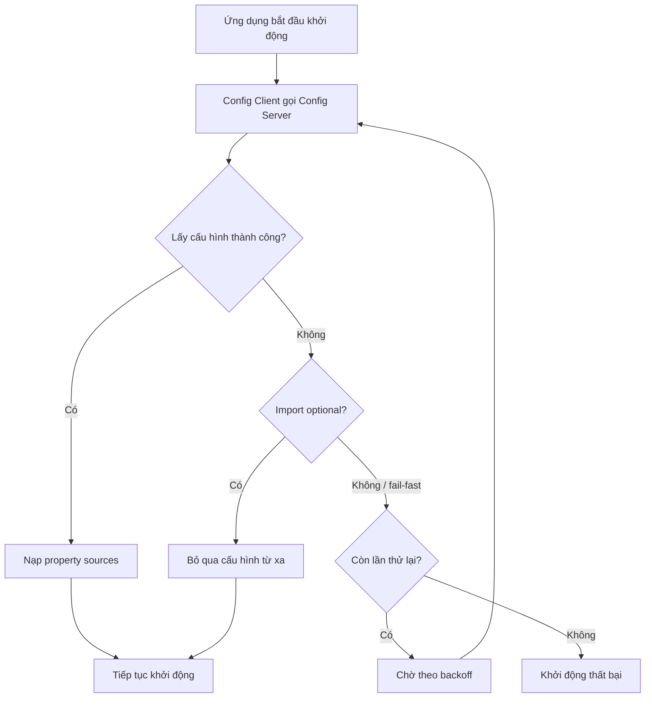

# Fail-fast, thư viện retry và chính sách giãn cách thử lại

Khi một ứng dụng Spring Boot khởi động và lấy cấu hình từ Spring Cloud Config Server, kết nối có thể thất bại vì server chưa sẵn sàng, mạng tạm thời gián đoạn hoặc backend Git đang cập nhật. Nhóm phát triển cần quyết định ứng dụng sẽ tiếp tục chạy với cấu hình cục bộ, dừng khởi động ngay hay chờ và thử kết nối lại trong một khoảng thời gian có giới hạn.

Spring Cloud Config Client cung cấp hai cơ chế quan trọng cho quyết định này: **fail-fast** xác định ứng dụng có được phép khởi động khi không lấy được cấu hình từ xa hay không; **retry** điều khiển số lần thử lại và khoảng chờ giữa các lần thử. Kết hợp đúng hai cơ chế giúp tránh khởi động một dịch vụ với cấu hình thiếu, đồng thời chịu được những gián đoạn ngắn của Config Server.

## Mục tiêu học tập

Sau bài này, bạn có thể:

- Phân biệt Config Data import tùy chọn với import bắt buộc và chế độ bootstrap cũ.
- Cấu hình fail-fast cho Config Client theo đúng cách tích hợp.
- Chọn dependency retry phù hợp với phiên bản Spring Cloud Config.
- Thiết lập `max-attempts`, `initial-interval`, `max-interval` và `multiplier`.
- Giải thích exponential backoff và tác động của timeout lên tổng thời gian khởi động.
- Phân biệt lỗi tạm thời với lỗi cấu hình hoặc xác thực cần sửa.
- Kết hợp retry với nhiều địa chỉ Config Server và kiểm thử hành vi khi server không sẵn sàng.

## Điều gì xảy ra khi Config Client không lấy được cấu hình?

Trong lúc khởi động, Config Client gọi Config Server để lấy property source theo application, profile và label. Nếu lời gọi thất bại, ứng dụng cần một chính sách rõ ràng:

- **Cho phép tiếp tục:** ứng dụng bỏ qua nguồn từ xa và dùng các giá trị cục bộ hoặc mặc định. Cách này chỉ an toàn khi cấu hình cục bộ đủ để ứng dụng hoạt động đúng.
- **Fail-fast:** ứng dụng dừng quá trình khởi động vì cấu hình trung tâm là điều kiện bắt buộc.
- **Retry rồi fail:** ứng dụng chờ và thử lại một số lần. Nếu server vẫn không sẵn sàng sau giới hạn đã đặt, ứng dụng dừng khởi động.



Fail-fast và retry thường được dùng cùng nhau: retry xử lý gián đoạn có thể tự hết, còn fail-fast bảo đảm ứng dụng không chạy tiếp khi đã hết cơ hội lấy cấu hình bắt buộc.

## Config Data import: tùy chọn hay bắt buộc?

Với Spring Boot 2.4 trở lên, cách mặc định để kết nối Config Server là Config Data API qua `spring.config.import`.

Import tùy chọn:

```yaml
spring:
  application:
    name: order-service
  config:
    import: "optional:configserver:http://localhost:8888"
```

Tiền tố `optional:` cho phép ứng dụng tiếp tục khởi động nếu Config Server không truy cập được. Đây là hành vi phù hợp khi cấu hình từ xa thực sự không bắt buộc và các giá trị cục bộ có thể dùng an toàn.

Import bắt buộc:

```yaml
spring:
  application:
    name: order-service
  config:
    import: "configserver:http://localhost:8888"
```

Khi bỏ `optional:`, Config Client không thể hoàn tất quá trình nạp cấu hình nếu Config Server không truy cập được. Đây là cách thể hiện fail-fast cho Config Data import. Không cần tạo `bootstrap.yml` cho luồng Config Data này.

Ví dụ, `order-service` cần địa chỉ database production và thông tin kết nối thanh toán từ Config Server. Nếu khởi động bằng giá trị mặc định hoặc giá trị cục bộ cũ có thể khiến service ghi dữ liệu sai nơi, import bắt buộc là lựa chọn hợp lý. Với một banner hoặc một tùy chọn giao diện không thiết yếu, import tùy chọn có thể phù hợp hơn.

## Bootstrap legacy và thuộc tính `fail-fast`

Các hệ thống cũ có thể sử dụng bootstrap context. Khi đó, cần bật bootstrap bằng `spring-cloud-starter-bootstrap` hoặc thiết lập `spring.cloud.bootstrap.enabled=true` từ system property hay environment variable.

Ví dụ `bootstrap.yml`:

```yaml
spring:
  cloud:
    config:
      uri: http://localhost:8888
      fail-fast: true
```

Trong bootstrap legacy, `spring.cloud.config.fail-fast=true` yêu cầu client ném exception và dừng khởi động nếu không thể lấy cấu hình từ Config Server. Nếu để `false`, client có thể tiếp tục với các property source cục bộ.

Hai cách cấu hình cần được phân biệt:

| Cách tích hợp | Cách yêu cầu cấu hình từ xa | Cách bật fail-fast |
|---|---|---|
| Config Data API | `spring.config.import=configserver:...` | Bỏ tiền tố `optional:` |
| Bootstrap legacy | `spring.cloud.config.uri` trong bootstrap context | `spring.cloud.config.fail-fast=true` |

Không trộn `bootstrap.yml`, `spring-cloud-starter-bootstrap` và Config Data import theo thói quen. Hãy xác định dự án đang dùng luồng nào trước khi cấu hình retry.

## Retry cần thư viện nào? Phụ thuộc phiên bản

Đây là điểm quan trọng khi nâng cấp Spring Cloud Config. Cơ chế retry đã thay đổi ở phiên bản 5.1:

| Phiên bản Spring Cloud Config | Cơ chế retry | Dependency cần thêm |
|---|---|---|
| Trước 5.1, ví dụ 4.3.x | Spring Retry | `org.springframework.retry:spring-retry` và `org.springframework.boot:spring-boot-starter-aop` |
| Từ 5.1 | Retry support của Spring Framework | Không cần thêm dependency retry riêng |

Với dòng 4.x, sau khi đặt `spring.cloud.config.fail-fast=true`, thêm hai dependency sau vào Config Client:

```xml
<dependencies>
    <dependency>
        <groupId>org.springframework.retry</groupId>
        <artifactId>spring-retry</artifactId>
    </dependency>

    <dependency>
        <groupId>org.springframework.boot</groupId>
        <artifactId>spring-boot-starter-aop</artifactId>
    </dependency>
</dependencies>
```

Để BOM tương thích quản lý phiên bản của các dependency này. Không tự chọn một phiên bản Spring Retry khác với hệ sinh thái Spring Boot/Spring Cloud mà dự án đang dùng.

Từ Spring Cloud Config 5.1, retry dựa trên retry support của Spring Framework. Bật bằng `spring.cloud.config.retry.enabled=true`; không cần thêm Spring Retry hoặc AOP chỉ để có retry cho Config Client. Khi nâng từ 5.0 hoặc 4.x lên 5.1, hãy kiểm tra và bỏ các giả định cũ về dependency, đồng thời xác nhận cấu hình retry đã được bật rõ ràng.

Nếu không tùy chỉnh, tài liệu 5.1 mô tả mặc định sáu lần gọi tổng cộng, khoảng chờ ban đầu 1.000 ms và hệ số nhân 1,1. `max-attempts` tính cả lần gọi đầu tiên, nên sáu lần gọi tương đương một lần đầu và tối đa năm lần retry. Khi triển khai, nên đặt rõ các giá trị thay vì phụ thuộc vào mặc định có thể thay đổi giữa các release train.

## Cấu hình retry cho Config Data API

Ví dụ cho Spring Cloud Config 5.1:

```yaml
spring:
  application:
    name: order-service
  config:
    import: "configserver:http://localhost:8888"
  cloud:
    config:
      fail-fast: true
      retry:
        enabled: true
        max-attempts: 8
        initial-interval: 1000
        max-interval: 5000
        multiplier: 1.5
      request-connect-timeout: 2000
      request-read-timeout: 5000
```

Trong ví dụ:

- Import không có `optional:` nên Config Server là nguồn bắt buộc.
- `fail-fast: true` thể hiện rõ ý định dừng khởi động khi không thể lấy cấu hình.
- `retry.enabled: true` bật cơ chế retry trong Spring Cloud Config 5.1.
- `max-attempts: 8` giới hạn tổng số lần gọi, tính cả lần đầu tiên.
- `initial-interval: 1000` đặt khoảng chờ ban đầu là 1.000 ms.
- `multiplier: 1.5` nhân khoảng chờ sau mỗi lần thất bại.
- `max-interval: 5000` giới hạn khoảng chờ tối đa ở 5.000 ms.
- Hai thuộc tính timeout đặt giới hạn thời gian kết nối và đọc phản hồi; đơn vị là mili giây.

Retry ở đây phục vụ việc Config Client lấy cấu hình trong quá trình khởi động/Config Data resolution. Nó không phải chính sách retry dùng chung cho các lời gọi HTTP nghiệp vụ giữa những microservice; các lời gọi đó cần chính sách timeout/retry riêng ở HTTP client hoặc thư viện resilience phù hợp.

Với Spring Cloud Config trước 5.1, giữ cấu hình backoff tương ứng nhưng thêm `spring-retry` và `spring-boot-starter-aop`. Không dùng `retry.enabled` như một yêu cầu chung cho các phiên bản cũ nếu tài liệu release train đó không định nghĩa thuộc tính này.

## Cấu hình retry cho bootstrap legacy

Với bootstrap legacy và Spring Cloud Config 4.x, có thể cấu hình như sau:

```yaml
spring:
  cloud:
    config:
      uri: http://localhost:8888
      fail-fast: true
      retry:
        max-attempts: 8
        initial-interval: 1000
        max-interval: 5000
        multiplier: 1.5
```

Đảm bảo `spring-retry` và `spring-boot-starter-aop` đã có trên classpath. Với Config Data API, dùng `spring.config.import` như phần trước; không sao chép nguyên cấu hình bootstrap sang Config Data mà bỏ qua quy tắc import.

## Import được khai báo trong profile riêng

Nếu `spring.config.import` nằm trong một file profile như `application-prod.yml`, các thuộc tính retry cần thiết cho lần resolve import phải được truyền dưới dạng query parameters của URL theo hướng dẫn Config Client.

Ví dụ:

```yaml
spring:
  config:
    import: "configserver:https://config.example.com?fail-fast=true&max-attempts=8&max-interval=5000&multiplier=1.5&initial-interval=1000"
```

Trong Config Client 5.1, bật `spring.cloud.config.retry.enabled=true` ở cấu hình được nạp trước lần resolve profile-specific import. Các tham số URL trên điều chỉnh fail-fast và backoff cho import đó. Hãy kiểm tra tài liệu đúng phiên bản nếu sử dụng nhiều import location hoặc cấu hình xác thực riêng cho từng server.

Không đưa username, password hoặc token dài hạn vào URL query. URL có thể xuất hiện trong log, diagnostic output hoặc lịch sử triển khai. Dùng cơ chế credential được hỗ trợ và secret injection phù hợp.

## Exponential backoff hoạt động như thế nào?

Nếu nhiều client cùng retry liên tục sau một lỗi, chúng có thể tiếp tục dồn request vào Config Server đúng lúc server đang phục hồi. Exponential backoff làm khoảng chờ tăng dần sau mỗi lần thất bại.

Với cấu hình:

- Khoảng chờ ban đầu: `I = 1.000 ms`
- Hệ số nhân: `m = 1,5`
- Khoảng chờ tối đa: `M = 5.000 ms`

Khoảng chờ sau lần thất bại thứ (n) có thể mô tả gần đúng bằng:

\[
T_n = \min(I \times m^{n-1}, M)
\]

Lịch chờ minh họa:

| Lần chờ | Khoảng chờ |
|---:|---:|
| 1 | 1.000 ms |
| 2 | 1.500 ms |
| 3 | 2.250 ms |
| 4 | 3.375 ms |
| 5 trở đi | 5.000 ms |

Với `max-attempts: 8`, client thực hiện tối đa tám lần gọi, tức một lần đầu và tối đa bảy lần thử lại. Tổng thời gian khởi động còn bao gồm thời gian mỗi request chờ kết nối/đọc phản hồi; vì vậy, không thể chỉ cộng các khoảng backoff để suy ra toàn bộ startup timeout.

Một số phiên bản Spring Retry hỗ trợ random exponential backoff để phân tán thời điểm retry của nhiều client. Tuy nhiên, `spring.cloud.config.retry.useRandomPolicy` đã bị đánh dấu deprecated trong Spring Cloud Config 5.1. Khi nâng cấp, hãy theo tài liệu hiện hành và không xây chính sách mới phụ thuộc vào thuộc tính đã deprecated.

## Chọn chính sách retry hợp lý

Không có một bộ giá trị đúng cho mọi hệ thống. Hãy chọn dựa trên thời gian sẵn sàng của Config Server, timeout mạng và yêu cầu triển khai:

| Tình huống | Hướng cấu hình |
|---|---|
| Config Server thường khởi động chậm hơn client vài giây | Fail-fast kết hợp một số lần retry với backoff ngắn |
| Config Server phụ thuộc Git hoặc cloud backend có thể gián đoạn ngắn | Tăng giới hạn thời gian retry nhưng vẫn có tổng thời gian tối đa rõ ràng |
| Nhiều instance cùng khởi động sau khi node phục hồi | Dùng backoff tăng dần; cân nhắc jitter nếu phiên bản hỗ trợ |
| Config Server là nguồn cấu hình bắt buộc của production | Import bắt buộc hoặc fail-fast; không cho chạy với cấu hình thiếu |
| Cấu hình từ xa chỉ bổ sung và local defaults đã được kiểm thử | Có thể dùng optional import, đồng thời giám sát việc bỏ qua remote config |

Không đặt `max-attempts` quá cao để che lỗi kéo dài. Một ứng dụng chờ quá lâu có thể làm chậm rollout, autoscaling và recovery. Cần thống nhất startup budget với orchestration platform, readiness/liveness probe và thời gian triển khai.

## Retry không sửa được lỗi cấu hình

Retry hữu ích với lỗi có khả năng tự hết, ví dụ:

- Config Server vừa khởi động và chưa mở cổng HTTP.
- DNS hoặc kết nối mạng tạm thời thất bại.
- Một instance Config Server tạm thời không phản hồi.
- Git backend đang phục hồi sau gián đoạn ngắn.

Retry không thay thế việc xử lý lỗi cố định:

- Sai URL hoặc context path.
- Sai username/password, token hết hạn hoặc thiếu quyền (401/403).
- Sai application, profile, label hoặc repository không tồn tại.
- File cấu hình sai cú pháp hoặc giá trị không hợp lệ.
- TLS certificate hoặc truststore cấu hình sai.

Trong các trường hợp này, retry chỉ làm ứng dụng chờ lâu hơn trước khi thất bại. Hãy đọc exception gốc, HTTP status, log Config Server và kiểm tra cấu hình mạng/xác thực.

## Kết hợp nhiều địa chỉ Config Server

Retry một endpoint và dự phòng sang nhiều Config Server là hai lớp bảo vệ khác nhau. Với bootstrap legacy, có thể khai báo nhiều URI phân tách bằng dấu phẩy:

```yaml
spring:
  cloud:
    config:
      uri: http://config-a:8888,http://config-b:8888
      multiple-uri-strategy: connection-timeout-only
      fail-fast: true
```

Mặc định, client thử các URI theo thứ tự cho đến khi có request thành công. `multiple-uri-strategy: connection-timeout-only` giới hạn việc chuyển sang URI tiếp theo cho các trường hợp server không chạy hoặc kết nối timeout. Một lỗi 401 hay 500 không nhất thiết được xem là lỗi kết nối để chuyển sang server khác.

Với Config Data API, có thể khai báo nhiều location trong `spring.config.import`. Các location được xử lý theo thứ tự. Khi fail-fast được bật, lỗi ở location đầu tiên có thể làm client dừng ngay; nếu cần fallback, hãy thiết kế import và chính sách lỗi phù hợp với tài liệu phiên bản đang dùng. Không giả định `multiple-uri-strategy` của thuộc tính `spring.cloud.config.uri` áp dụng y hệt cho danh sách import.

## Timeout và tổng thời gian khởi động

Retry chỉ có ý nghĩa khi mỗi request có timeout hữu hạn. Nếu kết nối không có timeout phù hợp, một lần thử có thể chờ quá lâu và làm toàn bộ lịch retry mất kiểm soát.

Các thuộc tính thường dùng:

```yaml
spring:
  cloud:
    config:
      request-connect-timeout: 2000
      request-read-timeout: 5000
```

Connection timeout giới hạn thời gian thiết lập kết nối. Read timeout giới hạn thời gian chờ dữ liệu phản hồi sau khi kết nối. Giá trị cụ thể cần dựa trên mạng và độ trễ backend. Hãy tính startup budget gồm thời gian request tối đa nhân số lần gọi, các khoảng backoff và những lượt resolve profile mà Config Data có thể thực hiện.

Nếu ứng dụng chạy trong Kubernetes hoặc nền tảng orchestration khác, đặt startup/readiness probe và rollout timeout đủ rộng cho chính sách retry. Liveness probe quá ngắn có thể liên tục kill process đang chờ Config Server, khiến mọi retry không bao giờ hoàn tất.

## Kiểm thử fail-fast và retry

Nên kiểm thử các trường hợp sau trong môi trường thử nghiệm:

1. **Server sẵn sàng:** ứng dụng lấy cấu hình và khởi động bình thường.
2. **Server chưa sẵn sàng lúc đầu:** khởi động client trước, sau đó bật Config Server; xác nhận client retry và tiếp tục khi nhận được cấu hình.
3. **Server không bao giờ sẵn sàng:** xác nhận client dừng sau `max-attempts` và log chỉ rõ lỗi cuối cùng.
4. **Import optional:** tắt Config Server và xác nhận ứng dụng tiếp tục chỉ khi cấu hình local đủ để chạy an toàn.
5. **Sai credential:** xác nhận retry có giới hạn, không kéo dài vô tận và log cho biết lỗi xác thực.
6. **Nhiều URI:** làm một endpoint lỗi và endpoint còn lại hoạt động; kiểm tra hành vi fallback theo `multiple-uri-strategy` hoặc import locations.
7. **Timeout:** làm chậm phản hồi server và xác nhận thời gian chờ nằm trong startup budget.

Có thể mô phỏng server chưa sẵn sàng bằng cách dùng một cổng chưa mở trong môi trường local, ví dụ:

```yaml
spring:
  config:
    import: "configserver:http://localhost:18888"
  cloud:
    config:
      fail-fast: true
      retry:
        enabled: true
        max-attempts: 4
        initial-interval: 500
        max-interval: 1500
        multiplier: 2
      request-connect-timeout: 500
      request-read-timeout: 1000
```

Ví dụ dùng thuộc tính `retry.enabled` của Config 5.1. Với phiên bản trước 5.1, thêm hai dependency Spring Retry/AOP tương ứng và bỏ thuộc tính `retry.enabled` nếu release train không hỗ trợ nó. Sau khi thử nghiệm, kiểm tra log để đếm số lần gọi, thời gian chờ và lỗi cuối cùng.

## Vận hành và quan sát

Để retry giúp ích trong production, cần theo dõi:

- Số lần khởi động thất bại do không lấy được cấu hình.
- Tỷ lệ request Config Server thành công/thất bại và HTTP status.
- Thời gian kết nối, thời gian đọc phản hồi và tổng thời gian startup.
- Số lần retry trung bình, số lần chạm `max-attempts` và số instance phải restart.
- Trạng thái Config Server, Git backend, DNS, network và secret/credential.

Không log token, password hoặc nội dung bí mật trong exception và diagnostic output. Khi Config Server không sẵn sàng, cần phân biệt lỗi của client với lỗi backend để đội vận hành khắc phục đúng tầng.

## Kết luận

Fail-fast quyết định ứng dụng có được khởi động khi không lấy được cấu hình trung tâm hay không. Retry giúp chịu được gián đoạn tạm thời bằng số lần thử hữu hạn và backoff có kiểm soát. Với Config Data API, import bắt buộc được thể hiện bằng cách bỏ `optional:`; với bootstrap legacy, dùng `spring.cloud.config.fail-fast=true`.

Dependency retry phụ thuộc phiên bản: trước Spring Cloud Config 5.1 cần Spring Retry và Spring AOP; từ 5.1 sử dụng retry support của Spring Framework và bật `spring.cloud.config.retry.enabled=true`. Hãy kết hợp backoff, timeout, nhiều URI và startup budget phù hợp, đồng thời sửa lỗi xác thực hoặc cấu hình thay vì lặp lại một request chắc chắn thất bại.

## Tài liệu tham khảo

- [Spring Cloud Config Client – tài liệu hiện hành 5.1](https://docs.spring.io/spring-cloud-config/reference/client.html)
- [Spring Cloud Config Client – tài liệu 4.3](https://docs.spring.io/spring-cloud-config/reference/4.3/client.html)
- [Spring Retry](https://github.com/spring-projects/spring-retry)
