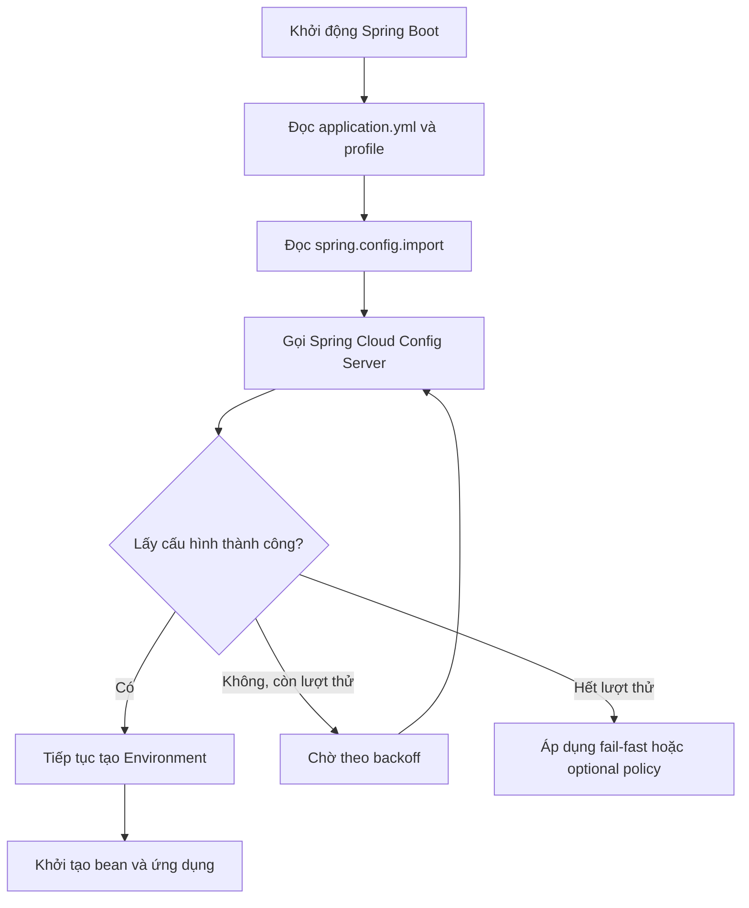

# Tham số retry khi import được đặt trong tệp theo profile

Spring Cloud Config Client thường cần lấy cấu hình từ Config Server ngay trong giai đoạn khởi động ứng dụng. Khi Config Server vừa khởi động, mạng chưa ổn định hoặc kết nối tạm thời bị gián đoạn, request đầu tiên có thể thất bại dù server sẽ sẵn sàng sau vài giây. Retry giúp client thử lại theo khoảng chờ tăng dần trước khi kết luận không thể lấy cấu hình.

Với Spring Boot Config Data, client khai báo nguồn cấu hình từ Config Server bằng `spring.config.import`. Khi muốn cấu hình retry cho một import, các tham số retry cần được đặt trực tiếp trên chuỗi import dưới dạng query parameter. Nếu import nằm trong file theo profile, ví dụ `application-staging.yml`, các tham số này cũng nằm ngay trong giá trị `spring.config.import` của file đó.

Điểm này quan trọng vì Config Server chưa cung cấp được cấu hình từ xa trước khi import thành công. Nếu đặt retry chỉ trong cấu hình remote mà client phải tải về, client không thể dùng chính dữ liệu chưa tải được để biết cần retry như thế nào.

## 1. Retry diễn ra ở giai đoạn nào?

Khi ứng dụng dùng Config Data API, Spring Boot đọc cấu hình ban đầu, xác định các nguồn được import rồi yêu cầu Config Server cung cấp Environment theo application, profile và label. Nếu request thất bại do lỗi tạm thời, cơ chế retry có thể thử lại trước khi quá trình nạp Config Data kết thúc.

Ví dụ luồng khởi động:



Retry trong import chủ yếu xử lý việc lấy cấu hình ở giai đoạn nạp Config Data. Nó không tự động biến mọi lời gọi HTTP về sau, mọi thao tác refresh hay mọi truy vấn nghiệp vụ thành request có retry. Các luồng runtime khác cần chính sách retry riêng.

## 2. Đặt retry parameters trực tiếp trong `spring.config.import`

Ví dụ import từ Config Server với retry:

```yaml
spring:
  config:
    import: "configserver:https://config.example.internal?fail-fast=true&max-attempts=8&initial-interval=1000&max-interval=5000&multiplier=1.5"
```

Các query parameter trong ví dụ có ý nghĩa:

| Tham số | Ý nghĩa |
|---|---|
| `fail-fast=true` | Yêu cầu quá trình lấy cấu hình thất bại rõ ràng nếu không thể kết nối sau các lần thử |
| `max-attempts=8` | Giới hạn số lần thử kết nối theo cấu hình retry |
| `initial-interval=1000` | Khoảng chờ ban đầu giữa các lần thử, tính bằng mili giây |
| `max-interval=5000` | Giới hạn trên của khoảng chờ, tính bằng mili giây |
| `multiplier=1.5` | Hệ số tăng khoảng chờ sau mỗi lần thử |

Khoảng chờ tăng theo hệ số multiplier và không vượt quá max interval. Cách tăng dần này tránh việc nhiều client liên tục gọi Config Server với tần suất cao trong lúc backend đang phục hồi.

Các giá trị trong ví dụ là lựa chọn minh họa, không phải thông số bắt buộc cho mọi hệ thống. Hãy chọn số lần thử và khoảng chờ dựa trên thời gian khởi động Config Server, timeout mạng, ngân sách thời gian khởi động của ứng dụng và chính sách triển khai.

## 3. Đặt import trong file cấu hình theo profile

Spring Boot có thể nạp file cấu hình theo profile, chẳng hạn:

```text
application.yml
application-development.yml
application-staging.yml
application-production.yml
```

Nếu mỗi môi trường dùng Config Server hoặc chính sách retry khác nhau, có thể đặt `spring.config.import` trong file profile tương ứng. Ví dụ, `application-staging.yml`:

```yaml
spring:
  config:
    import: "configserver:https://config-staging.example.internal?fail-fast=true&max-attempts=8&initial-interval=1000&max-interval=5000&multiplier=1.5"
```

Và `application-production.yml`:

```yaml
spring:
  config:
    import: "configserver:https://config.example.internal?fail-fast=true&max-attempts=12&initial-interval=1500&max-interval=10000&multiplier=2.0"
```

Khi profile `staging` hoạt động, Spring Boot nạp import trong `application-staging.yml`; khi profile `production` hoạt động, import trong `application-production.yml` được dùng. Mỗi chuỗi import tự mang tham số retry của chính nguồn Config Server đó.

Kích hoạt profile từ cấu hình không phụ thuộc profile, biến môi trường hoặc tham số khởi chạy, ví dụ:

```bash
SPRING_PROFILES_ACTIVE=staging
```

Hoặc:

```bash
java -jar order-service.jar --spring.profiles.active=production
```

Không khai báo `spring.profiles.active` bên trong file profile-specific như `application-production.yml`; file đó chỉ được nạp sau khi profile đã được chọn. Profile là điều kiện chọn cấu hình, còn retry parameters là tùy chọn của import được chọn.

## 4. Vì sao query parameters phải đi cùng import?

Config Data cần biết cách truy cập Config Server ngay trong lúc xây dựng Environment. Các thuộc tính retry đặt trong nguồn remote chỉ có thể được đọc sau khi client đã kết nối thành công và nhận cấu hình. Vì vậy, với Config Data import, cách đáng tin cậy để gắn chính sách retry cho một import là truyền chúng ngay trong URL import.

Ví dụ dưới đây không phải cách cấu hình retry cho Config Data import:

```yaml
spring:
  cloud:
    config:
      retry:
        max-attempts: 8
        initial-interval: 1000
        max-interval: 5000
        multiplier: 1.5
  config:
    import: "configserver:https://config.example.internal"
```

Với Config Data API, không nên dựa vào các key `spring.cloud.config.retry.*` trong cùng file để thay thế query parameters trên import. Hãy cấu hình trực tiếp như sau:

```yaml
spring:
  config:
    import: "configserver:https://config.example.internal?fail-fast=true&max-attempts=8&initial-interval=1000&max-interval=5000&multiplier=1.5"
```

Các thuộc tính `spring.cloud.config.retry.*` thường gặp trong hướng dẫn dùng cơ chế bootstrap legacy. Cần phân biệt cách cấu hình theo cơ chế khởi tạo đang sử dụng; không trộn hai mô hình mà không kiểm tra tài liệu đúng phiên bản Spring Boot và Spring Cloud.

## 5. Dependency cần có để bật retry

Retry của Config Client dựa trên Spring Retry và Spring AOP. Với Gradle, khai báo các dependency tương ứng:

```groovy
dependencies {
    implementation 'org.springframework.cloud:spring-cloud-starter-config'
    implementation 'org.springframework.retry:spring-retry'
    implementation 'org.springframework.boot:spring-boot-starter-aop'
}
```

Nếu dự án dùng Gradle Kotlin DSL:

```kotlin
dependencies {
    implementation("org.springframework.cloud:spring-cloud-starter-config")
    implementation("org.springframework.retry:spring-retry")
    implementation("org.springframework.boot:spring-boot-starter-aop")
}
```

Nên để Spring Cloud BOM quản lý phiên bản thư viện Spring Cloud và dùng dependency management phù hợp của dự án cho Spring Boot. Tránh tự ghim các phiên bản không tương thích với release train đang chạy.

Chỉ thêm dependency không có nghĩa mọi lỗi đều sẽ được retry. Import cần được cấu hình với chính sách fail-fast/retry phù hợp và client phải dùng đúng cơ chế Config Data được phiên bản thư viện hỗ trợ.

## 6. Chọn số lần thử và khoảng chờ

Một chính sách retry nên cân bằng giữa khả năng chờ Config Server phục hồi và thời gian tối đa mà ứng dụng được phép khởi động.

| Tình huống | Hướng lựa chọn |
|---|---|
| Config Server thường khởi động chậm hơn client vài giây | Tăng số lần thử vừa đủ và đặt khoảng chờ ban đầu phù hợp |
| Mạng nội bộ có gián đoạn ngắn | Dùng backoff tăng dần để tránh gọi dồn dập |
| Backend Git thỉnh thoảng phản hồi chậm | Đặt timeout và max interval theo độ trễ quan sát được |
| Ứng dụng chạy trong môi trường cần khởi động nhanh | Giữ ngân sách retry thấp, báo lỗi sớm khi quá thời gian cho phép |
| Config Server không sẵn sàng kéo dài | Retry chỉ trì hoãn thất bại; cần giải quyết availability hoặc quyết định fallback |

Tổng thời gian retry phụ thuộc số lần thử, thời gian mỗi request, các khoảng chờ và timeout kết nối. Ví dụ, 8 lần thử với request timeout 10 giây có thể kéo dài lâu hơn nhiều so với 8 khoảng chờ 1 giây. Vì vậy, hãy tính cả thời gian chờ HTTP và thời gian backoff trong startup budget.

Không nên tăng `max-attempts` lên một con số rất lớn để che giấu Config Server thiếu tính sẵn sàng. Retry giúp vượt qua lỗi tạm thời; nó không sửa được URL sai, DNS sai, chứng thư TLS hết hạn hoặc credential không hợp lệ.

## 7. `fail-fast` và tiền tố `optional:`

Hai lựa chọn này thể hiện cách ứng dụng phản ứng khi Config Server không thể cung cấp cấu hình.

**Cấu hình bắt buộc:**

```yaml
spring:
  config:
    import: "configserver:https://config.example.internal?fail-fast=true&max-attempts=8&initial-interval=1000&max-interval=5000&multiplier=1.5"
```

Ứng dụng thử lại theo chính sách rồi thất bại nếu không lấy được cấu hình bắt buộc. Cách này phù hợp khi remote config chứa endpoint, policy hoặc giá trị cần thiết để ứng dụng chạy an toàn.

**Cấu hình tùy chọn có fallback đã thiết kế:**

```yaml
spring:
  config:
    import: "optional:configserver:https://config.example.internal?fail-fast=true&max-attempts=5&initial-interval=1000&max-interval=3000&multiplier=1.5"
```

Tiền tố `optional:` cho phép ứng dụng tiếp tục khi nguồn import không sẵn sàng theo quy tắc của Config Data. Khi muốn retry trước khi bỏ qua nguồn tùy chọn, vẫn khai báo `fail-fast=true` và các tham số retry trên import; sau khi hết lượt thử, optional policy quyết định ứng dụng có được tiếp tục hay không theo hành vi của phiên bản đang dùng. Hãy kiểm thử kết hợp này trên release train thực tế. Chỉ sử dụng khi file local hoặc giá trị mặc định đã đủ để ứng dụng hoạt động đúng. Phải kiểm tra các key bắt buộc trước khi nhận traffic; nếu thiếu cấu hình quan trọng, ứng dụng cần báo lỗi rõ thay vì chạy với giá trị mặc định không an toàn.

Không xem `optional:` là cách thay thế retry. Retry xử lý các lần thử lại trong quá trình lấy nguồn; optional quyết định ứng dụng có được phép tiếp tục khi nguồn không thể nạp hay không. Nếu cấu hình là bắt buộc, bỏ `optional:` và xác minh fail-fast.

## 8. Tổ chức import theo môi trường

Với một Config Server cho mỗi môi trường, cách đơn giản nhất là để mỗi file profile-specific khai báo một import tương ứng. Như vậy, endpoint và retry policy được chọn cùng profile đang hoạt động.

Nếu một ứng dụng cần nhiều import Config Data, mỗi location có thể có yêu cầu riêng về optionality, endpoint và retry. Hãy dùng cú pháp nhiều location được hỗ trợ bởi phiên bản Spring Boot đang chạy, gắn tham số vào đúng chuỗi import và kiểm tra thứ tự property source. Không nên xem nhiều Config Server import tự động là cơ chế failover hoặc load balancing; cần thiết kế rõ nguồn có thẩm quyền và cách xử lý khi một nguồn thành công còn nguồn khác thất bại.

Khi đặt import trong file profile-specific, nên giữ URL và retry policy gắn với môi trường tương ứng. Ví dụ staging có thể dùng endpoint staging và thời gian chờ ngắn; production có thể có retry budget khác dựa trên SLO khởi động. Thay đổi chính sách retry cần được review cùng thay đổi endpoint và fallback.

## 9. Lỗi thường gặp

| Hiện tượng | Nguyên nhân thường gặp | Cách xử lý |
|---|---|---|
| Client không retry khi Config Server khởi động chậm | Retry parameters đặt ở `spring.cloud.config.retry.*` thay vì query trên Config Data import | Đưa `fail-fast` và các tham số retry vào chuỗi `spring.config.import` |
| File profile-specific không được áp dụng | Profile chưa được kích hoạt hoặc tên file không khớp | Kiểm tra `SPRING_PROFILES_ACTIVE` và tên `application-{profile}.yml` |
| Client retry quá lâu rồi mới thất bại | `max-attempts`, timeout hoặc max interval quá lớn | Tính startup budget và giảm retry budget phù hợp |
| Ứng dụng tiếp tục dù không lấy được cấu hình | Import được đánh dấu `optional:` và local fallback cho phép khởi động | Kiểm tra key bắt buộc và quyết định nguồn có thật sự tùy chọn không |
| Retry không giải quyết lỗi `401` hoặc `403` | Credential hoặc quyền truy cập sai | Sửa authentication/authorization; tránh lặp request vô ích |
| Client không kết nối được dù URL đúng | DNS, TLS, firewall, proxy hoặc timeout | Kiểm tra network path và chứng thư từ đúng runtime của ứng dụng |
| Thay đổi retry trong remote config không có tác dụng | Client cần chính sách retry trước khi remote config được nạp | Đặt tham số ở import cục bộ được chọn trước khi kết nối |

Khi điều tra, hãy ghi nhận profile đang hoạt động, chuỗi import đã chọn, HTTP status và số lần thử. Không ghi credential hoặc response cấu hình đầy đủ vào log. Nếu cần xác minh server trả đúng profile/label, dùng kiểm tra API an toàn và chỉ xuất metadata cần thiết.

## 10. Ví dụ hoàn chỉnh cho `order-service`

Giả sử `order-service` dùng chung tên ứng dụng và chỉ khác endpoint Config Server theo môi trường.

`application.yml`:

```yaml
spring:
  application:
    name: order-service
```

`application-staging.yml`:

```yaml
spring:
  config:
    import: "configserver:https://config-staging.example.internal?fail-fast=true&max-attempts=8&initial-interval=1000&max-interval=5000&multiplier=1.5"
```

`application-production.yml`:

```yaml
spring:
  config:
    import: "configserver:https://config.example.internal?fail-fast=true&max-attempts=12&initial-interval=1500&max-interval=10000&multiplier=2.0"
```

Triển khai staging với:

```bash
export SPRING_PROFILES_ACTIVE=staging
```

Triển khai production với:

```bash
export SPRING_PROFILES_ACTIVE=production
```

Khi staging khởi động, nó dùng Config Server staging cùng retry policy 8 lần thử tối đa theo cấu hình. Production dùng endpoint production với retry budget riêng. Cả hai vẫn gửi application name `order-service`; profile được chọn từ môi trường triển khai và Config Server trả cấu hình tương ứng.

## 11. Checklist triển khai

Trước khi đưa retry policy vào môi trường thật, hãy kiểm tra:

- [ ] Dự án dùng Config Data import và phiên bản Spring Boot/Spring Cloud tương thích.
- [ ] `spring.config.import` nằm trong file chung hoặc file profile-specific phù hợp.
- [ ] Retry parameters được gắn trực tiếp vào chuỗi import bằng query parameters.
- [ ] Có dependency Spring Retry và Spring AOP theo hướng dẫn phiên bản đang dùng.
- [ ] Profile được kích hoạt từ nguồn cấu hình không phụ thuộc profile.
- [ ] Đã quyết định Config Server là bắt buộc hay optional.
- [ ] Tổng thời gian retry phù hợp với startup budget.
- [ ] Đã thử tình huống server chậm, timeout, 401/403 và DNS/TLS failure.
- [ ] Log chỉ chứa metadata vận hành cần thiết, không chứa credential hoặc response secrets.
- [ ] Các key bắt buộc được xác thực trước khi ứng dụng nhận traffic.

## 12. Mục tiêu cần đạt sau bài học

Sau bài này, người học cần có khả năng:

- Giải thích được thời điểm Config Client thực hiện retry khi import cấu hình từ xa.
- Viết được `spring.config.import` có query parameters retry.
- Đặt import và retry policy trong `application-{profile}.yml` phù hợp với từng môi trường.
- Phân biệt cách khai báo retry của Config Data API với cơ chế bootstrap legacy.
- Giải thích vai trò của `fail-fast`, `optional:`, max attempts và exponential backoff.
- Chọn retry budget dựa trên timeout và thời gian khởi động cho phép.
- Chẩn đoán được trường hợp retry không có tác dụng do cấu hình sai, thiếu dependency hoặc lỗi authentication/network.

**Tự kiểm tra:** `order-service` dùng `application-production.yml` để import Config Server production. Hãy viết chuỗi import có `fail-fast=true`, 10 lần thử tối đa, khoảng chờ đầu 1 giây, tối đa 8 giây và multiplier 2.0. Giải thích vì sao đặt các tham số này trong remote config là quá muộn, và khi nào có thể dùng tiền tố `optional:`.
