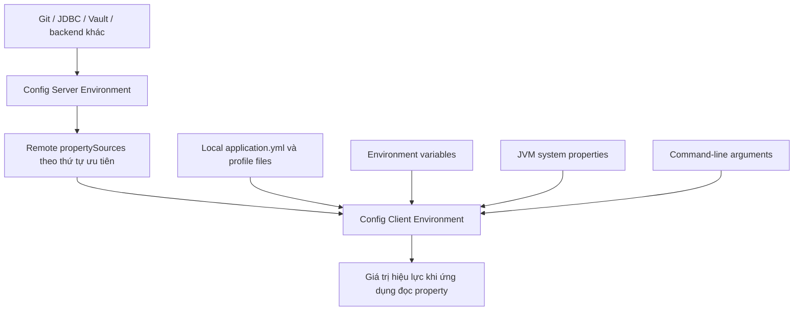

# Phân biệt ưu tiên phía Config Server với ưu tiên phía client

Khi cùng một property được khai báo ở nhiều nơi, giá trị ứng dụng sử dụng phụ thuộc vào thứ tự ưu tiên của các nguồn cấu hình. Với Spring Cloud Config, cần phân tích hai lớp riêng: thứ tự các `propertySources` mà Config Server tổng hợp từ backend, và thứ tự các nguồn trong `Environment` của Config Client sau khi nhận cấu hình từ xa.

Hai lớp này liên quan nhưng không giống nhau. Config Server chỉ trả về các nguồn mà backend của nó cung cấp theo application, profile và label. Client tiếp tục kết hợp các nguồn từ xa với cấu hình local, biến môi trường, JVM system properties và tham số dòng lệnh theo cơ chế nạp cấu hình của Spring Boot cùng chính sách override của Spring Cloud Config. Vì vậy, giá trị trong response Config Server chưa chắc là giá trị cuối cùng mà bean trong ứng dụng đọc được.

## 1. Hai tầng ưu tiên



**Tầng Config Server** trả lời câu hỏi: trong những nguồn từ xa được server tìm thấy, nguồn nào thắng khi nhiều nguồn cùng khai báo một key?

**Tầng Config Client** trả lời câu hỏi: sau khi remote property sources được đưa vào Spring `Environment` cùng các nguồn local và nguồn lúc khởi chạy, giá trị nào thắng?

Khi điều tra một giá trị bất ngờ, hãy xác định tầng gây ra khác biệt trước. Nếu response Config Server đã sai, xem backend, application, profile, label và thứ tự remote sources. Nếu response đúng nhưng client dùng giá trị khác, xem override policy và các property sources phía client.

## 2. Ưu tiên giữa các nguồn tại Config Server

Config Server đọc cấu hình theo ba thông tin định tuyến:

```text
/{application}/{profile}/{label}
```

Ví dụ:

```bash
curl "http://localhost:8888/order-service/prod/main"
```

Giả sử repository có các tệp sau và mỗi tệp khai báo cùng key `orders.timeout`:

```yaml
# application.yml
orders:
  timeout: 2s
```

```yaml
# application-prod.yml
orders:
  timeout: 3s
```

```yaml
# order-service.yml
orders:
  timeout: 4s
```

```yaml
# order-service-prod.yml
orders:
  timeout: 5s
```

Config Server trả về Environment có danh sách `propertySources`. Ví dụ rút gọn:

```json
{
  "name": "order-service",
  "profiles": ["prod"],
  "label": "main",
  "propertySources": [
    {
      "name": ".../order-service-prod.yml",
      "source": { "orders.timeout": "5s" }
    },
    {
      "name": ".../order-service.yml",
      "source": { "orders.timeout": "4s" }
    },
    {
      "name": ".../application-prod.yml",
      "source": { "orders.timeout": "3s" }
    },
    {
      "name": ".../application.yml",
      "source": { "orders.timeout": "2s" }
    }
  ]
}
```

Trong danh sách `propertySources` của một Environment, nguồn đứng trước có ưu tiên cao hơn nguồn đứng sau khi cùng chứa một key. Với response minh họa, giá trị remote được phân giải cho `orders.timeout` là `5s`. Các key chỉ có ở nguồn phía sau vẫn được kế thừa; chỉ những key trùng nhau mới cần phân xử theo thứ tự.

Thứ tự thực tế phụ thuộc backend, profile, search paths, cách cấu hình repository và phiên bản Spring Cloud Config. Không nên tự suy ra giá trị thắng chỉ từ tên file. Hãy đọc danh sách `propertySources` mà server thực sự trả về.

### 2.1. Backend và composite repositories

Với Git backend, server tìm các tệp theo application/profile trong repository và label đã chọn. Với JDBC, Vault hoặc backend khác, cách tạo property source có thể khác. Nếu dùng composite environment repository để kết hợp nhiều backend, thứ tự các repository thành phần cũng ảnh hưởng đến thứ tự remote sources. Cần cấu hình thứ tự rõ ràng và kiểm tra response sau khi thay đổi.

Composite repository không làm mất quy tắc ưu tiên của từng property source. Khi nhiều backend trả cùng một key, backend có ưu tiên cao hơn theo cấu hình composite sẽ cung cấp giá trị thắng. Không phụ thuộc vào thứ tự ngẫu nhiên của truy vấn database hoặc thứ tự triển khai backend.

## 3. Config Server response chưa phải toàn bộ Environment của client

Sau khi Config Client nhận remote Environment, Spring Boot còn có thể đưa vào các nguồn như:

- `application.yml` và `application-{profile}.yml` đóng gói cùng ứng dụng.
- Biến môi trường của máy, container hoặc deployment platform.
- JVM system properties truyền bằng `-D`.
- Tham số dòng lệnh khi chạy ứng dụng.
- Các nguồn cấu hình khác do Spring Boot, framework hoặc ứng dụng bổ sung.

Các nguồn này được tổ chức trong Spring `Environment`. Khi nhiều nguồn chứa cùng key, nguồn có độ ưu tiên cao hơn trong Environment sẽ quyết định giá trị tra cứu. Thứ tự cụ thể của local sources tuân theo quy tắc Spring Boot và cách Config Client nạp remote configuration.

Với Config Data API, client thường khai báo nguồn từ xa bằng `spring.config.import`. Remote property sources được tích hợp trong quá trình nạp Config Data. Spring Cloud Config cũng có các cờ cho phép remote source điều khiển mức độ override của local sources. Vì thế, không nên áp dụng một danh sách thứ tự chung mà bỏ qua phiên bản Spring Boot, cơ chế bootstrap hay override policy của dự án.

## 4. Chính sách override mặc định của Spring Cloud Config

Theo mặc định, remote property sources từ Config Server được đặt ở vị trí ưu tiên cao hơn cấu hình local để cấu hình tập trung có thể kiểm soát giá trị ứng dụng. Nếu muốn cho local configuration ghi đè remote values, chính remote configuration phải cấp quyền thông qua `spring.cloud.config.allowOverride=true`.

Các cờ điều khiển thường dùng:

| Thuộc tính | Ý nghĩa |
|---|---|
| `spring.cloud.config.allowOverride` | Cho phép client sources ghi đè remote properties theo chính sách chi tiết bên dưới |
| `spring.cloud.config.overrideNone` | Khi `true`, cho phép mọi property source phía client ghi đè remote properties |
| `spring.cloud.config.overrideSystemProperties` | Khi `false`, các nguồn hệ thống như environment variables, JVM system properties và command-line có thể ghi đè remote properties, còn local config files không tự động được ưu tiên |

Đặt `allowOverride` trong cấu hình từ xa được Config Server cung cấp, ví dụ:

```yaml
# application-prod.yml trong Config Repository
spring:
  cloud:
    config:
      allowOverride: true
      overrideNone: true
```

Với cấu hình này, local sources được phép ghi đè remote properties. Nếu chỉ muốn các nguồn hệ thống như environment variables, JVM system properties và command-line được ghi đè, có thể dùng:

```yaml
spring:
  cloud:
    config:
      allowOverride: true
      overrideSystemProperties: false
```

`allowOverride` phải được đặt ở remote property source; đặt nó trong `application.yml` local không cấp quyền override cho client. Các cờ này ảnh hưởng đến cách remote property source được đặt trong Environment, vì vậy cần kiểm tra kết quả thực tế ở client sau khi thay đổi. Tránh bật override rộng hơn nhu cầu: một biến môi trường cũ có thể làm các instance cùng đọc một Git label nhưng sử dụng giá trị khác nhau.

## 5. Ví dụ cùng một key ở nhiều nguồn

Giả sử Config Server trả về:

```yaml
orders:
  timeout: 5s
```

Client có cấu hình local:

```yaml
# application-prod.yml của client
orders:
  timeout: 6s
```

Môi trường triển khai cũng đặt:

```text
ORDERS_TIMEOUT=7s
```

Và ứng dụng được khởi chạy với:

```bash
java -jar order-service.jar --orders.timeout=9s
```

Các giá trị đang tồn tại là:

| Nguồn | Giá trị |
|---|---:|
| Config Server remote | `5s` |
| Client `application-prod.yml` | `6s` |
| Environment variable | `7s` |
| Command-line argument | `9s` |

Kết quả cần phân tích theo override policy:

- **Mặc định:** remote source giữ ưu tiên theo chính sách Spring Cloud Config; local file, environment variable và command-line không tự động thắng remote source.
- **`allowOverride=true`, `overrideNone=true`:** local sources được phép override remote. Nếu nhiều local sources cùng khai báo key, Spring Boot tiếp tục áp dụng thứ tự ưu tiên của chúng; command-line thường có ưu tiên cao hơn environment variable và file cấu hình.
- **`allowOverride=true`, `overrideSystemProperties=false`:** system properties, environment variables và command-line được phép override remote; local config files không tự động thắng remote.

Đây là ví dụ để phân tích phạm vi override, không thay thế việc xem Environment của phiên bản ứng dụng đang chạy. Nếu có nhiều nguồn local cùng chứa key, hãy xác nhận nguồn thắng bằng Actuator hoặc bằng kiểm tra có kiểm soát trong ứng dụng.

## 6. Kiểm tra tầng Config Server

Trước tiên, gọi endpoint Environment với đúng application, profile và label:

```powershell
$remote = Invoke-RestMethod `
    -Method Get `
    -Uri "http://localhost:8888/order-service/prod/main"

$remote | Select-Object name, profiles, label, version
```

In các nguồn có chứa `orders.timeout` theo thứ tự server trả về:

```powershell
foreach ($source in $remote.propertySources) {
    $property = $source.source.PSObject.Properties["orders.timeout"]
    if ($null -ne $property) {
        [PSCustomObject]@{
            Source = $source.name
            Value = $property.Value
        }
    }
}
```

Hãy xác minh:

1. `name` đúng application được yêu cầu.
2. `profiles` đúng profile.
3. `label` đúng branch/tag/ref hoặc label backend.
4. `version` đúng commit nếu backend cung cấp.
5. `propertySources` có những nguồn mong đợi và nguồn đứng trước có độ ưu tiên cao hơn.

Nếu giá trị đã sai ở đây, kiểm tra backend, tệp, query, profile, label, search path hoặc thứ tự repository composite. Chưa cần điều tra biến môi trường phía client ở bước này.

## 7. Kiểm tra tầng Config Client

Để xem giá trị sau khi remote và local sources đã được tổng hợp, có thể dùng Spring Boot Actuator. Thêm Actuator dependency và expose endpoint `env` trong môi trường được bảo vệ:

```yaml
management:
  endpoints:
    web:
      exposure:
        include: health,env
  endpoint:
    env:
      show-values: when-authorized
```

Yêu cầu thông tin cho key cụ thể:

```bash
curl "http://localhost:8080/actuator/env/orders.timeout"
```

Endpoint có thể hiển thị danh sách property sources, nguồn chứa key và giá trị mà Spring Environment chọn, tùy quyền truy cập và cấu hình `show-values`. Nếu giá trị bị che, vẫn có thể đối chiếu tên nguồn hoặc tạo một phép kiểm tra nội bộ chỉ trả về giá trị không nhạy cảm.

Không expose `/actuator/env` công khai. Endpoint có thể tiết lộ cấu hình nội bộ và thông tin nhạy cảm. Giới hạn network, bật xác thực/phân quyền, chỉ hiển thị giá trị cho người được phép và tránh dùng `show-values: always` trong production.

### 7.1. Kiểm tra bean đã bind

Spring `Environment` cho biết kết quả tra cứu property. Bean sử dụng cấu hình có thể bind qua `@Value` hoặc `@ConfigurationProperties`:

```java
import java.time.Duration;

import org.springframework.boot.context.properties.ConfigurationProperties;

@ConfigurationProperties(prefix = "orders")
public record OrderProperties(Duration timeout) {
}
```

Đăng ký properties bằng `@ConfigurationPropertiesScan` hoặc `@EnableConfigurationProperties`. Nếu Actuator cho thấy giá trị đúng nhưng bean hoạt động khác, kiểm tra prefix, tên key, chuyển đổi kiểu và việc bean đã giữ giá trị từ lúc khởi tạo hay chưa. Một số thành phần sao chép property vào connection pool hoặc HTTP client lúc startup nên không tự thay đổi khi Environment được cập nhật.

## 8. Phân tích theo từng tình huống

| Hiện tượng | Tầng cần kiểm tra trước | Hướng điều tra |
|---|---|---|
| Config Server trả sai giá trị | Config Server | Kiểm tra application/profile/label, backend, `propertySources` và thứ tự nguồn |
| Config Server đúng nhưng client `env` khác | Config Client | Kiểm tra `allowOverride`, `overrideNone`, `overrideSystemProperties` và local sources |
| Client `env` đúng nhưng bean dùng giá trị khác | Binding/runtime | Kiểm tra cách bind, default trong code, thời điểm tạo bean và tài nguyên đã khởi tạo |
| Chỉ một số instance dùng giá trị khác | Môi trường từng instance | So sánh profile, label, biến môi trường, JVM args và command-line của từng instance |
| Sau refresh Environment đổi nhưng hành vi chưa đổi | Vòng đời bean | Kiểm tra `@RefreshScope`, rebind và khả năng cấu hình lại của thư viện |

Một quy trình chẩn đoán hữu ích:

1. Ghi nhận key, application, profile và label đang được kiểm tra.
2. Gọi Config Server và xác định remote value cùng property source thắng.
3. Kiểm tra override policy do remote configuration cung cấp.
4. Xem property sources và giá trị hiệu lực ở client.
5. So sánh biến môi trường, JVM system properties và tham số dòng lệnh giữa các instance.
6. Kiểm tra bean binding và tài nguyên runtime sử dụng giá trị.
7. Ghi lại commit/label, remote value, client value và nguồn thắng để truy vết.

## 9. Nguyên tắc thiết kế chính sách ưu tiên

- Dùng Config Server làm nguồn quản trị tập trung cho các giá trị cần nhất quán giữa nhiều ứng dụng.
- Chỉ bật local override khi có nhu cầu rõ ràng, chẳng hạn tham số vận hành được nền tảng triển khai cấp riêng cho từng instance.
- Đặt `allowOverride` trong remote configuration và review thay đổi này như một chính sách bảo mật/vận hành.
- Không dùng biến môi trường để âm thầm ghi đè các key quan trọng nếu không có quy trình quản lý và quan sát.
- Tách cấu hình bắt buộc khỏi giá trị mặc định; xác thực key và kiểu dữ liệu khi ứng dụng khởi động.
- Bảo vệ Actuator `env`, không đưa secret vào log hoặc response chẩn đoán.
- Kiểm tra cả server response lẫn client Environment sau khi thay đổi backend hoặc override policy.

Khi phân biệt rõ thứ tự remote `propertySources` và thứ tự toàn bộ client `Environment`, có thể xác định chính xác tầng nào làm thay đổi giá trị. Config Server giải thích cấu hình từ xa được phân giải ra sao; Config Client cho biết remote values tương tác với local sources thế nào để tạo ra giá trị mà ứng dụng thực sự sử dụng.
