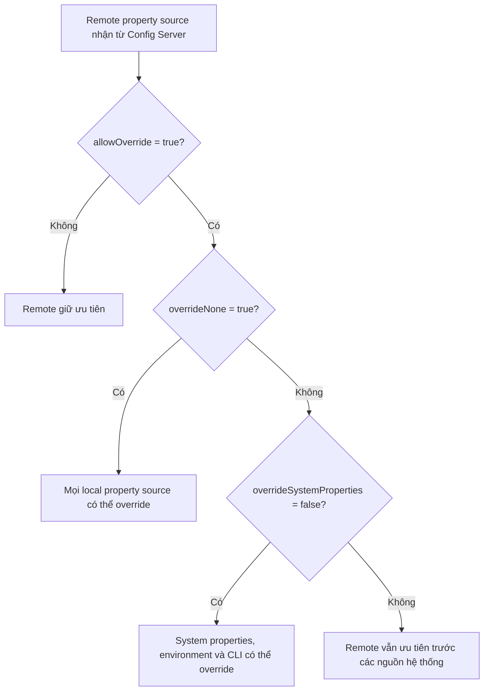

# allowOverride, overrideNone và overrideSystemProperties trong bootstrap cũ

Spring Cloud Config Client có thể nhận cấu hình từ Config Server đồng thời với các nguồn cục bộ của Spring Boot như `bootstrap.yml`, `application.yml`, biến môi trường, thuộc tính JVM và tham số dòng lệnh. Trong cơ chế **bootstrap context** cũ, cấu hình từ xa thường được đưa vào `Environment` với mức ưu tiên cao để bảo đảm server quản lý được giá trị dùng chung. Khi cần cho phép một số nguồn cục bộ ghi đè cấu hình từ xa, Spring Cloud Config cung cấp ba thuộc tính: `allowOverride`, `overrideNone` và `overrideSystemProperties`.

Ba thuộc tính này phối hợp để quyết định vị trí ưu tiên của remote property source so với các nguồn cục bộ. Hiểu đúng nơi khai báo và tác động của từng thuộc tính giúp đội vận hành kiểm soát được chính sách cấu hình, chẳng hạn cho phép biến môi trường production ghi đè một giá trị từ xa nhưng vẫn giữ cấu hình trong file cục bộ dưới quyền quản lý của Config Server.

## 1. Bootstrap context và remote property source

Trong mô hình cũ, Spring Cloud Config Client dùng bootstrap context để tải cấu hình từ Config Server trước khi hoàn tất việc tạo application context chính. Client thường khai báo địa chỉ Config Server và tên ứng dụng trong `bootstrap.yml`:

```yaml
spring:
  application:
    name: orders-service
  cloud:
    config:
      uri: http://config-server:8888
```

Bootstrap context khởi tạo quá trình lấy cấu hình từ xa. Config Server trả về một `Environment` chứa các `PropertySource`; client đưa các nguồn đó vào `Environment` của ứng dụng. Ngoài nguồn từ xa, ứng dụng vẫn có thể có cấu hình cục bộ như:

```yaml
# application.yml của client
app:
  payment:
    timeout: 5s
```

Khi `app.payment.timeout` đồng thời tồn tại trong remote config và `application.yml`, Spring phải chọn một giá trị theo thứ tự ưu tiên property source. Chính sách mặc định của Spring Cloud Config bảo vệ nguồn từ xa: local property source không tự động ghi đè remote property source. Ba thuộc tính trong bài học cho phép thay đổi hành vi đó theo chính sách được server cấp quyền.

## 2. Vai trò và nơi khai báo ba thuộc tính

Ba thuộc tính có ý nghĩa khác nhau:

| Thuộc tính | Ý nghĩa |
|---|---|
| `spring.cloud.config.allowOverride` | Cho phép các nguồn cục bộ có cơ hội ghi đè cấu hình từ xa. Mặc định là `false`. |
| `spring.cloud.config.overrideNone` | Khi `true`, mọi local property source có thể ghi đè remote property source. Mặc định là `false`. |
| `spring.cloud.config.overrideSystemProperties` | Điều khiển quan hệ ưu tiên giữa remote source với system properties, biến môi trường và tham số dòng lệnh. Mặc định là `true`; khi đặt `false`, các nguồn hệ thống này có thể ghi đè remote, còn file cấu hình cục bộ vẫn không được ưu tiên hơn remote nếu `overrideNone` vẫn là `false`. |

Điểm quan trọng nhất: **`allowOverride` phải được khai báo trong property source từ xa do Config Server trả về**. Ví dụ, có thể đặt nó trong `application.yml` hoặc file cấu hình ứng dụng trong Git repository cấu hình. Chỉ đặt `allowOverride` trong `bootstrap.yml` hoặc `application.yml` cục bộ của client không cấp quyền ghi đè cho local source.

Ví dụ cấu hình từ xa trong Git repository:

```yaml
spring:
  cloud:
    config:
      allowOverride: true
      overrideNone: false
      overrideSystemProperties: false

app:
  payment:
    timeout: 3s
```

Config Server trả các thuộc tính này cho `orders-service`. Client khi nhận remote property source mới có thể áp dụng chính sách ghi đè đã được cấp.

## 3. Hiểu allowOverride

`allowOverride` là cổng cho phép local property source ghi đè remote property source. Giá trị mặc định `false` giữ cấu hình từ xa ở mức ưu tiên cao hơn các nguồn cục bộ theo cơ chế bootstrap.

Khi `allowOverride: false`:

- Giá trị do Config Server cung cấp tiếp tục có ưu tiên.
- Một giá trị trùng khóa trong `application.yml` cục bộ không tự động thay thế giá trị từ xa.
- Các thuộc tính `overrideNone` và `overrideSystemProperties` không thể tự cấp quyền ghi đè nếu `allowOverride` chưa bật.

Khi đặt `allowOverride: true`, client được phép áp dụng một trong các chính sách chi tiết hơn thông qua hai thuộc tính còn lại. Điều này không có nghĩa mọi local source lập tức thắng remote; kết quả còn phụ thuộc `overrideNone` và `overrideSystemProperties`.

Ví dụ: remote config đặt `app.payment.timeout: 3s`, còn local `application.yml` đặt `5s`. Nếu remote không cấp `allowOverride`, ứng dụng vẫn dùng `3s` theo chính sách bootstrap. Đổi giá trị trong file cục bộ mà không đổi chính sách từ xa sẽ không tạo ra kết quả mong muốn.

## 4. Hiểu overrideNone

`overrideNone` mặc định là `false`. Khi đặt `true` cùng với `allowOverride: true`, mọi local property source có thể ghi đè remote property source.

Ví dụ trong cấu hình từ xa:

```yaml
spring:
  cloud:
    config:
      allowOverride: true
      overrideNone: true
```

Khi chính sách này được áp dụng, các nguồn cục bộ như `application.yml`, biến môi trường, system properties và tham số dòng lệnh đều có thể tham gia ghi đè cấu hình từ xa. Thứ tự giữa các nguồn cục bộ vẫn theo quy tắc ưu tiên của Spring Boot.

Chế độ này phù hợp khi ứng dụng cần quyền tự chủ lớn ở từng môi trường hoặc khi local config được coi là nguồn điều khiển chính. Tuy nhiên, nếu bật rộng rãi cho nhiều dịch vụ, cấu hình tập trung có thể mất tính nhất quán vì mỗi instance có thể dùng các giá trị cục bộ khác nhau.

## 5. Hiểu overrideSystemProperties

Khi `allowOverride` là `true` và `overrideNone` là `false`, `overrideSystemProperties` xác định liệu các nguồn hệ thống có thể ghi đè remote property source hay không.

### overrideSystemProperties = false

Với giá trị `false`, các nguồn hệ thống như biến môi trường, Java system properties và tham số dòng lệnh có thể ghi đè cấu hình từ xa. Các file cấu hình cục bộ như `application.yml` vẫn nằm dưới remote property source.

Ví dụ:

```yaml
spring:
  cloud:
    config:
      allowOverride: true
      overrideNone: false
      overrideSystemProperties: false
```

Chế độ này thường hữu ích khi Config Server giữ cấu hình chuẩn, còn đội vận hành cần một cách override có kiểm soát qua biến môi trường hoặc tham số khởi chạy.

### overrideSystemProperties = true

Giá trị mặc định là `true`. Trong chính sách này, remote property source vẫn có thể đứng trên các nguồn hệ thống. Khi `overrideNone` vẫn là `false`, file cấu hình cục bộ cũng không được tự động đưa lên trên remote source.

Chế độ này phù hợp khi Config Server cần giữ quyền kiểm soát chặt chẽ đối với giá trị từ xa, kể cả khi môi trường chạy có biến môi trường hoặc system property trùng khóa.

## 6. Bảng quyết định thứ tự ưu tiên

Bảng sau tóm tắt quan hệ giữa remote property source và local property source trong cơ chế bootstrap cũ:

| allowOverride | overrideNone | overrideSystemProperties | Kết quả đối với remote source |
|---|---|---|---|
| `false` (mặc định) | Bất kỳ | Bất kỳ | Remote source được bảo vệ; local sources không được phép ghi đè theo chính sách này. |
| `true` | `true` | Không còn quyết định chính | Mọi local property source có thể ghi đè remote source. |
| `true` | `false` | `false` | System properties, biến môi trường và command-line arguments có thể ghi đè remote; local config files không ghi đè remote. |
| `true` | `false` | `true` (mặc định) | Remote source vẫn có ưu tiên trước system properties; local config files cũng không ghi đè remote. |

Có thể hình dung chính sách như sau:



Đây là cách diễn giải quan hệ ưu tiên của các cờ bootstrap. Thứ tự chính xác giữa những nguồn cục bộ với nhau vẫn tuân theo thứ tự externalized configuration của Spring Boot.

## 7. Ví dụ thực tế với cùng một khóa

Giả sử Config Server trả về:

```yaml
app:
  payment:
    timeout: 3s
```

Client có file cục bộ:

```yaml
# application.yml
app:
  payment:
    timeout: 5s
```

Và môi trường triển khai có biến:

```bash
APP_PAYMENT_TIMEOUT=8s
```

Nếu tiến trình được khởi chạy với tham số:

```bash
java -jar orders-service.jar --app.payment.timeout=10s
```

Kết quả phụ thuộc chính sách từ xa:

| Chính sách từ xa | Giá trị được chọn trong tình huống minh họa |
|---|---|
| `allowOverride: false` | Remote `3s` giữ ưu tiên. |
| `allowOverride: true`, `overrideNone: true` | Local sources được phép override; theo thứ tự local thông thường, tham số command line `10s` có thể thắng. |
| `allowOverride: true`, `overrideNone: false`, `overrideSystemProperties: false` | System/environment/CLI được phép override; command line `10s` có thể thắng, còn local file `5s` không thắng remote nếu không có nguồn hệ thống ghi đè. |
| `allowOverride: true`, `overrideNone: false`, `overrideSystemProperties: true` | Remote `3s` giữ ưu tiên trước các nguồn hệ thống và local config file. |

Ví dụ này chỉ xét các nguồn được nêu và giả định chúng đều được nạp đúng trong ứng dụng. Nếu có thêm profile-specific file, command-line property khác hoặc custom property source, cần xem thứ tự thực tế trong `Environment`.

## 8. Đặt cờ trong cấu hình từ xa như thế nào?

Ví dụ cấu trúc Git repository:

```text
config-repo/
├── application.yml
├── orders-service.yml
└── orders-service-prod.yml
```

Nếu muốn chính sách override áp dụng cho nhiều ứng dụng, có thể đặt trong `application.yml` từ xa:

```yaml
spring:
  cloud:
    config:
      allowOverride: true
      overrideNone: false
      overrideSystemProperties: false
```

Nếu chính sách chỉ dành cho một ứng dụng, có thể đặt các cờ trong file riêng của ứng dụng, ví dụ `orders-service.yml` hoặc file profile tương ứng. Cần xác nhận Config Server thực sự trả property source chứa các cờ đó cho request của ứng dụng.

Không đặt các cờ chỉ trong `bootstrap.yml` của client rồi kỳ vọng chúng thay đổi quyền ưu tiên của remote source. Client không thể tự cấp cho mình quyền ghi đè mà Config Server chưa cho phép.

## 9. Bootstrap cũ khác Config Data API

Các thuộc tính `allowOverride`, `overrideNone` và `overrideSystemProperties` được thiết kế cho mô hình bootstrap cũ của Spring Cloud Config Client. Mô hình này sử dụng bootstrap context và cơ chế `PropertySourceLocator` để nạp cấu hình từ xa.

Với ứng dụng cũ, bootstrap có thể được kích hoạt bằng dependency `spring-cloud-starter-bootstrap` hoặc cơ chế tương ứng của phiên bản Spring Cloud đang dùng. Địa chỉ Config Server thường được khai báo bằng `spring.cloud.config.uri` trong `bootstrap.yml`.

Các ứng dụng Spring Boot hiện đại thường dùng Config Data API:

```yaml
spring:
  application:
    name: orders-service
  config:
    import: "configserver:http://config-server:8888"
```

Config Data API có quy tắc nạp và sắp xếp property source riêng. Không nên sao chép nguyên bộ cờ bootstrap cũ vào ứng dụng dùng `spring.config.import` rồi giả định hành vi giống hệt. Khi chuyển đổi từ bootstrap sang Config Data API, cần kiểm tra tài liệu của release train đang sử dụng, xem thứ tự property source thực tế và kiểm thử các trường hợp override quan trọng.

## 10. Kiểm tra property source và giá trị cuối cùng

Khi một thuộc tính có giá trị khác dự kiến, cần kiểm tra cả nơi khai báo cờ và thứ tự property source:

1. Xác nhận ứng dụng thực sự dùng bootstrap context cũ.
2. Gọi Config Server với đúng application/profile/label để xem remote source có chứa `allowOverride`, `overrideNone` và `overrideSystemProperties` hay không.
3. Xác nhận `allowOverride` nằm trong nguồn từ xa được trả về cho client, không chỉ trong file local.
4. Kiểm tra các giá trị boolean có được viết đúng và thuộc đúng application/profile không.
5. Xác định khóa bị tranh chấp xuất hiện trong những property source nào.
6. Kiểm tra thứ tự `Environment` sau khi bootstrap hoàn tất và xem nguồn nào thắng.
7. Kiểm tra biến môi trường, JVM properties và tham số dòng lệnh của tiến trình đang chạy.

Actuator có thể cung cấp endpoint `env` nếu được bật và bảo vệ phù hợp. Endpoint này giúp xem nguồn của thuộc tính và giá trị được chọn, nhưng có thể tiết lộ dữ liệu nhạy cảm. Chỉ mở cho người vận hành được ủy quyền, bật sanitization và tránh chia sẻ response chứa secret.

## 11. Lỗi thường gặp và cách xử lý

| Hiện tượng | Nguyên nhân có thể | Cách xử lý |
|---|---|---|
| Local `application.yml` không ghi đè remote | `allowOverride` chưa bật trong remote property source. | Đặt `spring.cloud.config.allowOverride: true` trong cấu hình mà Config Server trả về. |
| Đã bật `allowOverride` nhưng file local vẫn không thắng | `overrideNone` đang là `false`; file local không thuộc nhóm system properties/environment/CLI được phép override. | Nếu muốn mọi local source ghi đè, đặt `overrideNone: true` từ xa. |
| Biến môi trường không ghi đè remote | `overrideSystemProperties` vẫn là `true`, hoặc `allowOverride` chưa được cấp. | Xác nhận `allowOverride: true` và đặt `overrideSystemProperties: false` nếu chỉ muốn system/environment/CLI override. |
| Cờ được đặt trong bootstrap.yml nhưng không có tác dụng | Cờ quyền ghi đè được đọc từ remote property source. | Chuyển cờ vào cấu hình do Config Server trả về. |
| Cấu hình hoạt động khác sau khi nâng cấp | Ứng dụng đã chuyển sang Config Data API hoặc phiên bản Spring Cloud thay đổi cơ chế nạp. | Xác nhận bootstrap còn được dùng và kiểm tra tài liệu phiên bản mới. |
| Giá trị vẫn khác dù cờ đúng | Có nhiều nguồn cùng khai báo khóa hoặc có profile-specific source. | Kiểm tra property source và thứ tự thực tế trong Environment. |

## 12. Nguyên tắc chọn chính sách override

Không có một chính sách override phù hợp cho mọi dịch vụ. Hãy quyết định dựa trên mức độ tập trung mà hệ thống cần và quyền điều chỉnh mà môi trường triển khai được phép có:

- **Cấu hình tập trung có thẩm quyền:** giữ `allowOverride: false` để các client không tự ghi đè remote config.
- **Cho phép vận hành override qua environment/CLI:** đặt `allowOverride: true`, `overrideNone: false`, `overrideSystemProperties: false`.
- **Cho phép local config hoàn toàn tự chủ:** đặt `allowOverride: true`, `overrideNone: true` và quản lý chặt các nguồn local.
- **Muốn remote thắng cả system properties:** khi đã cấp override, giữ `overrideNone: false` và `overrideSystemProperties: true`.

Nên review chính sách này như một thay đổi bảo mật và vận hành. Nếu local source có thể ghi đè các khóa quan trọng như endpoint thanh toán, giới hạn truy cập hoặc cờ bảo vệ dữ liệu, đội vận hành cần biết chính xác nguồn nào có quyền thay đổi chúng.

## 13. Tổng kết

- Trong bootstrap context cũ, Config Client nạp remote property source trước khi hoàn tất application context.
- `allowOverride` phải được khai báo trong remote property source; mặc định `false` giữ ưu tiên cho cấu hình từ xa.
- `overrideNone: true` cho phép mọi local property source ghi đè remote source.
- Khi `overrideNone: false`, `overrideSystemProperties: false` cho phép system properties, biến môi trường và command line ghi đè remote, còn local config files không được ưu tiên hơn remote.
- `overrideSystemProperties: true` là mặc định và giữ remote source ở trên các nguồn hệ thống.
- Ba cờ này thuộc cơ chế bootstrap cũ; Config Data API có quy tắc nạp cấu hình riêng cần được kiểm tra khi di chuyển.
- Khi chẩn đoán, xác minh cờ trong remote source và xem thứ tự property source thực tế của client.
