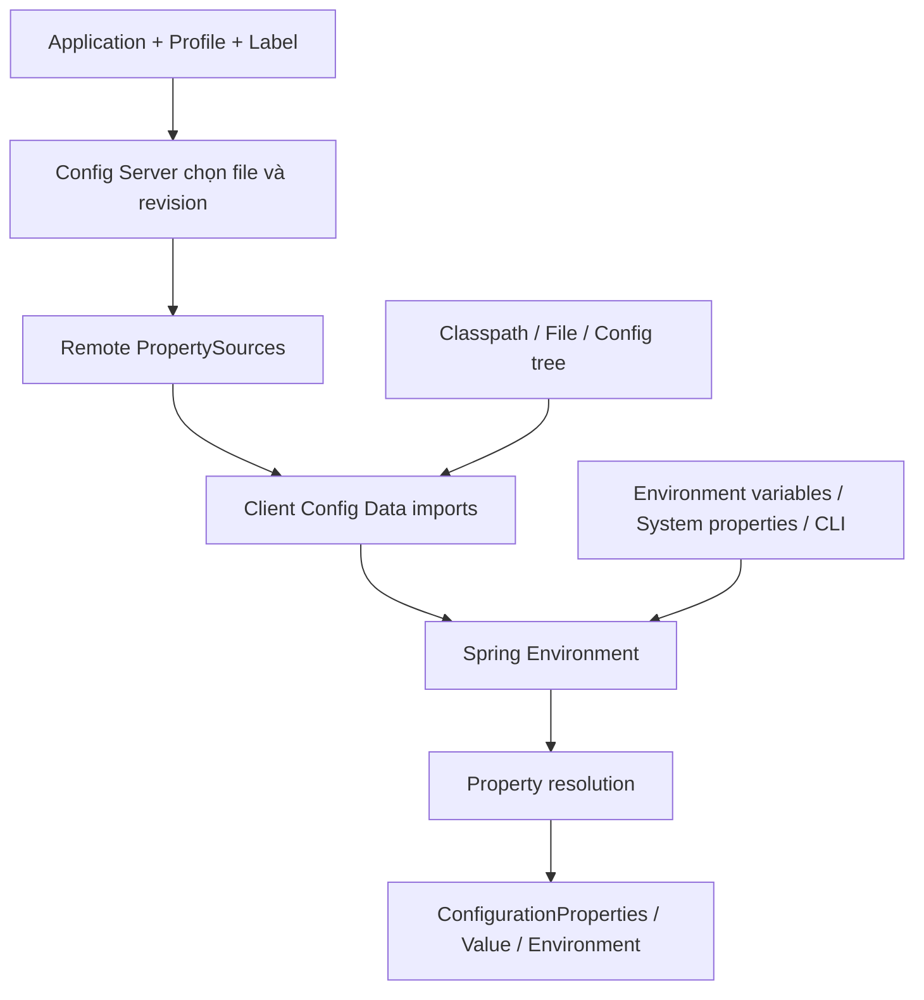

# Thiết kế quy tắc ghi đè rõ ràng và kiểm thử bằng ví dụ xung đột

Trong một hệ thống dùng Spring Cloud Config, cùng một thuộc tính có thể xuất hiện ở nhiều nơi: file mặc định trong ứng dụng, file theo profile, Git repository, Config Server, biến môi trường, JVM system property hoặc tham số dòng lệnh. Spring Boot vẫn có thể khởi động bình thường dù một key bị khai báo nhiều lần, nhưng giá trị cuối cùng có thể khác với điều mà người viết cấu hình mong đợi.

Muốn cấu hình nhất quán, nhóm cần xác định nguồn nào sở hữu từng nhóm thuộc tính, nguồn nào được phép ghi đè, và cách kiểm chứng khi có xung đột. Bài viết trình bày các lớp ưu tiên trong Spring Boot và Spring Cloud Config, hai chính sách ghi đè thường gặp, cách đọc PropertySource và ví dụ kiểm thử có thể tái lập.

## 1. Phân biệt các lớp ưu tiên

Không có một quy tắc duy nhất giải thích mọi xung đột. Cấu hình được hợp nhất qua nhiều giai đoạn:

1. **Chọn tập cấu hình từ xa**: application, profile và label xác định file hoặc revision mà Config Server đọc.
2. **Kết hợp property source ở Config Server**: file chung, file theo profile, file theo application và các backend composite đóng góp nguồn thuộc tính.
3. **Nạp Config Data ở client**: các file và location import được đưa vào Spring Environment theo thứ tự Config Data.
4. **Hợp nhất Environment của Spring Boot**: biến môi trường, JVM system properties, tham số dòng lệnh và các nguồn khác có vị trí ưu tiên riêng.
5. **Binding và sử dụng**: `@ConfigurationProperties`, `@Value` hoặc `Environment` đọc giá trị đã phân giải.

Ví dụ, Git có thể trả `orders.http.read-timeout=10s`, nhưng client vẫn có thể nhận giá trị khác nếu chính sách remote override cho phép một nguồn cục bộ ưu tiên cao hơn. Ngược lại, hai file trong repository cùng khai báo key thì cần xem thứ tự property source do Config Server trả về.

Sơ đồ các giai đoạn:



Cần chẩn đoán đúng lớp trước khi thay đổi cấu hình. Nếu Config Server đã trả sai giá trị, kiểm tra repository, profile, label và thứ tự remote source. Nếu response từ server đúng nhưng client nhận sai, kiểm tra Config Data import và các property source phía client.

## 2. Thiết lập quyền sở hữu thuộc tính

Trước khi chọn thứ tự ưu tiên, hãy thống nhất nguồn nào chịu trách nhiệm cho từng nhóm key. Một bảng ownership giúp giảm việc nhiều nhóm cùng chỉnh một thuộc tính.

| Nhóm thuộc tính | Nguồn sở hữu khuyến nghị | Nguồn override được phép |
| --- | --- | --- |
| Giá trị mặc định an toàn | Classpath trong ứng dụng | File triển khai hoặc Config Server |
| Timeout, retry, feature flag theo môi trường | Git qua Config Server | Quy trình release cấu hình; ngoại lệ runtime có kiểm soát |
| Secret như password, API token | Vault/secret manager hoặc config tree | Quy trình rotate secret |
| Thông số vận hành khẩn cấp | Nguồn runtime được quản trị | Environment variable hoặc command line theo quyền hạn |
| Thiết lập chẩn đoán cục bộ | File riêng trên máy phát triển | Chỉ môi trường phát triển |

Không nên để Git và Vault cùng sở hữu một key nếu không có lý do rõ ràng. Tương tự, không nên cho biến môi trường tùy ý ghi đè mọi thuộc tính production nếu chỉ cần cho phép override một vài thông số khẩn cấp.

Có thể ghi lại quy tắc theo từng key quan trọng:

| Key | Giá trị chuẩn | Chủ sở hữu | Có cho override runtime? |
| --- | --- | --- | --- |
| `orders.http.read-timeout` | Git theo profile | Platform team | Có, chỉ trong sự cố có phê duyệt |
| `orders.retry.max-attempts` | Git theo profile | Service team | Không |
| `orders.db.password` | Vault | Security/DB owner | Không qua biến môi trường tùy ý |
| `feature.new-checkout-enabled` | Git theo profile | Product team | Theo quy trình release |

Ownership cần đi kèm review và audit. Nếu không xác định ai có quyền thay đổi key, một quy tắc precedence đúng về kỹ thuật vẫn có thể tạo ra thay đổi khó kiểm soát trong vận hành.

## 3. Thứ tự ưu tiên trong Config Server và Spring Boot

Ở phía Config Server, các file có thể được chọn theo application và profile, ví dụ:

```text
application.yml
application-prod.yml
orders-service.yml
orders-service-prod.yml
```

Config Server trả về các property source trong Environment JSON. Khi có nhiều nguồn cùng khai báo một key, thứ tự property source được trả về quyết định nguồn nào thắng theo cơ chế phân giải của Spring.

Ở phía client, Spring Boot tiếp tục kết hợp remote property source với các nguồn Config Data khác. Các import được xử lý theo thứ tự khai báo; import đứng sau có thể ghi đè import đứng trước khi cùng khai báo key. Cấu hình được import có ưu tiên cao hơn document khai báo import đó.

Các nguồn ngoài Config Data như command-line arguments, JVM system properties và environment variables cũng có vị trí ưu tiên riêng. Vì vậy, không nên lấy thứ tự file trong Git làm thứ tự ưu tiên tổng thể của ứng dụng.

Có thể dùng ví dụ sau để theo dõi một key:

| Nguồn | Giá trị khai báo |
| --- | --- |
| `classpath:/defaults.yml` | `5s` |
| `file:./config/common.yml` | `8s` |
| Config Server `orders-service-prod.yml` | `10s` |
| Environment variable | `3s` |
| Command line | `2s` |

Giá trị cuối không thể kết luận chỉ từ bảng này nếu chưa xác định chính sách remote override. Nếu remote property source được đặt ở ưu tiên cao theo mặc định, giá trị từ Config Server có thể thắng các file cục bộ. Nếu server cho phép local override theo chính sách đã chọn, biến môi trường hoặc command line có thể thắng remote. Hãy kiểm thử thay vì giả định.

## 4. Chính sách A: Config Server là nguồn có thẩm quyền

Đây là lựa chọn phù hợp khi nhóm muốn cấu hình tập trung quyết định giá trị cho các môi trường dùng chung. Config Server cung cấp giá trị đã được review; file cục bộ và biến môi trường không được phép âm thầm thay đổi các key đó.

Ví dụ repository Git:

```yaml
# orders-service-prod.yml
orders:
  http:
    read-timeout: 10s
  retry:
    max-attempts: 4
```

Client import Config Server:

```yaml
spring:
  application:
    name: orders-service
  profiles:
    active: prod
  config:
    import: "configserver:http://config-server:8888"
```

Theo chính sách mặc định của Spring Cloud Config, remote property source thường được đặt ở mức ưu tiên cao hơn cấu hình cục bộ. Không bật các cờ cho phép override nếu muốn giữ hành vi này. Khi đó, một file local có thể chứa giá trị mặc định hoặc hỗ trợ phát triển, nhưng không được dùng để thay đổi các key do Config Server quản lý.

Ưu điểm:

- Giá trị production được quản lý tập trung và review tại một nơi.
- Các instance nhận cùng chính sách cấu hình theo application/profile/label.
- Giảm nguy cơ một container có biến môi trường cũ làm lệch hành vi.
- Dễ truy vết thay đổi qua Git revision.

Điểm cần cân nhắc là thao tác khẩn cấp qua environment variable hoặc command line sẽ không ghi đè remote nếu chính sách không cho phép. Nếu cần cơ chế override khẩn cấp, phải thiết kế một ngoại lệ có kiểm soát, thay vì thêm biến môi trường tùy ý.

## 5. Chính sách B: cho phép runtime override có giới hạn

Một số nền tảng cần cho phép operator override một số giá trị bằng environment variable, JVM system property hoặc command line, ví dụ giảm timeout hoặc tạm thời vô hiệu hóa một tính năng. Spring Cloud Config cung cấp các thuộc tính điều khiển remote override.

Các thuộc tính này phải được đặt trong **cấu hình từ xa do Config Server cung cấp**, không phải chỉ thêm vào file local của client:

```yaml
# application.yml trong Git repository
spring:
  cloud:
    config:
      allowOverride: true
      overrideNone: false
      overrideSystemProperties: false
```

Ý nghĩa khái quát:

| Thuộc tính | Vai trò |
| --- | --- |
| `spring.cloud.config.allowOverride` | Cho phép nguồn cục bộ có thể ghi đè remote property source |
| `spring.cloud.config.overrideNone` | Khi `true`, cho phép các nguồn cục bộ override remote |
| `spring.cloud.config.overrideSystemProperties` | Điều khiển việc các nguồn hệ thống như environment, system properties và command line có thể override remote hay không |

Với `allowOverride: true`, `overrideNone: false` và `overrideSystemProperties: false`, mục tiêu là cho phép các nguồn hệ thống như environment variables, JVM system properties và command-line arguments override remote, trong khi các file cấu hình local không tự động được ưu tiên hơn remote theo cùng cách.

Nếu đặt `overrideNone: true`, các nguồn cục bộ có thể override remote rộng hơn. Chỉ bật khi đã chấp nhận rõ ràng rằng file cấu hình local và các nguồn khác có thể thay đổi giá trị do Config Server cung cấp.

Các cờ này có quy tắc chi tiết phụ thuộc phiên bản Spring Cloud Config. Hãy xác minh với release train đang sử dụng và thử nghiệm bằng một key không nhạy cảm. Đặc biệt, `allowOverride` phải được gửi từ phía server trong property source từ xa; đặt nó ở client không thể tự cấp quyền override cho client.

## 6. Ví dụ xung đột có thể tái lập

Giả sử `orders-service-prod.yml` trong Git đặt:

```yaml
orders:
  http:
    read-timeout: 10s
```

File local `config/common.yml` đặt:

```yaml
orders:
  http:
    read-timeout: 8s
```

Biến môi trường của container đặt:

```text
ORDERS_HTTP_READTIMEOUT=3s
```

Tham số dòng lệnh đặt:

```text
--orders.http.read-timeout=2s
```

Có thể kiểm tra theo từng tình huống:

| Tình huống | Chính sách | Giá trị dự kiến |
| --- | --- | --- |
| Chỉ có Git remote | Config Server authoritative | `10s` |
| Git remote và local file | Remote authoritative | `10s` |
| Git remote và environment variable | Runtime override được cho phép | `3s` |
| Git remote và command line | Runtime override được cho phép | `2s` |
| Local file đứng sau file defaults trong imports, không có remote key | Config Data import order | Giá trị từ import đứng sau |

Tên biến môi trường theo quy tắc relaxed binding: viết hoa, thay dấu chấm bằng dấu gạch dưới và loại bỏ dấu gạch ngang. Vì vậy `orders.http.read-timeout` trở thành `ORDERS_HTTP_READTIMEOUT`.

Đây là các kết quả mong đợi theo chính sách đã mô tả; phải xác nhận bằng phiên bản Spring Boot/Spring Cloud thực tế. Nếu kết quả khác, hãy kiểm tra response Environment của Config Server, các remote override flags và property source ở client.

## 7. Kiểm tra remote response trước khi kiểm tra client

Trước tiên, xác nhận Config Server trả đúng dữ liệu:

```bash
curl http://localhost:8888/orders-service/prod/main
```

Trong JSON response, kiểm tra:

- `name` có phải `orders-service`.
- `profiles` có chứa `prod`.
- `label` và revision Git có đúng bản phát hành.
- `propertySources` có chứa key `orders.http.read-timeout`.
- Key có xuất hiện trong nhiều source hay không.
- Thứ tự source có phù hợp với chính sách đã thiết kế.

Nếu Config Server trả `10s` đúng như repository, nhưng client đọc `3s`, vấn đề nằm ở bước hợp nhất phía client hoặc ở nguồn khác có quyền override. Nếu Config Server trả `8s` hoặc giá trị khác, cần kiểm tra file/profile/label và thứ tự property source ở server trước.

Không lưu response chứa password hoặc token vào file chia sẻ. Khi debug bằng script, chỉ in tên property source, revision và sự hiện diện của key; không in giá trị secret.

## 8. Kiểm tra giá trị hiệu lực trong Spring Environment

Có thể expose Actuator endpoint `env` và `configprops` trong môi trường kiểm thử:

```yaml
management:
  endpoints:
    web:
      exposure:
        include: health,env,configprops
```

Sau khi ứng dụng khởi động, truy vấn key cụ thể:

```bash
curl http://localhost:8080/actuator/env/orders.http.read-timeout
```

Response có thể cho biết giá trị và nguồn property source, tùy phiên bản Actuator và chính sách sanitization. Endpoint `configprops` giúp kiểm tra giá trị đã bind vào bean cấu hình. Chỉ bật các endpoint này trong mạng quản trị, bật xác thực và phân quyền; không expose công khai vì có thể làm lộ cấu hình nhạy cảm.

Có thể kiểm tra từ code bằng `Environment`:

```java
@Component
public class ConfigDiagnostics {
    private final Environment environment;

    public ConfigDiagnostics(Environment environment) {
        this.environment = environment;
    }

    public Duration readTimeout() {
        return environment.getProperty(
                "orders.http.read-timeout",
                Duration.class);
    }
}
```

Để quan sát thứ tự PropertySource mà không in giá trị secret:

```java
@Component
public class PropertySourceReporter {
    private final ConfigurableEnvironment environment;

    public PropertySourceReporter(ConfigurableEnvironment environment) {
        this.environment = environment;
    }

    public void reportReadTimeoutSources() {
        String key = "orders.http.read-timeout";

        for (PropertySource<?> source : environment.getPropertySources()) {
            if (source.containsProperty(key)) {
                System.out.println("Key found in source: " + source.getName());
            }
        }
    }
}
```

Đoạn code chỉ in tên nguồn có chứa key, không in giá trị. Dùng nó trong môi trường kiểm thử hoặc công cụ chẩn đoán nội bộ; tránh tạo log quá nhiều khi ứng dụng khởi động.

## 9. Kiểm thử binding bằng Spring Boot

Một bean cấu hình có kiểu rõ ràng giúp kiểm tra giá trị cuối cùng:

```java
@ConfigurationProperties(prefix = "orders.http")
public record OrdersHttpProperties(
        Duration connectTimeout,
        Duration readTimeout) {
}
```

Đăng ký lớp bằng `@ConfigurationPropertiesScan` hoặc `@EnableConfigurationProperties`:

```java
@SpringBootApplication
@ConfigurationPropertiesScan
public class OrdersApplication {
    public static void main(String[] args) {
        SpringApplication.run(OrdersApplication.class, args);
    }
}
```

Có thể viết integration test để xác nhận client nhận giá trị remote khi không có runtime override:

```java
@SpringBootTest(properties = {
        "spring.application.name=orders-service",
        "spring.profiles.active=prod",
        "spring.config.import=configserver:http://localhost:8888"
})
class RemoteConfigurationIT {

    @Autowired
    Environment environment;

    @Autowired
    OrdersHttpProperties properties;

    @Test
    void loadsReadTimeoutFromConfigServer() {
        assertThat(environment.getProperty(
                "orders.http.read-timeout", Duration.class))
                .isEqualTo(Duration.ofSeconds(10));

        assertThat(properties.readTimeout())
                .isEqualTo(Duration.ofSeconds(10));
    }
}
```

Test này cần Config Server đang chạy và repository có cấu hình đúng. Nó xác nhận cả giá trị trong Environment và kết quả binding. Đảm bảo môi trường test không vô tình có biến môi trường hoặc command line đang ghi đè key.

Để kiểm tra chính sách runtime override, khởi động cùng ứng dụng với biến môi trường hoặc command line theo từng lần chạy. Ví dụ:

```bash
ORDERS_HTTP_READTIMEOUT=3s java -jar orders-service.jar
```

Hoặc:

```bash
java -jar orders-service.jar --orders.http.read-timeout=2s
```

Với chính sách B, kiểm tra Actuator hoặc một test endpoint không nhạy cảm để xác nhận giá trị runtime đã thắng. Với chính sách A, xác nhận giá trị remote vẫn giữ nguyên. Không cần viết một test riêng cho mọi biến thể; chọn các xung đột đại diện cho từng loại nguồn và kiểm tra trong CI hoặc môi trường tích hợp.

## 10. Kiểm thử xung đột giữa nhiều file Config Data

Có thể kiểm tra thứ tự giữa các import cục bộ mà không cần Config Server. Ví dụ:

```yaml
spring:
  config:
    import:
      - "classpath:/defaults.yml"
      - "file:./config/common.yml"
```

File `defaults.yml`:

```yaml
orders:
  http:
    read-timeout: 5s
```

File `common.yml`:

```yaml
orders:
  http:
    read-timeout: 8s
```

Với thứ tự import trên, location được import sau có thể ghi đè giá trị của location trước. Có thể đảo hai dòng import rồi khởi động lại để xác nhận kết quả thay đổi. Lưu ý rằng đây là thử nghiệm thứ tự Config Data cục bộ; khi thêm Config Server, remote property source còn chịu chính sách override của Spring Cloud Config.

## 11. Quy tắc thiết kế để tránh xung đột

Một chính sách dễ vận hành thường có các nguyên tắc sau:

- Mỗi key có một nguồn sở hữu chính; tránh ghi trùng cùng một key ở nhiều backend.
- Cấu hình dùng chung và cấu hình theo profile có quy ước tên file rõ ràng.
- Chọn rõ Config Server authoritative hay cho phép runtime override có giới hạn.
- Đặt remote override flags ở repository từ xa theo đúng tài liệu phiên bản đang dùng.
- Dành environment variables và command line cho những override runtime đã được phê duyệt.
- Không dùng override để che giấu lỗi cấu hình bắt buộc hoặc bỏ qua validation.
- Kiểm tra response Environment trước, sau đó kiểm tra Environment và bean binding ở client.
- Ghi nhận application, profile, label, Git revision và chính sách override của từng lần triển khai.
- Bảo vệ Actuator và không in giá trị secret khi chẩn đoán.

Khi có xung đột, hãy xác định key, liệt kê mọi nguồn đang cung cấp key đó, xác định chính sách đã chọn và kiểm tra nguồn thắng. Không nên chữa từng trường hợp bằng cách thêm một giá trị vào file ngẫu nhiên; hãy sửa ownership hoặc chính sách chung để các instance có cùng kết quả.

## 12. Quy trình review một thay đổi cấu hình

Trước khi phát hành một thay đổi có thể ghi đè key hiện có, reviewer có thể thực hiện:

1. Tìm các file hoặc backend đang khai báo key đó.
2. Xác định nguồn sở hữu theo bảng ownership.
3. Kiểm tra profile và label của môi trường mục tiêu.
4. Đánh giá thay đổi có tác động đến các ứng dụng khác hay không.
5. Kiểm tra remote override flags và các nguồn runtime được phép.
6. Chạy test binding và test xung đột đại diện.
7. Kiểm tra response Environment và revision Git.
8. Triển khai thử, theo dõi metric/log và xác nhận các instance cùng nhận giá trị.
9. Ghi lại revision và rollback plan nếu thay đổi gây lỗi.

Quy trình này đặc biệt quan trọng với các key điều khiển timeout, retry, connection pool, feature flag và endpoint dịch vụ. Một giá trị bị override có thể làm tăng tải, thay đổi hành vi retry hoặc khiến một dịch vụ kết nối sang môi trường không mong muốn.

## 13. Kết luận vận hành

Thứ tự ưu tiên là một phần của thiết kế hệ thống cấu hình. Config Server có thể tập trung quyền quyết định, hoặc cho phép một số nguồn runtime override trong phạm vi giới hạn. Cả hai mô hình đều có thể hoạt động tốt nếu quyền sở hữu key rõ ràng, các cờ override được đặt đúng phía server và xung đột được kiểm thử trước khi phát hành.

Hãy coi một cấu hình hợp lệ là cấu hình có thể giải thích được: biết key đến từ đâu, vì sao nguồn đó thắng, thuộc phiên bản nào và cách kiểm tra lại kết quả trên từng client. Khi nhóm duy trì được quy tắc này, việc thay đổi cấu hình cho nhiều ứng dụng Spring Boot sẽ dễ review, dễ truy vết và ít tạo ra sai khác khó chẩn đoán giữa các môi trường.

