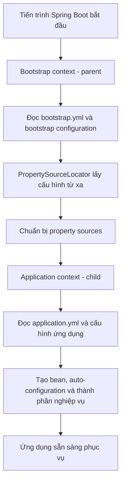

# Vai trò của bootstrap context và application context

Trong các ứng dụng Spring Boot sử dụng Spring Cloud Config theo cơ chế cũ, cấu hình từ xa cần được lấy trước khi những bean nghiệp vụ của ứng dụng được tạo. Spring Cloud giải quyết yêu cầu này bằng **bootstrap context**: một `ApplicationContext` cha được khởi tạo sớm để chuẩn bị nguồn cấu hình và các thành phần hạ tầng. Sau đó Spring Boot tạo **application context** làm context con để khởi tạo ứng dụng chính.

Hai context có vòng đời và trách nhiệm khác nhau. Bootstrap context chuẩn bị cấu hình nền, kết nối Config Server và đăng ký các thành phần mở rộng phục vụ bootstrap. Application context sử dụng các nguồn thuộc tính đã được chuẩn bị để tạo bean, cấu hình web, kết nối database và chạy nghiệp vụ. Hiểu ranh giới này giúp bảo trì dự án Spring Cloud Config cũ, xử lý lỗi khởi động và chuyển đổi sang Config Data API hiện đại.

## 1. Mục tiêu học tập

Sau bài học, bạn có thể:

- Giải thích vì sao Spring Cloud cần bootstrap context trước application context trong cơ chế bootstrap legacy.
- Mô tả quan hệ parent-child giữa bootstrap context và application context.
- Phân biệt trách nhiệm, bean và thời điểm khởi tạo của hai context.
- Giải thích vai trò của `bootstrap.yml`, `BootstrapConfiguration` và `PropertySourceLocator`.
- Cấu hình Config Client theo cơ chế bootstrap cũ bằng `spring-cloud-starter-bootstrap`.
- Hiểu cách property source từ xa tham gia vào `Environment` và cách kiểm tra thứ tự ưu tiên.
- Nhận biết giới hạn của bootstrap legacy và lập kế hoạch chuyển sang Config Data API với `spring.config.import`.

## 2. Vì sao cần bootstrap context?

Một ứng dụng Spring Boot thông thường tạo application context, nạp cấu hình và khởi tạo các bean. Tuy nhiên, với một ứng dụng cần lấy cấu hình từ Config Server, có một vấn đề về thứ tự: ứng dụng phải biết địa chỉ Config Server, tên ứng dụng, profile và label trước khi có thể lấy các giá trị cấu hình từ xa.

Ví dụ, `order-service` cần đọc từ Config Server:

- URL database của môi trường `prod`.
- Địa chỉ dịch vụ inventory.
- Timeout và giới hạn kết nối.
- Các thuộc tính cần thiết để tạo bean trong ứng dụng.

Nếu chỉ đợi application context được tạo rồi mới lấy cấu hình từ xa, một số bean có thể đã được khởi tạo với giá trị mặc định hoặc giá trị chưa đầy đủ. Bootstrap context tạo ra một giai đoạn chuẩn bị trước để giải quyết vấn đề đó.

Bootstrap context thường chịu trách nhiệm:

- Đọc cấu hình bootstrap như `bootstrap.yml` hoặc `bootstrap.properties`.
- Tạo các bean hạ tầng cần thiết cho quá trình lấy cấu hình.
- Chạy các `PropertySourceLocator` để lấy property source từ Config Server hoặc nguồn bên ngoài khác.
- Đưa property source đã lấy được vào môi trường cấu hình mà application context sử dụng.
- Làm parent context cho application context chính.

Application context sau đó khởi tạo các bean của ứng dụng dựa trên cấu hình đã sẵn sàng.

## 3. Quan hệ giữa bootstrap context và application context

Trong cơ chế legacy, bootstrap context là context cha (parent), còn application context là context con (child). Context con có thể tra cứu bean được định nghĩa trong context cha. Context cha không thể tra cứu bean chỉ được tạo trong context con.



### Bootstrap context (parent)

Bootstrap context là một `ApplicationContext` được tạo trước context chính. Nó chứa những bean cần thiết để chuẩn bị cấu hình, chẳng hạn các thành phần bootstrap do Spring Cloud cung cấp hoặc do ứng dụng đăng ký thông qua cơ chế bootstrap configuration.

Các bean trong parent có thể được tìm thấy từ child thông qua cơ chế tra cứu bean theo phân cấp của Spring. Điều này hữu ích khi các thành phần ở application context cần sử dụng một số bean hạ tầng được tạo trong bootstrap context.

Bootstrap context không phải nơi đặt các service nghiệp vụ, controller hoặc repository của ứng dụng. Các bean nghiệp vụ thuộc application context để có vòng đời, dependency và phạm vi rõ ràng.

### Application context (child)

Application context là context chính được Spring Boot tạo để chạy ứng dụng. Nó chứa các bean được phát hiện qua component scan, auto-configuration và cấu hình Java/XML của ứng dụng.

Application context sử dụng các property source đã được bootstrap chuẩn bị. Các bean như `DataSource`, HTTP client, `@ConfigurationProperties` và `@Value` được cấu hình dựa trên `Environment` tại thời điểm chúng được tạo hoặc bind.

### Khả năng nhìn thấy bean giữa hai context

| Hướng tra cứu | Kết quả | Giải thích |
| --- | --- | --- |
| Application context tìm bean trong bootstrap context | Có thể | Child tra cứu được bean ở parent nếu không có bean phù hợp trong chính child |
| Bootstrap context tìm bean chỉ có trong application context | Không | Parent không tra cứu ngược xuống child |
| Hai context cùng khai báo một bean name | Cần xem cấu hình và chính sách override | Có thể gây xung đột hoặc che khuất bean; không nên dùng chung tên tùy tiện |
| Bean nghiệp vụ đặt trong bootstrap context | Không phù hợp | Bootstrap chỉ nên chứa thành phần phục vụ việc chuẩn bị cấu hình |

Không nên coi hai context là hai ứng dụng độc lập. Chúng thuộc cùng tiến trình, có quan hệ phân cấp và phối hợp trong một lần khởi động.

## 4. Vòng đời khởi động trong cơ chế bootstrap legacy

Quá trình khởi động có thể tóm tắt thành các giai đoạn:

1. JVM chạy `main()` và Spring Boot bắt đầu chuẩn bị môi trường.
2. Cơ chế bootstrap của Spring Cloud được kích hoạt, thường thông qua `spring-cloud-starter-bootstrap` hoặc thiết lập bootstrap tương ứng.
3. Spring Cloud tạo bootstrap context và đọc các nguồn bootstrap.
4. Các bootstrap configuration và `PropertySourceLocator` được chạy để tìm nguồn cấu hình bên ngoài.
5. Config Client liên hệ Config Server bằng các thông tin có sẵn như application name, profile, label và URI.
6. Config Server trả về `Environment` gồm các property source; những nguồn này được thêm vào môi trường cấu hình mà context chính sẽ sử dụng.
7. Spring Boot tạo application context làm child của bootstrap context.
8. Application context đọc cấu hình ứng dụng, chạy auto-configuration và tạo bean.
9. Ứng dụng hoàn tất khởi động hoặc báo lỗi nếu cấu hình bắt buộc không lấy được hay không hợp lệ.

Điểm cốt lõi là cấu hình từ xa được chuẩn bị trước khi application context tạo các bean phụ thuộc vào cấu hình đó. Chi tiết nội bộ của listener, event và thứ tự property source có thể thay đổi giữa các phiên bản Spring Cloud; khi điều tra một dự án cụ thể, cần đối chiếu phiên bản BOM đang dùng.

## 5. Vai trò của `bootstrap.yml`

`bootstrap.yml` hoặc `bootstrap.properties` là tệp cấu hình được đọc trong giai đoạn bootstrap legacy. Nó thường chứa những thông tin tối thiểu cần có để lấy cấu hình từ xa, ví dụ:

- Tên ứng dụng.
- Địa chỉ Config Server.
- Profile và label cần yêu cầu.
- Thông tin kết nối hoặc tùy chọn client cần thiết.

Ví dụ:

```yaml
spring:
  application:
    name: order-service
  cloud:
    config:
      uri: http://localhost:8888
      name: order-service
      profile: dev
      label: main
      fail-fast: true
```

Trong ví dụ, Config Client dùng tên `order-service`, yêu cầu profile `dev`, label `main` và kết nối đến Config Server tại cổng `8888`. `fail-fast: true` yêu cầu client báo lỗi khởi động khi không lấy được cấu hình từ xa theo cơ chế hỗ trợ của phiên bản đang dùng.

`bootstrap.yml` không phải file cấu hình nghiệp vụ. Không nên đặt mọi thuộc tính của ứng dụng vào đây. Chỉ giữ những thông tin cần thiết cho quá trình bootstrap và cấu hình kết nối đến nguồn bên ngoài.

### Phân biệt `bootstrap.yml` với `application.yml`

| Tệp | Thời điểm và mục đích | Nội dung thường đặt |
| --- | --- | --- |
| `bootstrap.yml` | Được đọc trong bootstrap context trước application context | Tên ứng dụng, Config Server URI, profile/label và bootstrap settings |
| `application.yml` | Được đọc trong application context | Cấu hình ứng dụng, logging, server, bean và các thuộc tính nghiệp vụ-kỹ thuật |
| `application-{profile}.yml` | Cấu hình ứng dụng theo profile | Giá trị riêng của `dev`, `test`, `prod`... |

Hai tệp có vai trò khác nhau trong cơ chế legacy. Nếu một khóa được khai báo ở nhiều nguồn, giá trị hiệu lực phụ thuộc thứ tự property source và chính sách override. Không suy luận rằng file tên `bootstrap.yml` luôn thắng `application.yml` hoặc ngược lại; hãy kiểm tra `Environment` thực tế.

## 6. Cách kích hoạt cơ chế bootstrap

Ở các dự án Spring Cloud đời cũ, bootstrap context thường được kích hoạt mặc định theo cấu hình của phiên bản. Từ các dòng Spring Cloud mới hơn, cơ chế bootstrap legacy không còn được bật tự động trong mọi trường hợp. Để sử dụng, dự án thường cần thêm dependency `spring-cloud-starter-bootstrap`.

Ví dụ Maven:

```xml
<dependency>
    <groupId>org.springframework.cloud</groupId>
    <artifactId>spring-cloud-starter-bootstrap</artifactId>
</dependency>
```

Dependency version nên được quản lý bằng Spring Cloud BOM tương thích với dòng Spring Boot của dự án; không tự đặt một phiên bản starter độc lập nếu BOM đã quản lý.

Một số phiên bản còn cho phép bật bootstrap bằng thuộc tính `spring.cloud.bootstrap.enabled=true`. Nếu dùng cách này, phải truyền thuộc tính đủ sớm trước khi application context bắt đầu, ví dụ bằng system property hoặc biến môi trường. Đặt nó trong `application.yml` thường là quá muộn vì file đó được đọc trong application context, sau thời điểm quyết định tạo bootstrap context.

Ví dụ truyền system property:

```bash
java -Dspring.cloud.bootstrap.enabled=true -jar order-service.jar
```

Trước khi áp dụng, hãy kiểm tra tài liệu đúng phiên bản Spring Cloud. Với dự án mới, Config Data API thường là lựa chọn được khuyến nghị.

## 7. Bootstrap configuration và `PropertySourceLocator`

Bootstrap context có thể được mở rộng bằng các lớp cấu hình bootstrap. Các lớp này đăng ký bean phục vụ quá trình chuẩn bị cấu hình, ví dụ một `PropertySourceLocator`.

`PropertySourceLocator` là một extension point cho phép Spring Cloud tìm và trả về một `PropertySource` từ nguồn bên ngoài. Trong trường hợp Config Client, thành phần tích hợp Config Server thực hiện việc lấy cấu hình từ server và cung cấp các property source cho môi trường của ứng dụng.

Một bootstrap configuration thường được khai báo riêng để chỉ được nạp trong bootstrap context. Với cơ chế Spring Cloud legacy, các lớp cấu hình bootstrap có thể được đăng ký thông qua `spring.factories` trong `META-INF` theo quy ước của phiên bản tương ứng. Không nên đặt các lớp này trong component scan thông thường nếu chúng chỉ phục vụ bootstrap, vì có thể tạo bean trùng hoặc làm thay đổi context ngoài ý muốn.

Ví dụ minh họa một lớp cấu hình bootstrap:

```java
@Configuration(proxyBeanMethods = false)
public class CustomBootstrapConfiguration {

    @Bean
    public SomeBootstrapSupport bootstrapSupport() {
        return new SomeBootstrapSupport();
    }
}
```

Đây là ví dụ cấu trúc, trong đó `SomeBootstrapSupport` đại diện cho một thành phần hạ tầng do ứng dụng định nghĩa. Lớp thực tế cần được đăng ký theo cơ chế bootstrap configuration mà phiên bản Spring Cloud đang dùng hỗ trợ.

Không đưa business service, controller hoặc repository vào bootstrap configuration. Việc đó làm tăng phụ thuộc giữa hai context và khiến vòng đời bean khó hiểu.

## 8. Config Client legacy lấy cấu hình từ Config Server

Một cấu hình legacy tối thiểu có thể gồm dependency starter, `bootstrap.yml` và file cấu hình ứng dụng.

### Dependency

```xml
<dependency>
    <groupId>org.springframework.cloud</groupId>
    <artifactId>spring-cloud-starter-config</artifactId>
</dependency>
<dependency>
    <groupId>org.springframework.cloud</groupId>
    <artifactId>spring-cloud-starter-bootstrap</artifactId>
</dependency>
```

### `bootstrap.yml`

```yaml
spring:
  application:
    name: order-service
  cloud:
    config:
      uri: http://config-server:8888
      profile: ${SPRING_PROFILES_ACTIVE:dev}
      label: release-2026.11
      fail-fast: true
```

### `application.yml`

```yaml
server:
  port: 8081

platform:
  feature:
    order-export-enabled: false
```

Khi khởi động, bootstrap context sử dụng thông tin kết nối để lấy cấu hình từ Config Server. Application context sau đó sử dụng các nguồn cấu hình đã được chuẩn bị cùng các thuộc tính cục bộ để tạo bean và chạy ứng dụng.

Trong môi trường thật, URI, profile và label phải phù hợp với cách triển khai. Credential truy cập Config Server hoặc Git không được ghi trực tiếp vào file cấu hình đã commit. Hãy cấp bí mật qua secret manager hoặc cơ chế an toàn của nền tảng.

## 9. Property source và thứ tự ưu tiên

Config Server thường trả về một `Environment` gồm nhiều property source. Trong cơ chế bootstrap legacy, các property source từ xa được thêm vào môi trường mà application context sử dụng. Các nguồn cục bộ như `bootstrap.yml`, `application.yml`, file bên ngoài, biến môi trường và tham số dòng lệnh cũng có thể tham gia.

Không nên giả định một thứ tự ưu tiên cố định chỉ dựa trên tên file. Spring Cloud Config có các tùy chọn điều khiển việc cấu hình cục bộ có được ghi đè cấu hình từ xa hay không. Một số tùy chọn liên quan được đặt trong cấu hình từ xa, chẳng hạn:

- `spring.cloud.config.allowOverride`: cho phép cấu hình cục bộ ghi đè nguồn từ xa theo chính sách được hỗ trợ.
- `spring.cloud.config.overrideNone`: cho phép các nguồn cục bộ ghi đè nguồn từ xa khi được bật.
- `spring.cloud.config.overrideSystemProperties`: điều khiển phạm vi các nguồn hệ thống có thể ghi đè cấu hình từ xa.

Các thuộc tính này cần được cấu hình và kiểm tra theo đúng phiên bản Spring Cloud; không đặt chúng tùy tiện ở phía client với kỳ vọng thay đổi chính sách của remote property source.

Khi một giá trị không đúng như mong đợi:

1. Gọi endpoint Config Server theo application, profile và label để xem các property source được trả về.
2. Kiểm tra log bootstrap để xác nhận Config Client đã kết nối và nạp cấu hình từ xa.
3. Kiểm tra các nguồn cục bộ và biến môi trường có khai báo cùng khóa hay không.
4. Dùng Actuator `env` nếu được bật để xem nguồn của thuộc tính; bảo vệ endpoint này vì nó có thể tiết lộ cấu hình nhạy cảm.
5. Kiểm tra tùy chọn override và phiên bản Spring Cloud đang sử dụng.

## 10. Phạm vi bean và tránh nhầm lẫn giữa hai context

Vì bootstrap context là parent, các bean trong bootstrap context có thể được tra cứu từ application context. Điều này không có nghĩa mọi bean trong hai context đều nằm trong cùng một container hoặc có cùng vòng đời.

Một số nguyên tắc thiết kế:

- Chỉ đặt bean cần thiết để lấy cấu hình hoặc chuẩn bị hạ tầng bootstrap trong parent.
- Đặt controller, service, repository, scheduler và các bean nghiệp vụ trong application context.
- Tránh khai báo cùng một bean ở cả hai context nếu không hiểu rõ hành vi override và lookup.
- Không inject bean của application context vào bootstrap configuration vì parent không thể tra cứu ngược bean của child.
- Nếu một thành phần cần cấu hình từ xa, ưu tiên để nó được tạo trong application context sau khi property source đã sẵn sàng.

Ví dụ, một `DataSource` phụ thuộc URL và credential từ Config Server nên được tạo trong application context. Bootstrap context chỉ cần chứa thành phần giúp Config Client kết nối đến Config Server; không nên tạo `DataSource` nghiệp vụ quá sớm trong parent.

## 11. Lỗi thường gặp trong bootstrap legacy

| Biểu hiện | Nguyên nhân có thể | Cách xử lý |
| --- | --- | --- |
| `bootstrap.yml` không được đọc | Thiếu starter bootstrap hoặc cơ chế bootstrap chưa được bật | Kiểm tra dependency và thuộc tính kích hoạt đủ sớm |
| Client không gọi Config Server | Sai URI, tên ứng dụng hoặc cấu hình bootstrap chưa được nạp | Kiểm tra log bootstrap và endpoint server |
| Bean không nhận giá trị từ xa | Property source không được thêm vào Environment, khóa sai hoặc bị nguồn khác ghi đè | Kiểm tra response, Actuator `env` và thứ tự ưu tiên |
| `@Value` nhận giá trị cũ | Bean được tạo trước khi cấu hình mong muốn có mặt hoặc nguồn ưu tiên khác thắng | Kiểm tra thứ tự khởi động và property source |
| Bean không tìm thấy trong bootstrap context | Bean chỉ được khai báo trong application context child | Đưa phần hạ tầng phù hợp vào bootstrap config hoặc chuyển consumer sang child |
| Bean bị tạo hai lần | Cấu hình được component scan và đăng ký bootstrap cùng lúc | Tách package/configuration và tránh đăng ký trùng |
| Ứng dụng khởi động dù thiếu cấu hình từ xa | Fail-fast không bật hoặc lỗi được bỏ qua theo cấu hình | Xác định chính sách bắt buộc/optional và kiểm tra cấu hình client |
| Dự án nâng Spring Cloud nhưng bootstrap không còn hoạt động | Bootstrap không được bật mặc định ở dòng phiên bản mới | Thêm starter bootstrap nếu tiếp tục dùng legacy hoặc chuyển sang Config Data API |

## 12. Giới hạn của cơ chế bootstrap legacy

Bootstrap context giải quyết bài toán lấy cấu hình sớm, nhưng cũng tạo thêm một tầng vòng đời và context hierarchy mà nhóm phải hiểu và bảo trì.

Các hạn chế thường gặp:

- Cần phân biệt `bootstrap.yml` với `application.yml` và biết file nào được đọc ở giai đoạn nào.
- Thứ tự tạo context, đăng ký bootstrap configuration và property source có thể khó theo dõi khi ứng dụng có nhiều extension.
- Bean ở parent và child có quy tắc lookup khác nhau; đặt sai phạm vi dễ dẫn đến bean trùng hoặc dependency không thể giải quyết.
- Cơ chế legacy không còn là cách tích hợp mặc định được ưu tiên cho các dự án Spring Boot/Spring Cloud hiện đại.
- Khi nâng cấp, dự án cần kiểm tra dependency và cấu hình kích hoạt bootstrap thay vì giả định `bootstrap.yml` luôn tự được đọc.

Nếu dự án đang chạy ổn định với bootstrap legacy, không cần thay đổi chỉ vì cơ chế này cũ. Tuy nhiên, cần ghi rõ phiên bản Spring Boot/Spring Cloud, dependency bootstrap và quy trình khởi động để có thể bảo trì. Với dự án mới hoặc khi nâng cấp lớn, nên đánh giá chuyển sang Config Data API.

## 13. Chuyển từ bootstrap context sang Config Data API

Config Data API là cơ chế tích hợp cấu hình ngoài hiện đại của Spring Boot. Với Spring Cloud Config Client, ứng dụng thường khai báo `spring.config.import` để lấy cấu hình từ Config Server.

Ví dụ cấu hình hiện đại:

```yaml
spring:
  application:
    name: order-service
  config:
    import: "configserver:http://config-server:8888"
  profiles:
    active: dev
```

Nếu Config Server là nguồn bắt buộc, giữ import không có `optional:` để ứng dụng phát hiện lỗi lấy cấu hình ngay khi khởi động. Nếu có giá trị fallback an toàn và đã kiểm thử, có thể dùng:

```yaml
spring:
  config:
    import: "optional:configserver:http://config-server:8888"
```

Các bước chuyển đổi:

1. Ghi nhận phiên bản Java, Spring Boot, Spring Cloud và dependency hiện tại.
2. Đọc migration guide và bảng tương thích để chọn Spring Cloud release train phù hợp.
3. Xác định mọi cấu hình trong `bootstrap.yml`: application name, URI, profile, label, timeout, retry, fail-fast và các tùy chọn khác.
4. Chuyển các thuộc tính Config Client phù hợp sang `application.yml`, biến môi trường hoặc nguồn cấu hình sớm được Config Data hỗ trợ.
5. Thêm `spring.config.import` với URI Config Server.
6. Xác định chính sách optional/required và kiểm tra retry theo phiên bản.
7. Loại bỏ dependency bootstrap legacy nếu không còn thành phần nào cần bootstrap context.
8. Chạy thử với từng profile, xác minh application/profile/label và property source hiệu lực.
9. Kiểm tra các bean trước đây phụ thuộc parent context; chuyển chúng về application context nếu không còn lý do cần bootstrap.
10. Triển khai thử ở môi trường thấp trước khi áp dụng production.

Không nên giữ đồng thời hai cơ chế chỉ để tránh sửa cấu hình. Khi Config Data API và bootstrap legacy cùng được bật, ứng dụng có thể thực hiện nhiều lần lấy cấu hình hoặc tạo nguồn trùng, làm thứ tự ưu tiên khó hiểu. Chỉ giữ cả hai khi có yêu cầu tương thích cụ thể và đã kiểm thử rõ ràng.

## 14. Tình huống minh họa

Giả sử `payment-service` cần URL gateway và database credential trước khi tạo các bean tích hợp. Trong hệ thống cũ, `bootstrap.yml` xác định tên ứng dụng và Config Server:

```yaml
spring:
  application:
    name: payment-service
  cloud:
    config:
      uri: http://config-server:8888
      profile: prod
      label: release-2026.11
      fail-fast: true
```

Bootstrap context khởi tạo trước, dùng thông tin này để yêu cầu cấu hình từ xa. Khi property source đã được chuẩn bị, application context mới tạo `DataSource`, gateway client và service nghiệp vụ. Nhờ vậy, các bean được bind với cấu hình production đã nạp thay vì các giá trị tạm thời trong lúc khởi động.

Nếu Config Server không truy cập được và fail-fast được bật, ứng dụng dừng khởi động. Đây là lựa chọn phù hợp khi thiếu URL gateway hoặc thông tin kết nối khiến ứng dụng không thể hoạt động an toàn. Nếu nhóm chọn cơ chế fallback, phải xác định rõ giá trị nào được phép dự phòng và kiểm thử để không vô tình chạy với cấu hình của môi trường khác.

## 15. Checklist kiểm tra một ứng dụng dùng bootstrap legacy

- [ ] Đã xác định phiên bản Spring Boot và Spring Cloud tương thích.
- [ ] `spring-cloud-starter-bootstrap` hoặc cơ chế kích hoạt bootstrap phù hợp đã được cấu hình.
- [ ] `bootstrap.yml` chỉ chứa thông tin cần cho giai đoạn bootstrap.
- [ ] `spring.application.name`, Config Server URI, profile và label chính xác.
- [ ] Config Client có chính sách fail-fast/optional phù hợp với mức độ bắt buộc của cấu hình từ xa.
- [ ] Bootstrap context chỉ chứa bean hạ tầng phục vụ bootstrap.
- [ ] Bean nghiệp vụ được tạo trong application context.
- [ ] Không có bean bị đăng ký trùng giữa parent và child ngoài chủ đích.
- [ ] Property source từ xa và thứ tự ưu tiên đã được kiểm tra.
- [ ] Endpoint chẩn đoán cấu hình được bảo vệ và không tiết lộ secret.
- [ ] Có tài liệu chuyển đổi sang Config Data API nếu dự án sẽ nâng cấp.

Bootstrap context và application context có trách nhiệm khác nhau trong cơ chế Spring Cloud Config legacy. Bootstrap context chuẩn bị nguồn cấu hình và hạ tầng cần thiết trước; application context sử dụng các nguồn đó để khởi tạo ứng dụng. Khi giữ đúng ranh giới parent-child, đặt cấu hình bootstrap đúng chỗ và hiểu thứ tự property source, nhóm có thể vận hành hệ thống cũ ổn định và chuyển đổi sang Config Data API một cách có kiểm soát.

## 16. Tài liệu tham khảo

- [Spring Cloud Context — The Bootstrap Application Context](https://docs.spring.io/spring-cloud-commons/reference/spring-cloud-commons/application-context-services.html#the-bootstrap-application-context)
- [Spring Cloud Config Client](https://docs.spring.io/spring-cloud-config/reference/client.html)
- [Spring Boot — Externalized Configuration](https://docs.spring.io/spring-boot/reference/features/external-config.html)
