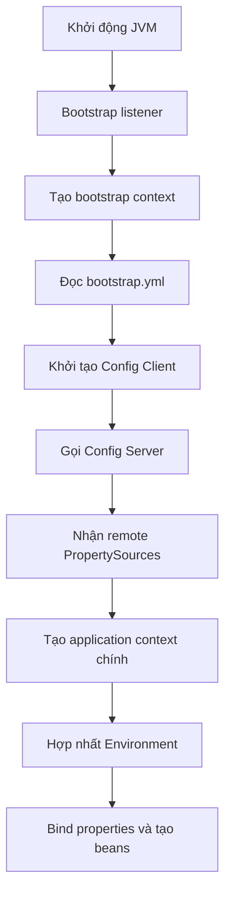

# Khi nào bootstrap.yml được đọc và cách kích hoạt cơ chế cũ

Trong các phiên bản Spring Cloud đời đầu, Config Client thường lấy cấu hình từ Config Server thông qua một cơ chế khởi tạo riêng gọi là **bootstrap context**. File `bootstrap.yml` chứa những thông tin cần có trước khi Spring Boot tạo application context chính, chẳng hạn tên ứng dụng, profile và địa chỉ Config Server.

Từ Spring Boot 2.4 và các release train Spring Cloud hiện đại, Config Data API cùng `spring.config.import` trở thành cách tích hợp được khuyến nghị. Bootstrap context không còn tự động bật trong các dòng Spring Cloud mới. Tuy vậy, một số hệ thống cũ vẫn cần cơ chế này vì phụ thuộc vào bootstrap listener, bootstrap property source hoặc thư viện mở rộng được xây dựng quanh nó.

Bài viết giải thích thời điểm `bootstrap.yml` được đọc, điều kiện kích hoạt bootstrap context, cách Config Client dùng thông tin trong file để liên hệ Config Server, thứ tự cấu hình và cách chuyển dần sang Config Data import.

## 1. Bootstrap context là gì?

Bootstrap context là một Spring ApplicationContext cha được tạo trước application context chính. Mục tiêu của nó là nạp các thiết lập cần thiết để chuẩn bị môi trường cho ứng dụng, đặc biệt là các property source từ hệ thống cấu hình bên ngoài.

Luồng khởi tạo ở chế độ bootstrap truyền thống có thể hình dung như sau:



Bootstrap context đóng vai trò chuẩn bị dữ liệu trước khi ứng dụng chính hoàn tất quá trình khởi tạo. Application context chính kế thừa môi trường và có thể sử dụng các property source đã được nạp ở giai đoạn bootstrap.

Cách tổ chức parent-child này từng giúp Config Client lấy được cấu hình tập trung trước khi các bean nghiệp vụ được tạo. Nhờ đó, những thiết lập như datasource URL, timeout hoặc feature flag có thể được binding ngay trong lần khởi động đầu tiên.

## 2. Khi nào bootstrap.yml được đọc?

`bootstrap.yml` được đọc như cấu hình bootstrap khi bootstrap mechanism được kích hoạt. Trong các dự án Spring Cloud cũ, cơ chế này thường được bật tự động bởi các starter thuộc hệ sinh thái Spring Cloud. Từ Spring Cloud 2020.0 trở đi, bootstrap context mặc định không còn tự động hoạt động như trước.

Có hai cách phổ biến để kích hoạt cơ chế cũ trong các phiên bản còn hỗ trợ:

1. Thêm dependency `spring-cloud-starter-bootstrap` vào ứng dụng.
2. Đặt `spring.cloud.bootstrap.enabled=true` trước khi Spring Boot tạo application context chính, thường bằng system property hoặc environment variable.

Ví dụ Maven:

```xml
<dependency>
    <groupId>org.springframework.cloud</groupId>
    <artifactId>spring-cloud-starter-bootstrap</artifactId>
</dependency>
```

Dependency version nên được quản lý qua Spring Cloud BOM tương thích với Spring Boot, tránh chỉ định một phiên bản starter độc lập không khớp release train.

Hoặc bật bằng JVM system property:

```bash
java -Dspring.cloud.bootstrap.enabled=true -jar orders-service.jar
```

Hoặc bằng environment variable:

```bash
SPRING_CLOUD_BOOTSTRAP_ENABLED=true
```

Thiết lập kích hoạt phải có mặt đủ sớm để bootstrap listener nhận biết. Nếu đặt `spring.cloud.bootstrap.enabled=true` trong chính `application.yml` được đọc sau khi bootstrap đã kết thúc, thiết lập đó đến quá muộn để bật cơ chế bootstrap cho lần khởi động hiện tại.

Khi bootstrap mechanism không được kích hoạt, không nên giả định Spring Boot sẽ tự đọc `bootstrap.yml` như một file cấu hình thông thường. Với ứng dụng hiện đại, hãy chuyển thông tin kết nối Config Server sang cấu hình Config Data phù hợp.

## 3. Đặt bootstrap.yml ở đâu?

File thường nằm trong classpath của ứng dụng client, ví dụ:

```text
orders-service/
└── src/
    └── main/
        └── resources/
            ├── bootstrap.yml
            └── application.yml
```

Một cấu hình bootstrap tối thiểu:

```yaml
spring:
  application:
    name: orders-service
  cloud:
    config:
      uri: http://config-server:8888
      name: orders-service
      profile: prod
      label: release-2026.11
```

Các thuộc tính chính:

| Thuộc tính | Ý nghĩa |
| --- | --- |
| `spring.application.name` | Tên ứng dụng; thường được dùng làm application name khi yêu cầu cấu hình |
| `spring.cloud.config.uri` | Địa chỉ Config Server |
| `spring.cloud.config.name` | Tên application được yêu cầu; có thể dùng khi tên cấu hình từ xa khác tên ứng dụng |
| `spring.cloud.config.profile` | Profile mà Config Client yêu cầu |
| `spring.cloud.config.label` | Branch, tag hoặc revision Git được yêu cầu |

Nếu không khai báo `spring.cloud.config.name`, Config Client thường sử dụng `spring.application.name`. Nếu không khai báo profile hoặc label riêng, client sử dụng profile đang hoạt động và label mặc định theo cấu hình server/client.

Không nên hard-code token, mật khẩu hoặc private key trong `bootstrap.yml`. File này thường được đóng gói cùng ứng dụng và có thể xuất hiện trong artifact. Credential kết nối Config Server nên được cấp qua secret manager, environment variable được bảo vệ hoặc cơ chế xác thực workload của nền tảng.

## 4. Phân biệt bootstrap.yml và application.yml

Hai file có vai trò khác nhau trong mô hình bootstrap truyền thống.

`bootstrap.yml` thường chứa thiết lập phục vụ quá trình bootstrap:

- Tên ứng dụng dùng để tra cứu cấu hình.
- Địa chỉ Config Server.
- Profile và label cần yêu cầu.
- Các thiết lập bootstrap khác cần có trước application context chính.

`application.yml` thường chứa cấu hình của chính ứng dụng:

- Port HTTP.
- Cấu hình logging.
- Các thiết lập mặc định của thành phần nghiệp vụ.
- Các thuộc tính có thể được remote configuration ghi đè theo chính sách.

Ví dụ:

```yaml
# bootstrap.yml
spring:
  application:
    name: orders-service
  cloud:
    config:
      uri: http://config-server:8888
      profile: prod
      label: main
```

```yaml
# application.yml
server:
  port: 8080

orders:
  http:
    connect-timeout: 2s
    read-timeout: 5s
```

Tách hai file giúp phân biệt thông tin cần để tìm Config Server với cấu hình ứng dụng. Nếu Config Server trả về `orders.http.read-timeout=10s`, giá trị remote có thể thay thế giá trị local theo thứ tự ưu tiên và chính sách override đang áp dụng.

## 5. Bootstrap property source và thứ tự ưu tiên

Bootstrap context tạo ra các property source và đưa chúng vào môi trường của application context chính. Cần phân biệt property source đến từ file `bootstrap.yml` với property source được Config Server trả về.

- Các thuộc tính từ `bootstrap.yml` được đưa vào child context theo quy tắc của bootstrap mechanism. Trong mô hình truyền thống, cấu hình cục bộ của application context như `application.yml` có thể ghi đè các giá trị khai báo trong `bootstrap.yml`.
- Các remote property source từ Config Server có chính sách ưu tiên riêng. Theo mặc định, remote source thường có độ ưu tiên cao hơn cấu hình local; khả năng local override phụ thuộc các thuộc tính do server gửi như `spring.cloud.config.allowOverride`, `overrideNone` và `overrideSystemProperties`.
- Biến môi trường, system properties và command-line arguments vẫn tham gia vào Spring Environment theo quy tắc ưu tiên của Spring Boot và chính sách remote override.

Ví dụ, bootstrap file xác định địa chỉ server:

```yaml
spring:
  cloud:
    config:
      uri: http://config-server:8888
```

Application file có thể chứa một giá trị nghiệp vụ mặc định:

```yaml
orders:
  http:
    read-timeout: 5s
```

Config Server trả về:

```yaml
orders:
  http:
    read-timeout: 10s
```

Không nên suy ra giá trị cuối cùng chỉ từ việc key nằm trong file nào. Hãy xem remote property source, các cờ override và Environment ở client. Thứ tự chi tiết có thể khác theo phiên bản Spring Cloud và cách các nguồn được đăng ký.

## 6. Thiết lập Config Client với bootstrap mechanism

Một ứng dụng Config Client dùng bootstrap có thể khai báo dependency:

```xml
<dependency>
    <groupId>org.springframework.cloud</groupId>
    <artifactId>spring-cloud-starter-config</artifactId>
</dependency>

<dependency>
    <groupId>org.springframework.cloud</groupId>
    <artifactId>spring-cloud-starter-bootstrap</artifactId>
</dependency>
```

Dependency đầu tiên cung cấp Config Client; dependency thứ hai bật bootstrap context ở những phiên bản hỗ trợ cơ chế này.

Ví dụ cấu hình đầy đủ hơn:

```yaml
# bootstrap.yml
spring:
  application:
    name: orders-service
  cloud:
    config:
      uri: http://config-server:8888
      name: orders-service
      profile: ${SPRING_PROFILES_ACTIVE:prod}
      label: ${CONFIG_LABEL:main}
      fail-fast: true
```

`fail-fast: true` yêu cầu ứng dụng thất bại khi không lấy được cấu hình từ xa theo cơ chế client tương ứng. Đây là lựa chọn phù hợp nếu cấu hình trung tâm là bắt buộc để ứng dụng hoạt động đúng.

Có thể thêm retry nếu dự án đã cấu hình các dependency và thuộc tính retry tương thích với phiên bản Spring Cloud Config đang sử dụng. Retry giúp xử lý trường hợp Config Server vừa khởi động hoặc kết nối tạm thời gián đoạn; nó không thay thế việc kiểm tra health và khả năng sẵn sàng của server.

## 7. Cấu hình profile, label và tên ứng dụng

Config Client truyền application, profile và label để Config Server chọn tập cấu hình.

Ví dụ:

```text
application = orders-service
profile     = prod
label       = release-2026.11
```

Config Server có thể được kiểm tra bằng endpoint:

```bash
curl http://localhost:8888/orders-service/prod/release-2026.11
```

Nếu tên ứng dụng không đúng, server có thể trả về cấu hình chung mà thiếu file riêng của ứng dụng. Nếu profile không đúng, client có thể nhận giá trị dev trong khi đang chạy production. Nếu label không được ghim, server có thể dùng default label và trả revision khác với dự kiến.

Trong hệ thống cũ, cần kiểm tra các giá trị bootstrap đã được nạp trước khi Config Client gửi request. Log khởi động và endpoint Environment của Config Server giúp xác nhận request thực tế.

## 8. Kiểm tra bootstrap có thực sự hoạt động

Có thể xác nhận theo từng lớp:

1. Kiểm tra dependency tree để biết `spring-cloud-starter-bootstrap` có trong runtime classpath hay không.
2. Nếu dùng cờ kích hoạt, xác nhận system property hoặc environment variable có mặt trước khi JVM khởi động.
3. Bật log phù hợp cho Spring Cloud Config Client và bootstrap trong môi trường phát triển.
4. Khởi động ứng dụng và kiểm tra log có bước gọi Config Server hay không.
5. Gọi endpoint Environment của Config Server với đúng application/profile/label.
6. Kiểm tra Environment và bean `@ConfigurationProperties` phía client.

Có thể kiểm tra health của server:

```bash
curl http://localhost:8888/actuator/health
```

Và kiểm tra cấu hình được server trả về:

```bash
curl http://localhost:8888/orders-service/prod/main
```

Nếu ứng dụng không gọi Config Server, kiểm tra bootstrap mechanism đã được kích hoạt và dependency tương thích chưa. Nếu có gọi nhưng nhận sai cấu hình, kiểm tra application name, profile, label, Git revision và thứ tự property source.

Không expose toàn bộ Environment hoặc ConfigProps endpoint công khai để debug. Những endpoint này có thể tiết lộ URL nội bộ và dữ liệu nhạy cảm; chỉ bật trong mạng quản trị với xác thực và phân quyền phù hợp.

## 9. Những lỗi thường gặp

| Hiện tượng | Nguyên nhân có thể | Cách xử lý |
| --- | --- | --- |
| `bootstrap.yml` không được đọc | Bootstrap context chưa bật trong release train hiện tại | Thêm starter tương thích hoặc bật cờ từ JVM/environment |
| `spring.cloud.bootstrap.enabled` không có tác dụng | Đặt trong application.yml, quá muộn để bootstrap listener nhận biết | Đặt qua system property hoặc environment trước khi khởi động |
| Config Client không gọi Config Server | Thiếu starter Config Client, sai URI hoặc bootstrap không hoạt động | Kiểm tra dependency, bootstrap settings và log |
| Nhận cấu hình của ứng dụng khác | `spring.application.name` hoặc `spring.cloud.config.name` sai | Xác nhận application name trong request |
| Nhận profile không mong muốn | Profile active khác với bootstrap profile | Kiểm tra profile thực tế và request |
| Không nhận revision Git mong đợi | Label không được chỉ định hoặc branch/tag không tồn tại | Kiểm tra `spring.cloud.config.label` và endpoint |
| Local value không ghi đè remote | Remote override policy không cho phép | Kiểm tra các cờ override được đặt ở phía server |
| Ứng dụng khởi động thiếu cấu hình | Fail-fast bị tắt hoặc nguồn từ xa không bắt buộc | Xác định cấu hình có phải dependency bắt buộc hay không |

## 10. Khi nào nên giữ bootstrap mechanism?

Có thể giữ bootstrap trong thời gian chuyển đổi nếu:

- Ứng dụng cũ phụ thuộc bootstrap listener hoặc bootstrap property source.
- Một thư viện nội bộ cần bootstrap context để nạp cấu hình trước application context.
- Chưa thể chuyển toàn bộ cấu hình và kiểm thử sang Config Data import trong một lần phát hành.
- Phiên bản Spring Boot/Spring Cloud hiện tại vẫn hỗ trợ bootstrap theo ma trận tương thích của dự án.

Nếu giữ cơ chế cũ, cần pin phiên bản Spring Boot và Spring Cloud tương thích, kiểm thử nâng cấp và ghi rõ dependency bật bootstrap. Không nên dựa vào hành vi mặc định cũ trong một dự án đã nâng cấp release train.

## 11. Chuyển từ bootstrap.yml sang Config Data import

Với ứng dụng hiện đại, cách tích hợp Config Server được khuyến nghị là khai báo `spring.config.import` trong `application.yml`:

```yaml
spring:
  application:
    name: orders-service
  profiles:
    active: prod
  config:
    import: "configserver:http://config-server:8888"
  cloud:
    config:
      label: release-2026.11
```

Cách mới không yêu cầu bootstrap context để gọi Config Server. Config Data loader xử lý import trong quá trình nạp cấu hình của Spring Boot.

Một lộ trình chuyển đổi an toàn:

1. Kiểm tra phiên bản Spring Boot và Spring Cloud tương thích với Config Data API.
2. Liệt kê các thuộc tính đang đặt trong `bootstrap.yml`.
3. Chuyển tên ứng dụng, profile, label và Config Server URI sang cấu hình phù hợp trong `application.yml` hoặc biến môi trường.
4. Thay dependency bootstrap bằng cấu hình Config Client hiện đại nếu không còn thư viện nào phụ thuộc bootstrap context.
5. Khai báo `spring.config.import=configserver:...`; quyết định rõ Config Server là bắt buộc hay optional.
6. Kiểm tra lại thứ tự property source, remote override, profile và label.
7. Chạy integration test với Config Server và kiểm tra giá trị binding trước khi triển khai.
8. Chỉ gỡ bootstrap starter sau khi xác nhận không còn thành phần nào cần bootstrap context.

Không nên đồng thời duy trì hai cơ chế nạp cấu hình mà không có lý do rõ ràng. Việc trộn bootstrap cũ và Config Data import có thể tạo nhiều lần gọi Config Server hoặc các property source trùng nhau, khiến thứ tự ưu tiên khó giải thích.

## 12. Nguyên tắc vận hành

- Chỉ bật bootstrap context khi ứng dụng hoặc thư viện thực sự cần cơ chế cũ.
- Dùng `spring-cloud-starter-bootstrap` hoặc cờ kích hoạt sớm theo phiên bản hỗ trợ.
- Đặt `bootstrap.yml` trong classpath của client và chỉ giữ các thiết lập cần cho bootstrap.
- Dùng application name, profile và label rõ ràng để xác định cấu hình từ xa.
- Phân biệt bootstrap property source với remote property source; kiểm tra precedence thực tế.
- Đặt fail-fast và retry theo mức độ bắt buộc của Config Server.
- Không lưu credential dạng rõ trong bootstrap.yml hoặc artifact.
- Bảo vệ log, Actuator và endpoint cấu hình.
- Lập kế hoạch chuyển sang `spring.config.import` khi nâng cấp Spring Boot/Spring Cloud.

Bootstrap context là cơ chế lịch sử quan trọng của Spring Cloud Config Client. Nó cho phép ứng dụng nạp thông tin kết nối và cấu hình từ xa trước khi application context chính được tạo. Hiểu thời điểm kích hoạt, nguồn thuộc tính và thứ tự ưu tiên giúp duy trì hệ thống cũ an toàn, đồng thời tạo cơ sở để chuyển sang Config Data import mà không làm thay đổi hành vi cấu hình ngoài dự kiến.

