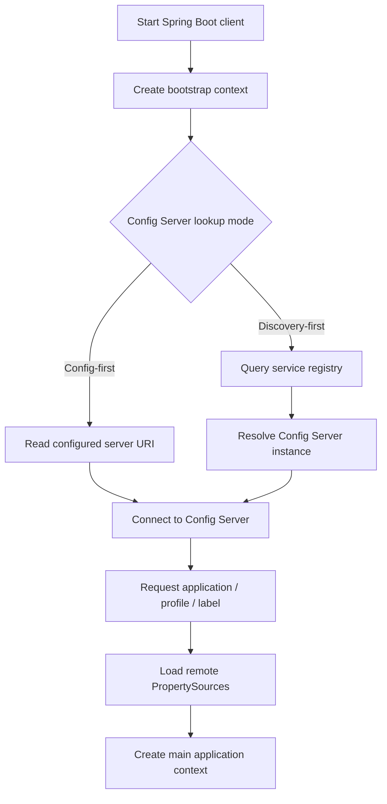

# Config-first và discovery-first trong mô hình bootstrap

Trong mô hình bootstrap cũ của Spring Cloud Config Client, ứng dụng phải tìm được Config Server trước khi có thể tải cấu hình tập trung. Có hai cách định vị server phổ biến: **config-first**, trong đó client biết trước URI của Config Server; và **discovery-first**, trong đó client hỏi service registry để tìm một instance Config Server theo service ID.

Hai cách đều phục vụ cùng mục tiêu lấy cấu hình theo application, profile và label. Điểm khác nhau nằm ở bước tìm địa chỉ Config Server, các thành phần hạ tầng cần có và cách xử lý khi service registry hoặc Config Server chưa sẵn sàng. Chọn đúng mô hình giúp quá trình khởi động dễ dự đoán và tránh tạo vòng phụ thuộc giữa Config Server, service registry và các ứng dụng.

## 1. Bootstrap context trong Config Client cũ

Ở mô hình legacy, Spring Cloud tạo một bootstrap context để nạp các thuộc tính cần thiết cho quá trình khởi tạo ứng dụng chính. Config Client sử dụng context này để tìm Config Server, gửi yêu cầu cấu hình và thêm các remote `PropertySource` vào `Environment`.

Các thuộc tính cần thiết để tìm server phải có sẵn trước khi gọi Config Server. Chúng thường được đặt trong `bootstrap.yml` hoặc được cung cấp qua biến môi trường/tham số khởi chạy. Ví dụ, client cần biết:

- `spring.application.name`: tên ứng dụng mà Config Server sẽ tìm cấu hình.
- URI Config Server nếu dùng config-first.
- Cấu hình service discovery và service ID nếu dùng discovery-first.
- Thông tin xác thực và TLS cần thiết để truy cập hạ tầng.

Luồng bootstrap tổng quát:



Config-first và discovery-first là hai chiến lược định vị Config Server trong giai đoạn bootstrap. Chúng không thay đổi ý nghĩa của application, profile hay label trong yêu cầu cấu hình.

## 2. Config-first: khai báo URI trực tiếp

Với config-first, client biết địa chỉ Config Server từ trước. Đây là cách đơn giản nhất khi địa chỉ server ổn định hoặc được cung cấp qua cấu hình triển khai.

Ví dụ `bootstrap.yml` của client:

```yaml
spring:
  application:
    name: orders-service
  cloud:
    config:
      uri: http://config-server.internal:8888
      fail-fast: true
```

Client kết nối trực tiếp đến URI đã khai báo. Config Server tiếp nhận yêu cầu cho `orders-service` và profile đang hoạt động, sau đó đọc backend cấu hình và trả về các property source.

Ưu điểm của config-first:

- Không cần service registry để tìm Config Server.
- Ít thành phần phụ thuộc trong giai đoạn bootstrap.
- Dễ kiểm tra bằng `curl`, log và cấu hình mạng.
- Phù hợp với địa chỉ DNS ổn định, service nội bộ hoặc môi trường nhỏ.

Giới hạn của config-first:

- Client phải biết URI chính xác.
- Khi Config Server đổi hostname, cổng hoặc topology, cần cập nhật cấu hình client hay cấu hình triển khai.
- Nếu có nhiều instance Config Server, cần có một địa chỉ ổn định phía trước, chẳng hạn DNS, load balancer hoặc service virtual IP.

Có thể cung cấp URI qua biến môi trường thay vì cố định trong file:

```bash
SPRING_CLOUD_CONFIG_URI=https://config.example.internal
```

Với HTTPS, client cần tin cậy chứng chỉ của server và kiểm tra hostname. Timeout, TLS và xác thực là các cấu hình riêng; chỉ khai báo URI không tự giải quyết những yêu cầu đó.

## 3. Discovery-first: tìm Config Server qua service registry

Với discovery-first, client không cần biết trước URI cụ thể của Config Server. Client truy vấn service registry, tìm service ID của Config Server rồi sử dụng địa chỉ instance được registry công bố.

Ví dụ `bootstrap.yml` của client dùng Eureka:

```yaml
spring:
  application:
    name: orders-service
  cloud:
    config:
      discovery:
        enabled: true
        service-id: configserver
      fail-fast: true

eureka:
  client:
    service-url:
      defaultZone: http://eureka.internal:8761/eureka/
```

Hai thuộc tính quan trọng:

- `spring.cloud.config.discovery.enabled: true` bật việc tìm Config Server thông qua `DiscoveryClient`.
- `spring.cloud.config.discovery.service-id` chỉ định service ID cần tra cứu. Giá trị mặc định thường là `configserver`; khai báo tường minh giúp tránh nhầm tên giữa các môi trường.

Client cũng cần dependency discovery client tương ứng, ví dụ `spring-cloud-starter-netflix-eureka-client` khi dùng Eureka. Với Consul hoặc registry khác, dùng starter và cấu hình tương ứng của hệ sinh thái đó.

Discovery-first hữu ích khi:

- Config Server có nhiều instance và địa chỉ instance có thể thay đổi.
- Hạ tầng đã có service registry làm nguồn khám phá dịch vụ chung.
- Muốn client tìm Config Server theo service ID thay vì lưu địa chỉ vật lý.
- Các môi trường có topology khác nhau nhưng dùng chung tên dịch vụ.

Đổi lại, discovery-first tạo thêm một phụ thuộc trong quá trình bootstrap: client phải truy cập được registry trước khi lấy được cấu hình từ Config Server.

## 4. Đăng ký Config Server vào registry

Để client tìm thấy Config Server, chính Config Server phải đăng ký với service registry. Ví dụ cấu hình Eureka ở phía Config Server:

```yaml
server:
  port: 8888

spring:
  application:
    name: configserver
  cloud:
    config:
      server:
        git:
          uri: https://git.example.internal/platform/config-repo.git

eureka:
  client:
    service-url:
      defaultZone: http://eureka.internal:8761/eureka/
  instance:
    prefer-ip-address: true
```

Ứng dụng server cũng cần bật Config Server bằng `@EnableConfigServer` và có dependency discovery client. Tên `spring.application.name` phải khớp service ID mà client tra cứu, trong ví dụ là `configserver`.

`prefer-ip-address: true` chỉ phù hợp khi địa chỉ IP được registry công bố có thể truy cập từ các client. Trong môi trường container hoặc Kubernetes, cần cân nhắc hostname/service DNS mà các client có thể phân giải được. Địa chỉ instance không thể truy cập sẽ khiến discovery trả về kết quả nhưng client vẫn không kết nối được.

Khi có nhiều Config Server instance, registry công bố các instance đang đăng ký. Việc chọn instance hoặc cân bằng tải phụ thuộc discovery client, load-balancer và cấu hình của phiên bản Spring Cloud đang sử dụng. Hãy xác minh hành vi thực tế thay vì giả định rằng mọi client luôn được phân phối đồng đều.

## 5. Những gì phải có sẵn trước khi tải remote config

Discovery-first không loại bỏ nhu cầu cấu hình ban đầu. Client cần có đủ thông tin để kết nối service registry, bởi vì chính Config Server mới là nơi cung cấp cấu hình tập trung.

Ví dụ, các thuộc tính sau phải có sẵn trong bootstrap context hoặc nguồn cấu hình sớm tương đương:

```yaml
spring:
  application:
    name: orders-service
  cloud:
    config:
      discovery:
        enabled: true
        service-id: configserver

eureka:
  client:
    service-url:
      defaultZone: ${EUREKA_SERVER_URL:http://localhost:8761/eureka/}
```

Các thuộc tính dùng để tìm registry không thể chỉ nằm trong remote Config Server repository mà client chưa truy cập được. Nếu client cần Config Server để biết địa chỉ Eureka, nhưng lại cần Eureka để tìm Config Server, hệ thống sẽ rơi vào vòng phụ thuộc.

Vì vậy, hãy giữ các thông tin tối thiểu như registry URI, truststore và credential truy cập registry trong bootstrap configuration hoặc trong cơ chế triển khai an toàn. Các cấu hình nghiệp vụ còn lại có thể được nạp từ Config Server sau khi kết nối thành công.

## 6. So sánh config-first và discovery-first

| Tiêu chí | Config-first | Discovery-first |
|---|---|---|
| Cách tìm server | Dùng URI đã khai báo trong client. | Tra cứu service ID trong registry. |
| Phụ thuộc bootstrap | Config Server và mạng đến URI. | Service registry, discovery client, Config Server và mạng đến instance. |
| Thay đổi địa chỉ instance | Cần cập nhật URI hoặc hạ tầng DNS/load balancer. | Registry cập nhật danh sách instance; client tra cứu theo service ID. |
| Số thành phần cần cấu hình | Ít hơn. | Nhiều hơn do cần registry và discovery integration. |
| Phù hợp | Địa chỉ ổn định, môi trường đơn giản. | Hệ thống có service discovery và nhiều instance động. |
| Rủi ro chính | URI lỗi thời hoặc endpoint không sẵn sàng. | Registry không sẵn sàng, đăng ký sai service ID hoặc instance không thể truy cập. |

Không có lựa chọn nào luôn tốt hơn. Nếu hệ thống chưa có service registry, config-first thường dễ vận hành hơn. Nếu discovery đã là nền tảng chuẩn của hệ thống và Config Server có nhiều instance động, discovery-first có thể giảm việc quản lý URI tĩnh ở từng client.

## 7. Xác thực, TLS và bảo vệ thông tin bootstrap

Config Server thường cung cấp cấu hình nội bộ, vì vậy endpoint có thể yêu cầu xác thực. Trong mô hình bootstrap cũ, client có thể khai báo username/password hoặc credential tương ứng trong bootstrap configuration:

```yaml
spring:
  cloud:
    config:
      username: ${CONFIG_SERVER_USERNAME}
      password: ${CONFIG_SERVER_PASSWORD}
```

Giá trị thực nên được cung cấp từ secret manager hoặc cơ chế quản lý bí mật của nền tảng. Không commit mật khẩu, token hoặc private key trong repository cấu hình.

Với discovery-first, registry chỉ cung cấp thông tin instance; nó không thay thế xác thực giữa client và Config Server. Client vẫn cần credential hoặc cơ chế token phù hợp để gọi endpoint cấu hình. Nếu registry công bố URI HTTPS, client phải tin cậy chứng chỉ của Config Server.

Đồng thời bảo vệ kết nối đến registry. Dùng TLS và thông tin xác thực riêng nếu service registry yêu cầu. Tránh công bố thông tin nhạy cảm trong metadata instance, log discovery hoặc health details.

## 8. Fail-fast, retry và thời gian khởi động

Trong bootstrap cũ, `spring.cloud.config.fail-fast: true` yêu cầu ứng dụng báo lỗi khởi động khi không lấy được cấu hình từ xa theo điều kiện của Config Client. Điều này phù hợp khi cấu hình tập trung là điều kiện bắt buộc để dịch vụ hoạt động an toàn.

Có thể cấu hình retry nếu ứng dụng có dependency và cấu hình phù hợp với phiên bản Spring Cloud đang dùng:

```yaml
spring:
  cloud:
    config:
      fail-fast: true
      retry:
        max-attempts: 5
        initial-interval: 1000
        max-interval: 4000
        multiplier: 1.5
```

Retry có thể giúp vượt qua gián đoạn ngắn khi Config Server hoặc registry vừa khởi động. Tuy nhiên, retry không thay thế readiness check hay xử lý phụ thuộc đúng thứ tự. Nếu registry không hoạt động lâu, client discovery-first vẫn không thể tìm Config Server; tăng số lần thử chỉ kéo dài thời gian chờ.

Khi thiết kế thời gian khởi động, hãy tính cả thời gian truy cập registry, tìm instance, kết nối Config Server, đọc backend cấu hình và các lần retry. Cần phối hợp connect timeout, read timeout, retry và ngân sách startup của nền tảng.

## 9. Những lỗi thường gặp

| Triệu chứng | Nguyên nhân có thể | Hướng xử lý |
|---|---|---|
| Client kết nối sai địa chỉ Config Server | URI config-first lỗi thời hoặc sai port. | Kiểm tra `spring.cloud.config.uri`, DNS và cấu hình triển khai. |
| Discovery không tìm thấy `configserver` | Server chưa đăng ký, service ID không khớp hoặc registry chưa cập nhật. | Kiểm tra `spring.application.name` phía server và `discovery.service-id` phía client. |
| Registry trả về instance nhưng client không kết nối được | Hostname/IP quảng bá không thể truy cập từ client. | Kiểm tra metadata instance, DNS, route mạng và cổng server. |
| Client không thể truy cập registry lúc bootstrap | Registry URI, credential hoặc TLS chưa được cấu hình cục bộ. | Đặt thông tin tối thiểu trong bootstrap configuration và kiểm tra kết nối registry. |
| Ứng dụng khởi động theo vòng phụ thuộc | Registry hoặc Config Server lại cần cấu hình từ chính Config Server để khởi động. | Tách cấu hình hạ tầng tối thiểu khỏi remote config. |
| Config Server tìm được nhưng trả `401`/`403` | Credential hoặc quyền truy cập endpoint sai. | Kiểm tra xác thực Config Server riêng với xác thực registry. |
| Client lấy được cấu hình ở một môi trường nhưng không ở môi trường khác | URI, service ID, DNS hoặc registry namespace khác nhau. | So sánh bootstrap properties và service registration giữa môi trường. |

## 10. Quy trình chẩn đoán theo từng bước

Khi client không lấy được cấu hình, hãy xác định đang dùng config-first hay discovery-first trước khi kiểm tra:

1. **Kiểm tra bootstrap mode:** xác nhận ứng dụng có bật bootstrap context theo phiên bản đang dùng và `bootstrap.yml` được nạp.
2. **Kiểm tra application:** xác nhận `spring.application.name` đúng với tên file cấu hình và tên client yêu cầu.
3. **Nếu config-first:** kiểm tra URI, DNS, port, TLS, authentication và khả năng truy cập trực tiếp từ runtime client.
4. **Nếu discovery-first:** kiểm tra kết nối registry, discovery client, service ID, instance đăng ký và địa chỉ instance được quảng bá.
5. **Kiểm tra Config Server:** gọi health endpoint và xác minh server có thể đọc backend Git/Native.
6. **Kiểm tra request:** xác nhận profile, label và Environment response chứa các property source mong muốn.
7. **Kiểm tra log:** đối chiếu log client, registry và Config Server theo cùng timestamp để tìm bước thất bại đầu tiên.

Với config-first, có thể kiểm tra endpoint trực tiếp:

```bash
curl -i http://config-server.internal:8888/orders-service/prod/main
```

Với discovery-first, trước hết kiểm tra registry có đăng ký service ID `configserver` và trả về địa chỉ instance hợp lệ. Sau đó thử gọi Environment API bằng địa chỉ instance đó từ cùng môi trường mạng của client.

## 11. Bootstrap cũ và Config Data API

Config-first và discovery-first trong bài học này tập trung vào mô hình bootstrap context cũ, thường dùng `bootstrap.yml`, `spring.cloud.config.uri` và các thuộc tính `spring.cloud.config.discovery.*`.

Các ứng dụng Spring Boot hiện đại thường dùng Config Data API với `spring.config.import`:

```yaml
spring:
  application:
    name: orders-service
  config:
    import: "configserver:http://config-server:8888"
```

Config Data API có cơ chế nạp cấu hình và thứ tự property source khác bootstrap cũ. Một số khả năng discovery và thuộc tính liên quan vẫn phụ thuộc release train và cách tích hợp discovery client. Khi chuyển đổi, không nên sao chép nguyên cấu hình bootstrap sang Config Data API mà không kiểm tra tài liệu phiên bản đang sử dụng.

Với dự án legacy, cần xác nhận bootstrap context được bật. Ở các phiên bản Spring Cloud cũ, bootstrap thường được kích hoạt theo mặc định; ở các thế hệ Spring Boot/Spring Cloud mới hơn, có thể cần `spring-cloud-starter-bootstrap` hoặc cấu hình tương ứng để bật lại. Hãy dùng đúng hướng dẫn của release train trong dự án.

## 12. Chọn chiến lược phù hợp

Chọn **config-first** khi Config Server có URI ổn định, môi trường ít thay đổi hoặc tổ chức muốn giữ bootstrap đơn giản. Một DNS alias hoặc load balancer ổn định có thể giúp che giấu thay đổi instance mà không cần service discovery ở client.

Chọn **discovery-first** khi hệ thống đã vận hành registry đáng tin cậy, Config Server có thể scale hoặc thay đổi instance thường xuyên và client có thể truy cập registry ngay từ bootstrap. Đảm bảo Config Server đăng ký đúng service ID, instance quảng bá địa chỉ có thể truy cập và registry không phụ thuộc vòng ngược vào cấu hình mà nó giúp phân phối.

Với cả hai mô hình, hãy quản lý rõ cấu hình bootstrap tối thiểu, bảo vệ credential, thiết lập timeout/retry hợp lý và kiểm tra request theo application/profile/label trước khi đưa thay đổi vào production.

## 13. Tổng kết

- Config-first dùng URI Config Server được khai báo sẵn, thường qua `spring.cloud.config.uri` trong bootstrap configuration.
- Discovery-first dùng `spring.cloud.config.discovery.enabled: true` và `service-id` để tìm Config Server qua service registry.
- Discovery-first cần discovery client và Config Server phải đăng ký dưới service ID mà client tra cứu.
- Thông tin truy cập registry phải có sẵn trước khi lấy remote config; không đặt cấu hình cần thiết để tìm Config Server chỉ trong chính Config Server.
- Config Server discovery không thay thế xác thực, TLS hoặc kiểm tra địa chỉ instance có thể truy cập.
- `fail-fast`, retry và timeout cần phối hợp với khả năng sẵn sàng của registry, Config Server và backend.
- Khi chuyển từ bootstrap cũ sang Config Data API, kiểm tra lại cơ chế nạp và discovery theo phiên bản Spring Cloud đang dùng.
