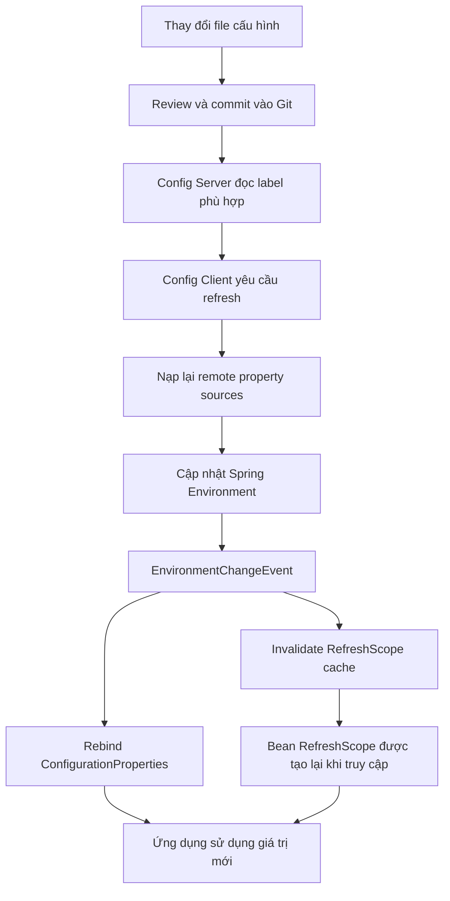

# Chu trình thay đổi kho, nạp lại Environment và cập nhật bean

Khi một nhóm thay đổi cấu hình trong Git, ứng dụng Spring Boot đang chạy không tự động nhận giá trị mới chỉ vì commit đã được push. Spring Cloud Config phân phối cấu hình qua nhiều bước: repository lưu phiên bản mới, Config Server đọc phiên bản đó, Config Client yêu cầu nạp lại Environment, rồi Spring cập nhật những bean có hỗ trợ refresh.

Hiểu rõ chu trình này giúp xác định chính xác thay đổi đang dừng ở đâu. Một request tới Config Server thành công chưa chứng minh bean trong ứng dụng đã nhận giá trị mới; một thuộc tính đã xuất hiện trong Environment cũng chưa có nghĩa mọi đối tượng singleton đã được tạo trước đó đều tự thay đổi.

## 1. Bốn giai đoạn của một lần thay đổi cấu hình

Một lần thay đổi cấu hình đang chạy có thể chia thành bốn giai đoạn:

1. **Thay đổi nguồn:** nhóm cập nhật file cấu hình, review và commit vào repository.
2. **Phân phối:** Config Server đọc phiên bản phù hợp theo application, profile và label rồi trả Environment cho client.
3. **Nạp lại Environment:** Config Client thực hiện refresh để lấy lại property sources và cập nhật Environment trong tiến trình.
4. **Cập nhật bean:** Spring phát sự kiện thay đổi, rebind các bean cấu hình được hỗ trợ và làm mới các bean thuộc `@RefreshScope`.



Các giai đoạn có thể thất bại độc lập. Ví dụ Git đã có commit mới nhưng Config Server vẫn đọc cache cũ; Config Server đã trả giá trị mới nhưng client chưa gọi refresh; Environment đã đổi nhưng một singleton dùng `@Value` vẫn giữ giá trị cũ.

## 2. Giai đoạn 1: thay đổi repository cấu hình

Giả sử `order-service` đang lấy cấu hình từ Git:

```yaml
# order-service-production.yml
checkout:
  timeout: 2s
  max-retries: 2
```

Nhóm Commerce muốn tăng timeout lên `5s`. Thay đổi được thực hiện qua pull request, review và commit:

```yaml
checkout:
  timeout: 5s
  max-retries: 2
```

Sau khi merge, repository đã chứa nội dung mới. Tuy nhiên, cần xem client đang yêu cầu label nào:

- Nếu client dùng branch mutable như `main`, commit mới có thể trở thành phiên bản được phục vụ sau khi Config Server cập nhật bản clone/fetch theo chính sách Git backend.
- Nếu client dùng tag release hoặc commit SHA bất biến, commit mới trên `main` không làm label cũ thay đổi. Muốn nhận cấu hình mới, cần phát hành label mới và cập nhật cấu hình triển khai của client theo quy trình.

Đây là lý do phải ghi lại application, profile và label khi điều tra. Chỉ biết repository đã có commit mới chưa đủ để kết luận client sẽ nhận commit đó.

## 3. Giai đoạn 2: Config Server đọc và phân phối cấu hình

Config Client yêu cầu cấu hình theo tên ứng dụng, profile và label. Ví dụ:

```text
/{application}/{profile}/{label}
```

Với `order-service`, profile `production` và label `main`, Config Server tìm các property source tương ứng trong backend rồi trả Environment cho client.

Config Server không phải lúc nào cũng fetch Git ngay lập tức theo cùng một cách. Hành vi cập nhật bản clone phụ thuộc cấu hình backend, ví dụ `refresh-rate`, cùng trạng thái cache và phiên bản Spring Cloud Config. Vì vậy, sau khi commit, hãy xác minh Config Server thực sự trả nội dung mới bằng request có đúng application/profile/label.

Ví dụ request kiểm tra metadata:

```bash
curl --fail --silent --show-error \
  "https://config.example.internal/order-service/production/main"
```

Trong production, endpoint cần xác thực và TLS. Response Environment có thể chứa cấu hình nội bộ hoặc bí mật; không in toàn bộ body vào CI log hay terminal dùng chung. Chỉ kiểm tra metadata, property source và key không nhạy cảm cần thiết.

Quan trọng: Config Server trả cấu hình mới không đồng nghĩa Config Client đang chạy đã tự nhận cấu hình đó. Nếu không có refresh trigger, client thường tiếp tục dùng Environment đã nạp lúc khởi động.

## 4. Giai đoạn 3: Config Client nạp lại Environment

Với Spring Cloud Config Client, một cách phổ biến để yêu cầu ứng dụng nạp lại cấu hình là endpoint Actuator `refresh` của Spring Cloud Context. Endpoint này thực hiện refresh trong tiến trình client: lấy lại cấu hình từ các nguồn được hỗ trợ, cập nhật Environment và phát các sự kiện liên quan.

Ứng dụng cần dependency Actuator và Config Client tương ứng. Với Gradle:

```groovy
dependencies {
    implementation 'org.springframework.cloud:spring-cloud-starter-config'
    implementation 'org.springframework.boot:spring-boot-starter-actuator'
}
```

Để Spring Cloud quản lý phiên bản nhất quán, dùng Spring Cloud BOM tương thích với phiên bản Spring Boot của dự án. `spring-cloud-starter-config` cung cấp các thành phần Config Client/Spring Cloud Context; Actuator cung cấp hạ tầng endpoint HTTP.

Ví dụ cấu hình:

```yaml
spring:
  application:
    name: order-service
  config:
    import: "configserver:https://config.example.internal"

management:
  endpoints:
    web:
      exposure:
        include: health,info,refresh
```

Ví dụ trên minh họa việc expose endpoint. Trong môi trường thật, cần bật authentication, authorization và giới hạn truy cập mạng cho endpoint refresh. Chỉ expose những endpoint cần thiết; không công khai endpoint quản trị ra Internet.

Sau khi Config Server đã trả cấu hình mới, gửi POST tới endpoint của đúng instance:

```bash
curl --fail --silent --show-error \
  --request POST \
  "https://order-service.internal/actuator/refresh"
```

Nếu hệ thống dùng token hoặc mTLS, bổ sung cơ chế xác thực theo chuẩn triển khai. Không đặt token thật trực tiếp trong lệnh được ghi vào shell history hoặc log. Endpoint refresh thay đổi trạng thái ứng dụng nên không dùng GET và không gọi từ nguồn không đáng tin cậy.

Response của refresh thường liệt kê các key được phát hiện là thay đổi. Danh sách này giúp quan sát kết quả, nhưng không thay thế việc kiểm tra bean hoặc hành vi nghiệp vụ. Nếu response rỗng, có thể không có key thay đổi trong lần refresh đó; cũng cần xác minh Config Server đã trả đúng label và property source.

## 5. Environment thay đổi và `EnvironmentChangeEvent`

Khi refresh hoàn tất việc nạp lại nguồn cấu hình, Spring Cloud Context cập nhật Environment trong ứng dụng. Những key có giá trị thay đổi được dùng để phát `EnvironmentChangeEvent`.

Các thành phần lắng nghe sự kiện có thể phản ứng với thay đổi:

- Cập nhật các bean được quản lý bởi cơ chế `@ConfigurationProperties` rebinding.
- Cập nhật một số cấu hình tích hợp sẵn, ví dụ mức logging khi thuộc tính logging tương ứng thay đổi.
- Làm mới cache của `RefreshScope`, để các bean thuộc scope này được tạo lại khi cần.

Environment là nơi Spring tra cứu thuộc tính. Thay đổi Environment không tự sửa mọi field Java đã được gán giá trị trước đó. Cách bean nhận cấu hình quyết định nó có nhìn thấy giá trị mới hay không.

## 6. Bean `@ConfigurationProperties` được rebind

`@ConfigurationProperties` gom các thuộc tính cùng namespace thành một đối tượng có kiểu dữ liệu rõ ràng. Spring Cloud Context có cơ chế rebinding các bean cấu hình được hỗ trợ khi Environment thay đổi.

Ví dụ:

```java
import java.time.Duration;

import org.springframework.boot.context.properties.ConfigurationProperties;

@ConfigurationProperties(prefix = "checkout")
public class CheckoutProperties {

    private Duration timeout = Duration.ofSeconds(2);
    private int maxRetries = 2;

    public Duration getTimeout() {
        return timeout;
    }

    public void setTimeout(Duration timeout) {
        this.timeout = timeout;
    }

    public int getMaxRetries() {
        return maxRetries;
    }

    public void setMaxRetries(int maxRetries) {
        this.maxRetries = maxRetries;
    }
}
```

Đăng ký bean bằng `@ConfigurationPropertiesScan` hoặc `@EnableConfigurationProperties`:

```java
import org.springframework.boot.context.properties.ConfigurationPropertiesScan;
import org.springframework.boot.autoconfigure.SpringBootApplication;

@SpringBootApplication
@ConfigurationPropertiesScan
public class OrderApplication {
}
```

Một service có thể nhận bean này qua constructor:

```java
import java.time.Duration;

import org.springframework.stereotype.Service;

@Service
public class CheckoutService {

    private final CheckoutProperties properties;

    public CheckoutService(CheckoutProperties properties) {
        this.properties = properties;
    }

    public Duration requestTimeout() {
        return properties.getTimeout();
    }
}
```

Khi cấu hình `checkout.timeout` được cập nhật và bean được rebind thành công, service đọc thuộc tính từ bean sẽ nhìn thấy giá trị mới. Hãy kiểm thử đúng kiểu bean và cách đăng ký trong phiên bản Spring Cloud đang dùng; các cấu trúc immutable hoặc constructor-bound có giới hạn refresh riêng và có thể cần khởi tạo lại bean hay ứng dụng.

## 7. Bean `@RefreshScope` được tạo lại khi truy cập

Với một bean cần tạo lại sau khi cấu hình thay đổi, có thể dùng `@RefreshScope`. Spring đặt một proxy trước bean. Khi refresh scope được làm mới, target hiện tại bị loại khỏi cache; lần gọi tiếp theo qua proxy sẽ tạo target mới và inject các giá trị cấu hình mới.

Ví dụ:

```java
import java.time.Duration;

import org.springframework.beans.factory.annotation.Value;
import org.springframework.cloud.context.config.annotation.RefreshScope;
import org.springframework.stereotype.Component;

@Component
@RefreshScope
public class CheckoutPolicy {

    @Value("${checkout.timeout:2s}")
    private Duration timeout;

    public Duration timeout() {
        return timeout;
    }
}
```

Trong ví dụ này, `CheckoutPolicy` được truy cập qua proxy. Sau khi refresh scope bị invalidate, lần truy cập tiếp theo sẽ khởi tạo target mới với giá trị `checkout.timeout` hiện tại trong Environment.

Không nên thêm `@RefreshScope` vào mọi bean một cách máy móc. Việc tạo lại bean có thể đóng/mở tài nguyên, làm thay đổi trạng thái nội bộ hoặc ảnh hưởng tới request đang chạy. Chỉ áp dụng cho bean có vòng đời có thể tái tạo an toàn và kiểm thử hành vi khi target được khởi tạo lại.

## 8. `@Value` trong singleton không tự thay đổi

Một singleton bình thường có thể đọc thuộc tính bằng `@Value` lúc khởi tạo:

```java
import java.time.Duration;

import org.springframework.beans.factory.annotation.Value;
import org.springframework.stereotype.Component;

@Component
public class CheckoutPolicy {

    @Value("${checkout.timeout:2s}")
    private Duration timeout;
}
```

Sau khi Environment thay đổi, field đã inject trong singleton này không tự được gán lại chỉ vì key trong Environment có giá trị mới. Có thể dùng `@RefreshScope` cho bean phù hợp, chuyển sang `@ConfigurationProperties` có cơ chế rebinding được hỗ trợ, hoặc thiết kế một thành phần đọc giá trị từ nguồn cấu hình động theo cách có kiểm soát.

Đây là một nguyên nhân phổ biến khiến endpoint refresh trả về thành công nhưng ứng dụng vẫn hoạt động với giá trị cũ: Environment đã thay đổi, còn bean đang giữ bản sao giá trị được inject lúc khởi động.

## 9. Không phải thay đổi nào cũng áp dụng nóng được

Refresh thích hợp với các thuộc tính mà ứng dụng và bean có thể nhận thay đổi khi đang chạy. Một số thay đổi đòi hỏi tái khởi tạo thành phần lớn hoặc khởi động lại ứng dụng.

| Loại thay đổi | Cách xử lý thường gặp |
|---|---|
| Timeout hoặc giới hạn nghiệp vụ trong `@ConfigurationProperties` có hỗ trợ rebinding | Refresh và xác minh bean đã nhận giá trị mới |
| Thuộc tính trong bean `@RefreshScope` | Refresh scope; target được tạo lại khi truy cập tiếp theo |
| Field `@Value` trong singleton thường | Không tự đổi; chuyển sang mô hình refresh phù hợp hoặc restart |
| `spring.config.import`, Config Server URI hoặc cấu trúc nguồn Config Data | Thường cần restart để chạy lại quy trình nạp nguồn |
| Active profiles hoặc thay đổi cách chọn profile | Thường cần restart vì profile ảnh hưởng quá trình xây dựng Environment |
| DataSource/pool hoặc client kết nối có trạng thái | Cần đánh giá khả năng đóng/mở và tái tạo an toàn; nhiều trường hợp nên restart có kiểm soát |
| Thay đổi cấu trúc bean hoặc wiring ứng dụng | Restart/deploy phiên bản ứng dụng mới |

Không nên xem refresh như một lần khởi động lại thu nhỏ. Refresh cập nhật Environment và các bean có hỗ trợ; nó không chạy lại toàn bộ quá trình tạo ApplicationContext như khi restart.

## 10. Ví dụ trọn chu trình từ Git tới bean

Giả sử `order-service` đang chạy với `checkout.timeout=2s` trong Git. Bean `CheckoutPolicy` được đánh dấu `@RefreshScope`.

**Bước 1 — cập nhật Git:** nhóm thay giá trị thành `5s`, review và merge commit vào branch mà client đang dùng.

**Bước 2 — xác minh Config Server:** gọi endpoint `order-service/production/main` bằng danh tính được phép và xác nhận key không nhạy cảm `checkout.timeout` đã có giá trị mới.

**Bước 3 — gọi refresh ở client:** gửi POST tới `/actuator/refresh` trên instance `order-service`.

**Bước 4 — kiểm tra Environment và bean:** xác nhận refresh hoàn tất; gọi luồng nghiệp vụ hoặc health/diagnostic nội bộ phù hợp để xác minh target `CheckoutPolicy` mới sử dụng timeout `5s`.

**Bước 5 — theo dõi:** kiểm tra log, metric, lỗi timeout và hành vi checkout. Nếu có sự cố, revert commit hoặc chọn lại label trước đó, sau đó refresh/restart theo cách phù hợp.

Chu trình này có thể tóm tắt bằng bảng:

| Mốc | Bằng chứng cần có | Nếu chưa đạt |
|---|---|---|
| Git đã cập nhật | Commit/label xác định được | Kiểm tra pull request, branch và tag |
| Config Server trả phiên bản mới | Environment response đúng app/profile/label | Kiểm tra Git fetch/cache và backend |
| Client đã refresh | Refresh request thành công và có kết quả | Kiểm tra endpoint, quyền truy cập và client log |
| Environment có giá trị mới | Key cần thiết có trong Environment | Kiểm tra property source và thứ tự ưu tiên |
| Bean dùng giá trị mới | Bean được rebind hoặc target refresh-scope được tạo lại | Kiểm tra cách inject cấu hình và vòng đời bean |
| Ứng dụng hoạt động đúng | Metric, log và kiểm thử nghiệp vụ đạt | Rollback hoặc restart theo kế hoạch |

## 11. Một instance hay toàn bộ fleet?

Endpoint `/actuator/refresh` tác động lên tiến trình client nhận request. Nếu một dịch vụ có 10 replica, gọi endpoint trên một replica không có nghĩa 9 replica còn lại cũng được refresh.

Trong hệ thống nhiều instance, có thể:

- Gọi refresh trên từng instance qua cơ chế quản trị nội bộ được bảo vệ.
- Dùng Spring Cloud Bus để phát sự kiện refresh tới các instance đã đăng ký với bus.
- Dùng quy trình rollout/restart nếu thay đổi yêu cầu khởi tạo lại ứng dụng.

Spring Cloud Bus là cơ chế phân phối sự kiện tới nhiều node; nó không thay thế việc Config Server có cấu hình mới, cũng không bảo đảm mọi bean đều có thể áp dụng nóng. Cần kiểm tra bài toán định tuyến sự kiện, broker, bảo mật và xác nhận từng instance đã xử lý.

## 12. Bảo mật và vận hành endpoint refresh

Refresh endpoint có khả năng thay đổi trạng thái cấu hình của ứng dụng. Người không có quyền có thể kích hoạt việc tải lại cấu hình hoặc tạo tải lên Config Server/backend. Vì vậy:

- Chỉ expose endpoint refresh khi thực sự cần.
- Bắt buộc xác thực và phân quyền cho danh tính vận hành hoặc automation.
- Giới hạn truy cập qua mạng quản trị, service mesh hoặc API gateway.
- Dùng HTTPS và quản lý certificate phù hợp.
- Theo dõi ai gọi refresh, thời điểm, instance đích, kết quả và correlation ID.
- Không ghi toàn bộ Environment hoặc secret vào log khi kiểm tra sau refresh.
- Có rate limit hoặc quy trình điều phối để tránh refresh đồng loạt ngoài ý muốn.

Không dùng một endpoint công khai không xác thực làm cơ chế triển khai cấu hình. Nếu cần refresh hàng loạt, hãy thiết kế workflow có phê duyệt, kiểm soát phạm vi và khả năng quan sát.

## 13. Lỗi thường gặp và cách chẩn đoán

| Hiện tượng | Nguyên nhân thường gặp | Cách xử lý |
|---|---|---|
| Git đã có commit mới nhưng Config Server trả giá trị cũ | Client dùng label khác, server chưa fetch hoặc backend cache theo refresh policy | Kiểm tra application/profile/label, commit và Git backend refresh settings |
| Config Server trả giá trị mới nhưng ứng dụng vẫn dùng giá trị cũ | Client chưa gọi refresh hoặc refresh nhầm instance | Gọi đúng endpoint client và xác minh kết quả |
| `/actuator/refresh` trả lỗi 404 | Endpoint chưa có dependency, chưa expose hoặc sai base path | Kiểm tra Actuator, Spring Cloud Context và endpoint mapping |
| Refresh trả thành công nhưng field `@Value` vẫn cũ | Bean singleton đã giữ giá trị inject lúc tạo | Dùng `@RefreshScope`, `@ConfigurationProperties` rebinding hoặc restart phù hợp |
| Bean refresh-scope lỗi khi truy cập lần tiếp theo | Constructor hoặc tài nguyên của bean không thể khởi tạo lại | Kiểm tra dependency, lifecycle và thao tác mở/đóng tài nguyên |
| Chỉ một số replica có giá trị mới | Chỉ refresh một instance hoặc sự kiện chưa tới các node khác | Kiểm tra từng replica hoặc dùng bus/rollout có kiểm soát |
| Thay đổi profile/import không có hiệu lực | Refresh không chạy lại toàn bộ Config Data bootstrap | Restart/deploy lại với profile hoặc import mới |
| Refresh làm tăng lỗi hoặc độ trễ | Nhiều bean bị tạo lại cùng lúc hoặc backend bị gọi dồn dập | Giới hạn phạm vi, rollout theo đợt và theo dõi tài nguyên |

Khi điều tra, đi theo thứ tự: xác minh commit/label, kiểm tra Config Server, kiểm tra request refresh tại client, kiểm tra Environment và cuối cùng kiểm tra bean. Cách này giúp xác định giai đoạn nào chưa hoàn tất thay vì thay đổi nhiều lớp cùng lúc.

## 14. Checklist cho một lần refresh

Trước khi refresh production, hãy xác nhận:

- [ ] Thay đổi Git đã được review và xác định bằng commit/tag.
- [ ] Client dùng đúng application, profile và label.
- [ ] Config Server trả property source mới.
- [ ] Đã xác định các key bị thay đổi và bean sử dụng chúng.
- [ ] Bean có cơ chế rebinding hoặc refresh scope phù hợp.
- [ ] Thay đổi không yêu cầu restart do ảnh hưởng tới profile, import hoặc cấu trúc ứng dụng.
- [ ] Endpoint refresh được bảo vệ và chỉ gọi tới instance dự kiến.
- [ ] Có cách xử lý tất cả replica, qua refresh từng node, Bus hoặc rollout.
- [ ] Có metric/log để xác nhận hành vi sau thay đổi.
- [ ] Có commit/label trước đó và phương án rollback.

## 15. Mục tiêu cần đạt sau bài học

Sau bài này, người học cần có khả năng:

- Mô tả được chu trình từ thay đổi repository tới Config Server, Config Client Environment và bean.
- Giải thích vì sao commit Git không tự động cập nhật ứng dụng đang chạy.
- Phân biệt refresh Environment, rebinding `@ConfigurationProperties` và tạo lại bean `@RefreshScope`.
- Giải thích vì sao `@Value` trong singleton thường không tự thay đổi sau refresh.
- Gọi và bảo vệ endpoint `/actuator/refresh` đúng cách.
- Nhận diện các thay đổi cần restart thay vì refresh.
- Xác định cách refresh một instance hoặc toàn bộ fleet và kiểm chứng kết quả.
- Chẩn đoán sự cố theo từng giai đoạn của chu trình.

**Tự kiểm tra:** Git đã đổi `checkout.timeout` từ `2s` thành `5s`, Config Server trả giá trị mới nhưng một instance `order-service` vẫn dùng `2s`. Hãy lần lượt kiểm tra label, request refresh, Environment, cách bean inject thuộc tính và việc instance đó có dùng `@RefreshScope` hay `@ConfigurationProperties` hay không. Giải thích vì sao refresh một replica không tự cập nhật các replica còn lại.
