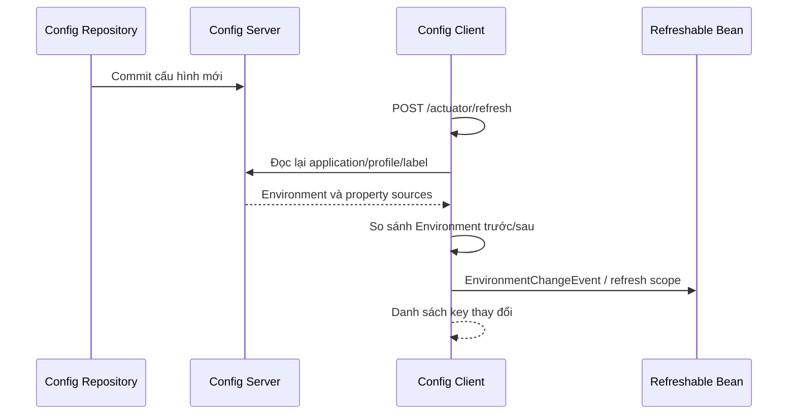

# Gọi POST `/actuator/refresh` và đọc các khóa được báo thay đổi

Khi cấu hình trong Config Server đã được cập nhật, một Config Client đang chạy không tự động nạp lại giá trị chỉ vì Git có commit mới. Có thể yêu cầu một instance đọc lại cấu hình bằng endpoint Actuator `POST /actuator/refresh`. Endpoint này làm mới Spring `Environment` của instance và trả về danh sách các property key được phát hiện là đã thay đổi.

Danh sách trả về giúp xác nhận những key mà quá trình refresh nhận thấy có khác biệt. Nó không phải danh sách bean đã được tạo lại và cũng không chứng minh mọi thành phần đang dùng key đó đã áp dụng giá trị mới. Sau khi gọi endpoint, cần kiểm tra thêm Environment, bean và hành vi thực tế của ứng dụng.

## 1. Luồng refresh của một Config Client

Một lần refresh thường đi qua các bước:

1. Nhóm vận hành cập nhật cấu hình trong backend mà Config Server đang đọc, ví dụ commit thay đổi vào Git.
2. Config Server có thể truy xuất được phiên bản cấu hình mới tại đúng application, profile và label.
3. Gửi HTTP `POST` đến endpoint `/actuator/refresh` của một Config Client.
4. Client làm mới `Environment`, đọc lại nguồn cấu hình theo cơ chế Config Client đang dùng và so sánh các property trước/sau.
5. Spring Cloud phát sự kiện thay đổi cấu hình và làm mới các bean thuộc refresh scope.
6. Client trả về danh sách key được phát hiện thay đổi.



Endpoint chỉ làm mới instance nhận request. Nếu có năm instance của cùng dịch vụ, gọi endpoint trên một instance không đồng nghĩa bốn instance còn lại cũng được refresh. Có thể gọi từng instance hoặc dùng Spring Cloud Bus để phát sự kiện đến nhiều client.

## 2. Điều kiện cần có ở ứng dụng

Config Client cần có Spring Cloud Config Client và Spring Boot Actuator. Với Maven, các dependency chính thường là:

```xml
<dependencies>
    <dependency>
        <groupId>org.springframework.cloud</groupId>
        <artifactId>spring-cloud-starter-config</artifactId>
    </dependency>

    <dependency>
        <groupId>org.springframework.boot</groupId>
        <artifactId>spring-boot-starter-actuator</artifactId>
    </dependency>
</dependencies>
```

Quản lý phiên bản Spring Boot và Spring Cloud bằng các BOM tương thích. Spring Cloud Config Client đưa Spring Cloud Context vào dependency graph ở các cấu hình thông dụng; nếu dự án tự tổ chức dependency, cần bảo đảm module cung cấp refresh endpoint được đưa vào classpath.

Với Spring Boot 2.4 trở lên, client thường khai báo Config Data import trong `application.yml`:

```yaml
spring:
  application:
    name: order-service
  config:
    import: "configserver:http://config-server:8888"
  profiles:
    active: prod
  cloud:
    config:
      label: main
```

Tên ứng dụng, profile và label phải trỏ đến đúng bộ cấu hình đã được thay đổi. Nếu client dùng `optional:configserver:`, cần bảo đảm fallback đủ an toàn khi Config Server không truy cập được. Cơ chế bootstrap cũ có thể có cách khai báo khác; hãy theo đúng cấu hình của phiên bản Spring Boot/Spring Cloud đang sử dụng.

## 3. Expose endpoint `refresh` qua Actuator

Mặc định, Actuator không expose mọi endpoint qua HTTP. Hãy khai báo endpoint cần dùng trong `application.yml`:

```yaml
management:
  endpoints:
    web:
      exposure:
        include: health,info,refresh
```

Nếu ứng dụng dùng management port hoặc base path riêng, URL cần gọi sẽ thay đổi. Ví dụ:

```yaml
management:
  server:
    port: 9001
  endpoints:
    web:
      base-path: /manage
      exposure:
        include: health,refresh
```

Với cấu hình này, endpoint sẽ nằm tại `http://localhost:9001/manage/refresh` thay vì `/actuator/refresh` trên cổng ứng dụng. Hãy kiểm tra `management.server.port`, `management.endpoints.web.base-path` và các thiết lập mạng trước khi gọi.

Chỉ expose endpoint cần thiết. Không dùng `include: "*"` trong production nếu chưa có chính sách bảo vệ và lý do vận hành cụ thể.

## 4. Gửi yêu cầu POST

Khi Config Server đã phục vụ phiên bản cấu hình mới, gửi request đến đúng instance Config Client.

Với curl:

```bash
curl -i -X POST "http://localhost:8080/actuator/refresh"
```

Với PowerShell:

```powershell
Invoke-RestMethod `
    -Method Post `
    -Uri "http://localhost:8080/actuator/refresh"
```

Nếu endpoint được bảo vệ bằng HTTP Basic trong môi trường thử nghiệm, có thể truyền credential qua biến môi trường thay vì ghi mật khẩu trực tiếp vào script:

```bash
curl -i -X POST \
  -u "$CONFIG_ADMIN_USER:$CONFIG_ADMIN_PASSWORD" \
  "http://localhost:8080/actuator/refresh"
```

Trong môi trường có Spring Security, người gọi cần quyền được cấp cho endpoint này. Tùy cấu hình bảo mật, POST cũng có thể cần CSRF token. Nếu nhận `401`, kiểm tra xác thực; nếu nhận `403`, kiểm tra quyền truy cập và CSRF policy. Không tắt CSRF toàn cục chỉ để làm cho endpoint refresh hoạt động; hãy cấu hình ngoại lệ có giới hạn cho endpoint quản trị theo kiến trúc bảo mật của ứng dụng.

## 5. Đọc response: các key nào đã thay đổi?

Khi refresh thành công, endpoint thường trả về JSON array gồm các key được phát hiện có thay đổi trong `Environment`. Ví dụ:

```json
[
  "orders.timeout",
  "feature.checkout-enabled",
  "message.welcome"
]
```

Có thể đọc kết quả như sau:

| Key | Ý nghĩa trong ví dụ |
|---|---|
| `orders.timeout` | Giá trị timeout của đơn hàng đã thay đổi |
| `feature.checkout-enabled` | Trạng thái bật/tắt checkout đã thay đổi |
| `message.welcome` | Nội dung thông báo chào mừng đã thay đổi |

Các phần tử là tên property key, thường ở dạng phân cấp với dấu chấm. Endpoint trả về tập key thay đổi, không trả về toàn bộ giá trị mới. Muốn xem giá trị hiện tại, kiểm tra Environment phía client hoặc một cơ chế chẩn đoán đã được bảo vệ.

### 5.1. Response rỗng

Nếu response là:

```json
[]
```

thì lần refresh không phát hiện key nào khác so với trạng thái Environment trước đó. Một số nguyên nhân thường gặp:

- Config Server vẫn trả về cùng giá trị vì thay đổi chưa được commit hoặc server chưa thấy phiên bản mới.
- Client đang dùng label khác với label đã cập nhật.
- Thay đổi được ghi vào file hoặc repository không thuộc application/profile mà client yêu cầu.
- Một nguồn có ưu tiên cao hơn vẫn cung cấp cùng giá trị hiệu lực.
- Một lần refresh trước đó đã nạp thay đổi, nên lần gọi tiếp theo không còn khác biệt.

Response rỗng không tự nó chứng minh request bị lỗi. Nếu HTTP status là thành công, hãy kiểm tra metadata và property sources để xác định client đang đọc bộ cấu hình nào.

### 5.2. Response không phải số bean được refresh

Ví dụ response có ba key không có nghĩa ba bean đã được tạo lại. Một bean có thể dùng nhiều key; một key có thể được nhiều bean sử dụng; một bean thường có thể không được cập nhật dù Environment đã đổi. Danh sách này mô tả khác biệt của property, không phải kết quả kiểm kê vòng đời bean.

## 6. Ví dụ thay đổi cấu hình từ Git đến client

Giả sử Git có tệp `order-service-prod.yml`:

```yaml
orders:
  timeout: 3s

feature:
  checkout-enabled: false
```

Client đang chạy với application `order-service`, profile `prod`, label `main`. Nhóm vận hành cập nhật tệp:

```yaml
orders:
  timeout: 5s

feature:
  checkout-enabled: true
```

Sau khi commit, trước tiên kiểm tra Config Server đã trả giá trị mới:

```bash
curl "http://localhost:8888/order-service/prod/main"
```

Nếu server vẫn trả `3s` và `false`, chưa nên kết luận client refresh có lỗi. Cần kiểm tra Git ref, trạng thái fetch/clone, cache và property source phía server. Chỉ khi response server có `5s` và `true`, mới gọi refresh ở client:

```bash
curl -i -X POST "http://localhost:8080/actuator/refresh"
```

Response có thể là:

```json
[
  "orders.timeout",
  "feature.checkout-enabled"
]
```

Tiếp theo, kiểm tra giá trị phía client bằng Actuator `env` trong môi trường đã bảo vệ hoặc qua một endpoint nội bộ chỉ trả dữ liệu không nhạy cảm. Cuối cùng, gọi chức năng nghiệp vụ để xác nhận timeout và feature flag đã có hiệu lực.

## 7. Điều gì được cập nhật sau refresh?

Refresh cập nhật `Environment`, nhưng cách các bean nhận giá trị mới phụ thuộc cách chúng được tạo và bind.

### 7.1. Bean có `@RefreshScope`

Bean được đánh dấu `@RefreshScope` được truy cập thông qua proxy. Khi refresh scope được làm mới, target hiện tại bị loại khỏi cache; lần truy cập tiếp theo tạo target mới với cấu hình hiện tại.

Ví dụ:

```java
import org.springframework.beans.factory.annotation.Value;
import org.springframework.cloud.context.config.annotation.RefreshScope;
import org.springframework.web.bind.annotation.GetMapping;
import org.springframework.web.bind.annotation.RestController;

@RestController
@RefreshScope
public class CheckoutController {

    @Value("${feature.checkout-enabled:false}")
    private boolean checkoutEnabled;

    @GetMapping("/checkout/status")
    public String status() {
        return checkoutEnabled ? "enabled" : "disabled";
    }
}
```

Sau khi refresh, lần gọi tiếp theo đến `/checkout/status` sẽ đi qua proxy và có thể tạo target mới để đọc giá trị hiện tại. Không gắn `@RefreshScope` đại trà: tạo lại bean có thể đóng/mở tài nguyên, làm mất trạng thái nội bộ hoặc gây gián đoạn nếu vòng đời của bean không phù hợp.

### 7.2. Bean `@ConfigurationProperties`

Spring Cloud Context hỗ trợ rebind các bean cấu hình được quản lý phù hợp khi có sự kiện thay đổi Environment. Ví dụ:

```java
import java.time.Duration;

import org.springframework.boot.context.properties.ConfigurationProperties;

@ConfigurationProperties(prefix = "orders")
public class OrderProperties {

    private Duration timeout = Duration.ofSeconds(3);

    public Duration getTimeout() {
        return timeout;
    }

    public void setTimeout(Duration timeout) {
        this.timeout = timeout;
    }
}
```

Đăng ký bean qua `@ConfigurationPropertiesScan` hoặc `@EnableConfigurationProperties`. Cần xác minh kiểu bind, khả năng rebind và các ràng buộc validation theo phiên bản Spring Boot/Spring Cloud. Với cấu hình immutable, constructor-bound hoặc bean đã chuyển giá trị sang một thư viện khác, không giả định nó sẽ tự cập nhật.

### 7.3. Bean singleton thông thường

Một singleton dùng `@Value` trong constructor hoặc field thường giữ giá trị đã inject khi bean được tạo. Việc Environment thay đổi không tự chạy lại constructor và không gán lại field đó. Nếu thành phần cần cập nhật nóng, thiết kế nó với refresh scope, cơ chế rebind phù hợp hoặc API cấu hình lại riêng. Nếu không có cách cập nhật an toàn, cần restart instance.

## 8. Giới hạn của refresh

Không phải mọi cấu hình đều có thể thay đổi trong tiến trình đang chạy. Các thay đổi sau thường cần restart hoặc redeploy:

- Cổng server hoặc địa chỉ bind socket đã được mở.
- SSL context, chứng chỉ hoặc listener chỉ được khởi tạo lúc startup.
- Điều kiện tạo bean và auto-configuration đã được đánh giá khi ApplicationContext khởi tạo.
- Thread pool, connection pool hoặc HTTP client không có API reconfigure an toàn.
- Biến môi trường của process/container, JVM arguments hoặc deployment manifest được cấp lúc tạo instance.
- Mã nguồn, dependency hoặc image ứng dụng thay đổi.

Trước khi dùng refresh cho một key, xác định bean và tài nguyên nào tiêu thụ key đó. Nếu chỉ có Environment thay đổi nhưng tài nguyên vẫn giữ giá trị cũ, hãy chọn restart/redeploy thay vì liên tục gọi refresh.

## 9. Xác minh sau khi gọi refresh

Một quy trình xác minh có thể thực hiện theo thứ tự:

1. **Kiểm tra nguồn:** gọi Config Server và xác nhận đúng application, profile, label cùng giá trị mới.
2. **Gọi refresh:** gửi POST đến đúng instance và lưu HTTP status cùng response key.
3. **Đọc Environment:** kiểm tra các key quan trọng ở client qua Actuator `env` hoặc công cụ nội bộ được bảo vệ.
4. **Kiểm tra bean:** xác nhận `@RefreshScope` target được tạo lại hoặc `@ConfigurationProperties` đã rebind.
5. **Kiểm tra nghiệp vụ:** gọi chức năng có sử dụng cấu hình và quan sát hành vi thực tế.
6. **Kiểm tra instance khác:** xác minh tất cả replica đã nhận thay đổi nếu mục tiêu là cập nhật toàn bộ dịch vụ.

Không ghi secret vào log hoặc response chẩn đoán. Khi cần xác minh một credential, chỉ kiểm tra trạng thái có/không hoặc metadata an toàn; không in giá trị thật.

## 10. Bảo vệ endpoint refresh

`POST /actuator/refresh` có thể thay đổi hành vi ứng dụng. Người không được phép gọi endpoint có thể thay đổi feature flag, timeout hoặc cấu hình tích hợp của dịch vụ. Do đó:

- Chỉ expose endpoint `refresh` nếu thật sự cần.
- Giới hạn truy cập bằng mạng quản trị, xác thực và phân quyền.
- Chỉ cấp quyền refresh cho vai trò vận hành được ủy quyền.
- Dùng HTTPS/TLS khi gọi qua mạng.
- Không mở management port ra Internet công cộng.
- Theo dõi ai gọi refresh, thời điểm, instance và kết quả; tránh ghi giá trị bí mật.
- Xử lý CSRF có phạm vi hẹp và phù hợp với cơ chế xác thực của endpoint.

Nếu dùng Spring Security, cấu hình quyền cụ thể cho endpoint quản trị trong `SecurityFilterChain`. Tránh loại bỏ toàn bộ security chỉ để curl POST thành công. Tùy phiên bản và cấu hình, Actuator endpoint có thể cần quyền truy cập riêng và CSRF token.

## 11. Lỗi thường gặp và cách xử lý

| Hiện tượng | Nguyên nhân có thể có | Cách kiểm tra |
|---|---|---|
| `404 Not Found` | Endpoint chưa được expose, sai base path hoặc management port | Kiểm tra `management.endpoints.web.exposure.include`, `base-path`, `management.server.port` |
| `401 Unauthorized` | Thiếu hoặc sai thông tin xác thực | Kiểm tra cơ chế authentication và credential của vai trò vận hành |
| `403 Forbidden` | Không đủ quyền hoặc POST bị CSRF chặn | Kiểm tra authorization rules và CSRF policy cho endpoint |
| `405 Method Not Allowed` | Gọi bằng GET thay vì POST hoặc proxy chặn method | Dùng `POST` và kiểm tra reverse proxy/gateway |
| Response `[]` | Environment không phát hiện key khác | Kiểm tra Config Server response, application/profile/label và commit mới |
| Có key trong response nhưng bean không đổi | Bean không hỗ trợ refresh/rebind hoặc đã copy giá trị vào tài nguyên | Kiểm tra scope, binding và vòng đời bean |
| Một instance đổi, instance khác không đổi | Chỉ gọi refresh một replica | Gọi từng instance hoặc triển khai Spring Cloud Bus |
| Refresh lỗi khi lấy cấu hình | Config Server không truy cập được hoặc backend lỗi | Kiểm tra log client, URL, kết nối và response server |

## 12. Khi nào cần Spring Cloud Bus?

Endpoint `/actuator/refresh` chỉ tác động instance nhận POST. Với hệ thống nhiều replica, gọi thủ công từng instance khó bảo đảm tất cả đều nhận thay đổi. Spring Cloud Bus có thể phát sự kiện refresh qua message broker để các client tham gia bus cùng làm mới Environment.

Bus không thay thế việc kiểm tra kết quả ở từng instance. Mỗi client vẫn phải truy cập được Config Server và bean vẫn cần hỗ trợ rebind hoặc refresh scope. Nếu thay đổi yêu cầu tạo lại socket, connection pool hoặc bean không thể refresh an toàn, cần rolling restart/redeploy.

## 13. Checklist vận hành một lần refresh

- Cấu hình mới đã được commit hoặc publish vào đúng backend.
- Config Server đã trả về giá trị mới cho đúng application/profile/label.
- Client đang dùng đúng Config Server URL và label.
- Endpoint `refresh` được expose có chủ đích và bảo vệ bằng xác thực/phân quyền.
- Request dùng HTTP POST đến đúng management port/base path.
- HTTP status và danh sách key thay đổi đã được ghi nhận.
- Environment, bean và hành vi nghiệp vụ đã được xác minh.
- Các replica còn lại đã được refresh hoặc có kế hoạch restart/redeploy.
- Có phương án rollback cấu hình nếu thay đổi gây lỗi.

`POST /actuator/refresh` là thao tác yêu cầu một Config Client đọc lại cấu hình và công bố các key được phát hiện thay đổi. Hãy dùng danh sách key như một tín hiệu chẩn đoán, sau đó xác minh Environment, bean và chức năng thực tế. Khi kết hợp với bảo vệ endpoint, giám sát từng instance và phương án restart cho các cấu hình không thể cập nhật nóng, quy trình refresh sẽ dễ kiểm soát và an toàn hơn.
