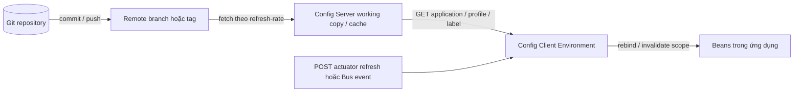
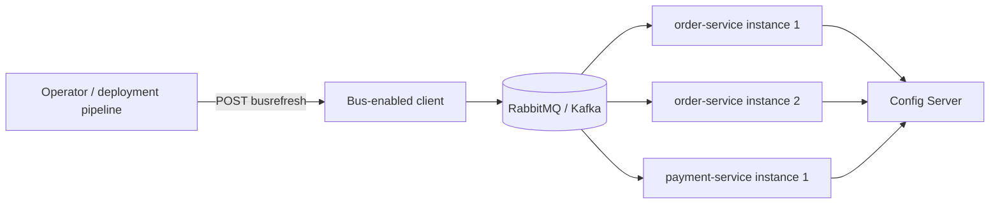

# Phân biệt cập nhật kho Git với làm mới ứng dụng client

## 1. Ba giai đoạn thường bị nhầm lẫn

Trong hệ thống Spring Cloud Config, thay đổi cấu hình không đi thẳng từ Git vào các biến đang được sử dụng trong ứng dụng. Có ba giai đoạn riêng:

1. **Cập nhật kho Git**: người vận hành commit và push thay đổi lên branch hoặc tag của repository cấu hình.
2. **Config Server nhận revision mới**: server fetch repository từ xa và cập nhật working copy/cache mà nó dùng để tạo `Environment`.
3. **Config Client nạp lại cấu hình**: ứng dụng client gửi yêu cầu mới đến Config Server, cập nhật Spring `Environment` và làm mới những bean có hỗ trợ refresh.

Ba giai đoạn này có thể xảy ra ở các thời điểm khác nhau. Push commit thành công chỉ chứng minh Git đã nhận thay đổi. Nó không tự bảo đảm Config Server đã fetch commit mới, và càng không tự cập nhật các bean trong những client đang chạy.

Ví dụ, nhóm Payments đổi `payment.timeout` từ `5s` thành `8s` rồi push lên branch `main`. Config Server có thể vẫn đang giữ bản clone/cache cũ. Ngay cả khi server đã fetch revision mới, `order-service` đang chạy vẫn giữ giá trị đã nạp lúc khởi động cho đến khi client refresh hoặc restart theo quy trình triển khai.

## 2. Luồng dữ liệu từ Git đến bean đang chạy



Mỗi thành phần có trách nhiệm riêng:

| Thành phần | Việc thực hiện | Điều chưa tự xảy ra |
|---|---|---|
| Git | Lưu revision mới sau commit/push. | Không thông báo trực tiếp cho mọi client đang chạy. |
| Config Server | Fetch Git và tạo `Environment` theo application/profile/label. | Không tự thay đổi Spring `Environment` bên trong client đang chạy. |
| Config Client | Lấy lại property sources, cập nhật `Environment`, rebind hoặc refresh bean phù hợp. | Không thể cập nhật an toàn mọi đối tượng hoặc tài nguyên trong ứng dụng. |
| Spring Cloud Bus | Phát sự kiện để nhiều client cùng refresh. | Không thay thế Git, Config Server hoặc cơ chế refresh của client. |

Khi điều tra một thay đổi chưa có hiệu lực, hãy xác định nó dừng ở giai đoạn nào thay vì chỉ kiểm tra xem commit đã xuất hiện trên Git hay chưa.

## 3. Giai đoạn 1: Cập nhật kho Git

Giả sử repository có file `payment-service-prod.yml`:

```yaml
payment:
  timeout: 5s
  retry-count: 2
```

Nhóm vận hành sửa thành:

```yaml
payment:
  timeout: 8s
  retry-count: 3
```

Sau khi review, commit và push lên branch `main`, Git đã lưu revision mới. Có thể xác minh bằng lịch sử commit hoặc xem file trực tiếp trên Git provider.

Ở giai đoạn này cần xác nhận:

- Đúng repository mà Config Server đang đọc đã được cập nhật.
- Commit được push lên đúng branch hoặc tag mà client yêu cầu.
- Application và profile của file khớp với request, ví dụ `payment-service` và `prod`.
- Client có dùng label di động như `main`, hay đang ghim tag/commit cố định.

Nếu client dùng label `release-2026-11` là tag bất biến, việc push thêm commit vào branch `main` không làm nội dung tag thay đổi. Muốn client nhận cấu hình mới, phải tạo/phát hành label mới hoặc chủ động cập nhật label của client theo chính sách release.

Git là nguồn lưu trữ có phiên bản. Nó không phải kênh refresh của ứng dụng. Commit mới không tự gửi lệnh đến các tiến trình Spring Boot.

## 4. Giai đoạn 2: Config Server fetch Git và cập nhật cache

Config Server đọc repository qua Git backend. Với remote repository, server thường giữ một bản clone local và fetch cập nhật theo chính sách `refresh-rate`.

Ví dụ cấu hình:

```yaml
spring:
  cloud:
    config:
      server:
        git:
          uri: ${CONFIG_REPO_URI}
          default-label: main
          basedir: ${CONFIG_GIT_BASEDIR:/var/cache/config-server}
          clone-on-start: true
          refresh-rate: 0
```

Các thuộc tính có ý nghĩa:

- `uri`: repository nguồn trên Git server.
- `default-label`: branch mặc định khi request không chỉ định label.
- `basedir`: vị trí local để lưu bản clone/cache của repository remote.
- `clone-on-start`: yêu cầu server clone repository khi khởi động để phát hiện sớm một số lỗi kết nối hoặc quyền truy cập.
- `refresh-rate`: khoảng thời gian tối thiểu giữa các lần fetch cập nhật repository, tính bằng giây.

Với `refresh-rate: 0` (mặc định), Config Server fetch từ Git theo từng request cấu hình. Với giá trị dương, server có thể dùng bản clone đã fetch cho đến khi khoảng thời gian cấu hình trôi qua; vì vậy thay đổi trên remote có thể chưa xuất hiện ngay trong phản hồi tiếp theo.

Ví dụ, nếu `refresh-rate: 60`, server có thể tiếp tục trả nội dung từ revision đã fetch cho đến lần refresh Git tiếp theo. Một yêu cầu từ client trong khoảng thời gian đó chưa chắc nhận commit mới.

`refresh-rate` điều khiển việc Config Server cập nhật bản sao Git. Nó không điều khiển tần suất Config Client refresh. Hai cơ chế này độc lập.

### Kiểm tra Config Server đã thấy revision mới chưa

Gọi endpoint theo application/profile/label:

```text
GET http://config-server:8888/payment-service/prod/main
```

Phản hồi `Environment` cho biết application, profile, label và property sources mà server đang cung cấp. Tìm khóa `payment.timeout` và xác nhận giá trị là `8s`. Nếu server vẫn trả `5s`, kiểm tra repository URI, label, thời điểm fetch, `refresh-rate`, quyền Git và log backend.

Không nên gọi refresh ở client liên tục nếu Config Server vẫn trả revision cũ. Trước tiên phải giải quyết giai đoạn fetch/cache ở server.

## 5. Giai đoạn 3: Client lấy lại cấu hình

Config Client thường lấy cấu hình từ xa trong quá trình khởi động. Ví dụ với Config Data:

```yaml
spring:
  application:
    name: payment-service
  profiles:
    active: prod
  config:
    import: "configserver:${CONFIG_SERVER_URI}"
  cloud:
    config:
      label: main
```

Sau khi khởi động, client có một `Environment` gồm property sources được nạp từ Config Server và các nguồn khác của Spring Boot. Nếu Git thay đổi, `Environment` trong tiến trình đang chạy không tự biết revision mới.

Để nạp lại cấu hình, có thể:

- Gọi endpoint refresh trên từng client.
- Phát sự kiện Spring Cloud Bus để nhiều client refresh.
- Khởi động lại client để nó lấy cấu hình mới trong lần bootstrap tiếp theo.

Lựa chọn phụ thuộc số lượng instance, mức độ cần cập nhật nhanh và việc các bean có thể thay đổi an toàn trong lúc chạy hay không.

## 6. Refresh một client bằng Actuator

Ứng dụng client cần Spring Boot Actuator và endpoint refresh của Spring Cloud Context. Cấu hình ví dụ:

```yaml
management:
  endpoints:
    web:
      exposure:
        include: health,info,refresh
```

Sau khi Config Server đã trả revision mới, gửi yêu cầu `POST` đến client:

```bash
curl -X POST http://payment-service:8080/actuator/refresh
```

Endpoint refresh yêu cầu client làm mới cấu hình từ các nguồn đã khai báo. Quá trình này cập nhật `Environment`, tính lại các thuộc tính liên quan và trả về danh sách khóa được làm mới theo phiên bản framework. Nó không có nghĩa mọi đối tượng Java trong tiến trình đều tự động được xây dựng lại.

Một số lưu ý:

- Đây là endpoint trên **Config Client**, không phải endpoint trên Git provider.
- Client cần gọi lại Config Server; vì vậy server phải nhìn thấy revision mới trước đó.
- Refresh cần được bảo vệ bằng xác thực, phân quyền và giới hạn mạng.
- Chỉ expose endpoint cần thiết; không mở toàn bộ Actuator endpoint công khai.
- Nếu có nhiều instance của cùng một dịch vụ, gọi endpoint trên một instance chỉ làm mới instance đó.

## 7. Bean nào nhận cấu hình mới?

Spring Cloud Context hỗ trợ hai cơ chế thường dùng:

### `@ConfigurationProperties`

Các bean được bind bằng `@ConfigurationProperties` có thể được rebind khi refresh. Ví dụ:

```java
@Validated
@ConfigurationProperties(prefix = "payment")
public class PaymentProperties {
    private Duration timeout = Duration.ofSeconds(5);
    private int retryCount = 1;

    public Duration getTimeout() {
        return timeout;
    }

    public void setTimeout(Duration timeout) {
        this.timeout = timeout;
    }

    public int getRetryCount() {
        return retryCount;
    }

    public void setRetryCount(int retryCount) {
        this.retryCount = retryCount;
    }
}
```

Sau refresh, các thuộc tính được quản lý bởi rebinder có thể nhận giá trị mới. Tuy nhiên, nếu bean đã tạo một client HTTP, connection pool hoặc cấu trúc nội bộ dựa trên giá trị cũ, việc rebind field không tự động cấu hình lại tài nguyên đó. Cần có logic cập nhật hoặc tạo lại tài nguyên một cách an toàn.

### `@RefreshScope`

Với bean cần được tạo lại khi cấu hình thay đổi, có thể dùng `@RefreshScope`:

```java
@Component
@RefreshScope
public class PaymentGatewaySettings {
    @Value("${payment.timeout:5s}")
    private Duration timeout;

    public Duration timeout() {
        return timeout;
    }
}
```

Refresh scope giữ một proxy và loại bỏ target bean hiện tại khi refresh. Khi bean được truy cập lại, target mới được tạo với cấu hình hiện hành. Vì vậy, việc tạo lại diễn ra theo cơ chế lazy khi có lần truy cập tiếp theo, không nhất thiết ngay tại thời điểm gửi POST refresh.

Không phải mọi bean đều nên đặt trong `@RefreshScope`. Nếu việc khởi tạo lại bean có side effect, mở kết nối hoặc tiêu tốn tài nguyên, cần đánh giá vòng đời và khả năng đóng tài nguyên cũ. Một số bean hoặc thành phần hạ tầng có thể cần restart ứng dụng để thay đổi được áp dụng an toàn.

## 8. Khi nào cần restart thay vì refresh?

Refresh cập nhật Spring `Environment` và các bean hỗ trợ refresh. Nó không thể bảo đảm mọi cấu hình được áp dụng động.

Các thay đổi có thể cần restart hoặc quy trình triển khai riêng gồm:

- Cổng HTTP, địa chỉ bind hoặc cấu hình listener được đọc khi web server khởi động.
- Thay đổi cấu trúc thread pool hoặc executor mà thư viện không hỗ trợ cập nhật an toàn.
- Thay đổi datasource, connection pool hoặc client bên thứ ba nếu đối tượng đang chạy không có cơ chế reconfigure.
- Thay đổi cấu hình khởi tạo một lần trong static field, singleton không refresh hoặc thành phần chỉ đọc property ở constructor.
- Thay đổi yêu cầu tạo bean/auto-configuration hoặc dependency wiring mới.

Ví dụ, `payment.timeout` chỉ được đọc trong một bean refresh-scoped có thể được cập nhật sau refresh. Nhưng nếu timeout đã được truyền vào một SDK client khi khởi tạo và SDK không có API đổi timeout, ứng dụng cần tạo lại client hoặc restart theo quy trình phù hợp.

Trước khi đưa refresh vào production, cần phân loại mỗi thuộc tính:

| Loại cấu hình | Hành vi dự kiến |
|---|---|
| Giá trị được đọc mỗi lần xử lý request | Có thể nhận giá trị mới sau khi `Environment` refresh. |
| `@ConfigurationProperties` có thể rebind | Bean có thể nhận giá trị mới; cần kiểm tra các tài nguyên phụ thuộc. |
| Bean `@RefreshScope` | Target bị loại bỏ và tạo lại khi truy cập tiếp theo. |
| Cấu hình hạ tầng chỉ đọc lúc startup | Thường cần restart hoặc cơ chế reconfigure riêng. |
| Secret/credential dùng để mở kết nối | Cần luân chuyển kết nối hoặc tài nguyên đang sử dụng theo quy trình an toàn. |

## 9. Refresh nhiều instance bằng Spring Cloud Bus

Với nhiều instance, gọi `/actuator/refresh` từng instance là khó quản lý. Spring Cloud Bus dùng message broker như RabbitMQ hoặc Kafka để phát sự kiện refresh đến các ứng dụng đã tham gia Bus.

Kiến trúc tổng quát:



Các client cần dependency Bus phù hợp và cấu hình kết nối broker. Khi endpoint Bus được expose và bảo vệ, gửi:

```bash
curl -X POST http://config-client:8080/actuator/busrefresh
```

Sự kiện được truyền qua broker để các ứng dụng/instance tham gia Bus xử lý refresh. Có thể định tuyến sự kiện đến một dịch vụ hoặc nhóm instance theo destination được hỗ trợ.

Bus chỉ phát thông báo refresh. Mỗi client vẫn phải lấy lại cấu hình từ Config Server, nên nếu server chưa fetch Git revision mới, các client có thể cùng nhận lại giá trị cũ. Bus cũng không thay thế việc kiểm tra bean nào hỗ trợ refresh hoặc thành phần nào cần restart.

## 10. Tự động hóa bằng webhook từ Git

Spring Cloud Config Monitor có thể nhận webhook từ Git provider qua endpoint `/monitor`. Khi nhận thông báo thay đổi repository, monitor xác định các ứng dụng bị ảnh hưởng và phát sự kiện refresh qua Spring Cloud Bus nếu hệ thống đã cấu hình Bus.

Luồng điển hình:

1. Developer merge và push commit vào Git.
2. Git provider gửi webhook đến Config Server Monitor.
3. Config Server xử lý payload và xác định các ứng dụng có cấu hình bị thay đổi.
4. Monitor phát sự kiện refresh qua Bus.
5. Các client nhận sự kiện, gọi lại Config Server và cập nhật cấu hình.

Webhook giảm thao tác thủ công nhưng cần được cấu hình đúng provider, endpoint, mạng, xác thực và chính sách lọc sự kiện. Không để endpoint monitor mở công khai mà không xác thực hoặc giới hạn nguồn gửi. Cũng cần xác minh Config Server đã có revision mới trước khi client refresh; nếu server cache chưa cập nhật, cần điều chỉnh refresh policy hoặc cơ chế đồng bộ tương ứng.

Webhook, Bus và client refresh là ba mắt xích khác nhau. Webhook thông báo có thay đổi, Bus phân phối sự kiện, còn Config Client thực hiện việc nạp lại cấu hình.

## 11. Label quyết định revision nào được nạp lại

Refresh không tự thay đổi label mà client đang yêu cầu. Nếu client dùng:

```yaml
spring:
  cloud:
    config:
      label: main
```

thì mỗi lần lấy lại cấu hình, client tiếp tục yêu cầu branch `main`. Khi branch có commit mới và Config Server fetch revision đó, client có thể nhận nội dung mới.

Nếu client dùng tag:

```yaml
spring:
  cloud:
    config:
      label: config-release-2.4.0
```

thì refresh tiếp tục đọc tag `config-release-2.4.0`. Nếu tag không đổi, nội dung cũng không đổi. Muốn dùng cấu hình release mới, cần cập nhật label sang tag mới theo quy trình phát hành.

Với nhiều repository hoặc composite backend, cần bảo đảm các nguồn có revision/label tương thích. Việc một repository có branch `main` không có nghĩa tất cả repository thành phần đều đang ở cùng một commit hoặc cùng nội dung.

## 12. Quy trình phát hành thay đổi cấu hình an toàn

Một quy trình thực tế có thể gồm:

1. **Review thay đổi**: tạo pull request, kiểm tra YAML/schema, khóa bắt buộc và phạm vi ứng dụng/profile bị ảnh hưởng.
2. **Merge hoặc tạo tag**: ghi nhận commit SHA và label phát hành.
3. **Đợi Config Server đồng bộ**: kiểm tra fetch/cache, refresh-rate và quyền truy cập Git.
4. **Kiểm tra endpoint server**: gọi `/{application}/{profile}/{label}` và xác nhận property source, giá trị và revision.
5. **Refresh có kiểm soát**: gọi `/actuator/refresh`, `/actuator/busrefresh` hoặc webhook theo quy trình đã chọn.
6. **Xác minh client**: kiểm tra giá trị bind, log, metric và hành vi nghiệp vụ.
7. **Restart khi cần**: triển khai lại những instance có thuộc tính không thể cập nhật an toàn bằng refresh.
8. **Rollback**: quay về commit/tag đã xác nhận tốt, bảo đảm Config Server fetch revision rollback rồi refresh client.

Nên phát hành theo nhóm hoặc canary nếu thay đổi ảnh hưởng đến nhiều dịch vụ. Với khóa liên quan bảo mật, thanh toán, kết nối hoặc giới hạn tài nguyên, cần có xác nhận rõ ràng sau refresh.

## 13. Ví dụ xử lý khi client vẫn nhận giá trị cũ

Giả sử Git đã có `payment.timeout: 8s` nhưng client vẫn dùng `5s`. Kiểm tra theo thứ tự:

| Bước | Kiểm tra | Nếu chưa đúng |
|---|---|---|
| 1 | File đã được commit/push lên đúng repository chưa? | Hoàn tất merge/push và xác nhận branch/tag. |
| 2 | Client có yêu cầu đúng application/profile/label không? | Sửa tên ứng dụng, profile hoặc label. |
| 3 | Config Server endpoint đã trả `8s` chưa? | Kiểm tra Git URI, fetch, `refresh-rate`, cache và log server. |
| 4 | Client đã refresh hoặc restart chưa? | Gọi endpoint refresh hoặc triển khai lại. |
| 5 | Client Environment đã có `8s` chưa? | Kiểm tra property source và các nguồn ghi đè local/env/CLI. |
| 6 | Bean đang sử dụng giá trị mới chưa? | Kiểm tra rebind, `@RefreshScope` hoặc tài nguyên cần tạo lại. |

Phân loại lỗi theo từng bước sẽ giúp tránh gọi Bus nhiều lần trong khi Config Server vẫn trả cấu hình cũ, hoặc restart toàn bộ hệ thống khi vấn đề chỉ là một property source local đang ghi đè remote.

## 14. Bảo mật endpoint refresh

Các endpoint refresh có thể thay đổi hành vi dịch vụ đang chạy. Cần:

- Chỉ expose `refresh`, `busrefresh` hoặc `monitor` khi thật sự cần.
- Bật xác thực và phân quyền cho người dùng hoặc service account được phép kích hoạt.
- Giới hạn endpoint trong mạng quản trị hoặc qua gateway có policy phù hợp.
- Không ghi payload webhook hoặc phản hồi cấu hình chứa secret vào log không được bảo vệ.
- Theo dõi ai kích hoạt refresh, thời điểm, ứng dụng/instance và kết quả.
- Tránh cho phép một client bất kỳ refresh tất cả dịch vụ nếu không có quyền tương ứng.

## 15. Bài thực hành

### Bước 1: Quan sát thay đổi Git

Tạo một khóa `demo.refresh-value` trong repository, khởi động Config Server và Config Client. Ghi lại giá trị ban đầu.

**Kết quả cần đạt:** xác định revision và giá trị client nhận khi khởi động.

### Bước 2: Commit giá trị mới

Sửa giá trị trong Git từ `before` sang `after`, commit và push. Gọi endpoint Config Server theo đúng application/profile/label.

**Kết quả cần đạt:** xác nhận thời điểm Config Server nhìn thấy commit mới; thử `refresh-rate: 0` và một giá trị dương.

### Bước 3: Refresh một client

Expose Actuator refresh trong môi trường thử nghiệm, gọi `POST /actuator/refresh` và kiểm tra Environment cùng bean được bind.

**Kết quả cần đạt:** phân biệt server đã có giá trị mới với client đã nạp giá trị mới.

### Bước 4: Thử `@RefreshScope`

Tạo bean đọc `demo.refresh-value` bằng `@Value` và `@RefreshScope`. Gọi refresh, truy cập bean lại và quan sát target được tạo lại.

**Kết quả cần đạt:** hiểu refresh scope và giới hạn của các bean singleton thông thường.

### Bước 5: Refresh nhiều instance

Chạy hai instance client, cấu hình Spring Cloud Bus với broker thử nghiệm và gửi `POST /actuator/busrefresh`. Kiểm tra cả hai instance nhận revision mới.

**Kết quả cần đạt:** hiểu Bus phân phối sự kiện nhưng client vẫn lấy dữ liệu từ Config Server.

### Bước 6: Thử webhook hoặc restart

Nếu môi trường có Git webhook, cấu hình Config Server Monitor và kiểm tra luồng push → monitor → Bus → client. Sau đó thử một thuộc tính yêu cầu restart để xác định giới hạn refresh.

**Kết quả cần đạt:** xây dựng quy trình phát hành và xác minh thay đổi phù hợp với từng loại cấu hình.

## 16. Tự kiểm tra

1. Vì sao commit/push Git không tự làm mới các ứng dụng client đang chạy?
2. Config Server cần thực hiện thao tác gì sau khi remote branch có commit mới?
3. `refresh-rate` điều khiển giai đoạn nào và khác gì client refresh?
4. Làm sao xác minh Config Server đã trả revision mới trước khi gọi refresh client?
5. `POST /actuator/refresh` được gọi trên server hay client?
6. `@ConfigurationProperties` và `@RefreshScope` có cách cập nhật khác nhau thế nào?
7. Vì sao một số thay đổi vẫn cần restart ứng dụng?
8. Spring Cloud Bus giúp ích gì khi có nhiều instance?
9. Git webhook, Bus và client refresh đảm nhiệm những vai trò nào?
10. Nếu client ghim tag bất biến, refresh có tự chuyển sang tag mới không?
11. Cần kiểm tra những gì khi client vẫn sử dụng giá trị cũ?

Khi hoàn thành bài thực hành, người học có thể phân biệt thay đổi ở Git, cập nhật cache của Config Server và refresh Environment của Config Client; lựa chọn refresh đơn lẻ, Bus, webhook hoặc restart; và xác minh thay đổi đã thực sự có hiệu lực trong ứng dụng.

## Tài liệu tham khảo

- [Spring Cloud Config – Git Backend](https://docs.spring.io/spring-cloud-config/reference/server/environment-repository/git-backend.html): Git repository, clone/cache và `refresh-rate`.
- [Spring Cloud Config Client](https://docs.spring.io/spring-cloud-config/reference/client.html): Config Data import và cách client lấy cấu hình.
- [Spring Cloud Commons – Application Context Services](https://docs.spring.io/spring-cloud-commons/reference/spring-cloud-commons/application-context-services.html): `/actuator/refresh`, `@RefreshScope` và refresh các bean.
- [Spring Cloud Bus](https://docs.spring.io/spring-cloud-bus/reference/): phân phối sự kiện refresh qua message broker.
- [Spring Cloud Config – Push Notifications and Spring Cloud Bus](https://docs.spring.io/spring-cloud-config/reference/server/push-notifications-and-spring-cloud-bus.html): Config Monitor, webhook và refresh event.
