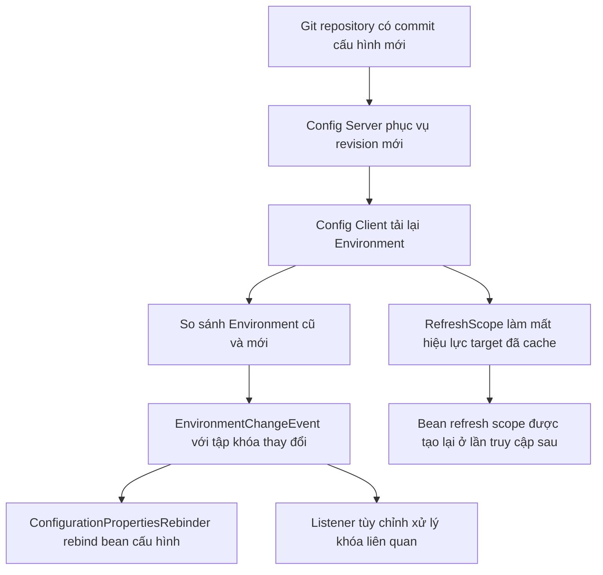

# EnvironmentChangeEvent và quá trình rebind ConfigurationProperties

Khi cấu hình tập trung thay đổi, Spring Cloud Config Client cần đưa giá trị mới vào `Environment` và cập nhật những bean đang sử dụng cấu hình đó. Việc này có nhiều bước: client tải lại cấu hình, so sánh các khóa thay đổi, phát `EnvironmentChangeEvent`, rebind các bean `@ConfigurationProperties` và làm mới những bean thuộc `@RefreshScope`.

Các bước này có liên quan nhưng không giống nhau. `EnvironmentChangeEvent` thông báo những khóa đã thay đổi; `ConfigurationPropertiesRebinder` cập nhật các bean cấu hình có thể rebind; `RefreshScope` loại bỏ instance đang được cache để tạo instance mới ở lần truy cập tiếp theo. Hiểu rõ vai trò của từng thành phần giúp ứng dụng cập nhật cấu hình đúng lúc và tránh giả định rằng mọi singleton đều tự khởi tạo lại sau một lần refresh.

## Mục tiêu học tập

Sau bài học, bạn có thể:

- Mô tả luồng refresh từ Config Server đến `Environment` của Config Client.
- Giải thích nội dung và vai trò của `EnvironmentChangeEvent`.
- Trình bày cách `ConfigurationPropertiesRebinder` cập nhật bean cấu hình.
- Phân biệt rebind với việc tạo lại bean qua `@RefreshScope`.
- Xác định trường hợp `@Value`, immutable configuration và bean singleton cần xử lý riêng.
- Kích hoạt refresh qua Actuator và bảo vệ endpoint quản trị.
- Kiểm thử, quan sát và rollback một thay đổi cấu hình khi ứng dụng đang chạy.

## 1. Bức tranh tổng thể của một lần refresh

Giả sử `catalog-service` đang dùng timeout tìm kiếm là `3s`. Nhóm vận hành thay đổi giá trị trong Git thành `2s`. Config Server đã nhận revision mới và client được yêu cầu refresh. Sau đó, ứng dụng cần cập nhật đối tượng cấu hình và những thành phần phụ thuộc vào timeout.

Luồng khái quát:



Một lần refresh thường có thể hiểu qua các thành phần:

| Thành phần | Vai trò |
|---|---|
| `ContextRefresher` | Điều phối việc tải lại môi trường cấu hình và refresh scope. |
| `Environment` | Chứa các `PropertySource` và giá trị cấu hình mà ứng dụng tra cứu. |
| `EnvironmentChangeEvent` | Thông báo những khóa có giá trị thay đổi sau khi Environment được cập nhật. |
| `ConfigurationPropertiesRebinder` | Rebind các bean được đăng ký bằng `@ConfigurationProperties`. |
| `RefreshScope` | Xóa target bean đã cache để instance mới được tạo ở lần truy cập tiếp theo. |
| Listener của ứng dụng | Cập nhật cache, bộ định tuyến hoặc trạng thái phụ thuộc vào các khóa thay đổi. |

Refresh không đồng nghĩa tạo lại toàn bộ `ApplicationContext`. Chỉ các cơ chế và bean được hỗ trợ mới được cập nhật theo quy trình này.

## 2. ContextRefresher cập nhật Environment

Trong Spring Cloud Context, `ContextRefresher` điều phối quá trình refresh. Khi được gọi, nó yêu cầu cơ chế Config Data hoặc cơ chế bootstrap tương ứng nạp lại nguồn cấu hình, tạo tập giá trị mới và so sánh với Environment hiện tại.

Ở mức khái niệm, quy trình gồm:

1. Ghi nhận trạng thái cấu hình hiện tại.
2. Nạp lại nguồn cấu hình, bao gồm Config Server nếu client được cấu hình để lấy nguồn từ xa.
3. So sánh các giá trị cũ và mới để xác định tập khóa thay đổi.
4. Cập nhật Environment của ứng dụng.
5. Phát `EnvironmentChangeEvent` mang theo tập khóa đã thay đổi.
6. Làm mới `RefreshScope` để các target bean đã cache có thể được tạo lại.

Chi tiết triển khai khác nhau giữa các phiên bản Spring Cloud và cách ứng dụng dùng Config Data import hay bootstrap context cũ. Không trộn cấu hình của hai cơ chế; hãy dùng release train tương thích với phiên bản Spring Boot của dự án.

Một điểm quan trọng: Config Server phải nhìn thấy revision mới trước khi client tải lại cấu hình. Nếu Git backend của Config Server đang trong cửa sổ `refresh-rate` và vẫn phục vụ local clone cũ, client refresh có thể nhận lại giá trị cũ. Khi điều tra, hãy kiểm tra Environment API phía server trước, sau đó mới gọi refresh ở client.

## 3. EnvironmentChangeEvent mang thông tin gì?

`EnvironmentChangeEvent` là một Spring application event do Spring Cloud Context sử dụng để thông báo rằng các thuộc tính trong Environment đã thay đổi. Event cung cấp tập tên khóa thay đổi qua `getKeys()`.

Ví dụ, một lần refresh có thể phát event chứa:

```text
catalog.search.timeout
catalog.search.base-url
catalog.cache.ttl
```

Các listener có thể dùng tập khóa này để quyết định thành phần nào cần cập nhật. Listener không cần xử lý mọi lần refresh; nó có thể bỏ qua event nếu không có khóa thuộc phạm vi của mình.

Event chỉ là thông báo. Tự tạo và phát `EnvironmentChangeEvent` không tự gọi Config Server, không tự nạp Git và cũng không tự sửa giá trị trong Environment. Muốn thay đổi được phản ánh, trước tiên phải cập nhật nguồn/Environment bằng quy trình phù hợp, sau đó mới phát event để các thành phần tiêu thụ thay đổi.

### Lắng nghe event trong ứng dụng

Có thể dùng `@EventListener` để xử lý các khóa thuộc phạm vi một thành phần:

```java
import org.springframework.cloud.context.environment.EnvironmentChangeEvent;
import org.springframework.context.event.EventListener;
import org.springframework.stereotype.Component;

@Component
public class SearchConfigurationListener {

    @EventListener
    public void onEnvironmentChange(EnvironmentChangeEvent event) {
        boolean searchChanged = event.getKeys().stream()
            .anyMatch(key -> key.startsWith("catalog.search."));

        if (searchChanged) {
            // Đánh dấu cache hoặc cấu hình client tìm kiếm cần cập nhật.
        }
    }
}
```

Listener nên làm công việc ngắn, có thể lặp lại an toàn và không phụ thuộc thứ tự ngẫu nhiên giữa các listener. Tránh gọi dịch vụ từ xa lâu, thực hiện migration lớn hoặc chạy tác vụ không thể lặp lại trong callback đồng bộ của event.

## 4. ConfigurationPropertiesRebinder làm gì?

Spring Boot bind các thuộc tính vào bean `@ConfigurationProperties`. Trong Spring Cloud Context, `ConfigurationPropertiesRebinder` lắng nghe thay đổi môi trường và thực hiện bind lại các bean cấu hình đã đăng ký.

Điều này hữu ích khi bean giữ một nhóm cấu hình có cấu trúc. Thay vì đọc từng chuỗi bằng `@Value`, ứng dụng có thể gom các khóa liên quan vào một đối tượng có kiểu dữ liệu, validation và quy tắc đặt tên rõ ràng.

Ví dụ cấu hình:

```yaml
catalog:
  search:
    base-url: https://search.internal.example
    timeout: 3s
    retry-count: 2
```

Bean cấu hình mutable:

```java
import java.net.URI;
import java.time.Duration;
import jakarta.validation.constraints.Min;
import jakarta.validation.constraints.NotNull;
import org.springframework.boot.context.properties.ConfigurationProperties;
import org.springframework.validation.annotation.Validated;

@Validated
@ConfigurationProperties(prefix = "catalog.search")
public class SearchProperties {

    @NotNull
    private URI baseUrl;

    @NotNull
    private Duration timeout = Duration.ofSeconds(3);

    @Min(0)
    private int retryCount = 2;

    public URI getBaseUrl() {
        return baseUrl;
    }

    public void setBaseUrl(URI baseUrl) {
        this.baseUrl = baseUrl;
    }

    public Duration getTimeout() {
        return timeout;
    }

    public void setTimeout(Duration timeout) {
        this.timeout = timeout;
    }

    public int getRetryCount() {
        return retryCount;
    }

    public void setRetryCount(int retryCount) {
        this.retryCount = retryCount;
    }
}
```

Đăng ký bean bằng `@ConfigurationPropertiesScan` trên lớp ứng dụng hoặc `@EnableConfigurationProperties(SearchProperties.class)` trong lớp cấu hình. Khi các khóa `catalog.search.*` thay đổi và quá trình refresh phát event, rebinder có thể bind giá trị mới vào bean này.

Ví dụ dùng Jakarta Validation của Spring Boot 3; dự án Spring Boot 2 thường dùng namespace `javax.validation`. Cần có validation provider phù hợp, thường được cung cấp qua `spring-boot-starter-validation`, để các annotation như `@NotNull` và `@Min` thực sự được kiểm tra.

### Bean phụ thuộc vào SearchProperties

```java
import java.time.Duration;
import org.springframework.stereotype.Service;

@Service
public class SearchRequestPolicy {
    private final SearchProperties properties;

    public SearchRequestPolicy(SearchProperties properties) {
        this.properties = properties;
    }

    public Duration timeout() {
        return properties.getTimeout();
    }
}
```

Trong ví dụ, service giữ tham chiếu đến bean `SearchProperties` và đọc thuộc tính khi cần. Khi bean cấu hình mutable được rebind, lời gọi tiếp theo có thể thấy giá trị mới. Nếu service sao chép timeout vào một field riêng trong constructor, field đã sao chép sẽ không tự thay đổi chỉ vì bean nguồn được rebind.

## 5. Quá trình rebind và các giới hạn

Rebind có nghĩa là binder chạy lại trên bean cấu hình đã tồn tại để cập nhật các thuộc tính từ Environment mới. Đối với JavaBean mutable có setter, giá trị mới có thể được ghi vào cùng instance.

Rebind không tự động giải quyết mọi phụ thuộc trong ứng dụng:

- Một service đã sao chép giá trị cấu hình vào field riêng có thể vẫn giữ giá trị cũ.
- Một thư viện tạo client hoặc connection pool trong constructor có thể không đọc lại thuộc tính sau khi bean cấu hình thay đổi.
- Một bean singleton không thuộc refresh scope vẫn giữ instance hiện tại.
- Một số thuộc tính chỉ có ý nghĩa trong giai đoạn khởi động không thể áp dụng an toàn bằng cách rebind.
- Binding hoặc validation thất bại có thể khiến quá trình cập nhật không hoàn tất như mong muốn; cần kiểm tra log và kết quả endpoint.

Với cấu hình cần tính nhất quán giữa nhiều thuộc tính, hãy thiết kế bean nhận cấu hình theo một đơn vị hợp lệ. Không để một listener cập nhật nửa trạng thái rồi thực hiện thao tác phụ thuộc vào nửa còn lại. Nếu cần tái tạo toàn bộ đối tượng phụ thuộc, cân nhắc `@RefreshScope` hoặc một cơ chế thay thế cấu hình có kiểm soát.

## 6. @Value không tự rebind trong singleton thông thường

`@Value` được giải quyết khi bean được tạo và dependency injection diễn ra. Một singleton bình thường có field `@Value` không tự được tiêm lại chỉ vì EnvironmentChangeEvent được phát.

Ví dụ:

```java
import java.net.URI;
import org.springframework.beans.factory.annotation.Value;
import org.springframework.stereotype.Component;

@Component
public class SearchEndpointHolder {
    @Value("${catalog.search.base-url}")
    private URI baseUrl;
}
```

Nếu `SearchEndpointHolder` là singleton bình thường, field `baseUrl` thường giữ giá trị được tiêm lúc khởi tạo. Nếu thành phần cần dùng giá trị mới, hãy chọn một trong các hướng:

- Chuyển nhóm cấu hình sang `@ConfigurationProperties` để dùng cơ chế rebind.
- Đưa bean cần tạo lại vào `@RefreshScope`.
- Đọc giá trị từ `Environment` tại thời điểm sử dụng nếu việc tra cứu động phù hợp với thiết kế.

Không nên dùng `Environment.getProperty()` rải rác trong mã nghiệp vụ để né việc thiết kế cấu hình. Với cấu hình có cấu trúc, `@ConfigurationProperties` thường giúp quản lý kiểu dữ liệu và validation rõ ràng hơn.

## 7. @RefreshScope tạo lại bean khi cần

`@RefreshScope` cung cấp scope đặc biệt cho bean có thể được làm mới. Spring đặt proxy ở vị trí bean được inject. Khi refresh scope bị làm mới, target instance đã cache bị loại bỏ; lần gọi tiếp theo qua proxy sẽ tạo target instance mới từ Environment hiện tại.

Ví dụ một client HTTP được tạo từ cấu hình tìm kiếm:

```java
import java.net.URI;
import org.springframework.cloud.context.config.annotation.RefreshScope;
import org.springframework.stereotype.Component;
import org.springframework.web.reactive.function.client.WebClient;

@Component
@RefreshScope
public class RemoteSearchGateway {
    private final SearchProperties properties;
    private final WebClient webClient;

    public RemoteSearchGateway(SearchProperties properties) {
        this.properties = properties;
        this.webClient = WebClient.builder()
            .baseUrl(properties.getBaseUrl().toString())
            .build();
    }

    public URI baseUrl() {
        return properties.getBaseUrl();
    }
}
```

Sau khi refresh scope được làm mới, target cũ bị hủy theo lifecycle của scope. Ở lần gọi kế tiếp, Spring tạo `RemoteSearchGateway` mới và constructor nhận cấu hình hiện tại. Đây là cách phù hợp khi bean cần dựng lại một tài nguyên từ giá trị cấu hình mới, chẳng hạn HTTP client hoặc bộ định tuyến. Ví dụ dùng `WebClient` của Spring WebFlux; nếu dự án dùng HTTP client khác, thay bằng implementation tương ứng.

Bean phải có thể được proxy theo cơ chế scope mà dự án sử dụng. Với class-based proxy, tránh khai báo lớp hoặc phương thức cần proxy là `final`. Hãy kiểm tra target cũ được đóng hoặc giải phóng tài nguyên đúng cách khi bị loại khỏi scope.

### Rebind và RefreshScope khác nhau thế nào?

| Cơ chế | Tác động | Khi nào dùng |
|---|---|---|
| `ConfigurationPropertiesRebinder` | Bind lại thuộc tính trên bean cấu hình đã đăng ký | Bean cấu hình mutable cần nhận giá trị mới. |
| `@RefreshScope` | Xóa target đã cache và tạo instance mới ở lần truy cập sau | Bean phải chạy lại constructor hoặc khởi tạo lại tài nguyên. |
| Singleton thông thường | Giữ nguyên instance | Dùng cho thành phần không cần cập nhật runtime. |

`@RefreshScope` không phải annotation để đặt tùy tiện lên mọi bean. Việc tạo lại client, pool hoặc tài nguyên có thể tốn thời gian và cần đóng tài nguyên cũ đúng cách. Chỉ áp dụng cho những bean có lifecycle có thể tái tạo an toàn.

## 8. Cấu hình bất biến và constructor binding

Các lớp `@ConfigurationProperties` dạng immutable hoặc dùng constructor binding không có setter để rebinder cập nhật từng field như JavaBean mutable. Nếu đối tượng cần thay đổi theo cấu hình runtime, phải chọn một cơ chế có thể tạo lại chính đối tượng cấu hình từ Environment mới và được release train hỗ trợ, hoặc dùng rolling restart. Không giả định rằng chỉ đặt một bean phụ thuộc vào record trong refresh scope sẽ tự tạo lại record singleton đó.

Ví dụ một record cấu hình:

```java
import java.net.URI;
import java.time.Duration;
import org.springframework.boot.context.properties.ConfigurationProperties;

@ConfigurationProperties(prefix = "catalog.search")
public record SearchSettings(URI baseUrl, Duration timeout) {}
```

Record thích hợp khi muốn mô hình cấu hình bất biến sau khi bind. Nếu ứng dụng yêu cầu cập nhật record này lúc chạy, hãy xác nhận cách đăng ký bean và scope được hỗ trợ trong release train của dự án. Không giả định rebinder có thể gọi setter trên một record.

Nếu cần cập nhật record lúc chạy, hãy xác minh cơ chế hỗ trợ constructor binding của release train đang dùng. Một wrapper `@RefreshScope` đơn thuần không đủ nếu nó vẫn inject lại cùng một record singleton cũ. Có thể tạo lại toàn bộ cấu trúc chứa record bằng một cơ chế refresh được hỗ trợ, hoặc dùng rolling restart nếu không thể bảo đảm instance mới nhận đúng cấu hình.

## 9. Kích hoạt refresh bằng Actuator

Trong ứng dụng dùng Spring Cloud Config Client, endpoint refresh thường được cung cấp qua Spring Cloud Context cùng Spring Boot Actuator. Cần có các dependency tương thích, thường gồm Config Client starter và Actuator starter.

Cho phép expose endpoint `refresh` qua HTTP:

```yaml
management:
  endpoints:
    web:
      exposure:
        include: health,info,refresh
```

Sau khi Config Server đã phục vụ cấu hình mới, gửi POST đến endpoint:

```bash
curl -X POST \
  -H "Authorization: Bearer ${ACTUATOR_TOKEN}" \
  https://catalog-service.internal/actuator/refresh
```

Endpoint có thể trả về danh sách khóa thay đổi, ví dụ:

```json
[
  "catalog.search.timeout",
  "catalog.search.base-url"
]
```

Danh sách rỗng thường cho biết không phát hiện khóa khác biệt trong lần refresh đó. Nó không tự chứng minh rằng Git commit chưa tồn tại; hãy kiểm tra response của Config Server, label và revision backend trước khi kết luận.

Đường dẫn endpoint có thể thay đổi theo `management.endpoints.web.base-path` hoặc management port riêng. Một số cấu hình triển khai cũng có thể tắt endpoint. Hãy xác nhận URL và quyền truy cập trong môi trường thực tế.

## 10. Bảo vệ endpoint refresh

Refresh có thể làm thay đổi hành vi ứng dụng đang phục vụ lưu lượng thật. Người có quyền gọi endpoint không được kiểm soát có thể khiến client nạp cấu hình ngoài dự kiến hoặc tạo lại nhiều bean cùng lúc.

Áp dụng các nguyên tắc:

- Không expose `refresh` công khai trên Internet.
- Dùng Spring Security để yêu cầu xác thực và phân quyền riêng cho endpoint quản trị.
- Ưu tiên HTTPS/TLS và giới hạn truy cập qua mạng quản trị hoặc gateway nội bộ.
- Không dùng chung token quản trị giữa người dùng và pipeline.
- Ghi nhận ai gọi refresh, lúc nào và kết quả thay đổi ở mức không lộ giá trị cấu hình.
- Chỉ expose các Actuator endpoint thực sự cần thiết.

Chỉ thêm `refresh` vào danh sách exposure không tự cấu hình xác thực. Việc bảo vệ phải được thực hiện ở security filter chain và lớp mạng của hệ thống.

## 11. Phân biệt refresh, EnvironmentChangeEvent và Spring Cloud Bus

Ba khái niệm thường xuất hiện cùng nhau nhưng đảm nhiệm các công việc khác nhau:

| Thành phần | Phạm vi | Công việc |
|---|---|---|
| Refresh endpoint | Một Config Client instance | Yêu cầu instance tải lại Environment và chạy quy trình refresh cục bộ. |
| `EnvironmentChangeEvent` | ApplicationContext của instance | Thông báo các khóa thay đổi để rebinder và listener xử lý. |
| Spring Cloud Bus | Nhiều instance kết nối broker | Phân phối sự kiện refresh đến các ứng dụng/instance khác. |

Nếu có 20 instance, gọi `/actuator/refresh` trên một instance chỉ refresh instance đó. Muốn phân phối sự kiện đến nhiều instance, có thể dùng Spring Cloud Bus và endpoint bus refresh tương ứng. Mỗi instance nhận sự kiện vẫn phải thực hiện quy trình refresh cục bộ và xử lý EnvironmentChangeEvent của mình.

Bus không thay thế Git fetch ở Config Server. Nếu server còn phục vụ revision cũ, mọi client được yêu cầu refresh vẫn có thể nhận cấu hình cũ. Quy trình phát hành nên xác nhận server đã nhìn thấy revision mới trước khi phát sự kiện refresh hàng loạt.

## 12. Các thuộc tính nào có thể cập nhật runtime?

Không phải mọi thuộc tính đều có thể thay đổi an toàn khi ứng dụng đang chạy. Khả năng cập nhật phụ thuộc cách bean sử dụng thuộc tính và khả năng tái tạo tài nguyên.

| Loại cấu hình | Khả năng cập nhật | Lưu ý |
|---|---|---|
| Giá trị trong bean `@ConfigurationProperties` mutable | Có thể rebind | Bean và code sử dụng phải đọc giá trị mới, không sao chép thành state cũ. |
| Logging level được Spring Cloud hỗ trợ | Có thể cập nhật | Cần phân biệt đổi level với đổi toàn bộ cấu hình logging. |
| Bean `@RefreshScope` | Có thể tạo lại target | Kiểm tra lifecycle, proxy và tài nguyên cũ. |
| Field `@Value` trong singleton thường | Không tự cập nhật | Cần refresh scope hoặc thiết kế truy cập khác. |
| Server port, cấu trúc listener hoặc thuộc tính bootstrap | Thường cần khởi động lại | Chúng được tiêu thụ trong giai đoạn khởi tạo hạ tầng. |
| Kết nối pool hoặc client bên thứ ba | Tùy implementation | Cần cơ chế đóng và tạo lại tài nguyên an toàn. |

Nếu một thay đổi có ảnh hưởng đến socket đang lắng nghe, thread pool, schema hoặc tài nguyên bên ngoài, refresh bean đơn lẻ có thể không đủ. Với những thay đổi như vậy, rolling restart thường dễ dự đoán và an toàn hơn.

## 13. Xử lý lỗi trong quá trình refresh

Một lần refresh có thể thất bại ở nhiều giai đoạn:

1. Config Server không truy cập được hoặc trả về revision cũ.
2. Config Data loader không tải được nguồn cấu hình bắt buộc.
3. Giá trị mới không chuyển đổi được sang kiểu Java.
4. Validation của `@ConfigurationProperties` thất bại.
5. Listener tùy chỉnh ném exception hoặc thực hiện tác vụ phụ thất bại.
6. Bean refresh scope không thể khởi tạo lại vì endpoint, credential hoặc tài nguyên mới không hợp lệ.

Hãy theo dõi log của Config Client, kết quả HTTP từ refresh endpoint, tập khóa thay đổi và trạng thái các bean sau refresh. Không ghi giá trị secret vào log để tìm nguyên nhân.

Đối với cấu hình quan trọng, nên kiểm tra dữ liệu trước khi phát hành. Ví dụ, endpoint phải là URI hợp lệ, timeout phải dương và số lần retry phải nằm trong giới hạn. Validation giúp phát hiện lỗi trước khi cấu hình được áp dụng cho nhiều instance.

## 14. Kiểm thử rebind và refresh scope

Một kiểm thử tích hợp nên xác nhận cả giá trị trong Environment lẫn hành vi của bean:

- Đặt giá trị ban đầu cho `catalog.search.timeout`.
- Tạo context và xác nhận bean `SearchProperties` nhận giá trị ban đầu.
- Thay nguồn cấu hình bằng cơ chế test phù hợp rồi kích hoạt quy trình refresh.
- Xác nhận event chứa đúng khóa thay đổi.
- Xác nhận bean mutable `@ConfigurationProperties` nhận giá trị mới.
- Xác nhận bean `@RefreshScope` được tạo lại khi truy cập qua proxy sau refresh.
- Xác nhận singleton thông thường không bị tạo lại ngoài ý muốn.
- Kiểm tra trường hợp giá trị mới không hợp lệ và cách hệ thống báo lỗi.

Với listener tùy chỉnh, kiểm thử rằng listener chỉ phản ứng với namespace khóa cần thiết và có thể xử lý event lặp lại an toàn. Tránh viết listener phụ thuộc thứ tự xử lý của listener khác.

## 15. Quy trình vận hành một thay đổi cấu hình

Một luồng triển khai có kiểm soát cho `catalog-service` có thể là:

1. Tạo pull request thay đổi `catalog.search.timeout` từ `3s` thành `2s` trong Git.
2. Review thay đổi và chạy kiểm tra cấu trúc, kiểu dữ liệu cùng validation.
3. Merge hoặc tạo tag cấu hình đã được phê duyệt.
4. Xác nhận Config Server đã fetch revision mới bằng Environment API.
5. Gọi `/actuator/refresh` cho một instance canary.
6. Kiểm tra `EnvironmentChangeEvent`, bean cấu hình, client tìm kiếm và metrics.
7. Nếu kết quả đạt yêu cầu, phát refresh event qua Bus hoặc refresh các instance còn lại theo rollout.
8. Nếu có lỗi, khôi phục revision cấu hình trước đó và refresh lại theo quy trình tương tự.

Không refresh hàng loạt trước khi xác nhận Config Server đã phục vụ revision mong muốn. Ghi lại revision, thời điểm refresh và kết quả kiểm tra để có thể truy vết khi xảy ra sự cố.

## 16. Những điểm cần ghi nhớ

- `ContextRefresher` điều phối việc tải lại Environment và làm mới refresh scope.
- `EnvironmentChangeEvent` thông báo tập khóa thay đổi; bản thân event không tải cấu hình từ Config Server.
- `ConfigurationPropertiesRebinder` rebind các bean `@ConfigurationProperties` đã đăng ký và có thể cập nhật.
- Bean mutable có setter phù hợp với rebind; immutable/constructor-bound cần thiết kế vòng đời riêng và kiểm thử theo phiên bản.
- `@Value` trong singleton thường không tự được tiêm lại sau refresh.
- `@RefreshScope` loại bỏ target đã cache và tạo target mới ở lần truy cập kế tiếp.
- Refresh endpoint thường là `POST /actuator/refresh`; phải expose có chọn lọc và bảo vệ bằng xác thực, phân quyền.
- Refresh một instance không đồng nghĩa refresh toàn bộ hệ thống; Spring Cloud Bus hỗ trợ phân phối sự kiện đến nhiều instance.
- Xác nhận Config Server đã có revision mới trước khi refresh client, và dùng restart khi thay đổi không thể áp dụng runtime an toàn.

Khi nắm được quan hệ giữa `EnvironmentChangeEvent`, rebind và refresh scope, bạn có thể thiết kế ứng dụng cập nhật cấu hình có kiểm soát. Mỗi bean cần một chiến lược rõ ràng: nhận giá trị mới qua rebind, được tạo lại qua refresh scope, hoặc chỉ thay đổi sau khi khởi động lại.

## Tài liệu tham khảo

- [Spring Cloud Context – Refresh Scope and Environment Changes](https://docs.spring.io/spring-cloud-commons/reference/spring-cloud-commons/application-context-services.html)
- [Spring Boot – Actuator Endpoints](https://docs.spring.io/spring-boot/reference/actuator/endpoints.html)
- [Spring Cloud Config – Client](https://docs.spring.io/spring-cloud-config/reference/client.html)
