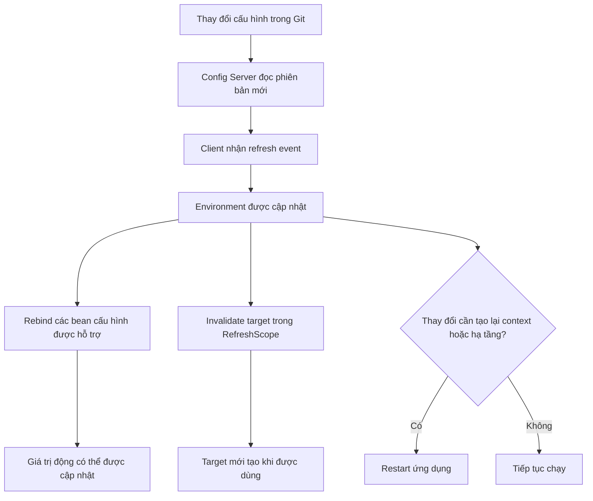

# Tham số cần khởi động lại như cổng, bean condition và lựa chọn hạ tầng

Spring Cloud Config giúp thay đổi cấu hình tập trung mà không phải đóng gói lại ứng dụng cho mỗi lần chỉnh sửa. Tuy nhiên, việc client nhận được giá trị mới không đồng nghĩa mọi thành phần đang chạy đều tự thay đổi theo. Một số thuộc tính có thể được cập nhật trong `Environment`, một số bean có thể được bind lại hoặc tạo lại, còn những quyết định đã được thực hiện khi Spring khởi tạo application context thường cần khởi động lại ứng dụng.

Với hệ thống nhiều ứng dụng Spring Boot, cần phân biệt rõ **refresh cấu hình** và **restart ứng dụng**. Bài học này tập trung vào các trường hợp thường phải khởi động lại như `server.port`, điều kiện tạo bean và lựa chọn hạ tầng, đồng thời hướng dẫn cách nhận diện thay đổi nào có thể refresh an toàn.

## 1. Refresh không đồng nghĩa khởi động lại application context

Khi cấu hình trong Git thay đổi, Config Server có thể đọc được phiên bản mới. Client đang chạy không tự động nhận mọi thay đổi chỉ vì commit đã được push. Client cần một cơ chế lấy lại cấu hình và áp dụng nó.

Trong Spring Cloud, quá trình refresh thường gồm các bước chính:

1. Client lấy lại các property source từ xa và cập nhật `Environment`.
2. Spring phát sự kiện thay đổi môi trường (`EnvironmentChangeEvent`) cho các thành phần quan tâm.
3. Các bean cấu hình được hỗ trợ có thể được bind lại.
4. Các bean nằm trong `@RefreshScope` bị loại khỏi cache của refresh scope; target mới được tạo khi bean được sử dụng lần tiếp theo.

Quá trình này không tạo lại toàn bộ application context. Nó cũng không tự khởi tạo lại embedded web server, không chạy lại toàn bộ auto-configuration và không đánh giá lại mọi điều kiện `@Conditional` đã được kiểm tra lúc startup.



Vì vậy, cần xem mỗi thuộc tính ảnh hưởng đến dữ liệu mà ứng dụng đọc trong lúc chạy, vòng đời bean, hay cấu trúc hạ tầng được dựng lúc khởi động.

## 2. Những thay đổi thường có thể refresh

Một thuộc tính có thể refresh khi thành phần sử dụng nó được thiết kế để đọc giá trị mới hoặc được Spring hỗ trợ bind lại/tạo lại an toàn.

Ví dụ thường gặp:

- Nội dung thông báo, nhãn hiển thị hoặc một số cờ nghiệp vụ được đọc mỗi lần xử lý.
- Giới hạn nghiệp vụ đơn giản như số lượng tối đa, nếu logic đọc giá trị mới thay vì giữ một bản sao bất biến.
- Tham số của một bean được quản lý bằng `@RefreshScope`, khi việc tạo lại target không làm hỏng tài nguyên hoặc trạng thái bên ngoài.
- Một số bean `@ConfigurationProperties` được Spring Cloud hỗ trợ rebind sau sự kiện refresh.

Ví dụ một service đọc thông điệp từ bean refresh-scoped:

```java
@Component
@RefreshScope
public class GreetingService {

    @Value("${app.greeting:Hello}")
    private String greeting;

    public String message() {
        return greeting;
    }
}
```

Khi `app.greeting` thay đổi và client thực hiện refresh, target của `GreetingService` có thể được tạo lại. Lần gọi tiếp theo qua proxy sẽ nhận target mới và giá trị mới.

Với nhóm thuộc tính có cấu trúc, có thể dùng `@ConfigurationProperties`:

```java
@ConfigurationProperties(prefix = "app.limits")
public class LimitProperties {

    private int maxOrders = 100;

    public int getMaxOrders() {
        return maxOrders;
    }

    public void setMaxOrders(int maxOrders) {
        this.maxOrders = maxOrders;
    }
}
```

Đăng ký lớp cấu hình bằng `@ConfigurationPropertiesScan` hoặc `@EnableConfigurationProperties`. Spring Cloud có cơ chế rebind cho các bean cấu hình được quản lý, nhưng thành phần tiêu thụ vẫn phải đọc giá trị đã cập nhật. Nếu một bean khác sao chép giá trị vào field riêng trong constructor hoặc dùng giá trị để khởi tạo tài nguyên một lần, việc rebind `LimitProperties` không tự cập nhật bản sao đó.

Không nên xem `@RefreshScope` như một nút làm mới toàn bộ đồ thị bean. Annotation này tạo proxy và quản lý target của bean trong refresh scope. Những đối tượng đã giữ tham chiếu đến tài nguyên cũ, trạng thái bên ngoài hoặc bean không được quản lý trong scope có thể vẫn giữ hành vi cũ.

## 3. Vì sao `server.port` cần restart?

`server.port` được sử dụng khi Spring Boot khởi tạo embedded web server và bind socket lắng nghe. Khi ứng dụng đã chạy, connector đã gắn với cổng cụ thể. Refresh có thể cập nhật giá trị thuộc tính trong `Environment`, nhưng không tự động đóng socket cũ, dựng connector mới và chuyển traffic sang cổng mới.

Ví dụ cấu hình ban đầu:

```yaml
server:
  port: 8081
```

Sau đó đổi trong Config Server thành:

```yaml
server:
  port: 8082
```

Nếu client chỉ nhận refresh event, ứng dụng thường vẫn tiếp tục lắng nghe trên cổng `8081`. Đọc lại property `server.port` có thể cho thấy giá trị mới, nhưng điều đó không chứng minh web server đã chuyển sang cổng `8082`.

Để thay đổi cổng, cần khởi động lại instance với cấu hình mới. Trong hệ thống nhiều replica, có thể triển khai rolling restart: tạo instance mới dùng cổng/cấu hình mới, chờ readiness thành công, chuyển traffic, rồi dừng instance cũ theo quy trình triển khai.

Không dùng `@RefreshScope` trên một bean tùy ý để kỳ vọng embedded server đổi cổng. Web server là hạ tầng được dựng trong lifecycle khởi động của application context; refresh scope không thực hiện lại toàn bộ lifecycle đó.

## 4. Điều kiện tạo bean không được đánh giá lại khi refresh

Spring Boot thường dùng các điều kiện như `@ConditionalOnProperty`, `@ConditionalOnClass`, `@ConditionalOnBean` và các điều kiện auto-configuration để quyết định bean nào được đăng ký trong application context. Những điều kiện này được đánh giá trong quá trình tạo context.

Ví dụ:

```java
@Configuration
@ConditionalOnProperty(
    name = "app.storage.provider",
    havingValue = "s3"
)
public class S3StorageConfiguration {

    @Bean
    public StorageClient storageClient() {
        return new S3StorageClient();
    }
}
```

Giả sử ứng dụng khởi động với:

```yaml
app:
  storage:
    provider: s3
```

Spring đánh giá điều kiện và tạo `StorageClient` dùng S3. Nếu Config Server đổi `app.storage.provider` thành `filesystem` rồi client refresh, Spring không chạy lại toàn bộ quá trình component scan và auto-configuration. Bean S3 đã được đăng ký vẫn tồn tại; bean filesystem không tự xuất hiện chỉ vì `Environment` đã có giá trị mới.

Những thay đổi thường thuộc nhóm cần restart:

- Bật/tắt một cấu hình `@Configuration` bằng `@ConditionalOnProperty`.
- Chuyển implementation được chọn bằng điều kiện lúc startup.
- Thay đổi điều kiện phụ thuộc classpath hoặc bean khác.
- Thay đổi cấu trúc dependency injection, component scan hoặc auto-configuration.

Nếu thực sự cần đổi implementation trong lúc chạy, hãy thiết kế một cơ chế định tuyến động có chủ đích, chẳng hạn một registry/strategy bean giữ nhiều implementation đã được tạo sẵn và chọn implementation theo cấu hình runtime. Cơ chế này phải xử lý an toàn việc đóng tài nguyên, đồng bộ trạng thái, lỗi chuyển đổi và rollback. Đó là thiết kế runtime riêng, không phải hành vi tự động của `@ConditionalOnProperty`.

## 5. Lựa chọn hạ tầng thường cần restart

Nhiều thuộc tính hạ tầng được dùng để tạo kết nối hoặc tài nguyên trong startup. Thay đổi chúng trong `Environment` không đảm bảo tài nguyên đang chạy được thay thế.

| Nhóm cấu hình | Ví dụ | Hành vi khi refresh | Hướng xử lý thường dùng |
|---|---|---|---|
| Web server | `server.port`, SSL listener, địa chỉ bind | Connector/socket đã được khởi tạo; refresh không tự bind lại. | Restart instance. |
| Bean condition | `app.storage.provider`, `feature.adapter` dùng `@ConditionalOnProperty` | Điều kiện không được đánh giá lại; bean graph giữ cấu trúc cũ. | Restart hoặc thiết kế router runtime. |
| Database pool | JDBC URL, driver, pool implementation, credential kết nối | Pool đang chạy có thể giữ connection và cấu hình cũ; `HikariDataSource` mặc định thuộc nhóm không refreshable của Spring Cloud. | Restart hoặc chủ động tạo/đóng pool mới với quy trình an toàn. |
| Messaging client | Broker endpoint, protocol, serializer, consumer topology | Connection, channel, listener container có thể tiếp tục dùng cấu hình cũ. | Restart hoặc triển khai cơ chế tái tạo client/container có kiểm soát. |
| Cache provider | Redis/embedded provider, cluster topology, serialization | Client và cache manager có thể đã giữ connection, topology hoặc object serializer cũ. | Thường restart; chỉ refresh nếu provider hỗ trợ thay đổi động đã được thiết kế. |
| Service discovery | Registry endpoint, namespace, transport hoặc identity | Discovery client có thể đã khởi tạo scheduler, connection và registration state. | Restart hoặc cập nhật bằng API lifecycle chuyên biệt. |
| TLS và bảo mật | Keystore, truststore, key material, authentication provider | Listener/client connection đã tạo có thể tiếp tục dùng SSL context cũ. | Reload theo khả năng thư viện hoặc restart; xác minh handshake mới. |
| Thread pool | Số worker, queue capacity, executor implementation | Một số executor hỗ trợ resize; thay implementation hoặc cấu trúc pool không tự động được áp dụng. | Dùng API quản lý pool nếu hỗ trợ, nếu không restart. |

Đây là phân loại vận hành điển hình, không phải quy tắc tuyệt đối cho mọi thư viện. Một số hạ tầng hỗ trợ reload hoặc reconfigure động qua API riêng. Cần xác nhận capability của implementation cụ thể và kiểm tra vòng đời tài nguyên trước khi cho phép refresh.

## 6. Cấu hình datasource và giới hạn của refresh scope

Một ví dụ dễ gây hiểu nhầm là thay JDBC URL hoặc thông tin pool trong khi ứng dụng đang chạy:

```yaml
spring:
  datasource:
    url: jdbc:postgresql://db-primary:5432/orders
    username: orders_app
    password: ${ORDERS_DB_PASSWORD}
```

Datasource thường tạo connection pool lúc khởi động. Việc thay `spring.datasource.url` trong `Environment` không tự động làm các connection hiện có chuyển sang database mới. HikariCP được Spring Cloud mặc định xem là datasource không refreshable để tránh làm hỏng pool đang được sử dụng.

Nếu cần chuyển database, có hai hướng:

1. **Restart có kiểm soát:** triển khai instance mới với datasource mới, kiểm tra health và truy vấn, chuyển traffic rồi dừng instance cũ.
2. **Tái tạo pool có chủ đích:** tạo pool mới, kiểm tra kết nối, chuyển các request mới sang pool mới, chờ request đang chạy hoàn tất rồi đóng pool cũ. Cách này cần code quản lý lifecycle và đồng bộ, không chỉ thêm `@RefreshScope` vào bean.

Không đóng pool cũ trước khi các request đang dùng nó kết thúc. Nếu credential hoặc endpoint mới sai, cần có khả năng giữ pool cũ hoặc rollback mà không làm gián đoạn dịch vụ.

## 7. `@RefreshScope` làm gì và không làm gì?

`@RefreshScope` tạo một proxy cho bean và quản lý target bên trong refresh scope. Khi refresh xảy ra, target hiện tại bị loại khỏi cache; lần gọi tiếp theo qua proxy sẽ tạo target mới bằng cấu hình hiện tại.

Ví dụ:

```java
@Component
@RefreshScope
public class PartnerApiClient {

    private final RestClient restClient;

    public PartnerApiClient(
            @Value("${partner.api.base-url}") String baseUrl) {
        this.restClient = RestClient.builder()
            .baseUrl(baseUrl)
            .build();
    }

    public String status() {
        return restClient.get()
            .uri("/status")
            .retrieve()
            .body(String.class);
    }
}
```

Nếu `partner.api.base-url` thay đổi, target `PartnerApiClient` có thể được tạo lại với URL mới sau refresh. Tuy nhiên, cần lưu ý:

- Bean phải được truy cập qua proxy do Spring quản lý.
- Các tham chiếu đã giữ target hoặc tài nguyên bên ngoài có thể không tự đổi.
- Việc tạo target mới có thể thất bại nếu cấu hình mới không hợp lệ.
- Refresh scope không đánh giá lại `@ConditionalOnProperty` hay tạo lại toàn bộ context.
- Tài nguyên của target cũ cần được giải phóng đúng lifecycle.

`@RefreshScope` phù hợp với bean có thể tạo lại độc lập và có lifecycle rõ ràng. Không gắn annotation hàng loạt vào mọi bean hoặc dùng nó để thay thế quy trình restart cho hạ tầng.

## 8. Refresh qua Actuator và Spring Cloud Bus

Với client đã cấu hình Spring Boot Actuator và Spring Cloud Context, endpoint refresh có thể được sử dụng để yêu cầu instance nạp lại cấu hình. Ví dụ:

```yaml
management:
  endpoints:
    web:
      exposure:
        include: health,info,refresh
```

Gửi POST đến instance cần refresh:

```bash
curl -X POST http://orders-service:8081/actuator/refresh
```

Endpoint này tác động đến instance nhận request. Nó không restart tiến trình và không làm thay đổi các thành phần cần được dựng lại lúc startup.

Trong hệ thống nhiều instance, Spring Cloud Bus có thể phân phối sự kiện refresh qua message broker:

```bash
curl -X POST http://config-client:8081/actuator/busrefresh
```

Bus refresh giúp các client đã kết nối broker nhận sự kiện để cập nhật cấu hình. Nó không biến refresh thành restart: `server.port`, điều kiện bean và lựa chọn hạ tầng vẫn cần quy trình khởi động lại hoặc cơ chế tái cấu hình chuyên biệt.

Các endpoint quản trị phải được bảo vệ bằng xác thực, phân quyền và giới hạn truy cập mạng. Chỉ expose endpoint thực sự cần thiết; không công khai `refresh` hoặc `busrefresh` ra Internet nếu không có lớp bảo vệ thích hợp.

## 9. Lập danh mục thuộc tính: refresh hay restart?

Trước khi triển khai thay đổi, hãy lập danh mục các khóa cấu hình và cách ứng dụng sử dụng chúng. Một bảng phân loại có thể gồm:

| Câu hỏi | Nếu câu trả lời là “có” | Hành động |
|---|---|---|
| Giá trị chỉ được đọc mỗi lần xử lý và không tạo tài nguyên? | Có thể là cấu hình runtime. | Kiểm tra bean có đọc giá trị mới sau refresh. |
| Bean được rebind hoặc target nằm trong `@RefreshScope`? | Có thể cập nhật mà không restart. | Kiểm tra dependency, proxy và lifecycle của target. |
| Thuộc tính được dùng để tạo socket, pool, connection hoặc listener lúc startup? | Tài nguyên có thể vẫn giữ cấu hình cũ. | Ưu tiên restart hoặc quy trình tái tạo tài nguyên chuyên biệt. |
| Thuộc tính quyết định `@Conditional`, auto-configuration hoặc component graph? | Điều kiện không tự chạy lại. | Restart application context. |
| Thay đổi có ảnh hưởng đến port, protocol, TLS hoặc identity? | Có thể làm hạ tầng không đồng bộ. | Lập kế hoạch restart/rollout và kiểm tra kết nối. |

Một thuộc tính có thể được rebind thành công nhưng vẫn cần restart để áp dụng lên tài nguyên mà nó đã cấu hình. Vì vậy, phân loại dựa trên cách thuộc tính được tiêu thụ, không chỉ dựa vào kiểu dữ liệu hoặc tên property.

## 10. Quy trình restart an toàn khi cấu hình thay đổi

Với thay đổi cần restart, hãy xử lý như một đợt triển khai mới:

1. **Phân loại thay đổi:** xác định khóa nào cần restart và instance/service nào bị ảnh hưởng.
2. **Kiểm tra cấu hình mới:** xác minh application, profile, label, giá trị bắt buộc và secret đã được cung cấp.
3. **Kiểm tra tương thích:** bảo đảm cổng mới không xung đột, endpoint mới có thể truy cập và hạ tầng đích sẵn sàng.
4. **Tạo instance mới:** khởi động với phiên bản cấu hình mới hoặc revision triển khai mới.
5. **Chờ readiness:** kiểm tra health, kết nối database/message broker, TLS handshake và các probe nghiệp vụ.
6. **Chuyển traffic:** chỉ chuyển traffic sau khi instance mới sẵn sàng.
7. **Dừng instance cũ:** dùng graceful shutdown để hoàn tất request đang chạy và đóng tài nguyên.
8. **Theo dõi và rollback:** quan sát lỗi, latency, connection pool và khả năng xử lý; quay lại revision cấu hình trước nếu có sự cố.

Với Kubernetes, có thể dùng rolling update hoặc thay đổi pod template để tạo rollout mới. Chỉ sửa ConfigMap/Secret mount không đảm bảo ứng dụng tự áp dụng mọi thay đổi; hành vi cập nhật file và refresh phụ thuộc cách mount, Config Client và bean sử dụng cấu hình. Với thay đổi như `server.port` hoặc điều kiện bean, cần tạo pod mới hoặc restart container theo chính sách triển khai.

## 11. Kiểm tra sau refresh và sau restart

Sau refresh, xác minh cả cấu hình và hành vi thực tế:

- Client đã lấy đúng application, profile và label chưa?
- Environment đã nhận giá trị mới chưa?
- Bean refresh-scoped có được tạo lại khi truy cập không?
- Bean cấu hình có được rebind và consumer có đọc giá trị mới không?
- Các request mới có sử dụng giá trị mong đợi không?
- Có lỗi tạo target mới, lỗi validation hoặc lỗi kết nối backend không?

Sau restart, cần xác minh thêm:

- Tiến trình mới đã bind đúng `server.port` hoặc địa chỉ listener chưa?
- Đúng bean implementation đã được tạo theo điều kiện mới chưa?
- Database pool, messaging client, cache provider và TLS context có dùng endpoint/credential mới không?
- Readiness và health check có thành công không?
- Instance cũ đã được rút khỏi traffic và đóng tài nguyên chưa?

Không chỉ dựa vào endpoint `env` hoặc response refresh để kết luận thay đổi hạ tầng đã có hiệu lực. Cần kiểm tra socket thực tế, connection, bean đang được sử dụng và hành vi của request.

## 12. Những lỗi vận hành thường gặp

| Hiện tượng | Nguyên nhân | Cách xử lý |
|---|---|---|
| `server.port` trong Environment đổi nhưng ứng dụng vẫn nghe cổng cũ | Embedded web server đã bind socket lúc startup. | Restart instance với cấu hình mới. |
| Đổi `@ConditionalOnProperty` nhưng bean cũ vẫn tồn tại | Condition chỉ được đánh giá khi tạo application context. | Restart hoặc thiết kế strategy/router runtime. |
| JDBC URL đổi nhưng query vẫn đi database cũ | Datasource/pool đang giữ connection đã tạo. | Restart hoặc triển khai quy trình thay pool có lifecycle an toàn. |
| `@RefreshScope` bean vẫn dùng cấu hình cũ | Consumer không đi qua proxy, target chưa được tạo lại hoặc bean khác giữ bản sao giá trị. | Kiểm tra proxy, scope và nơi giá trị được capture. |
| Bus refresh thành công nhưng cổng/listener không đổi | Bus chỉ phát sự kiện refresh, không restart hạ tầng. | Thực hiện rollout/restart cho thuộc tính startup-only. |
| Instance mới không sẵn sàng sau restart | Cấu hình mới sai, secret thiếu, port xung đột hoặc backend không truy cập được. | Kiểm tra startup log, readiness, kết nối và rollback revision. |

## 13. Tổng kết

- Refresh cập nhật `Environment`, rebind một số bean cấu hình và làm mới target trong `@RefreshScope`; nó không tạo lại toàn bộ application context.
- `server.port` cần restart vì web server đã bind socket trong quá trình khởi động.
- `@ConditionalOnProperty` và các điều kiện auto-configuration không được đánh giá lại khi refresh.
- Lựa chọn database pool, messaging client, cache provider, service discovery, TLS và các tài nguyên hạ tầng thường cần restart hoặc cơ chế tái tạo chuyên biệt.
- `@RefreshScope` chỉ quản lý lifecycle target của bean qua proxy; nó không thay thế restart và không tự cập nhật mọi tham chiếu đã capture.
- `/actuator/refresh` và Spring Cloud Bus `/actuator/busrefresh` phát động refresh, không khởi động lại tiến trình.
- Phân loại từng property theo cách nó được tiêu thụ; dùng rolling restart, readiness, graceful shutdown và rollback cho thay đổi startup-only.
