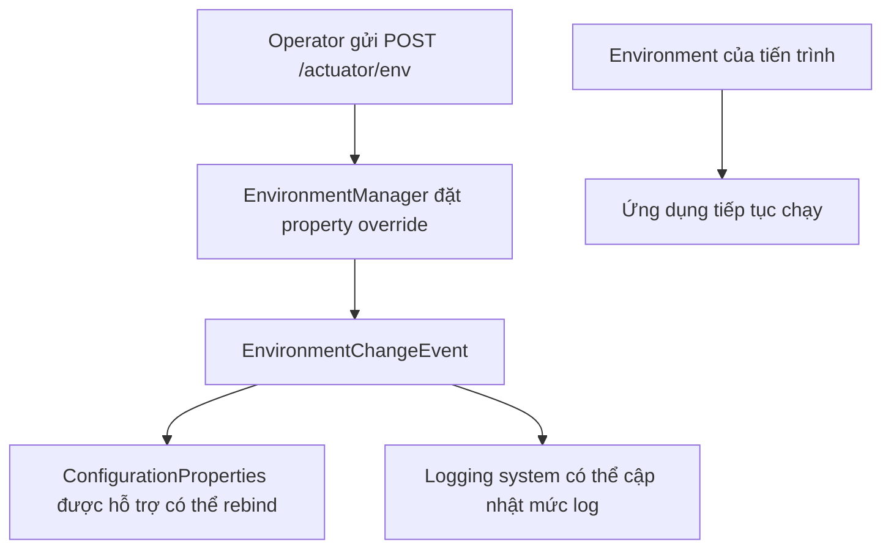
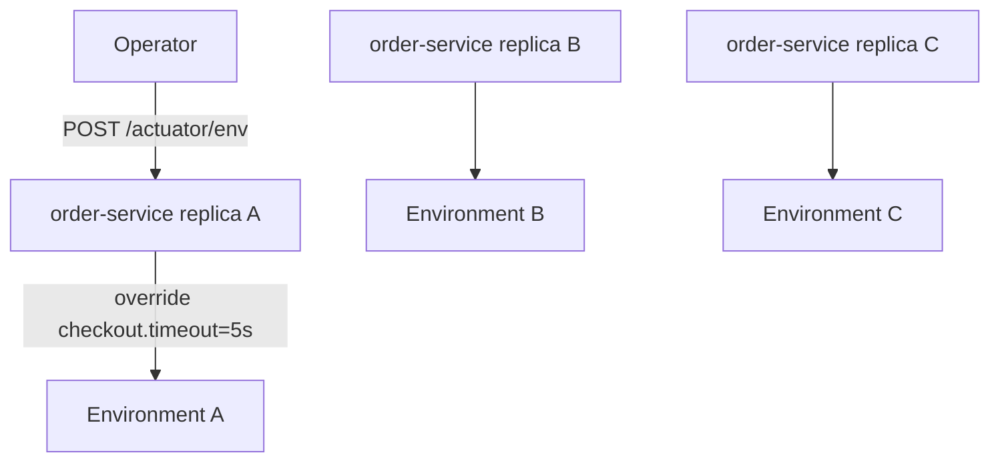

# Phân biệt cập nhật tạm qua Actuator env với thay đổi nguồn bền vững

Spring Boot Actuator có endpoint `env` cho phép người vận hành xem các property source của ứng dụng. Trong Spring Cloud Context, endpoint này còn có thể nhận lệnh POST để thêm một giá trị vào Environment đang chạy. Cách cập nhật này hữu ích khi cần thử nhanh một giá trị hoặc xử lý tình huống khẩn cấp trên một instance.

Tuy nhiên, cập nhật qua `/actuator/env` chỉ thay đổi Environment trong tiến trình đang chạy. Nó không sửa file trong Git, không cập nhật Config Server và không tự phân phối thay đổi tới các replica khác. Muốn thay đổi cấu hình trở thành trạng thái có thể review, tái lập và triển khai lâu dài, cần cập nhật nguồn có thẩm quyền như repository Git hoặc backend cấu hình tương ứng.

## 1. Hai loại thay đổi có vòng đời khác nhau

Hãy phân biệt hai cách thay đổi một thuộc tính `checkout.timeout`:

| Cách thay đổi | Nơi ghi nhận | Phạm vi | Vòng đời |
|---|---|---|---|
| POST `/actuator/env` | Environment của một tiến trình đang chạy | Instance nhận request | Tạm thời; không được lưu vào Git hay Config Server và mất khi tiến trình khởi động lại |
| Sửa Git rồi phân phối qua Config Server | Repository cấu hình có lịch sử | Các client yêu cầu application/profile/label tương ứng | Bền vững theo phiên bản nguồn; có review, audit và rollback |

Actuator env phù hợp với thử nghiệm có kiểm soát hoặc thao tác khẩn cấp trên một instance. Git/Config Server phù hợp với thay đổi chính thức cần đồng bộ giữa các instance và môi trường.

Không nên coi một lần POST thành công là hoàn tất thay đổi cấu hình của hệ thống. Nếu giá trị đó cần tồn tại sau lần restart tiếp theo hoặc cần áp dụng cho toàn bộ dịch vụ, phải cập nhật nguồn có thẩm quyền và triển khai theo quy trình.

## 2. `/actuator/env` POST làm gì?

Trong Spring Cloud Context, thao tác POST trên Environment endpoint có thể đặt một property override vào Environment của ứng dụng đang chạy. Endpoint nhận tên thuộc tính và giá trị mới, sau đó phát `EnvironmentChangeEvent` để các thành phần hỗ trợ có thể phản ứng.

Ví dụ, cần thay đổi timeout từ `2s` sang `5s` trên một instance:

```bash
curl --fail --silent --show-error \
  --request POST \
  --header 'Content-Type: application/json' \
  --data '{"name":"checkout.timeout","value":"5s"}' \
  http://localhost:8080/actuator/env
```

Đây là ví dụ gọi cục bộ trong môi trường được kiểm soát. Khi triển khai thực tế, endpoint cần xác thực, phân quyền và giới hạn mạng. Không gửi request này từ máy cá nhân tới một instance production nếu chưa có quy trình vận hành được phê duyệt.

Tên endpoint có thể thay đổi nếu ứng dụng tùy chỉnh `management.endpoints.web.base-path` hoặc endpoint path. Hãy xác minh đường dẫn thực tế theo cấu hình Actuator của ứng dụng.

### Bật thao tác POST

Với các phiên bản Spring Boot/Spring Cloud hỗ trợ thao tác ghi này, cần bật rõ ràng thuộc tính POST của endpoint `env` và expose endpoint qua web:

```yaml
management:
  endpoint:
    env:
      post:
        enabled: true
  endpoints:
    web:
      exposure:
        include: health,info,env
```

Chỉ expose endpoint `env` khi thực sự cần. Cú pháp và khả năng ghi phụ thuộc phiên bản Spring Boot, Spring Cloud Context và cấu hình Actuator đang dùng; kiểm tra tài liệu đúng release train trước khi triển khai. Việc expose endpoint không tự cấp quyền truy cập: vẫn cần Spring Security hoặc lớp bảo vệ tương đương.

## 3. Điều gì xảy ra sau khi POST?

Ở mức khái niệm, chu trình của một lệnh cập nhật tạm như sau:



Giá trị được đặt vào Environment đang chạy và có thể được các thành phần tra cứu thuộc tính nhìn thấy. Các bean `@ConfigurationProperties` được Spring Cloud Context hỗ trợ có thể được rebind khi nhận sự kiện. Một số thành phần tích hợp, chẳng hạn logging system, cũng có thể phản ứng với thay đổi tương ứng.

Tuy vậy, không phải mọi cách inject thuộc tính đều tự thay đổi:

- Một singleton bình thường đã inject `@Value` vào field khi khởi tạo thường tiếp tục giữ giá trị cũ.
- Bean `@ConfigurationProperties` chỉ cập nhật khi được đăng ký và hỗ trợ rebinding trong phiên bản đang dùng.
- Bean `@RefreshScope` có cơ chế làm mới target thông qua refresh scope; không nên mặc định rằng POST `/env` tương đương toàn bộ thao tác `/refresh`.
- Những thành phần giữ connection, pool hoặc trạng thái nội bộ có thể cần tái tạo riêng hoặc restart.

Vì vậy, sau POST phải kiểm tra giá trị trong Environment và hành vi của bean thật sự sử dụng nó. HTTP 200 chỉ cho biết endpoint xử lý request thành công, không chứng minh mọi thành phần trong ứng dụng đã đổi hành vi.

## 4. Property override và thứ tự ưu tiên

Thao tác POST tạo một giá trị override do tiến trình quản lý. Trong các phiên bản Spring Cloud Context triển khai cơ chế này, override được thêm vào Environment với ưu tiên cao để có thể ghi đè giá trị cùng tên từ nguồn cấu hình thông thường.

Ví dụ, ứng dụng có các giá trị:

| Nguồn | `checkout.timeout` |
|---|---:|
| Git `application.yml` | `2s` |
| Git `order-service-production.yml` | `3s` |
| POST `/actuator/env` trên instance A | `5s` |

Trên instance A, giá trị override runtime có thể thắng các giá trị từ Git. Instance B chưa nhận POST vẫn dùng giá trị do các nguồn cấu hình thông thường cung cấp.

Thứ tự cuối cùng còn phụ thuộc phiên bản, property source khác và cơ chế cấu hình của ứng dụng. Khi cần xác nhận, kiểm tra Environment của chính instance đó bằng endpoint được bảo vệ hoặc một diagnostic an toàn. Không suy luận rằng mọi nguồn khác đều bị ghi đè trong mọi cấu hình.

## 5. Cập nhật tạm chỉ tác động tới instance nhận request

Giả sử `order-service` có ba replica:



Sau request, replica A có thể dùng `5s`; B và C vẫn dùng cấu hình hiện tại của chúng. Load balancer có thể gửi request nghiệp vụ tới bất kỳ replica nào, khiến hành vi quan sát được không nhất quán.

Muốn thử trên nhiều replica, phải gọi đúng endpoint của từng instance qua kênh quản trị an toàn và ghi nhận kết quả từng node. Không nên giả định một request qua load balancer sẽ được phát tới toàn bộ replica. Cũng không nên dùng hàng loạt POST runtime làm quy trình phát hành chính thức, vì các giá trị sẽ không được lưu chung trong nguồn có thẩm quyền.

## 6. Khác biệt với Config Server và Git

Với cấu hình tập trung, thay đổi bền vững thường đi theo luồng:

1. Nhóm sở hữu sửa file cấu hình trong Git.
2. Pull request được review và các kiểm tra tự động chạy.
3. Thay đổi được merge hoặc gắn tag/commit phát hành.
4. Config Server đọc cấu hình theo application, profile và label.
5. Config Client refresh Environment hoặc nhận sự kiện refresh qua Spring Cloud Bus.
6. Bean được rebind hoặc refresh scope được làm mới nếu có hỗ trợ.

Luồng này tạo ra lịch sử thay đổi, khả năng review, promotion và rollback. POST `/actuator/env` bỏ qua các bước quản trị nguồn; nó chỉ tạo một thay đổi tại runtime trên instance được gọi.

| Tiêu chí | POST `/actuator/env` | Git + Config Server |
|---|---|---|
| Mục đích | Điều chỉnh runtime nhanh trên instance | Phân phối cấu hình chính thức |
| Có commit/lịch sử | Không | Có |
| Review/approval | Không tự có | Có thể áp dụng qua Git workflow |
| Phạm vi | Một tiến trình nhận request | Các client dùng cùng nguồn/version theo application/profile/label |
| Tái lập sau restart | Không | Có, nếu giữ phiên bản nguồn và triển khai lại |
| Rollback | POST lại giá trị trước hoặc restart theo quy trình | Revert commit hoặc chọn label đã biết là tốt rồi refresh/restart |
| Phù hợp | Thử nghiệm ngắn hạn, chẩn đoán, ứng phó khẩn cấp | Thay đổi cần quản trị và duy trì lâu dài |

## 7. POST `/env` không phải POST `/refresh`

Hai endpoint thường được nhắc cùng nhau nhưng mục đích khác nhau:

| Endpoint | Tác dụng chính |
|---|---|
| `POST /actuator/env` | Đặt một giá trị runtime override vào Environment của instance hiện tại và phát sự kiện thay đổi môi trường |
| `POST /actuator/refresh` | Nạp lại cấu hình từ các nguồn được hỗ trợ, cập nhật Environment và làm mới các bean thuộc refresh scope theo cơ chế Spring Cloud Context |

POST `/env` không yêu cầu Config Server đọc lại Git. Nó cũng không có nghĩa client đã tải lại toàn bộ remote property sources. POST `/refresh` mới là thao tác refresh các nguồn cấu hình được hỗ trợ; nhưng refresh cũng không biến thay đổi runtime override thành commit Git.

Nếu đã dùng `/env` để thử `checkout.timeout=5s`, sau đó gọi `/refresh`, kết quả cuối có thể phụ thuộc cách phiên bản đang dùng giữ và ưu tiên property source override. Không nên giả định giá trị sẽ luôn được giữ hoặc luôn bị xóa. Hãy kiểm tra Environment sau refresh và thử hành vi trong môi trường kiểm thử trước khi áp dụng quy trình này.

## 8. Khi nào nên dùng cập nhật tạm qua Actuator env?

Một số tình huống phù hợp:

- Thử một giá trị không nhạy cảm trên một instance kiểm thử để xác nhận giả thuyết.
- Điều chỉnh tạm mức log để thu thập thông tin chẩn đoán trong thời gian ngắn.
- Kiểm tra phản ứng của một bean có hỗ trợ rebinding trước khi sửa cấu hình chính thức.
- Ứng phó sự cố có quy trình được phê duyệt, khi cần thay đổi runtime nhanh trong lúc chuẩn bị bản sửa bền vững.

Không nên dùng cho:

- Thay đổi cần áp dụng nhất quán lên toàn bộ replica hoặc nhiều môi trường.
- Cấu hình phải tồn tại sau restart hoặc cần truy vết, phê duyệt.
- Thay đổi profile, `spring.config.import`, cấu trúc Config Data hoặc wiring ứng dụng.
- Credential, password, token hoặc private key.
- Thay đổi có thể gây tác động lớn mà không có kế hoạch rollback và quan sát.

Đặc biệt, không dùng `/actuator/env` để phát tán bí mật. Endpoint có thể đưa giá trị vào Environment và làm nó xuất hiện trong các đường truy cập cấu hình của tiến trình. Bí mật cần được cấp từ Vault hoặc secret manager theo danh tính workload, có policy, audit và rotation.

## 9. Cách quay lại sau một cập nhật tạm

Vì giá trị POST không được ghi vào nguồn bền vững, rollback cần dựa vào giá trị trước đó đã được xác minh hoặc khôi phục tiến trình về trạng thái sạch.

Ví dụ, nếu giá trị ban đầu là `2s` và đã POST thành `5s`, có thể gửi POST lại giá trị cũ:

```bash
curl --fail --silent --show-error \
  --request POST \
  --header 'Content-Type: application/json' \
  --data '{"name":"checkout.timeout","value":"2s"}' \
  http://localhost:8080/actuator/env
```

Đây là một lần cập nhật runtime khác, không xóa lịch sử vì không có lịch sử Git để sửa. Nếu cần loại bỏ hoàn toàn override, cách xử lý phụ thuộc khả năng của phiên bản và endpoint được cung cấp; trong nhiều quy trình vận hành, restart/redeploy instance từ cấu hình chuẩn là cách đưa tiến trình về trạng thái có thể tái lập. Không giả định một thao tác DELETE tồn tại nếu tài liệu phiên bản đang dùng không xác nhận.

Sau khi rollback, xác minh Environment, bean và hành vi nghiệp vụ. Nếu thay đổi tạm đã che giấu một vấn đề cấu hình chính thức, hãy sửa nguồn Git/Config Server để các lần khởi động tiếp theo không tái tạo sự cố.

## 10. Bảo mật endpoint Environment

Endpoint `env` nhạy cảm theo cả hai hướng: GET có thể tiết lộ tên property source và thông tin cấu hình; POST có thể thay đổi hành vi runtime. Vì vậy:

- Chỉ expose endpoint khi có nhu cầu vận hành cụ thể.
- Bật POST write operation tường minh theo phiên bản hỗ trợ.
- Bắt buộc authentication và authorization; chỉ cấp quyền ghi cho nhóm vận hành được chỉ định.
- Giới hạn endpoint trong mạng quản trị hoặc qua gateway/service mesh có kiểm soát.
- Dùng HTTPS và xác minh certificate.
- Bảo vệ CSRF theo mô hình xác thực của ứng dụng; không tắt bảo vệ toàn cục chỉ để làm cho POST hoạt động.
- Ghi audit actor, thời điểm, instance, key được thay đổi, lý do và mã ticket; tránh ghi giá trị nhạy cảm.
- Hạn chế hiển thị giá trị qua GET `/env` và các endpoint Actuator liên quan.
- Không đặt token hoặc password trong URL, shell history hay log.

Nếu một ứng dụng không cần runtime override, giữ POST operation bị tắt và không expose endpoint `env`. Đây là lựa chọn an toàn hơn cho phần lớn dịch vụ production.

## 11. Quy trình vận hành khuyến nghị

Nếu phải dùng runtime override trong sự cố, nên có quy trình rõ:

1. Ghi lại instance, key, giá trị hiện tại đã xác minh và lý do cần thay đổi.
2. Xác định key không nhạy cảm và bean có thể nhận cập nhật an toàn.
3. Phê duyệt thay đổi theo quy trình sự cố; dùng danh tính có quyền tối thiểu.
4. Gửi POST tới đúng instance qua kênh quản trị.
5. Kiểm tra Environment và hành vi ứng dụng; theo dõi metric/log.
6. Đặt thời hạn cho override và người chịu trách nhiệm khôi phục.
7. Tạo thay đổi Git chính thức nếu giá trị mới cần duy trì.
8. Triển khai label đã review, refresh/restart theo kế hoạch và xác minh mọi replica.
9. Khôi phục hoặc restart instance đã thử nghiệm để loại bỏ sai khác runtime còn sót.
10. Đóng sự cố với bằng chứng thay đổi, kết quả và trạng thái nguồn bền vững.

Không để một runtime override trở thành “cấu hình bí mật” chỉ tồn tại trên một replica mà không ai biết. Sai khác này rất khó điều tra khi traffic được cân bằng giữa các instance.

## 12. Lỗi thường gặp

| Hiện tượng | Nguyên nhân thường gặp | Cách xử lý |
|---|---|---|
| POST `/actuator/env` trả 404 | Endpoint chưa có, sai base path hoặc chưa expose | Kiểm tra Actuator mapping và web exposure |
| POST trả 405 hoặc operation không được hỗ trợ | POST write operation chưa bật hoặc phiên bản không hỗ trợ | Kiểm tra `management.endpoint.env.post.enabled` và tài liệu phiên bản |
| POST trả 401/403 | Thiếu xác thực hoặc không có quyền ghi | Kiểm tra security policy và danh tính vận hành |
| Environment có giá trị mới nhưng bean vẫn cũ | Singleton `@Value` không tự được inject lại hoặc bean không hỗ trợ rebinding | Kiểm tra loại bean, `@ConfigurationProperties`, refresh scope hoặc restart |
| Một replica có giá trị khác các replica còn lại | POST chỉ được gửi tới một tiến trình | Kiểm tra từng instance và cập nhật nguồn bền vững nếu cần đồng bộ |
| Giá trị tạm biến mất sau restart | Runtime override không được lưu vào nguồn cấu hình | Commit thay đổi vào Git hoặc backend có thẩm quyền |
| Giá trị thay đổi sau khi gọi `/refresh` | Tương tác giữa runtime override và property sources được nạp lại | Kiểm tra precedence thực tế trên đúng phiên bản và không dựa vào hành vi chưa xác minh |
| Không thể quay về giá trị mặc định | Chưa ghi nhận giá trị cũ hoặc không có thao tác xóa override được hỗ trợ | POST giá trị cũ đã xác minh hoặc restart/redeploy từ cấu hình chuẩn |

## 13. Ví dụ so sánh hai quy trình

**Thử nghiệm tạm trên một instance:**

```text
POST /actuator/env
{"name":"checkout.timeout","value":"5s"}
```

Sau đó kiểm tra Environment và hành vi của bean trên chính instance nhận request. Các replica khác không được giả định đã thay đổi.

**Thay đổi bền vững cho toàn dịch vụ:**

```yaml
# order-service-production.yml trong Git
checkout:
  timeout: 5s
```

Tạo pull request, review, merge và phát hành label. Config Server phục vụ phiên bản đó; các client dùng đúng application/profile/label sẽ lấy cấu hình mới khi khởi động hoặc refresh. Dùng Spring Cloud Bus hoặc workflow quản trị để thông báo refresh tới nhiều instance nếu thay đổi có thể áp dụng nóng.

Hai cách có thể xuất hiện trong cùng một quy trình sự cố: runtime override để thử giả thuyết trước, sau đó commit giá trị đã xác nhận vào Git và loại bỏ sai khác tạm bằng refresh/restart có kiểm soát.

## 14. Checklist trước khi dùng POST `/actuator/env`

- [ ] Phiên bản Spring Boot/Spring Cloud hỗ trợ write operation của Environment endpoint.
- [ ] POST operation được bật có chủ đích và endpoint chỉ được expose trong phạm vi cần thiết.
- [ ] Danh tính gọi có quyền ghi phù hợp; request đi qua HTTPS/kênh quản trị.
- [ ] Key không phải password, token, private key hoặc dữ liệu nhạy cảm.
- [ ] Đã ghi nhận giá trị hiện tại, instance đích, lý do và thời hạn override.
- [ ] Bean sử dụng thuộc tính có cơ chế cập nhật phù hợp.
- [ ] Đã kiểm tra hành vi thực tế, không chỉ dựa vào HTTP status.
- [ ] Có cách khôi phục giá trị cũ hoặc restart/redeploy instance.
- [ ] Nếu thay đổi cần duy trì, đã tạo thay đổi trong Git/nguồn bền vững.
- [ ] Các replica đã được kiểm tra để tránh sai khác runtime kéo dài.

## 15. Mục tiêu cần đạt sau bài học

Sau bài này, người học cần có khả năng:

- Giải thích được POST `/actuator/env` thay đổi Environment runtime của tiến trình nhận request.
- Phân biệt runtime override với thay đổi Git/Config Server có lịch sử và khả năng tái lập.
- Mô tả được `EnvironmentChangeEvent` và các thành phần có thể phản ứng với sự kiện.
- Giải thích vì sao POST trên một replica không tự cập nhật các replica khác.
- Phân biệt `/actuator/env` với `/actuator/refresh`.
- Nhận diện bean có thể rebind và trường hợp singleton `@Value` vẫn giữ giá trị cũ.
- Bảo vệ endpoint ghi cấu hình và tránh dùng nó để phân phối bí mật.
- Lập kế hoạch rollback và chuyển một thay đổi tạm thành thay đổi bền vững.

**Tự kiểm tra:** Một operator POST `checkout.timeout=5s` lên replica A của `order-service`, sau đó restart replica A và thấy timeout quay lại `2s`; replica B chưa từng thay đổi. Hãy giải thích vì sao hành vi này đúng với runtime override, cách xác minh bean đã nhận giá trị tạm và các bước cần làm để đưa `5s` thành cấu hình chính thức cho toàn bộ dịch vụ.
