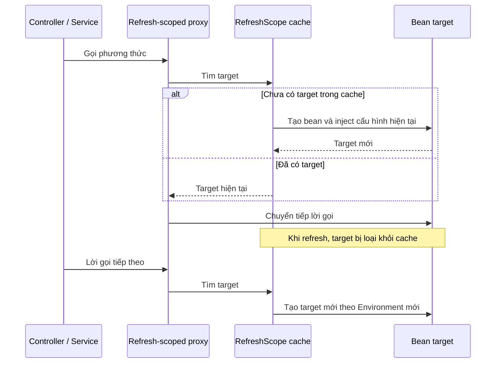

# `@RefreshScope`, scoped proxy và khởi tạo bean theo nhu cầu

Trong Spring Cloud Config, refresh có thể cập nhật `Environment` của một ứng dụng đang chạy. Tuy nhiên, một bean singleton thông thường không tự chạy lại constructor hoặc inject lại các field `@Value` chỉ vì property đã thay đổi. `@RefreshScope` giải quyết trường hợp này bằng cách đặt bean vào một scope có thể làm mới: ứng dụng giữ một proxy, còn đối tượng thực (target) được tạo khi cần và có thể bị loại khỏi cache để tạo lại với cấu hình mới.

Điểm cần hiểu là `@RefreshScope` không sửa trực tiếp mọi field của một object đang tồn tại. Nó quản lý vòng đời target phía sau proxy. Sau khi scope được làm mới, lần gọi tiếp theo qua proxy sẽ tạo target mới; vì vậy thiết kế cách các bean giữ tham chiếu và trạng thái có ý nghĩa quyết định.

## 1. Vấn đề của singleton khi cấu hình thay đổi

Giả sử một controller inject giá trị từ cấu hình:

```java
@RestController
public class GreetingController {

    @Value("${welcome.message:Hello}")
    private String message;

    @GetMapping("/welcome")
    public String welcome() {
        return message;
    }
}
```

Controller mặc định là singleton. Spring tạo bean một lần khi khởi tạo application context và gán `message` theo giá trị lúc đó. Nếu Config Client refresh `Environment`, field `message` trong object đã tạo không tự được gán lại. Request tiếp theo vẫn có thể đọc giá trị cũ.

Có thể cần tạo lại bean khi giá trị cấu hình thay đổi. `@RefreshScope` cho phép Spring thay target của bean theo yêu cầu mà không phải khởi động lại toàn bộ application context.

## 2. `@RefreshScope` hoạt động như thế nào?

`@RefreshScope` là một scope của Spring Cloud Context, được triển khai bằng scoped proxy. Có thể hình dung vòng đời như sau:



Các bước chính:

1. Spring đăng ký bean trong refresh scope và cung cấp một proxy cho các nơi inject bean đó.
2. Khi proxy được gọi lần đầu, scope kiểm tra cache target.
3. Nếu chưa có target, Spring tạo target thật, inject các dependency và property hiện tại rồi lưu target vào cache.
4. Khi refresh scope được làm mới, target đang cache bị đánh dấu để hủy và loại khỏi cache; proxy vẫn tồn tại.
5. Lần gọi tiếp theo qua proxy tạo target mới bằng cấu hình hiện tại.

Proxy thường được tạo sớm trong lúc khởi tạo context, nhưng target thật được tạo theo nhu cầu. Đây là lý do `@RefreshScope` vừa hỗ trợ thay target khi refresh, vừa có hành vi khởi tạo lười (lazy target initialization).

## 3. Khai báo bean bằng `@RefreshScope`

Có thể đặt annotation trực tiếp trên component:

```java
import org.springframework.beans.factory.annotation.Value;
import org.springframework.cloud.context.config.annotation.RefreshScope;
import org.springframework.stereotype.Service;

@Service
@RefreshScope
public class GreetingService {

    @Value("${welcome.message:Hello}")
    private String message;

    public String message() {
        return message;
    }
}
```

Controller inject service như một dependency thông thường:

```java
import org.springframework.web.bind.annotation.GetMapping;
import org.springframework.web.bind.annotation.RestController;

@RestController
public class GreetingController {

    private final GreetingService greetingService;

    public GreetingController(GreetingService greetingService) {
        this.greetingService = greetingService;
    }

    @GetMapping("/welcome")
    public String welcome() {
        return greetingService.message();
    }
}
```

Controller có thể vẫn là singleton. Nó giữ proxy được inject cho `GreetingService`; mỗi lần gọi `message()` sẽ được proxy chuyển đến target hiện tại. Khi target bị làm mới, controller không cần inject lại dependency.

### 3.1. Dùng `@Bean` trong lớp cấu hình

Nếu bean được tạo từ phương thức `@Bean`, đặt `@RefreshScope` trên phương thức tạo bean:

```java
import org.springframework.beans.factory.annotation.Value;
import org.springframework.cloud.context.config.annotation.RefreshScope;
import org.springframework.context.annotation.Bean;
import org.springframework.context.annotation.Configuration;

@Configuration
public class GreetingConfiguration {

    @Bean
    @RefreshScope
    GreetingFormatter greetingFormatter(
            @Value("${welcome.prefix:Hello}") String prefix) {
        return new GreetingFormatter(prefix);
    }
}
```

Đặt `@RefreshScope` trên lớp `@Configuration` không đồng nghĩa mọi bean do các phương thức `@Bean` trong lớp đó khai báo đều tự động thuộc refresh scope. Nếu muốn làm mới một bean cụ thể, hãy đánh dấu bean đó một cách tường minh và kiểm tra proxy được inject vào consumer.

## 4. Proxy giúp singleton consumer nhận target mới

Một singleton có thể inject refresh-scoped bean mà không cần tự biết khi nào cấu hình thay đổi:

```java
@Service
public class NotificationService {

    private final GreetingService greetingService;

    public NotificationService(GreetingService greetingService) {
        this.greetingService = greetingService;
    }

    public String buildMessage() {
        return greetingService.message();
    }
}
```

`NotificationService` giữ proxy, không giữ target thật. Khi gọi `greetingService.message()`, proxy tìm target hiện hành. Sau refresh, lần gọi mới có thể đến target được tạo bằng giá trị mới.

Điều quan trọng là consumer phải gọi qua proxy khi cần đọc giá trị mới. Nếu consumer lấy giá trị từ target một lần rồi lưu thành field riêng, proxy không thể cập nhật bản sao đó:

```java
// Ví dụ thiết kế dễ giữ giá trị cũ
@Service
public class NotificationService {

    private final String startupMessage;

    public NotificationService(GreetingService greetingService) {
        this.startupMessage = greetingService.message();
    }

    public String buildMessage() {
        return startupMessage;
    }
}
```

Ở ví dụ này, constructor gọi proxy để lấy message rồi lưu chuỗi vào `startupMessage`. Sau đó service không gọi proxy nữa, nên giá trị đã sao chép vẫn cũ. Hãy giữ proxy và truy cập giá trị tại thời điểm cần dùng, hoặc thiết kế một API cấu hình lại cho consumer.

## 5. Kết hợp với Config Client và endpoint refresh

Một ứng dụng Config Client có thể nạp cấu hình từ Config Server qua Config Data API:

```yaml
spring:
  application:
    name: notification-service
  config:
    import: "configserver:http://config-server:8888"
  profiles:
    active: prod
  cloud:
    config:
      label: main

management:
  endpoints:
    web:
      exposure:
        include: health,refresh
```

Sau khi thay đổi cấu hình trong backend và xác nhận Config Server đã trả về giá trị mới, gửi POST đến client:

```bash
curl -i -X POST "http://localhost:8080/actuator/refresh"
```

Endpoint refresh làm mới `Environment` và refresh scope. Response thường là danh sách key đã thay đổi, ví dụ:

```json
[
  "welcome.message"
]
```

Sau đó gọi endpoint nghiệp vụ:

```bash
curl "http://localhost:8080/welcome"
```

Nếu `GreetingService` thuộc refresh scope và consumer gọi qua proxy, lần gọi tiếp theo có thể tạo target mới với `welcome.message` mới. Danh sách key trong response không phải danh sách bean được tạo lại; cần kiểm tra hành vi endpoint để xác nhận target đã nhận giá trị mong muốn.

Endpoint `/actuator/refresh` chỉ tác động instance nhận request. Với nhiều replica, cần refresh từng instance hoặc dùng Spring Cloud Bus. Bảo vệ endpoint bằng xác thực, phân quyền, HTTPS và giới hạn mạng quản trị; không expose endpoint quản trị công khai.

## 6. `@RefreshScope` và `@ConfigurationProperties`

`@ConfigurationProperties` gom nhiều property có liên quan thành một object có kiểu dữ liệu. Spring Cloud Context hỗ trợ rebind các bean cấu hình được quản lý phù hợp khi Environment thay đổi. Ví dụ:

```java
import java.time.Duration;

import org.springframework.boot.context.properties.ConfigurationProperties;

@ConfigurationProperties(prefix = "notification")
public class NotificationProperties {

    private String senderName;
    private Duration timeout;

    public String getSenderName() {
        return senderName;
    }

    public void setSenderName(String senderName) {
        this.senderName = senderName;
    }

    public Duration getTimeout() {
        return timeout;
    }

    public void setTimeout(Duration timeout) {
        this.timeout = timeout;
    }
}
```

Với bean mutable được quản lý và hỗ trợ rebind, các thuộc tính có thể nhận giá trị mới mà không cần tạo lại toàn bộ bean. Nếu muốn hủy và tạo lại cả bean, có thể kết hợp `@RefreshScope`:

```java
@Component
@RefreshScope
@ConfigurationProperties(prefix = "notification")
public class NotificationProperties {
    // getters và setters
}
```

Chọn cơ chế theo yêu cầu:

| Nhu cầu | Cách tiếp cận |
|---|---|
| Cập nhật các trường của bean cấu hình mutable qua rebind | `@ConfigurationProperties` được quản lý phù hợp |
| Cần tạo lại toàn bộ bean và các dependency được khởi tạo cùng nó | `@RefreshScope` |
| Bean thường giữ giá trị `@Value` đã inject và cần đọc lại sau refresh | Đặt bean trong `@RefreshScope` hoặc chuyển sang cơ chế cấu hình có thể rebind |
| Tài nguyên có API cập nhật riêng | Gọi API reconfigure phù hợp và quản lý vòng đời tài nguyên |

Với record immutable hoặc constructor-bound properties, không giả định rebind sẽ thay đổi object hiện tại. Kiểm tra hành vi của phiên bản Spring Boot/Spring Cloud đang dùng và cân nhắc refresh scope nếu cần tạo lại object.

## 7. Khởi tạo lười (lazy target initialization)

Refresh scope thường tạo proxy khi application context khởi tạo nhưng trì hoãn việc tạo target đến lần truy cập đầu tiên. Điều này có một số hệ quả:

- Bean chưa được dùng có thể chưa chạy constructor hoặc chưa mở tài nguyên.
- Lỗi trong quá trình tạo target có thể xuất hiện ở request đầu tiên thay vì thời điểm startup.
- Sau refresh, target mới cũng thường được tạo ở lần gọi tiếp theo.
- Nếu constructor của bean thực hiện kết nối tới dịch vụ ngoài, request đầu tiên sau refresh có thể chịu thêm độ trễ hoặc gặp lỗi kết nối.

Ví dụ một client gọi dịch vụ bên ngoài trong constructor:

```java
import org.springframework.beans.factory.annotation.Value;
import org.springframework.cloud.context.config.annotation.RefreshScope;
import org.springframework.stereotype.Component;
import org.springframework.web.reactive.function.client.WebClient;
import reactor.core.publisher.Mono;

@Component
@RefreshScope
public class PartnerClient {

    private final WebClient webClient;

    public PartnerClient(
            WebClient.Builder builder,
            @Value("${partner.base-url}") String baseUrl) {
        this.webClient = builder.baseUrl(baseUrl).build();
    }

    public Mono<String> status() {
        return webClient.get()
                .uri("/status")
                .retrieve()
                .bodyToMono(String.class);
    }
}
```

Sau refresh, target mới được tạo khi proxy được gọi tiếp. Nếu việc tạo client có chi phí cao hoặc có thể thất bại, hãy cân nhắc kiểm tra cấu hình trước khi publish, warm-up có kiểm soát hoặc triển khai restart theo rolling strategy thay vì để request nghiệp vụ đầu tiên chịu toàn bộ chi phí.

## 8. Khi nào nên dùng `@RefreshScope`?

Annotation phù hợp với bean có thể tạo lại an toàn và cần đọc cấu hình mới khi ứng dụng đang chạy, ví dụ:

- Formatter hoặc template service có nội dung thay đổi theo cấu hình.
- Client tích hợp đối tác có thể tạo lại từ base URL, timeout hoặc header mới.
- Bean điều phối feature flag hoặc chính sách nghiệp vụ được thiết kế để thay đổi nóng.
- Thành phần có cấu hình được inject một lần và không có cơ chế rebind trường riêng.

Không nên dùng cho mọi bean. Việc hủy và tạo target mới có thể gây tác dụng phụ:

- Mất cache, counter, session hoặc trạng thái nội bộ của target cũ.
- Đóng kết nối hoặc tài nguyên khi target cũ bị hủy.
- Mở lại pool/client và tạo tải đột biến lên hệ thống phụ thuộc.
- Request đầu tiên sau refresh có thể chịu độ trễ khởi tạo.
- Một consumer giữ bản sao giá trị từ target cũ vẫn tiếp tục dùng dữ liệu cũ.

Tránh đặt state nghiệp vụ lâu dài trong refresh-scoped bean. Dữ liệu như trạng thái đơn hàng, tiến trình xử lý hoặc bộ đếm cần tồn tại qua refresh nên được lưu ở nơi có vòng đời riêng, chẳng hạn database hoặc cache chuyên dụng.

## 9. Giới hạn proxy và thiết kế bean

Vì Spring cần proxy để chuyển lời gọi đến target hiện hành, kiểu proxy và cấu trúc class ảnh hưởng đến cách dùng:

- Class hoặc method `final` có thể không phù hợp với class-based proxy vì không thể override để chặn lời gọi.
- Constructor và các phương thức khởi tạo không nên giả định target đã tồn tại trước khi proxy được gọi.
- Self-invocation (một method trong target gọi trực tiếp method khác trên `this`) không đi qua proxy; không nên dựa vào proxy để áp dụng hành vi scope cho lời gọi nội bộ đó.
- Nếu dùng interface-based proxy, nơi inject cần tương thích với interface mà proxy cung cấp.
- Không giữ target thật hoặc object state cũ ở nơi khác nếu mong muốn mọi lần truy cập đều đi qua proxy.

Thiết kế bean theo interface khi phù hợp, tránh `final` trên class/method cần proxy và kiểm tra kiểu proxy được tạo bởi cấu hình Spring. Đừng dùng reflection hoặc cơ chế lấy target nội bộ để giữ tham chiếu lâu dài vì điều đó phá vỡ lợi ích của scoped proxy.

## 10. Refresh target và xử lý đồng thời

Khi scope được refresh, target cũ bị loại khỏi cache và Spring thực hiện hủy target theo callback vòng đời đã đăng ký. Các request đang thực thi có thể đã giữ tham chiếu tới target cũ; chúng có thể hoàn tất theo vòng đời của lời gọi hiện tại. Những lần gọi sau sẽ lấy target mới. Không nên giả định mọi request đang chạy sẽ chuyển sang target mới ngay lập tức hoặc toàn bộ ứng dụng đổi cấu hình trong một thao tác nguyên tử.

Nếu nhiều request đầu tiên cùng đến ngay sau refresh, scope/proxy quản lý việc lấy target, nhưng constructor của bean vẫn cần an toàn khi khởi tạo. Hãy tránh constructor có side effect không thể lặp lại hoặc tạo tài nguyên mà không có cleanup rõ ràng.

Nếu bean quản lý thread, scheduler, listener hoặc connection pool, cần bảo đảm destruction callback dừng tài nguyên cũ đúng cách trước hoặc trong quá trình chuyển đổi. Với tài nguyên quan trọng, API reconfigure chuyên biệt hoặc rolling restart thường dễ dự đoán hơn việc hủy và tạo lại bean tùy ý.

## 11. Kiểm tra và chẩn đoán

Khi một bean không nhận giá trị mới, kiểm tra theo thứ tự:

1. Config Server có trả về giá trị mới cho đúng application/profile/label không?
2. Client đã refresh Environment và response có liệt kê key mong đợi không?
3. Bean cần cập nhật đã được đánh dấu `@RefreshScope` hoặc có cơ chế rebind phù hợp chưa?
4. Consumer có đang gọi qua proxy hay đã lưu một bản sao giá trị cũ?
5. Target mới đã được tạo chưa? Có lỗi trong constructor hoặc khi mở tài nguyên không?
6. Bean có giữ state nội bộ hoặc phụ thuộc nào không được tạo lại không?
7. Các instance khác đã được refresh chưa?

Có thể thêm log an toàn trong constructor để quan sát mỗi lần target được tạo:

```java
import org.springframework.beans.factory.annotation.Value;
import org.springframework.cloud.context.config.annotation.RefreshScope;
import org.slf4j.Logger;
import org.slf4j.LoggerFactory;
import org.springframework.stereotype.Service;

@Service
@RefreshScope
public class GreetingService {

    private static final Logger log = LoggerFactory.getLogger(GreetingService.class);
    private final String message;

    public GreetingService(@Value("${welcome.message:Hello}") String message) {
        this.message = message;
        log.info("GreetingService target initialized");
    }

    public String message() {
        return message;
    }
}
```

Chỉ log sự kiện khởi tạo hoặc phiên bản cấu hình không nhạy cảm. Không log token, password, private key hay toàn bộ Environment.

| Hiện tượng | Nguyên nhân có thể có | Cách kiểm tra |
|---|---|---|
| Environment đã đổi nhưng bean vẫn dùng giá trị cũ | Bean không thuộc refresh scope/rebind hoặc consumer giữ snapshot | Kiểm tra annotation, binding và cách consumer gọi dependency |
| Target chỉ khởi tạo ở request đầu tiên | Lazy target initialization | Kiểm tra log constructor và lần truy cập đầu |
| Request đầu tiên sau refresh bị chậm | Target mới phải tạo client hoặc tài nguyên | Đo thời gian khởi tạo, cân nhắc warm-up hoặc reconfigure |
| Refresh làm mất trạng thái | State nằm trong target bị hủy | Chuyển state sang bean có vòng đời phù hợp hoặc kho lưu trữ ngoài |
| Class không proxy được | Class/method final hoặc kiểu inject không tương thích proxy | Kiểm tra proxy mode và thiết kế class/interface |
| Một replica đổi, replica khác không đổi | Refresh chỉ được gửi tới một instance | Refresh từng replica hoặc dùng Spring Cloud Bus |

## 12. Quy trình áp dụng `@RefreshScope`

Trước khi đưa bean vào refresh scope, hãy xác định rõ property nào cần cập nhật và thành phần nào tiêu thụ nó:

1. Xác định key cấu hình và giá trị mới dự kiến.
2. Xác định bean đọc key, các dependency và tài nguyên mà bean tạo ra.
3. Đánh giá việc tạo lại bean có an toàn không; xác định state nào cần giữ bên ngoài target.
4. Đánh dấu bean hoặc phương thức `@Bean` cần refresh, kiểm tra proxy được inject vào consumer.
5. Cập nhật cấu hình từ xa và xác nhận Config Server trả giá trị mới.
6. Gọi refresh trên client được bảo vệ.
7. Gọi chức năng qua proxy để target mới được tạo; kiểm tra giá trị và hành vi.
8. Lặp lại kiểm tra trên các instance khác hoặc dùng Bus nếu triển khai phân phối sự kiện.
9. Theo dõi lỗi khởi tạo, độ trễ request đầu tiên và tài nguyên cũ được giải phóng.

`@RefreshScope` hữu ích khi một bean có thể được tạo lại an toàn và consumer có thể tiếp tục gọi qua scoped proxy. Proxy giữ điểm tham chiếu ổn định, còn target được tạo lười và thay mới sau refresh. Hiểu rõ cache target, trạng thái bean và vòng đời tài nguyên giúp cập nhật cấu hình linh hoạt mà không tạo ra lỗi do bean cũ, state bị mất hoặc khởi tạo lại ngoài dự kiến.
