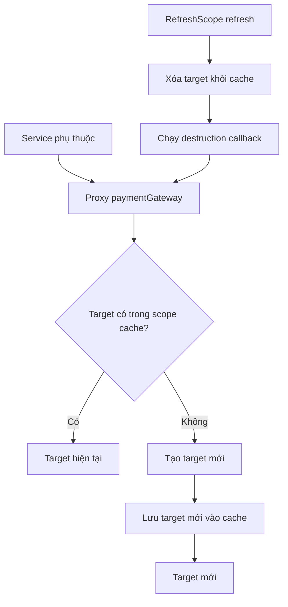
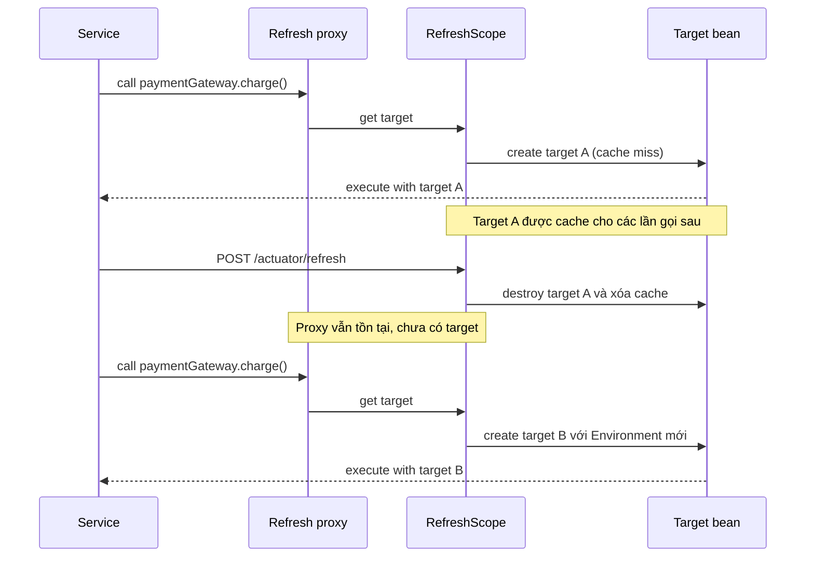

# Làm mất hiệu lực bộ đệm scope và thời điểm tạo lại bean

## 1. RefreshScope giải quyết vấn đề gì?

Khi Config Client nạp cấu hình từ Spring Cloud Config Server, một số giá trị có thể thay đổi trong lúc ứng dụng đang chạy. Tuy nhiên, nhiều bean Spring chỉ được khởi tạo một lần khi ApplicationContext tạo singleton. Nếu một bean đọc thuộc tính ở constructor hoặc lúc khởi tạo, việc cập nhật `Environment` chưa chắc làm đối tượng đang tồn tại tự thay đổi.

Spring Cloud Context cung cấp `@RefreshScope` để quản lý vòng đời của những bean cần được tạo lại sau khi cấu hình thay đổi. Bean được đưa vào một scope có proxy. Proxy được giữ ổn định trong các đối tượng phụ thuộc, còn đối tượng đích (target) được tạo và lưu trong bộ đệm của scope.

Khi scope được refresh, Spring làm mất hiệu lực target đang được lưu. Target cũ được hủy theo callback vòng đời; target mới thường chỉ được tạo khi có lời gọi tiếp theo đi qua proxy. Vì vậy, refresh scope gồm hai thời điểm khác nhau:

1. **Invalidate**: xóa target cũ khỏi bộ đệm và thực hiện callback hủy.
2. **Recreate**: tạo target mới khi proxy cần target đó ở lần truy cập tiếp theo.

RefreshScope không tự động thay đổi mọi đối tượng trong ứng dụng. Nó chỉ quản lý bean được khai báo trong scope này và những lời gọi đi qua proxy tương ứng.

## 2. Proxy và target được lưu như thế nào?

Giả sử ứng dụng có bean `paymentGateway` được đánh dấu `@RefreshScope`.

- Các bean khác được inject một proxy đại diện cho `paymentGateway`.
- Khi một phương thức được gọi trên proxy, proxy tìm target hiện tại trong RefreshScope.
- Nếu target đã tồn tại trong bộ đệm, scope dùng lại target đó.
- Nếu chưa có target, scope tạo một instance mới, lưu lại và chuyển lời gọi đến instance mới.
- Khi scope bị refresh, target được loại khỏi bộ đệm. Proxy vẫn tồn tại và vẫn được inject ở các nơi đang sử dụng bean.



Proxy là đối tượng được giữ lại; target là đối tượng có vòng đời được scope quản lý. Phân biệt hai đối tượng này giúp giải thích vì sao service đã inject bean từ trước vẫn có thể dùng target mới sau refresh.

## 3. Vòng đời từ lần truy cập đầu đến lần refresh

Vòng đời điển hình của một refresh-scoped bean:

1. Spring tạo proxy cho bean trong quá trình khởi tạo ApplicationContext.
2. Khi có lời gọi đầu tiên qua proxy, RefreshScope chưa có target trong cache nên tạo target.
3. Target được khởi tạo với các property hiện hành; các callback như `@PostConstruct` được thực hiện cho instance này.
4. Những lời gọi tiếp theo qua proxy dùng lại cùng target.
5. Khi refresh scope, target được gỡ khỏi cache và callback hủy như `@PreDestroy` hoặc `DisposableBean.destroy()` được gọi nếu bean hỗ trợ.
6. Proxy tiếp tục tồn tại nhưng hiện chưa có target.
7. Lời gọi tiếp theo qua proxy tạo target mới với cấu hình hiện hành; target mới được lưu vào cache.

Điểm quan trọng: bước 5 không đồng nghĩa bước 7 xảy ra ngay lập tức. Việc tạo lại thường là lazy, tức chỉ diễn ra khi bean được dùng lại.

## 4. Khai báo một bean với @RefreshScope

Có thể đánh dấu một component:

```java
@Component
@RefreshScope
public class PaymentGatewaySettings {
    @Value("${payment.timeout:5s}")
    private Duration timeout;

    @Value("${payment.endpoint:https://sandbox.example.internal}")
    private String endpoint;

    public Duration timeout() {
        return timeout;
    }

    public String endpoint() {
        return endpoint;
    }
}
```

Hoặc đánh dấu một bean được khai báo bằng `@Bean`:

```java
@Configuration
public class PaymentClientConfiguration {
    @Bean
    @RefreshScope
    public PaymentGateway paymentGateway(PaymentGatewaySettings settings) {
        return new PaymentGateway(
                settings.endpoint(),
                settings.timeout());
    }
}
```

Khi `paymentGateway` được inject vào một service, service nhận proxy scope. Sau khi target bị invalidate, lần gọi tiếp theo sẽ tạo một `PaymentGateway` mới với endpoint và timeout hiện tại.

Nếu dùng `@RefreshScope` trên một lớp `@Configuration`, không nên hiểu rằng tất cả các `@Bean` method bên trong tự động trở thành refresh-scoped. Hãy đánh dấu rõ từng bean cần scope hoặc thiết kế lớp cấu hình riêng để phạm vi vòng đời dễ hiểu.

## 5. Làm mất hiệu lực cache qua endpoint refresh

Với Spring Boot Actuator và Spring Cloud Context, endpoint refresh thường được expose như sau:

```yaml
management:
  endpoints:
    web:
      exposure:
        include: health,info,refresh
```

Sau khi Config Server đã có cấu hình mới, gọi endpoint trên **Config Client**:

```bash
curl -X POST http://payment-service:8080/actuator/refresh
```

Quy trình refresh của client thường gồm:

1. Lấy lại các property source từ nguồn cấu hình đã khai báo.
2. Cập nhật `Environment` với các giá trị mới.
3. Rebind các bean cấu hình được Spring Cloud quản lý theo cơ chế tương ứng.
4. Làm mới RefreshScope, loại bỏ các target hiện đang được cache.
5. Trả kết quả refresh cho người gọi.

Endpoint có thể trả về danh sách khóa thay đổi. Điều đó cho biết quá trình refresh đã phát hiện thay đổi trong Environment; nó không chứng minh mọi target mới đã được tạo thành công, vì việc tạo target có thể chỉ xảy ra khi có lời gọi sau đó.

Nếu Config Server vẫn trả giá trị cũ, refresh client chỉ nạp lại giá trị cũ. Hãy kiểm tra Git fetch/cache và endpoint server trước khi gọi refresh.

## 6. Invalidate toàn bộ scope hay chỉ một bean?

RefreshScope hỗ trợ làm mới toàn bộ các target đang được quản lý hoặc làm mới một bean cụ thể.

| Cách làm | Tác động | Khi phù hợp |
|---|---|---|
| `POST /actuator/refresh` | Làm mới Environment và invalidates các target trong RefreshScope của client. | Thay đổi cấu hình có thể ảnh hưởng nhiều bean. |
| `RefreshScope.refreshAll()` | Xóa toàn bộ target đang cache trong scope. | Mã quản trị nội bộ cần chủ động invalidate toàn scope. |
| `RefreshScope.refresh("beanName")` | Invalidate target có tên bean tương ứng nếu đang tồn tại. | Chỉ một bean cần tạo lại và hệ thống có cơ chế quản trị riêng. |

Ví dụ gọi API của RefreshScope từ một thành phần quản trị nội bộ:

```java
@Component
public class ScopedBeanRefresher {
    private final RefreshScope refreshScope;

    public ScopedBeanRefresher(RefreshScope refreshScope) {
        this.refreshScope = refreshScope;
    }

    public boolean refreshPaymentGateway() {
        return refreshScope.refresh("paymentGateway");
    }
}
```

Tên truyền vào `refresh(...)` là bean name trong Spring container, thường là tên phương thức `@Bean` nếu không chỉ định tên khác. Cần xác minh đúng tên và chỉ dùng thao tác làm mới riêng lẻ khi đã hiểu các dependency liên quan.

Không nhầm `RefreshScope.refreshAll()` với việc xóa cache nghiệp vụ, cache HTTP, Redis hoặc cache của thư viện bên thứ ba. Nó chỉ invalidates target thuộc RefreshScope.

## 7. Khi nào target mới được tạo?

Đây là điểm quan trọng nhất của RefreshScope.

Giả sử `paymentGateway` đã có target trong cache. Sau `POST /actuator/refresh`:

- Target cũ bị loại khỏi cache.
- Callback hủy target cũ được gọi.
- Proxy vẫn được giữ lại.
- Nếu chưa có lời gọi mới, target mới chưa cần được tạo.
- Khi service gọi phương thức qua proxy lần tiếp theo, scope mới tạo target và cache instance đó.

Ví dụ trình tự thời gian:



Nếu bean chưa từng được sử dụng trước refresh, scope chưa có target cũ để hủy. Lần truy cập đầu tiên sau đó sẽ tạo target với cấu hình mới nhất.

Vì tạo target là lazy, một lỗi trong constructor hoặc `@PostConstruct` có thể chỉ xuất hiện ở lần gọi tiếp theo sau refresh. Endpoint refresh có thể đã hoàn tất nhưng request nghiệp vụ sau đó lại thất bại vì không tạo được target mới. Cần giám sát cả kết quả refresh lẫn lần khởi tạo target tiếp theo.

## 8. Callback hủy và tài nguyên do bean sở hữu

Khi target bị invalidate, scope gọi callback hủy mà Spring đã đăng ký cho bean. Có thể dùng `@PreDestroy`, `DisposableBean` hoặc cơ chế destroy method của `@Bean` để giải phóng tài nguyên.

Ví dụ:

```java
@Component
@RefreshScope
public class PartnerConnection implements AutoCloseable {
    private final PartnerClient client;

    public PartnerConnection(PartnerSettings settings) {
        this.client = new PartnerClient(
                settings.baseUrl(),
                settings.timeout());
    }

    public PartnerResponse call(PartnerRequest request) {
        return client.send(request);
    }

    @Override
    public void close() {
        client.close();
    }
}
```

Nếu Spring nhận diện `close()` là destroy method của bean, method này được gọi khi target bị hủy. Với `@Bean`, có thể khai báo `destroyMethod` rõ ràng khi cần.

Khi bean sở hữu connection pool, thread, scheduler hoặc client có socket, phải bảo đảm callback đóng tài nguyên đúng cách. Nếu không, mỗi lần refresh có thể để lại tài nguyên của target cũ và tạo thêm tài nguyên mới, dẫn đến rò rỉ thread, socket hoặc connection.

Callback hủy cần an toàn khi được gọi trong vòng đời thực tế: đóng tài nguyên đúng một lần, xử lý timeout, không chặn refresh vô hạn và ghi log đủ để phát hiện lỗi giải phóng.

## 9. Phân biệt RefreshScope với rebind ConfigurationProperties

Hai cơ chế thường được dùng cùng nhau nhưng giải quyết các vấn đề khác nhau:

| Cơ chế | Điều được cập nhật | Vòng đời đối tượng |
|---|---|---|
| `@ConfigurationProperties` rebind | Các thuộc tính được bind từ Environment mới. | Bean có thể được cập nhật giá trị; không mặc nhiên tạo lại toàn bộ tài nguyên mà bean sở hữu. |
| `@RefreshScope` | Target bean được invalidate khỏi scope cache. | Target cũ bị hủy; target mới tạo lazy ở lần truy cập tiếp theo. |

Ví dụ, một bean `PaymentProperties` có thể được rebind để nhận timeout mới. Nhưng một `PaymentGateway` đã tạo connection pool từ timeout cũ có thể vẫn giữ pool cũ. Đặt gateway trong RefreshScope cho phép tạo lại gateway sau khi scope bị invalidate, với điều kiện cấu hình phụ thuộc đã được cập nhật và lifecycle tài nguyên được xử lý đúng.

Không cần đặt mọi `@ConfigurationProperties` vào RefreshScope. Hãy chọn cơ chế dựa trên nhu cầu: chỉ cập nhật giá trị hay cần thay toàn bộ target bean và tài nguyên nó sở hữu.

## 10. Dependency khác có thể giữ lại giá trị cũ

Proxy chỉ giúp những lời gọi đi qua proxy lấy target hiện hành. Một bean singleton phụ thuộc có thể vô tình lưu một bản sao giá trị cũ.

Ví dụ không mong muốn:

```java
@Component
public class PaymentService {
    private final Duration timeout;

    public PaymentService(PaymentGatewaySettings settings) {
        // Lưu giá trị hiện tại vào field; không giữ proxy để đọc lại.
        this.timeout = settings.timeout();
    }
}
```

`PaymentService` chỉ đọc `settings.timeout()` khi constructor chạy. Nếu giữ lại `Duration` trong field, giá trị này không tự thay đổi khi target của `PaymentGatewaySettings` được tạo lại.

Một cách khác là giữ dependency proxy và đọc giá trị khi cần:

```java
@Component
public class PaymentService {
    private final PaymentGatewaySettings settings;

    public PaymentService(PaymentGatewaySettings settings) {
        this.settings = settings;
    }

    public Duration currentTimeout() {
        return settings.timeout();
    }
}
```

Khi lời gọi `settings.timeout()` đi qua proxy, proxy có thể lấy target mới sau refresh. Nếu `PaymentService` tự cache kết quả trả về hoặc xây dựng tài nguyên riêng từ giá trị đó, phần cache/tài nguyên ấy vẫn cần cơ chế cập nhật tương ứng.

## 11. RefreshScope và xử lý đồng thời

Refresh có thể xảy ra trong lúc ứng dụng đang xử lý request. Không nên coi việc invalidate scope là một giao dịch nguyên tử bao trùm toàn bộ ứng dụng.

- Một lời gọi đã bắt đầu trên target cũ có thể tiếp tục cho đến khi lời gọi đó hoàn tất.
- Những lời gọi mới đi qua proxy sau khi cache bị invalidate sẽ lấy target mới.
- Các bean khác nhau có thể được tạo lại ở những thời điểm khác nhau vì mỗi target chỉ được tạo khi có nhu cầu.
- Nếu nhiều request đồng thời truy cập bean sau invalidation, scope quản lý quá trình tạo target/cache; tuy nhiên logic khởi tạo của bean vẫn phải an toàn với môi trường đồng thời.

Do đó, tránh thay đổi cấu hình theo cách đòi hỏi tất cả bean trong hệ thống chuyển trạng thái cùng một thời điểm tuyệt đối. Với thay đổi ảnh hưởng nhiều tài nguyên liên kết, có thể cần quy trình rollout, drain request, restart theo nhóm hoặc cơ chế chuyển đổi hai pha.

## 12. Những trường hợp RefreshScope không giải quyết được

RefreshScope không phải công tắc thay thế restart. Cần cân nhắc các trường hợp sau:

- Bean không được đánh dấu `@RefreshScope` nên target của nó không bị scope quản lý.
- Dependency giữ một giá trị primitive/object đã copy từ trước thay vì gọi qua proxy.
- Bean tự lưu cache nội bộ mà callback refresh không xóa.
- Tài nguyên ngoài JVM như schema database, cấu hình network hoặc dịch vụ đối tác cần thay đổi theo quy trình riêng.
- Cấu hình được đọc ở giai đoạn quá sớm trước khi refresh scope có thể tham gia.
- Việc tạo target mới phụ thuộc một thành phần đang không sẵn sàng.
- Bean có side effect khởi tạo không an toàn nếu bị tạo lại nhiều lần.

Các thuộc tính ảnh hưởng đến server socket, cổng HTTP, cấu trúc ApplicationContext hoặc auto-configuration thường cần restart. Với datasource, connection pool và SDK client, hãy kiểm tra khả năng reconfigure/recreate của thư viện trước khi chọn RefreshScope.

## 13. Kiểm thử thời điểm invalidate và recreate

Một bài kiểm thử hữu ích cần chứng minh cả ba sự kiện: target cũ được tạo, target cũ bị hủy, target mới chỉ được tạo khi truy cập tiếp.

Ví dụ bean có thể ghi nhận instance id:

```java
@Component
@RefreshScope
public class ScopedProbe {
    private final String instanceId = UUID.randomUUID().toString();

    public String instanceId() {
        return instanceId;
    }
}
```

Trong integration test:

1. Gọi `instanceId()` lần đầu và lưu ID A.
2. Gọi lại trước refresh; xác nhận vẫn nhận ID A.
3. Kích hoạt refresh scope hoặc endpoint refresh.
4. Chưa gọi bean ngay; xác nhận refresh đã invalidate target cũ.
5. Gọi `instanceId()` lần tiếp theo; xác nhận nhận ID B khác ID A.
6. Gọi thêm lần nữa; xác nhận vẫn nhận ID B.

Có thể bổ sung counter cho constructor và destruction callback để kiểm tra số lần tạo/hủy. Test cũng nên kiểm tra trường hợp constructor target mới ném exception để bảo đảm lỗi được quan sát ở lần truy cập sau refresh.

## 14. Bảo mật và vận hành endpoint refresh

Endpoint `/actuator/refresh` có thể làm thay đổi hành vi ứng dụng đang chạy. Không expose endpoint này công khai chỉ để thuận tiện thao tác.

- Chỉ expose endpoint refresh trên các client thực sự cần hỗ trợ.
- Bảo vệ bằng xác thực và phân quyền; chỉ service account hoặc người vận hành được phép mới có thể gọi.
- Giới hạn truy cập trong mạng quản trị hoặc qua gateway có policy phù hợp.
- Theo dõi thời điểm refresh, danh tính người gọi, instance, danh sách khóa thay đổi và lỗi khởi tạo target sau refresh.
- Không log secret hoặc toàn bộ cấu hình nhạy cảm.
- Với Bus, bảo vệ broker và endpoint phát sự kiện; giới hạn phạm vi destination.

Nếu refresh tạo target mới theo lazy access, chỉ ghi nhận HTTP 200 từ endpoint là chưa đủ để khẳng định dịch vụ đã hoạt động với cấu hình mới. Cần có health check nghiệp vụ hoặc kiểm thử một lời gọi thực tế đi qua bean được refresh.

## 15. Quy trình vận hành đề xuất

1. Xác định bean nào thực sự cần tạo lại khi cấu hình thay đổi.
2. Đánh dấu `@RefreshScope` trên đúng bean hoặc `@Bean` method.
3. Xác định dependency nào giữ proxy và dependency nào đang copy giá trị vào field/cache riêng.
4. Thiết kế callback hủy để giải phóng tài nguyên cũ an toàn.
5. Kiểm tra Config Server đã trả cấu hình mới và Config Client đã nạp Environment mới.
6. Kích hoạt refresh scope qua endpoint hoặc Bus.
7. Gọi thử bean để kích hoạt lazy recreation.
8. Kiểm tra target mới, giá trị cấu hình, tài nguyên và hành vi nghiệp vụ.
9. Nếu tạo target mới thất bại hoặc thay đổi không hỗ trợ refresh, rollback cấu hình hoặc restart theo kế hoạch.
10. Ghi nhận kết quả và cập nhật danh sách thuộc tính có thể refresh trong tài liệu vận hành.

## 16. Bài thực hành

### Bước 1: Tạo refresh-scoped bean

Tạo `PaymentGatewaySettings` với `@RefreshScope`, đọc `payment.endpoint` và `payment.timeout`. Inject bean vào một service và gọi phương thức để tạo target đầu tiên.

**Kết quả cần đạt:** hiểu proxy được inject và target chỉ tạo khi được sử dụng.

### Bước 2: Quan sát target cache

Thêm instance ID và counter tạo bean. Gọi service nhiều lần để xác nhận proxy sử dụng cùng target đã cache.

**Kết quả cần đạt:** phân biệt proxy ổn định với target được cache.

### Bước 3: Thay đổi cấu hình và invalidate

Đổi `payment.timeout` trong Git, xác nhận Config Server trả giá trị mới, gọi `POST /actuator/refresh` trên client.

**Kết quả cần đạt:** xác nhận target cũ đã bị invalidate và callback hủy được gọi.

### Bước 4: Kích hoạt lazy recreation

Sau refresh, gọi service lần đầu và kiểm tra target mới được tạo với cấu hình mới. Gọi lần tiếp theo để xác nhận target mới được cache.

**Kết quả cần đạt:** phân biệt thời điểm invalidate với thời điểm recreate.

### Bước 5: Kiểm tra dependency và tài nguyên

Tạo một singleton giữ giá trị timeout trong constructor và so sánh với singleton gọi qua proxy mỗi lần. Thêm một client có `close()` để xác nhận destruction callback được gọi.

**Kết quả cần đạt:** nhận diện giá trị cũ bị giữ lại và quản lý tài nguyên của target cũ.

### Bước 6: Kiểm thử lỗi khởi tạo

Đổi endpoint sang giá trị không hợp lệ, refresh, sau đó gọi bean. Quan sát lỗi xuất hiện ở giai đoạn tạo target mới. Khôi phục cấu hình và xác nhận bean có thể được tạo lại thành công.

**Kết quả cần đạt:** hiểu refresh endpoint hoàn tất không có nghĩa target mới đã được tạo thành công.

## 17. Tự kiểm tra

1. RefreshScope giữ proxy hay target trong các bean phụ thuộc?
2. Điều gì xảy ra với target đang cache khi gọi `refreshAll()`?
3. Vì sao target mới thường chỉ được tạo ở lần truy cập tiếp theo?
4. Callback `@PreDestroy` được sử dụng ở giai đoạn nào?
5. `RefreshScope.refresh(name)` khác gì `refreshAll()`?
6. RefreshScope khác rebind `@ConfigurationProperties` như thế nào?
7. Vì sao singleton lưu giá trị đọc trong constructor có thể tiếp tục dùng giá trị cũ?
8. Điều gì có thể xảy ra nếu constructor target mới lỗi sau khi scope đã invalidate target cũ?
9. Vì sao refresh không phải thao tác atomic trên toàn bộ ứng dụng?
10. Khi nào nên restart thay vì dùng RefreshScope?

Khi hoàn thành bài thực hành, người học có thể giải thích chính xác bộ đệm RefreshScope hoạt động ra sao, phân biệt thời điểm target cũ bị hủy với thời điểm target mới được tạo, và thiết kế bean có vòng đời, dependency cùng tài nguyên an toàn khi refresh.

## Tài liệu tham khảo

- [Spring Cloud Commons – Refresh Scope](https://docs.spring.io/spring-cloud-commons/reference/spring-cloud-commons/application-context-services.html#refresh-scope): proxy, cache invalidation, `refreshAll()` và thời điểm target được tạo lại.
- [Spring Cloud Commons – Refresh Endpoint](https://docs.spring.io/spring-cloud-commons/reference/spring-cloud-commons/application-context-services.html#refresh-scope): làm mới Environment và refresh scope qua Actuator.
- [Spring Boot – Actuator Endpoints](https://docs.spring.io/spring-boot/reference/actuator/endpoints.html): expose và bảo vệ endpoint quản trị.
