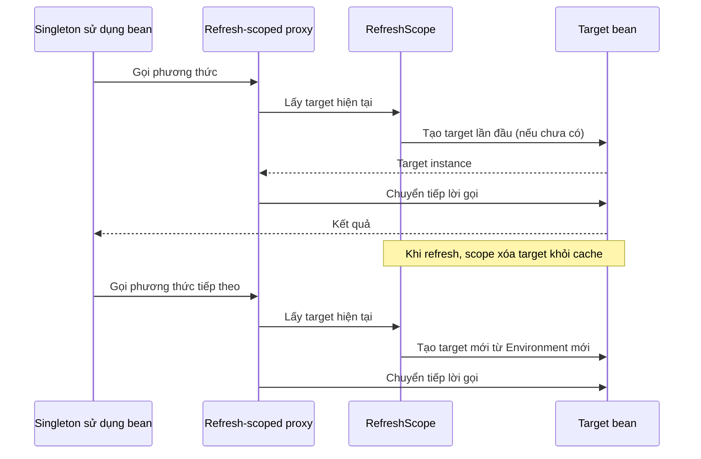

# Đặt RefreshScope trên @Bean hay trên lớp cấu hình

Khi cấu hình từ xa thay đổi, Spring Cloud có thể làm mới `Environment` của ứng dụng. Tuy nhiên, các bean singleton đã được tạo thường vẫn giữ trạng thái và giá trị mà chúng nhận lúc khởi tạo. `@RefreshScope` giải quyết một phần vấn đề này bằng cách đặt bean vào một scope có thể xóa target đã cache để bean được tạo lại khi cần.

Vị trí đặt annotation quyết định đối tượng nào thực sự thuộc refresh scope. Nếu muốn một bean do phương thức `@Bean` tạo ra được khởi tạo lại sau refresh, hãy đặt `@RefreshScope` trực tiếp trên phương thức đó. Đặt annotation trên lớp `@Configuration` chỉ áp dụng scope cho chính bean cấu hình; nó không tự động biến mọi bean được khai báo trong lớp thành refresh-scoped bean.

## 1. Mục tiêu học tập

Sau bài học, bạn có thể:

- Giải thích `@RefreshScope` hoạt động thông qua scoped proxy và cache target bean.
- Phân biệt đặt `@RefreshScope` trên phương thức `@Bean`, trên lớp `@Configuration` và trên một component bean.
- Chọn đúng vị trí annotation để tái tạo bean chứa cấu hình thay đổi.
- Mô tả vòng đời bean trước và sau lệnh refresh.
- Hiểu vì sao singleton khác vẫn có thể giữ proxy và nhận target mới sau refresh.
- Nhận biết giới hạn với tham chiếu trực tiếp, bean không do Spring quản lý, tài nguyên và các loại bean không thể refresh.
- Thiết kế kiểm thử và vận hành refresh an toàn trong ứng dụng Spring Cloud Config.

## 2. Vì sao cần `@RefreshScope`?

Giả sử `order-service` đọc địa chỉ của dịch vụ inventory từ Config Server:

```yaml
inventory:
  client:
    base-url: https://inventory.internal
    read-timeout: 3s
```

Ứng dụng tạo một HTTP client lúc khởi động và dùng client đó trong suốt vòng đời của singleton service. Sau khi nhóm vận hành đổi `base-url` trong Git và ứng dụng nhận cấu hình mới, trường hợp sau có thể xảy ra:

- `Environment` đã chứa giá trị `base-url` mới.
- Bean HTTP client đã được tạo trước đó vẫn giữ URL cũ.
- Singleton service vẫn đang sử dụng bean HTTP client cũ.

Việc nạp lại property source không tự động tạo lại mọi object đã được khởi tạo. Nếu một bean cần được tạo lại để áp dụng giá trị mới, có thể đặt bean đó trong `@RefreshScope`.

`@RefreshScope` thường phù hợp với bean có cấu hình được đọc khi khởi tạo, chẳng hạn HTTP client, bộ định tuyến hoặc một thành phần tích hợp có thể xây dựng lại an toàn. Nó không phải cơ chế tự động cập nhật mọi biến trong ứng dụng và cũng không thay thế thiết kế quản lý cấu hình.

## 3. `@RefreshScope` hoạt động như thế nào?

`@RefreshScope` là một scope của Spring Cloud, được triển khai dựa trên scoped proxy. Thay vì để các bean khác giữ trực tiếp target object, Spring cung cấp một proxy đại diện cho bean refresh-scoped.

Vòng đời cơ bản:

1. Spring đăng ký bean definition trong refresh scope và tạo proxy để các bean khác inject.
2. Khi proxy được gọi lần đầu, scope tạo target bean thật và cache target đó.
3. Các lời gọi tiếp theo đi qua proxy đến target đang được cache.
4. Khi sự kiện refresh được xử lý, scope xóa target đã cache.
5. Target không nhất thiết được tạo lại ngay tại thời điểm refresh. Ở lần gọi tiếp theo qua proxy, scope tạo target mới bằng `Environment` hiện tại.
6. Proxy mà các bean khác đang giữ vẫn có thể giữ nguyên; nó chuyển lời gọi đến target mới.



Refresh chủ yếu làm mất hiệu lực target đang cache. Đây là lý do một bean được refresh scope có thể nhận giá trị mới mà singleton đang inject nó không cần được tạo lại.

## 4. Đặt `@RefreshScope` trên phương thức `@Bean`

Đây là cách rõ ràng khi mục tiêu là làm mới một bean cụ thể được tạo trong lớp cấu hình.

Ví dụ:

```java
import java.net.URI;
import java.time.Duration;

import org.springframework.beans.factory.annotation.Value;
import org.springframework.context.annotation.Bean;
import org.springframework.context.annotation.Configuration;
import org.springframework.cloud.context.config.annotation.RefreshScope;

@Configuration(proxyBeanMethods = false)
public class InventoryClientConfiguration {

    @Bean
    @RefreshScope
    public InventoryClient inventoryClient(
            @Value("${inventory.client.base-url}") URI baseUrl,
            @Value("${inventory.client.read-timeout:3s}") Duration readTimeout) {
        return new InventoryClient(baseUrl, readTimeout);
    }
}
```

Trong ví dụ:

- `InventoryClientConfiguration` là lớp cấu hình thông thường.
- `inventoryClient()` tạo một bean có tên `inventoryClient`.
- `@RefreshScope` được đặt trên phương thức `@Bean`, vì vậy bean `InventoryClient` do phương thức tạo ra là bean cần được refresh.
- Các tham số `@Value` được phân giải khi target bean được tạo. Sau refresh, lần tạo target tiếp theo sử dụng giá trị từ `Environment` mới.

Một service singleton có thể inject bean đó:

```java
@Service
public class StockReservationService {

    private final InventoryClient inventoryClient;

    public StockReservationService(InventoryClient inventoryClient) {
        this.inventoryClient = inventoryClient;
    }

    public Stock reserve(String sku, int quantity) {
        return inventoryClient.reserve(sku, quantity);
    }
}
```

Spring inject scoped proxy cho `InventoryClient`. `StockReservationService` vẫn là singleton; khi gọi `inventoryClient.reserve(...)`, proxy tìm target hiện tại. Sau khi target cũ bị xóa khỏi refresh scope, lời gọi tiếp theo sẽ kích hoạt tạo target mới.

### Vì sao nên dùng tham số phương thức `@Bean`?

Đặt cấu hình ở tham số phương thức giúp thể hiện rõ giá trị được đọc khi bean target được tạo. Nó cũng tránh việc lớp cấu hình giữ một field đã được bind một lần rồi truyền cùng object cũ vào những lần tạo bean tiếp theo.

Với lớp cấu hình dùng `proxyBeanMethods = false`, nên khai báo dependency qua tham số phương thức `@Bean` thay vì gọi trực tiếp phương thức `@Bean` khác. Cách này làm quan hệ phụ thuộc rõ ràng và không dựa vào method interception của `@Configuration`.

## 5. Đặt `@RefreshScope` trên lớp `@Configuration`

Có thể thấy ví dụ như sau:

```java
@Configuration
@RefreshScope
public class InventoryClientConfiguration {

    @Bean
    public InventoryClient inventoryClient(
            @Value("${inventory.client.base-url}") URI baseUrl) {
        return new InventoryClient(baseUrl);
    }

    @Bean
    public InventoryHealthIndicator inventoryHealthIndicator(
            InventoryClient inventoryClient) {
        return new InventoryHealthIndicator(inventoryClient);
    }
}
```

Điểm quan trọng: annotation ở đây áp dụng cho bean `InventoryClientConfiguration` (bean đại diện cho lớp cấu hình). Nó không tự động đặt scope `refresh` lên các bean được khai báo bởi những phương thức `@Bean` bên trong.

Do đó, nếu `InventoryClient` là bean cần được tái tạo sau refresh, hãy đặt `@RefreshScope` trên chính phương thức `inventoryClient()`. Nếu `InventoryHealthIndicator` cũng giữ trạng thái hoặc tài nguyên được tạo từ cấu hình cũ và cần tái tạo, hãy đánh giá riêng bean đó và đặt annotation trên phương thức tương ứng.

```java
@Configuration(proxyBeanMethods = false)
public class InventoryClientConfiguration {

    @Bean
    @RefreshScope
    public InventoryClient inventoryClient(
            @Value("${inventory.client.base-url}") URI baseUrl) {
        return new InventoryClient(baseUrl);
    }

    @Bean
    public InventoryHealthIndicator inventoryHealthIndicator(
            InventoryClient inventoryClient) {
        return new InventoryHealthIndicator(inventoryClient);
    }
}
```

Trong ví dụ thứ hai, chỉ `InventoryClient` được refresh-scoped. `InventoryHealthIndicator` vẫn là singleton nhưng giữ tham chiếu đến proxy `InventoryClient`, nên nó có thể gọi target mới thông qua proxy. Nếu health indicator tự lưu URL hoặc trạng thái khác từ cấu hình lúc khởi tạo, nó cũng có thể cần được refresh riêng.

### Khi nào nên đặt trên lớp cấu hình?

Chỉ cân nhắc khi chính bean cấu hình có trạng thái hoặc phụ thuộc cần được tạo lại và nhóm hiểu rõ vòng đời của configuration bean. Đây không phải cách rút gọn để làm mới tất cả bean sản xuất trong lớp.

Trong phần lớn trường hợp, đặt annotation trên từng phương thức `@Bean` cần làm mới sẽ diễn đạt chính xác ý định hơn và tránh tạo kỳ vọng rằng mọi bean con đều được refresh.

## 6. Đặt `@RefreshScope` trên một component class

Nếu bean được tạo bằng component scanning thay vì một phương thức `@Bean`, có thể đặt annotation trực tiếp trên lớp component.

Ví dụ:

```java
import org.springframework.beans.factory.annotation.Value;
import org.springframework.cloud.context.config.annotation.RefreshScope;
import org.springframework.stereotype.Component;

@Component
@RefreshScope
public class CheckoutPolicy {

    private final boolean newCheckoutEnabled;

    public CheckoutPolicy(
            @Value("${checkout.new-flow.enabled:false}") boolean newCheckoutEnabled) {
        this.newCheckoutEnabled = newCheckoutEnabled;
    }

    public boolean isNewCheckoutEnabled() {
        return newCheckoutEnabled;
    }
}
```

Ở đây `CheckoutPolicy` là bean component và chính bean đó thuộc refresh scope. Khi target bị xóa khỏi cache, lần gọi tiếp theo tạo một `CheckoutPolicy` mới và đọc giá trị `checkout.new-flow.enabled` từ `Environment` hiện tại.

Một component class chỉ nên có `@RefreshScope` nếu việc tạo lại object là an toàn. Tránh đặt scope này trên bean có constructor tạo side effect không thể lặp lại, ví dụ gửi giao dịch, đăng ký listener không có cơ chế hủy hoặc khởi tạo tài nguyên bên ngoài mà không giải phóng đúng cách.

## 7. So sánh các vị trí đặt annotation

| Vị trí đặt `@RefreshScope` | Bean được áp dụng scope | Các bean do phương thức `@Bean` tạo ra | Khi nên dùng |
| --- | --- | --- | --- |
| Trên phương thức `@Bean` | Bean do phương thức đó định nghĩa | Chỉ bean được đánh dấu chịu refresh scope | Khi cần tái tạo một hoặc một số bean cụ thể |
| Trên lớp `@Configuration` | Chính bean cấu hình | Không tự động chuyển mọi bean sản xuất sang refresh scope | Khi chính configuration bean cần được refresh và đã hiểu tác động |
| Trên lớp `@Component` hoặc bean stereotype | Chính component bean | Không liên quan đến các bean khác | Khi component đó cần đọc lại cấu hình bằng cách tạo target mới |

Một quy tắc dễ áp dụng: hãy đánh dấu đúng bean cần được tạo lại. Nếu bean được khai báo bằng `@Bean`, đánh dấu phương thức `@Bean`; nếu bean được phát hiện qua component scan, đánh dấu lớp component. Đừng đánh dấu lớp `@Configuration` với kỳ vọng tất cả phương thức `@Bean` của nó tự động được refresh.

## 8. Điều gì xảy ra với các bean singleton đang sử dụng proxy?

Giả sử `StockReservationService` là singleton và inject `InventoryClient` có `@RefreshScope`. Trong thời gian chạy:

- `StockReservationService` được tạo một lần.
- Trường `inventoryClient` giữ scoped proxy.
- Proxy tra cứu target hiện tại trong refresh scope mỗi khi cần chuyển tiếp lời gọi.
- Khi refresh xóa target cũ, proxy không cần được inject lại vào `StockReservationService`.
- Lần gọi kế tiếp tạo target mới và chuyển tiếp đến object mới.

Điều này chỉ hoạt động khi lời gọi tiếp tục đi qua proxy. Nếu một bean lấy target thật rồi lưu tham chiếu trực tiếp bằng cách bỏ qua proxy, tham chiếu đó không tự được thay thế. Tương tự, nếu code tự tạo object bằng `new InventoryClient(...)` thay vì để Spring quản lý, refresh scope không kiểm soát object đó.

Tránh gọi `AopTestUtils.getTargetObject`, unwrap proxy hoặc giữ target nội bộ trong biến static. Những thao tác này có thể làm mất lợi ích của scope.

## 9. Refresh scope không đồng nghĩa tạo lại ngay lập tức

Một điểm dễ hiểu nhầm là thời điểm target được tạo lại. Khi refresh được kích hoạt, Spring Cloud cập nhật cấu hình và refresh scope xóa target đang cache. Target mới thường chỉ được khởi tạo ở lần truy cập tiếp theo.

Ví dụ:

1. `inventoryClient` đang dùng `https://inventory-v1.internal`.
2. Git được cập nhật thành `https://inventory-v2.internal`.
3. Config Client nhận cấu hình mới và xử lý refresh.
4. Refresh scope xóa target `InventoryClient` cũ.
5. Không có lời gọi nào đến proxy trong khoảng thời gian này thì target mới chưa cần được tạo.
6. Request tiếp theo gọi `inventoryClient` qua proxy, target mới được tạo với URL v2.

Lazy recreation giúp tránh tạo lại mọi bean ngay cả khi không có ai sử dụng. Tuy nhiên, nếu constructor của bean mới thất bại, lỗi có thể chỉ xuất hiện ở lần truy cập đầu tiên sau refresh. Vì vậy, với bean quan trọng, cần có health check hoặc kiểm thử sau refresh để phát hiện sớm.

## 10. Kích hoạt refresh trong ứng dụng

Config Server có thể đọc được commit mới từ Git, nhưng client đang chạy không mặc nhiên tự cập nhật mọi bean. Cần một cơ chế gửi yêu cầu refresh đến client.

Với Spring Boot Actuator và Spring Cloud Context, một cách thường dùng là gọi endpoint refresh:

```bash
curl -X POST http://localhost:8080/actuator/refresh
```

Endpoint này yêu cầu ứng dụng làm mới các nguồn cấu hình có thể refresh và phát sự kiện để các thành phần như RefreshScope xử lý. Tên endpoint và hành vi chi tiết cần đối chiếu phiên bản Spring Cloud đang dùng.

Để expose endpoint trong cấu hình Actuator:

```yaml
management:
  endpoints:
    web:
      exposure:
        include: health,info,refresh
```

Chỉ expose endpoint cần thiết. Endpoint refresh có thể làm thay đổi hành vi ứng dụng đang chạy nên phải được bảo vệ bằng xác thực, phân quyền và giới hạn mạng. Không để endpoint quản trị mở công khai.

Trong hệ thống nhiều instance, Spring Cloud Bus có thể phát sự kiện refresh đến nhiều client. Khi đó, mỗi instance xử lý refresh và refresh scope cục bộ xóa target đã cache. Bus phân phối sự kiện; nó không tự đảm bảo mọi bean đều được tạo lại thành công hoặc mọi instance đã nhận cùng cấu hình. Cần quan sát kết quả trên từng instance.

## 11. Các trường hợp không phù hợp với `@RefreshScope`

Không phải mọi bean đều nên được đặt trong refresh scope.

### Bean có side effect khi tạo

Nếu constructor hoặc factory method gửi email, tạo giao dịch, đăng ký tài nguyên ngoài hoặc chạy một tác vụ không thể lặp lại an toàn, việc tạo lại target có thể lặp side effect. Hãy chuyển side effect sang một lifecycle hoặc service có kiểm soát riêng.

### Tài nguyên cần đóng và giải phóng

HTTP client, connection pool, thread pool hoặc file watcher có thể cần đóng trước khi thay thế. Hãy bảo đảm bean triển khai lifecycle callback như `close()` hoặc `@PreDestroy` phù hợp để tài nguyên cũ được giải phóng khi target bị hủy.

### Bean bị giữ tham chiếu trực tiếp

Nếu code lưu target thật thay vì proxy, việc xóa target khỏi scope không thay thế tham chiếu đã lưu. Thiết kế phụ thuộc nên inject proxy và gọi qua proxy.

### Bean không do Spring quản lý

Object được tạo bằng `new`, static singleton tự quản lý hoặc object do thư viện bên ngoài tạo không tự tham gia refresh scope. Hãy đưa việc tạo object qua Spring hoặc xây dựng cơ chế cập nhật riêng.

### Bean hoặc loại tài nguyên không hỗ trợ refresh

Một số loại bean có ràng buộc lifecycle hoặc được Spring Cloud đánh dấu không refreshable. Ví dụ, `HikariDataSource` nằm trong danh sách mặc định không thể refresh của Spring Cloud Context. Không nên giả định chỉ cần thêm annotation là mọi connection pool hoặc tài nguyên nền tảng có thể được thay thế an toàn.

Với datasource, hãy đánh giá riêng việc thay URL/credential, đóng connection hiện có, giao dịch đang chạy và khả năng tạo pool mới. Có thể cần rollout ứng dụng hoặc dùng cơ chế xoay vòng connection chuyên biệt thay vì refresh scope.

## 12. `@RefreshScope` và `@ConfigurationProperties`

`@ConfigurationProperties` gom các thuộc tính có cấu trúc thành một bean. Spring Cloud có cơ chế rebind một số bean cấu hình khi refresh. Tuy nhiên, rebind giá trị và tái tạo bean là hai hành vi khác nhau.

- Nếu bean properties được rebind, các trường/thuộc tính của bean được cập nhật theo `Environment` mới theo cơ chế binding.
- Nếu một bean khác đã dùng giá trị properties để tạo một client hoặc tài nguyên, việc rebind bean properties không tự tạo lại tài nguyên đó.
- Nếu cần tái tạo tài nguyên phụ thuộc cấu hình, hãy đặt tài nguyên đó trong refresh scope hoặc thiết kế factory/reconfiguration riêng.

Ví dụ, `InventoryClientProperties` có thể được rebind, nhưng `InventoryClient` được tạo với `baseUrl` cũ vẫn có thể giữ giá trị cũ nếu nó không được làm mới. Đây là lý do cần xác định bean nào chứa dữ liệu cấu hình và bean nào chứa tài nguyên được xây dựng từ dữ liệu đó.

Không nên thêm `@RefreshScope` vào mọi lớp `@ConfigurationProperties` theo thói quen. Hãy chọn cơ chế phù hợp với cách ứng dụng sử dụng các giá trị và kiểm tra hành vi với phiên bản Spring Cloud cụ thể.

## 13. Kiểm thử việc chọn vị trí annotation

Một bài kiểm thử tốt cần chứng minh target bean được tạo lại và nhận cấu hình mới, đồng thời bean singleton sử dụng proxy vẫn hoạt động.

Có thể kiểm thử theo các bước:

1. Khởi động context với `inventory.client.base-url=https://inventory-v1.internal`.
2. Lấy `StockReservationService` và gọi phương thức dùng `InventoryClient`.
3. Xác nhận target ban đầu nhận URL v1.
4. Cập nhật property trong `Environment` hoặc dùng cơ chế refresh test phù hợp.
5. Phát sự kiện refresh hoặc gọi `RefreshScope.refreshAll()` trong test.
6. Gọi lại service singleton.
7. Xác nhận proxy tạo target mới và target mới nhận URL v2.
8. Xác nhận tài nguyên của target cũ được giải phóng nếu bean có lifecycle cleanup.

Nên có một kiểm thử đối chứng: đặt `@RefreshScope` chỉ trên lớp `@Configuration`, để chứng minh bean sản phẩm không tự động trở thành refresh-scoped. Điều này giúp tránh regression khi người khác chuyển annotation từ phương thức `@Bean` lên lớp cấu hình.

Ví dụ test ở mức khái niệm:

```java
@SpringBootTest
class InventoryClientRefreshTest {

    @Autowired
    StockReservationService service;

    @Autowired
    ConfigurableEnvironment environment;

    @Autowired
    RefreshScope refreshScope;

    @Test
    void recreatesClientAfterRefresh() {
        // Thiết lập property ban đầu và gọi service để tạo target v1.
        // Cập nhật property trong test Environment.
        // Gọi refreshScope.refresh("inventoryClient") hoặc refreshAll().
        // Gọi service lần nữa và xác nhận target được tạo với giá trị mới.
    }
}
```

Đoạn test là khung minh họa, không phải test hoàn chỉnh có thể chạy ngay. Cách thay đổi `Environment`, đăng ký `RefreshScope` và phát refresh event phụ thuộc cấu hình test và phiên bản Spring Cloud. Trong test tích hợp, ưu tiên dùng cơ chế refresh thật của ứng dụng để xác nhận toàn bộ đường đi từ cập nhật cấu hình đến target mới.

## 14. Những lỗi thường gặp

| Biểu hiện | Nguyên nhân có thể | Cách xử lý |
| --- | --- | --- |
| Đổi cấu hình nhưng bean vẫn dùng giá trị cũ | Bean không thuộc refresh scope hoặc refresh chưa được kích hoạt | Kiểm tra vị trí annotation và sự kiện refresh |
| Đặt `@RefreshScope` trên `@Configuration` nhưng bean `@Bean` không đổi | Annotation chỉ áp dụng cho configuration bean | Đặt annotation trên từng phương thức `@Bean` cần refresh |
| Service singleton vẫn hoạt động với target cũ | Nó giữ tham chiếu trực tiếp đến target thay vì scoped proxy | Inject proxy và không unwrap/giữ target thật |
| Target mới lỗi khi được gọi | Cấu hình mới không hợp lệ hoặc constructor/factory thất bại | Kiểm tra property source, validation và log lần tạo target |
| Tài nguyên cũ vẫn tồn tại | Bean không đóng tài nguyên đúng lifecycle hoặc thư viện tự quản lý tài nguyên | Bổ sung cleanup callback và kiểm thử giải phóng |
| Một số bean cập nhật, một số bean không | Chỉ một phần bean được refresh-scoped hoặc rebind | Lập danh sách bean phụ thuộc cấu hình và chọn cơ chế riêng cho từng bean |
| Datasource không thay đổi sau refresh | Loại datasource không refreshable hoặc pool có lifecycle đặc biệt | Kiểm tra `never-refreshable`, chính sách datasource và cân nhắc rollout |
| Refresh endpoint trả lỗi hoặc không truy cập được | Endpoint chưa expose, thiếu dependency hoặc bị bảo vệ/chặn mạng | Kiểm tra Actuator exposure, security và log |
| Nhiều instance có trạng thái khác nhau | Chỉ một instance nhận refresh hoặc sự kiện Bus chưa tới mọi client | Kiểm tra Bus, instance ID, log và trạng thái từng instance |

## 15. Hướng dẫn chọn cách đặt annotation

| Tình huống | Cách đặt đề xuất | Lý do |
| --- | --- | --- |
| Một HTTP client được tạo từ phương thức `@Bean` cần đọc lại URL và timeout | `@RefreshScope` trên phương thức `@Bean` | Chỉ target client cần được tái tạo |
| Một component chứa cờ tính năng được inject qua constructor | `@RefreshScope` trên component class | Chính component là bean cần tạo lại |
| Một lớp `@Configuration` khai báo nhiều bean, chỉ một client thay đổi | `@RefreshScope` trên phương thức tạo client | Tránh refresh nhầm phạm vi hoặc tưởng mọi bean đều được scope |
| Nhiều bean trong cùng configuration cần refresh độc lập | Đánh dấu từng phương thức `@Bean` cần thiết | Phạm vi và lifecycle rõ ràng cho từng bean |
| Một bean properties chỉ cần cập nhật trường cấu hình | Dùng cơ chế rebind phù hợp; không thêm scope nếu không cần tái tạo | Rebind và recreate là hai yêu cầu khác nhau |
| Một pool hoặc tài nguyên bị đánh dấu không refreshable | Dùng rollout hoặc cơ chế quản lý tài nguyên chuyên biệt | Annotation không vượt qua giới hạn lifecycle của loại tài nguyên |

Hãy bắt đầu từ câu hỏi: object nào phải được tạo lại để áp dụng cấu hình mới? Sau đó đặt annotation lên bean tương ứng. Đây là cách giữ phạm vi refresh nhỏ, giảm thời gian gián đoạn và tránh tạo lại những thành phần không liên quan.

## 16. Checklist trước khi dùng `@RefreshScope`

- [ ] Đã xác định bean cụ thể cần được tạo lại sau refresh.
- [ ] Nếu bean được tạo bằng `@Bean`, annotation đặt trên đúng phương thức `@Bean`.
- [ ] Không kỳ vọng annotation trên `@Configuration` tự động áp dụng cho mọi bean sản phẩm.
- [ ] Nếu bean là component, annotation đặt trên đúng component class.
- [ ] Bean được Spring quản lý và các consumer sử dụng scoped proxy.
- [ ] Giá trị cấu hình được đọc lại khi target mới được tạo.
- [ ] Constructor/factory có thể chạy lại an toàn và không lặp side effect ngoài ý muốn.
- [ ] Tài nguyên cũ có lifecycle cleanup phù hợp.
- [ ] Đã kiểm tra bean/resource có thuộc nhóm không refreshable hay không.
- [ ] Đã cấu hình và bảo vệ endpoint refresh hoặc cơ chế phát sự kiện tương ứng.
- [ ] Đã kiểm thử target cũ bị loại bỏ và target mới nhận giá trị mong muốn.
- [ ] Đã kiểm tra hành vi trên tất cả instance nếu hệ thống chạy nhiều replica.

## 17. Tài liệu tham khảo

- [Spring Cloud Context — Refresh Scope](https://docs.spring.io/spring-cloud-commons/reference/spring-cloud-commons/application-context-services.html#refresh-scope)
- [Spring Cloud Config Client](https://docs.spring.io/spring-cloud-config/reference/client.html)
- [Spring Boot — Externalized Configuration](https://docs.spring.io/spring-boot/reference/features/external-config.html)
