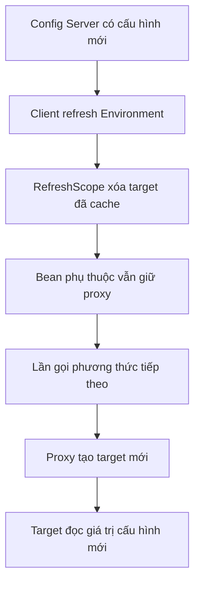

# Bean phụ thuộc giữ tham chiếu cũ và cách kiểm chứng

Spring Cloud Config có thể cập nhật `Environment` của một ứng dụng đang chạy, nhưng điều đó không có nghĩa mọi object được tạo từ cấu hình cũ đều tự thay đổi. Một bean singleton có thể giữ lại URL, timeout, collection hoặc HTTP client đã tạo từ giá trị cũ. Sau khi refresh, bean cấu hình có thể đã nhận giá trị mới trong khi object dẫn xuất nằm trong bean phụ thuộc vẫn tiếp tục dùng trạng thái cũ.

Để xử lý đúng, cần hiểu sự khác nhau giữa **tham chiếu proxy**, **target bên trong proxy** và **giá trị hoặc tài nguyên mà bean phụ thuộc đã chụp lại**. `@RefreshScope` làm mới target của bean được đánh dấu; nó không tự tìm và xây dựng lại mọi object mà các bean khác từng tạo từ target đó.

## Mục tiêu học tập

Sau bài này, bạn có thể:

- Mô tả cách `@RefreshScope` dùng proxy và cache target.
- Phân biệt tham chiếu proxy còn hợp lệ với object dẫn xuất đã giữ giá trị cũ.
- Nhận diện bean singleton cache cấu hình hoặc tài nguyên trong constructor và `@PostConstruct`.
- Chọn cách làm mới bean phụ thuộc: dùng proxy động, đưa bean phụ thuộc vào refresh scope hoặc xây dựng lại tài nguyên có kiểm soát.
- Kiểm chứng giá trị trước và sau refresh bằng log, Actuator và kiểm thử tự động.
- Tránh các lỗi thường gặp khi đặt `@RefreshScope` trên lớp cấu hình hoặc bean không thể refresh.

## Refresh thực sự làm gì?

Khi ứng dụng nhận thay đổi cấu hình, quy trình refresh thường gồm hai phần:

1. Cập nhật `Environment` từ nguồn cấu hình hiện tại, chẳng hạn Config Server.
2. Làm mới các bean thuộc `RefreshScope` bằng cách xóa target đã cache. Target mới được khởi tạo lười ở lần gọi phương thức tiếp theo và nhận giá trị từ `Environment` đã cập nhật.

`@RefreshScope` tạo một proxy có vòng đời ổn định để các bean khác có thể inject. Proxy giữ một target đã khởi tạo trong scope. Khi refresh xóa target khỏi cache, tham chiếu proxy ở các bean phụ thuộc vẫn còn, nhưng lần gọi tiếp theo đi qua proxy sẽ tạo hoặc lấy target mới.



Vì vậy, việc một bean phụ thuộc giữ tham chiếu đến proxy không tự nó gây lỗi. Vấn đề xuất hiện khi bean đó gọi proxy một lần rồi lưu kết quả vào một field, hoặc tạo ra một tài nguyên độc lập mà proxy không quản lý.

## Phân biệt proxy, target và snapshot

| Thành phần | Ý nghĩa | Sau refresh |
|---|---|---|
| Proxy được inject vào singleton | Đối tượng trung gian mà bean phụ thuộc giữ | Thường vẫn là cùng một tham chiếu; nó trỏ đến target mới khi được gọi |
| Target của bean `@RefreshScope` | Instance thực hiện logic và giữ cấu hình đã bind | Bị loại khỏi cache; được tạo lại khi proxy được sử dụng tiếp |
| Giá trị được đọc một lần và lưu vào field | Snapshot như `URI`, `Duration`, `Map` hoặc chuỗi | Không tự thay đổi |
| Tài nguyên được tạo từ cấu hình cũ | `WebClient`, HTTP client, connection pool hoặc SDK client | Không tự xây lại chỉ vì bean nguồn đã refresh |
| Bean singleton không thuộc refresh scope | Object được tạo một lần trong context | Không tự tạo lại; chỉ thay đổi nếu nó đọc một dependency động hoặc có logic cập nhật riêng |

Ví dụ: `PartnerEndpoint` được đánh dấu `@RefreshScope`, còn `PartnerAdapter` là singleton. `PartnerAdapter` inject proxy `PartnerEndpoint` và gọi `baseUrl()` trong constructor để lưu `capturedBaseUrl`. Sau refresh, proxy có thể trả URL mới qua `currentBaseUrl()`, nhưng field `capturedBaseUrl` vẫn là giá trị cũ vì nó là một `URI` độc lập đã được tạo và lưu từ trước.

## Ví dụ về bean phụ thuộc giữ giá trị cũ

Giả sử ứng dụng cần gọi một dịch vụ đối tác. URL được quản lý trong Config Server:

```yaml
partner:
  base-url: https://partner-v1.example.com
```

Bean cấu hình endpoint được đặt trong refresh scope:

```java
public class PartnerEndpoint {
    private final URI baseUrl;

    public PartnerEndpoint(URI baseUrl) {
        this.baseUrl = baseUrl;
    }

    public URI baseUrl() {
        return baseUrl;
    }
}
```

```java
@Configuration(proxyBeanMethods = false)
public class PartnerConfiguration {

    @Bean
    @RefreshScope
    PartnerEndpoint partnerEndpoint(
            @Value("${partner.base-url}") URI baseUrl) {
        return new PartnerEndpoint(baseUrl);
    }
}
```

Một singleton phụ thuộc giữ proxy, nhưng đồng thời chụp URL vào field:

```java
@Component
public class PartnerAdapter {
    private final PartnerEndpoint endpoint;
    private final URI capturedBaseUrl;

    public PartnerAdapter(PartnerEndpoint endpoint) {
        this.endpoint = endpoint; // Tham chiếu proxy
        this.capturedBaseUrl = endpoint.baseUrl(); // Snapshot lúc khởi tạo
    }

    public URI currentBaseUrl() {
        return endpoint.baseUrl();
    }

    public URI capturedBaseUrl() {
        return capturedBaseUrl;
    }
}
```

Ban đầu, cả hai phương thức trả về `https://partner-v1.example.com`. Sau khi `Environment` được cập nhật thành `https://partner-v2.example.com` và refresh scope được làm mới:

- `currentBaseUrl()` gọi qua proxy, nên target mới trả URL v2.
- `capturedBaseUrl()` trả field được gán trong constructor, nên vẫn là URL v1.

Đây là dạng lỗi phổ biến khi singleton tạo `WebClient`, `RestClient`, `HttpClient`, route table hoặc cache từ giá trị của một bean refresh-scoped rồi giữ tài nguyên đó suốt vòng đời ứng dụng.

## Cách thiết kế để bean phụ thuộc nhận cấu hình mới

### Đọc qua proxy khi cần giá trị hiện tại

Nếu thao tác chỉ cần một giá trị đơn giản, hãy gọi phương thức của bean refresh-scoped tại thời điểm sử dụng và tránh lưu kết quả lâu dài:

```java
@Component
public class PartnerAdapter {
    private final PartnerEndpoint endpoint;

    public PartnerAdapter(PartnerEndpoint endpoint) {
        this.endpoint = endpoint;
    }

    public URI currentBaseUrl() {
        return endpoint.baseUrl();
    }
}
```

`endpoint` ở đây là proxy được Spring inject. Mỗi lần gọi `baseUrl()`, proxy phân giải target hiện tại. Cách này phù hợp với các giá trị được đọc thường xuyên và không cần xây tài nguyên đắt tiền từ chúng.

### Đưa bean phụ thuộc vào `@RefreshScope`

Nếu bean phụ thuộc tạo tài nguyên từ cấu hình trong constructor hoặc `@PostConstruct`, có thể đặt chính bean đó trong refresh scope để nó được tạo lại cùng chu kỳ refresh:

```java
@Component
@RefreshScope
public class PartnerAdapter {
    private final WebClient webClient;

    public PartnerAdapter(PartnerEndpoint endpoint) {
        this.webClient = WebClient.builder()
                .baseUrl(endpoint.baseUrl().toString())
                .build();
    }

    public Mono<String> fetchStatus() {
        return webClient.get()
                .uri("/status")
                .retrieve()
                .bodyToMono(String.class);
    }
}
```

Khi refresh scope bị làm mới, target của `PartnerAdapter` cũng bị xóa. Lần gọi tiếp theo qua proxy `PartnerAdapter` sẽ tạo target mới; constructor đọc `PartnerEndpoint` qua proxy và nhận URL mới. Cách này phù hợp khi adapter và tài nguyên của nó có vòng đời gắn chặt với cấu hình.

Chỉ đưa những bean thực sự cần tái tạo vào refresh scope. Tạo lại connection pool, client hoặc tài nguyên lớn có thể tốn thời gian và ảnh hưởng các request đang chạy. Hãy kiểm tra cơ chế đóng tài nguyên cũ, timeout, retry và khả năng hoàn tất các thao tác đang diễn ra.

### Dùng factory để tạo tài nguyên theo phiên bản cấu hình

Nếu tài nguyên chỉ cần tạo khi có yêu cầu hoặc có thể cache theo cấu hình, dùng một factory đọc proxy hiện tại:

```java
@Component
public class PartnerClientFactory {
    private final PartnerEndpoint endpoint;

    public PartnerClientFactory(PartnerEndpoint endpoint) {
        this.endpoint = endpoint;
    }

    public WebClient createClient() {
        return WebClient.builder()
                .baseUrl(endpoint.baseUrl().toString())
                .build();
    }
}
```

Mỗi lần gọi factory, nó đọc URL hiện tại từ proxy rồi tạo client mới. Không nên tạo client mới cho mọi request nếu client quản lý connection pool; trong trường hợp đó, factory có thể giữ client theo version/config key và thay thế cache khi cấu hình thay đổi. Việc thay thế cần có chính sách đóng tài nguyên cũ và tránh tạo nhiều client trùng lặp.

### Tái tạo bean có snapshot bằng refresh scope

Một bean phụ thuộc có thể được đặt trong `@RefreshScope` nếu snapshot của nó phải được tính lại khi refresh. Khi đó, cả bean nguồn lẫn bean phụ thuộc đều có proxy; refresh xóa target của cả hai. Ở lần gọi tiếp theo, target phụ thuộc được tạo lại và lấy target mới của dependency khi khởi tạo.

Nếu không thể đặt bean phụ thuộc vào refresh scope, hãy cung cấp một cơ chế cập nhật rõ ràng, chẳng hạn listener nhận sự kiện thay đổi cấu hình để thay thế cache hoặc tài nguyên. Listener phải đồng bộ việc đọc/ghi, tránh để request thấy trạng thái nửa cũ nửa mới và phải xử lý lỗi khi tài nguyên mới không tạo được.

## Đặt `@RefreshScope` đúng bean

`@RefreshScope` nên được đặt trên bean có state cần tạo lại, thường là method `@Bean` hoặc component cụ thể:

```java
@Configuration(proxyBeanMethods = false)
public class PartnerConfiguration {

    @Bean
    @RefreshScope
    PartnerEndpoint partnerEndpoint(
            @Value("${partner.base-url}") URI baseUrl) {
        return new PartnerEndpoint(baseUrl);
    }
}
```

Không giả định rằng đánh dấu cả lớp `@Configuration` sẽ tự đưa tất cả bean được khai báo bên trong vào refresh scope. Spring Cloud lưu ý rằng các `@Bean` trong lớp cấu hình đó không mặc nhiên đều được refresh; bean phụ thuộc vào chúng cũng không tự được xây dựng lại. Hãy đánh dấu trực tiếp method `@Bean` cần refresh hoặc bean phụ thuộc cần tái tạo.

Với bean `@ConfigurationProperties`, cần hiểu cách binding của phiên bản Spring Cloud đang sử dụng. Bean mutable có thể được rebind theo cơ chế refresh; nếu bean hoặc cấu trúc bên trong giữ state bất biến và cần được thay instance, hãy xem xét refresh scope hoặc `spring.cloud.refresh.extra-refreshable` theo tài liệu phiên bản. Không phải mọi loại bean đều có thể refresh: `HikariDataSource` nằm trong danh sách `never-refreshable` mặc định của Spring Cloud. Với các tài nguyên như vậy, cần chiến lược tạo lại riêng hoặc restart ứng dụng.

## Refresh cấu hình từ Config Server

Một commit mới trong Git chưa tự làm thay đổi `Environment` của client đang chạy. Cần có luồng cập nhật cấu hình và trigger refresh, ví dụ gọi endpoint Actuator hoặc phát sự kiện qua Spring Cloud Bus.

Để dùng endpoint refresh trong môi trường thử nghiệm:

```yaml
management:
  endpoints:
    web:
      exposure:
        include: health,refresh
```

Sau khi Config Client lấy cấu hình mới, gọi:

```bash
curl -X POST http://localhost:8080/actuator/refresh
```

Phản hồi thường liệt kê các key thay đổi trong `Environment`. Refresh scope sau đó xóa target đã cache; target mới chỉ được tạo khi có lời gọi tiếp theo đến proxy. Do đó, ngay sau POST, log khởi tạo bean mới có thể chưa xuất hiện nếu chưa có request nào sử dụng bean đó.

Endpoint refresh có thể làm thay đổi hành vi ứng dụng, nên phải được bảo vệ bằng xác thực, phân quyền và giới hạn truy cập mạng. Không expose công khai chỉ để tiện kiểm thử. Trong môi trường nhiều instance, cần refresh từng instance hoặc dùng Spring Cloud Bus để gửi thông báo đến các instance phù hợp.

## Cách kiểm chứng bean phụ thuộc còn giữ giá trị cũ

Nên kiểm tra cả proxy và snapshot của bean phụ thuộc, thay vì chỉ xem log refresh. Có thể tạo một kiểm thử Spring Boot với cấu hình ban đầu:

```yaml
partner:
  base-url: https://partner-v1.example.com
```

Ví dụ kiểm thử minh họa:

```java
@SpringBootTest(properties = "partner.base-url=https://partner-v1.example.com")
class RefreshReferenceTests {

    @Autowired
    PartnerAdapter adapter;

    @Autowired
    ConfigurableEnvironment environment;

    @Autowired
    RefreshScope refreshScope;

    @Test
    void proxyUsesNewTargetButDependentSnapshotStaysOld() {
        URI oldUri = URI.create("https://partner-v1.example.com");
        URI newUri = URI.create("https://partner-v2.example.com");

        assertThat(adapter.currentBaseUrl()).isEqualTo(oldUri);
        assertThat(adapter.capturedBaseUrl()).isEqualTo(oldUri);

        environment.getPropertySources().addFirst(
                new MapPropertySource("test-update",
                        Map.of("partner.base-url", newUri.toString())));

        refreshScope.refresh("partnerEndpoint");

        assertThat(adapter.currentBaseUrl()).isEqualTo(newUri);
        assertThat(adapter.capturedBaseUrl()).isEqualTo(oldUri);
    }
}
```

Đoạn kiểm thử giả định `PartnerEndpoint` được đăng ký bằng method `@Bean` tên `partnerEndpoint` có `@RefreshScope`, `PartnerAdapter` là singleton như ví dụ trước, và dự án đã khai báo JUnit, Spring Boot Test cùng AssertJ. `refreshScope.refresh("partnerEndpoint")` xóa target của đúng bean đó. Lần gọi `currentBaseUrl()` tiếp theo tạo target mới; field `capturedBaseUrl` trong singleton không được gán lại.

Trong kiểm thử tích hợp với Config Server thật, thay thao tác thêm `MapPropertySource` bằng cập nhật cấu hình tại backend rồi trigger refresh theo quy trình ứng dụng. Có thể dùng `/actuator/refresh` hoặc Bus; sau đó kiểm tra cùng hai giá trị để chứng minh target proxy đã đổi còn snapshot vẫn cũ.

## Quy trình kiểm chứng trong môi trường chạy

Khi điều tra sự cố, thực hiện theo trình tự:

1. Ghi nhận giá trị cấu hình hiệu lực trước khi thay đổi, chẳng hạn URL hoặc timeout; không ghi secret vào log.
2. Xác nhận Config Server đã phục vụ đúng application, profile và label mới.
3. Trigger refresh ở client và kiểm tra danh sách key thay đổi.
4. Gọi một phương thức trên bean refresh-scoped để buộc target mới được tạo.
5. Ghi nhận giá trị từ proxy và giá trị snapshot mà bean phụ thuộc đang giữ.
6. Kiểm tra tài nguyên dẫn xuất như HTTP client, pool, route table hoặc cache có được thay mới không.
7. Kiểm tra log khởi tạo/hủy bean và metric để phát hiện target cũ hoặc tài nguyên bị rò rỉ.
8. Lặp lại với ít nhất hai lần refresh để phát hiện cache chỉ được cập nhật ở lần đầu hoặc listener xử lý không ổn định.

Actuator `env` có thể giúp xem property source và origin của key trong môi trường kiểm thử. Endpoint này có thể tiết lộ thông tin nhạy cảm; chỉ bật tạm thời với xác thực/phân quyền phù hợp và tắt sau khi điều tra. Log ứng dụng nên ghi tên bean, phiên bản cấu hình hoặc giá trị không nhạy cảm, không in toàn bộ object cấu hình.

## Các lỗi thường gặp

| Hiện tượng | Nguyên nhân có thể gặp | Cách xử lý |
|---|---|---|
| Giá trị qua proxy đã mới nhưng request vẫn gọi URL cũ | Bean phụ thuộc đã cache `WebClient`, URI hoặc route từ trước | Làm mới bean phụ thuộc, hoặc xây tài nguyên từ proxy hiện tại |
| `@RefreshScope` đã đặt trên lớp `@Configuration` nhưng bean không đổi | Các method `@Bean` không mặc nhiên thuộc refresh scope | Đặt annotation trên từng method `@Bean` cần refresh |
| Gọi `/actuator/refresh` nhưng chưa thấy target mới được tạo | Target được khởi tạo lười, chưa có lời gọi sau refresh | Gọi phương thức qua proxy rồi kiểm tra log tạo target |
| Thay đổi Git nhưng client vẫn dùng giá trị cũ | Client chưa lấy cấu hình mới hoặc chưa trigger refresh | Kiểm tra Config Server response, refresh endpoint/Bus và changed keys |
| Bean không thể refresh hoặc không đổi | Bean thuộc `never-refreshable`, ví dụ `HikariDataSource`, hoặc loại bean không được hỗ trợ | Chọn chiến lược thay thế tài nguyên hoặc restart có kiểm soát |
| Lần đầu refresh đúng, lần sau sai | Cache/factory/listener quản lý vòng đời không đúng | Kiểm tra cache key, đồng bộ thay thế và cleanup tài nguyên cũ |
| Giá trị trong Environment mới nhưng object vẫn giữ cấu hình cũ | Object được tạo từ snapshot trong constructor hoặc `@PostConstruct` | Đọc qua proxy mỗi lần cần hoặc tái tạo object phụ thuộc |

## Checklist thiết kế bean có thể refresh

- [ ] Xác định bean nào trực tiếp đọc cấu hình và bean nào tạo tài nguyên từ cấu hình đó.
- [ ] Đặt `@RefreshScope` trên đúng method `@Bean` hoặc component cần tạo lại.
- [ ] Không lưu snapshot cấu hình trong singleton nếu mong đợi nó tự thay đổi.
- [ ] Nếu singleton tạo client/pool từ cấu hình, đưa nó vào refresh scope hoặc có factory/listener cập nhật riêng.
- [ ] Kiểm tra proxy được inject thay vì giữ target hoặc object con lấy từ target.
- [ ] Xác định cách đóng tài nguyên cũ và xử lý request đang chạy.
- [ ] Kiểm tra bean thuộc `never-refreshable` hoặc yêu cầu restart.
- [ ] Trigger refresh thật sự sau khi Config Client nhận cấu hình mới.
- [ ] Kiểm thử cả giá trị proxy lẫn snapshot/tài nguyên trong bean phụ thuộc.
- [ ] Bảo vệ Actuator endpoint và không ghi bí mật vào log.

## Kết luận

`@RefreshScope` giữ một proxy ổn định và quản lý target được tạo lười bên trong scope. Khi refresh, target đã cache bị loại bỏ; lần gọi tiếp theo qua proxy sẽ tạo target mới với cấu hình hiện tại. Vì thế, bean singleton inject proxy có thể nhìn thấy giá trị mới nếu nó gọi proxy tại thời điểm sử dụng.

Giá trị hoặc tài nguyên mà bean phụ thuộc đã đọc và lưu lại trong constructor, `@PostConstruct` hay cache riêng sẽ không tự thay đổi. Hãy tránh snapshot dài hạn, hoặc làm mới chính bean phụ thuộc/tài nguyên dẫn xuất bằng refresh scope, factory hay listener có kiểm soát. Kiểm thử đồng thời giá trị qua proxy và giá trị được bean phụ thuộc giữ lại là cách rõ ràng để phát hiện tham chiếu cũ sau refresh.

## Tài liệu tham khảo

- [Spring Cloud Commons – Application Context Services và Refresh Scope](https://docs.spring.io/spring-cloud-commons/reference/spring-cloud-commons/application-context-services.html)
- [Spring Cloud Commons – Configuration Properties](https://docs.spring.io/spring-cloud-commons/reference/configprops.html)
