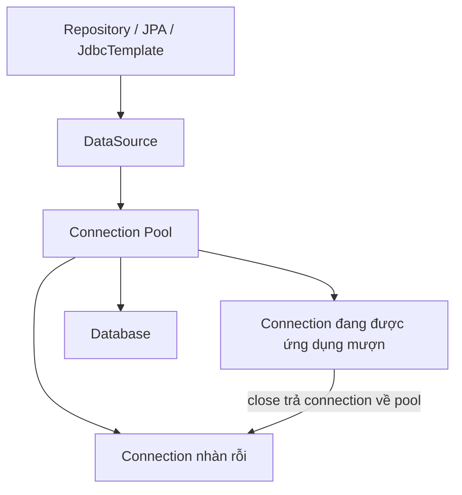
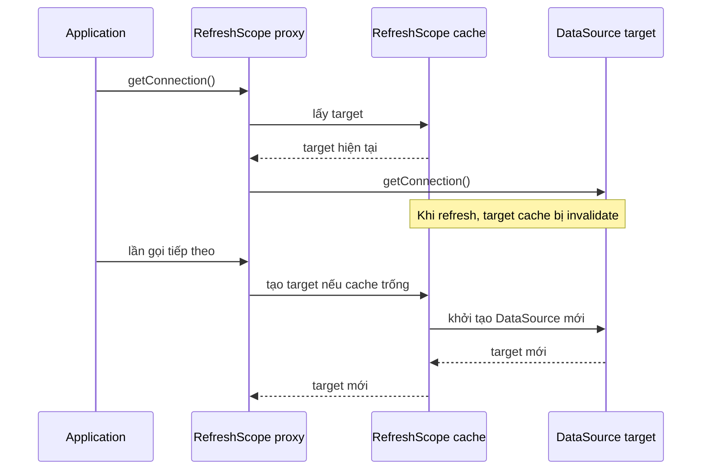

# DataSource, connection pool và danh sách never-refreshable

`DataSource` là điểm truy cập kết nối cơ sở dữ liệu của ứng dụng Spring Boot. Trong production, bean này thường đại diện cho một connection pool như HikariCP, quản lý việc tạo, cho mượn, thu hồi và đóng các kết nối vật lý. Khi cấu hình database thay đổi, ví dụ URL, username, password hoặc giới hạn pool, việc cập nhật bean `DataSource` cần được xem xét cẩn thận vì nó ảnh hưởng đến các kết nối đang được ứng dụng sử dụng.

`@RefreshScope` có thể làm mới một bean bằng cách loại bỏ target đang cache và tạo target mới ở lần truy cập kế tiếp. Tuy nhiên, Spring Cloud mặc định đánh dấu `HikariDataSource` là loại không được refresh. Vì vậy, chỉ thêm `@RefreshScope` vào bean Hikari không đảm bảo pool sẽ được thay thế. Muốn thay đổi pool lúc chạy, cần hiểu danh sách `never-refreshable`, vòng đời tài nguyên và cách chuyển đổi từ pool cũ sang pool mới an toàn.

## Mục tiêu học tập

Sau bài học, bạn có thể:

- Giải thích vòng đời của `DataSource` và connection pool trong Spring Boot.
- Hiểu vì sao `HikariDataSource` mặc định nằm trong danh sách `never-refreshable`.
- Cấu hình `spring.cloud.refresh.never-refreshable` và `spring.cloud.refresh.extra-refreshable` theo nhu cầu.
- Đánh giá rủi ro khi tạo lại pool trong lúc ứng dụng đang xử lý request.
- Chọn giữa refresh pool, thay pool có kiểm soát hoặc rolling restart.
- Kiểm thử kết nối, credential, pool metrics và hành vi khi refresh thất bại.

## 1. DataSource và connection pool

Spring Boot thường tự cấu hình một `DataSource` khi có JDBC driver và thư viện connection pool trên classpath. Với HikariCP, bean thực tế thường là `com.zaxxer.hikari.HikariDataSource`.

`DataSource` cung cấp kết nối cho JDBC, JPA và các thành phần truy cập dữ liệu. Connection pool giữ một nhóm kết nối vật lý đến database để tránh tạo kết nối mới cho từng truy vấn.



Trong JDBC, gọi `Connection.close()` trên connection do pool cấp thường trả connection về pool để tái sử dụng, thay vì đóng ngay kết nối vật lý. Pool kiểm soát giới hạn tối đa, thời gian chờ, vòng đời kết nối và việc kiểm tra kết nối còn hợp lệ.

Một số thuộc tính thường thay đổi theo môi trường:

| Thuộc tính | Ý nghĩa |
|---|---|
| `spring.datasource.url` | JDBC URL của database. |
| `spring.datasource.username` | Tài khoản kết nối. |
| `spring.datasource.password` | Mật khẩu kết nối; cần lấy từ secret store. |
| `spring.datasource.hikari.maximum-pool-size` | Số connection tối đa trong pool. |
| `spring.datasource.hikari.minimum-idle` | Số connection nhàn rỗi tối thiểu mà pool cố duy trì. |
| `spring.datasource.hikari.connection-timeout` | Thời gian chờ lấy connection từ pool. |
| `spring.datasource.hikari.max-lifetime` | Tuổi thọ tối đa của connection trong pool. |

Các thuộc tính trên không có cùng khả năng áp dụng runtime. Một số có thể được bind lại vào bean cấu hình nhưng pool đã khởi tạo có thể không tự thay đổi hành vi tương ứng. Nếu cần cập nhật chúng, cần kiểm tra API của pool và cách bean được tạo.

## 2. Vì sao DataSource cần được xử lý riêng khi refresh?

Một bean cấu hình đơn giản như `SearchProperties` có thể được bind lại khi Environment thay đổi. `DataSource` lại quản lý tài nguyên bên ngoài JVM: socket, session database, transaction và các connection đang được request sử dụng.

Nếu thay pool quá sớm, request đang giữ connection có thể gặp lỗi giữa transaction. Nếu giữ pool cũ quá lâu, các kết nối có thể tiếp tục dùng credential hoặc endpoint cũ. Nếu tạo pool mới nhưng không đóng pool cũ, số connection đến database có thể vượt giới hạn.

Vì vậy, thay đổi cấu hình database cần trả lời ba câu hỏi:

1. Bean `DataSource` có thực sự được phép refresh theo loại class không?
2. Khi target cũ bị loại bỏ, pool cũ và các connection đang mượn được xử lý như thế nào?
3. Pool mới đã kết nối và hoạt động tốt trước khi lưu lượng được chuyển sang chưa?

`@RefreshScope` chỉ cung cấp cơ chế cache/invalidate target bean. Nó không tự thiết kế một quy trình chuyển pool không gián đoạn cho mọi ứng dụng.

## 3. Cơ chế cache và proxy của @RefreshScope

Bean thuộc `@RefreshScope` được truy cập thông qua proxy. Scope lưu target instance sau lần khởi tạo đầu tiên. Khi refresh scope được invalidate, target đã cache bị xóa; lần truy cập tiếp theo qua proxy sẽ tạo target mới từ Environment hiện tại.



Việc tạo target mới diễn ra khi bean được truy cập sau refresh, không nhất thiết ngay tại thời điểm endpoint refresh trả về. Điều này có nghĩa lỗi khởi tạo pool mới có thể chỉ xuất hiện khi request đầu tiên chạm đến `DataSource`.

Nếu bean bị invalidate và có destroy callback, scope có thể gọi lifecycle callback để đóng target cũ. Nhưng việc đóng pool trong khi connection còn đang được sử dụng có thể ảnh hưởng đến request hoặc transaction đang chạy. Cần kiểm tra hành vi đóng của pool và thiết kế rollout phù hợp.

## 4. HikariDataSource trong danh sách never-refreshable

Spring Cloud Context mặc định đặt lớp `com.zaxxer.hikari.HikariDataSource` trong danh sách `spring.cloud.refresh.never-refreshable`. Mục đích là tránh làm mới trực tiếp loại pool này theo cơ chế refresh scope mặc định, vì vòng đời và trạng thái kết nối của nó cần được quản lý cẩn thận.

Ví dụ cấu hình mặc định được thể hiện rõ:

```yaml
spring:
  cloud:
    refresh:
      never-refreshable:
        - com.zaxxer.hikari.HikariDataSource
```

Nếu một bean có target thuộc lớp bị liệt kê trong `never-refreshable`, thêm `@RefreshScope` không có nghĩa target sẽ được thay thế trong quy trình refresh thông thường. Hãy kiểm tra class thực tế của bean, vì một cấu hình `DataSource` có thể trả về Hikari, Tomcat JDBC Pool, DBCP2 hoặc implementation khác tùy dependency và cấu hình.

`never-refreshable` nhận danh sách tên lớp đầy đủ. Khi thay đổi danh sách, phải dùng đúng tên class mà ứng dụng đang tạo. Cấu hình một class khác hoặc chỉ ghi tên interface `javax.sql.DataSource` sẽ không tương đương với việc chỉ định implementation cụ thể.

## 5. Khi nào nên giữ DataSource trong never-refreshable?

Với nhiều hệ thống production, giữ pool trong danh sách không refreshable và dùng rolling restart khi đổi endpoint hoặc credential là lựa chọn dễ dự đoán hơn.

Nên giữ hành vi mặc định khi:

- Pool không có cơ chế chuyển đổi an toàn trong lúc request đang chạy.
- Database giới hạn số connection và không đủ dung lượng cho hai pool cùng tồn tại tạm thời.
- Việc đổi credential cần đóng các session cũ theo quy trình bảo mật riêng.
- Ứng dụng có transaction dài hoặc job nền đang sử dụng connection.
- Nhóm vận hành đã có rolling deployment và health check đáng tin cậy.

Trong quy trình rolling restart, instance mới khởi động với cấu hình database mới, kiểm tra kết nối thành công, sau đó nhận lưu lượng. Instance cũ được drain và dừng khi request/transaction hoàn tất. Cách này có thể tạo khoảng thời gian hai pool cùng tồn tại ở các instance khác nhau, nhưng quá trình được điều phối bởi nền tảng triển khai và readiness thay vì bất ngờ thay target bên trong một JVM.

## 6. Cho phép HikariDataSource được refresh

Nếu đã đánh giá và kiểm thử rằng pool có thể được thay thế an toàn, có thể loại Hikari khỏi danh sách `never-refreshable`. Ví dụ cấu hình danh sách rỗng:

```yaml
spring:
  cloud:
    refresh:
      never-refreshable: []
```

Khi dùng cấu hình này, không còn class nào bị loại bởi danh sách `never-refreshable` được đặt ở nguồn đó. Hãy xem xét các override khác từ Config Server, biến môi trường hoặc profile để chắc chắn giá trị cuối cùng đúng như mong muốn.

Ví dụ khai báo bean Hikari trong refresh scope:

```java
import com.zaxxer.hikari.HikariDataSource;
import org.springframework.boot.autoconfigure.jdbc.DataSourceProperties;
import org.springframework.boot.context.properties.ConfigurationProperties;
import org.springframework.cloud.context.config.annotation.RefreshScope;
import org.springframework.context.annotation.Bean;
import org.springframework.context.annotation.Configuration;

@Configuration(proxyBeanMethods = false)
public class DatabaseConfiguration {

    @Bean
    @RefreshScope
    @ConfigurationProperties("spring.datasource.hikari")
    HikariDataSource dataSource(DataSourceProperties properties) {
        return properties.initializeDataSourceBuilder()
            .type(HikariDataSource.class)
            .build();
    }
}
```

Ví dụ minh họa việc tạo pool từ `DataSourceProperties` và bind các thuộc tính Hikari. Bean này chỉ có thể được thay thế qua refresh nếu implementation thực tế được phép refresh trong phiên bản Spring Cloud đang dùng và không còn bị danh sách `never-refreshable` loại trừ.

Không nên đưa cấu hình `never-refreshable: []` vào production chỉ để thử xem endpoint có hoạt động hay không. Hãy kiểm tra số connection, transaction đang chạy, callback đóng pool cũ và khả năng rollback trước khi cho phép thay thế.

## 7. Danh sách extra-refreshable

Ngoài `never-refreshable`, Spring Cloud Context có thuộc tính `spring.cloud.refresh.extra-refreshable` để bổ sung các loại bean được phép refresh theo cơ chế của phiên bản đang sử dụng.

Ví dụ minh họa:

```yaml
spring:
  cloud:
    refresh:
      extra-refreshable:
        - com.example.legacy.LegacyConnectionFactory
```

Thuộc tính này hữu ích với implementation tùy chỉnh hoặc loại bean mà cơ chế refresh không tự nhận diện theo mặc định. Nó không tự làm cho một tài nguyên bên ngoài trở nên an toàn khi thay thế. Trước khi thêm class, cần xác nhận:

- Bean có thể được proxy và quản lý bằng scope trong kiến trúc hiện tại.
- Instance cũ có lifecycle đóng/giải phóng tài nguyên rõ ràng.
- Instance mới được tạo từ Environment đã cập nhật.
- Các consumer đang giữ tham chiếu đến proxy, không giữ target cũ ngoài scope.
- Có kiểm thử cho tình huống tạo instance mới thất bại.

Nếu một class vừa được đưa vào `extra-refreshable` vừa nằm trong `never-refreshable`, phải giải quyết cấu hình xung đột theo quy tắc của release train; không nên cấu hình một class trong cả hai danh sách.

## 8. Kiểm tra implementation DataSource thực tế

Trước khi thay đổi danh sách refresh, hãy xác định bean `DataSource` được tạo bởi auto-configuration hay bởi cấu hình tùy chỉnh. Có thể kiểm tra class mà không in URL, username hoặc password:

```java
import javax.sql.DataSource;
import org.slf4j.Logger;
import org.slf4j.LoggerFactory;
import org.springframework.boot.ApplicationRunner;
import org.springframework.context.annotation.Bean;
import org.springframework.context.annotation.Configuration;

@Configuration(proxyBeanMethods = false)
public class DataSourceDiagnostics {
    private static final Logger log =
        LoggerFactory.getLogger(DataSourceDiagnostics.class);

    @Bean
    ApplicationRunner reportDataSourceType(DataSource dataSource) {
        return args -> log.info(
            "DataSource implementation: {}",
            dataSource.getClass().getName()
        );
    }
}
```

Trong một số ứng dụng, bean được bọc bởi proxy hoặc wrapper nên `getClass()` có thể cho biết lớp proxy. Có thể kiểm tra target type bằng công cụ Spring AOP phù hợp trong môi trường chẩn đoán, nhưng không được expose thông tin nội bộ hoặc giá trị kết nối qua endpoint công khai.

Với Spring Boot 3, các API servlet và validation dùng namespace Jakarta; `javax.sql.DataSource` vẫn thuộc Java SE và không đổi namespace. Vì vậy, import `javax.sql.DataSource` trong ví dụ là đúng cả với ứng dụng Spring Boot 3.

## 9. Connection đang mượn khi pool bị thay thế

Một connection do pool cấp có thể đang được sử dụng trong transaction khi refresh xảy ra. Nếu target pool cũ bị đóng ngay, connection đó có thể bị đóng hoặc lỗi khi transaction chưa hoàn tất. Hành vi cụ thể phụ thuộc pool, driver và trạng thái connection.

Một chiến lược thay pool an toàn cần có các bước:

1. Xác thực cấu hình mới trước khi tạo pool.
2. Tạo pool mới và thử kết nối database.
3. Chỉ chuyển consumer sang pool mới sau khi pool mới đạt health check.
4. Ngừng cấp connection mới từ pool cũ.
5. Chờ connection đang mượn hoàn tất trong một khoảng drain có giới hạn.
6. Đóng pool cũ sau khi không còn connection đang sử dụng hoặc sau chính sách timeout đã định.
7. Nếu pool mới không hoạt động, giữ pool cũ hoặc rollback về cấu hình trước đó.

`@RefreshScope` đơn thuần không cung cấp đầy đủ quy trình chuyển pool nguyên tử như trên. Nếu cần zero-downtime rotation, hãy xây dựng một component quản lý pool có khả năng swap target rõ ràng, hoặc dùng rolling deployment. Không tự đóng pool cũ từ một listener mà chưa kiểm soát các transaction đang chạy.

## 10. Thay đổi URL hoặc credential database

Các thay đổi cấu hình database có mức độ ảnh hưởng khác nhau:

| Thay đổi | Tác động | Lưu ý vận hành |
|---|---|---|
| `maximum-pool-size` | Thay đổi giới hạn pool | Cần xem implementation có áp dụng động hay chỉ đọc khi khởi tạo. |
| `connection-timeout` | Thay đổi thời gian chờ mượn connection | Kiểm tra API pool; bind lại bean không bảo đảm pool đã cập nhật. |
| JDBC URL | Thay endpoint database | Thường cần tạo pool mới để mở connection tới host/database mới. |
| Username/password | Thay danh tính kết nối | Connection hiện tại có thể vẫn dùng session cũ; pool mới cần được kiểm tra trước khi chuyển. |
| SSL trust/key material | Thay cấu hình TLS | Thường cần tạo lại connection vật lý hoặc pool. |

Credential phải được lấy từ secret store hoặc nguồn được bảo vệ. Không đưa mật khẩu database vào log, exception message, metric label hoặc nội dung response Actuator.

Khi luân chuyển password, có thể tồn tại một khoảng thời gian cả credential cũ và mới đều được chấp nhận ở database. Hãy phối hợp thứ tự cập nhật database, secret store, Config Server và pool client để tránh tất cả instance mất quyền kết nối cùng lúc.

## 11. Ví dụ cấu hình Hikari theo môi trường

Ví dụ cấu hình chung:

```yaml
spring:
  datasource:
    url: ${CATALOG_DB_URL}
    username: ${CATALOG_DB_USERNAME}
    password: ${CATALOG_DB_PASSWORD}
    hikari:
      maximum-pool-size: 20
      minimum-idle: 5
      connection-timeout: 30000
      max-lifetime: 1800000
```

Các giá trị timeout và lifetime của Hikari ở ví dụ được tính bằng mili giây. Tên biến môi trường được Spring Boot ánh xạ thành các thuộc tính tương ứng. Secret thực tế phải được cấp từ secret store hoặc nền tảng triển khai.

Nếu production cần pool khác local, có thể ghi đè các giá trị trong profile `prod`. Việc profile thay đổi chỉ cập nhật Environment; pool Hikari đã được tạo có thể vẫn giữ cấu hình cũ cho đến khi được tạo lại bằng một cơ chế được hỗ trợ.

```yaml
# application-prod.yml
spring:
  datasource:
    hikari:
      maximum-pool-size: 40
      minimum-idle: 10
```

Không tăng `maximum-pool-size` chỉ dựa trên tải của một instance. Tổng connection tối đa có thể xấp xỉ số instance nhân với pool size, cộng các ứng dụng và job khác dùng chung database. Cần đối chiếu giới hạn connection của database và ngân sách kết nối toàn hệ thống.

## 12. Kiểm thử refresh DataSource

Một kiểm thử có ý nghĩa cần xác nhận hành vi pool và connection, không chỉ kiểm tra Environment đã đổi giá trị.

Các bước gợi ý:

1. Khởi động context với database test và xác nhận loại DataSource thực tế.
2. Kiểm tra class có nằm trong `spring.cloud.refresh.never-refreshable` hay không.
3. Ghi nhận pool ban đầu và mở một connection để mô phỏng request đang hoạt động.
4. Thay cấu hình URL, credential hoặc pool size bằng test property source phù hợp.
5. Kích hoạt refresh theo cách ứng dụng đang sử dụng.
6. Kiểm tra target có được thay thế hay không; nếu không, xác nhận đó là hành vi được mong đợi theo danh sách never-refreshable.
7. Xác nhận connection đang mượn được xử lý theo chính sách drain và pool cũ được đóng đúng lúc.
8. Xác nhận pool mới có thể tạo connection và thực hiện truy vấn kiểm tra.
9. Mô phỏng credential sai hoặc database không sẵn sàng để kiểm tra rollback và readiness.

Không dùng database production để thử thay pool hoặc credential. Dùng database test riêng và kiểm tra cả trường hợp có request đang chạy trong lúc refresh.

## 13. Quan sát và cảnh báo connection pool

Sau khi thay pool, cần quan sát cả ứng dụng lẫn database:

- Số connection active, idle, pending và tổng connection.
- Thời gian chờ lấy connection và tỷ lệ timeout.
- Số lần tạo connection thất bại.
- Số connection bị leak hoặc đóng bất thường.
- Tỷ lệ lỗi transaction và truy vấn sau refresh.
- Số pool đang tồn tại trong một JVM trong giai đoạn chuyển đổi.
- Tổng connection từ tất cả instance so với giới hạn database.

Nếu dùng Actuator/Micrometer, các metric Hikari có thể được xuất theo cấu hình quan sát của ứng dụng. Chỉ expose endpoint metrics cho hệ thống giám sát có xác thực và không dùng username, URL có thông tin nhạy cảm hoặc secret làm label.

Readiness check nên xác nhận ứng dụng có thể lấy connection và thực hiện thao tác phù hợp. Nếu pool mới chưa sẵn sàng, tránh đưa instance vào nhận lưu lượng chỉ vì tiến trình JVM vẫn đang sống.

## 14. Khi nào nên dùng rolling restart?

Rolling restart thường là lựa chọn phù hợp khi:

- Cần thay JDBC URL hoặc credential và không có cơ chế swap pool an toàn.
- Driver hoặc pool không hỗ trợ cập nhật thuộc tính cần thiết lúc chạy.
- Transaction dài khiến việc đóng pool cũ khó kiểm soát.
- Thay đổi cần khởi tạo lại TLS context hoặc thành phần hạ tầng.
- Ứng dụng đã có readiness, graceful shutdown và khả năng chạy song song nhiều replica.

Quy trình:

1. Cập nhật cấu hình và secret đã được review.
2. Khởi động một replica mới với cấu hình mới.
3. Chờ health/readiness và kiểm tra truy vấn database.
4. Chuyển lưu lượng sang replica mới.
5. Drain và dừng replica cũ.
6. Lặp lại cho các replica còn lại.

Nếu database không cho phép hai pool cùng tồn tại trong thời gian rollout, cần lên kế hoạch giới hạn kết nối hoặc cập nhật theo giai đoạn. Rolling restart không loại bỏ nhu cầu quản lý tổng connection; nó chỉ làm vòng đời thay thế dễ quan sát và kiểm soát hơn.

## 15. Những điểm cần ghi nhớ

- `DataSource` thường đại diện cho connection pool và quản lý tài nguyên database bên ngoài JVM.
- `@RefreshScope` cache target qua proxy; refresh loại target và tạo target mới ở lần truy cập kế tiếp.
- `HikariDataSource` mặc định nằm trong `spring.cloud.refresh.never-refreshable`, nên chỉ thêm annotation không đảm bảo pool được thay thế.
- `spring.cloud.refresh.never-refreshable` là danh sách class đầy đủ cần loại khỏi refresh; chỉ thay đổi khi đã hiểu lifecycle tài nguyên.
- `spring.cloud.refresh.extra-refreshable` bổ sung các loại bean được phép refresh theo cơ chế của phiên bản Spring Cloud.
- Recreate pool có thể ảnh hưởng connection đang mượn, transaction và giới hạn kết nối database.
- Muốn thay pool an toàn cần kiểm tra pool mới, chuyển lưu lượng, drain connection cũ và có rollback.
- Với JDBC URL, credential hoặc TLS thay đổi, rolling restart thường dễ dự đoán hơn nếu không có cơ chế swap pool an toàn.
- Kiểm tra class DataSource thực tế, pool metrics, readiness và tổng connection trên toàn hệ thống.

Khi quản lý `DataSource` bằng RefreshScope, điều quan trọng là hiểu cả danh sách class được phép refresh lẫn vòng đời connection pool. Không nên xem việc Environment đã đổi là bằng chứng pool đang sử dụng đã đổi. Hãy xác minh target, connection đang mượn, pool mới và khả năng rollback trước khi áp dụng refresh cho database production.

## Tài liệu tham khảo

- [Spring Cloud Commons – Refresh Scope and Environment Changes](https://docs.spring.io/spring-cloud-commons/reference/spring-cloud-commons/application-context-services.html)
- [Spring Boot – Configure a DataSource](https://docs.spring.io/spring-boot/reference/data/sql.html#data.sql.datasource)
- [HikariCP – Configuration](https://github.com/brettwooldridge/HikariCP#configuration-knobs-baby)
