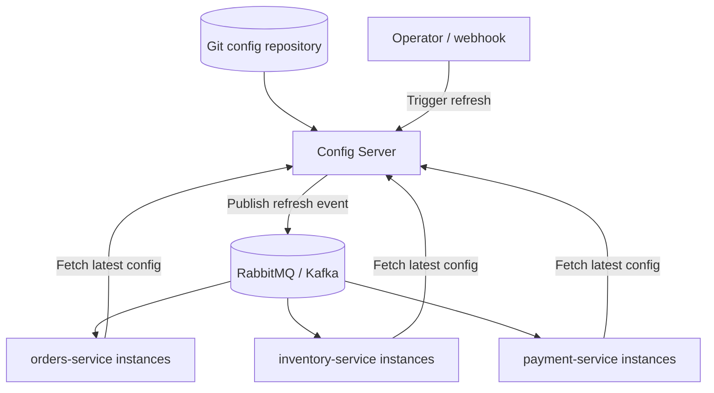

# Vai trò của Bus trong lan truyền thay đổi tới nhiều client

Trong hệ thống có nhiều ứng dụng Spring Boot, cấu hình tập trung thường được lưu ở Git và cung cấp qua Spring Cloud Config Server. Khi một giá trị thay đổi, từng Config Client phải lấy lại cấu hình và áp dụng thay đổi. Gọi endpoint refresh riêng cho từng instance sẽ tốn công và dễ bỏ sót khi số lượng dịch vụ hoặc replica tăng lên.

**Spring Cloud Bus** giải quyết phần phân phối sự kiện bằng cách kết nối các ứng dụng Spring qua một message broker như RabbitMQ hoặc Apache Kafka. Một ứng dụng phát sự kiện refresh lên Bus; các ứng dụng đã tham gia Bus nhận sự kiện và thực hiện refresh theo phạm vi được chỉ định. Bus giúp lan truyền tín hiệu thay đổi đến nhiều client, trong khi Config Server vẫn là nơi cung cấp nội dung cấu hình mới.

## 1. Vấn đề khi refresh từng client riêng lẻ

Giả sử hệ thống có ba dịch vụ, mỗi dịch vụ chạy nhiều replica:

```text
orders-service       3 instances
inventory-service    2 instances
payment-service      4 instances
```

Nếu một thuộc tính dùng chung trong `application-prod.yml` thay đổi, các instance cần nhận cấu hình mới. Nếu không có cơ chế phân phối sự kiện, người vận hành phải biết địa chỉ từng instance và gọi refresh riêng lẻ. Cách này dễ phát sinh các vấn đề:

- Một hoặc nhiều instance bị bỏ sót.
- Số request quản trị tăng theo số replica.
- Khó đồng bộ thời điểm refresh giữa nhiều dịch vụ.
- Script triển khai phải duy trì danh sách địa chỉ instance đang thay đổi.
- Việc thêm dịch vụ mới đòi hỏi cập nhật quy trình refresh thủ công.

Spring Cloud Bus cung cấp một kênh sự kiện chung để các instance nhận tín hiệu từ một điểm phát. Thay vì gọi trực tiếp từng client, hệ thống phát một sự kiện lên broker; các thành phần đã đăng ký Bus cùng lắng nghe kênh đó.

## 2. Spring Cloud Bus là gì?

Spring Cloud Bus là cơ chế truyền các sự kiện giữa những ứng dụng Spring Cloud thông qua message broker. Bus thường được dùng để phát tán thay đổi cấu hình, nhưng cũng có thể truyền các loại `RemoteApplicationEvent` phù hợp khác.

Các thành phần chính:

| Thành phần | Vai trò |
|---|---|
| Config Server | Đọc cấu hình từ Git hoặc backend khác và trả cấu hình cho client. |
| Config Client | Nhận cấu hình từ Config Server và cập nhật `Environment` khi refresh. |
| Spring Cloud Bus | Tạo, gửi, nhận và định tuyến sự kiện giữa các ứng dụng. |
| Message broker | Chuyển thông điệp giữa các node; ví dụ RabbitMQ hoặc Kafka. |
| Actuator endpoint | Cung cấp thao tác quản trị như `busrefresh` để phát sự kiện refresh. |

Bus không phải kho lưu cấu hình và không thay thế Config Server. Bus chỉ phân phối sự kiện; khi nhận sự kiện refresh, client vẫn phải lấy cấu hình mới từ Config Server.

## 3. Kiến trúc lan truyền thay đổi

Một hệ thống thường có Config Server và nhiều Config Client cùng kết nối đến một broker:



Trình tự cơ bản:

1. Đội vận hành cập nhật cấu hình trong Git hoặc backend của Config Server.
2. Một thao tác quản trị hoặc webhook tạo sự kiện refresh.
3. Ứng dụng phát sự kiện gửi thông điệp lên broker qua Spring Cloud Bus.
4. Các node Bus đang kết nối broker nhận thông điệp.
5. Bus kiểm tra thông tin định tuyến để xác định node hoặc nhóm node cần xử lý.
6. Config Client được chọn lấy lại cấu hình từ Config Server.
7. Spring cập nhật `Environment`, rebind những bean được hỗ trợ và làm mới target trong `@RefreshScope`.

Các node có thể nhận sự kiện gần như đồng thời, nhưng thời điểm hoàn tất refresh không nhất thiết giống nhau. Độ trễ còn phụ thuộc broker, mạng, tải của Config Server và thời gian đọc backend.

## 4. Broker và dependency cần thiết

Spring Cloud Bus sử dụng Spring Cloud Stream binder để tích hợp với broker. Hai lựa chọn thường gặp là RabbitMQ và Kafka. Mỗi ứng dụng cần có dependency Bus và binder tương ứng để tham gia cùng hệ thống.

Ví dụ Gradle khi dùng RabbitMQ:

```gradle
dependencies {
    implementation 'org.springframework.boot:spring-boot-starter-actuator'
    implementation 'org.springframework.cloud:spring-cloud-starter-bus-amqp'
}
```

Ví dụ khi dùng Kafka:

```gradle
dependencies {
    implementation 'org.springframework.boot:spring-boot-starter-actuator'
    implementation 'org.springframework.cloud:spring-cloud-starter-bus-kafka'
}
```

Chọn starter theo broker mà hệ thống sử dụng; không cần thêm cả hai nếu kiến trúc chỉ dùng một binder. Quản lý phiên bản dependency qua Spring Cloud release train tương thích với Spring Boot của dự án.

### Cấu hình RabbitMQ

Ví dụ cấu hình cho một ứng dụng có Bus:

```yaml
spring:
  application:
    name: orders-service
  cloud:
    bus:
      destination: springCloudBus
  rabbitmq:
    host: rabbitmq.internal
    port: 5672
    username: ${RABBITMQ_USERNAME}
    password: ${RABBITMQ_PASSWORD}
```

Spring Cloud Bus dùng binder AMQP để gửi và nhận sự kiện qua RabbitMQ. `destination` xác định tên đích messaging mà các node cùng tham gia; nếu không khai báo, tên mặc định thường là `springCloudBus`.

### Cấu hình Kafka

Nếu dùng Kafka, cấu hình broker bootstrap servers thay cho RabbitMQ:

```yaml
spring:
  application:
    name: orders-service
  cloud:
    bus:
      destination: springCloudBus
  kafka:
    bootstrap-servers: kafka-1.internal:9092,kafka-2.internal:9092
```

Binder Kafka sử dụng topic tương ứng với Bus destination. Các node cần kết nối đúng cluster và có quyền publish/consume phù hợp.

Tên destination và cấu hình binder phải thống nhất giữa Config Server và các Config Client cần tham gia cùng Bus. Nếu các ứng dụng dùng destination hoặc broker khác nhau, chúng sẽ không cùng nhận một luồng sự kiện.

## 5. Cấu hình trên Config Server và Config Client

Để phát sự kiện từ Config Server, server cần Actuator, Spring Cloud Bus và binder. Ví dụ với RabbitMQ:

```yaml
server:
  port: 8888

spring:
  application:
    name: config-server
  cloud:
    config:
      server:
        git:
          uri: https://git.example.internal/platform/config-repo.git
    bus:
      destination: springCloudBus
  rabbitmq:
    host: rabbitmq.internal
    port: 5672
    username: ${RABBITMQ_USERNAME}
    password: ${RABBITMQ_PASSWORD}

management:
  endpoints:
    web:
      exposure:
        include: health,info,busrefresh
```

Mỗi Config Client muốn nhận sự kiện cũng cần Bus starter, cấu hình kết nối broker và Config Client. Ví dụ:

```yaml
spring:
  application:
    name: orders-service
  config:
    import: "configserver:http://config-server:8888"
  cloud:
    bus:
      destination: springCloudBus
```

Đoạn ví dụ client dùng Config Data API để lấy cấu hình. Bus có thể được sử dụng cùng Config Data API; sự kiện refresh sẽ yêu cầu client nạp lại nguồn cấu hình theo cơ chế của phiên bản Spring Cloud đang dùng.

Nếu ứng dụng dùng bootstrap context cũ, cần bật bootstrap theo phiên bản dự án và khai báo Config Client theo cơ chế legacy. Việc dùng bootstrap cũ hay Config Data API không thay đổi vai trò của Bus là kênh truyền sự kiện giữa các node.

## 6. Phát sự kiện refresh bằng busrefresh

Spring Cloud Bus cung cấp Actuator endpoint `busrefresh`. Gửi HTTP POST đến endpoint này sẽ phát sự kiện refresh lên Bus:

```bash
curl -X POST http://config-server:8888/actuator/busrefresh
```

Endpoint thường cần được expose qua cấu hình Actuator:

```yaml
management:
  endpoints:
    web:
      exposure:
        include: health,info,busrefresh
```

Khi sự kiện được phát, các Config Client tham gia cùng Bus nhận thông điệp và thực hiện refresh. Mỗi client sẽ lấy cấu hình hiện hành từ Config Server. Không cần gửi một request HTTP riêng đến từng replica.

Có thể phát sự kiện từ một ứng dụng Bus-enabled khác thay vì Config Server, miễn endpoint được bật và ứng dụng có thể publish lên cùng Bus. Tuy nhiên, quy trình vận hành thường đặt điểm phát ở Config Server hoặc một thành phần quản trị được kiểm soát để dễ truy vết.

### Refresh một nhóm hoặc một ứng dụng

Khi chỉ một dịch vụ cần nhận thay đổi, có thể dùng destination path của endpoint để giới hạn đích:

```bash
curl -X POST http://config-server:8888/actuator/busrefresh/orders-service:**
```

Destination được đối chiếu với service ID của các node Bus; mẫu như `orders-service:**` có thể chọn các instance thuộc dịch vụ đó. Cần xác minh service ID thực tế và cú pháp pattern trong phiên bản đang dùng trước khi dùng cho production. Nếu bỏ destination, sự kiện thường được phát cho toàn bộ các node phù hợp trên Bus.

Việc nhắm đích giúp giảm số client phải refresh, nhưng cần cẩn thận khi thay đổi cấu hình dùng chung trong `application.yml` hoặc profile dùng chung. Nếu nhiều ứng dụng phụ thuộc khóa đó, refresh chỉ một dịch vụ có thể để các client còn lại tiếp tục dùng giá trị cũ.

## 7. Bus phối hợp với Config Server và Git webhook

Một quy trình thường gặp là:

1. Developer tạo commit thay đổi file cấu hình và merge vào branch được triển khai.
2. Git server gửi webhook đến Config Server hoặc hệ thống automation.
3. Config Server nhận biết tài liệu liên quan đã thay đổi.
4. Thành phần monitor/automation phát sự kiện refresh qua Spring Cloud Bus.
5. Các client nhận sự kiện, truy vấn Config Server và cập nhật cấu hình.

Spring Cloud Config Monitor có thể nhận webhook từ hệ thống quản lý source control và phát sự kiện liên quan đến ứng dụng bị ảnh hưởng khi được tích hợp với Bus. Nếu không dùng webhook, đội vận hành có thể gọi `busrefresh` sau khi xác nhận commit đã sẵn sàng.

Điều cần bảo đảm là Config Server đã nhìn thấy phiên bản cấu hình mới trước khi client refresh. Nếu webhook đến quá sớm hoặc server chưa cập nhật trạng thái repository, client có thể tải lại phiên bản cũ. Hãy thiết kế quy trình để thứ tự commit, cập nhật repository và phát sự kiện được kiểm soát.

## 8. Bus ID, destination và định tuyến sự kiện

Mỗi node tham gia Bus có một định danh dịch vụ để phân biệt origin và destination. Bus ID thường được tạo từ tên ứng dụng cùng thông tin instance như port hoặc index. Trong hệ thống nhiều replica, định danh cần đủ duy nhất để Bus có thể nhắm đúng node.

Có thể đặt `spring.cloud.bus.id` khi cần quy ước ID riêng:

```yaml
spring:
  application:
    name: orders-service
  cloud:
    bus:
      id: orders-service:${INSTANCE_ID:local}
      destination: springCloudBus
```

Nếu tự đặt ID, phải bảo đảm mỗi instance có ID riêng. ID trùng nhau có thể làm định tuyến sự kiện đến sai phạm vi hoặc khiến các node bị nhận diện như cùng một đích.

`destination` có hai ý nghĩa cần phân biệt trong vận hành:

- `spring.cloud.bus.destination` xác định kênh messaging chung, chẳng hạn exchange hoặc topic mà các node cùng tham gia.
- Destination được truyền cho endpoint `busrefresh` dùng để giới hạn node/service nhận sự kiện theo Bus ID.

Đổi tên kênh messaging ở một số ứng dụng mà không cập nhật các ứng dụng còn lại sẽ chia hệ thống thành các nhóm Bus riêng, khiến sự kiện không đến đủ client.

## 9. Bus refresh làm gì ở phía client?

Khi Config Client nhận refresh event, client thực hiện quá trình refresh cấu hình theo cơ chế Spring Cloud Context:

- Lấy lại cấu hình từ Config Server.
- Cập nhật các property source trong `Environment`.
- Phát sự kiện thay đổi môi trường để các thành phần được hỗ trợ cập nhật.
- Rebind các bean cấu hình phù hợp.
- Invalidate target trong `@RefreshScope`; target mới được tạo khi có lần truy cập tiếp theo.

Bus không tự chuyển mọi thuộc tính thành cấu hình runtime. Các thay đổi như `server.port`, điều kiện `@ConditionalOnProperty`, lựa chọn implementation lúc startup hoặc kết nối hạ tầng đã được tạo có thể cần restart hoặc quy trình tái cấu hình chuyên biệt.

Do đó, Bus refresh thành công chỉ chứng minh tín hiệu refresh đã được xử lý theo cơ chế client. Cần kiểm tra hành vi của bean và tài nguyên thực tế trước khi kết luận mọi thay đổi đã có hiệu lực.

## 10. Bảo mật broker và endpoint quản trị

Bus có thể phát sự kiện làm thay đổi cấu hình của nhiều dịch vụ, vì vậy cả broker lẫn endpoint quản trị đều cần được bảo vệ.

Các nguyên tắc chính:

- Chỉ cho phép các service account cần thiết kết nối broker.
- Dùng TLS cho kết nối broker khi hạ tầng hỗ trợ.
- Cấp quyền publish/consume theo đúng destination; không dùng tài khoản broker có quyền quản trị rộng cho mọi ứng dụng.
- Lưu username, password, token và certificate trong secret manager hoặc cơ chế quản lý bí mật của nền tảng.
- Bảo vệ `/actuator/busrefresh` bằng xác thực và phân quyền; giới hạn truy cập trong mạng quản trị.
- Chỉ expose endpoint Actuator cần thiết, không công khai toàn bộ endpoint.
- Ghi log ai đã yêu cầu refresh, thời điểm, destination và kết quả xử lý; tránh ghi nội dung secret.
- Xác thực webhook và giới hạn nguồn gửi webhook trước khi chuyển thành sự kiện Bus.

Nếu người không có quyền có thể gọi `busrefresh`, họ có thể gây refresh hàng loạt, tạo tải đột biến lên Config Server và broker. Nếu họ có thể phát các sự kiện cấu hình khác, tác động có thể rộng hơn. Hãy xem Bus như một kênh điều khiển nội bộ có quyền hạn cao.

## 11. Độ tin cậy, tải và giới hạn vận hành

Spring Cloud Bus phụ thuộc message broker và kết nối của từng node. Nếu broker ngừng hoạt động, ứng dụng vẫn có thể chạy với cấu hình đã nạp, nhưng sự kiện refresh mới có thể không được phân phối. Khi broker phục hồi, cần có quy trình xác minh và phát lại refresh nếu cần.

Một số điểm cần tính đến:

- **Eventual consistency:** các client có thể hoàn tất refresh ở thời điểm khác nhau.
- **Broker availability:** sự kiện phụ thuộc broker, network và binder.
- **Config Server capacity:** một lần broadcast có thể khiến nhiều client đồng thời gọi Config Server, tạo đợt tải tăng cao.
- **Retry và lỗi cục bộ:** một client có thể lỗi khi fetch config dù các client khác thành công.
- **Version drift:** nếu client lấy cấu hình ở các thời điểm khác nhau trong lúc branch thay đổi liên tục, chúng có thể nhận các commit khác nhau.
- **Event không thay thế rollout:** thay đổi startup-only vẫn cần restart có kiểm soát.

Để giảm tải, hãy giới hạn phạm vi destination khi phù hợp, tránh phát refresh liên tục cho mỗi commit nhỏ và cân nhắc điều phối theo nhóm dịch vụ. Với thay đổi cần đồng bộ chặt chẽ, hãy dùng release version cố định và quy trình rollout thay vì chỉ dựa vào broadcast event.

## 12. Theo dõi và chẩn đoán Bus

Khi một client không nhận được cấu hình mới, hãy kiểm tra theo từng lớp:

1. Config Server đã đọc được commit hoặc backend mới chưa?
2. Endpoint `busrefresh` có được expose và caller có quyền POST không?
3. Ứng dụng phát sự kiện có kết nối broker và publish thành công không?
4. Config Server và client có dùng cùng broker cluster, virtual host/namespace và Bus destination không?
5. Client có kết nối broker, consume message và có Bus ID hợp lệ không?
6. Destination pattern có khớp Bus ID của client không?
7. Client có fetch được Config Server và cập nhật `Environment` không?
8. Bean tiêu thụ cấu hình có hỗ trợ rebind hoặc `@RefreshScope` không, hay thay đổi cần restart?

Một số dấu hiệu thường gặp:

| Hiện tượng | Nguyên nhân cần kiểm tra |
|---|---|
| Không client nào refresh | Endpoint chưa expose, publisher không kết nối broker, sai destination hoặc broker lỗi. |
| Chỉ một nhóm client refresh | Destination pattern, Bus ID hoặc các ứng dụng đang dùng broker/destination khác nhau. |
| Một instance trong cùng dịch vụ không refresh | Instance không kết nối broker, ID trùng/sai, consumer lỗi hoặc bị loại khỏi destination. |
| Event đã phát nhưng giá trị không đổi | Config Server vẫn trả phiên bản cũ, client fetch thất bại hoặc khóa bị nguồn ưu tiên cao hơn ghi đè. |
| Environment đổi nhưng hạ tầng không đổi | Thuộc tính cần restart hoặc bean không được thiết kế để refresh. |
| Config Server quá tải sau broadcast | Nhiều client fetch cùng lúc; cần giới hạn phạm vi, điều phối hoặc giảm tần suất sự kiện. |

Nên theo dõi trạng thái kết nối broker, publish/consume error, số lần refresh, thời gian fetch Config Server và tỷ lệ client nhận phiên bản cấu hình mong muốn. Log cần có application name, Bus ID, destination và correlation/timestamp để đối chiếu giữa các node.

## 13. Quy trình phát hành thay đổi cấu hình với Bus

Một quy trình vận hành có thể gồm:

1. Review và merge thay đổi cấu hình vào branch/tag được phê duyệt.
2. Xác nhận Config Server đọc được phiên bản mới bằng Environment API.
3. Xác định phạm vi ứng dụng bị ảnh hưởng theo application/profile và các khóa dùng chung.
4. Chọn broadcast toàn bộ Bus hoặc destination cụ thể.
5. Gửi `POST /actuator/busrefresh` hoặc endpoint có destination phù hợp.
6. Theo dõi từng client nhận refresh, lấy được cấu hình và áp dụng thành công.
7. Kiểm tra hành vi thực tế của bean và tài nguyên; tạo rollout/restart cho thay đổi startup-only.
8. Ghi nhận commit/label, danh sách dịch vụ, thời điểm refresh và kết quả để audit hoặc rollback.

Không nên coi HTTP response thành công từ endpoint phát sự kiện là bằng chứng tất cả client đã áp dụng cấu hình. Cần có health/telemetry hoặc quy trình xác minh theo từng dịch vụ.

## 14. Tổng kết

- Spring Cloud Bus lan truyền sự kiện giữa các ứng dụng Spring qua broker như RabbitMQ hoặc Kafka.
- Bus giảm nhu cầu gọi refresh riêng lẻ từng instance; Config Server vẫn cung cấp nội dung cấu hình mới.
- Các ứng dụng cần Bus starter, binder và kết nối cùng broker/destination để tham gia một luồng sự kiện.
- `POST /actuator/busrefresh` phát sự kiện refresh; có thể dùng destination để giới hạn nhóm node theo Bus ID.
- Git webhook hoặc thao tác quản trị có thể kích hoạt sự kiện sau khi Config Server đã nhìn thấy phiên bản mới.
- Client nhận sự kiện sẽ fetch cấu hình, cập nhật `Environment` và refresh các bean được hỗ trợ; Bus không restart ứng dụng.
- Bảo vệ broker, endpoint Actuator, webhook và secret; theo dõi trạng thái publish/consume và kết quả refresh của từng client.
- Với thay đổi startup-only hoặc cần triển khai đồng bộ chặt chẽ, kết hợp Bus với rollout/restart và kiểm tra phiên bản thay vì chỉ broadcast.
