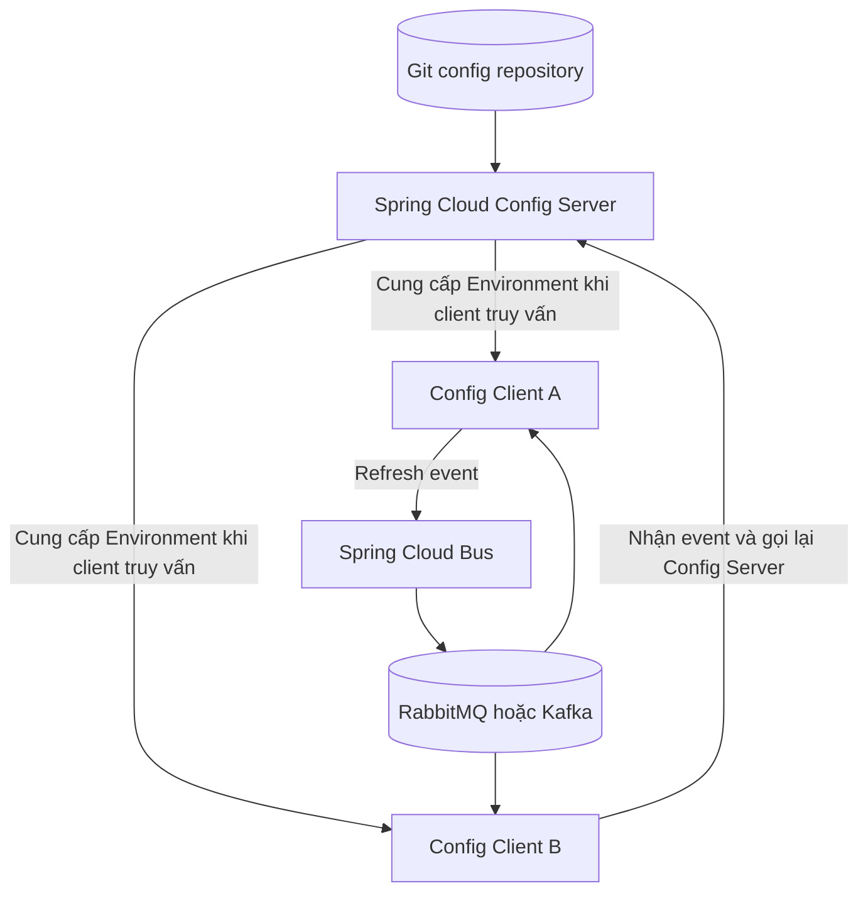

# Chọn starter Bus với RabbitMQ hoặc Kafka

Spring Cloud Bus giúp các ứng dụng Spring Cloud gửi và nhận sự kiện qua một message broker chung. Trong bài toán cấu hình tập trung, một instance có thể phát sự kiện refresh để các instance khác nhận thông báo và nạp lại cấu hình từ Config Server. Bus không lưu cấu hình và cũng không gửi toàn bộ nội dung cấu hình mới trong sự kiện; nó phân phối thông báo để các client thực hiện hành động tương ứng.

Spring Cloud Bus tích hợp với Spring Cloud Stream thông qua binder. Hai lựa chọn phổ biến là RabbitMQ và Kafka, được đưa vào ứng dụng bằng hai starter tương ứng:

- `spring-cloud-starter-bus-amqp` dùng RabbitMQ binder.
- `spring-cloud-starter-bus-kafka` dùng Kafka binder.

Lựa chọn phù hợp thường dựa trên message broker tổ chức đang vận hành, kỹ năng của đội nền tảng, yêu cầu bảo mật và cách giám sát. Sự kiện refresh thường có lưu lượng thấp; không cần triển khai Kafka chỉ vì hệ thống có nhiều ứng dụng, cũng không cần thêm RabbitMQ nếu nền tảng đã có một Kafka cluster được quản trị tốt.

## 1. Spring Cloud Bus nằm ở đâu trong kiến trúc?

Khi cấu hình trong Git thay đổi, Config Server có thể trả phiên bản mới cho client. Tuy nhiên, các ứng dụng đang chạy cần nhận tín hiệu để thực hiện refresh. Spring Cloud Bus cung cấp kênh gửi tín hiệu đó qua broker.



Luồng cơ bản:

1. Nhóm vận hành thay đổi cấu hình trong Git và phát hành commit hoặc label mới.
2. Config Server có thể phục vụ cấu hình mới theo application, profile và label.
3. Một node phát sự kiện Bus, thường qua endpoint `/actuator/busrefresh`.
4. Broker chuyển sự kiện tới các node cùng tham gia Bus.
5. Các Config Client nhận sự kiện và thực hiện refresh theo cơ chế Spring Cloud Context.
6. Environment và các bean hỗ trợ refresh được cập nhật theo khả năng của từng ứng dụng.

Bus chỉ truyền sự kiện điều khiển. Client vẫn lấy cấu hình từ Config Server; nếu Config Server chưa nhìn thấy commit mới hoặc client đang pin một label cũ, refresh có thể vẫn nhận cấu hình cũ.

## 2. Chọn đúng starter

| Starter | Binder | Broker | Nên chọn khi |
|---|---|---|---|
| `spring-cloud-starter-bus-amqp` | Rabbit binder | RabbitMQ | Tổ chức đã vận hành RabbitMQ, quen mô hình exchange/queue và muốn dùng broker này cho sự kiện Bus |
| `spring-cloud-starter-bus-kafka` | Kafka binder | Apache Kafka | Tổ chức đã có Kafka cluster, quản lý topic/ACL/monitoring và muốn dùng hạ tầng messaging hiện hữu |

Hai starter cung cấp tích hợp Bus với binder tương ứng. Thông thường, mỗi ứng dụng chọn một starter theo broker được sử dụng. Không thêm cả hai starter theo thói quen; nếu classpath có nhiều binder, ứng dụng có thể cần cấu hình binder mặc định hoặc định tuyến binding rõ ràng. Chỉ dùng nhiều binder khi kiến trúc thực sự cần và đã cấu hình, kiểm thử riêng.

Các ứng dụng cần tham gia gửi hoặc nhận sự kiện Bus phải có starter phù hợp và kết nối tới cùng broker/destination. Nếu muốn gọi endpoint Bus trên Config Server để phát sự kiện, Config Server cũng cần starter Bus và cấu hình broker tương ứng. Nếu sự kiện được phát từ một Config Client, node phát và các node nhận đều phải tham gia cùng Bus.

Bus starter không thay thế starter của chức năng cấu hình. Một Config Client vẫn cần `spring-cloud-starter-config`; một Config Server vẫn cần `spring-cloud-config-server`. Thêm Bus starter vào các ứng dụng cần gửi/nhận sự kiện, rồi giữ dependency Config Client hoặc Config Server tương ứng với vai trò của từng ứng dụng.

## 3. Quản lý phiên bản bằng Spring Cloud BOM

Không tự chọn phiên bản starter Bus tách rời khỏi Spring Boot và Spring Cloud. Dùng Spring Cloud BOM tương thích với phiên bản Spring Boot của dự án để quản lý các thành phần Config, Bus, Stream và binder.

Ví dụ Maven với RabbitMQ:

```xml
<dependencyManagement>
    <dependencies>
        <dependency>
            <groupId>org.springframework.cloud</groupId>
            <artifactId>spring-cloud-dependencies</artifactId>
            <version>${spring-cloud.version}</version>
            <type>pom</type>
            <scope>import</scope>
        </dependency>
    </dependencies>
</dependencyManagement>

<dependencies>
    <dependency>
        <groupId>org.springframework.cloud</groupId>
        <artifactId>spring-cloud-starter-bus-amqp</artifactId>
    </dependency>
    <dependency>
        <groupId>org.springframework.boot</groupId>
        <artifactId>spring-boot-starter-actuator</artifactId>
    </dependency>
</dependencies>
```

Nếu dùng Kafka, thay starter AMQP bằng:

```xml
<dependency>
    <groupId>org.springframework.cloud</groupId>
    <artifactId>spring-cloud-starter-bus-kafka</artifactId>
</dependency>
```

Với Gradle, có thể khai báo BOM và starter như sau:

```groovy
dependencies {
    implementation platform("org.springframework.cloud:spring-cloud-dependencies:${springCloudVersion}")
    implementation "org.springframework.cloud:spring-cloud-starter-bus-amqp"
    implementation "org.springframework.boot:spring-boot-starter-actuator"
}
```

Khi chọn Kafka, thay `spring-cloud-starter-bus-amqp` bằng `spring-cloud-starter-bus-kafka`. Trong dự án thực tế, hãy dùng Spring Cloud release train tương thích và kiểm tra dependency tree để tránh vô tình kéo vào hai binder hoặc các phiên bản Stream không tương thích.

## 4. Cấu hình Bus dùng chung

Các node cùng tham gia một Bus cần thống nhất destination logic và phải kết nối tới cùng broker hoặc cụm broker tương ứng. Destination mặc định thường là `springCloudBus`; có thể đặt tên riêng qua `spring.cloud.bus.destination`.

Ví dụ phần cấu hình chung:

```yaml
spring:
  application:
    name: order-service
  cloud:
    bus:
      destination: springCloudBus
```

Tên destination nên được thống nhất trong cùng môi trường. Có thể dùng destination khác nhau cho development, staging và production để tránh sự kiện từ môi trường thử nghiệm ảnh hưởng tới dịch vụ production.

Mỗi node cần có định danh Bus duy nhất. `spring.cloud.bus.id` có thể được cấu hình tường minh nếu cách tạo ID mặc định của môi trường không bảo đảm duy nhất. Một định danh thường kết hợp tên ứng dụng với instance ID, pod name hoặc một giá trị duy nhất khác. Tránh để hai instance dùng cùng ID vì việc nhận diện và định tuyến sự kiện có thể trở nên khó đoán.

Không cần cấu hình lại toàn bộ Spring Cloud Stream nếu starter Bus đã cung cấp binder mặc định và nhu cầu chỉ là Bus cơ bản. Chỉ bổ sung cấu hình binder khi cần chỉ định broker, bảo mật, destination hoặc các tùy chọn vận hành của môi trường.

## 5. Cấu hình RabbitMQ với `spring-cloud-starter-bus-amqp`

RabbitMQ phù hợp khi tổ chức đã dùng RabbitMQ cho messaging, có quy trình quản lý exchange/queue, virtual host, user và permission. Rabbit binder kết nối tới RabbitMQ thông qua cấu hình kết nối của Spring Boot.

Ví dụ cấu hình:

```yaml
spring:
  application:
    name: order-service
  cloud:
    bus:
      destination: springCloudBus
  rabbitmq:
    host: rabbitmq.internal
    port: 5671
    username: ${RABBITMQ_USERNAME}
    password: ${RABBITMQ_PASSWORD}
    virtual-host: /platform
    ssl:
      enabled: true
```

Các biến `RABBITMQ_USERNAME` và `RABBITMQ_PASSWORD` phải được cấp từ secret manager hoặc cơ chế quản lý secret của nền tảng. Không commit password vào Git config repository hoặc file cấu hình phân phối cho mọi client.

Những điểm cần thống nhất khi vận hành RabbitMQ:

- Các node Bus kết nối đúng cluster, virtual host và destination.
- User có quyền cần thiết để khai báo hoặc sử dụng exchange/queue theo chính sách broker.
- TLS được bật và certificate được xác minh.
- Có monitoring cho kết nối, exchange, queue, consumer và lỗi publish/consume.
- Mỗi môi trường có ranh giới destination và quyền truy cập phù hợp.

RabbitMQ thường dễ lựa chọn nếu đội vận hành đã có cluster HA, quy trình quản lý vhost và kinh nghiệm xử lý queue. Không cần tạo một RabbitMQ riêng chỉ để gửi vài sự kiện refresh nếu một nền tảng messaging khác đã đáp ứng yêu cầu.

## 6. Cấu hình Kafka với `spring-cloud-starter-bus-kafka`

Kafka phù hợp khi tổ chức đã có Kafka cluster và chuẩn hóa cách quản lý topic, broker, ACL, TLS/SASL, monitoring và consumer. Kafka binder dùng cấu hình của Spring Cloud Stream Kafka binder.

Ví dụ cấu hình:

```yaml
spring:
  application:
    name: order-service
  cloud:
    bus:
      destination: springCloudBus
    stream:
      kafka:
        binder:
          brokers: kafka-1.internal:9093,kafka-2.internal:9093
          configuration:
            security.protocol: SASL_SSL
            sasl.mechanism: SCRAM-SHA-512
            sasl.jaas.config: ${KAFKA_SASL_JAAS_CONFIG}
```

`KAFKA_SASL_JAAS_CONFIG` là giá trị nhạy cảm, cần lấy từ secret manager hoặc injection an toàn của môi trường triển khai. Không ghi credential vào repository. Tên broker, port và cơ chế SASL trong ví dụ cần khớp cấu hình cluster thật.

Với Kafka binder, lưu ý:

- `spring.cloud.stream.kafka.binder.brokers` cấu hình broker cho binder; không mặc định rằng chỉ khai báo `spring.kafka.bootstrap-servers` là đã cấu hình Kafka binder của Spring Cloud Stream.
- `spring.cloud.bus.destination` xác định destination logic mà Bus dùng; với Kafka, destination này được ánh xạ thành topic theo binder.
- Cần cấp ACL cho các ứng dụng để tạo/đọc/ghi topic theo chính sách triển khai.
- Theo dõi broker health, partition, consumer lag và lỗi xác thực.
- Bật TLS/SASL theo chuẩn bảo mật của nền tảng.

Kafka hữu ích khi đã là hạ tầng messaging chuẩn của tổ chức hoặc cần quản trị tập trung các luồng event. Tuy nhiên, sự kiện Bus chỉ là tín hiệu điều khiển refresh; không dùng nó làm kho lịch sử cấu hình hay thay thế Git/Config Server.

## 7. Kích hoạt refresh qua Bus

Để gửi sự kiện refresh bằng HTTP, ứng dụng cần Actuator và expose endpoint Bus tương ứng. Ví dụ:

```yaml
management:
  endpoints:
    web:
      exposure:
        include: health,info,busrefresh
```

Gửi POST tới endpoint trên một node tham gia Bus:

```bash
curl --fail --silent --show-error \
  --request POST \
  https://config-server.internal/actuator/busrefresh
```

Node nhận request phát sự kiện refresh qua broker. Các node Bus phù hợp nhận sự kiện và refresh cấu hình theo cơ chế Spring Cloud Context. Endpoint cần xác thực, phân quyền và giới hạn trong mạng quản trị. Không expose công khai một endpoint có thể kích hoạt refresh hàng loạt.

Một số phiên bản hỗ trợ định tuyến refresh tới nhóm đích qua destination trên endpoint, ví dụ dạng `/actuator/busrefresh/{destination}`. Cú pháp và cách định danh destination cần được kiểm tra theo phiên bản đang dùng trước khi áp dụng; luôn thử trên môi trường staging.

Nếu cần thay đổi thuộc tính môi trường thay vì yêu cầu refresh, Spring Cloud Bus còn có endpoint `busenv` trong các phiên bản hỗ trợ. Đây là thao tác điều khiển có tác động rộng, cần kiểm soát quyền và đánh giá key được thay đổi. Không dùng `busenv` để phát tán password, token hoặc private key.

## 8. RabbitMQ hay Kafka: so sánh theo nhu cầu vận hành

| Tiêu chí | RabbitMQ | Kafka |
|---|---|---|
| Mô hình quen thuộc | Exchange, routing key, queue và consumer | Topic, partition, producer và consumer group |
| Phù hợp khi | Đã có RabbitMQ và cần pub/sub message nhẹ | Đã có Kafka làm nền tảng event/messaging chung |
| Vận hành | Quản lý vhost, exchange, queue, connection và consumer | Quản lý cluster, topic, partition, replication, ACL và consumer lag |
| Cấu hình binder | `spring.rabbitmq.*` và các tùy chọn Rabbit binder | `spring.cloud.stream.kafka.binder.*` |
| Bảo mật | TLS, user/password, vhost và permission | TLS, SASL, ACL và cấu hình broker/client |
| Quy mô hệ thống | Phù hợp event điều khiển và messaging theo queue | Phù hợp nền tảng streaming/event lớn; Bus vẫn chỉ phát các thông báo điều khiển |
| Chi phí lựa chọn | Thấp nếu RabbitMQ đã được vận hành | Thấp nếu Kafka đã được vận hành; cao hơn nếu phải dựng riêng |

Đối với refresh cấu hình, số lượng sự kiện thường không lớn. Do đó, tiêu chí quan trọng thường là hạ tầng có sẵn, độ tin cậy, khả năng phân quyền, kỹ năng vận hành và mức độ quan sát, thay vì benchmark thông lượng cực đại.

## 9. Có nên cài cả hai starter?

Thông thường, không. Một ứng dụng nên chọn một binder mặc định cho Bus để tránh cấu hình mơ hồ. Khi cả Rabbit và Kafka binder cùng có trên classpath, Spring Cloud Stream có thể cần xác định binder mặc định hoặc cấu hình nhiều binder tường minh.

Chỉ cài cả hai khi có một nhu cầu kiến trúc cụ thể, ví dụ một số binding dùng RabbitMQ còn binding khác dùng Kafka. Khi đó cần cấu hình binder name, binding-to-binder mapping và thuộc tính từng binder theo tài liệu Spring Cloud Stream của phiên bản đang dùng. Đừng thêm hai Bus starter chỉ với mục đích “dự phòng” vì hai broker không tự đồng bộ message với nhau.

Nếu muốn chuyển broker từ RabbitMQ sang Kafka, hãy thực hiện như một thay đổi triển khai có kế hoạch: đổi dependency, cấu hình binder, quyền broker, destination, kiểm thử tất cả node và rollout đồng bộ. Một node publish vào RabbitMQ sẽ không tự động được node chỉ nghe Kafka nhận sự kiện.

## 10. Bảo mật và cô lập môi trường

Sự kiện Bus có thể khiến nhiều ứng dụng tải lại cấu hình cùng lúc. Người không có quyền phát sự kiện có thể gây tải lên Config Server hoặc kích hoạt thay đổi diện rộng. Vì vậy cần bảo vệ cả broker và endpoint điều khiển.

- Dùng tài khoản broker riêng cho ứng dụng hoặc nhóm ứng dụng, với quyền tối thiểu.
- Bật TLS; dùng SASL/ACL với Kafka và user/vhost permission với RabbitMQ.
- Không dùng chung credential development và production.
- Tách destination theo môi trường hoặc trust boundary; không để staging và production cùng nghe một destination ngoài chủ đích.
- Đảm bảo `spring.cloud.bus.id` duy nhất cho từng node.
- Bảo vệ `/actuator/busrefresh` và `/actuator/busenv` bằng authentication, authorization và mạng quản trị.
- Không ghi payload nhạy cảm, credential hoặc toàn bộ Environment vào log sự kiện.
- Theo dõi publish failure, consumer failure, lag và trạng thái refresh từng ứng dụng.

Bus không thay thế quyền truy cập Config Server. Một node nhận sự kiện vẫn cần có quyền truy cập Config Server và backend để lấy cấu hình. Hãy bảo vệ hai đường đi độc lập: broker để nhận sự kiện và Config Server để lấy property sources.

## 11. Vận hành khi broker hoặc node bị lỗi

Nếu broker không sẵn sàng, node có thể không publish hoặc nhận được sự kiện Bus. Config Server vẫn có thể phục vụ cấu hình qua HTTP; vấn đề nằm ở việc thông báo refresh không tới các client.

Một số tình huống cần chuẩn bị:

| Sự cố | Tác động | Cách xử lý |
|---|---|---|
| Broker ngừng hoạt động | Không gửi/nhận được Bus event trong thời gian lỗi | Khôi phục broker; sau đó phát lại refresh có kiểm soát hoặc restart client |
| Một client mất kết nối broker | Instance đó có thể bỏ lỡ sự kiện | Kiểm tra trạng thái consumer và chủ động refresh instance sau khi kết nối lại |
| Config Server chưa thấy commit mới | Client nhận event nhưng tải lại cấu hình cũ | Xác minh Git fetch, label và response Config Server trước khi refresh hàng loạt |
| Một client không có quyền đọc cấu hình | Nhận event nhưng refresh thất bại | Sửa authorization Config Server/backend và kiểm tra riêng instance |
| Một số replica không xử lý event | Cấu hình giữa các replica có thể lệch | Quan sát từng instance và chạy refresh/restart bù có kiểm soát |
| Destination giữa các node khác nhau | Các node không nhận cùng một event | Đồng bộ `spring.cloud.bus.destination` và cấu hình môi trường |

Không nên giả định broker đã nhận message nghĩa là mọi client đã refresh thành công. Cần có log, metric hoặc cơ chế xác nhận theo từng node. Đối với thay đổi quan trọng, có thể kết hợp Bus với rollout/restart và kiểm tra readiness sau thay đổi.

## 12. Kiểm thử tích hợp trước khi dùng production

Một bài kiểm thử tối thiểu nên có hai instance của cùng một Config Client và một Config Server, cùng kết nối tới một broker thử nghiệm.

1. Khởi động broker RabbitMQ hoặc Kafka trong môi trường kiểm thử.
2. Khởi động Config Server và hai instance client với cùng destination Bus nhưng ID riêng.
3. Xác minh cả hai client truy cập được Config Server và nhận cấu hình ban đầu.
4. Thay đổi một key không nhạy cảm trong Git, sau đó xác nhận Config Server trả giá trị mới theo label cần kiểm tra.
5. Gửi POST `/actuator/busrefresh` từ một node được bảo vệ.
6. Xác nhận cả hai client nhận sự kiện, refresh và sử dụng giá trị mới nếu bean hỗ trợ cập nhật nóng.
7. Tắt kết nối broker của một instance để kiểm tra khả năng phát hiện node bỏ lỡ event.
8. Khôi phục kết nối và xác minh quy trình refresh bù hoặc restart.

Trong bài kiểm thử, không chỉ kiểm tra HTTP status của endpoint phát sự kiện. Cần kiểm tra kết quả ở từng instance, vì publish thành công không chứng minh tất cả consumer đã xử lý thành công.

## 13. Lỗi thường gặp

| Hiện tượng | Nguyên nhân thường gặp | Cách xử lý |
|---|---|---|
| Không thấy endpoint `/actuator/busrefresh` | Chưa thêm Bus starter, Actuator chưa có hoặc endpoint chưa expose | Kiểm tra dependency, version compatibility và management exposure |
| Endpoint trả 401/403 | Thiếu xác thực hoặc quyền gọi | Kiểm tra security policy và danh tính vận hành |
| Endpoint trả thành công nhưng client không refresh | Client chưa có Bus starter, broker/destination khác hoặc consumer lỗi | Kiểm tra dependency và kết nối broker ở từng node |
| RabbitMQ connection refused | Sai host/port, vhost, credential hoặc TLS | Kiểm tra network, user permission, vhost và certificate |
| Kafka authentication failed | Sai SASL config, ACL hoặc broker endpoint | Kiểm tra binder configuration, secret và ACL topic |
| Chỉ một số node nhận event | Node mất kết nối, ID/destination sai hoặc consumer lỗi | Theo dõi từng instance và phát hiện node bỏ lỡ sự kiện |
| Refresh xong vẫn nhận cấu hình cũ | Config Server chưa fetch commit mới hoặc client dùng label cũ | Xác minh Config Server response trước khi phát Bus event |
| Có hai binder và ứng dụng không khởi động | Binder mặc định không rõ hoặc nhiều binder cấu hình xung đột | Chỉ giữ starter cần thiết hoặc cấu hình multi-binder tường minh |
| Development làm refresh production | Hai môi trường dùng chung destination/broker không cô lập | Tách destination, broker credential và network policy theo môi trường |

## 14. Quy trình chọn starter

Trước khi thêm dependency, trả lời lần lượt:

1. Tổ chức đã có RabbitMQ hoặc Kafka được vận hành production chưa?
2. Đội nền tảng có quy trình cấp credential, TLS, ACL và monitoring cho broker đó không?
3. Các node Config Client và node phát sự kiện có thể kết nối cùng broker/destination không?
4. Có cần tách môi trường hoặc nhóm ứng dụng bằng destination và quyền broker không?
5. Ai được gọi endpoint Bus và làm thế nào xác nhận từng node đã refresh?
6. Nếu broker ngừng hoạt động, hệ thống sẽ refresh bù hoặc restart như thế nào?

Nếu tổ chức đang dùng RabbitMQ làm nền tảng messaging chuẩn, chọn `spring-cloud-starter-bus-amqp`. Nếu Kafka là nền tảng event chuẩn và đội vận hành đã quản lý topic/ACL/consumer, chọn `spring-cloud-starter-bus-kafka`. Nếu chưa có broker nào và chỉ cần refresh một vài instance, hãy cân nhắc liệu gọi refresh qua orchestration có đơn giản và phù hợp hơn việc triển khai thêm một message broker.

## 15. Mục tiêu cần đạt sau bài học

Sau bài này, người học cần có khả năng:

- Giải thích vai trò của Spring Cloud Bus và mối quan hệ giữa Bus, broker và Config Server.
- Chọn đúng `spring-cloud-starter-bus-amqp` hoặc `spring-cloud-starter-bus-kafka` theo hạ tầng messaging.
- Khai báo dependency với Spring Cloud BOM tương thích.
- Cấu hình RabbitMQ qua `spring.rabbitmq.*` và Kafka binder qua `spring.cloud.stream.kafka.binder.*`.
- Giải thích destination, Bus ID và yêu cầu các node tham gia cùng Bus.
- Dùng endpoint `/actuator/busrefresh` có bảo vệ để gửi sự kiện refresh.
- Phân tích tác động khi broker, consumer hoặc Config Server gặp sự cố.
- Thiết kế kiểm thử và monitoring để xác nhận từng instance đã xử lý refresh.

**Tự kiểm tra:** Một tổ chức đã có Kafka cluster với TLS, SASL và ACL được vận hành chuẩn; các dịch vụ Spring Boot cần nhận sự kiện refresh qua Bus. Hãy chọn starter, chỉ ra namespace cấu hình Kafka binder, cấu hình destination chung và giải thích vì sao thêm RabbitMQ starter cùng lúc không tự tạo cơ chế dự phòng. Nếu một client mất kết nối broker khi phát sự kiện, cần kiểm tra và khôi phục trạng thái cấu hình của instance đó như thế nào?
