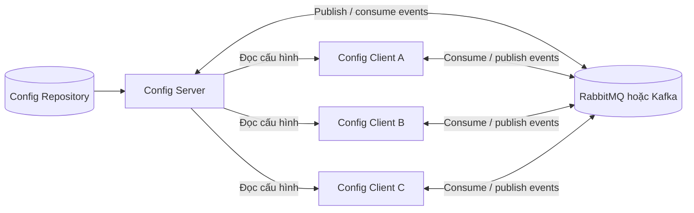

# Cấu hình broker và kết nối trên Config Server cùng các client

Spring Cloud Bus giúp phân phối sự kiện giữa nhiều ứng dụng Spring Boot thông qua một message broker. Trong hệ thống Spring Cloud Config, Config Server và các Config Client cùng kết nối tới broker để một sự kiện như refresh có thể được gửi từ một instance và nhận bởi các instance khác.

Để Bus hoạt động, các thành phần tham gia phải dùng cấu hình broker tương thích: cùng loại binder, cùng địa chỉ broker, cùng destination và thông tin xác thực phù hợp. Config Server thường là nơi phát sự kiện sau khi cấu hình đã được cập nhật; mỗi Config Client nhận sự kiện rồi tự đọc lại cấu hình từ Config Server. Broker phân phối tín hiệu, còn nội dung cấu hình vẫn được lấy từ Config Server theo application, profile và label của từng client.

## 1. Kiến trúc kết nối

Spring Cloud Bus dựa trên Spring Cloud Stream binder để kết nối với message broker. Hai lựa chọn thường gặp là RabbitMQ và Apache Kafka. Trong một triển khai, Config Server và các Config Client cần cùng tham gia vào một Bus destination để nhận và phát sự kiện trên cùng kênh.



Vai trò của từng thành phần:

| Thành phần | Trách nhiệm |
|---|---|
| Config Repository | Lưu phiên bản cấu hình được quản lý |
| Config Server | Cung cấp Environment theo application/profile/label và có thể phát sự kiện Bus |
| Config Client | Nhận sự kiện, đọc lại cấu hình từ Config Server và cập nhật Environment |
| Message broker | Chuyển tiếp sự kiện giữa các ứng dụng tham gia Bus |
| Actuator Bus endpoint | Cung cấp HTTP endpoint để người vận hành phát sự kiện như refresh |

Bus không tự đẩy toàn bộ nội dung YAML hoặc properties qua broker. Sự kiện báo cho các client biết cần thực hiện hành động; mỗi client kết nối tới Config Server để lấy cấu hình phù hợp với chính nó. Do đó, Config Server vẫn phải truy cập được từ các client tại thời điểm refresh.

## 2. Chọn broker và dependency

Mỗi ứng dụng tham gia Bus cần dependency Spring Cloud Bus tương ứng với broker đã chọn. Với Maven, có thể dùng một trong hai starter sau:

**RabbitMQ:**

```xml
<dependency>
    <groupId>org.springframework.cloud</groupId>
    <artifactId>spring-cloud-starter-bus-amqp</artifactId>
</dependency>
```

**Apache Kafka:**

```xml
<dependency>
    <groupId>org.springframework.cloud</groupId>
    <artifactId>spring-cloud-starter-bus-kafka</artifactId>
</dependency>
```

Config Server và từng Config Client cần starter tương ứng nếu đều tham gia gửi/nhận sự kiện. Các client vẫn cần `spring-cloud-starter-config`; Config Server vẫn cần `spring-cloud-config-server`. Thành phần expose HTTP trigger cần Spring Boot Actuator.

Ví dụ dependencies cốt lõi của Config Server dùng RabbitMQ:

```xml
<dependencies>
    <dependency>
        <groupId>org.springframework.cloud</groupId>
        <artifactId>spring-cloud-config-server</artifactId>
    </dependency>
    <dependency>
        <groupId>org.springframework.cloud</groupId>
        <artifactId>spring-cloud-starter-bus-amqp</artifactId>
    </dependency>
    <dependency>
        <groupId>org.springframework.boot</groupId>
        <artifactId>spring-boot-starter-actuator</artifactId>
    </dependency>
</dependencies>
```

Ví dụ dependencies cốt lõi của một Config Client:

```xml
<dependencies>
    <dependency>
        <groupId>org.springframework.cloud</groupId>
        <artifactId>spring-cloud-starter-config</artifactId>
    </dependency>
    <dependency>
        <groupId>org.springframework.cloud</groupId>
        <artifactId>spring-cloud-starter-bus-amqp</artifactId>
    </dependency>
    <dependency>
        <groupId>org.springframework.boot</groupId>
        <artifactId>spring-boot-starter-actuator</artifactId>
    </dependency>
</dependencies>
```

Nếu dùng Kafka, thay `spring-cloud-starter-bus-amqp` bằng `spring-cloud-starter-bus-kafka` ở tất cả ứng dụng tham gia cùng Bus. Quản lý phiên bản Spring Boot và Spring Cloud bằng BOM tương thích; không tự ghép phiên bản starter khác release train.

## 3. Cấu hình chung của Bus

Các ứng dụng tham gia cần thống nhất destination của Bus. Thuộc tính phổ biến là `spring.cloud.bus.destination`; nếu không khai báo, Spring Cloud Bus sử dụng destination mặc định của phiên bản đang dùng (thường là `springCloudBus`). Đặt rõ destination giúp cấu hình giữa server và client dễ đối chiếu:

```yaml
spring:
  cloud:
    bus:
      destination: config-events
```

Giá trị này phải nhất quán trên Config Server và các Config Client cùng tham gia một Bus. Nếu một client dùng destination khác, nó có thể kết nối broker thành công nhưng không nhận sự kiện phát trên destination còn lại.

Không dùng chung một destination cho các hệ thống không cùng phạm vi tin cậy hoặc không cùng vòng đời vận hành. Có thể tách destination theo môi trường hoặc nhóm dịch vụ để tránh sự kiện từ môi trường thử nghiệm ảnh hưởng tới production.

## 4. Cấu hình RabbitMQ trên Config Server và client

Với RabbitMQ, mỗi ứng dụng cần biết địa chỉ broker, virtual host và credential được cấp. Ví dụ cấu hình dùng biến môi trường để cung cấp thông tin nhạy cảm:

```yaml
spring:
  rabbitmq:
    addresses: ${BUS_RABBITMQ_ADDRESSES:localhost:5672}
    username: ${BUS_RABBITMQ_USERNAME}
    password: ${BUS_RABBITMQ_PASSWORD}
    virtual-host: ${BUS_RABBITMQ_VHOST:/config}
    ssl:
      enabled: ${BUS_RABBITMQ_SSL:false}

  cloud:
    bus:
      destination: config-events
```

Ví dụ local dùng `localhost:5672` và TLS tắt để minh họa. Trong môi trường dùng chung, cấp broker URL, username, password và virtual host từ secret manager hoặc nền tảng triển khai; bật TLS và xác minh chứng chỉ theo chính sách hạ tầng.

Áp dụng cấu hình kết nối tương ứng trên Config Server và từng Config Client. Các ứng dụng phải có quyền publish và consume trên destination cần thiết. Nên cấp tài khoản riêng hoặc quyền tối thiểu cho từng nhóm ứng dụng thay vì dùng tài khoản quản trị broker.

RabbitMQ thường dùng exchange/queue được binder quản lý theo destination và cấu hình binding. Không cần tự tạo thủ công topology nếu ứng dụng đã được cấu hình để binder tự khai báo và tài khoản có quyền phù hợp. Nếu hạ tầng yêu cầu quản trị topology thủ công, hãy đồng bộ tên destination, exchange, queue và quyền truy cập với cấu hình binder của phiên bản đang dùng.

### 4.1. Cấu hình bằng host và port

Nếu không dùng `addresses`, có thể khai báo host và port riêng:

```yaml
spring:
  rabbitmq:
    host: rabbitmq.internal
    port: 5671
    username: ${BUS_RABBITMQ_USERNAME}
    password: ${BUS_RABBITMQ_PASSWORD}
    virtual-host: /config
    ssl:
      enabled: true
```

Port `5671` thường được dùng cho AMQPS, nhưng endpoint thực tế phụ thuộc cấu hình broker. Không mặc định rằng chỉ đổi port là đã bật TLS; cần bật SSL và cấu hình trust/certificate phù hợp.

## 5. Cấu hình Kafka trên Config Server và client

Với Kafka, các ứng dụng cần trỏ tới cùng cluster và dùng cùng destination topic cho Bus:

```yaml
spring:
  kafka:
    bootstrap-servers: ${BUS_KAFKA_BOOTSTRAP_SERVERS:localhost:9092}
    properties:
      security.protocol: ${BUS_KAFKA_SECURITY_PROTOCOL:PLAINTEXT}

  cloud:
    bus:
      destination: config-events
```

Ví dụ trên dùng `PLAINTEXT` cho local lab. Trong môi trường production, sử dụng `SASL_SSL` hoặc cơ chế bảo mật được Kafka cluster hỗ trợ, đồng thời cấp truststore/credential qua secret manager hoặc biến môi trường được bảo vệ.

Ví dụ minh họa cấu hình SASL:

```yaml
spring:
  kafka:
    bootstrap-servers: ${BUS_KAFKA_BOOTSTRAP_SERVERS}
    properties:
      security.protocol: SASL_SSL
      sasl.mechanism: SCRAM-SHA-512
      sasl.jaas.config: ${BUS_KAFKA_SASL_JAAS_CONFIG}

  cloud:
    bus:
      destination: config-events
```

`BUS_KAFKA_SASL_JAAS_CONFIG` phải được cấp dưới dạng secret; không ghi chuỗi JAAS chứa username/password vào repository. Tên cơ chế SASL và security protocol phải khớp cấu hình listener của Kafka cluster.

Kafka binder quản lý producer/consumer và subscription theo destination. Kiểm tra quyền ACL cho topic, consumer group và các thao tác metadata mà binder cần. Nếu topic được tạo sẵn, xác nhận retention, replication factor và số partition phù hợp với tiêu chuẩn vận hành của cluster.

## 6. Giữ cấu hình Bus đồng nhất giữa các ứng dụng

Một hệ thống có Config Server và nhiều client có thể dùng cùng một đoạn cấu hình Bus chung. Ví dụ tệp local hoặc cấu hình triển khai của từng ứng dụng:

```yaml
spring:
  cloud:
    bus:
      destination: config-events

  rabbitmq:
    addresses: ${BUS_RABBITMQ_ADDRESSES}
    username: ${BUS_RABBITMQ_USERNAME}
    password: ${BUS_RABBITMQ_PASSWORD}
    virtual-host: ${BUS_RABBITMQ_VHOST:/config}
    ssl:
      enabled: true
```

Nếu chọn Kafka, thay phần `spring.rabbitmq` bằng `spring.kafka` tương ứng. Không cấu hình một nửa ứng dụng dùng RabbitMQ và nửa còn lại dùng Kafka trong cùng một Bus destination rồi kỳ vọng chúng tự giao tiếp; hai broker không chia sẻ message nếu không có cầu nối được thiết kế riêng.

Các giá trị cần nhất quán:

- Loại Bus starter/binder.
- Địa chỉ cluster hoặc broker.
- `spring.cloud.bus.destination`.
- Cơ chế xác thực và quyền publish/consume.
- TLS, trust chain và chính sách mạng.
- Cấu hình identity của từng instance nếu tổ chức tùy chỉnh Bus ID.

Spring Cloud Bus tạo định danh instance để tránh xử lý lặp lại sự kiện do chính instance phát ra và để hỗ trợ định tuyến. Mặc định framework tạo ID dựa trên thông tin ứng dụng/instance. Nếu tùy chỉnh `spring.cloud.bus.id`, phải bảo đảm ID duy nhất cho từng instance đang chạy; ID trùng có thể làm định tuyến hoặc loại trừ sự kiện không như mong muốn.

## 7. Expose endpoint phát sự kiện refresh

Để gửi sự kiện refresh qua Bus, ứng dụng phát sự kiện cần có Bus starter và Actuator endpoint `busrefresh`. Ví dụ trên Config Server:

```yaml
management:
  endpoints:
    web:
      exposure:
        include: health,info,busrefresh
```

Sau khi cấu hình mới đã được commit vào backend và Config Server có thể đọc phiên bản mới, gửi POST:

```bash
curl -i -X POST "https://config-server.internal/actuator/busrefresh"
```

Endpoint phát một sự kiện refresh lên Bus. Các Config Client tham gia nhận sự kiện sẽ đọc lại cấu hình từ Config Server. Mỗi client dùng application/profile/label riêng của nó để lấy đúng bộ cấu hình.

Nếu muốn phát sự kiện từ một Config Client hoặc một ứng dụng quản trị khác, ứng dụng đó cũng phải tham gia cùng Bus và được phép publish. Thông thường chọn một điểm phát sự kiện rõ ràng, chẳng hạn Config Server hoặc một control service, để dễ kiểm soát quyền và audit.

### 7.1. Làm mới theo phạm vi đích

Một số phiên bản Spring Cloud Bus hỗ trợ endpoint có destination path để giới hạn sự kiện cho một nhóm ứng dụng/instance phù hợp. Ví dụ dạng endpoint:

```text
POST /actuator/busrefresh/{destination}
```

Destination được so khớp với định danh Bus của ứng dụng theo quy tắc của phiên bản đang dùng. Hãy kiểm tra tài liệu phiên bản và thử trên môi trường staging trước khi sử dụng trong production. Nếu không truyền destination, sự kiện refresh thường được phát cho các instance tham gia Bus.

## 8. Kiểm tra kết nối broker và sự kiện đầu tiên

Nên xác minh từng tầng trước khi thử refresh toàn hệ thống:

1. **Kiểm tra mạng:** từ Config Server và từng client, xác nhận DNS, route, firewall và port broker có thể truy cập.
2. **Kiểm tra xác thực:** xác nhận username/password, virtual host hoặc Kafka ACL được chấp nhận.
3. **Kiểm tra TLS:** xác minh certificate, hostname và trust chain nếu dùng TLS.
4. **Kiểm tra binder:** đọc log khởi động để xác nhận binder tạo kết nối và binding thành công.
5. **Kiểm tra destination:** xác nhận tất cả ứng dụng dùng cùng `spring.cloud.bus.destination`.
6. **Kiểm tra instance identity:** bảo đảm Bus ID không trùng nếu đã tùy chỉnh.
7. **Phát sự kiện thử:** gọi `busrefresh` trên môi trường thử nghiệm và quan sát log nhận event ở các client.
8. **Xác minh cấu hình:** kiểm tra client đã đọc giá trị mới từ Config Server và bean hỗ trợ refresh đã áp dụng thay đổi.

Để kiểm tra broker ở mức hạ tầng, có thể dùng công cụ quản trị RabbitMQ hoặc Kafka để quan sát connection, exchange/topic, queue/consumer group, message rate và consumer lag. Không chỉ dựa vào việc Config Server trả HTTP 200: endpoint có thể nhận yêu cầu nhưng client vẫn không nhận event nếu binding hoặc destination sai.

## 9. Theo dõi và xử lý lỗi

| Hiện tượng | Nguyên nhân có thể có | Cách kiểm tra |
|---|---|---|
| Config Server không khởi động | Thiếu Bus starter, broker URL sai hoặc credential không hợp lệ | Kiểm tra dependency, log binder, hostname và quyền broker |
| Client kết nối broker nhưng không nhận event | Destination khác, binding lỗi hoặc client không tham gia cùng Bus | So sánh `spring.cloud.bus.destination`, binder và log consumer |
| Một số client nhận, số khác không | Network, credential, ACL hoặc consumer binding riêng của instance | Kiểm tra connection, consumer status và log từng client |
| `busrefresh` trả `404` | Endpoint chưa expose hoặc sai management path/port | Kiểm tra `management.endpoints.web.exposure.include`, base path và management port |
| `busrefresh` trả `401`/`403` | Thiếu xác thực, quyền hoặc bị CSRF chặn | Kiểm tra SecurityFilterChain và quyền endpoint quản trị |
| Client nhận event nhưng cấu hình không đổi | Config Server chưa có dữ liệu mới hoặc client dùng sai profile/label | Gọi Environment endpoint và kiểm tra metadata của client |
| Một số bean vẫn giữ giá trị cũ | Bean không hỗ trợ rebind/refresh scope hoặc đã sao chép giá trị | Kiểm tra bean lifecycle, `@RefreshScope` và hành vi thực tế |
| Sự kiện bị xử lý lặp hoặc định tuyến bất thường | Bus ID tùy chỉnh bị trùng hoặc nhiều ứng dụng phát event ngoài dự kiến | Kiểm tra ID instance và log event origin/destination |
| Kafka consumer lag tăng | Client xử lý chậm, broker quá tải hoặc cấu hình consumer chưa phù hợp | Quan sát lag, throughput, partition và lỗi consumer |
| RabbitMQ queue tồn đọng | Client ngừng consume, queue binding hoặc quyền truy cập sai | Kiểm tra queue depth, consumer count, connection và broker logs |

Khi sự kiện đã được nhận nhưng một client không lấy được cấu hình, điều tra đường kết nối client-to-Config-Server riêng với đường kết nối client-to-broker. Hai kết nối này phục vụ hai mục đích khác nhau và có thể lỗi độc lập.

## 10. Bảo mật broker và endpoint quản trị

Bus có khả năng phát tín hiệu làm thay đổi hành vi nhiều ứng dụng, vì vậy broker và endpoint phát sự kiện đều là thành phần quản trị quan trọng.

- Dùng TLS cho kết nối giữa ứng dụng và broker; xác minh certificate thay vì bỏ qua lỗi trust.
- Cấp tài khoản hoặc principal riêng với quyền tối thiểu để publish/consume đúng destination.
- Tách broker vhost, topic hoặc ACL giữa dev, staging và production.
- Lưu credential trong secret manager hoặc hệ thống secret của nền tảng; không commit mật khẩu, SASL JAAS hoặc private key.
- Giới hạn mạng truy cập broker và management endpoint.
- Bảo vệ `/actuator/busrefresh` bằng authentication, authorization và HTTPS.
- Ghi audit người phát sự kiện, thời điểm, destination và kết quả; không log nội dung bí mật.
- Theo dõi broker availability, connection count, queue depth hoặc consumer lag.

Không expose toàn bộ Actuator endpoints chỉ để sử dụng Bus. Chỉ expose endpoint cần thiết và cấu hình quyền truy cập cụ thể. Với Spring Security, POST có thể cần CSRF token tùy cấu hình; không tắt CSRF toàn cục chỉ để endpoint hoạt động.

## 11. Quy trình thay đổi cấu hình cho nhiều client

Một quy trình vận hành an toàn có thể thực hiện như sau:

1. Thay đổi cấu hình trong Git, JDBC, Vault hoặc backend đang sử dụng; review và phát hành phiên bản theo quy trình.
2. Kiểm tra Config Server trả về giá trị mới cho application/profile/label đại diện.
3. Xác nhận Config Server và các client đều đang kết nối cùng broker, destination và cơ chế bảo mật.
4. Phát `POST /actuator/busrefresh` từ điểm quản trị được ủy quyền.
5. Quan sát log sự kiện ở các client và trạng thái consumer trên broker.
6. Xác minh từng nhóm ứng dụng đã đọc cấu hình mới; kiểm tra bean và chức năng nghiệp vụ.
7. Theo dõi lỗi, độ trễ và trạng thái instance sau refresh.
8. Nếu thay đổi gây sự cố, khôi phục phiên bản cấu hình trước rồi phát sự kiện refresh mới hoặc rolling restart nếu property không thể cập nhật nóng.

Bus phân phối sự kiện, không bảo đảm mọi bean đều có thể thay đổi nóng. Những cấu hình ảnh hưởng tới cổng server, SSL context, pool hoặc tài nguyên chỉ đọc lúc khởi tạo có thể vẫn cần restart/redeploy. Với thay đổi quan trọng, có thể refresh theo nhóm nhỏ và xác minh trước khi mở rộng phạm vi.

## 12. Checklist triển khai

- [ ] Config Server có Bus starter phù hợp với broker đã chọn.
- [ ] Mọi Config Client cần nhận event có cùng Bus starter/binder.
- [ ] Tất cả ứng dụng trỏ tới đúng broker cluster.
- [ ] `spring.cloud.bus.destination` giống nhau trong cùng phạm vi Bus.
- [ ] Credential, TLS, vhost/topic và ACL đã được kiểm tra.
- [ ] Bus ID mặc định hoặc tùy chỉnh là duy nhất theo instance.
- [ ] Actuator expose `busrefresh` tại đúng management port/base path.
- [ ] Endpoint phát sự kiện được bảo vệ bằng xác thực và phân quyền.
- [ ] Đã thử một sự kiện trên staging và xác nhận client nhận event.
- [ ] Đã xác minh client đọc lại cấu hình và bean áp dụng giá trị mới.
- [ ] Có giám sát broker và phương án rollback/restart.

Khi Config Server và các Config Client cùng kết nối một broker, dùng destination thống nhất và được cấp quyền phù hợp, Spring Cloud Bus có thể phân phối sự kiện refresh đến nhiều instance. Vận hành ổn định đòi hỏi kiểm tra cả hai đường đi: sự kiện qua broker và việc từng client đọc lại cấu hình từ Config Server. Kết hợp bảo mật, giám sát và xác minh sau refresh giúp thay đổi cấu hình được áp dụng có kiểm soát trên toàn hệ thống.
