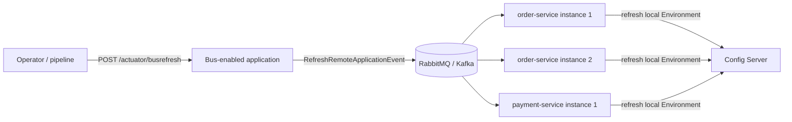

# POST /actuator/busrefresh và phạm vi làm mới từ xa

## 1. Vì sao cần busrefresh?

Khi một ứng dụng Spring Boot chạy nhiều instance, gọi `POST /actuator/refresh` trên một instance chỉ làm mới cấu hình của instance đó. Các instance còn lại vẫn giữ `Environment` và bean state hiện tại cho đến khi chúng được refresh hoặc restart riêng.

Spring Cloud Bus giải quyết việc phát tín hiệu refresh đến nhiều ứng dụng đang kết nối với cùng message broker. Endpoint `POST /actuator/busrefresh` phát một sự kiện refresh qua Bus. Các instance nhận sự kiện và phù hợp với phạm vi đích sẽ làm mới cấu hình của chính chúng.

Ví dụ, `payment-service` chạy ba instance sau load balancer. Sau khi Config Server đã nhận cấu hình mới, người vận hành có thể gửi một yêu cầu busrefresh để cả ba instance cùng nhận tín hiệu refresh, thay vì gọi từng endpoint riêng lẻ.

`busrefresh` là cơ chế thông báo và điều phối refresh. Nó không commit cấu hình vào Git, không tự làm Config Server fetch repository mới và không bảo đảm mọi bean trong ứng dụng được tạo lại an toàn.

## 2. Luồng xử lý từ yêu cầu HTTP đến các instance



Quy trình tổng quát:

1. Người vận hành gọi endpoint `busrefresh` trên một ứng dụng tham gia Bus.
2. Ứng dụng phát `RefreshRemoteApplicationEvent` lên message broker.
3. Các ứng dụng đã đăng ký nhận sự kiện từ broker.
4. Mỗi instance kiểm tra destination của sự kiện có khớp với Bus ID của nó không.
5. Instance được nhắm đến làm mới cấu hình cục bộ: cập nhật Environment, rebind các bean `@ConfigurationProperties` và xóa cache `RefreshScope`.
6. Các bean thuộc `@RefreshScope` được tạo lại khi có lời gọi tiếp theo qua proxy.

Bus giúp phân phối một sự kiện đến nhiều instance. Mỗi instance vẫn thực hiện thao tác refresh trong tiến trình riêng của nó.

## 3. Chuẩn bị dependency và message broker

Spring Cloud Bus sử dụng Spring Cloud Stream để giao tiếp với broker. Các starter phổ biến gồm RabbitMQ và Kafka:

```xml
<!-- Chọn một binder phù hợp với hạ tầng của hệ thống. -->
<dependency>
    <groupId>org.springframework.cloud</groupId>
    <artifactId>spring-cloud-starter-bus-amqp</artifactId>
</dependency>
```

Hoặc dùng Kafka:

```xml
<dependency>
    <groupId>org.springframework.cloud</groupId>
    <artifactId>spring-cloud-starter-bus-kafka</artifactId>
</dependency>
```

Quản lý phiên bản Spring Cloud bằng BOM tương thích với phiên bản Spring Boot của dự án. Không tự ghép các phiên bản starter, Spring Cloud Stream và Spring Boot khác release train.

Ví dụ cấu hình RabbitMQ:

```yaml
spring:
  application:
    name: payment-service
  rabbitmq:
    host: ${RABBITMQ_HOST}
    port: ${RABBITMQ_PORT:5672}
    username: ${RABBITMQ_USERNAME}
    password: ${RABBITMQ_PASSWORD}
```

Nếu dùng Kafka, cấu hình bootstrap servers và thông tin xác thực theo chính sách của cluster Kafka:

```yaml
spring:
  kafka:
    bootstrap-servers: ${KAFKA_BOOTSTRAP_SERVERS}
```

Thông tin kết nối broker phải được cấp qua secret store hoặc biến môi trường được quản lý. Tất cả instance cần kết nối đến cùng hạ tầng Bus và dùng cấu hình channel/binder tương thích để nhận cùng loại sự kiện.

## 4. Expose endpoint busrefresh

Ứng dụng cần có Spring Boot Actuator và dependency Spring Cloud Bus. Để công bố endpoint trên HTTP, khai báo:

```yaml
management:
  endpoints:
    web:
      exposure:
        include: health,info,busrefresh
```

Sau đó gửi POST đến endpoint:

```bash
curl -X POST http://payment-service:8080/actuator/busrefresh
```

Đường dẫn này là endpoint Bus trên ứng dụng phát sự kiện. Nó không phải endpoint trên Git provider hoặc endpoint cấu hình của Config Server. Tên endpoint hiện đại là `busrefresh`; một số release train cũ dùng cách viết có dấu gạch nối như `bus-refresh`, vì vậy cần đối chiếu tài liệu đúng phiên bản đang triển khai.

`management.endpoints.web.exposure.include` chỉ quyết định endpoint nào được expose qua HTTP. Nó không tự cấu hình authentication hoặc authorization. Endpoint cần được bảo vệ bằng Spring Security, gateway hoặc mạng quản trị phù hợp.

## 5. Phạm vi mặc định: refresh mọi instance trên Bus

Khi gọi:

```bash
curl -X POST http://config-admin:8080/actuator/busrefresh
```

không chỉ định destination, sự kiện được gửi đến toàn bộ các node phù hợp đang tham gia Bus. Mỗi instance nhận sự kiện sẽ xử lý refresh cục bộ.

Phạm vi này hữu ích khi:

- Một thay đổi cấu hình chung ảnh hưởng nhiều dịch vụ.
- Nhiều ứng dụng cùng sử dụng một property source hoặc cấu hình nền tảng.
- Người vận hành cần đồng bộ refresh trên toàn bộ cụm sau một lần phát hành.

Tuy nhiên, broadcast toàn Bus có thể làm nhiều ứng dụng cùng truy cập Config Server và khởi tạo lại bean trong một khoảng thời gian ngắn. Nếu chỉ một dịch vụ bị ảnh hưởng, nên nhắm destination hẹp hơn để giảm tải và phạm vi tác động.

## 6. Nhắm đến một service hoặc một instance bằng destination

Spring Cloud Bus cho phép thêm destination vào path của endpoint. Destination được so khớp với Bus ID của từng instance bằng `PathMatcher`, trong đó dấu `:` là dấu phân cách thành phần.

### Nhắm đến một instance cụ thể

Ví dụ:

```bash
curl -X POST http://config-admin:8080/actuator/busrefresh/customers:9000
```

Chỉ instance có Bus ID khớp `customers:9000` xử lý sự kiện; các instance khác nhận thông điệp nhưng bỏ qua vì destination không khớp.

### Nhắm đến mọi instance của một service

Có thể dùng wildcard:

```bash
curl -X POST http://config-admin:8080/actuator/busrefresh/payment-service:**
```

Mẫu `payment-service:**` nhắm đến mọi instance có service ID bắt đầu bằng `payment-service`, bất kể các thành phần định danh tiếp theo.

Ví dụ, nếu một ứng dụng chạy ba instance với các Bus ID:

```text
payment-service:8080:instance-a
payment-service:8081:instance-b
payment-service:8082:instance-c
```

thì destination `payment-service:**` có thể chọn cả ba instance. Hãy kiểm tra Bus ID thực tế của hệ thống trước khi dùng pattern trong production.

## 7. Bus ID phải duy nhất

Mỗi instance trên Bus cần có một ID phân biệt để sự kiện được định tuyến và xử lý đúng. ID mặc định được tạo từ thông tin môi trường, thường có dạng:

```text
app:index:id
```

Trong đó:

- `app` thường lấy từ `spring.application.name` hoặc tên ứng dụng do nền tảng cung cấp.
- `index` có thể lấy từ instance index, `spring.application.index`, cổng server hoặc giá trị mặc định.
- `id` có thể lấy từ instance ID của nền tảng hoặc một giá trị ngẫu nhiên.

Có thể cấu hình `spring.cloud.bus.id` nếu cần kiểm soát định danh. Khi tự đặt ID, phải bảo đảm mỗi instance có giá trị duy nhất. Nếu nhiều instance dùng cùng một ID, cơ chế chống xử lý lặp của Bus có thể khiến một số instance không xử lý sự kiện như mong đợi.

Ví dụ đặt index riêng cho từng instance:

```yaml
spring:
  application:
    name: payment-service
    index: ${INSTANCE_INDEX:0}
```

Giá trị `INSTANCE_INDEX` phải khác nhau giữa các instance trong cùng service. Với Kubernetes, có thể dùng ordinal của StatefulSet hoặc một định danh instance được nền tảng cấp; tránh dùng một giá trị cố định cho mọi replica.

## 8. busrefresh làm gì trên mỗi instance?

Endpoint `/actuator/busrefresh` tương ứng với việc làm mới cấu hình trên nhiều instance. Theo Spring Cloud Bus, thao tác này:

- Làm mới các property source từ nguồn cấu hình của client.
- Cập nhật Spring `Environment` cục bộ.
- Rebind các bean được quản lý bằng `@ConfigurationProperties`.
- Xóa cache `RefreshScope`, để các target bean cũ bị hủy và target mới được tạo khi proxy được gọi lần tiếp theo.

Điều này không có nghĩa mọi bean singleton đều được tạo lại. Bean không thuộc RefreshScope hoặc tài nguyên bên thứ ba không hỗ trợ reconfigure có thể vẫn giữ trạng thái cũ. Một số thay đổi vẫn cần restart.

Đối với bean `@RefreshScope`, invalidation và recreation là hai thời điểm riêng. Sau khi sự kiện refresh được xử lý, target cũ bị loại khỏi cache. Target mới thường được tạo lazy ở lần truy cập tiếp theo qua proxy.

## 9. Phân biệt refresh, busrefresh và busenv

Ba endpoint có mục đích khác nhau:

| Endpoint | Phạm vi | Tác dụng chính |
|---|---|---|
| `POST /actuator/refresh` | Một instance client | Nạp lại cấu hình và làm mới bean ở instance đó. |
| `POST /actuator/busrefresh` | Mọi instance hoặc destination được chọn | Phát sự kiện để các instance đích tự refresh cấu hình. |
| `POST /actuator/busenv` | Mọi instance hoặc destination được chọn | Phát cập nhật key/value vào Environment của các node. |

`busenv` nhận payload dạng:

```json
{
  "name": "feature.preview-enabled",
  "value": "true"
}
```

`busenv` không tương đương với việc đọc lại một commit Git. Nếu mục tiêu là lấy các property source mới từ Config Server, dùng `busrefresh`. Nếu mục tiêu là phát một thay đổi key/value trực tiếp qua Bus, `busenv` là endpoint riêng và cần chính sách bảo vệ chặt chẽ.

## 10. busrefresh không cập nhật Git hoặc cache Config Server

Trước khi phát busrefresh, cần xác nhận Config Server đã thấy revision mới. Chuỗi đúng là:

1. Commit và push cấu hình vào đúng repository/branch/tag.
2. Chờ Config Server fetch Git theo `refresh-rate` hoặc thực hiện cơ chế đồng bộ đã cấu hình.
3. Gọi endpoint Config Server theo application/profile/label để xác nhận giá trị mới.
4. Gửi `POST /actuator/busrefresh` đến phạm vi instance mong muốn.
5. Kiểm tra các client nhận sự kiện, lấy lại cấu hình và áp dụng thay đổi.

Nếu Config Server vẫn trả giá trị cũ, các client dù nhận busrefresh cũng có thể nạp lại giá trị cũ. Vì vậy, không nên dùng busrefresh để xử lý một vấn đề thực chất nằm ở Git fetch hoặc label.

Tương tự, nếu client dùng label là tag hoặc commit cố định, busrefresh tiếp tục lấy đúng label đó. Sự kiện Bus không tự đổi label sang release mới.

## 11. Bus là bất đồng bộ: HTTP thành công chưa có nghĩa mọi node đã refresh xong

Bus gửi sự kiện qua message broker. Việc publish thành công và việc mọi instance hoàn tất xử lý là hai trạng thái khác nhau.

Một yêu cầu HTTP thành công cho biết endpoint đã tiếp nhận/xử lý yêu cầu phát sự kiện theo cơ chế của phiên bản. Nó không nhất thiết là xác nhận đồng bộ rằng tất cả client đã:

- Nhận được thông điệp.
- Gọi lại Config Server thành công.
- Rebind cấu hình thành công.
- Tạo được target mới khi target được truy cập.
- Hoàn tất kiểm tra nghiệp vụ sau refresh.

Instance đang tắt, mất kết nối broker, bị partition mạng hoặc không khớp destination sẽ không xử lý sự kiện như các instance đang hoạt động. Cần giám sát broker, trạng thái consumer và kết quả refresh ở phía client.

Đối với thay đổi quan trọng, hãy có bước xác nhận sau refresh, chẳng hạn kiểm tra metric, log, health indicator hoặc một request nghiệp vụ an toàn đến từng instance.

## 12. Theo dõi sự kiện và xác nhận instance đã nhận

Spring Cloud Bus hỗ trợ tracing sự kiện. Có thể bật:

```yaml
spring:
  cloud:
    bus:
      trace:
        enabled: true
```

Khi môi trường có `TraceRepository` phù hợp, các sự kiện gửi và acknowledgement có thể được quan sát để biết event được phát từ node nào, destination là gì và instance nào đã gửi ack. Trong một số phiên bản hoặc cấu hình Actuator, endpoint trace có thể không được cung cấp mặc định; cần kiểm tra khả năng quan sát đúng release train.

Ngoài tracing, nên theo dõi:

- Broker connection và consumer lag/queue depth.
- Số lượng event được publish và nhận.
- Bus ID và destination của từng event.
- Lỗi khi client fetch Config Server hoặc rebind cấu hình.
- Lỗi tạo lại bean `@RefreshScope` trong lần truy cập sau refresh.
- Thời gian từ lúc phát sự kiện đến khi tất cả instance xác nhận trạng thái mới.

Có thể lắng nghe các event như `AckRemoteApplicationEvent` hoặc `SentApplicationEvent` để tích hợp acknowledgement vào hệ thống giám sát. Ack chứng minh node đã xử lý hoặc xác nhận sự kiện theo cơ chế Bus; vẫn cần health check nghiệp vụ để xác nhận ứng dụng thực sự hoạt động với cấu hình mới.

## 13. Bảo vệ endpoint busrefresh và broker

`busrefresh` có thể làm thay đổi hành vi của nhiều ứng dụng trong cùng một lần gọi. Nếu endpoint bị lộ, người không có quyền có thể kích hoạt refresh liên tục hoặc làm các client cùng truy cập Config Server và tạo lại tài nguyên.

Áp dụng các biện pháp:

- Chỉ expose `busrefresh` trên các ứng dụng cần phát sự kiện.
- Bảo vệ endpoint bằng xác thực và phân quyền; chỉ service account hoặc người vận hành được phép mới được gọi.
- Giới hạn truy cập trong mạng quản trị hoặc qua gateway có policy phù hợp.
- Bảo vệ RabbitMQ/Kafka bằng TLS, authentication, ACL và quyền publish/consume tối thiểu.
- Không để mọi ứng dụng có quyền publish mọi loại event nếu kiến trúc có thể giới hạn quyền theo channel/topic.
- Theo dõi tần suất refresh, người gọi, destination và kết quả.
- Không ghi secret hoặc toàn bộ payload cấu hình vào log.

Với thay đổi chỉ ảnh hưởng một service, dùng destination hẹp thay vì broadcast toàn Bus. Điều này giảm phạm vi tác động và tải đồng thời.

## 14. Lỗi thường gặp và cách xử lý

| Triệu chứng | Nguyên nhân cần kiểm tra | Hướng xử lý |
|---|---|---|
| `POST /actuator/busrefresh` trả 404 | Endpoint chưa được expose, thiếu Actuator/Bus dependency hoặc path khác theo phiên bản. | Kiểm tra dependency, exposure config và tên endpoint của release train. |
| HTTP trả thành công nhưng client không đổi cấu hình | Broker không truyền event đến client, client không tham gia Bus hoặc Config Server vẫn trả giá trị cũ. | Kiểm tra broker, Bus connectivity, trace và endpoint Config Server. |
| Chỉ một vài instance refresh | Destination không khớp, instance mất kết nối broker, hoặc Bus ID bị trùng. | Kiểm tra Bus ID, destination, consumer và trạng thái từng replica. |
| Gọi destination service nhưng không instance nào nhận | Pattern sai hoặc service ID thực tế khác dự kiến. | Xem Bus ID thực tế và dùng đúng path matcher. |
| Client refresh nhưng bean vẫn dùng giá trị cũ | Bean không thuộc RefreshScope, singleton đã copy giá trị hoặc thư viện giữ tài nguyên cũ. | Kiểm tra rebind, proxy, cache nội bộ và khả năng restart/reconfigure. |
| Bean lỗi ở request đầu sau refresh | Target mới được tạo lazy và constructor/`@PostConstruct` thất bại. | Kiểm tra log khởi tạo target, rollback cấu hình hoặc khôi phục dependency. |
| Tất cả client cùng tải Config Server quá mạnh | Broadcast toàn Bus làm nhiều node fetch đồng thời. | Nhắm destination theo service, giãn rollout hoặc điều chỉnh cache/fetch policy. |
| Broker có message nhưng client không xử lý | Consumer lỗi, security ACL, sai binder hoặc message destination không khớp. | Kiểm tra broker logs, binder configuration, permissions và event tracing. |

Khi điều tra, kiểm tra theo thứ tự: Config Server trả đúng giá trị chưa, endpoint Bus đã publish chưa, broker có message không, instance có Bus ID/destination khớp không, client refresh có thành công không, và bean mới có được tạo thành công không.

## 15. Quy trình vận hành đề xuất

1. Review và merge thay đổi cấu hình; ghi lại repository, commit, application, profile và label.
2. Xác nhận Config Server đã fetch revision mới bằng endpoint cấu hình.
3. Chọn phạm vi refresh: toàn Bus, một service hoặc một instance.
4. Kiểm tra các instance mục tiêu đang online và Bus ID duy nhất.
5. Gửi `POST /actuator/busrefresh` với destination phù hợp.
6. Theo dõi broker event, ack/tracing và log refresh của client.
7. Kiểm tra các property đã rebind, bean refresh-scoped và health nghiệp vụ.
8. Nếu instance không nhận event hoặc target mới lỗi, xử lý riêng instance đó hoặc restart theo kế hoạch.
9. Lưu dấu vết người gọi, thời điểm, destination, commit/label và kết quả xác nhận.

Với thay đổi có rủi ro cao, nên refresh một instance hoặc một service thử nghiệm trước, xác nhận hành vi rồi mới mở rộng phạm vi.

## 16. Bài thực hành

### Bước 1: Kết nối hai instance vào Bus

Chạy hai instance của `payment-service`, thêm `spring-cloud-starter-bus-amqp` hoặc `spring-cloud-starter-bus-kafka`, cấu hình broker và bảo đảm hai instance có Bus ID khác nhau.

**Kết quả cần đạt:** cả hai instance kết nối broker và có thể nhận sự kiện Bus.

### Bước 2: Expose busrefresh

Thêm Actuator và cấu hình `management.endpoints.web.exposure.include` có `busrefresh`. Bảo vệ endpoint bằng security policy của môi trường thử nghiệm.

**Kết quả cần đạt:** endpoint `POST /actuator/busrefresh` được expose và chỉ danh tính được phép mới gọi được.

### Bước 3: Broadcast toàn Bus

Thay đổi một property trong Git, xác nhận Config Server trả giá trị mới rồi gọi busrefresh không có destination.

**Kết quả cần đạt:** cả hai instance nhận sự kiện và refresh Environment.

### Bước 4: Nhắm một service hoặc instance

Chạy thêm một service khác, sau đó gọi destination `payment-service:**`. Kiểm tra chỉ các instance payment được chọn xử lý sự kiện. Tiếp tục thử destination của một instance cụ thể.

**Kết quả cần đạt:** hiểu sự khác nhau giữa broadcast, service-level targeting và instance-level targeting.

### Bước 5: Kiểm tra target bean và acknowledgement

Đặt một bean `@RefreshScope` có instance ID, bật Bus trace nếu môi trường hỗ trợ, phát busrefresh và gọi bean trên từng instance.

**Kết quả cần đạt:** xác nhận target cũ bị invalidate, target mới được tạo khi truy cập, và theo dõi được event/ack ở mức Bus.

### Bước 6: Diễn tập lỗi

Tắt một consumer hoặc dùng destination không khớp trong môi trường thử nghiệm. Quan sát khác biệt giữa HTTP response, broker delivery và trạng thái refresh thực tế.

**Kết quả cần đạt:** biết cách phân biệt publish thành công với tất cả instance đã áp dụng cấu hình.

## 17. Tự kiểm tra

1. `POST /actuator/busrefresh` khác `POST /actuator/refresh` ở phạm vi nào?
2. Bus dùng thành phần nào để phân phối sự kiện giữa các instance?
3. Khi không có destination, sự kiện busrefresh được gửi đến phạm vi nào?
4. Cách nhắm đến mọi instance của một service là gì?
5. Bus ID có vai trò gì và vì sao cần duy nhất?
6. busrefresh làm gì với RefreshScope cache và `@ConfigurationProperties`?
7. Vì sao busrefresh không tự cập nhật Git hoặc Config Server cache?
8. HTTP success có chứng minh mọi client đã refresh xong không?
9. Làm sao quan sát event và acknowledgement?
10. `busenv` khác `busrefresh` ở điểm nào?
11. Khi nào nên nhắm một service thay vì broadcast toàn Bus?

Khi hoàn thành bài thực hành, người học có thể sử dụng `POST /actuator/busrefresh` để làm mới cấu hình từ xa, chọn đúng phạm vi toàn Bus/service/instance, kiểm tra Bus ID và theo dõi kết quả xử lý sự kiện trên từng node.

## Tài liệu tham khảo

- [Spring Cloud Bus – Bus Endpoints](https://docs.spring.io/spring-cloud-bus/reference/spring-cloud-bus/bus-endpoints.html): `busrefresh`, `busenv` và tác động lên RefreshScope/ConfigurationProperties.
- [Spring Cloud Bus – Addressing Instances](https://docs.spring.io/spring-cloud-bus/reference/spring-cloud-bus/addressing.html): destination, Bus ID và định tuyến đến service/instance.
- [Spring Cloud Bus – Quickstart](https://docs.spring.io/spring-cloud-bus/reference/quickstart.html): binder RabbitMQ/Kafka và cách kích hoạt Bus.
- [Spring Cloud Bus – Configuration and Tracing](https://docs.spring.io/spring-cloud-bus/reference/spring-cloud-bus/configuration.html): tracing sự kiện và acknowledgement.
