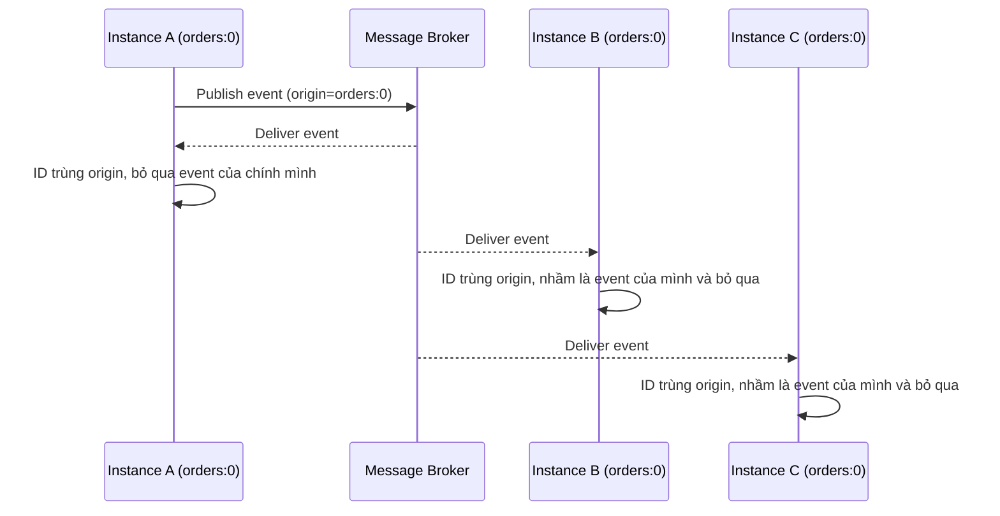

# Định danh spring.cloud.bus.id và lỗi trùng ID giữa các instance

Spring Cloud Bus kết nối nhiều instance của ứng dụng Spring Boot qua một message broker để phát tán sự kiện như refresh cấu hình. Mỗi instance cần một service ID để Bus nhận biết nguồn gửi, xác định đích nhận và tránh xử lý lại sự kiện do chính instance đó phát ra.

Thuộc tính `spring.cloud.bus.id` cho phép đặt định danh này. ID phải duy nhất giữa các instance cùng tham gia Bus. Nếu nhiều replica dùng cùng một ID, chúng có thể cùng nhận diện sự kiện là sự kiện do chính mình gửi và bỏ qua; kết quả là lệnh refresh được phát nhưng các instance đích không thực hiện xử lý như mong đợi.

## 1. Mục tiêu học tập

Sau bài học, bạn có thể:

- Giải thích vai trò của `spring.cloud.bus.id` trong nhận diện instance và định tuyến sự kiện.
- Mô tả cấu trúc ID mặc định `app:index:id` và các nguồn môi trường dùng để tạo từng phần.
- Phân biệt ID của ứng dụng với ID duy nhất của từng replica.
- Nhận biết vì sao ID trùng khiến Bus bỏ qua sự kiện.
- Cấu hình ID duy nhất khi chạy local, container, Kubernetes hoặc Cloud Foundry.
- Dùng destination pattern để gửi sự kiện đến một instance hoặc mọi instance của một service.
- Chẩn đoán lỗi trùng ID và xác minh ID thực tế của các instance.

## 2. Vì sao mỗi instance cần một Bus ID?

Một service có thể chạy nhiều bản sao để tăng khả năng phục vụ. Ví dụ, hệ thống có ba replica `order-service`:

```text
order-service instance A
order-service instance B
order-service instance C
```

Cả ba cùng kết nối đến một broker và cùng nhận các sự kiện Bus. Khi một instance phát sự kiện refresh, message broker phân phối sự kiện đến các instance đang đăng ký nhận.

Bus cần biết:

- Instance nào đã phát sự kiện.
- Instance nào là đích nhận nếu sự kiện được gửi có destination cụ thể.
- Instance nào cần bỏ qua bản tin do chính nó phát ra để tránh xử lý lặp.

`spring.cloud.bus.id` là service ID của một instance. Nó không đơn giản là tên service dùng chung cho mọi replica. Nếu tất cả replica cùng đặt `spring.cloud.bus.id=order-service`, Bus không còn phân biệt được từng instance.

## 3. Cấu trúc ID mặc định

Mỗi instance có một service ID. Có thể đặt trực tiếp bằng `spring.cloud.bus.id`. Nếu không đặt, Spring Cloud Bus tạo ID từ môi trường theo dạng:

```text
app:index:id
```

Ba thành phần có ý nghĩa:

| Thành phần | Nguồn được ưu tiên | Ý nghĩa |
| --- | --- | --- |
| `app` | `vcap.application.name`, nếu có; nếu không thì `spring.application.name` | Tên ứng dụng/service |
| `index` | `vcap.application.instance_index`, `spring.application.index`, `local.server.port`, `server.port`, rồi `0` | Chỉ số hoặc cổng phân biệt instance |
| `id` | `vcap.application.instance_id`, nếu có; nếu không thì giá trị ngẫu nhiên | Định danh bổ sung cho instance |

Ví dụ ID được tạo có thể có dạng:

```text
orders:2:7f3a91
```

Trong đó `orders` là application name, `2` là instance index và `7f3a91` đại diện cho phần định danh instance. Giá trị cụ thể phụ thuộc môi trường triển khai.

ID có thể được ghi đè bằng `spring.cloud.bus.id`. Giá trị này được kỳ vọng là danh sách định danh phân tách bằng dấu hai chấm (`:`), theo thứ tự từ ít cụ thể đến cụ thể hơn. Cấu trúc nhiều phần giúp destination pattern có thể nhắm đến một nhóm instance hoặc một instance cụ thể.

## 4. Phân biệt application name và instance ID

`spring.application.name` thường giống nhau giữa các replica của cùng một service:

```yaml
spring:
  application:
    name: orders
```

Điều đó là bình thường vì cả ba replica đều thuộc service `orders`. Tuy nhiên, ID của Bus cần phân biệt từng replica. Có thể hình dung:

| Replica | Application name | Instance index | Bus ID tùy chỉnh |
| --- | --- | --- | --- |
| A | `orders` | `0` | `orders:0` |
| B | `orders` | `1` | `orders:1` |
| C | `orders` | `2` | `orders:2` |

Tên ứng dụng giống nhau giúp nhóm instance được nhận diện như một service. Phần index hoặc ID cụ thể giúp Bus phân biệt từng thành viên.

Không đặt một giá trị tĩnh giống nhau cho `spring.cloud.bus.id` trong file cấu hình dùng chung nếu file đó được mọi replica nạp. Giá trị định danh riêng phải được cấp theo từng instance từ nền tảng triển khai.

## 5. Điều gì xảy ra khi nhiều instance trùng ID?

Spring Cloud Bus cần tránh một instance xử lý lại sự kiện do chính nó phát ra. Bus kiểm tra service ID của nguồn gửi với service ID của instance hiện tại. Việc kiểm tra này được dùng để loại bỏ xử lý lặp ở cả sự kiện ứng dụng ban đầu và bản tin nhận lại từ broker.

Nếu nhiều instance có cùng ID, vấn đề xảy ra như sau:

1. Instance A phát sự kiện Bus với source ID là `orders:0`.
2. Broker chuyển bản tin đến các instance đang đăng ký.
3. Instance A so sánh source ID với ID của chính nó và bỏ qua sự kiện do đây là sự kiện của mình.
4. Instance B cũng có ID `orders:0`, nên nó cũng nhận diện sự kiện là do chính mình phát và bỏ qua.
5. Instance C nếu có cùng ID cũng bỏ qua.

Kết quả là sự kiện có thể đã được publish và broker đã phân phối, nhưng không có replica nào thực hiện xử lý refresh mong muốn.



Đây là lý do lỗi trùng ID có thể gây ra hiện tượng khó hiểu: log publish không báo lỗi, broker vẫn hoạt động, nhưng refresh không lan đến các replica.

## 6. Cấu hình ID duy nhất bằng `spring.application.index`

Tài liệu Spring Cloud Bus khuyến nghị đặt `spring.application.index` thành giá trị duy nhất cho mỗi instance khi chạy ngoài Cloud Foundry. Đây là cách phù hợp để phân biệt replica theo một chỉ số được nền tảng cấp.

Ví dụ cấu hình chung:

```yaml
spring:
  application:
    name: orders
    index: ${INSTANCE_INDEX}
```

Nếu không tự đặt `spring.cloud.bus.id`, Bus có thể sử dụng `spring.application.index` khi tạo phần `index` của ID mặc định. Nếu muốn ID tường minh và dễ đọc, có thể đặt:

```yaml
spring:
  application:
    name: orders
    index: ${INSTANCE_INDEX}
  cloud:
    bus:
      id: ${spring.application.name}:${spring.application.index}
```

Trong ví dụ, `INSTANCE_INDEX` phải khác nhau giữa các replica. Không đặt cùng một giá trị như `0` trong ConfigMap hoặc file cấu hình được dùng chung bởi mọi Pod.

Nếu custom ID chỉ gồm `application name` và `index`, chính `index` phải duy nhất. Nếu dùng thêm phần định danh instance, hãy bảo đảm phần đó cũng khác nhau giữa các replica. Không đưa dấu `:` vào bên trong một segment nếu không muốn nó bị hiểu là ranh giới giữa các phần ID.

## 7. Cấu hình trong các môi trường triển khai

### Chạy nhiều instance trên máy local

Khi chạy nhiều tiến trình trên cùng máy, có thể cấp index khác nhau:

```bash
java -jar orders.jar --server.port=8081 --spring.application.index=local-a
```

```bash
java -jar orders.jar --server.port=8082 --spring.application.index=local-b
```

Hai tiến trình có application name giống nhau nhưng instance index khác nhau. Nếu dùng custom ID theo `app:index`, chúng sẽ có ID `orders:local-a` và `orders:local-b`.

Port khác nhau cũng là một nguồn phân biệt trong cách tạo ID mặc định. Tuy nhiên, không nên dựa vào port khi các replica chạy trong các container riêng và cùng lắng nghe một port nội bộ, chẳng hạn tất cả đều dùng `8080`.

### Docker hoặc container platform

Có thể truyền index qua biến môi trường riêng cho từng container:

```yaml
services:
  orders-a:
    image: example/orders:latest
    environment:
      SPRING_APPLICATION_NAME: orders
      SPRING_APPLICATION_INDEX: orders-a

  orders-b:
    image: example/orders:latest
    environment:
      SPRING_APPLICATION_NAME: orders
      SPRING_APPLICATION_INDEX: orders-b
```

Ví dụ này minh họa hai container có index khác nhau. Khi dùng orchestrator để scale replica, hãy dùng metadata hoặc biến môi trường riêng theo từng instance thay vì một giá trị hard-code chung.

### Kubernetes

Trong Kubernetes, Pod name có thể được đưa vào container qua Downward API. Pod name duy nhất trong namespace tại một thời điểm và có thể dùng làm instance index:

```yaml
env:
  - name: SPRING_APPLICATION_INDEX
    valueFrom:
      fieldRef:
        fieldPath: metadata.name
```

Kubernetes gán trực tiếp tên Pod vào `SPRING_APPLICATION_INDEX`. Ứng dụng đọc biến này vào `spring.application.index`.

Ví dụ `application.yml`:

```yaml
spring:
  application:
    name: orders
    index: ${SPRING_APPLICATION_INDEX}
  cloud:
    bus:
      id: ${spring.application.name}:${spring.application.index}
```

Nếu manifest dùng cú pháp tham chiếu biến môi trường trong cùng danh sách `env`, hãy xác minh thứ tự khai báo và cơ chế mở rộng của Kubernetes. Một cách đơn giản hơn là đặt trực tiếp `SPRING_APPLICATION_INDEX` bằng `fieldRef` cho `metadata.name` rồi để Spring đọc biến đó.

Không dùng một biến `INSTANCE_INDEX=0` chung cho Deployment nhiều replica khi `spring.cloud.bus.id` được ghép trực tiếp từ application name và index. Tất cả Pod khi đó sẽ có cùng Bus ID.

### Cloud Foundry

Cloud Foundry cung cấp các biến `vcap.application.name`, `vcap.application.instance_index` và `vcap.application.instance_id`. Spring Cloud Bus có thể dùng các giá trị này để tạo ID mặc định, vì vậy thông thường không cần tự tạo index thủ công nếu metadata nền tảng đã được cấp đúng.

Khi chạy trên nền tảng khác, cần cung cấp một giá trị riêng cho mỗi instance. Đừng giả định biến môi trường đặc thù Cloud Foundry tồn tại trong Docker hoặc Kubernetes.

## 8. Định tuyến sự kiện bằng destination

Các endpoint của Spring Cloud Bus có thể nhận destination để giới hạn instance xử lý sự kiện. Destination được so khớp bằng `PathMatcher` với dấu hai chấm (`:`) làm dấu phân cách.

Ví dụ các ID:

```text
orders:0
orders:1
orders:2
payments:0
```

Một destination như `orders:1` nhắm đến instance có ID chính xác đó. Destination `orders:**` có thể nhắm đến tất cả instance thuộc service `orders`, bất kể phần ID phía sau.

Ví dụ gửi refresh đến tất cả instance `orders`:

```bash
curl -X POST "http://localhost:8080/actuator/busrefresh/orders:**"
```

Ví dụ nhắm một instance:

```bash
curl -X POST "http://localhost:8080/actuator/busrefresh/orders:1"
```

Đường dẫn cụ thể cần khớp với endpoint và cấu hình management port của ứng dụng. Chỉ expose `busrefresh` khi cần và bảo vệ bằng xác thực, phân quyền và giới hạn mạng.

Nếu ID trùng nhau, destination cụ thể cũng có thể khớp nhiều instance ngoài dự kiến. Vì vậy, uniqueness vừa cần cho self-origin filtering vừa cần cho định tuyến đúng một replica.

## 9. Ví dụ lỗi trùng ID trong production

Giả sử Deployment `orders` có ba Pod. Nhóm đặt trong ConfigMap:

```yaml
spring:
  application:
    name: orders
  cloud:
    bus:
      id: orders:0
```

ConfigMap được mount cho cả ba Pod, nên tất cả đều có ID `orders:0`. Khi Pod đầu tiên gửi `busrefresh`, mọi Pod nhận message có source ID giống ID cục bộ và có thể bỏ qua.

Biểu hiện thường thấy:

- Endpoint `/actuator/busrefresh` trả phản hồi thành công ở Pod phát lệnh.
- Broker có message được publish và không báo lỗi kết nối.
- Log của các replica không cho thấy refresh target hoặc rebind như mong đợi.
- Gửi sự kiện nhiều lần vẫn không làm các replica cập nhật.

Cách sửa:

1. Bỏ giá trị Bus ID tĩnh dùng chung.
2. Cấp index riêng cho từng Pod, ví dụ dùng Pod name.
3. Ghép ID từ application name và index duy nhất, hoặc để Bus tạo ID mặc định từ môi trường.
4. Restart các Pod để chúng khởi tạo lại ID.
5. Xác minh ID của từng instance trước khi thử lại refresh.

## 10. Cách kiểm tra ID thực tế của từng instance

Khi điều tra, cần thu thập ID của tất cả replica thay vì chỉ xem cấu hình trong file. Giá trị hiệu lực có thể bị ghi đè bởi biến môi trường, tham số dòng lệnh hoặc cấu hình nền tảng.

Các cách kiểm tra:

- Kiểm tra cấu hình `spring.cloud.bus.id`, `spring.application.name` và `spring.application.index` trong từng instance.
- Xem biến môi trường mà tiến trình nhận được, nhưng không in hoặc ghi log các secret khác trong cùng môi trường.
- Kiểm tra metadata instance của nền tảng như Pod name, container ID hoặc instance index.
- Dùng log khởi động hoặc log Bus ở mức phù hợp nếu phiên bản và cấu hình có ghi service ID.
- Gửi một sự kiện có destination chính xác trong môi trường kiểm thử và xác nhận chỉ instance mong muốn xử lý.

Nếu Actuator `env` được bật để xem giá trị hiệu lực, endpoint này phải được bảo vệ vì có thể tiết lộ cấu hình nhạy cảm. Không expose endpoint chẩn đoán công khai chỉ để tìm Bus ID.

Một bảng kiểm tra có thể dùng khi triển khai:

| Instance | `spring.application.name` | `spring.application.index` | `spring.cloud.bus.id` hiệu lực | Duy nhất? |
| --- | --- | --- | --- | --- |
| Pod A | `orders` | `orders-7f9c` | `orders:orders-7f9c` | Có |
| Pod B | `orders` | `orders-a12d` | `orders:orders-a12d` | Có |
| Pod C | `orders` | `orders-c831` | `orders:orders-c831` | Có |

## 11. Những nguyên nhân gây trùng ID thường gặp

| Nguyên nhân | Vì sao trùng | Cách khắc phục |
| --- | --- | --- |
| Hard-code `spring.cloud.bus.id` trong ConfigMap chung | Mọi replica nhận cùng chuỗi | Tạo ID theo metadata riêng của từng instance |
| Đặt `spring.application.index=0` cho mọi replica | Phần index không còn phân biệt instance; nếu custom ID chỉ dùng app:index thì sẽ trùng | Cấp index duy nhất cho từng replica |
| Dùng cùng file `.env` cho nhiều container | Biến instance ID có cùng giá trị | Inject biến riêng theo container hoặc orchestrator |
| Dùng `server.port` làm index trong các container riêng | Các container thường cùng port nội bộ | Dùng Pod name, instance index hoặc ID do nền tảng cấp |
| Clone cùng cấu hình cho nhiều môi trường mà không thay ID | Nhiều instance trên cùng Bus dùng chung tên và ID | Tạo namespace/segment phân biệt môi trường nếu cùng broker và cần tách đích |
| Cấu hình ID tĩnh ở remote config | Các client cùng nhận một giá trị từ Config Server | Giữ ID instance-specific ở nguồn triển khai cục bộ, không đặt một giá trị chung từ xa |
| Nâng cấp hoặc đổi cơ chế tạo ID nhưng không kiểm tra replica cũ | Một số instance giữ ID cũ, một số instance dùng ID mới | Rollout đồng bộ và xác minh danh sách ID sau triển khai |

Lưu ý: ID mặc định có thể có phần `id` ngẫu nhiên khi nền tảng không cung cấp `vcap.application.instance_id`. Tuy nhiên, với các hệ thống cần định tuyến ổn định và dễ quan sát, nên đặt `spring.application.index` duy nhất theo từng instance như tài liệu Spring Cloud Bus khuyến nghị.

## 12. Quy trình sửa lỗi trùng ID

1. **Liệt kê instance:** lấy danh sách mọi replica đang kết nối tới cùng Bus/broker.
2. **Thu thập ID hiệu lực:** kiểm tra `spring.cloud.bus.id` hoặc các thành phần tạo ID mặc định.
3. **Tìm giá trị trùng:** so sánh ID đầy đủ, không chỉ application name.
4. **Xác định nguồn cấu hình:** tìm xem ID được đặt trong ConfigMap, biến môi trường, file cục bộ, tham số khởi động hay remote configuration.
5. **Thiết kế ID riêng:** chọn index hoặc instance ID ổn định trong vòng đời replica và duy nhất giữa các instance tham gia Bus.
6. **Cập nhật deployment:** cấp giá trị riêng theo instance; tránh đặt một chuỗi cố định cho cả Deployment.
7. **Restart/rollout:** bảo đảm mọi instance đang chạy dùng ID mới.
8. **Xác minh:** kiểm tra ID sau khởi động, gửi sự kiện refresh đến một instance và đến toàn service.
9. **Theo dõi:** xác nhận mọi replica nhận và xử lý sự kiện; kiểm tra log và trạng thái cấu hình sau refresh.
10. **Tài liệu hóa:** ghi quy tắc tạo ID, nguồn cấp index và cách kiểm tra khi scale up/down.

## 13. Nguyên tắc thiết kế ID trong hệ thống nhiều môi trường

Khi nhiều môi trường dùng chung một broker, ID nên thể hiện đủ phạm vi để không đụng nhau và để destination pattern dễ đọc. Có thể tổ chức các segment như:

```text
<service>:<environment>:<instance>
```

Ví dụ:

```text
orders:prod:orders-7f9c
orders:prod:orders-a12d
orders:staging:orders-31bc
```

Nếu môi trường đã được tách broker hoặc destination, không nhất thiết phải lặp lại mọi thông tin trong ID. Điều quan trọng là các ID phải duy nhất trong phạm vi Bus mà chúng tham gia và destination pattern phải khớp đúng cấu trúc đã chọn.

Các nguyên tắc:

- Giữ application/service segment ổn định để có thể target cả service bằng wildcard.
- Dùng instance segment duy nhất cho từng replica.
- Dùng environment segment nếu nhiều môi trường dùng chung broker và cần tách destination.
- Tránh segment chứa dấu `:` vì dấu này là separator của ID.
- Không để giá trị instance-specific trong một file cấu hình dùng chung nếu mọi replica đều nạp file đó.
- Khi Pod/container được tạo lại, bảo đảm ID mới không trùng với các instance đang hoạt động.

## 14. Checklist trước khi triển khai Spring Cloud Bus

- [ ] Mỗi instance có `spring.cloud.bus.id` duy nhất trong phạm vi Bus.
- [ ] Nếu dùng ID mặc định, đã hiểu nguồn tạo `app`, `index` và `id`.
- [ ] Nếu custom ID, các segment được phân tách bằng `:` và không bị lặp giữa các replica.
- [ ] `spring.application.index` được cấp riêng cho từng instance nếu cần định danh ổn định.
- [ ] Không hard-code cùng một Bus ID trong ConfigMap hoặc file dùng chung cho mọi replica.
- [ ] Không dựa vào `server.port` khi các container có cùng port nội bộ.
- [ ] Destination pattern đã được kiểm thử cho một instance và toàn service.
- [ ] Endpoint Bus được expose có chọn lọc và bảo vệ bằng security.
- [ ] Đã thử refresh trên nhiều replica và xác nhận tất cả instance mong muốn xử lý sự kiện.
- [ ] Đã có log/metric hoặc quy trình kiểm tra để phát hiện ID trùng khi scale.

## 15. Tài liệu tham khảo

- [Spring Cloud Bus — Addressing Instances](https://docs.spring.io/spring-cloud-bus/reference/spring-cloud-bus/addressing.html)
- [Spring Cloud Bus — Bus Endpoints](https://docs.spring.io/spring-cloud-bus/reference/spring-cloud-bus/bus-endpoints.html)
- [Spring Cloud Bus — Configuration](https://docs.spring.io/spring-cloud-bus/reference/spring-cloud-bus/configuration.html)
