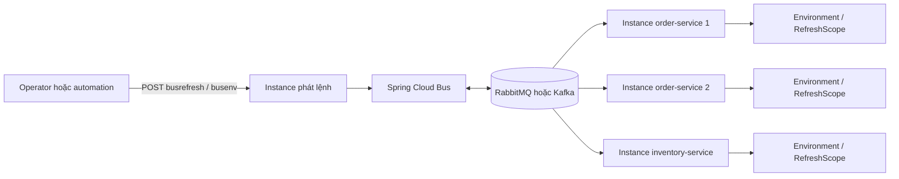
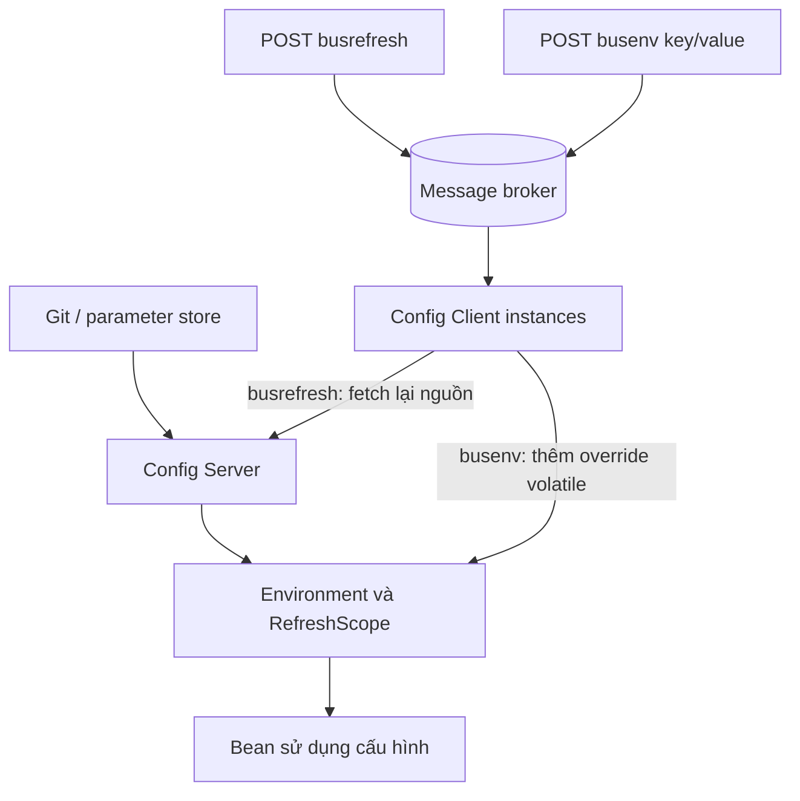

# Phân biệt `busrefresh` với `busenv` và tính bền vững của thay đổi

Spring Cloud Bus giúp nhiều instance Spring Boot trao đổi sự kiện qua một message broker như RabbitMQ hoặc Kafka. Trong quản lý cấu hình, hai endpoint thường được dùng là `/actuator/busrefresh` và `/actuator/busenv`. Tên gần giống nhau nhưng chúng giải quyết hai việc khác nhau: `busrefresh` yêu cầu các instance làm mới cấu hình và bean có thể refresh; `busenv` gửi một cặp key/value để cập nhật `Environment` đang chạy.

Khác biệt quan trọng nhất nằm ở nơi lưu giá trị. `busenv` tạo thay đổi cục bộ, tạm thời trong bộ nhớ của từng ứng dụng; nó không ghi vào Git, Config Server hay parameter store. `busrefresh` cũng không ghi cấu hình về backend: nó yêu cầu ứng dụng tải lại cấu hình từ nguồn đã được cấu hình. Muốn thay đổi tồn tại sau khi instance khởi động lại, cần cập nhật nguồn cấu hình chuẩn rồi phát lệnh refresh.

## Mục tiêu học tập

Sau bài này, bạn có thể:

- Giải thích vai trò của Spring Cloud Bus và message broker trong việc phân phối sự kiện.
- Phân biệt tác động của `/actuator/busrefresh` và `/actuator/busenv`.
- Xác định thay đổi nào được lưu bền vững trong Git hoặc parameter store và thay đổi nào chỉ tồn tại trong `Environment` của process.
- Gửi sự kiện đến tất cả instance, một service hoặc một instance cụ thể.
- Kiểm tra event delivery, giá trị hiệu lực và trạng thái refresh trên các node.
- Thiết kế quy trình cập nhật, override khẩn cấp, hoàn nguyên và bảo vệ endpoint Bus.

## Spring Cloud Bus truyền sự kiện như thế nào?

Spring Cloud Bus kết nối các ứng dụng trong hệ thống phân tán qua một broker. Mỗi instance tham gia Bus có định danh riêng; khi một instance phát sự kiện, broker chuyển sự kiện đến các node phù hợp với destination. Các node nhận sự kiện rồi thực hiện hành động tương ứng.



Để bật Bus, ứng dụng thêm một starter transport phù hợp, thường là `spring-cloud-starter-bus-amqp` hoặc `spring-cloud-starter-bus-kafka`, đồng thời cấu hình broker. Nếu cần gọi các endpoint HTTP, ứng dụng cũng cần Spring Boot Actuator và phải expose endpoint có chủ đích. Bus sử dụng Spring Cloud Stream bên dưới nên có thể tích hợp các binder khác theo hệ sinh thái và phiên bản tương ứng.

Ví dụ dependency Maven cho RabbitMQ:

```xml
<dependency>
    <groupId>org.springframework.cloud</groupId>
    <artifactId>spring-cloud-starter-bus-amqp</artifactId>
</dependency>
```

Hoặc dùng Kafka:

```xml
<dependency>
    <groupId>org.springframework.cloud</groupId>
    <artifactId>spring-cloud-starter-bus-kafka</artifactId>
</dependency>
```

Để Spring Cloud BOM quản lý phiên bản tương thích với Spring Boot. Broker phải sẵn sàng, các instance phải kết nối được và sử dụng cấu hình xác thực phù hợp. Broker có thể có cơ chế lưu message, acknowledgement và redelivery tùy cấu hình, nhưng điều đó chỉ liên quan đến vận chuyển sự kiện. Bus vẫn không phải kho lưu cấu hình chuẩn và không biến một override runtime thành dữ liệu cấu hình bền vững.

## `busrefresh`: làm mới cấu hình và bean có thể refresh

Endpoint:

```text
POST /actuator/busrefresh
```

`busrefresh` phát sự kiện yêu cầu các instance nhận sự kiện chạy quy trình refresh. Hành động này tương ứng với refresh ở từng ứng dụng: làm mới các property source có thể tải lại, xóa cache của `RefreshScope` và rebind các bean `@ConfigurationProperties` theo cơ chế Spring Cloud. Nhờ vậy, những bean dùng proxy refresh scope có thể tạo target mới khi được gọi tiếp theo.

Ví dụ, nhóm đã cập nhật timeout của dịch vụ thanh toán trong Git:

```yaml
payment:
  gateway:
    connect-timeout: 4s
```

Sau khi commit đã có trên branch/label mà Config Server phục vụ, gửi:

```bash
curl -X POST http://order-service:8080/actuator/busrefresh
```

Các instance nhận sự kiện sẽ lấy lại cấu hình theo nguồn và label đang dùng, rồi cập nhật các thành phần được hỗ trợ. `busrefresh` không tạo commit và không sửa file trong Git. Nếu backend vẫn trả giá trị cũ, refresh sẽ không tự tạo ra giá trị mới.

`busrefresh` cũng không bảo đảm mọi bean trong ứng dụng đều thay đổi. Bean singleton tự lưu snapshot hoặc tài nguyên được tạo từ cấu hình cũ có thể vẫn giữ trạng thái cũ. Các bean đó cần được thiết kế bằng `@RefreshScope`, rebind phù hợp hoặc cơ chế thay thế tài nguyên riêng.

## `busenv`: cập nhật một key/value trong Environment đang chạy

Endpoint:

```text
POST /actuator/busenv
```

Endpoint nhận JSON có tên thuộc tính và giá trị mới:

```json
{
  "name": "orders.max-items",
  "value": "25"
}
```

Ví dụ gửi thay đổi đến các instance đang tham gia Bus:

```bash
curl -X POST http://order-service:8080/actuator/busenv \
  -H "Content-Type: application/json" \
  -d '{"name":"orders.max-items","value":"25"}'
```

`busenv` cập nhật `Environment` trên các instance đích bằng một property source runtime có độ ưu tiên cao. Sự kiện thay đổi môi trường được phát để các thành phần hỗ trợ có thể phản ứng, ví dụ bean `@ConfigurationProperties` được rebind theo cơ chế Spring Cloud Context.

Điểm cần nhớ là thay đổi này chỉ nằm trong bộ nhớ của process. `busenv` không gọi Config Server để lưu giá trị, không ghi vào Git và không cập nhật parameter store. Tài liệu `EnvironmentManager` mô tả loại thay đổi này là thay đổi local nhưng volatile, được thêm vào property source có độ ưu tiên cao của `Environment`.

Vì `busenv` không tương đương với refresh scope, không mặc định rằng mọi target `@RefreshScope` đã được xóa cache chỉ bằng một sự kiện `busenv`. Nếu một bean refresh-scoped cần tạo lại từ giá trị vừa thay đổi, cần có bước refresh phù hợp và kiểm tra kết quả trên đúng phiên bản Spring Cloud đang dùng.

## So sánh hai endpoint

| Tiêu chí | `busrefresh` | `busenv` |
|---|---|---|
| Mục đích | Yêu cầu các instance làm mới cấu hình và bean được hỗ trợ | Đưa một cặp key/value vào `Environment` đang chạy |
| Dữ liệu đầu vào | Thường không cần body; ứng dụng tải lại nguồn cấu hình hiện tại | Tên thuộc tính và giá trị mới trong POST body |
| Tác động chính | Refresh property sources, xóa cache `RefreshScope`, rebind `@ConfigurationProperties` | Thêm/cập nhật giá trị runtime trong property source có ưu tiên cao; phát sự kiện môi trường |
| Ghi vào Git/Config Server | Không | Không |
| Tính bền vững | Phụ thuộc nguồn cấu hình đã lưu; refresh chỉ tải lại nguồn đó | Volatile, không tồn tại như một thay đổi bền vững trong backend |
| Khi restart instance | Giá trị chuẩn được tải lại từ nguồn cấu hình | Override runtime mất đi, trừ khi đã được lưu riêng ở nguồn khác |
| Tình huống phù hợp | Phân phối thay đổi đã commit vào nguồn cấu hình chuẩn | Override tạm thời, có kiểm soát cho một tình huống vận hành |

Không dùng `busenv` như một quy trình phát hành cấu hình dài hạn. Nó hữu ích cho thao tác runtime có chủ đích, nhưng nếu giá trị phải được giữ sau restart hoặc áp dụng cho instance mới trong tương lai thì cần ghi thay đổi vào nguồn cấu hình chuẩn.

## Tính bền vững: nguồn chuẩn, sự kiện và trạng thái runtime

Trong hệ thống Config Server, cần tách ba lớp sau:

1. **Nguồn cấu hình chuẩn:** Git, object storage hoặc parameter service. Đây là nơi lưu giá trị được review, version và dùng lại khi instance khởi động.
2. **Sự kiện Bus:** thông điệp báo cho các instance biết cần refresh hoặc cập nhật một thuộc tính. Broker vận chuyển sự kiện; bản thân sự kiện không phải một bản phát hành cấu hình.
3. **Environment runtime:** tập property source trong bộ nhớ của mỗi instance. `busenv` thêm override vào lớp này; `busrefresh` yêu cầu tải lại nguồn cấu hình và làm mới bean theo cơ chế hỗ trợ.



### Ví dụ 1: thay đổi bền vững

Nhóm muốn đổi timeout thanh toán từ 3 giây thành 4 giây cho tất cả instance production:

1. Sửa file `order-service-prod.yml` trong repository cấu hình.
2. Tạo pull request, review và chạy kiểm tra YAML/validation.
3. Merge commit vào branch hoặc tag mà Config Server sử dụng.
4. Xác nhận Config Server trả giá trị 4 giây cho đúng application, profile và label.
5. Gửi `POST /actuator/busrefresh` để các instance nạp cấu hình mới.
6. Kiểm tra từng instance đã nhận giá trị và bean/tài nguyên liên quan đã áp dụng nó.

Giá trị 4 giây được lưu trong Git nên instance mới khởi động sau đó cũng lấy được. Bus chỉ giúp các instance đang chạy cập nhật nhanh hơn.

### Ví dụ 2: override runtime tạm thời

Trong sự cố, nhóm cần tắt tạm một tính năng:

```json
{
  "name": "features.new-checkout.enabled",
  "value": "false"
}
```

Gửi qua `busenv` để các instance nhận override. Giá trị này có thể có hiệu lực ngay sau khi sự kiện được xử lý và các bean liên quan phản ứng. Tuy nhiên, file Git vẫn giữ giá trị cũ. Instance khởi động mới không tự biết override runtime trước đó; khi process bị thay thế hoặc khởi động lại, thay đổi volatile không còn.

Sau khi xử lý sự cố, nhóm cần quyết định giữ hay bỏ thay đổi:

- Nếu muốn giữ, cập nhật feature flag trong nguồn cấu hình chuẩn, review/commit rồi chạy `busrefresh`.
- Nếu chỉ là override tạm thời, kết thúc override bằng quy trình reset được hỗ trợ cho phiên bản đang dùng hoặc restart có kiểm soát; sau đó xác nhận giá trị hiệu lực trở về nguồn chuẩn.

Không giả định rằng gọi `busrefresh` tự động xóa override do `busenv` tạo. Vì override được đặt trong property source runtime có độ ưu tiên cao, cần kiểm tra thứ tự property source và cách reset của phiên bản Spring Cloud cụ thể. Khi chưa có cơ chế reset được xác nhận, restart instance là cách rõ ràng để loại bỏ trạng thái volatile, nhưng phải bảo đảm nguồn chuẩn đã có giá trị mong muốn trước khi restart.

## Nhắm đích đến một service hoặc instance

Nếu không chỉ định destination, sự kiện Bus thường được phát đến toàn bộ node phù hợp. Có thể giới hạn sự kiện bằng phần destination trong path:

```text
POST /actuator/busrefresh/order-service:**
POST /actuator/busenv/order-service:8081
```

Ví dụ thứ nhất nhắm đến các instance có service ID khớp `order-service:**`; ví dụ thứ hai nhắm một instance có ID `order-service:8081`. Destination được so khớp bằng `PathMatcher` với dấu `:` làm dấu phân tách.

Mỗi node phải có Bus ID duy nhất để tránh sự kiện bị bỏ qua hoặc xử lý sai. ID mặc định được tạo từ tên ứng dụng và thông tin instance như port/index/instance ID. Có thể cấu hình `spring.cloud.bus.id` nếu cần kiểm soát rõ định danh; trong môi trường nhiều replica, bảo đảm mỗi instance có phần định danh riêng.

Chỉ target một service hoặc instance khi đã xác định rõ phạm vi ảnh hưởng. Nếu thay đổi ảnh hưởng đến tất cả node dùng chung cấu hình, cần kiểm tra rollout và khả năng tương thích giữa các phiên bản trước khi broadcast.

## Cấu hình endpoint và bảo vệ quyền thay đổi

Chỉ expose các endpoint cần dùng:

```yaml
management:
  endpoints:
    web:
      exposure:
        include: health,busrefresh,busenv
```

Đây là ví dụ cho môi trường có nhu cầu vận hành cả hai endpoint; nếu không cần `busenv`, hãy bỏ nó khỏi danh sách exposure. Các endpoint có thể thay đổi hành vi runtime trên nhiều instance nên cần:

- Bật TLS khi truy cập qua mạng và xác thực người gọi.
- Phân quyền riêng cho thao tác refresh và thao tác sửa Environment.
- Chỉ cho phép truy cập từ mạng quản trị hoặc hệ thống automation được tin cậy.
- Ghi audit người gọi, thời điểm, endpoint, destination và tên thuộc tính bị thay đổi.
- Không gửi password, token, private key hoặc dữ liệu nhạy cảm qua `busenv`; event payload có thể đi qua broker, log và hệ thống tracing.
- Bảo vệ RabbitMQ/Kafka bằng credential, TLS, quyền publish/consume và network policy phù hợp.
- Tránh expose rộng các endpoint Actuator khác như `env`, `configprops` hoặc `shutdown` nếu không có nhu cầu.

`busenv` đặc biệt nhạy cảm vì có thể ghi đè một thuộc tính với độ ưu tiên cao. Chỉ nhóm vận hành được ủy quyền mới nên sử dụng, và mỗi override cần có ticket/change record, lý do, thời hạn và bước hoàn nguyên.

## Kiểm tra sự kiện đã đến và thay đổi đã có hiệu lực

HTTP request thành công chỉ cho biết endpoint ở node phát lệnh đã nhận yêu cầu. Nó không tự chứng minh mọi instance đã nhận sự kiện và đã áp dụng giá trị mới.

Để theo dõi Bus event, có thể bật tracing trong môi trường phù hợp:

```yaml
spring:
  cloud:
    bus:
      trace:
        enabled: true
```

Khi `TraceRepository` có mặt, trace có thể ghi nhận sự kiện đã gửi và các acknowledgement từ instance. Tùy phiên bản Spring Boot và cơ chế tracing đang dùng, endpoint hiển thị trace có thể khác; hãy kiểm tra telemetry của ứng dụng thay vì mặc định một endpoint trace luôn có sẵn.

Checklist xác minh:

1. Xác nhận broker hoạt động và các instance đang kết nối đúng destination/topic.
2. Ghi nhận event ID, origin và destination nếu tracing được bật.
3. Kiểm tra log/ack từ các instance dự kiến nhận sự kiện.
4. Với `busrefresh`, kiểm tra Config Server đang phục vụ đúng commit/label và kiểm tra giá trị hiệu lực ở từng instance.
5. Với `busenv`, kiểm tra key/value trong `Environment` và xác nhận property source runtime đang thắng theo thứ tự ưu tiên.
6. Gọi chức năng nghiệp vụ có sử dụng thuộc tính đó để xác nhận hành vi thực tế.
7. Ghi nhận node không phản hồi và xử lý riêng; không xem broadcast thành công là bằng chứng tất cả node đã đồng bộ.

## Kiểm thử tính bền vững

Trong môi trường thử nghiệm, kiểm tra ít nhất các trường hợp sau:

| Tình huống | Kết quả cần xác nhận |
|---|---|
| Sửa Git rồi gửi `busrefresh` | Các instance đang chạy nhận giá trị từ commit mới |
| Gửi `busenv` mà không sửa Git | Instance đang chạy nhận override; repository không thay đổi |
| Khởi động một instance mới sau `busenv` | Instance mới lấy giá trị từ nguồn chuẩn, không tự kế thừa override volatile của instance cũ |
| Restart instance đã nhận `busenv` | Override runtime mất; giá trị khởi động đến từ nguồn cấu hình được nạp lại |
| Gửi `busenv`, sau đó `busrefresh` | Xác minh riêng property source runtime và giá trị hiệu lực; không giả định refresh xóa override |
| Target một service hoặc instance | Chỉ các node khớp destination xử lý sự kiện |
| Broker tạm thời gián đoạn | Theo dõi event chưa được xử lý, retry/ack và trạng thái sau khi broker phục hồi |

Không dùng secret thật trong bài kiểm thử. Với cấu hình nhạy cảm, chỉ kiểm tra tên property hoặc giá trị giả lập và bảo đảm log không in payload.

## Quy trình vận hành đề xuất

Đối với thay đổi cấu hình thông thường:

1. Sửa nguồn cấu hình chuẩn (Git hoặc parameter service).
2. Review, kiểm thử validation và phát hành một version/label rõ ràng.
3. Kiểm tra Config Server trả về đúng giá trị.
4. Gửi `busrefresh` đến phạm vi instance phù hợp.
5. Theo dõi event acknowledgement, giá trị hiệu lực và sức khỏe ứng dụng.
6. Nếu có lỗi, rollback nguồn cấu hình về commit/version đã biết tốt rồi phát `busrefresh` lần nữa.

Đối với override khẩn cấp:

1. Ghi nhận lý do, người phê duyệt, key, giá trị và phạm vi destination.
2. Đánh giá liệu `busenv` có phù hợp và không tác động đến bí mật hoặc thuộc tính khởi động bất biến.
3. Gửi override đến đúng service/instance và xác minh từng node.
4. Đặt thời hạn cho override và theo dõi hành vi sau khi áp dụng.
5. Chuyển thay đổi thành commit/version bền vững nếu cần giữ; nếu không, reset hoặc restart theo quy trình đã kiểm thử.
6. Xác minh không còn override runtime ngoài ý muốn.

## Kết luận

`busrefresh` và `busenv` đều phân phối thay đổi qua Spring Cloud Bus nhưng có ý nghĩa khác nhau. `busrefresh` yêu cầu các instance làm mới cấu hình từ nguồn hiện tại, xóa cache `RefreshScope` và rebind `@ConfigurationProperties`. `busenv` thêm hoặc cập nhật một key/value trong `Environment` runtime của các instance đích.

Thay đổi do `busenv` tạo là volatile và không được lưu vào Git, Config Server hay parameter store. Broker chỉ vận chuyển sự kiện, không biến override runtime thành cấu hình bền vững. Muốn thay đổi tồn tại sau restart, hãy cập nhật nguồn cấu hình chuẩn, phát hành version/commit rồi gửi `busrefresh`. Với override khẩn cấp, cần audit, giới hạn phạm vi, đặt thời hạn và có cách reset đã được kiểm thử.

## Tài liệu tham khảo

- [Spring Cloud Bus – Bus Endpoints](https://docs.spring.io/spring-cloud-bus/reference/spring-cloud-bus/bus-endpoints.html)
- [Spring Cloud Bus – Quickstart và broker](https://docs.spring.io/spring-cloud-bus/reference/quickstart.html)
- [Spring Cloud Bus – Configuration và tracing](https://docs.spring.io/spring-cloud-bus/reference/spring-cloud-bus/configuration.html)
- [Spring Cloud Context – EnvironmentManager API](https://javadoc.io/doc/org.springframework.cloud/spring-cloud-context/3.1.9/org/springframework/cloud/context/environment/EnvironmentManager.html)
