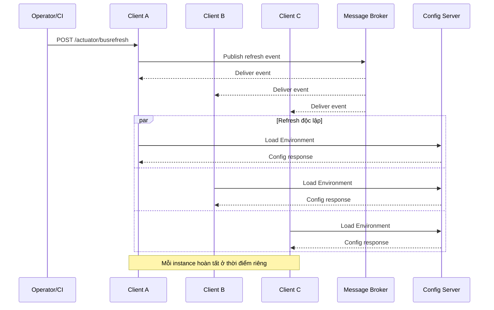

# Giới hạn của Bus: không tạo giao dịch cập nhật đồng thời mọi client

Spring Cloud Bus giúp phân phối sự kiện giữa các ứng dụng Spring Cloud thông qua message broker như RabbitMQ hoặc Kafka. Với cấu hình tập trung, sự kiện refresh có thể yêu cầu nhiều Config Client tải lại cấu hình từ Config Server. Tuy nhiên, **Bus không tạo ra một giao dịch phân tán bảo đảm mọi client đổi cấu hình cùng một thời điểm, hoặc tất cả cùng thành công hay cùng rollback**.

Mỗi instance nhận sự kiện và tự xử lý refresh trong tiến trình riêng. Thời gian nhận, kết nối Config Server, tải property source, rebind bean và hoàn tất xử lý có thể khác nhau. Trong một khoảng thời gian, một số instance có thể đã dùng cấu hình mới trong khi instance khác vẫn dùng cấu hình cũ. Đây là đặc tính eventual consistency cần được tính đến khi thiết kế thay đổi cấu hình cho nhiều dịch vụ.

## 1. Bus phân phối sự kiện, không điều phối một transaction

Spring Cloud Bus tạo một kênh sự kiện phân tán giữa các ứng dụng tham gia cùng broker. Khi một instance phát sự kiện refresh, Bus chuyển thông điệp qua broker để các instance phù hợp nhận và xử lý. Với endpoint Bus refresh, mục tiêu thường là yêu cầu các client tải lại cấu hình từ nguồn đã cấu hình.

Luồng tổng quát:



Broker chịu trách nhiệm vận chuyển message theo cấu hình và semantics của nó. Sau khi nhận sự kiện, mỗi client tự thực hiện logic refresh. Không có một transaction coordinator mặc định giữ tất cả instance ở trạng thái cũ, chờ tất cả cùng sẵn sàng, rồi commit thay đổi tại một thời điểm chung.

Vì vậy, Bus cung cấp cơ chế **phát tín hiệu và lan truyền yêu cầu**, không cung cấp giao dịch ACID xuyên qua broker, Config Server, các JVM, Spring `Environment` và các bean đang chạy.

## 2. Vì sao không thể cập nhật đồng thời mọi client?

Ngay cả khi các client cùng nhận một event, thời gian hoàn tất vẫn có thể khác nhau do:

- **Độ trễ mạng và broker:** mỗi consumer nhận message ở thời điểm khác nhau; consumer có thể bị backlog hoặc tạm thời mất kết nối.
- **Tải của instance:** một JVM bận xử lý request, GC hoặc khởi tạo bean có thể refresh chậm hơn instance khác.
- **Khả năng truy cập Config Server:** client có thể gặp timeout, DNS lỗi, TLS/authentication failure hoặc Config Server quá tải.
- **Khác biệt backend:** Git, Vault hoặc composite repository có thể trả dữ liệu với thời gian khác nhau hoặc một backend đang lỗi.
- **Khác biệt bean:** một client có bean cần rebind đơn giản, client khác có resource cần đóng/mở hoặc không hỗ trợ refresh.
- **Instance offline:** một instance đang restart, partition mạng hoặc chưa tham gia broker có thể không xử lý event tại thời điểm phát.

Ví dụ, service `billing-api` có 5 replica. Sau khi phát refresh event, 3 replica có thể đã tải cấu hình mới, 1 replica đang chờ Config Server và 1 replica đang offline. Trong khoảng đó, request được load balancer phân phối có thể gặp hành vi khác nhau tùy replica xử lý.

## 3. Bus refresh không đồng nghĩa cập nhật tất cả bean thành công

Quá trình cập nhật có nhiều bước độc lập:

1. Producer gửi refresh event.
2. Broker nhận và phân phối event.
3. Mỗi client nhận event và bắt đầu xử lý.
4. Client tải lại cấu hình từ Config Server.
5. Spring `Environment` được cập nhật và các thay đổi được phát hiện.
6. Bean được rebind hoặc bean thuộc `@RefreshScope` được làm mới khi cơ chế hỗ trợ.
7. Ứng dụng tiếp tục hoạt động với trạng thái mới.

Thành công ở một bước không chứng minh các bước sau đã thành công. Ví dụ, HTTP request phát event trả thành công chỉ cho biết thao tác publish/endpoint đã được chấp nhận theo implementation; nó không phải bằng chứng tất cả client đã tải cấu hình, rebind bean và sẵn sàng dùng giá trị mới.

Một số bean có thể không refresh được, một số giá trị chỉ được đọc lúc startup, và một số resource cần restart để áp dụng thay đổi. Bus không tự biến các bean này thành refreshable.

## 4. Không có all-or-nothing và rollback tự động

Giao dịch phân tán kiểu all-or-nothing thường có hai đặc tính: mọi participant cùng commit, hoặc nếu một participant thất bại thì toàn bộ giao dịch được rollback. Spring Cloud Bus refresh không cung cấp giao thức đó.

Giả sử 10 instance nhận event:

| Instance | Kết quả refresh |
| --- | --- |
| A–F | Tải cấu hình mới và rebind thành công |
| G | Tải được `Environment` nhưng bean cần thiết không áp dụng được |
| H | Timeout khi gọi Config Server |
| I | Đang restart nên chưa xử lý event |
| J | Không kết nối được broker trong thời gian phát event |

Các instance A–F không tự quay lại cấu hình cũ chỉ vì G–J thất bại. Bus không có trạng thái commit chung để hoàn tác các thay đổi đã áp dụng. Nhóm vận hành phải quan sát trạng thái từng instance và quyết định retry, rollout hoặc phát một thay đổi khôi phục.

Nếu cấu hình mới gây lỗi, cách rollback thường là đưa repository về một revision đã biết hoặc chọn label cũ, sau đó phát một đợt refresh/rollout mới. Đây là **một thay đổi bù trừ**, không phải rollback nguyên tử của event trước.

## 5. Revision có thể khác nhau giữa các client

Một refresh event thường yêu cầu mỗi client đọc cấu hình hiện tại từ Config Server. Nếu client dùng branch có thể thay đổi như `main`, thời điểm mỗi client truy vấn có thể khác nhau:

1. Client A truy vấn khi branch `main` đang ở commit `abc`.
2. Một commit mới được merge, branch chuyển sang `def`.
3. Client B truy vấn sau đó và nhận commit `def`.

Hai client cùng xử lý một event nhưng có thể nhận revision khác nhau. Điều này không nhất thiết là lỗi của broker; đó là hệ quả của việc đọc một tham chiếu Git có thể di chuyển tại những thời điểm khác nhau.

Để giảm revision skew:

- Dùng tag phát hành được bảo vệ hoặc commit SHA bất biến cho một đợt rollout cần nhất quán.
- Ghi nhận `label` và `version`/Git revision trong log hoặc metadata của từng instance.
- Chỉ phát refresh sau khi Config Server có thể phục vụ revision dự kiến.
- Tránh cập nhật branch trong khi một đợt refresh quan trọng đang diễn ra.
- Nếu composite repository dùng nhiều Git repo, ghi nhận revision của từng nguồn khi backend cung cấp metadata.

Label cố định giúp các client đọc cùng snapshot cấu hình, nhưng vẫn không làm cho thời điểm áp dụng ở mọi client trở nên đồng thời. Nó giải quyết vấn đề **cùng nội dung**, không giải quyết vấn đề **cùng thời điểm commit vào runtime**.

## 6. Đích nhận sự kiện và phạm vi refresh

Spring Cloud Bus hỗ trợ phát sự kiện tới các ứng dụng tham gia và có thể giới hạn phạm vi bằng destination theo cơ chế định tuyến của Bus. Ví dụ, endpoint `busrefresh` có thể được dùng để yêu cầu refresh toàn bộ client hoặc một nhóm/destination phù hợp.

Ví dụ endpoint thường gặp:

```bash
curl -X POST http://billing-api-1:8081/actuator/busrefresh
```

Tên endpoint, exposure và cách định tuyến phụ thuộc phiên bản Spring Cloud Bus, Actuator và cấu hình destination. Cần xác nhận endpoint đang bật, được bảo vệ và route tới đúng nhóm ứng dụng. Không được suy luận rằng gửi event từ một replica chỉ refresh replica đó; mục tiêu của Bus là phân phối sự kiện qua broker theo phạm vi đã cấu hình.

Phạm vi càng rộng, ảnh hưởng của event càng lớn. Với thay đổi chỉ liên quan một nhóm dịch vụ, nên dùng destination có giới hạn nếu kiến trúc hỗ trợ, đồng thời kiểm tra các client nào thực sự nhận được event.

## 7. Lỗi, retry và message delivery

Không nên giả định mọi event luôn được giao đúng một lần và xử lý thành công đúng một lần. Đặc tính delivery phụ thuộc broker, exchange/topic, queue/group, acknowledgment, retry, dead-letter và cấu hình consumer. Ngoài ra, event có thể được xử lý nhưng refresh logic phía client thất bại.

Các trường hợp cần tính đến:

| Tình huống | Rủi ro | Cách xử lý |
| --- | --- | --- |
| Client offline khi event phát | Instance có thể chưa xử lý event | Theo dõi instance, kiểm tra revision và có quy trình refresh lại khi trở lại |
| Consumer nhận event nhưng Config Server lỗi | Environment không được cập nhật | Retry có giới hạn, backoff và cảnh báo lỗi refresh |
| Event được giao lại | Cùng yêu cầu có thể được xử lý nhiều lần | Thiết kế refresh idempotent, không gắn side effect nghiệp vụ không an toàn vào listener |
| Nhiều event đến gần nhau | Client có thể refresh nhiều lần hoặc xử lý theo thời điểm khác nhau | Gộp/throttle sự kiện ở pipeline nếu phù hợp; dùng revision rõ ràng |
| Một instance không rebind bean | Environment mới nhưng hành vi runtime cũ | Kiểm tra bean lifecycle, refresh scope hoặc restart yêu cầu |

Retry chỉ cải thiện khả năng thử lại thao tác thất bại; nó không tạo transaction chung. Cần đặt giới hạn retry, backoff, timeout và cảnh báo để tránh bão request lên Config Server khi nhiều client cùng phục hồi.

## 8. Cách xác minh trạng thái sau một đợt Bus refresh

Để biết thay đổi đã tới đâu, cần theo dõi từng instance thay vì chỉ nhìn response từ instance phát event.

Với mỗi instance, ghi nhận:

- Application name, instance ID và destination.
- Event ID hoặc correlation ID nếu hệ thống có ghi nhận.
- Thời điểm nhận event và thời điểm bắt đầu/kết thúc refresh.
- Config Server label và Git revision được nạp.
- Kết quả refresh, số lượng hoặc danh sách khóa thay đổi nếu endpoint cung cấp.
- Readiness/health và lỗi rebind hoặc khởi tạo lại bean.

Có thể kiểm tra Config Server trực tiếp trước khi phát event:

```bash
curl -sS "http://config-server:8888/billing-api/prod/release-2026"
```

Sau đó kiểm tra từng client bằng log, metric hoặc endpoint Actuator đã được bảo vệ. Không dựa vào một HTTP 200 từ `busrefresh` để kết luận tất cả instance đã cập nhật. Endpoint `env` hoặc `configprops` có thể giúp chẩn đoán nhưng có khả năng tiết lộ thông tin nhạy cảm; chỉ bật trong phạm vi mạng và quyền truy cập phù hợp.

Một dashboard rollout nên thể hiện ít nhất ba trạng thái: `pending`, `applied` và `failed` theo instance. Có thể thêm `stale` khi revision đang chạy khác revision mục tiêu. Đây là trạng thái do hệ thống giám sát/pipeline xây dựng; Bus không tự cung cấp một transaction status tổng hợp bảo đảm tất cả client đã commit.

## 9. Chiến lược rollout an toàn cho thay đổi cấu hình

Vì không có cập nhật đồng thời, hãy thiết kế cấu hình sao cho các phiên bản cũ và mới có thể cùng tồn tại trong một khoảng thời gian.

### Bước 1: Thay đổi tương thích ngược

Khi cần đổi tên thuộc tính hoặc cấu trúc cấu hình, triển khai ứng dụng hiểu được cả cấu hình cũ và mới trước. Không xóa khóa cũ ngay khi vẫn còn instance chỉ hiểu định dạng cũ.

### Bước 2: Phát hành snapshot cấu hình

Merge và review thay đổi, sau đó tạo tag hoặc commit label cố định. Xác nhận Config Server trả đúng revision và các property source dự kiến.

### Bước 3: Refresh theo nhóm

Nếu thay đổi có thể áp dụng động, phát event cho một nhóm/canary trước. Kiểm tra metric, log, readiness và revision của nhóm đó rồi mới mở rộng phạm vi.

### Bước 4: Xác minh đủ instance

Đối chiếu danh sách instance đang hoạt động với revision mục tiêu. Instance offline cần được xử lý khi quay lại; không được tính là đã cập nhật chỉ vì broker đã nhận event.

### Bước 5: Dọn cấu hình cũ ở đợt sau

Sau khi tất cả instance đã dùng phiên bản ứng dụng hiểu cấu hình mới, mới loại bỏ khóa cũ hoặc chuyển sang cấu trúc mới hoàn toàn. Cách làm theo nhiều giai đoạn giảm nguy cơ một phần hệ thống không hiểu cấu hình trong thời gian chuyển tiếp.

## 10. Khi nào cần coordinator hoặc rollout thay vì Bus refresh?

Nếu nghiệp vụ yêu cầu tất cả instance phải chuyển trạng thái theo một quy trình có kiểm soát, Bus đơn thuần không đủ. Có thể cần một control plane hoặc deployment orchestrator quản lý các bước:

1. **Prepare:** phát hành revision mới và yêu cầu từng instance tải/validate cấu hình nhưng chưa kích hoạt hành vi mới.
2. **Report readiness:** mỗi instance báo đã đọc đúng revision, validation thành công và sẵn sàng chuyển đổi.
3. **Activate:** khi đủ điều kiện, control plane phát lệnh kích hoạt hoặc triển khai instance mới.
4. **Observe:** xác minh các instance đã chuyển trạng thái và theo dõi metric nghiệp vụ.
5. **Compensate:** nếu có lỗi, phát hành revision khôi phục hoặc quay lại deployment đã biết.

Đây là giao thức ứng dụng cần tự thiết kế; Spring Cloud Bus không tự cung cấp các pha prepare/commit này. Ngay cả coordinator cũng không thể làm mọi JVM thay đổi trong cùng một nanosecond khi mạng và scheduler phân tán. Mục tiêu thực tế là tạo một **cổng kích hoạt có kiểm soát**, giới hạn thời gian hỗn hợp và bảo đảm các phiên bản tương thích trong cửa sổ chuyển đổi.

Với thay đổi ảnh hưởng tới schema dữ liệu, thuật toán tính phí hoặc giao thức giữa các dịch vụ, thường an toàn hơn khi dùng triển khai tương thích ngược theo nhiều bước thay vì yêu cầu tất cả client cập nhật cấu hình đồng thời.

## 11. Ví dụ: cập nhật timeout cho nhiều replica

Giả sử `billing-api` có ba replica A, B, C. Cấu hình hiện tại là `connect-timeout: 3s`; thay đổi mới là `5s`.

| Thời điểm | Replica A | Replica B | Replica C |
| --- | --- | --- | --- |
| Trước event | 3s | 3s | 3s |
| Event đã phát | Đang refresh | Chưa nhận | Đang refresh |
| Giữa quá trình | 5s | 3s | 5s |
| Sau xử lý thành công | 5s | 5s | 5s |

Trạng thái giữa quá trình là bình thường trong mô hình phân tán. Nếu B không nhận event vì offline, hệ thống cần phát hiện B đang chạy revision cũ và refresh hoặc restart nó khi trở lại. Nếu C refresh thất bại, A và B không tự rollback về `3s`.

Với timeout, trạng thái hỗn hợp có thể chấp nhận trong thời gian ngắn nếu dịch vụ và upstream tương thích với cả hai giá trị. Với thay đổi nhạy cảm hơn, cần canary, rollout instance mới hoặc một giao thức kích hoạt riêng.

## 12. Các lỗi vận hành thường gặp

| Triệu chứng | Nguyên nhân có thể | Hành động |
| --- | --- | --- |
| Endpoint phát Bus trả thành công nhưng một client không đổi | Client chưa nhận event, refresh lỗi hoặc bean không áp dụng giá trị | Kiểm tra consumer log, revision và bean lifecycle của client đó |
| Một số instance dùng revision khác nhau | Branch di chuyển trong khi client fetch ở thời điểm khác nhau | Dùng tag/commit cố định và so sánh `version` |
| Client nhận event nhiều lần | Broker redelivery hoặc nhiều producer phát event | Bảo đảm handler idempotent và kiểm soát nguồn phát |
| Config Server đã có commit mới nhưng client cũ | Client chưa refresh hoặc fetch bị giới hạn bởi Git refresh policy | Kiểm tra Config Server response rồi refresh client |
| Instance restart nhưng quay lại cấu hình cũ | Deployment truyền label cũ hoặc biến môi trường override | Kiểm tra startup config, label và property source precedence |
| Một nhóm client không nhận event | Sai destination, broker topology hoặc client không tham gia Bus | Kiểm tra destination, queue/topic, kết nối và subscription |

## 13. Bảo mật và giới hạn phạm vi sự kiện

Refresh event có thể khiến nhiều ứng dụng tải lại cấu hình và thay đổi hành vi runtime. Vì vậy:

- Bảo vệ endpoint `busrefresh` bằng xác thực, phân quyền và giới hạn mạng.
- Chỉ cho pipeline hoặc operator được phép phát event.
- Bảo vệ broker bằng credential, TLS và ACL cho exchange/topic/queue.
- Giới hạn destination theo nhóm dịch vụ khi phù hợp.
- Không đưa secret hoặc giá trị cấu hình nhạy cảm vào event payload, log hay metric.
- Audit người phát event, phạm vi đích, revision mục tiêu và kết quả theo instance.

Không dùng Bus làm kênh gửi tùy tiện các lệnh thay đổi trạng thái nghiệp vụ. Event refresh nên có mục đích rõ ràng, có kiểm soát và có thể truy vết.

## 14. Checklist trước khi phát một đợt refresh

- [ ] Git/config repository đã có revision được review và có thể truy vết.
- [ ] Config Server trả về đúng application, profile, label và revision mục tiêu.
- [ ] Đã xác định các instance/destination sẽ nhận sự kiện.
- [ ] Đã đánh giá trạng thái hỗn hợp cũ/mới có an toàn trong thời gian chuyển tiếp không.
- [ ] Đã xác định bean nào refresh được và bean nào cần restart.
- [ ] Broker, endpoint và quyền phát sự kiện được bảo vệ.
- [ ] Có metric/log để xác nhận từng instance nhận và áp dụng cấu hình.
- [ ] Có retry/backoff cho lỗi tạm thời và cách xử lý instance offline.
- [ ] Có kế hoạch canary, rollout, rollback hoặc thay đổi bù trừ.
- [ ] Chỉ kết thúc đợt triển khai khi mọi instance mục tiêu đã được đối chiếu với revision mong muốn.

Spring Cloud Bus giúp giảm thao tác gọi refresh từng instance bằng cách phân phối sự kiện qua broker. Nhưng mỗi client vẫn tự tải cấu hình và áp dụng thay đổi theo lifecycle riêng; không có giao dịch mặc định bảo đảm cập nhật đồng thời, all-or-nothing hay rollback tự động. Thiết kế an toàn cần chấp nhận trạng thái nhất quán cuối cùng, dùng revision có thể truy vết, theo dõi kết quả từng instance và tổ chức rollout sao cho phiên bản cũ/mới có thể cùng tồn tại trong thời gian chuyển tiếp.
