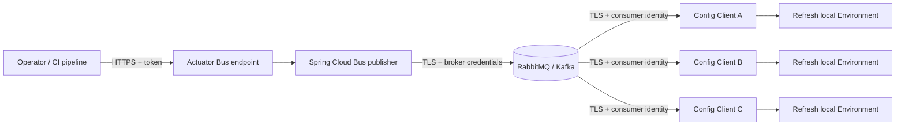

# Bảo vệ endpoint Bus, kết nối broker và nội dung sự kiện

Spring Cloud Bus dùng một message broker để truyền sự kiện giữa nhiều ứng dụng Spring Boot. Cách làm này giúp các Config Client nhận lệnh refresh mà không cần gọi từng instance bằng tay. Tuy nhiên, Bus tạo thêm hai bề mặt cần bảo vệ: các endpoint quản trị HTTP như `/actuator/busrefresh` và kết nối đến broker như RabbitMQ hoặc Kafka. Nội dung sự kiện cũng cần được xem là dữ liệu nội bộ, vì một số loại event có thể mang tên khóa và giá trị cấu hình.

Một triển khai an toàn cần kiểm soát độc lập quyền gọi endpoint, quyền publish/consume trên broker và dữ liệu được đưa vào event. TLS bảo vệ dữ liệu trên đường truyền, xác thực xác định danh tính client, còn phân quyền giới hạn client được phép gửi hoặc nhận sự kiện nào. Không lớp nào trong số này thay thế các lớp còn lại.

## Mục tiêu học tập

Sau bài học, bạn có thể:

- Xác định các endpoint Bus có thể thay đổi cấu hình trên một hoặc nhiều instance.
- Chỉ expose và phân quyền endpoint quản trị theo nguyên tắc quyền tối thiểu.
- Cấu hình kết nối RabbitMQ hoặc Kafka bằng thông tin xác thực được bảo vệ.
- Giới hạn quyền truy cập broker theo vhost, exchange, topic và consumer group.
- Giải thích metadata và payload thường có trong `RemoteApplicationEvent`.
- Đánh giá rủi ro khi phát `EnvironmentChangeRemoteApplicationEvent` hoặc custom event.
- Theo dõi, chẩn đoán và vận hành Bus mà không làm lộ bí mật.

## 1. Kiến trúc và các điểm cần bảo vệ

Spring Cloud Bus kết nối các ứng dụng với nhau qua broker. Một ứng dụng gửi event lên destination chung; broker phân phối message đến các instance đang subscribe. Mỗi instance nhận event sẽ kiểm tra đích nhận và thực hiện hành động tương ứng, ví dụ refresh Environment.



Có ba ranh giới bảo mật chính:

| Ranh giới | Câu hỏi cần trả lời | Biện pháp |
|---|---|---|
| HTTP management endpoint | Ai được phép yêu cầu broadcast hoặc thay đổi Environment? | HTTPS, xác thực, phân quyền, giới hạn mạng và exposure. |
| Message broker | Ứng dụng nào được publish/consume trên destination Bus? | TLS, tài khoản riêng, vhost/topic ACL và secret rotation. |
| Event payload | Message chứa dữ liệu gì và ai có thể đọc được? | Payload tối thiểu, không gửi secret, kiểm soát log và quyền truy cập broker. |

Endpoint Bus và broker là hai lớp độc lập. Một người không có quyền gọi Actuator vẫn có thể gây ảnh hưởng nếu lấy được broker credential có quyền publish; ngược lại, quyền gọi endpoint không nên đồng nghĩa với quyền quản trị toàn bộ broker.

## 2. Những endpoint Bus cần kiểm soát

Các endpoint thường gặp được cung cấp bởi Spring Cloud Bus qua Spring Boot Actuator:

| Endpoint | Tác dụng | Rủi ro nếu bị gọi trái phép |
|---|---|---|
| `POST /actuator/busrefresh` | Phát sự kiện yêu cầu các ứng dụng phù hợp refresh cấu hình. | Làm nhiều instance tải lại cấu hình cùng lúc, tạo tải lên Config Server hoặc khởi tạo lại bean. |
| `POST /actuator/busrefresh/{destination}` | Gửi refresh đến nhóm instance khớp destination, nếu phiên bản hỗ trợ endpoint dạng đích. | Tác động nhầm một dịch vụ hoặc một nhóm instance. |
| `POST /actuator/busenv/{name}/{value}` | Phát thay đổi thuộc tính Environment đến các ứng dụng nhận event. | Thay đổi hành vi runtime và có thể phát tán giá trị nhạy cảm. |

Đường dẫn cụ thể, phương thức HTTP và khả năng định tuyến theo destination phụ thuộc phiên bản Spring Cloud Bus. Hãy kiểm tra endpoint được expose trong release train của dự án thay vì giả định mọi phiên bản đều có cùng hành vi.

`busrefresh` thường gửi một event yêu cầu client tự refresh; nó không gửi toàn bộ `application.yml` hoặc toàn bộ cấu hình Git qua message. Client nhận event sẽ chạy quy trình refresh cục bộ và lấy cấu hình từ Config Server theo cơ chế đã thiết lập.

`busenv` có rủi ro cao hơn vì event thay đổi Environment có thể mang cả tên khóa và giá trị mới. Chỉ expose endpoint này nếu có use case rõ ràng, và không dùng nó để truyền password, token, private key hoặc dữ liệu cá nhân.

## 3. Chỉ expose endpoint cần thiết

Spring Boot Actuator không nên expose tất cả endpoint quản trị ra HTTP. Cấu hình tối thiểu có thể chỉ công khai health, info và endpoint Bus thực sự cần dùng:

```yaml
management:
  endpoints:
    web:
      exposure:
        include: health,info,busrefresh
```

Chỉ thêm `busenv` khi ứng dụng có nhu cầu thay đổi thuộc tính runtime qua Bus:

```yaml
management:
  endpoints:
    web:
      exposure:
        include: health,info,busrefresh,busenv
```

Không dùng `include: "*"` cho production chỉ để tiện kiểm tra. Nếu cần endpoint khác, hãy bổ sung từng ID sau khi đánh giá dữ liệu và thao tác mà endpoint đó cho phép.

Có thể tách cổng quản trị khỏi cổng phục vụ nghiệp vụ:

```yaml
server:
  port: 8080

management:
  server:
    port: 9001
```

Tách cổng giúp áp dụng firewall, network policy hoặc gateway riêng cho traffic quản trị. Cổng riêng không tự tạo ra bảo mật; cần giới hạn nguồn truy cập và bảo vệ endpoint bằng xác thực/phân quyền.

## 4. Phân quyền endpoint bằng Spring Security

Ví dụ sau minh họa Spring Boot 3 và Spring Security 6: chỉ principal có authority `SCOPE_config:refresh` được gọi các endpoint Bus bằng POST. Health và info được phép truy cập theo chính sách của ví dụ; các endpoint Actuator khác bị từ chối trong security chain này.

```java
import org.springframework.context.annotation.Bean;
import org.springframework.context.annotation.Configuration;
import org.springframework.http.HttpMethod;
import org.springframework.security.config.Customizer;
import org.springframework.security.config.annotation.web.builders.HttpSecurity;
import org.springframework.security.config.http.SessionCreationPolicy;
import org.springframework.security.web.SecurityFilterChain;

@Configuration
public class ManagementSecurityConfiguration {

    @Bean
    SecurityFilterChain managementSecurity(HttpSecurity http) throws Exception {
        return http
            .securityMatcher("/actuator/**")
            .authorizeHttpRequests(authorize -> authorize
                .requestMatchers("/actuator/health", "/actuator/info").permitAll()
                .requestMatchers(
                    HttpMethod.POST,
                    "/actuator/busrefresh",
                    "/actuator/busrefresh/**",
                    "/actuator/busenv",
                    "/actuator/busenv/**"
                ).hasAuthority("SCOPE_config:refresh")
                .anyRequest().denyAll()
            )
            .oauth2ResourceServer(oauth2 -> oauth2.jwt(Customizer.withDefaults()))
            .sessionManagement(session ->
                session.sessionCreationPolicy(SessionCreationPolicy.STATELESS)
            )
            .csrf(csrf -> csrf.ignoringRequestMatchers(
                "/actuator/busrefresh",
                "/actuator/busrefresh/**",
                "/actuator/busenv",
                "/actuator/busenv/**"
            ))
            .build();
    }
}
```

Đây là một security chain cho management path; ứng dụng có thể cần một chain khác cho API nghiệp vụ. Cấu hình JWT cần issuer/JWK hoặc decoder tương ứng. Nếu không dùng OAuth2 Resource Server, thay bằng cơ chế xác thực phù hợp của tổ chức.

Trong ví dụ, management chain dùng bearer token stateless và chỉ loại trừ các đường dẫn Bus khỏi CSRF protection. Chỉ áp dụng cách này khi credential được gửi tường minh trong Authorization header, không dựa vào cookie/session tự động. Nếu trình duyệt có thể gửi credential bằng cookie, giữ CSRF protection và yêu cầu CSRF token. Không tắt CSRF toàn ứng dụng.

Phân quyền nên tách theo hành động nếu tổ chức có nhiều nhóm vận hành. Ví dụ, một pipeline được phép broadcast refresh sau khi release, trong khi quyền thay đổi Environment bằng `busenv` chỉ dành cho nhóm quản trị đặc biệt hoặc bị tắt hoàn toàn.

## 5. Gọi endpoint an toàn từ pipeline

Pipeline nên lấy token ngắn hạn từ secret store hoặc hệ thống identity, sau đó gọi endpoint qua HTTPS:

```bash
curl --fail-with-body -X POST \
  -H "Authorization: Bearer ${BUS_REFRESH_TOKEN}" \
  https://catalog-management.internal/actuator/busrefresh
```

Không ghi token trực tiếp vào script được commit, tham số dòng lệnh dùng chung hoặc log pipeline. Dùng secret masking và quyền token chỉ đủ để gọi endpoint refresh.

Nếu chỉ refresh một destination, dùng endpoint đích được phiên bản Bus hỗ trợ, ví dụ:

```bash
curl --fail-with-body -X POST \
  -H "Authorization: Bearer ${BUS_REFRESH_TOKEN}" \
  https://catalog-management.internal/actuator/busrefresh/catalog-service:9001
```

Destination mẫu phải khớp `spring.cloud.bus.id` thực tế và quy tắc PathMatcher của ứng dụng. Không suy luận rằng tên service đơn lẻ luôn chọn đúng một instance. Hãy thử với một instance canary và xác minh các instance nhận event trước khi dùng trong production.

HTTP success thường chỉ cho biết endpoint đã chấp nhận hoặc publish event theo luồng xử lý của nó. Nó không chứng minh mọi consumer đã nhận, refresh thành công hoặc các bean đã được tạo lại. Pipeline cần bước xác minh sau phát event.

## 6. Kết nối broker là một lớp bảo mật riêng

Spring Cloud Bus sử dụng Spring Cloud Stream binder để kết nối message broker. Mỗi ứng dụng tham gia Bus cần có starter tương ứng, chẳng hạn:

| Broker | Dependency thường dùng |
|---|---|
| RabbitMQ | `spring-cloud-starter-bus-amqp` |
| Kafka | `spring-cloud-starter-bus-kafka` |

Các phiên bản Spring Boot và Spring Cloud phải tương thích theo release train. Chọn binder phù hợp với nền tảng message broker của tổ chức và tránh thêm nhiều binder nếu ứng dụng không có nhu cầu vận hành chúng.

Tất cả ứng dụng trong cùng Bus cần dùng chung destination để trao đổi event, trừ khi kiến trúc chủ ý tách các Bus riêng:

```yaml
spring:
  cloud:
    bus:
      destination: config-bus
```

Tên destination này là ví dụ. Với RabbitMQ, nó được ánh xạ vào tài nguyên messaging tương ứng của binder; với Kafka, nó thường là topic. Việc đặt tên nhất quán giúp các instance cùng tham gia một kênh sự kiện.

## 7. Cấu hình RabbitMQ qua TLS và vhost riêng

Ví dụ cấu hình RabbitMQ:

```yaml
spring:
  rabbitmq:
    host: ${BUS_RABBITMQ_HOST}
    port: 5671
    username: ${BUS_RABBITMQ_USERNAME}
    password: ${BUS_RABBITMQ_PASSWORD}
    virtual-host: /config-bus
    ssl:
      enabled: true
  cloud:
    bus:
      destination: config-bus
```

Trong ví dụ, thông tin xác thực được lấy từ biến môi trường do secret store hoặc nền tảng triển khai cấp. Port `5671` thường được dùng cho AMQPS; xác nhận port và certificate theo cấu hình broker thực tế.

Tạo tài khoản riêng cho Config Server và các nhóm Config Client. Cấp quyền tối thiểu trên vhost và exchange/queue cần dùng. Tránh dùng tài khoản `guest`, tài khoản admin hoặc một credential dùng chung cho tất cả workload.

Ở RabbitMQ, quyền vhost và permission trên exchange/queue cần được cấu hình phù hợp với binder. Một số tài nguyên có thể được binder tự tạo nếu tài khoản có quyền configure; nếu tổ chức quản lý tài nguyên trước, có thể thu hẹp quyền configure và cấp đúng quyền read/write cần thiết. Hãy kiểm tra tên exchange, queue và routing key do phiên bản binder tạo ra trước khi viết policy.

TLS bảo vệ dữ liệu trên đường truyền. Nếu cần xác thực hai chiều, cấu hình truststore/keystore hoặc SSL bundle theo phiên bản Spring Boot và chính sách PKI của tổ chức. Không tắt kiểm tra hostname hoặc certificate để xử lý lỗi TLS.

## 8. Cấu hình Kafka với SASL_SSL và ACL

Ví dụ cấu hình Kafka binder:

```yaml
spring:
  cloud:
    bus:
      destination: config-bus
    stream:
      kafka:
        binder:
          brokers: ${BUS_KAFKA_BROKERS}
          configuration:
            security.protocol: SASL_SSL
            sasl.mechanism: SCRAM-SHA-512
            sasl.jaas.config: ${BUS_KAFKA_JAAS_CONFIG}
```

`BUS_KAFKA_JAAS_CONFIG` chứa cấu hình đăng nhập do secret store cấp. Không commit giá trị JAAS có username/password thật vào Git. Với cluster dùng OAuth hoặc mTLS, chọn cơ chế xác thực tương ứng thay vì sao chép cấu hình SCRAM.

Tài khoản Kafka của ứng dụng cần ACL trên topic Bus và consumer group tương ứng. Quyền producer thường cần ghi vào topic; quyền consumer cần đọc topic và tham gia group. Không cấp quyền cluster-wide hoặc quyền tạo/xóa topic nếu ứng dụng không cần.

Nếu dùng nhiều môi trường, tách credential và topic/destination theo môi trường để tránh event production bị consumer test nhận hoặc ngược lại. ACL nên giới hạn theo service hoặc nhóm workload và được kiểm tra khi xoay vòng credential.

## 9. Định danh instance và destination

Spring Cloud Bus cần định danh instance để định tuyến event. Có thể cấu hình `spring.cloud.bus.id` theo quy ước của hệ thống. ID phải đủ duy nhất trong phạm vi Bus; nếu nhiều instance dùng cùng ID, định tuyến theo destination có thể không như mong đợi.

Ví dụ cấu hình ID có các thành phần ứng dụng, cổng và instance:

```yaml
spring:
  application:
    name: catalog-service
  cloud:
    bus:
      id: ${spring.application.name}:${server.port}:${INSTANCE_ID}
```

`INSTANCE_ID` cần được cấp duy nhất bởi nền tảng chạy ứng dụng. Destination thường được so khớp với ID bằng PathMatcher; pattern có thể nhắm một instance hoặc một nhóm. Cần kiểm tra cú pháp destination theo phiên bản Spring Cloud Bus đang dùng.

Không đưa thông tin nhạy cảm vào Bus ID. ID có thể xuất hiện trong log, tracing hoặc metadata của event và broker.

## 10. Nội dung của RemoteApplicationEvent

Spring Cloud Bus vận chuyển các event từ xa dựa trên lớp `RemoteApplicationEvent`. Một event có thể mang metadata phục vụ định tuyến và nhận diện, cùng payload riêng của loại event.

Các trường metadata thường gặp gồm:

| Thành phần | Ý nghĩa |
|---|---|
| Event type | Loại hành động hoặc loại sự kiện, ví dụ refresh hay environment change. |
| Event ID | Định danh event để hỗ trợ theo dõi và xử lý trùng lặp theo cơ chế framework. |
| `originService` | ID của service/instance phát event. |
| `destinationService` | Đích nhận hoặc pattern định tuyến; có thể không giới hạn vào một instance. |
| Payload riêng | Dữ liệu cần thiết cho loại event cụ thể. |

Tên trường, cấu trúc serialize và headers trên wire phụ thuộc phiên bản Spring Cloud Bus, Spring Cloud Stream binder và message converter. Không viết consumer bên ngoài dựa trên một JSON mẫu tự đoán; nếu cần tích hợp, hãy dùng API/event class được hỗ trợ và kiểm tra schema thực tế của release train.

### RefreshRemoteApplicationEvent

Event refresh chủ yếu mang thông tin cần thiết để định tuyến và yêu cầu instance nhận event chạy quy trình refresh cục bộ. Nó không cần mang toàn bộ `PropertySource` hay password từ Config Server. Instance nhận event sẽ tự tải lại cấu hình từ nguồn đã được cấu hình.

### EnvironmentChangeRemoteApplicationEvent

Event thay đổi Environment có thể mang tên khóa và giá trị cần áp dụng. Đây là lý do endpoint `busenv` cần được bảo vệ nghiêm ngặt: giá trị được gửi có thể được phân phối đến nhiều instance và có thể được lưu trong broker, log hoặc trace tùy cấu hình hạ tầng.

### Custom RemoteApplicationEvent

Ứng dụng có thể định nghĩa event tùy chỉnh khi cần truyền một thông báo nghiệp vụ hoặc vận hành giữa các service. Những class event cần được đăng ký/scan theo cơ chế Spring Cloud Bus của phiên bản đang dùng, và các ứng dụng gửi/nhận phải tương thích về class cũng như schema. Với custom event, ứng dụng thường dùng `@RemoteApplicationEventScan` để đăng ký package chứa các lớp event từ xa. Hãy giới hạn package được scan và chỉ đưa vào đó những event type đã được review; không scan một package rộng chứa các lớp không liên quan.

Payload custom nên nhỏ, có phiên bản schema và chỉ chứa dữ liệu cần thiết để consumer thực hiện hành động. Không gửi object domain lớn, token, credential, private key hoặc dữ liệu cá nhân nếu không có yêu cầu và cơ chế bảo vệ phù hợp.

## 11. Không đưa secret vào event

Message broker không phải secret manager. Event có thể được giữ trong queue/topic, bản sao lưu, dead-letter queue, trace hoặc công cụ quản trị broker. Vì vậy:

- Không gửi password, API token, private key, cookie hoặc credential trong event payload.
- Không dùng `/actuator/busenv` để phát secret đến nhiều instance.
- Chỉ gửi tên secret reference hoặc version identifier nếu consumer có thể tự lấy giá trị từ secret store với quyền riêng.
- Không log toàn bộ serialized event ở production.
- Giới hạn quyền đọc message trên broker và thời gian lưu giữ theo yêu cầu vận hành.
- Bật TLS khi truyền và mã hóa lưu trữ broker theo khả năng của nền tảng.

Ví dụ, thay vì gửi `database.password` cùng giá trị mới, event chỉ nên thông báo rằng version secret đã đổi. Mỗi instance có quyền đọc secret store sẽ tự lấy version được phê duyệt. Cách này tránh phát tán bí mật trong message bus và giữ quyền truy cập theo workload.

## 12. Kiểm soát custom event và tương thích schema

Custom event mở rộng khả năng của Bus nhưng cũng mở rộng bề mặt xử lý dữ liệu. Trước khi triển khai, xác định rõ:

1. Class event nào được phép gửi và ứng dụng nào được phép nhận.
2. Trường payload nào là bắt buộc, kiểu dữ liệu và giới hạn kích thước.
3. Phiên bản schema và cách xử lý field mới/field không còn dùng.
4. Consumer xử lý event lặp lại hoặc đến trễ như thế nào.
5. Log, trace và dead-letter queue có che giấu dữ liệu nhạy cảm hay không.

Các ứng dụng tham gia cùng Bus thường được triển khai độc lập. Khi nâng cấp event class, nên dùng thay đổi tương thích ngược trong giai đoạn rolling upgrade: consumer cũ vẫn bỏ qua field mới hoặc producer chưa gửi field bắt buộc cho đến khi mọi consumer được nâng cấp. Không đổi ý nghĩa một field đang dùng mà không có kế hoạch chuyển đổi.

Event handler nên idempotent nếu hành động có thể được phát lại. Dùng event ID hoặc business key để phát hiện xử lý lặp khi phù hợp; không giả định mọi broker/binder đảm bảo mỗi consumer chỉ thấy một lần trong mọi tình huống lỗi.

## 13. Quan sát và kiểm toán Bus

Vận hành Bus cần theo dõi cả endpoint, broker và consumer:

- Số lần gọi endpoint Bus, danh tính caller và kết quả HTTP.
- Số event publish thành công/thất bại và lỗi xác thực broker.
- Consumer lag, queue depth, số message chưa acknowledge và dead-letter count.
- Event type, origin, destination, event ID và thời điểm phát/nhận.
- Số instance nhận event và trạng thái refresh sau đó.
- Broker connection, TLS handshake, credential expiration và ACL denial.

Có thể bật tracing Bus nếu phiên bản và cấu hình hỗ trợ, nhưng cần giới hạn quyền đọc trace và không ghi payload chứa giá trị cấu hình. Log nên tập trung vào metadata phục vụ điều tra, không dump toàn bộ message.

HTTP 2xx từ endpoint không đồng nghĩa tất cả instance đã hoàn tất refresh. Cần một bước xác minh sau phát event, chẳng hạn kiểm tra revision Config Server, health/readiness và một chỉ dấu cấu hình an toàn ở từng instance.

## 14. Chẩn đoán lỗi endpoint và broker

| Hiện tượng | Nguyên nhân có thể | Cách kiểm tra |
|---|---|---|
| HTTP 404 | Endpoint chưa được expose, sai base path hoặc endpoint không có trong phiên bản hiện tại | Kiểm tra Actuator exposure, management port và endpoint IDs. |
| HTTP 401 | Thiếu token hoặc token không hợp lệ | Kiểm tra issuer, audience, expiry và credential pipeline. |
| HTTP 403 | Principal thiếu authority hoặc bị CSRF protection chặn | Kiểm tra security rules, scope/role và chính sách CSRF. |
| Endpoint trả thành công nhưng client không phản ứng | Broker publish/consume lỗi, destination sai hoặc client không subscribe cùng Bus | Kiểm tra log publisher, binder, broker ACL và consumer. |
| Broker connection refused | Host, port, DNS, firewall hoặc broker chưa sẵn sàng | Kiểm tra kết nối mạng và trạng thái broker. |
| TLS handshake thất bại | Certificate, truststore, hostname hoặc protocol không khớp | Kiểm tra chain chứng thư và cấu hình TLS hai phía. |
| SASL/AMQP authentication failed | Username/password, SASL mechanism, vhost hoặc ACL sai | Kiểm tra credential và quyền trên tài nguyên cụ thể. |
| Chỉ một số instance nhận event | Khác destination, Bus ID, broker cluster hoặc consumer group | So sánh cấu hình và metadata từng instance. |

Hãy điều tra theo thứ tự: endpoint HTTP → publish từ ứng dụng → broker nhận message → consumer subscribe → event được định tuyến → hành động refresh cục bộ. Không đổi đồng thời token, ACL, destination và Bus ID vì sẽ khó tìm ra nguyên nhân.

## 15. Quy trình phát hành refresh an toàn

Một pipeline có thể vận hành theo trình tự:

1. Xác thực commit/tag cấu hình đã được review.
2. Kiểm tra Config Server đang phục vụ đúng application, profile và label.
3. Gọi endpoint Bus bằng token ngắn hạn, chỉ có quyền refresh.
4. Ghi nhận event ID, origin và destination ở mức metadata an toàn.
5. Theo dõi broker publish/consume và trạng thái các instance nhận event.
6. Kiểm tra health, readiness và revision/config version trên các instance.
7. Nếu một nhóm instance không cập nhật, xử lý theo destination cụ thể hoặc rolling restart theo runbook.
8. Nếu cấu hình mới gây lỗi, rollback revision và phát refresh theo quy trình đã kiểm thử.

Đối với thay đổi rủi ro cao, refresh canary trước rồi mới broadcast đến toàn bộ hệ thống. Giới hạn tần suất phát event để tránh tạo nhiều lần khởi tạo bean, tải lên Config Server hoặc đợt kết nối đồng thời đến database.

## 16. Những điểm cần ghi nhớ

- Spring Cloud Bus phân phối event qua broker; endpoint Actuator chỉ là một trong các cách phát event.
- Chỉ expose `busrefresh` và `busenv` khi có nhu cầu; bảo vệ bằng HTTPS, xác thực và phân quyền.
- Broker cần TLS, credential riêng và ACL giới hạn theo vhost/topic/consumer group.
- Endpoint security và broker security là hai lớp độc lập, cần cấu hình cả hai.
- `RemoteApplicationEvent` mang metadata định tuyến và payload theo loại event; cấu trúc wire phụ thuộc phiên bản/binder.
- Refresh event không cần chứa toàn bộ cấu hình; client nhận event tự tải lại Environment.
- `busenv` và custom event có thể mang giá trị cấu hình; tuyệt đối không đưa secret vào payload.
- Theo dõi event ID, origin, destination, broker và trạng thái consumer; HTTP success không chứng minh mọi instance đã refresh.
- Dùng schema tương thích, handler idempotent và quy trình canary/rollback cho thay đổi quan trọng.

Khi bảo vệ đồng thời endpoint, broker và nội dung event, Spring Cloud Bus có thể phân phối thao tác refresh giữa nhiều ứng dụng mà vẫn giữ được ranh giới quyền truy cập. Hãy xem mọi event là dữ liệu vận hành có thể được lưu, đọc và phát lại; thiết kế payload tối thiểu và xác minh kết quả ở từng lớp trước khi coi một đợt refresh là hoàn tất.

## Tài liệu tham khảo

- [Spring Cloud Bus Reference](https://docs.spring.io/spring-cloud-bus/reference/)
- [Spring Cloud Bus – Actuator Endpoints](https://docs.spring.io/spring-cloud-bus/reference/spring-cloud-bus/actuator.html)
- [Spring Boot – Actuator Endpoint Security](https://docs.spring.io/spring-boot/reference/actuator/endpoints.html)
- [Spring Cloud Stream – Binder Configuration](https://docs.spring.io/spring-cloud-stream/reference/spring-cloud-stream/binding-properties.html)
