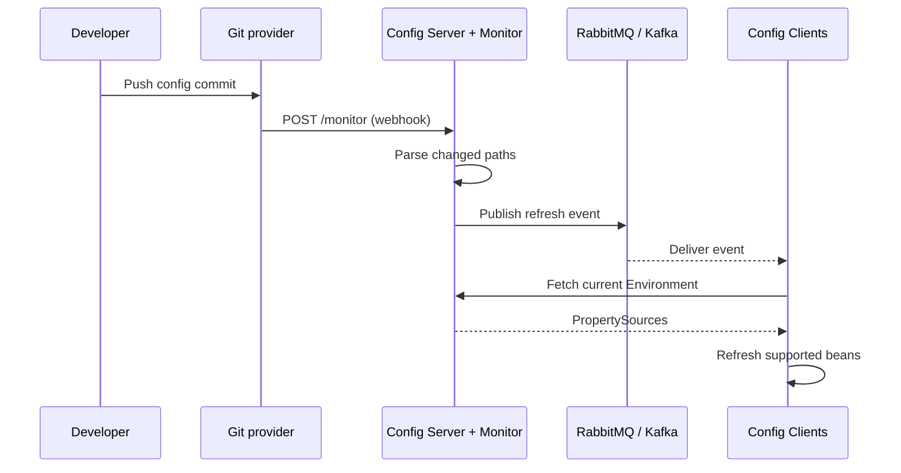

# Kích hoạt spring-cloud-config-monitor và điều kiện sử dụng Bus

Khi cấu hình trong Git thay đổi, Config Server có thể đọc được nội dung mới, nhưng các Config Client đang chạy không tự biết rằng cần tải lại cấu hình. Một cách kích hoạt là gửi webhook từ hệ thống quản lý mã nguồn đến Config Server. **`spring-cloud-config-monitor`** cung cấp endpoint nhận thông báo thay đổi, phân tích các file bị ảnh hưởng và xác định ứng dụng cần refresh.

Để lan truyền sự kiện đến nhiều client, Config Server cần được tích hợp **Spring Cloud Bus** cùng message broker. Monitor tiếp nhận webhook và xác định phạm vi ứng dụng; Bus đảm nhiệm việc phát sự kiện đến các client tham gia. Hai thành phần có trách nhiệm khác nhau và phải được cấu hình đúng thì quy trình tự động mới hoạt động đầy đủ.

## 1. Vai trò của spring-cloud-config-monitor

`spring-cloud-config-monitor` là thành phần mở rộng cho Spring Cloud Config Server, cung cấp endpoint nhận notification từ các hệ thống quản lý source code như GitHub, GitLab, Bitbucket hoặc Gitea theo các định dạng webhook được hỗ trợ.

Khi có một push hoặc thay đổi repository, hệ thống quản lý mã nguồn gửi HTTP POST đến endpoint monitor. Monitor phân tích payload, trích xuất đường dẫn file được thêm, sửa hoặc xóa, rồi ánh xạ những đường dẫn đó sang tên application cấu hình.

Ví dụ:

- Thay đổi `orders-service-prod.yml` có thể xác định ứng dụng bị ảnh hưởng là `orders-service`.
- Thay đổi `inventory-service.yml` có thể xác định ứng dụng bị ảnh hưởng là `inventory-service`.
- Thay đổi file dùng chung như `application.yml` có phạm vi rộng vì nhiều ứng dụng có thể kế thừa các thuộc tính trong file này.

Monitor giúp chuyển thông tin từ sự kiện source control thành tín hiệu refresh có phạm vi phù hợp. Nó không lưu cấu hình, không thay thế Git backend và cũng không tự bảo đảm mọi client đã áp dụng thành công giá trị mới.

## 2. Dependency cần có trên Config Server

Để kích hoạt endpoint monitor, thêm dependency `spring-cloud-config-monitor` vào ứng dụng Config Server. Nếu muốn webhook kích hoạt refresh phân tán, Config Server còn cần Spring Cloud Bus và binder tương ứng với broker.

Ví dụ Gradle dùng RabbitMQ:

```gradle
dependencies {
    implementation 'org.springframework.cloud:spring-cloud-config-server'
    implementation 'org.springframework.cloud:spring-cloud-config-monitor'
    implementation 'org.springframework.cloud:spring-cloud-starter-bus-amqp'
    implementation 'org.springframework.boot:spring-boot-starter-actuator'
}
```

Nếu hệ thống dùng Kafka, thay starter Bus AMQP bằng binder Kafka phù hợp:

```gradle
dependencies {
    implementation 'org.springframework.cloud:spring-cloud-config-server'
    implementation 'org.springframework.cloud:spring-cloud-config-monitor'
    implementation 'org.springframework.cloud:spring-cloud-starter-bus-kafka'
    implementation 'org.springframework.boot:spring-boot-starter-actuator'
}
```

Quản lý phiên bản các dependency bằng Spring Cloud release train tương thích với phiên bản Spring Boot của dự án. Không thêm đồng thời nhiều binder nếu kiến trúc chỉ sử dụng một broker.

Config Server vẫn cần được bật bằng `@EnableConfigServer`:

```java
@SpringBootApplication
@EnableConfigServer
public class ConfigServerApplication {
    public static void main(String[] args) {
        SpringApplication.run(ConfigServerApplication.class, args);
    }
}
```

Khi dependency monitor có mặt trong classpath, endpoint monitor được cung cấp tại `/monitor`. Đây là endpoint của Config Monitor, không phải endpoint Actuator `/actuator/monitor`.

## 3. Endpoint /monitor nhận webhook như thế nào?

Hệ thống quản lý mã nguồn được cấu hình gửi webhook đến URL công khai hoặc URL nội bộ của Config Server, ví dụ:

```text
POST https://config.example.internal/monitor
```

Webhook thường được gửi khi có sự kiện push. Payload chứa danh sách commit và các đường dẫn file được thêm, sửa hoặc xóa. Ví dụ payload dạng push minh họa:

```json
{
  "commits": [
    {
      "added": [],
      "modified": [
        "application.yml",
        "orders-service-prod.yml"
      ],
      "removed": []
    }
  ]
}
```

Định dạng payload thực tế phụ thuộc nhà cung cấp Git và loại sự kiện đã chọn. Config Monitor có hỗ trợ các định dạng webhook phổ biến, nhưng cần kiểm tra provider và phiên bản Spring Cloud đang sử dụng. Không nên giả định mọi webhook tùy chỉnh đều có cấu trúc tương thích.

Quá trình xử lý ở mức khái quát:

1. Config Server nhận POST tại `/monitor`.
2. Monitor nhận diện loại payload và trích xuất đường dẫn file thay đổi.
3. Monitor xác định application tương ứng từ tên file/đường dẫn theo quy ước cấu hình.
4. Nếu Bus được cấu hình, sự kiện refresh từ xa được phát cho application bị ảnh hưởng.
5. Các client phù hợp nhận sự kiện, truy vấn Config Server và nạp lại cấu hình.

Đối với file dùng chung như `application.yml`, phạm vi ảnh hưởng có thể là nhiều ứng dụng. Hãy kiểm thử ánh xạ của từng loại đường dẫn trước khi đưa webhook vào production.

## 4. Cách monitor ánh xạ file thay đổi sang application

Config Monitor sử dụng đường dẫn file trong payload để xác định ứng dụng cần refresh. Với quy ước file phổ biến của Config Server:

| File hoặc đường dẫn thay đổi | Phạm vi ứng dụng có thể bị ảnh hưởng |
|---|---|
| `orders-service.yml` | `orders-service` |
| `orders-service-prod.yml` | `orders-service` |
| `inventory-service.yml` | `inventory-service` |
| `application.yml` | Cấu hình dùng chung, có thể ảnh hưởng nhiều ứng dụng |
| `application-prod.yml` | Cấu hình dùng chung cho các ứng dụng yêu cầu profile `prod` |

Ánh xạ phụ thuộc cách repository được tổ chức và parser của monitor. Nếu file được đặt trong thư mục lồng nhau hoặc tên file tùy biến, cần xác nhận đường dẫn được nhận diện đúng. Tên application trong file phải nhất quán với `spring.application.name` mà client gửi đến Config Server.

Monitor chủ yếu xác định phạm vi application từ thay đổi đường dẫn. Profile cụ thể mà client đang chạy vẫn do client yêu cầu khi lấy cấu hình. Một thay đổi ở `orders-service-prod.yml` có thể khiến các instance `orders-service` nhận refresh event; mỗi instance sẽ tải cấu hình theo profile đang hoạt động của chính nó.

Với cấu hình dùng chung, cần cân nhắc phạm vi broadcast rộng. Nếu `application.yml` thay đổi, chỉ refresh một dịch vụ có thể khiến các ứng dụng khác tiếp tục giữ giá trị cũ. Hãy chọn chiến lược refresh theo phạm vi tác động của khóa cấu hình.

## 5. Điều kiện cần để monitor lan truyền qua Bus

Có hai khả năng cần phân biệt:

**Chỉ có Config Monitor:** Config Server nhận webhook và phân tích thay đổi. Tuy nhiên, nếu không có cơ chế phân phối sự kiện đến các client, việc nhận webhook không tự làm cho mọi instance ở xa tải lại cấu hình.

**Config Monitor kết hợp Spring Cloud Bus:** Config Server có Bus starter và binder, kết nối được broker; các Config Client liên quan cũng tham gia cùng Bus. Khi monitor phát sự kiện refresh từ xa, Bus phân phối sự kiện đến các node phù hợp.

Để dùng Bus fan-out, cần các điều kiện sau:

1. Config Server có `spring-cloud-config-monitor` để nhận webhook.
2. Config Server có Spring Cloud Bus starter và binder cho broker đã chọn.
3. Config Server kết nối broker thành công và có quyền publish.
4. Các Config Client cần nhận sự kiện cũng có Bus starter/binder tương ứng.
5. Các client kết nối cùng broker cluster và destination messaging tương thích.
6. Mỗi node có Bus ID phù hợp để định tuyến sự kiện.
7. Client vẫn truy cập được Config Server để tải cấu hình sau khi nhận event.

Nếu thiếu Bus ở Config Server hoặc client, hoặc các node dùng broker/destination khác nhau, webhook có thể được nhận nhưng không tạo ra quá trình refresh phân tán như mong đợi. Trong trường hợp đó, cần một cơ chế khác như gọi `/actuator/refresh` trực tiếp từng instance hoặc dùng hệ thống điều phối riêng.

## 6. Cấu hình Config Server với Monitor và Bus

Ví dụ Config Server dùng Git và RabbitMQ:

```yaml
server:
  port: 8888

spring:
  application:
    name: config-server
  cloud:
    config:
      server:
        git:
          uri: https://git.example.internal/platform/config-repo.git
          default-label: main
    bus:
      destination: springCloudBus
  rabbitmq:
    host: rabbitmq.internal
    port: 5672
    username: ${RABBITMQ_USERNAME}
    password: ${RABBITMQ_PASSWORD}

management:
  endpoints:
    web:
      exposure:
        include: health,info
```

Monitor endpoint `/monitor` không cần được thêm vào `management.endpoints.web.exposure.include`, vì nó không phải Actuator endpoint. Cấu hình exposure ở trên chỉ dành cho các endpoint Actuator được chọn.

Thông tin đăng nhập broker phải được cung cấp qua secret manager hoặc cơ chế quản lý bí mật của nền tảng. Không commit username/password thật vào repository.

## 7. Cấu hình Config Client tham gia Bus

Mỗi client cần dependency Bus tương ứng và cấu hình kết nối broker. Ví dụ dùng RabbitMQ:

```gradle
dependencies {
    implementation 'org.springframework.cloud:spring-cloud-starter-config'
    implementation 'org.springframework.cloud:spring-cloud-starter-bus-amqp'
    implementation 'org.springframework.boot:spring-boot-starter-actuator'
}
```

Ví dụ cấu hình client dùng Config Data API:

```yaml
spring:
  application:
    name: orders-service
  config:
    import: "configserver:http://config-server:8888"
  cloud:
    bus:
      destination: springCloudBus
  rabbitmq:
    host: rabbitmq.internal
    port: 5672
    username: ${RABBITMQ_USERNAME}
    password: ${RABBITMQ_PASSWORD}
```

Config Server và các client cần cùng tham gia kênh Bus mà hệ thống sử dụng. Trong môi trường nhiều replica, bảo đảm mỗi instance có định danh riêng và không vô tình bị cô lập sang destination khác.

Nếu hệ thống dùng Kafka, sử dụng starter Bus Kafka và cấu hình `spring.kafka.bootstrap-servers` cùng các thông tin bảo mật tương ứng. Không trộn binder RabbitMQ ở Config Server với binder Kafka ở client nếu không có một kiến trúc bridge được thiết kế rõ ràng.

## 8. Quy trình từ Git push đến refresh client

Một quy trình tự động thường diễn ra như sau:



Các bước cần được sắp xếp đúng:

1. Commit phải được push vào branch/tag mà Config Server đang đọc.
2. Config Server phải nhìn thấy nội dung mới trước khi client fetch lại.
3. Webhook cần đến đúng endpoint và payload phải được monitor nhận diện.
4. Bus phải chuyển sự kiện đến các client cần cập nhật.
5. Client phải lấy được cấu hình mới và áp dụng được thay đổi.

Nếu webhook được gửi trước khi backend Config Server cập nhật trạng thái repository, client có thể fetch phiên bản cũ. Với Git backend, hãy kiểm tra fetch/refresh repository và `version` trong Environment response khi cần xác minh commit.

## 9. Bảo vệ webhook endpoint

Webhook là một HTTP endpoint có thể kích hoạt refresh nhiều ứng dụng. Nếu bất kỳ ai cũng có thể gửi payload đến `/monitor`, họ có thể tạo refresh không cần thiết, gây tải lên Config Server, broker và các client.

Các biện pháp bảo vệ:

- Chỉ cho phép webhook đi vào từ mạng hoặc nguồn gửi được kiểm soát.
- Xác thực chữ ký webhook theo cơ chế của Git provider trước khi chấp nhận payload.
- Nếu dùng shared secret, lưu secret trong secret manager và không ghi vào log.
- Dùng TLS để bảo vệ payload trên đường truyền.
- Áp dụng xác thực/phân quyền tại reverse proxy hoặc Spring Security phù hợp với cơ chế webhook.
- Giới hạn tần suất và kích thước request; từ chối payload bất thường.
- Ghi nhận repository, event type, commit ID, đường dẫn thay đổi và thời điểm xử lý để audit.
- Không tin các trường application/path từ payload nếu chưa được kiểm tra và chuẩn hóa.

Không nên giả định việc cài `spring-cloud-config-monitor` tự động xác minh chữ ký webhook của mọi Git provider. Hãy kiểm tra khả năng của phiên bản đang dùng và đặt lớp xác minh chữ ký ở gateway, reverse proxy hoặc bộ xử lý webhook phù hợp trước khi payload có thể kích hoạt refresh.

## 10. Những lỗi thường gặp

| Hiện tượng | Nguyên nhân cần kiểm tra | Hướng xử lý |
|---|---|---|
| Git push thành công nhưng không có refresh | Webhook chưa được cấu hình hoặc URL `/monitor` sai. | Kiểm tra webhook delivery log và HTTP response. |
| `/monitor` trả lỗi | Payload không đúng định dạng provider được hỗ trợ hoặc endpoint không được đăng ký. | Kiểm tra dependency, phiên bản, event type và payload. |
| Monitor nhận payload nhưng client không nhận event | Config Server thiếu Bus/binder hoặc broker không kết nối được. | Kiểm tra Bus dependency, broker logs và publish status. |
| Một số client không refresh | Client thiếu Bus starter, sai destination, mất kết nối broker hoặc Bus ID không phù hợp. | Kiểm tra từng instance và cấu hình Bus. |
| Refresh xong nhưng giá trị vẫn cũ | Config Server chưa đọc commit mới hoặc client có property source ưu tiên cao hơn. | Kiểm tra `version`, `propertySources` và Environment phía client. |
| File dùng chung thay đổi nhưng chỉ một ứng dụng refresh | Mapping/path hoặc destination chỉ chọn một application. | Xác định phạm vi ảnh hưởng và phát refresh đến mọi ứng dụng kế thừa file chung. |
| Refresh gây tải đột biến | Một webhook tạo broadcast đến quá nhiều client. | Giới hạn phạm vi, gom thay đổi hoặc điều phối theo nhóm. |

## 11. Kiểm tra và vận hành webhook

Trước khi bật webhook production, hãy thử với một thay đổi nhỏ và xác minh từng chặng:

1. Tạo commit sửa một file application cụ thể.
2. Xác nhận Git provider gửi đúng event đến `/monitor`.
3. Kiểm tra log Config Server có nhận diện đúng đường dẫn và application không.
4. Xác nhận Config Server đã đọc commit mới bằng Environment API.
5. Kiểm tra sự kiện được publish lên broker.
6. Theo dõi client nhận event và bắt đầu fetch cấu hình.
7. Xác minh `Environment` và bean tiêu thụ đã nhận giá trị mới.
8. Thử một thay đổi ở `application.yml` để xác nhận phạm vi nhiều ứng dụng được xử lý đúng.

Nên lưu lại commit ID, event ID từ Git provider, danh sách application được monitor xác định, Bus destination và kết quả refresh. Những thông tin này giúp truy vết khi một dịch vụ không nhận được thay đổi.

Một HTTP response thành công từ `/monitor` chỉ cho biết request đã được endpoint tiếp nhận theo xử lý của nó; không chứng minh tất cả client đã tải và áp dụng cấu hình. Cần quan sát broker và client để xác nhận hoàn tất.

## 12. Tổng kết

- `spring-cloud-config-monitor` bổ sung endpoint `/monitor` cho Config Server để nhận webhook thay đổi từ hệ thống quản lý mã nguồn.
- Monitor phân tích các file được thêm/sửa/xóa và ánh xạ đường dẫn sang application bị ảnh hưởng.
- Monitor không thay thế Config Server và không phải message broker.
- Để lan truyền refresh đến nhiều client, Config Server và các client cần Spring Cloud Bus, binder và kết nối cùng broker/destination.
- Git webhook kích hoạt quy trình; Config Server phải nhìn thấy commit mới trước khi client fetch lại.
- File application-specific thường ánh xạ đến một ứng dụng; file `application.yml` dùng chung có thể ảnh hưởng nhiều ứng dụng.
- Bảo vệ `/monitor` bằng xác minh webhook, TLS, giới hạn mạng và kiểm soát request; không mặc định rằng dependency monitor tự xác minh chữ ký.
- Theo dõi từng chặng từ webhook, monitor, broker đến Config Client; không xem HTTP response của webhook là bằng chứng mọi instance đã refresh thành công.
