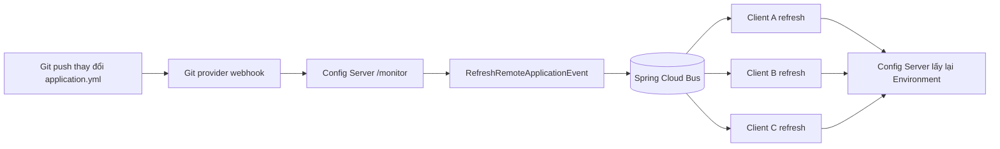

# Thay đổi application.yml và phạm vi tác động tới các client

## 1. Vì sao thay đổi application.yml có phạm vi rộng?

Trong Git backend của Spring Cloud Config, `application.yml` là file cấu hình nền dùng chung. Config Server trả property source này cho các ứng dụng client được phục vụ từ repository đó. Vì vậy, khi một commit thay đổi `application.yml`, phạm vi ảnh hưởng tiềm năng rộng hơn thay đổi file riêng như `order-service.yml`.

Ví dụ repository có:

```text
config-repo/
├── application.yml
├── application-prod.yml
├── order-service.yml
├── order-service-prod.yml
├── payment-service.yml
└── payment-service-prod.yml
```

`application.yml` cung cấp giá trị mặc định chung cho các client. `application-prod.yml` cung cấp cấu hình chung cho client đang dùng profile `prod`. Các file `order-service*.yml` và `payment-service*.yml` chỉ cung cấp cấu hình dành cho ứng dụng tương ứng.

Do đó, thay đổi một khóa trong `application.yml` có thể ảnh hưởng đến nhiều dịch vụ. Tuy nhiên, không phải mọi ứng dụng đều nhất thiết thay đổi hành vi: một client có thể không sử dụng khóa đó, có thể ghi đè bằng cấu hình riêng, hoặc không đọc cùng repository/label/search path.

## 2. application.yml được chia sẻ tới những client nào?

Với file-based EnvironmentRepository như Git, SVN và native, các tài nguyên có tên bắt đầu bằng `application` được dùng chung giữa các ứng dụng client. Những file thường gặp:

| File | Phạm vi cấu hình |
|---|---|
| `application.yml` | Giá trị mặc định chung cho mọi ứng dụng được phục vụ từ repository. |
| `application-dev.yml` | Giá trị chung cho các ứng dụng yêu cầu profile `dev`. |
| `application-prod.yml` | Giá trị chung cho các ứng dụng yêu cầu profile `prod`. |
| `order-service.yml` | Giá trị mặc định riêng của `order-service`. |
| `order-service-prod.yml` | Giá trị riêng của `order-service` khi profile `prod`. |
| `payment-service-prod.yml` | Giá trị riêng của `payment-service` khi profile `prod`. |

Phạm vi chia sẻ thực tế bị giới hạn bởi các điều kiện sau:

- Client phải được Config Server phục vụ từ repository chứa file đó.
- Request phải dùng label/revision có chứa thay đổi.
- File phải nằm trong vị trí được backend tìm kiếm, bao gồm `search-paths` nếu có.
- Profile và tên cấu hình mà client yêu cầu phải khiến property source đó được đưa vào `Environment`.
- Client phải thực hiện lần lấy cấu hình mới sau thay đổi nếu đang chạy từ trước.

Nếu Config Server định tuyến mỗi application đến một Git repository riêng, `application.yml` trong repository Orders không tự động được chia sẻ cho client đang dùng repository Payments. Cần xác định repository thực tế được chọn cho từng application.

## 3. Cấu hình chung và cấu hình riêng được ghép như thế nào?

Giả sử `application.yml` có:

```yaml
platform:
  http:
    connect-timeout: 3s
    read-timeout: 10s
  logging:
    audit-enabled: true
```

`order-service-prod.yml` có:

```yaml
platform:
  http:
    read-timeout: 6s

orders:
  reservation-timeout: 8s
```

Khi `order-service` yêu cầu profile `prod`, cấu hình chung cung cấp giá trị mặc định. Cấu hình riêng có thể ghi đè một khóa trùng tên và bổ sung khóa nghiệp vụ riêng. Kết quả logic:

| Khóa | Giá trị cuối từ Config Server | Nguồn |
|---|---:|---|
| `platform.http.connect-timeout` | `3s` | `application.yml` |
| `platform.http.read-timeout` | `6s` | `order-service-prod.yml` ghi đè giá trị chung `10s` |
| `platform.logging.audit-enabled` | `true` | `application.yml` |
| `orders.reservation-timeout` | `8s` | `order-service-prod.yml` |

Quy tắc của Config Server là file theo application/profile có thể ghi đè property từ file dùng chung. Các profile đang active cũng ảnh hưởng file được nạp; khi có nhiều profile, thứ tự profile cần được kiểm tra trong request và property sources thực tế.

Một thay đổi trong `application.yml` chỉ tác động đến khóa mà client còn nhận từ file chung. Nếu `order-service-prod.yml` đã ghi đè `platform.http.read-timeout`, thay đổi khóa đó trong file chung không làm thay đổi giá trị cuối của `order-service` ở profile `prod`.

## 4. Không nhầm file application.yml của repository với file của Config Server

Hai file có thể cùng tên nhưng có phạm vi hoàn toàn khác:

| Vị trí | Ai đọc? | Tác động |
|---|---|---|
| `config-server/src/main/resources/application.yml` hoặc file triển khai server | Spring Boot Config Server khi khởi động | Cấu hình runtime của chính Config Server, ví dụ cổng HTTP, Git URI, bảo mật và Actuator. |
| `config-repo/application.yml` | Config Server đọc từ Git khi xử lý request | Property source dùng chung được trả về cho các Config Client. |
| `order-service/src/main/resources/application.yml` | Spring Boot của order-service | Cấu hình local và bootstrap của chính order-service. |

Khi nói thay đổi `application.yml` trong bài này, ta đang nói đến file thuộc **Git repository được Config Server phục vụ**. Sửa file runtime của Config Server không đồng nghĩa thay đổi cấu hình chung gửi đến các client.

Ví dụ, thay đổi `server.port` trong `config-repo/application.yml` chỉ cấu hình property `server.port` cho các client nhận file đó. Nó không đổi cổng HTTP mà Config Server đang lắng nghe. Cổng của Config Server phải được đặt trong runtime Environment của chính server.

## 5. application.yml ảnh hưởng tới client qua label nào?

Config Client yêu cầu cấu hình theo application, profile và label:

```text
GET /{application}/{profile}/{label}
```

Ví dụ:

```text
GET /order-service/prod/main
GET /payment-service/prod/main
```

Nếu cả hai request dùng cùng repository và label `main`, thay đổi trong `application.yml` trên `main` có thể được trả cho cả hai ứng dụng khi chúng lấy lại cấu hình.

Nếu `order-service` ghim label `release-2.3.0` còn `payment-service` dùng `main`, một commit mới trên `main` chỉ tác động đến lần lấy cấu hình của client dùng `main`. Client dùng tag cũ tiếp tục đọc revision được tag đó trỏ tới.

Webhook không tự đổi label của client. Nó thông báo có thay đổi và yêu cầu client lấy lại cấu hình theo application/profile/label mà client đang dùng. Nếu cần phát hành cấu hình mới cho client đang ghim tag, phải tạo tag/revision mới và cập nhật label của client theo quy trình release.

## 6. Phạm vi webhook khi application.yml thay đổi

Spring Cloud Config Monitor có thể nhận webhook từ Git provider qua endpoint `/monitor`. Với `spring-cloud-config-monitor` và Spring Cloud Bus được kích hoạt ở Config Server, endpoint này nhận payload push, xác định các đường dẫn file đã thay đổi và phát `RefreshRemoteApplicationEvent` đến các ứng dụng có khả năng bị ảnh hưởng.

Theo cơ chế mặc định:

- File tên theo application, ví dụ `order-service.yml`, nhắm đến ứng dụng `order-service`.
- File `application.yml` là cấu hình chung nên nhắm đến tất cả ứng dụng.
- File `application-prod.yml` cũng thuộc nhóm cấu hình chung theo profile; sự kiện có thể nhắm rộng đến ứng dụng vì file được chia sẻ, trong khi mỗi client chỉ sử dụng nếu profile phù hợp.

Ví dụ, một commit chỉ sửa `order-service-prod.yml` có phạm vi thông báo hẹp hơn. Một commit sửa `application.yml` có thể làm Config Monitor phát sự kiện refresh cho tất cả ứng dụng được phục vụ từ nguồn cấu hình đó.

Phạm vi event và phạm vi giá trị thực sự thay đổi không hoàn toàn giống nhau. Monitor có thể thông báo rộng vì không biết ứng dụng nào đang dùng từng khóa; sau khi client lấy lại cấu hình, giá trị cuối của mỗi ứng dụng còn phụ thuộc profile và các file ghi đè riêng.

## 7. Điều kiện để webhook thực sự làm mới client

Webhook không trực tiếp sửa `Environment` trong tiến trình client. Chuỗi xử lý gồm:



Để đường đi qua Bus hoạt động:

- Config Server cần dependency `spring-cloud-config-monitor` để có endpoint `/monitor`.
- Spring Cloud Bus phải được kích hoạt ở Config Server.
- Các client cần tham gia cùng Bus và có broker connectivity.
- Client phải có cơ chế refresh phù hợp; bean thường cần `@RefreshScope` hoặc rebind `@ConfigurationProperties` nếu muốn cập nhật giá trị trong runtime.

Tài liệu Spring Cloud Config hiện hành quy định `RefreshRemoteApplicationEvent` chỉ được truyền khi Bus được kích hoạt ở cả Config Server và ứng dụng client. Nếu Bus không có sẵn, Config Server có thể dùng HTTP notifier khi có `DiscoveryClient`; notifier tìm instance của ứng dụng bị ảnh hưởng và gọi endpoint refresh của từng instance. Các client phải expose endpoint refresh được cấu hình, mặc định là `/actuator/refresh`.

Vì vậy, trước khi cấu hình webhook, hãy xác định hệ thống dùng Bus hay HTTP notifier. Không nên mặc định rằng chỉ cần khai báo URL `/monitor` trên Git provider là mọi client sẽ tự cập nhật.

## 8. Config Server cần thấy commit mới trước khi client đọc lại

Một webhook đến đúng lúc vẫn có thể tạo ra kết quả cũ nếu Config Server chưa cập nhật bản clone/cache của Git repository.

Với webhook có payload nhận diện được repository URL, Config Server hiện hành có thể làm hết hạn `refresh-rate` của repository tương ứng trước khi gửi thông báo. Nhờ đó, request cấu hình tiếp theo có thể fetch commit mới thay vì chờ hết khoảng refresh thông thường.

Nếu payload không xác định được repository tương ứng — ví dụ thông báo chỉ chứa đường dẫn hoặc thiếu repository URL — Config Server vẫn có thể gửi sự kiện đến ứng dụng nhưng không làm hết hạn refresh interval của repository. Khi đó, client có thể refresh nhưng Config Server vẫn trả revision cũ cho đến lần fetch tiếp theo.

Quy trình an toàn:

1. Xác nhận webhook nhận đúng payload và xác thực thành công.
2. Kiểm tra repository URL trong payload có khớp Git URI Config Server đang dùng.
3. Gọi endpoint cấu hình theo application/profile/label để xác nhận `application.yml` mới đã xuất hiện.
4. Theo dõi event Bus hoặc HTTP refresh notifier.
5. Kiểm tra client đã nạp giá trị mới và bean sử dụng giá trị đó.

## 9. Khi application.yml thay đổi nhưng không phải client nào cũng nên bị ảnh hưởng

Vì `application.yml` là file dùng chung, không nên đặt mọi cấu hình của mọi dịch vụ vào file này. Chỉ đưa các giá trị có ý nghĩa chung vào đó, ví dụ:

- Quy ước logging mặc định.
- Timeout mặc định cho thư viện dùng chung.
- Cấu hình Jackson hoặc serialization có cùng chính sách.
- Các feature flag nền tảng được nhiều ứng dụng sử dụng.
- Metadata không nhạy cảm và dùng chung.

Các giá trị riêng của dịch vụ nên nằm trong file theo application. Ví dụ:

```text
application.yml                 # mặc định dùng chung
application-prod.yml            # mặc định chung cho production
order-service.yml               # cấu hình riêng order-service
order-service-prod.yml          # khác biệt production của order-service
payment-service.yml             # cấu hình riêng payment-service
payment-service-prod.yml        # khác biệt production của payment-service
```

Nếu chỉ một nhóm ứng dụng cần chia sẻ cấu hình, có thể dùng tên cấu hình bổ sung qua `spring.cloud.config.name`, ví dụ `order-service,platform-http`. Cách này cho phép nhóm client chọn thêm một bộ file dùng chung theo nhu cầu mà không phải đưa mọi thuộc tính vào `application.yml` toàn cục.

Nếu nhiều ứng dụng dùng repository khác nhau, cần xem xét routing theo application hoặc composite repository. Không dùng file global để truyền secret hoặc cấu hình riêng cho một client đến mọi client khác.

## 10. Kiểm soát phạm vi webhook bằng ignored paths và max paths

Repository cấu hình đôi khi chứa cả tài liệu, script triển khai hoặc file không ảnh hưởng đến runtime. Config Server Monitor hỗ trợ bỏ qua đường dẫn không cần kích hoạt refresh:

```yaml
spring:
  cloud:
    config:
      server:
        monitor:
          ignored-paths:
            - "docs/.*"
            - "scripts/.*"
            - "\.github/.*"
          max-paths: 50
```

`ignored-paths` là danh sách regular expression so khớp với toàn bộ đường dẫn trong webhook. Đường dẫn khớp một biểu thức sẽ bị loại trước khi Config Server xác định ứng dụng cần refresh.

Theo tài liệu hiện hành, Config Server xử lý tối đa 20 đường dẫn trong một notification theo mặc định. `max-paths` cho phép thay đổi giới hạn. Nếu payload có nhiều đường dẫn hơn giới hạn, các đường dẫn còn lại không được xử lý và server ghi warning.

Không thêm biểu thức ignore rộng như `.*application.*` nếu không hiểu tác động: có thể vô tình bỏ qua chính file cấu hình chung cần phát refresh. Sau khi chỉnh ignore rule, hãy thử webhook với một thay đổi file chung và một file riêng để xác nhận phạm vi.

## 11. Bảo vệ webhook /monitor

Endpoint `/monitor` có thể kích hoạt refresh trên nhiều ứng dụng. Nếu người lạ gửi webhook giả, họ có thể gây refresh liên tục, tăng tải Config Server/broker hoặc kích hoạt việc tạo lại tài nguyên trong client.

Spring Cloud Config Monitor hỗ trợ xác thực webhook bằng secret chia sẻ với Git provider. Ví dụ với GitHub:

```yaml
spring:
  cloud:
    config:
      server:
        monitor:
          github:
            webhook-secret: ${GITHUB_CONFIG_WEBHOOK_SECRET}
```

GitLab có thuộc tính riêng:

```yaml
spring:
  cloud:
    config:
      server:
        monitor:
          gitlab:
            webhook-secret: ${GITLAB_CONFIG_WEBHOOK_SECRET}
```

Provider ký payload theo cơ chế riêng, ví dụ GitHub dùng HMAC-SHA256 trong header `X-Hub-Signature-256`, còn GitLab gửi token trong `X-Gitlab-Token`. Hãy cấu hình đúng loại provider và đúng secret. Theo tài liệu hiện hành, webhook không có secret được cấu hình sẽ bị từ chối; không tắt validation chỉ để làm cho webhook thử nghiệm chạy được.

Ngoài xác thực chữ ký:

- Dùng HTTPS cho endpoint webhook.
- Giới hạn mạng truy cập nếu Git provider hỗ trợ IP allowlist hoặc gateway.
- Không ghi raw payload có dữ liệu nhạy cảm hoặc secret vào log.
- Bảo vệ endpoint Bus/broker và endpoint refresh của client.
- Theo dõi webhook thất bại, chữ ký không hợp lệ và tần suất notification bất thường.

## 12. Những trường hợp application.yml thay đổi nhưng client không nhận giá trị mới

| Triệu chứng | Nguyên nhân cần kiểm tra | Hướng xử lý |
|---|---|---|
| Git có commit mới nhưng endpoint Config Server vẫn trả giá trị cũ | Server chưa fetch, `refresh-rate` chưa hết, webhook không nhận diện repository hoặc đang dùng label khác. | Kiểm tra payload repository URL, label, fetch/cache và endpoint. |
| Config Server trả giá trị mới nhưng client vẫn cũ | Client chưa nhận event hoặc chưa gọi refresh; Bus/HTTP notifier chưa hoạt động. | Kiểm tra Monitor, Bus, DiscoveryClient và endpoint refresh. |
| Một số client đổi, số khác không đổi | Client dùng repository, label, profile hoặc tên cấu hình khác; instance offline hoặc không tham gia Bus. | Kiểm tra request thực tế và trạng thái từng instance. |
| Client nhận event nhưng giá trị cuối không đổi | File riêng theo application/profile ghi đè khóa chung. | Kiểm tra property sources và thứ tự ưu tiên. |
| Client không bị refresh sau thay đổi file chung | Payload không chứa đường dẫn thay đổi đúng, extractor không nhận diện hoặc path bị ignore. | Kiểm tra payload, `PropertyPathNotificationExtractor` và `ignored-paths`. |
| Webhook trả HTTP 403 | Secret hoặc chữ ký không hợp lệ, provider chưa cấu hình secret. | Kiểm tra secret hai phía và header chữ ký. |
| Chỉ một phần file trong commit tạo event | Notification vượt `max-paths` hoặc các đường dẫn bị ignore. | Kiểm tra warning, điều chỉnh giới hạn và quy tắc ignore. |
| Refresh thành công nhưng hành vi ứng dụng không đổi | Bean không hỗ trợ rebind/RefreshScope, hoặc tài nguyên cần restart. | Kiểm tra `@ConfigurationProperties`, `@RefreshScope` và vòng đời tài nguyên. |

## 13. Quy trình thay đổi application.yml an toàn

Do phạm vi rộng, thay đổi file chung nên được review và phát hành cẩn thận:

1. **Xác định tác động**: liệt kê các ứng dụng, profile, repository và label có thể nhận file `application.yml`.
2. **Tìm override**: kiểm tra file theo application/profile để biết ứng dụng nào ghi đè khóa thay đổi.
3. **Đánh giá kiểu và ý nghĩa**: thay đổi kiểu dữ liệu, đơn vị timeout, giá trị mặc định hoặc tên khóa có thể làm client bind lỗi.
4. **Review**: yêu cầu owner của nền tảng và các nhóm dịch vụ liên quan phê duyệt.
5. **Kiểm tra tự động**: parse YAML, schema validation, khóa bắt buộc và secret scanning.
6. **Merge có kiểm soát**: ghi nhận commit SHA, branch/tag và thời điểm phát hành.
7. **Kiểm tra Config Server**: xác nhận endpoint cho một số application/profile đại diện trả đúng giá trị mới.
8. **Kích hoạt webhook**: xác minh `/monitor` nhận đúng payload và phát event đến phạm vi dự kiến.
9. **Xác minh client**: kiểm tra event delivery, refresh, property binding và health nghiệp vụ.
10. **Rollback**: revert commit hoặc chuyển về label trước; xác nhận Config Server đã thấy revision rollback rồi mới refresh client.

Với thay đổi có rủi ro cao, có thể triển khai bằng file application-specific trước để thử nghiệm, sau đó mới chuyển thành giá trị chung trong `application.yml`. Không dùng cách này nếu nó làm thay đổi semantics hoặc tạo ra hai nguồn cấu hình khó đồng bộ; cần xác định rõ bước dọn file thử nghiệm sau phát hành.

## 14. Bài thực hành

### Bước 1: Tạo ba client dùng chung repository

Tạo `order-service`, `payment-service` và `inventory-service`, tất cả yêu cầu cấu hình từ cùng Config Server, profile `dev`, label `main`. Tạo `application.yml` với khóa `platform.demo-value`.

**Kết quả cần đạt:** xác nhận cả ba client nhận property source chung.

### Bước 2: Tạo override riêng cho một client

Đặt `platform.demo-value` trong `payment-service-dev.yml` với giá trị khác. Gọi endpoint cho cả ba ứng dụng.

**Kết quả cần đạt:** hiểu file chung được chia sẻ nhưng file riêng có thể ghi đè giá trị ở một client.

### Bước 3: Thay đổi application.yml

Commit và push một giá trị mới trong `application.yml`. Gọi endpoint cho từng application/profile/label và so sánh giá trị property source.

**Kết quả cần đạt:** xác định client nào thực sự nhận giá trị mới và client nào bị override.

### Bước 4: Kích hoạt Config Monitor

Thêm `spring-cloud-config-monitor`, bật Spring Cloud Bus trên Config Server và client, cấu hình webhook Git provider trỏ đến `/monitor` cùng secret. Thực hiện một commit chỉ sửa `application.yml`.

**Kết quả cần đạt:** xác nhận monitor phát sự kiện có phạm vi toàn ứng dụng phù hợp với file chung.

### Bước 5: So sánh file chung và file riêng

Thực hiện một commit chỉ sửa `order-service-dev.yml`, sau đó so sánh event target với thay đổi `application.yml`.

**Kết quả cần đạt:** nhận biết khác biệt giữa refresh toàn ứng dụng và refresh theo application.

### Bước 6: Kiểm tra ignored path và lỗi webhook

Thêm một thư mục tài liệu vào `ignored-paths`, thử webhook với file tài liệu và file cấu hình. Thử secret sai trong môi trường thử nghiệm.

**Kết quả cần đạt:** xác nhận file không liên quan không kích hoạt refresh và webhook giả bị từ chối.

## 15. Tự kiểm tra

1. Vì sao `application.yml` trong Git backend có phạm vi rộng hơn `order-service.yml`?
2. `application-prod.yml` được chia sẻ cho client nào?
3. Vì sao thay đổi `application.yml` không nhất thiết làm mọi ứng dụng đổi giá trị cuối?
4. File application.yml trong classpath Config Server khác file cùng tên trong Git repository thế nào?
5. Label ảnh hưởng thế nào đến việc client nhận commit mới?
6. Config Monitor mặc định định tuyến thay đổi `application.yml` và file theo application ra sao?
7. Điều kiện nào cần có để `RefreshRemoteApplicationEvent` được truyền qua Bus?
8. Khi nào Config Server dùng HTTP notifier thay cho Bus?
9. Vì sao webhook có thể phát event nhưng client vẫn nhận revision cũ?
10. `ignored-paths` và `max-paths` kiểm soát điều gì?
11. Vì sao phải xác thực webhook bằng secret/chữ ký?
12. Cần kiểm tra những gì trước và sau khi thay đổi file cấu hình chung?

Khi hoàn thành bài thực hành, người học có thể dự đoán phạm vi tác động của thay đổi `application.yml`, phân biệt cấu hình chung với cấu hình riêng, cấu hình webhook để thông báo đúng ứng dụng và xác minh client đã thực sự nhận cũng như áp dụng giá trị mới.

## Tài liệu tham khảo

- [Spring Cloud Config – Sharing Configuration With All Applications](https://docs.spring.io/spring-cloud-config/reference/server/environment-repository/sharing-configuration-with-all-applications.html): phạm vi chia sẻ của các file `application*` trong Git/SVN/native repository.
- [Spring Cloud Config – Push Notifications and Spring Cloud Bus](https://docs.spring.io/spring-cloud-config/reference/server/push-notifications-and-bus.html): `/monitor`, định tuyến thay đổi file, Bus/HTTP notifier, ignored paths, max paths và webhook secret validation.
- [Spring Cloud Config Client](https://docs.spring.io/spring-cloud-config/reference/client.html): application/profile/label và property sources mà client nhận.
