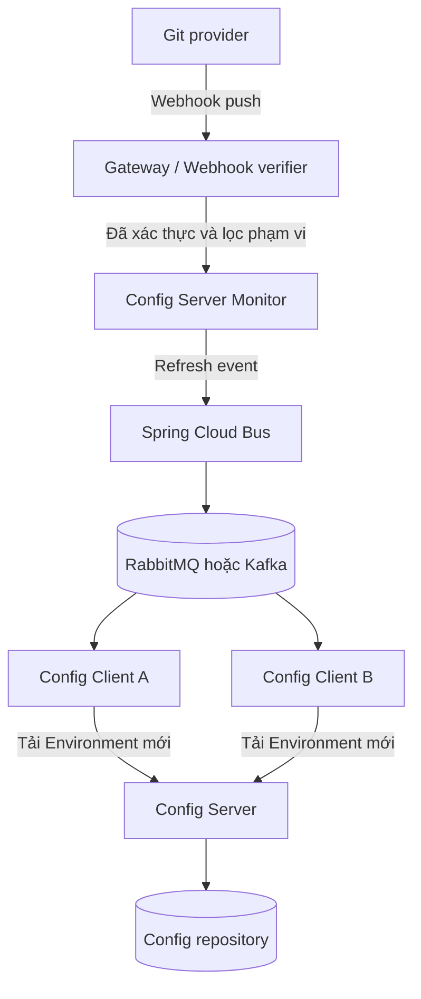

# Kiểm soát yêu cầu lặp, nguồn gửi và phạm vi đường dẫn

Webhook giúp repository cấu hình thông báo cho hệ thống khi có thay đổi. Khi Git provider gửi sự kiện push tới Spring Cloud Config Monitor, Config Server có thể xác định ứng dụng bị ảnh hưởng và phát sự kiện refresh qua Spring Cloud Bus. Cơ chế này rút ngắn thời gian phân phối cấu hình, nhưng webhook là HTTP request đến từ bên ngoài nên cần được kiểm soát về tính xác thực, tính lặp và phạm vi tác động.

Một webhook có thể được gửi lại nếu provider không nhận được phản hồi đúng hạn. Nhiều commit có thể đến gần nhau; payload có thể chứa file ngoài phạm vi cấu hình; một request giả mạo có thể cố kích hoạt refresh diện rộng. Vì vậy, endpoint webhook cần xử lý theo nguyên tắc **xác minh nguồn trước, kiểm tra phạm vi tiếp theo, xử lý idempotent và chỉ refresh ứng dụng được phép**.

## 1. Luồng webhook trong kiến trúc Config

Với Spring Cloud Config Monitor, Config Server nhận payload từ Git provider tại endpoint thường dùng là `/monitor`. Monitor phân tích thông tin thay đổi trong payload, xác định các đường dẫn liên quan và tạo thông báo refresh cho ứng dụng phù hợp. Khi kết hợp Spring Cloud Bus, thông báo được phân phối qua broker tới các Config Client.



Các thành phần có trách nhiệm khác nhau:

- **Git provider:** gửi thông báo về repository, branch/ref, commit và các file thay đổi.
- **Webhook verifier/gateway:** xác thực chữ ký hoặc token, giới hạn nguồn gửi, lọc event và áp dụng chính sách idempotency.
- **Config Server Monitor:** diễn giải payload theo provider/extractor được hỗ trợ và xác định thông báo refresh.
- **Spring Cloud Bus:** phân phối sự kiện tới các node tham gia Bus.
- **Config Client:** truy vấn Config Server theo application, profile và label của chính nó.

Webhook không phải nơi lưu cấu hình và không thay thế Git. Payload chỉ báo rằng có thay đổi; client vẫn lấy dữ liệu từ nguồn cấu hình đã được cấu hình cho nó.

## 2. Cài đặt Config Monitor và Bus

Config Server cần thư viện monitor để nhận và phân tích webhook. Nếu muốn sự kiện refresh lan tới nhiều instance, Config Server và các client tham gia phải có Bus starter phù hợp với broker của tổ chức.

Ví dụ Maven:

```xml
<dependencies>
    <dependency>
        <groupId>org.springframework.cloud</groupId>
        <artifactId>spring-cloud-config-server</artifactId>
    </dependency>
    <dependency>
        <groupId>org.springframework.cloud</groupId>
        <artifactId>spring-cloud-config-monitor</artifactId>
    </dependency>
    <dependency>
        <groupId>org.springframework.cloud</groupId>
        <artifactId>spring-cloud-starter-bus-amqp</artifactId>
    </dependency>
</dependencies>
```

Nếu dùng Kafka, thay `spring-cloud-starter-bus-amqp` bằng `spring-cloud-starter-bus-kafka`. Dùng Spring Cloud BOM tương thích với phiên bản Spring Boot để quản lý các phiên bản Config, Monitor, Bus và Stream binder.

Các Config Client cần starter Bus tương ứng nếu chúng phải nhận sự kiện. Client vẫn cần `spring-cloud-starter-config` để tải cấu hình. Chỉ cài monitor ở server không khiến các client tự động tham gia broker.

Endpoint monitor thường được gọi bằng HTTP POST tại `/monitor`. Đây là endpoint của Config Monitor, không phải endpoint Actuator `env` hay `refresh`. Đường dẫn có thể thay đổi nếu ứng dụng đặt context path hoặc cấu hình routing khác; hãy kiểm tra mapping thực tế của phiên bản đang dùng.

## 3. Vì sao webhook phải idempotent?

Git provider thường giao webhook theo mô hình ít nhất một lần (at-least-once). Nếu provider gửi request nhưng không nhận được phản hồi trước timeout, nó có thể gửi lại cùng một delivery. Request lặp cũng có thể xuất hiện do retry mạng, gateway retry hoặc thao tác gửi lại thủ công.

Nếu mỗi lần nhận webhook đều phát refresh, một thay đổi có thể tạo nhiều đợt refresh gần như giống nhau. Hệ quả có thể gồm:

- Nhiều client cùng gọi Config Server trong thời gian ngắn.
- Broker nhận nhiều sự kiện không cần thiết.
- Log và metric bị nhiễu, khó phân biệt một thay đổi với nhiều lần retry.
- Refresh hàng loạt lặp lại có thể tạo tải không cần thiết lên các ứng dụng.

Idempotency nghĩa là xử lý lại cùng một delivery không tạo thêm tác động nghiệp vụ ngoài ý muốn. Với webhook, nên nhận diện delivery trước khi phát refresh và lưu dấu vết xử lý để request lặp có thể được trả lời an toàn.

## 4. Dùng delivery ID để phát hiện request lặp

Ưu tiên sử dụng mã delivery duy nhất do provider gửi trong header. Ví dụ GitHub cung cấp `X-GitHub-Delivery`; header `X-GitHub-Event` cho biết loại event. Các provider khác có header và quy tắc riêng, vì vậy cần tra cứu đúng tài liệu provider đang tích hợp.

Một khóa deduplication có thể gồm:

```text
provider + repository + delivery-id
```

Nếu provider không có delivery ID ổn định, có thể tạo khóa dựa trên repository, event type, ref, commit SHA và tập đường dẫn đã chuẩn hóa. Khóa thay thế này cần được thiết kế cẩn thận vì hai event hợp lệ có thể cùng commit nhưng khác mục đích hoặc phạm vi.

Lưu delivery ID trong kho dữ liệu dùng chung như database hoặc Redis với unique constraint/atomic insert và thời hạn lưu phù hợp. Không chỉ dùng `HashSet` trong bộ nhớ của một Config Server instance: khi có nhiều replica, mỗi instance có bộ nhớ riêng và cùng một delivery có thể được xử lý nhiều lần ở các node khác nhau.

Quy trình xử lý khái quát:

1. Xác minh request và đọc delivery ID.
2. Tạo bản ghi delivery với trạng thái `RECEIVED` bằng thao tác atomic.
3. Nếu ID đã ở trạng thái `COMPLETED`, trả phản hồi 2xx và không phát refresh lần nữa.
4. Nếu ID đã `PROCESSING`, không tạo một tác vụ song song; trả phản hồi phù hợp với quy ước của gateway/provider.
5. Nếu là delivery mới, kiểm tra payload, xác định ứng dụng bị ảnh hưởng và ghi tác vụ vào hàng đợi/outbox bền vững.
6. Worker xử lý tác vụ, phát refresh, sau đó cập nhật trạng thái `COMPLETED` hoặc `FAILED`.

Không đánh dấu delivery `COMPLETED` trước khi tác vụ được lưu bền vững. Nếu tiến trình crash sau khi ghi completed nhưng trước khi phát sự kiện, webhook retry sẽ bị loại bỏ và refresh có thể bị mất. Mẫu inbox/outbox hoặc hàng đợi bền vững giúp xử lý khoảng trống này.

## 5. Phản hồi đúng để provider không retry vô hạn

Webhook handler nên xác nhận nhanh sau khi đã xác minh request và lưu tác vụ một cách bền vững. Không nên giữ HTTP request mở trong lúc chờ toàn bộ client refresh xong, vì quá trình đó có thể kéo dài và làm provider timeout.

Quy ước phản hồi thường dùng:

| Tình huống | Phản hồi gợi ý | Lý do |
|---|---|---|
| Delivery hợp lệ, đã được ghi nhận vào queue/outbox | `2xx` | Provider biết request đã được tiếp nhận |
| Delivery ID đã xử lý hoàn tất | `2xx` | Request lặp đã được xử lý trước đó |
| Chữ ký/token không hợp lệ | `401` hoặc `403` | Từ chối request không xác thực |
| Event hoặc repository không nằm trong allowlist | `403` hoặc phản hồi từ chối theo chính sách | Không cho phép tác động ngoài phạm vi |
| Payload sai định dạng | `400` | Provider hoặc cấu hình webhook cần sửa |
| Lỗi tạm thời trước khi lưu bền vững | `5xx` | Cho phép provider retry theo chính sách |

Mã trạng thái cụ thể cần nhất quán với Git provider và gateway. Điều quan trọng là chỉ trả thành công khi delivery đã được tiếp nhận bền vững; nếu chưa lưu được và không thể xử lý sau, cần báo lỗi để provider có thể retry.

## 6. Xác minh nguồn gửi bằng chữ ký hoặc token

Không được tin cậy một request chỉ vì nó gọi đúng URL `/monitor`. Endpoint có thể bị dò tìm hoặc gọi từ một nguồn không phải Git provider. Cần xác thực request trước khi cho phép nó tạo refresh event.

Các phương án thường dùng:

- **HMAC signature:** provider ký raw request body bằng secret webhook; server tính lại chữ ký và so sánh.
- **Shared secret token:** provider gửi token trong header chuyên dụng; server so sánh với secret được lưu an toàn.
- **mTLS hoặc gateway authentication:** gateway xác thực client certificate hoặc credential trước khi chuyển tiếp request.
- **IP allowlist:** chỉ nhận từ dải IP provider công bố, dùng như lớp phòng vệ bổ sung.

Với GitHub, có thể xác minh `X-Hub-Signature-256` bằng HMAC-SHA256 trên đúng raw body. Chữ ký phải được so sánh theo cách constant-time; không parse JSON rồi serialize lại trước khi tính HMAC vì byte sequence sẽ khác payload gốc.

Ví dụ Java minh họa hàm kiểm tra chữ ký với JDK 17:

```java
import java.nio.charset.StandardCharsets;
import java.security.MessageDigest;
import java.util.HexFormat;
import javax.crypto.Mac;
import javax.crypto.spec.SecretKeySpec;

public final class WebhookSignatureVerifier {

    private WebhookSignatureVerifier() {}

    public static boolean verifyGitHub(byte[] rawBody,
                                       String signatureHeader,
                                       String secret) throws Exception {
        if (signatureHeader == null || !signatureHeader.startsWith("sha256=")) {
            return false;
        }

        byte[] supplied;
        try {
            supplied = HexFormat.of().parseHex(
                signatureHeader.substring("sha256=".length()));
        } catch (IllegalArgumentException ex) {
            return false;
        }
        if (supplied.length != 32) {
            return false;
        }

        Mac mac = Mac.getInstance("HmacSHA256");
        mac.init(new SecretKeySpec(secret.getBytes(StandardCharsets.UTF_8), "HmacSHA256"));
        byte[] expected = mac.doFinal(rawBody);
        return MessageDigest.isEqual(expected, supplied);
    }
}
```

Đây chỉ là phần xác minh chữ ký, chưa phải một webhook controller hoàn chỉnh. Secret phải được lấy từ secret manager, không hard-code hoặc commit vào Git. Cần kiểm tra độ dài/chính sách secret, giới hạn kích thước body và xử lý exception an toàn. Với GitLab hoặc provider khác, dùng header và thuật toán theo tài liệu của provider; không dùng thuật toán GitHub cho mọi nền tảng.

Không giả định Spring Cloud Config Monitor tự xác minh mọi loại chữ ký webhook. Nếu phiên bản hoặc extractor không thực hiện kiểm tra xác thực mà hệ thống yêu cầu, hãy đặt verifier ở API gateway/reverse proxy hoặc lớp bảo vệ ngay trước endpoint monitor.

## 7. Kết hợp IP allowlist và kiểm tra repository

IP allowlist có thể giảm bề mặt truy cập, nhưng không nên là cơ chế xác thực duy nhất:

- Dải IP của provider có thể thay đổi; cần quy trình cập nhật từ nguồn chính thức.
- Proxy hoặc load balancer có thể làm địa chỉ nguồn mà ứng dụng nhìn thấy khác địa chỉ client thực.
- Header `X-Forwarded-For` chỉ đáng tin khi được proxy tin cậy ghi đè và cấu hình đúng; không nhận giá trị tùy ý từ Internet.
- Một nguồn IP hợp lệ vẫn có thể gửi event sai repository nếu credential hoặc webhook secret bị cấu hình nhầm.

Sau khi xác minh chữ ký/token, kiểm tra thêm metadata payload:

- Repository phải khớp danh sách repository được phép.
- Provider/event type phải nằm trong loại event đã đăng ký, ví dụ `push`.
- Ref phải là branch hoặc tag được phép, ví dụ `refs/heads/main`.
- Nếu payload có organization/project/installation ID, xác minh đúng tenant hoặc tổ chức.
- Commit SHA và repository URL phải nhất quán với nguồn đã đăng ký nếu provider cung cấp các trường này.

Không dùng tên repository do payload gửi tới để tự động tạo URL clone/fetch hoặc truy cập một backend tùy ý. Repository được phép phải nằm trong cấu hình allowlist của hệ thống.

## 8. Giới hạn phạm vi event và branch

Không phải mọi event từ Git provider đều cần làm mới cấu hình. Nên đăng ký webhook chỉ cho event cần thiết và lọc thêm ở phía server.

Ví dụ chính sách:

| Điều kiện | Xử lý |
|---|---|
| Event `push` vào `refs/heads/main` | Xem xét các file cấu hình được phép và phát refresh tương ứng |
| Push vào branch feature | Bỏ qua ở Config Server production |
| Tạo tag release | Chỉ xử lý nếu quy trình release có yêu cầu và label/tag được allowlist |
| Pull request opened/closed | Thường không refresh production vì chưa phải thay đổi đã merge |
| Repository khác allowlist | Từ chối |
| Event không có file cấu hình liên quan | Ghi nhận đã bỏ qua, không phát refresh |

Tên event và cách biểu diễn ref phụ thuộc provider. Ví dụ GitHub dùng header `X-GitHub-Event` và payload `ref`; các provider khác có thể dùng trường hoặc header khác. Hãy chuẩn hóa về một mô hình nội bộ sau bước xác thực.

## 9. Giới hạn đường dẫn file thay đổi

Payload push thường liệt kê các file được thêm, sửa hoặc xóa. Chỉ những đường dẫn thuộc phạm vi cấu hình mới nên kích hoạt refresh.

Ví dụ cấu trúc repository:

```text
config-repo/
├── application.yml
├── application-production.yml
├── order-service.yml
├── order-service-production.yml
├── inventory-service.yml
├── inventory-service-staging.yml
└── docs/
    └── README.md
```

Một chính sách đường dẫn có thể quy định:

- `application.yml` và `application-*.yml`: cấu hình dùng chung, có thể ảnh hưởng nhiều ứng dụng.
- `order-service.yml` và `order-service-*.yml`: cấu hình của `order-service`.
- `inventory-service.yml` và `inventory-service-*.yml`: cấu hình của `inventory-service`.
- `docs/**`, file test hoặc tài liệu: không kích hoạt refresh.

Đây là quy ước ánh xạ của hệ thống. Cách Spring Cloud Config Monitor diễn giải payload và chuyển file path thành application name phụ thuộc extractor/provider và phiên bản. Hãy kiểm thử các trường hợp file chung, file theo ứng dụng, file profile-specific và file trong thư mục con trước khi bật production.

### Chuẩn hóa và xác thực path

Trước khi so khớp allowlist, chuẩn hóa đường dẫn theo quy tắc repository:

1. Chỉ chấp nhận path tương đối bên trong repository.
2. Chuẩn hóa dấu phân cách về `/`.
3. Từ chối path rỗng, path tuyệt đối, segment `..`, ký tự null và các dạng traversal.
4. Không ghép path từ payload vào filesystem path để đọc file tùy ý.
5. So khớp với allowlist hoặc pattern đã cấu hình; không thực thi glob do payload gửi lên.
6. Chuyển path hợp lệ thành application/profile bằng bảng ánh xạ đã kiểm soát.

Ví dụ, `../secrets/prod.yml`, `/etc/passwd` hoặc `order-service/../../other.yml` phải bị từ chối trước khi dùng cho bất kỳ quyết định refresh nào.

## 10. Xác định ứng dụng bị ảnh hưởng

Phạm vi refresh cần phản ánh phạm vi cấu hình thực tế:

| File thay đổi | Phạm vi dự kiến | Lưu ý |
|---|---|---|
| `application.yml` | Nhiều hoặc tất cả ứng dụng dùng cấu hình chung | Cần kiểm tra phạm vi client thực tế của Config Server |
| `application-production.yml` | Các ứng dụng sử dụng profile production và kế thừa cấu hình chung | Chỉ refresh các client bị ảnh hưởng theo chính sách |
| `order-service.yml` | `order-service` | Không cần refresh `inventory-service` nếu không dùng nguồn này |
| `order-service-production.yml` | `order-service` với profile production | Xác định đúng profile được phục vụ |
| `docs/README.md` | Không có ứng dụng | Bỏ qua |

Không nên mặc định mọi thay đổi đều phải broadcast refresh toàn bộ fleet. Một file riêng của `order-service` nên giới hạn tới ứng dụng đó nếu extractor và chính sách định tuyến hỗ trợ. File dùng chung như `application.yml` có thể có phạm vi rộng hơn và cần quy trình rollout cẩn thận.

Khi nhiều đường dẫn thay đổi trong một delivery, hợp nhất tập ứng dụng bị ảnh hưởng trước khi phát sự kiện. Một commit sửa ba file của cùng ứng dụng chỉ cần một yêu cầu refresh cho ứng dụng đó, không cần phát ba event riêng.

## 11. Kết hợp deduplication, coalescing và chống event cũ

Ba kỹ thuật này giải quyết ba vấn đề khác nhau:

- **Deduplication:** loại bỏ cùng một delivery được gửi lại.
- **Coalescing/debounce:** gom nhiều delivery hợp lệ gần nhau thành một đợt refresh để giảm tải.
- **Ordering/stale-event guard:** tránh để event cũ hoặc đến trễ làm quy trình phát hành quay về trạng thái không mong muốn.

Ví dụ một push gồm ba commit liên tiếp vào `main` có thể tạo nhiều webhook gần nhau. Hệ thống có thể ghi nhận tất cả delivery ID, sau đó gom theo repository + ref + tập application trong một cửa sổ ngắn. Khi xử lý, client truy vấn label hiện hành mà nó được cấu hình sử dụng.

Lưu ý: webhook chỉ báo thay đổi; commit SHA trong payload không tự động trở thành label mà Config Client yêu cầu. Nếu client pin tag hoặc commit cũ, refresh sẽ tiếp tục lấy label cũ cho đến khi cấu hình triển khai thay đổi. Nếu dùng branch mutable, Config Server cần nhìn thấy head mới của branch trước khi client refresh.

Không dùng timestamp từ payload làm bằng chứng duy nhất về thứ tự commit. Có thể so sánh commit/ref với repository nguồn hoặc kiểm tra head hiện hành. Nếu event cũ đến trễ, thao tác refresh vẫn nên làm client đọc nguồn có thẩm quyền hiện tại, không thực hiện checkout tùy tiện về commit trong payload.

## 12. Cấu hình và bảo vệ endpoint `/monitor`

Endpoint monitor cần được giới hạn ở đúng đường dẫn và phương thức. Ví dụ, có thể đặt reverse proxy/API gateway phía trước để:

- Chỉ nhận `POST` tới `/monitor`.
- Xác minh chữ ký/token trước khi chuyển tiếp.
- Áp dụng giới hạn kích thước request body và timeout.
- Giới hạn IP theo dải chính thức của provider như lớp bổ sung.
- Giới hạn tần suất theo repository hoặc credential.
- Chuyển tiếp đúng raw body và các header đã xác thực cần thiết.
- Không ghi body hoặc signature/secret vào access log.

Nếu dùng Spring Security trực tiếp, tạo quy tắc bảo vệ endpoint monitor riêng, tránh vô tình cho phép toàn bộ đường dẫn quản trị. CSRF policy cần được thiết kế theo mô hình xác thực webhook: request từ provider thường không có session cookie trình duyệt, nhưng không nên tắt CSRF trên toàn ứng dụng chỉ để webhook hoạt động.

Đối với endpoint nhận webhook, xác minh chữ ký phải diễn ra trên raw body trước khi payload được tin cậy. Nếu gateway xác minh thay, đường kết nối gateway tới Config Server cũng phải được bảo vệ để client bên ngoài không thể giả mạo header đã xác thực.

## 13. Ví dụ chính sách xử lý nội bộ

Pseudocode sau minh họa thứ tự xử lý. Đây là logic kiến trúc, không phải API cụ thể của Spring Cloud Config Monitor:

```text
handleWebhook(request):
    rawBody = readBodyWithSizeLimit(request)
    verifyProviderSignature(request.headers, rawBody)

    event = parseJson(rawBody)
    requireAllowedEventType(request.headers, event)
    requireAllowedRepository(event.repository)
    requireAllowedRef(event.ref)

    deliveryId = getProviderDeliveryId(request.headers)
    if deliveryId is already completed:
        return 2xx

    paths = normalizeAndValidateChangedPaths(event)
    applications = mapPathsToAllowedApplications(paths)
    if applications is empty:
        recordIgnoredDelivery(deliveryId)
        return 2xx

    persistInboxAndRefreshOutbox(deliveryId, event, applications)
    return 2xx
```

Worker phía sau đọc outbox, gom các refresh gần nhau nếu cần, phát sự kiện qua Bus và cập nhật trạng thái xử lý. Nếu broker tạm lỗi, worker retry tác vụ bền vững; webhook provider không cần gửi lại một payload đã được tiếp nhận thành công.

## 14. Quan sát và audit

Webhook là điểm vào quan trọng của quy trình phân phối cấu hình. Cần ghi đủ metadata để điều tra nhưng tránh lưu bí mật:

- Provider và loại event.
- Repository đã chuẩn hóa và ref được phép.
- Delivery ID, commit SHA và thời điểm nhận.
- Số lượng đường dẫn thay đổi và tập application được ánh xạ.
- Kết quả xác thực chữ ký/token và quyết định allow/deny.
- Trạng thái deduplication, queue/outbox và phát refresh.
- Correlation ID liên kết webhook, Bus event và client refresh.

Không ghi raw payload đầy đủ, secret webhook, Authorization header, HMAC signature hoặc giá trị cấu hình. Nếu cần lưu payload để audit, phải áp dụng phân quyền, mã hóa, giới hạn thời gian lưu và lọc trường nhạy cảm.

Các metric nên theo dõi gồm số delivery hợp lệ/bị từ chối, số duplicate, queue depth, thời gian từ webhook tới refresh, lỗi publish Bus và số client không xác nhận refresh. Cảnh báo khi có đợt webhook bất thường hoặc một repository tạo quá nhiều event.

## 15. Kiểm thử các trường hợp bảo mật và phạm vi

Trước khi đưa webhook vào production, kiểm thử ít nhất các trường hợp:

| Trường hợp | Kết quả mong đợi |
|---|---|
| Chữ ký đúng, repository/ref/path hợp lệ | Ghi nhận delivery và phát refresh trong phạm vi cho phép |
| Chữ ký sai hoặc thiếu | Từ chối, không tạo Bus event |
| Cùng delivery ID gửi hai lần | Chỉ xử lý nghiệp vụ một lần; lần lặp trả phản hồi idempotent |
| Hai replica nhận cùng delivery đồng thời | Atomic deduplication chỉ cho một tác vụ được tạo |
| Repository ngoài allowlist | Từ chối, không refresh |
| Push vào branch không được phép | Bỏ qua hoặc từ chối theo chính sách |
| Chỉ thay đổi file docs | Không phát refresh |
| Thay đổi file `order-service-production.yml` | Chỉ refresh ứng dụng/profile nằm trong phạm vi đã ánh xạ |
| Thay đổi `application.yml` | Áp dụng phạm vi chung đã định nghĩa và kiểm thử |
| Path chứa `../` hoặc path tuyệt đối | Từ chối trước khi ánh xạ |
| Broker tạm thời không sẵn sàng | Tác vụ đã lưu bền vững được retry; không mất delivery |
| Event cũ đến sau event mới | Không làm client quay về label cũ ngoài ý muốn |

Ngoài kiểm thử endpoint, cần xác nhận Config Server thực sự phục vụ đúng application/profile/label và các client mục tiêu đã xử lý refresh. Một webhook được chấp nhận không đồng nghĩa cấu hình đã được áp dụng thành công trên toàn bộ fleet.

## 16. Lỗi thường gặp

| Hiện tượng | Nguyên nhân thường gặp | Cách xử lý |
|---|---|---|
| Một push tạo nhiều lần refresh | Provider retry nhưng hệ thống không deduplicate | Dùng delivery ID, atomic store và inbox/outbox |
| Request giả mạo kích hoạt refresh | Endpoint monitor không được xác thực hoặc gateway tin header tùy ý | Xác minh HMAC/token, giới hạn nguồn và kiểm tra repository |
| Webhook hợp lệ nhưng refresh quá nhiều ứng dụng | Không lọc changed paths hoặc file chung có phạm vi rộng | Ánh xạ path sang application/profile và áp dụng allowlist |
| Thay đổi docs cũng kích hoạt refresh | Pattern path quá rộng | Chỉ cho phép file cấu hình đã định nghĩa |
| Một event bị xử lý trên nhiều replica | Deduplication chỉ lưu trong memory cục bộ | Dùng kho trạng thái dùng chung và thao tác atomic |
| Provider retry liên tục | Handler timeout hoặc trả 5xx dù tác vụ đã được nhận | Lưu tác vụ nhanh, trả 2xx sau khi persist; xử lý bất đồng bộ |
| Event đã nhận nhưng không có refresh | Crash giữa ghi trạng thái và publish hoặc broker lỗi | Dùng outbox bền vững, retry worker và trạng thái xử lý |
| Client refresh nhưng nhận cấu hình cũ | Config Server chưa fetch commit mới hoặc client pin label cũ | Xác minh head/label và response Config Server trước khi phát event |
| Header IP nguồn không đáng tin | Tin `X-Forwarded-For` từ request Internet | Chỉ tin forwarded headers từ proxy được cấu hình tin cậy |

## 17. Checklist triển khai webhook

- [ ] Chỉ đăng ký event cần thiết tại Git provider.
- [ ] Endpoint `/monitor` chỉ nhận request qua gateway hoặc lớp xác thực được bảo vệ.
- [ ] Chữ ký HMAC hoặc shared token được xác minh theo đúng provider.
- [ ] Raw body được dùng để kiểm tra HMAC; so sánh chữ ký constant-time.
- [ ] Repository, organization/project, event type và ref nằm trong allowlist.
- [ ] Delivery ID được lưu bằng cơ chế atomic và dùng chung giữa các replica.
- [ ] Tác vụ refresh được ghi bền vững trước khi trả thành công.
- [ ] Changed paths được chuẩn hóa, chặn traversal và so khớp allowlist.
- [ ] File chung và file theo application/profile có phạm vi refresh rõ ràng.
- [ ] Nhiều đường dẫn của cùng delivery được gom theo application bị ảnh hưởng.
- [ ] Có coalescing/rate limit phù hợp và xử lý event đến trễ.
- [ ] Log không chứa raw payload, secret, signature hoặc cấu hình nhạy cảm.
- [ ] Có metric cho duplicate, rejected event, queue, Bus publish và client refresh.
- [ ] Đã kiểm thử chữ ký sai, replay, path ngoài phạm vi, broker failure và nhiều replica.

## 18. Mục tiêu cần đạt sau bài học

Sau bài này, người học cần có khả năng:

- Giải thích luồng Git webhook → Config Monitor → Spring Cloud Bus → Config Client.
- Thiết kế idempotency dựa trên delivery ID và kho trạng thái dùng chung.
- Xác minh nguồn gửi bằng HMAC/shared token và kết hợp IP allowlist đúng cách.
- Kiểm tra repository, event type, branch/ref trước khi chấp nhận refresh.
- Chuẩn hóa và giới hạn changed paths, ngăn path traversal và ánh xạ file tới application/profile.
- Phân biệt deduplication, coalescing và xử lý event đến trễ.
- Thiết kế phản hồi HTTP, hàng đợi/outbox, audit và monitoring cho webhook.
- Kiểm thử để bảo đảm một delivery chỉ tác động tới đúng ứng dụng trong phạm vi được phép.

**Tự kiểm tra:** Git provider gửi hai lần cùng một delivery cho `order-service-production.yml` trên branch `main`; đồng thời một request khác có chữ ký hợp lệ nhưng đến từ repository ngoài allowlist và chứa path `../secrets.yml`. Hãy mô tả thứ tự xác minh, cách deduplicate delivery đầu tiên, quyết định với repository/path không hợp lệ và cách bảo đảm chỉ `order-service` được refresh.
