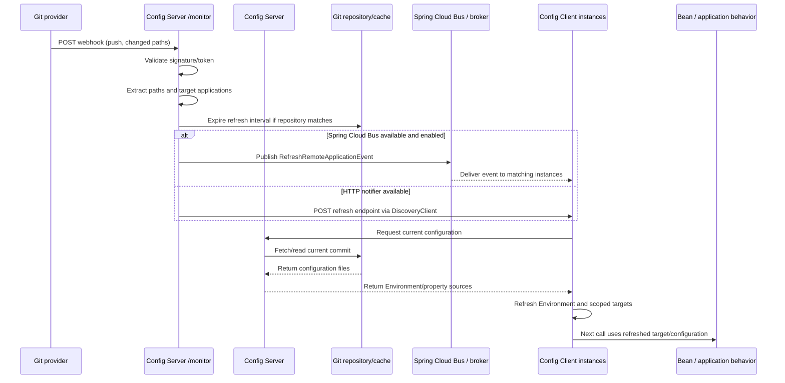

# Phân biệt nhận webhook thành công với client đã áp dụng cấu hình

Khi một commit mới được push lên Git repository chứa cấu hình, GitHub, GitLab hoặc nhà cung cấp Git khác có thể gửi webhook đến Spring Cloud Config Server. Config Server tiếp nhận thông báo, xác định những ứng dụng có thể bị ảnh hưởng và phát tín hiệu refresh. Sau đó Config Client phải nhận tín hiệu, lấy lại cấu hình và cập nhật các thành phần trong ứng dụng.

Mỗi bước là một phần riêng của chuỗi xử lý. Nhà cung cấp Git báo webhook thành công chỉ xác nhận endpoint đã nhận và xử lý request ở phía Config Server. Điều đó chưa chứng minh broker đã phân phối sự kiện, mọi client đã nhận sự kiện, client đã tải commit mới hoặc bean đang chạy đã sử dụng giá trị mới. Muốn xác nhận cấu hình thực sự được áp dụng, cần kiểm tra đến tận instance và hành vi ứng dụng.

## 1. Mục tiêu học tập

Sau bài học, bạn có thể:

- Mô tả toàn bộ luồng từ Git push, webhook, Config Server, message broker đến Config Client.
- Phân biệt webhook delivery thành công, refresh event được phát, client nhận event và cấu hình được áp dụng.
- Giải thích vai trò của `spring-cloud-config-monitor`, endpoint `/monitor` và Spring Cloud Bus.
- Hiểu cách Config Server ánh xạ đường dẫn file thay đổi đến application cần refresh.
- Nhận biết tác động của repository `refresh-rate`, URL repository không khớp và giới hạn số đường dẫn trong webhook.
- Bảo vệ webhook bằng chữ ký hoặc token của nhà cung cấp Git.
- Kiểm tra việc gửi/nhận event, tải lại `Environment`, rebind và refresh-scoped bean.
- Xây dựng quy trình xác minh end-to-end và xử lý tình huống webhook thành công nhưng client vẫn dùng cấu hình cũ.

## 2. Bốn trạng thái không được nhầm lẫn

Khi nói “webhook đã chạy”, cần xác định chính xác đang nói đến bước nào:

| Trạng thái | Điều đã được xác nhận | Điều chưa được xác nhận |
| --- | --- | --- |
| Webhook được chấp nhận | Config Server nhận request và vượt qua bước kiểm tra request theo cấu hình | Config Server đã chọn đúng application hoặc phát được event |
| Refresh event được phát | Config Server đã yêu cầu Bus hoặc HTTP notifier thông báo đến các client đích | Mọi instance đã nhận event hoặc tải cấu hình mới |
| Client đã nhận event | Instance đã nhận/ack sự kiện hoặc endpoint refresh được gọi | Client đã lấy được commit mới và mọi bean đã thay đổi |
| Cấu hình đã được áp dụng | Instance có giá trị hiệu lực mới và hành vi liên quan đã phản ánh giá trị đó | Các instance khác cũng đã hoàn tất, trừ khi đã kiểm tra tất cả |

Một HTTP response thành công từ `/monitor` là bằng chứng ở phía endpoint. Một Bus acknowledgment là bằng chứng instance đã nhận event. Cả hai đều không thay thế việc kiểm tra `Environment`, bean hoặc hành vi thực tế sau refresh.

## 3. Luồng tổng thể từ Git đến ứng dụng

Spring Cloud Config hỗ trợ webhook từ các nhà cung cấp như GitHub, GitLab, Gitea, Gitee, Gogs và Bitbucket. Khi repository có thay đổi, nhà cung cấp gửi HTTP POST đến endpoint `/monitor` của Config Server. Dependency `spring-cloud-config-monitor` cung cấp tích hợp monitor; khi Spring Cloud Bus được kích hoạt trên Config Server, monitor có thể phát refresh event qua Bus. Nếu Bus không có sẵn, các phiên bản hỗ trợ có thể dùng HTTP notifier khi có `DiscoveryClient`.



Các bước cần được theo dõi riêng:

1. Git provider tạo delivery cho sự kiện push.
2. Config Server xác thực request và đọc payload.
3. Monitor xác định đường dẫn file thay đổi và các application có thể bị ảnh hưởng.
4. Nếu nhận diện được Git repository tương ứng, Config Server làm hết hiệu lực thời gian chờ refresh của repository đó.
5. Config Server gửi refresh notification qua Spring Cloud Bus hoặc HTTP notifier theo cơ chế có sẵn.
6. Client nhận notification và yêu cầu làm mới cấu hình.
7. Client lấy property source mới từ Config Server, cập nhật `Environment` và thực hiện các cơ chế rebind/refresh phù hợp.
8. Các bean hoặc tài nguyên cần tái tạo được làm mới; hành vi ứng dụng được kiểm tra.

Một bước thành công không tự động chứng minh bước tiếp theo đã thành công.

## 4. Chuẩn bị Config Server để nhận webhook

Config Server cần dependency `spring-cloud-config-monitor` để cung cấp endpoint monitor. Nếu sử dụng Spring Cloud Bus, Config Server cũng cần dependency Bus và một binder tương ứng với broker.

Ví dụ dependency Maven cho Config Server dùng RabbitMQ:

```xml
<dependencies>
    <dependency>
        <groupId>org.springframework.cloud</groupId>
        <artifactId>spring-cloud-config-server</artifactId>
    </dependency>
    <dependency>
        <groupId>org.springframework.cloud</groupId>
        <artifactId>spring-cloud-config-monitor</artifactId>
    </dependency>
    <dependency>
        <groupId>org.springframework.cloud</groupId>
        <artifactId>spring-cloud-starter-bus-amqp</artifactId>
    </dependency>
</dependencies>
```

Các dependency Spring Cloud nên được quản lý bằng Spring Cloud BOM tương thích với dòng Spring Boot đang dùng. Nếu chọn Kafka, sử dụng Bus starter và binder Kafka tương ứng thay cho AMQP.

Config Server cũng cần cấu hình Git backend, kết nối broker và các webhook secret của provider. Ví dụ cấu hình rút gọn:

```yaml
server:
  port: 8888

spring:
  cloud:
    config:
      server:
        git:
          uri: https://git.example.com/platform/config-repo.git
          default-label: main
          refresh-rate: 60
        monitor:
          github:
            webhook-secret: ${CONFIG_GITHUB_WEBHOOK_SECRET}
          gitlab:
            webhook-secret: ${CONFIG_GITLAB_WEBHOOK_SECRET}
```

Ví dụ chỉ minh họa các thuộc tính liên quan. Giá trị secret phải được cấp từ secret manager hoặc cơ chế bí mật của nền tảng; không commit secret thật vào Git. Các thuộc tính cần được đối chiếu với phiên bản Spring Cloud Config mà dự án đang sử dụng.

## 5. Cấu hình webhook ở Git provider

Trong giao diện repository của nhà cung cấp Git, tạo webhook với URL trỏ đến endpoint monitor của Config Server:

```text
https://config-server.example.internal/monitor
```

Chọn sự kiện push hoặc loại sự kiện phù hợp với quy trình cập nhật cấu hình. Nếu nhóm chỉ muốn cập nhật cấu hình sau khi commit được merge vào branch phát hành, nên cấu hình webhook và quy tắc branch sao cho event tương ứng với thay đổi đã được duyệt.

Các điểm cần xác nhận:

- URL truy cập được từ hạ tầng webhook của provider.
- TLS certificate hợp lệ.
- Provider gửi đúng loại event, ví dụ `push`.
- Secret hoặc token của webhook khớp với cấu hình ở Config Server.
- Reverse proxy giữ nguyên request body và các header chữ ký cần thiết.
- Endpoint được giới hạn truy cập hợp lý nhưng vẫn nhận được request từ provider.
- Delivery log của provider có thể tra cứu theo thời điểm, delivery ID hoặc commit SHA.

Không dùng webhook từ mọi branch nếu Config Server chỉ nên nhận cấu hình phát hành. Có thể giới hạn sự kiện hoặc branch ở provider, hoặc áp dụng chính sách kiểm tra commit/label ở pipeline triển khai.

## 6. Config Server xác định application nào cần refresh như thế nào?

Payload webhook thường chứa danh sách commit và các đường dẫn file thay đổi. Config Server dùng cơ chế trích xuất đường dẫn để xác định các application có thể bị ảnh hưởng.

Theo mặc định, quy tắc nhận diện dựa trên tên file cấu hình:

- `order-service.yml` hoặc file cấu hình có tên ứng dụng `order-service` hướng thông báo đến `order-service`.
- `payment-service-prod.yml` hướng đến ứng dụng `payment-service`.
- `application.yml` là cấu hình chung, nên thay đổi có thể ảnh hưởng tất cả application.
- Các file không được nhận diện là cấu hình có thể không làm phát sinh refresh cho application nào.

Ví dụ repository:

```text
config-repo/
├── application.yml
├── application-prod.yml
├── order-service.yml
├── order-service-prod.yml
├── payment-service.yml
└── payment-service-prod.yml
```

Nếu commit chỉ sửa `order-service-prod.yml`, monitor có thể gửi refresh notification đến `order-service`. Nếu sửa `application.yml`, nhiều application dùng cấu hình chung có thể bị refresh.

Nếu cấu trúc repository hoặc cách đặt tên không phù hợp với quy tắc mặc định, có thể tùy biến `PropertyPathNotificationExtractor`. Extension point này nhận request headers và body, sau đó trả về danh sách đường dẫn đã thay đổi. Việc tùy biến cần được kiểm thử để không bỏ sót application hoặc phát refresh quá rộng.

## 7. Bỏ qua file không cần refresh và giới hạn số path

Một repository cấu hình có thể chứa tài liệu, script, file triển khai hoặc các tài nguyên không ảnh hưởng đến Config Client. Không cần phát refresh chỉ vì các file này thay đổi.

Có thể cấu hình `ignored-paths` bằng danh sách regular expression:

```yaml
spring:
  cloud:
    config:
      server:
        monitor:
          ignored-paths:
            - "docs/.*"
            - "docker/.*"
            - "scripts/.*"
```

Các biểu thức được so khớp với toàn bộ đường dẫn webhook. Path khớp một trong các biểu thức sẽ bị loại trước khi Config Server xác định application cần refresh.

Theo mặc định, Config Server xử lý tối đa 20 path trong một notification. Có thể thay đổi bằng:

```yaml
spring:
  cloud:
    config:
      server:
        monitor:
          max-paths: 50
```

Nếu webhook chứa nhiều path hơn giới hạn, các path vượt quá giới hạn không được xử lý và Config Server ghi warning. Khi provider báo delivery thành công nhưng một application không refresh, hãy kiểm tra số lượng path và log cảnh báo này.

Không tăng giới hạn một cách tùy tiện. Hãy xem xét số lượng application bị ảnh hưởng và chi phí phát refresh trên toàn hệ thống.

## 8. Repository refresh-rate ảnh hưởng đến thời điểm lấy commit mới

Webhook và việc fetch Git là hai hoạt động liên quan nhưng không đồng nhất. Config Server có thể dùng `refresh-rate` để giới hạn tần suất fetch repository từ remote.

Khi payload webhook nhận diện được repository Git đã cấu hình, Config Server làm hết hiệu lực thời gian chờ refresh của repository đó trước khi thông báo application. Lần request cấu hình tiếp theo có thể fetch commit mới mà không phải đợi hết khoảng `refresh-rate`.

Nếu payload không có URL repository hoặc URL không khớp với repository được cấu hình, Config Server vẫn có thể gửi thông báo đến application nhưng không làm hết hiệu lực refresh interval của repository. Khi client gọi lấy cấu hình, Config Server có thể vẫn trả bản clone hiện tại cho đến khi refresh interval cho phép fetch.

Ví dụ:

```yaml
spring:
  cloud:
    config:
      server:
        git:
          uri: https://git.example.com/platform/config-repo.git
          refresh-rate: 120
```

Giả sử Config Server vừa fetch repository và còn trong khoảng chờ 120 giây. Nếu webhook chứa URL nhận diện đúng repository, interval có thể được expire để lần lấy cấu hình tiếp theo fetch ngay. Nếu không nhận diện được URL, client có thể nhận cấu hình từ local clone cũ cho đến khi interval hết hạn.

Vì vậy, khi webhook accepted và Bus event đã đến client nhưng client vẫn lấy giá trị cũ, cần kiểm tra:

- Payload có thông tin URL repository không.
- URL trong payload có khớp host và repository path với Git backend không.
- Provider dùng HTTPS hay SSH trong khi Config Server khai báo URL theo dạng khác.
- Log Config Server có cho thấy repository được nhận diện và refresh interval bị expire không.
- `refresh-rate` hiện tại là bao nhiêu; giá trị âm có thể vô hiệu hóa fetch theo chính sách backend.

Tài liệu hiện hành có cơ chế so khớp URL linh hoạt giữa HTTPS và SSH, bỏ qua protocol, credential, SSH username và port; vẫn cần xác minh payload có chứa đúng host/repository path.

## 9. Cơ chế thông báo: Spring Cloud Bus hoặc HTTP notifier

Sau khi xác định application đích, Config Server cần thông báo cho các client.

### Spring Cloud Bus

Nếu Bus được kích hoạt ở cả Config Server và ứng dụng client, Config Server phát `RefreshRemoteApplicationEvent` qua message broker. Các client cùng tham gia Bus nhận event và xử lý refresh.

Điều kiện quan trọng:

- Config Server có Bus dependency và binder hoạt động.
- Client có Bus dependency và kết nối được broker.
- Các instance có Bus ID riêng và destination phù hợp.
- Broker, credentials, network và consumer subscription hoạt động.

Nếu Bus chỉ được kích hoạt trên Config Server mà không có trên client, event không thể được client nhận theo luồng Bus như mong đợi.

### HTTP notifier

Ở các phiên bản hỗ trợ cơ chế HTTP notifier, khi Spring Cloud Bus không có sẵn, Config Server có thể tự động dùng HTTP notifier nếu có `DiscoveryClient` trên classpath. Config Server tìm các instance của application bị ảnh hưởng và gửi POST đến refresh endpoint của từng instance.

Endpoint mặc định là:

```text
/actuator/refresh
```

Có thể tùy chỉnh endpoint theo application:

```yaml
spring:
  cloud:
    config:
      server:
        monitor:
          http:
            endpoints:
              orders: /management/refresh
              inventory: /actuator/custom-refresh
```

Target application phải expose endpoint được cấu hình và cho phép Config Server gọi tới. Khi Bus có sẵn và được bật, Bus notifier được ưu tiên. Hành vi này phụ thuộc phiên bản; hãy đối chiếu reference documentation của release train đang dùng.

## 10. Client nhận refresh event chưa có nghĩa bean đã dùng giá trị mới

Sau khi client nhận thông báo, Spring Cloud Config Client thực hiện quy trình refresh phù hợp để lấy lại cấu hình và cập nhật `Environment`. Nhưng mức độ thay đổi của bean phụ thuộc cách bean sử dụng cấu hình.

Ví dụ:

- `Environment` có thể chứa giá trị mới sau khi refresh.
- Bean có `@ConfigurationProperties` có thể được rebind theo cơ chế Spring Cloud hỗ trợ.
- Bean nằm trong `@RefreshScope` có target cũ bị xóa khỏi scope; target mới thường được tạo ở lần gọi tiếp theo qua proxy.
- Bean singleton thông thường đã giữ một giá trị primitive hoặc object từ constructor có thể vẫn giữ giá trị cũ.
- Một số loại tài nguyên hoặc bean không refreshable có thể cần restart hoặc rollout instance.

Do đó, log “received refresh event” chỉ xác nhận event đã đến. Cần kiểm tra `Environment`, trạng thái bean và hành vi thực tế trước khi kết luận client đã áp dụng cấu hình.

## 11. Bảo vệ webhook bằng secret hoặc chữ ký

Endpoint `/monitor` có thể kích hoạt refresh trên nhiều ứng dụng. Nếu người không được phép gửi request, họ có thể gây ra refresh liên tục hoặc kích hoạt thay đổi cấu hình ngoài quy trình. Vì vậy cần xác thực webhook.

Trong tài liệu Spring Cloud Config hiện hành, validation filter được bật mặc định. Khi đã cấu hình secret cho provider, request thiếu hoặc có chữ ký/token không hợp lệ sẽ bị từ chối với HTTP 403. Nếu không cấu hình secret nào, endpoint monitor từ chối các webhook đến; cần cấu hình secret cho từng provider mà nhóm muốn chấp nhận.

Ví dụ:

```yaml
spring:
  cloud:
    config:
      server:
        monitor:
          github:
            webhook-secret: ${CONFIG_GITHUB_WEBHOOK_SECRET}
          gitlab:
            webhook-secret: ${CONFIG_GITLAB_WEBHOOK_SECRET}
```

Các provider sử dụng cơ chế khác nhau:

| Provider | Cơ chế xác thực | Header thường dùng |
| --- | --- | --- |
| GitHub | HMAC-SHA256 trên raw request body | `X-Hub-Signature-256` |
| GitLab | Secret token so sánh trực tiếp | `X-Gitlab-Token` |
| Bitbucket | HMAC-SHA256 theo cấu hình provider | `X-Hub-Signature` |
| Gitea | HMAC-SHA256 | `X-Gitea-Signature` |
| Gogs | HMAC-SHA256 | `X-Gogs-Signature` |

Một số provider khác có cơ chế riêng. Hãy cấu hình secret ở cả provider và Config Server theo đúng định dạng mà tài liệu phiên bản hỗ trợ.

Nguyên tắc bảo vệ:

- Dùng secret riêng cho từng webhook/provider nếu nền tảng hỗ trợ.
- Lưu secret trong secret manager hoặc biến môi trường được bảo vệ.
- Không commit secret vào Git hoặc ghi secret vào log.
- Dùng HTTPS và xác minh TLS.
- Giữ nguyên raw body khi reverse proxy chuyển tiếp request có chữ ký HMAC.
- Xoay vòng secret khi có nghi ngờ bị lộ.
- Không tắt validation filter chỉ để làm webhook chạy được; hãy sửa cấu hình chữ ký hoặc header.

## 12. Cấu hình theo dõi Bus event và acknowledgment

Spring Cloud Bus hỗ trợ trace event để quan sát sự kiện đã gửi và các acknowledgment từ instance. Có thể bật:

```yaml
spring:
  cloud:
    bus:
      trace:
        enabled: true
```

Khi tracing được bật và có `TraceRepository` phù hợp, trace có thể ghi nhận:

- Loại event, ví dụ `RefreshRemoteApplicationEvent`.
- Event ID.
- Origin instance.
- Destination.
- Tín hiệu `sent`.
- Tín hiệu `ack` từ các service instance.

Ví dụ thông tin trace có thể tương tự:

```json
{
  "type": "RefreshRemoteApplicationEvent",
  "id": "c4d374b7-58ea-4928-a312-31984def293b",
  "origin": "config-server:8888",
  "destination": "orders:**",
  "signal": "spring.cloud.bus.ack"
}
```

Đây là ví dụ minh họa, không phải response cố định của mọi phiên bản. Cách expose và truy vấn trace phụ thuộc phiên bản Spring Boot/Spring Cloud Bus và cấu hình Actuator. Chỉ expose endpoint trace cho người vận hành có quyền.

ACK xác nhận instance đã nhận event theo cơ chế Bus. Nó không xác nhận instance đã fetch đúng commit, rebind mọi bean hoặc hoàn thành kiểm tra nghiệp vụ. Sau ACK vẫn cần kiểm tra kết quả refresh ở client.

## 13. Xác minh cấu hình đã được áp dụng

Hãy xác minh từ đầu đến cuối theo từng tầng.

### Tầng 1: Git provider đã gửi webhook

- Mở delivery log ở GitHub/GitLab/Bitbucket.
- Xác nhận event là push hoặc event đã cấu hình.
- Ghi nhận delivery ID, commit SHA, branch và thời gian.
- Kiểm tra HTTP response của endpoint `/monitor`.
- Nếu response là 401/403, kiểm tra xác thực và secret.
- Nếu response là 404, kiểm tra URL, reverse proxy và context path.
- Nếu response là 5xx hoặc timeout, kiểm tra log Config Server và khả năng kết nối Git/broker.

### Tầng 2: Config Server đã nhận diện đúng thay đổi

- Kiểm tra log monitor cho request và provider.
- Xác nhận payload có các changed path cần thiết.
- Xác nhận path không bị loại bởi `ignored-paths`.
- Kiểm tra giới hạn `max-paths`.
- Xác nhận các path được ánh xạ đến đúng application.
- Nếu payload có repository URL, kiểm tra URL đó khớp Git backend để refresh interval được expire.
- Gọi API Config Server theo application/profile/label để kiểm tra giá trị mới đã có thể đọc được.

Ví dụ kiểm tra cấu hình của `orders`:

```bash
curl http://config-server:8888/orders/prod/main
```

Response của Config Server giúp xác nhận nguồn cấu hình hiện tại ở phía server. Tuy nhiên, response này chưa chứng minh các client đang chạy đã lấy giá trị đó.

### Tầng 3: Event đã được phát và client đã nhận

- Kiểm tra log publish event tại Config Server.
- Kiểm tra trạng thái broker, queue/topic, consumer và lỗi kết nối.
- Nếu dùng Bus trace, tìm event ID, origin, destination, sent và ACK.
- Xác nhận mọi instance mong muốn đều có ACK hoặc log nhận event.
- Nếu dùng HTTP notifier, kiểm tra discovery có tìm đủ instance và POST refresh endpoint có thành công không.

### Tầng 4: Client đã nạp lại cấu hình

- Kiểm tra log client có xử lý refresh event không.
- Kiểm tra lỗi khi gọi Config Server hoặc lỗi parse YAML/property source.
- Kiểm tra giá trị hiệu lực trong `Environment` bằng endpoint chẩn đoán đã bảo vệ hoặc instrumentation nội bộ.
- Không hiển thị secret thật trong log hoặc response kiểm tra.

### Tầng 5: Bean và hành vi ứng dụng đã thay đổi

- Kiểm tra bean phụ thuộc cấu hình có được rebind hoặc tái tạo không.
- Với `@RefreshScope`, gọi qua proxy sau refresh để target mới được tạo.
- Kiểm tra connection pool, HTTP client, cache hoặc tài nguyên cần lifecycle riêng.
- Thực hiện một request nghiệp vụ chứng minh hành vi mới đang được sử dụng.
- Lặp lại kiểm tra trên tất cả replica, không chỉ instance nhận webhook hoặc instance phát event.

## 14. Tình huống: webhook trả thành công nhưng ứng dụng vẫn dùng cấu hình cũ

Giả sử nhóm đổi:

```yaml
orders:
  pricing:
    max-discount-percent: 15
```

thành:

```yaml
orders:
  pricing:
    max-discount-percent: 20
```

GitHub delivery log báo webhook thành công, nhưng API của `orders` vẫn giới hạn discount ở 15%. Không nên kết luận webhook đã làm mới cấu hình chỉ dựa vào delivery status.

Điều tra theo thứ tự:

1. **Provider:** xác nhận webhook được gửi sau commit chứa giá trị 20, không phải một commit cũ.
2. **Monitor:** xác nhận Config Server chấp nhận chữ ký, nhận đúng changed path và không bỏ qua path.
3. **Repository:** xác nhận path được nhận diện đúng application; nếu có nhiều repository, xác nhận payload URL khớp repository đang dùng.
4. **Fetch:** gọi endpoint Config Server và kiểm tra nó trả 20. Nếu vẫn là 15, kiểm tra branch/label, refresh-rate, URL repository và local clone.
5. **Notification:** kiểm tra Bus event sent/ack hoặc HTTP notifier đã gọi refresh endpoint của instance.
6. **Client:** xác nhận từng instance nhận event và không có lỗi lấy lại cấu hình.
7. **Bean:** kiểm tra bean có thuộc `@RefreshScope`, có được rebind hay cần restart.
8. **Behavior:** kiểm tra service thực sự dùng giá trị mới trong một request nghiệp vụ.

Ví dụ bảng điều tra:

| Quan sát | Kết luận có thể | Bước tiếp theo |
| --- | --- | --- |
| Provider báo 2xx nhưng Config Server không có log monitor | Có thể request đi nhầm endpoint hoặc log chưa đủ | Kiểm tra proxy, access log và URL webhook |
| Config Server log 403 | Chữ ký/token không hợp lệ hoặc thiếu secret | Đối chiếu provider secret và header, giữ validation bật |
| Config Server nhận path nhưng không có target application | Path không khớp quy tắc mapping hoặc bị ignore | Kiểm tra tên file, extractor và ignored paths |
| Event sent nhưng không có ACK | Client không kết nối Bus, sai destination hoặc consumer lỗi | Kiểm tra broker, Bus ID và log client |
| Có ACK nhưng API Config Server vẫn trả giá trị cũ | Repository chưa fetch commit mới hoặc label sai | Kiểm tra refresh-rate, repository URL và label |
| Server trả giá trị mới, client Environment vẫn cũ | Client chưa refresh hoặc không gọi được Config Server | Kiểm tra event nhận, client log và network |
| Environment mới nhưng bean vẫn dùng giá trị cũ | Bean không rebind/refresh hoặc giữ state cũ | Kiểm tra `@RefreshScope`, rebind và lifecycle |
| Một số replica cập nhật, số khác không | Notification hoặc refresh thất bại ở một số instance | Kiểm tra ACK và giá trị hiệu lực từng replica |

## 15. Tránh kết luận sai từ một lần kiểm tra

Một số tình huống tạo cảm giác hệ thống đã cập nhật trong khi chưa hoàn tất:

- **Chỉ kiểm tra response `/monitor`:** xác nhận endpoint xử lý request, không chứng minh client đã áp dụng.
- **Chỉ kiểm tra broker có message:** message có thể chưa được consumer xử lý.
- **Chỉ kiểm tra ACK:** instance nhận event nhưng có thể lỗi khi fetch cấu hình hoặc tái tạo bean.
- **Chỉ gọi Config Server API:** xác nhận server trả cấu hình mới, không chứng minh client đã nạp.
- **Chỉ kiểm tra một replica:** các replica khác có thể chưa nhận event hoặc bị lỗi.
- **Chỉ kiểm tra `Environment`:** một số bean đã giữ state cũ hoặc không refreshable.
- **Chỉ kiểm tra một request nghiệp vụ:** request có thể được load balancer chuyển đến replica đã cập nhật, trong khi replica khác vẫn cũ.

Đối với cấu hình quan trọng, cần một phép kiểm tra sau refresh có thể truy vấn từng instance hoặc dùng metric/version marker để xác định trạng thái rollout.

## 16. Quản trị retry, duplicate delivery và lỗi tạm thời

Webhook provider có thể retry khi endpoint timeout hoặc trả lỗi. Một commit cũng có thể tạo nhiều delivery tùy cách cấu hình event. Do đó, cùng một thay đổi có thể dẫn đến nhiều refresh notification.

Các nguyên tắc:

- Thiết kế quá trình refresh có thể lặp lại mà không gây side effect nghiệp vụ.
- Không đặt thao tác thanh toán, gửi email hoặc cập nhật dữ liệu giao dịch trong logic được gọi mỗi lần refresh bean.
- Ghi nhận delivery ID, commit SHA và event ID để liên kết log giữa provider, Config Server và client.
- Hạn chế refresh toàn bộ hệ thống nếu chỉ một ứng dụng thay đổi.
- Đặt timeout và retry phù hợp cho broker/HTTP notifier; tránh retry dồn dập gây quá tải.
- Khi nhận nhiều webhook cho cùng commit, chấp nhận việc refresh lặp an toàn hoặc áp dụng cơ chế chống trùng ở tầng tích hợp riêng.
- Có cảnh báo khi Config Server nhận webhook nhưng không có event sent hoặc không có client ACK trong khoảng thời gian kỳ vọng.

Webhook là tín hiệu có thay đổi, không phải cơ chế đảm bảo mọi client đã hội tụ. Cần có cơ chế đối soát hoặc kiểm tra định kỳ nếu hệ thống yêu cầu nhất quán cao.

## 17. Checklist triển khai webhook production

- [ ] Config Server có `spring-cloud-config-monitor` và endpoint `/monitor` hoạt động.
- [ ] Provider được cấu hình đúng URL, event và secret.
- [ ] Webhook validation được bật và secret được lưu ngoài Git.
- [ ] TLS và reverse proxy giữ nguyên body/header chữ ký.
- [ ] `ignored-paths` không loại nhầm file cấu hình.
- [ ] `max-paths` đủ cho kích thước commit và có giám sát warning.
- [ ] Payload URL khớp repository Git để refresh interval được expire đúng.
- [ ] `refresh-rate` phù hợp với yêu cầu cập nhật và tải Git.
- [ ] Config Server và client đều có Bus nếu dùng Bus notification.
- [ ] Nếu dùng HTTP notifier, DiscoveryClient có mặt và client expose refresh endpoint an toàn.
- [ ] Destination/event mapping nhắm đúng application và instance.
- [ ] Có log/trace cho webhook, event sent, ACK và client refresh.
- [ ] Có bước kiểm tra giá trị hiệu lực và hành vi ứng dụng sau refresh.
- [ ] Có cách phát hiện replica chưa áp dụng cấu hình.
- [ ] Có quy trình xử lý delivery lặp, lỗi broker và rollback cấu hình.

## 18. Tài liệu tham khảo

- [Spring Cloud Config — Push Notifications and Spring Cloud Bus](https://docs.spring.io/spring-cloud-config/reference/server/push-notifications-and-bus.html)
- [Spring Cloud Bus — Configuration and Event Tracing](https://docs.spring.io/spring-cloud-bus/reference/spring-cloud-bus/configuration.html)
- [Spring Cloud Bus — Addressing Instances](https://docs.spring.io/spring-cloud-bus/reference/spring-cloud-bus/addressing.html)
- [Spring Cloud Config — Config Client](https://docs.spring.io/spring-cloud-config/reference/client.html)
