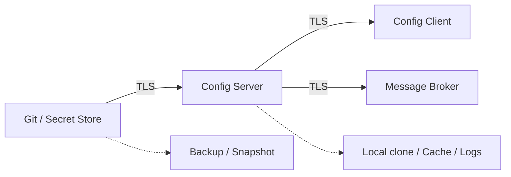

# Phân biệt mã hóa khi lưu trữ, TLS và kiểm soát quyền đọc

Spring Cloud Config phân phối cấu hình cho nhiều ứng dụng Spring Boot. Một số giá trị như mật khẩu cơ sở dữ liệu, API token, private key hoặc credential của dịch vụ bên ngoài không được để lộ trong Git, log hay đường truyền mạng. Để bảo vệ chúng, cần phân biệt ba lớp kiểm soát: **mã hóa khi lưu trữ (encryption at rest), TLS khi truyền dữ liệu (encryption in transit) và kiểm soát quyền đọc (authorization/access control)**.

Ba lớp này giải quyết các rủi ro khác nhau. Mã hóa at rest bảo vệ dữ liệu khi nằm trong repository, database, filesystem hoặc backup. TLS bảo vệ dữ liệu trên đường truyền giữa các thành phần. Authorization quyết định danh tính nào được phép đọc hoặc thay đổi cấu hình. Không lớp nào thay thế hoàn toàn hai lớp còn lại.

## 1. Threat model: bảo vệ dữ liệu ở đâu?

Một luồng cấu hình tập trung thường có các điểm lưu trữ và truyền tải sau:



Mỗi điểm có một loại rủi ro riêng:

- Người có quyền đọc Git có thể xem lịch sử repository và các file cấu hình.
- Bản backup hoặc snapshot có thể bị truy cập ngoài quy trình vận hành bình thường.
- Kẻ tấn công trên mạng có thể nghe lén hoặc sửa dữ liệu nếu kết nối không được bảo vệ.
- Một tài khoản hoặc service account có quyền quá rộng có thể đọc cấu hình của ứng dụng khác.
- Log, trace hoặc endpoint chẩn đoán có thể vô tình tiết lộ giá trị đã giải mã.
- Nếu khóa mã hóa nằm cùng nơi với dữ liệu mã hóa, người lấy được cả hai có thể giải mã bí mật.

Vì vậy, thiết kế an toàn cần xác định dữ liệu nhạy cảm nằm ở đâu, ai cần đọc, ai có thể giải mã và thành phần nào chịu trách nhiệm bảo vệ từng chặng.

## 2. Mã hóa khi lưu trữ (encryption at rest)

Encryption at rest bảo vệ dữ liệu khi dữ liệu đang nằm trên một thiết bị hoặc hệ thống lưu trữ, chẳng hạn:

- Git repository trên máy chủ, mirror và bản clone.
- Database chứa cấu hình.
- Filesystem hoặc persistent volume của Config Server.
- Backup, snapshot, archive và bản sao phục hồi thảm họa.
- Secret store hoặc ổ đĩa chứa key store.

Có hai lớp thường được dùng cùng nhau:

1. **Mã hóa ở tầng lưu trữ:** mã hóa volume, disk, database hoặc backup bằng cơ chế của nền tảng/hạ tầng.
2. **Mã hóa giá trị cấu hình:** mã hóa riêng một giá trị nhạy cảm trước khi commit vào Git; Config Server giải mã khi cần cung cấp cho client.

Mã hóa volume giúp bảo vệ khi thiết bị hoặc snapshot bị lấy cắp, nhưng không ngăn người dùng có quyền đọc file ở cấp hệ điều hành. Mã hóa từng giá trị trong repository giúp người chỉ đọc Git không thể đọc plaintext nếu họ không có khóa giải mã. Hai cách này bổ sung cho nhau.

### Mã hóa giá trị với Spring Cloud Config

Spring Cloud Config hỗ trợ mã hóa và giải mã giá trị cấu hình. Giá trị đã mã hóa trong repository thường được đánh dấu bằng tiền tố `{cipher}`:

```yaml
spring:
  datasource:
    username: billing_app
    password: '{cipher}AQB...ciphertext...'
```

Config Server dùng khóa mã hóa được cấu hình ở phía server để giải mã giá trị có marker `{cipher}` khi xử lý cấu hình. Client nhận giá trị đã giải mã trong response, vì vậy kết nối tới Config Server vẫn phải được bảo vệ bằng TLS và server phải được kiểm soát quyền truy cập.

Không commit plaintext trước rồi chỉ thêm `{cipher}` sau đó mà bỏ qua lịch sử Git. Nếu secret từng xuất hiện trong commit, tag, fork hoặc backup, hãy coi secret đó có thể đã bị lộ và thực hiện rotation. Mã hóa commit mới không tự xóa plaintext khỏi lịch sử cũ.

## 3. Khóa đối xứng và khóa bất đối xứng

Spring Cloud Config có thể sử dụng khóa đối xứng hoặc keystore bất đối xứng để mã hóa/giải mã.

### Khóa đối xứng

Một khóa bí mật được dùng cho cả mã hóa và giải mã. Ví dụ cấu hình khái quát:

```yaml
encrypt:
  key: ${CONFIG_ENCRYPT_KEY}
```

Biến `CONFIG_ENCRYPT_KEY` phải được cấp từ secret manager hoặc cơ chế quản lý bí mật của nền tảng khi Config Server khởi động. Không ghi khóa thật vào `application.yml`, Git, image container hoặc file cấu hình được chia sẻ.

Ưu điểm là cấu hình đơn giản. Nhược điểm là thành phần mã hóa và thành phần giải mã đều cần cùng bí mật; việc phân phối, lưu giữ, backup và rotation khóa phải được quản lý cẩn thận.

### Khóa bất đối xứng và keystore

Với RSA, bên mã hóa có thể dùng public key còn Config Server giữ private key để giải mã. Private key cần được bảo vệ nghiêm ngặt và không phân phối cho các nhóm chỉ cần mã hóa cấu hình.

Ví dụ cấu hình keystore trên Config Server:

```yaml
encrypt:
  key-store:
    location: file:/run/secrets/config-server.jks
    password: ${CONFIG_KEYSTORE_PASSWORD}
    alias: config-server-key
    secret: ${CONFIG_KEY_PASSWORD}
```

Các giá trị password phải được cấp qua secret manager hoặc nền tảng triển khai. File keystore cần được mount với quyền đọc tối thiểu; không đóng gói private key vào Git repository cấu hình hoặc image công khai.

| Tiêu chí | Khóa đối xứng | Khóa bất đối xứng |
| --- | --- | --- |
| Khóa mã hóa/giải mã | Cùng một secret | Public key mã hóa, private key giải mã |
| Phân phối cho nhóm phát triển | Phải bảo vệ secret dùng chung | Có thể phân phối public key; giữ private key ở server |
| Quản trị | Đơn giản hơn nhưng cần chia sẻ bí mật an toàn | Quản lý keystore và vòng đời certificate/key phức tạp hơn |
| Trường hợp phù hợp | Môi trường nhỏ hoặc mô hình secret management rõ ràng | Muốn tách quyền mã hóa khỏi quyền giải mã |

Lựa chọn thuật toán và độ dài khóa phải theo chính sách mật mã của tổ chức và khả năng của JDK/runtime đang dùng. Không tự tạo thuật toán hoặc tái sử dụng một khóa cho nhiều mục đích không liên quan.

## 4. Mã hóa khi truyền dữ liệu (TLS)

TLS bảo vệ dữ liệu trong lúc hai thành phần trao đổi qua mạng. Trong hệ thống Config, nên xem xét ít nhất các kết nối:

1. Config Client tới Config Server.
2. Config Server tới Git server qua HTTPS hoặc SSH được xác minh đúng host.
3. Config Server tới Vault hoặc secret manager.
4. Các ứng dụng tới message broker nếu dùng Spring Cloud Bus.

Ví dụ Config Server bật HTTPS bằng keystore server:

```yaml
server:
  port: 8443
  ssl:
    enabled: true
    key-store: file:/run/secrets/config-server-tls.p12
    key-store-password: ${CONFIG_TLS_KEYSTORE_PASSWORD}
    key-store-type: PKCS12
```

Config Client cần tin cậy chứng thư của Config Server thông qua truststore hoặc trust chain được hệ điều hành/JVM quản lý. Nếu dùng mutual TLS, cả hai phía xác thực certificate của nhau theo cấu hình của hạ tầng.

TLS cung cấp bảo mật đường truyền, xác thực peer và tính toàn vẹn dữ liệu trong phiên kết nối. TLS **không mã hóa Git repository nằm trên disk**, không bảo vệ backup sau khi được lưu và không quyết định người dùng nào được phép đọc một property source.

Không tắt hostname verification hoặc certificate validation để xử lý lỗi chứng thư. Hãy sửa trust chain, SAN/hostname, thời hạn certificate và cấu hình truststore.

## 5. Kiểm soát quyền đọc (authorization/access control)

Authorization quyết định ai được phép thực hiện hành động nào. Trong hệ thống Config Server, cần kiểm soát riêng:

- Ai được gọi endpoint lấy cấu hình.
- Client nào được đọc cấu hình của application nào.
- Ai được truy cập `/encrypt` và `/decrypt`.
- Ai được thay đổi Git repository, branch, tag hoặc secret path.
- Ai được gọi Actuator endpoint như `env`, `refresh` hoặc `busrefresh`.
- Service account nào được đọc private key, keystore và credential backend.

Có thể dùng Spring Security để yêu cầu xác thực và phân quyền cho endpoint Config Server. Cần giới hạn quyền theo application hoặc nhóm dịch vụ nếu kiến trúc yêu cầu cách ly. Không nên cấp một tài khoản dùng chung có thể đọc toàn bộ cấu hình cho mọi ứng dụng nếu mỗi client chỉ cần một phần.

Authorization không mã hóa dữ liệu. Người có quyền đọc hợp lệ vẫn có thể nhìn thấy plaintext nếu Config Server đã giải mã và trả về giá trị đó. Ngược lại, mã hóa dữ liệu không thay thế authorization: nếu endpoint `/decrypt` bị lộ cho người không được phép, họ có thể yêu cầu server giải mã ciphertext.

## 6. So sánh ba lớp bảo vệ

| Lớp | Bảo vệ điều gì? | Không giải quyết được điều gì? | Ví dụ triển khai |
| --- | --- | --- | --- |
| Encryption at rest | Dữ liệu lưu trên disk, database, Git storage hoặc backup | Không ngăn người có quyền truy cập runtime đọc plaintext | Volume encryption, database encryption, `{cipher}` trong Git |
| TLS | Dữ liệu truyền giữa client/server/backend | Không bảo vệ dữ liệu đã lưu trên disk; không phân quyền đọc | HTTPS, mTLS, TLS tới broker/Vault |
| Authorization | Xác định danh tính và quyền đọc/ghi/thực hiện endpoint | Không mã hóa dữ liệu nếu người dùng có quyền hợp lệ | Spring Security, RBAC, Git ACL, Vault policy |

Ví dụ, một file Git chứa `{cipher}...` nhưng Git server dùng HTTP không TLS vẫn có thể bị lộ metadata hoặc bị can thiệp trên đường truyền. Một Config Server dùng HTTPS nhưng repository lưu password plaintext vẫn để lộ bí mật nếu Git hoặc backup bị truy cập. Một server có cả TLS và mã hóa at rest nhưng cho mọi client quyền gọi `/decrypt` vẫn có nguy cơ bị lạm dụng.

## 7. Dùng endpoint encrypt/decrypt một cách an toàn

Config Server cung cấp endpoint mã hóa/giải mã khi chức năng tương ứng được cấu hình và bật. Thông thường:

- `POST /encrypt` nhận plaintext và trả về ciphertext.
- `POST /decrypt` nhận ciphertext và trả về plaintext.

Ví dụ thao tác mã hóa trong môi trường local được bảo vệ:

```bash
curl -X POST \
  -H 'Content-Type: text/plain' \
  --data-binary 'example-secret' \
  https://config-server.internal:8443/encrypt
```

Kết quả ciphertext được đưa vào repository với marker `{cipher}`:

```yaml
spring:
  datasource:
    password: '{cipher}AQB...ciphertext...'
```

Endpoint decrypt có thể trả plaintext, vì vậy cần bảo vệ nghiêm ngặt hơn endpoint đọc cấu hình thông thường. Chỉ nhóm vận hành hoặc pipeline được ủy quyền mới nên có quyền gọi endpoint này. Nếu không cần chức năng mã hóa/giải mã trực tiếp qua HTTP trong production, hãy cân nhắc vô hiệu hóa hoặc giới hạn endpoint theo khả năng cấu hình của phiên bản đang dùng.

Không gửi plaintext secret qua shell history, ticket, chat hoặc log CI. Nếu pipeline gọi `/encrypt`, hãy truyền dữ liệu qua secret input được bảo vệ và đảm bảo output/log không in plaintext. Không lưu response `/decrypt` thành artifact không mã hóa.

## 8. Bảo vệ khóa mã hóa quan trọng hơn ciphertext

Ciphertext chỉ an toàn khi khóa giải mã được bảo vệ độc lập. Nếu attacker lấy được cả repository và khóa, họ có thể giải mã dữ liệu. Các nguyên tắc quan trọng:

1. Lưu khóa đối xứng hoặc private key trong secret manager, KMS, HSM hoặc keystore được bảo vệ.
2. Không commit khóa cùng repository chứa ciphertext.
3. Giới hạn service account được đọc khóa; không cấp quyền cho mọi Config Client.
4. Tách quyền mã hóa và giải mã khi dùng mô hình public/private key.
5. Backup khóa theo quy trình phục hồi được kiểm soát; mất khóa có thể khiến cấu hình đã mã hóa không thể giải mã.
6. Audit thao tác đọc, sử dụng, thay đổi và rotation khóa.
7. Không in key, plaintext hoặc secret trong exception, debug log hay telemetry.

Config Server là nơi cần quyền giải mã nếu server thực hiện giải mã `{cipher}` trước khi trả cấu hình. Vì vậy, quyền truy cập runtime của chính server và host/container chạy server cần được bảo vệ chặt.

## 9. Rotation khóa và xử lý khi nghi ngờ bị lộ

Khóa mã hóa có vòng đời: tạo, phân phối, sử dụng, backup, rotation và thu hồi. Khi thay khóa, cần bảo đảm các giá trị trong repository có thể được giải mã bởi key material đang được Config Server sử dụng.

Quy trình rotation tổng quát:

1. Tạo key mới trong KMS/keystore theo chính sách tổ chức.
2. Xác định cách phiên bản Spring Cloud Config hiện tại chọn key và có hỗ trợ giai đoạn chuyển tiếp nhiều key hay không; không giả định tự động thử mọi key cũ.
3. Mã hóa lại các giá trị cấu hình bằng key mới trong môi trường an toàn.
4. Triển khai Config Server với key mới hoặc cấu hình chuyển tiếp đã được kiểm thử.
5. Gọi endpoint cấu hình thử nghiệm và xác minh các giá trị được giải mã đúng.
6. Triển khai đồng bộ tất cả Config Server instance để tránh instance dùng key khác nhau.
7. Sau khi xác nhận không còn ciphertext phụ thuộc key cũ, thu hồi key cũ theo quy trình.

Nếu nghi ngờ key hoặc plaintext secret đã bị lộ, không chỉ mã hóa lại cùng secret. Hãy thu hồi/rotate chính credential ở hệ thống đích, cập nhật ciphertext mới, kiểm tra Git history và backup, đồng thời rà soát audit log để xác định phạm vi ảnh hưởng. Mã hóa lại một password bị lộ không làm password cũ mất hiệu lực.

## 10. Ví dụ kiến trúc bảo vệ một credential

Giả sử `billing-api` cần password để kết nối database:

1. Nhóm phát triển tạo credential trong secret manager hoặc hệ thống cấp phát database.
2. Credential được mã hóa bằng Config Server `/encrypt` hoặc công cụ được phê duyệt dùng cùng public key.
3. Git repository chỉ lưu ciphertext có marker `{cipher}`.
4. Config Server lấy repository qua kết nối được xác thực và bảo vệ bằng TLS; server giữ khóa giải mã ở secret store/keystore.
5. Config Server giải mã khi tạo response cho `billing-api`.
6. Config Client xác thực với Config Server qua HTTPS và nhận cấu hình cần thiết.
7. Ứng dụng bind password vào cấu hình runtime; log, Actuator và dump cần được bảo vệ để không lộ giá trị.

Trong kiến trúc này, Git reader không có key sẽ chỉ thấy ciphertext; người nghe lén mạng không đọc được response nhờ TLS; client không được cấp quyền không thể lấy cấu hình qua authorization. Tuy vậy, một client được cấp quyền hợp lệ và có thể nhận plaintext vẫn phải được bảo vệ như một nơi lưu giữ secret.

## 11. Những sai lầm thường gặp

| Sai lầm | Rủi ro | Cách khắc phục |
| --- | --- | --- |
| Chỉ bật HTTPS | Git, backup hoặc disk vẫn có thể chứa plaintext | Bổ sung mã hóa at rest và secret-value encryption |
| Chỉ mã hóa `{cipher}` | Plaintext có thể lộ khi truyền hoặc qua endpoint decrypt | Dùng TLS và bảo vệ endpoint |
| Dùng chung một tài khoản đọc mọi ứng dụng | Một client bị xâm nhập có thể đọc cấu hình không liên quan | Phân quyền tối thiểu theo application/nhóm |
| Đặt `encrypt.key` trong Git | Kẻ đọc repository có cả ciphertext và key | Lấy key từ secret manager/KMS |
| Cho phép mọi người gọi `/decrypt` | Endpoint trở thành công cụ giải mã bí mật | Xác thực, phân quyền và giới hạn mạng; tắt nếu không cần |
| Commit plaintext rồi xóa ở commit sau | Git history và backup vẫn giữ secret | Rotate credential và xử lý lịch sử theo chính sách |
| Xoay key mà chưa mã hóa lại ciphertext | Config Server mới có thể không giải mã được cấu hình cũ | Lập kế hoạch chuyển tiếp và kiểm thử tương thích key |
| Log toàn bộ Environment | Plaintext có thể xuất hiện trong log/trace | Mask dữ liệu và chỉ log metadata an toàn |

## 12. Checklist bảo vệ cấu hình Spring Cloud Config

- [ ] Phân loại thuộc tính nào là bí mật và không cho phép commit plaintext.
- [ ] Bật mã hóa at rest cho Git storage, database, volume và backup theo chính sách hạ tầng.
- [ ] Mã hóa giá trị nhạy cảm trong repository bằng cơ chế được phê duyệt, ví dụ `{cipher}`.
- [ ] Lưu khóa đối xứng/private key ngoài Git và ngoài image container.
- [ ] Dùng TLS cho Client–Config Server, Config Server–Git/Vault và kết nối broker.
- [ ] Xác thực và phân quyền endpoint đọc cấu hình, `/encrypt`, `/decrypt` và Actuator.
- [ ] Cấp quyền đọc tối thiểu theo application/service account.
- [ ] Có quy trình backup, rotation, thu hồi và phục hồi khóa.
- [ ] Kiểm tra Git history, backup và log khi secret từng bị commit plaintext.
- [ ] Xác minh response Config Server, client binding và masking trước khi phát hành.

## 13. Cách kết hợp ba lớp trong thực tế

Một thiết kế phù hợp thường sử dụng cả ba lớp:

1. **At rest:** mã hóa disk, database, backup và các giá trị bí mật trong Git; giữ khóa ở KMS/secret manager.
2. **In transit:** dùng TLS giữa các thành phần và xác minh certificate/hostname; dùng mTLS nếu yêu cầu xác thực hai chiều.
3. **Access control:** xác thực client, phân quyền theo application, giới hạn endpoint quản trị và audit hoạt động.

Khi có thêm Vault hoặc secret manager, hãy xác định rõ hệ thống nào là nguồn sự thật của credential, Config Server có giữ plaintext bao lâu và client nào được phép nhận nó. Không nên sao chép bí mật qua quá nhiều repository hoặc cache nếu không có nhu cầu rõ ràng.

Mã hóa khi lưu trữ, TLS và kiểm soát quyền đọc là ba lớp bổ sung cho nhau. Encryption at rest bảo vệ bản lưu; TLS bảo vệ đường truyền; authorization giới hạn ai có thể truy cập dữ liệu. Kết hợp chúng với quản lý khóa độc lập, rotation và audit sẽ giúp cấu hình tập trung của nhiều ứng dụng Spring Boot an toàn hơn trong toàn bộ vòng đời từ Git tới runtime.
