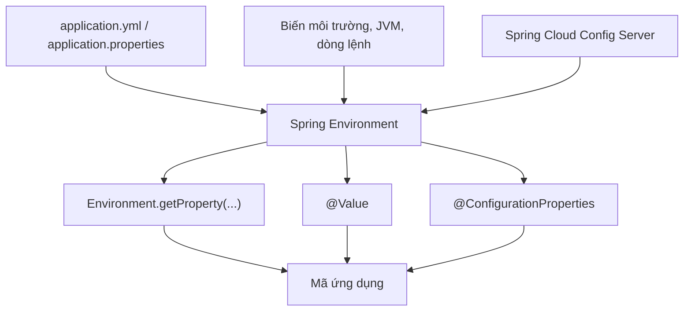

# Đọc cấu hình bằng Environment, @Value và @ConfigurationProperties

Trong ứng dụng Spring Boot, cấu hình có thể đến từ nhiều nguồn: file YAML hoặc properties, biến môi trường, tham số JVM, dòng lệnh và Spring Cloud Config Server. Spring Boot hợp nhất các nguồn này thành môi trường cấu hình của ứng dụng. Mã Java đọc giá trị từ môi trường đó bằng `Environment`, nhận một vài giá trị trực tiếp bằng `@Value`, hoặc ánh xạ cả nhóm cấu hình thành đối tượng có kiểu bằng `@ConfigurationProperties`.

Bài học này tập trung vào cách chọn đúng cơ chế đọc cấu hình, cách giá trị được phân giải khi có nhiều nguồn và điều cần lưu ý khi cấu hình được tải tập trung từ Git qua Spring Cloud Config.

Sau bài học, bạn có thể:

- Giải thích vai trò của `Environment` và thứ tự ưu tiên giữa các nguồn cấu hình.
- Đọc một giá trị đơn bằng `Environment` hoặc `@Value`.
- Gom cấu hình phân cấp vào một lớp `@ConfigurationProperties`, có chuyển đổi kiểu và kiểm tra hợp lệ.
- Theo dấu cấu hình từ Config Server đến bean Spring Boot và hiểu giới hạn của việc cập nhật nóng.

## 1. Từ nguồn cấu hình đến mã Java

Spring Boot không yêu cầu mỗi thành phần tự mở file cấu hình. Trong quá trình khởi động, framework nạp các nguồn cấu hình và cung cấp chúng qua `Environment`. Các cơ chế đọc cấu hình của ứng dụng sử dụng môi trường này:



Với Spring Cloud Config, ứng dụng khách (Config Client) lấy cấu hình từ Config Server trong lúc khởi động. Config Server thường đọc một Git repository và chọn tập tin dựa trên tên ứng dụng, profile và label. Sau khi được nạp, các thuộc tính từ xa trở thành một phần của môi trường cấu hình ở phía client; mã ứng dụng vẫn đọc chúng bằng các cơ chế Spring Boot quen thuộc.

Ví dụ, phần cấu hình phía client có thể khai báo:

```yaml
spring:
  application:
    name: inventory-service
  config:
    import: "optional:configserver:http://config-server:8888"
  cloud:
    config:
      profile: dev
      label: main
```

Trong Git repository của Config Server, một file như `inventory-service-dev.yml` có thể chứa:

```yaml
inventory:
  api-url: https://inventory.internal
  connect-timeout: 2s
  retry:
    max-attempts: 3
    backoff: 500ms
```

Tên ứng dụng, profile và label giúp Config Server chọn đúng cấu hình. Có thể hình dung endpoint tra cứu của Config Server theo dạng `/{application}/{profile}/{label}`: `inventory-service` là application, `dev` là profile và `main` là nhánh hoặc label Git. Label cũng có thể đại diện cho tag hay commit tùy cấu hình backend.

Tiền tố `optional:` trong `spring.config.import` cho phép ứng dụng tiếp tục khởi động nếu Config Server không truy cập được; khi đó ứng dụng có thể thiếu các giá trị chỉ có ở nguồn từ xa. Nếu Config Server là phụ thuộc bắt buộc để ứng dụng chạy đúng, bỏ `optional:` để lỗi kết nối được phát hiện ngay khi khởi động. Không nên dùng chế độ tùy chọn rồi âm thầm dựa vào các giá trị mặc định cho cấu hình quan trọng.

## 2. Đọc giá trị bằng Environment

`Environment` là giao diện truy cập môi trường cấu hình của Spring. Nó phù hợp khi cần tra cứu theo tên khóa, kiểm tra một thuộc tính có tồn tại hay không, hoặc cần giá trị mặc định và kiểu dữ liệu đích.

```java
import java.time.Duration;

import org.springframework.core.env.Environment;
import org.springframework.stereotype.Component;

@Component
public class InventoryConfigInspector {

    private final Environment environment;

    public InventoryConfigInspector(Environment environment) {
        this.environment = environment;
    }

    public Duration connectTimeout() {
        return environment.getProperty(
            "inventory.connect-timeout",
            Duration.class,
            Duration.ofSeconds(2)
        );
    }

    public boolean hasApiUrl() {
        return environment.containsProperty("inventory.api-url");
    }
}
```

Một số thao tác thường dùng:

- `getProperty("inventory.api-url")` trả về chuỗi hoặc `null` nếu không tìm thấy khóa.
- `getProperty("inventory.connect-timeout", Duration.class)` yêu cầu Spring chuyển đổi giá trị sang kiểu `Duration`.
- `getProperty(key, targetType, defaultValue)` trả về giá trị mặc định khi khóa không tồn tại.
- `containsProperty(key)` kiểm tra sự hiện diện của khóa.
- `getActiveProfiles()` cho biết các profile đang hoạt động trong môi trường.

Spring hỗ trợ chuyển đổi kiểu cho nhiều kiểu dữ liệu phổ biến, chẳng hạn `Duration`, số, boolean, enum và URI. Ví dụ `2s`, `500ms` hoặc `3m` có thể được chuyển thành `Duration` mà không cần tự phân tích chuỗi.

`Environment` hữu ích cho tra cứu có điều kiện hoặc những tình huống cần kiểm tra khóa ở thời điểm chạy. Tuy nhiên, nếu nhiều lớp nghiệp vụ cùng gọi `getProperty` với các chuỗi khóa rải rác, việc đổi tên khóa và kiểm tra cấu hình sẽ khó quản lý. Với một nhóm cấu hình ổn định, nên gom chúng vào `@ConfigurationProperties`.

## 3. Tiêm một vài giá trị bằng @Value

`@Value` đưa một thuộc tính vào bean khi Spring tạo bean đó. Cách này gọn khi một thành phần chỉ cần một hoặc vài giá trị đơn lẻ.

```java
import java.net.URI;
import java.time.Duration;

import org.springframework.beans.factory.annotation.Value;
import org.springframework.stereotype.Component;

@Component
public class InventoryClient {

    private final URI apiUrl;
    private final Duration connectTimeout;

    public InventoryClient(
            @Value("${inventory.api-url}") URI apiUrl,
            @Value("${inventory.connect-timeout:2s}") Duration connectTimeout) {
        this.apiUrl = apiUrl;
        this.connectTimeout = connectTimeout;
    }

    // Các phương thức gọi dịch vụ sử dụng apiUrl và connectTimeout.
}
```

Trong biểu thức `@Value`:

- `${inventory.api-url}` là placeholder tham chiếu đến khóa cấu hình.
- `${inventory.connect-timeout:2s}` dùng `2s` làm giá trị mặc định nếu khóa không có.
- Nếu khóa bắt buộc không tồn tại và không có giá trị mặc định, Spring thường báo lỗi khi tạo bean. Điều này giúp phát hiện cấu hình thiếu sớm.

Spring cũng hỗ trợ SpEL với cú pháp `#{...}`, nhưng không nên biến các biểu thức `@Value` thành nơi chứa logic cấu hình phức tạp. Hãy giữ phép tính nghiệp vụ trong mã Java và giữ cấu hình ở dạng dữ liệu rõ ràng.

Ưu tiên constructor injection như ví dụ trên để thể hiện rõ bean cần những giá trị nào và giúp kiểm thử dễ hơn. `@Value` không tự biến một giá trị đã tiêm thành giá trị luôn thay đổi theo Config Server. Giá trị thường được giải quyết khi bean được tạo; nếu bean cần được làm mới sau một sự kiện refresh, phải dùng cơ chế refresh phù hợp của Spring Cloud.

## 4. Ánh xạ nhóm cấu hình bằng @ConfigurationProperties

Khi cấu hình có nhiều khóa liên quan, cấu trúc lồng nhau, danh sách hoặc bản đồ, `@ConfigurationProperties` thường là lựa chọn phù hợp. Spring Boot bind các khóa có cùng prefix vào một đối tượng Java có kiểu.

Với YAML ở phần đầu bài, có thể khai báo:

```java
import java.net.URI;
import java.time.Duration;

import jakarta.validation.Valid;
import jakarta.validation.constraints.Min;
import jakarta.validation.constraints.NotNull;

import org.springframework.boot.context.properties.ConfigurationProperties;
import org.springframework.validation.annotation.Validated;

@ConfigurationProperties(prefix = "inventory")
@Validated
public record InventoryProperties(
        @NotNull URI apiUrl,
        @NotNull Duration connectTimeout,
        @NotNull @Valid Retry retry) {

    public record Retry(
            @Min(1) int maxAttempts,
            @NotNull Duration backoff) {
    }
}
```

Đăng ký quét các lớp cấu hình trong ứng dụng:

```java
import org.springframework.boot.SpringApplication;
import org.springframework.boot.autoconfigure.SpringBootApplication;
import org.springframework.boot.context.properties.ConfigurationPropertiesScan;

@SpringBootApplication
@ConfigurationPropertiesScan
public class InventoryApplication {

    public static void main(String[] args) {
        SpringApplication.run(InventoryApplication.class, args);
    }
}
```

Sau đó, inject đối tượng cấu hình vào thành phần cần dùng:

```java
import java.net.URI;
import java.time.Duration;

import org.springframework.stereotype.Service;

@Service
public class InventoryService {

    private final InventoryProperties properties;

    public InventoryService(InventoryProperties properties) {
        this.properties = properties;
    }

    public void inspectSettings() {
        URI endpoint = properties.apiUrl();
        Duration timeout = properties.connectTimeout();
        int attempts = properties.retry().maxAttempts();
        // Sử dụng các giá trị đã được bind trong xử lý dịch vụ.
    }
}
```

Ví dụ trên dùng Java record và cú pháp phù hợp với Spring Boot 3.x. Nếu dùng các phiên bản Spring Boot cũ hơn, cần đối chiếu cách hỗ trợ constructor binding và namespace validation của phiên bản đó. Khi sử dụng các annotation như `@NotNull` hoặc `@Min`, ứng dụng cần có implementation Jakarta Bean Validation, thường được thêm qua `spring-boot-starter-validation`.

Các lợi ích chính của `@ConfigurationProperties`:

1. **Có cấu trúc:** các khóa `inventory.*` được gom vào một đối tượng thay vì nằm rải rác trong nhiều biểu thức chuỗi.
2. **Có kiểu dữ liệu:** Spring chuyển đổi chuỗi thành `URI`, `Duration`, số, boolean, enum và các kiểu được hỗ trợ.
3. **Hỗ trợ cấu hình lồng nhau:** nhóm `inventory.retry.*` được bind vào đối tượng `Retry`.
4. **Hỗ trợ kiểm tra hợp lệ:** `@Validated`, `@NotNull`, `@Min` và `@Valid` giúp phát hiện giá trị thiếu hoặc không hợp lệ khi khởi động.
5. **Dễ kiểm thử và bảo trì:** các thành phần nhận một đối tượng cấu hình rõ ràng, có thể kiểm tra độc lập.

Spring Boot hỗ trợ relaxed binding, vì vậy tên khóa trong YAML thường viết theo kebab-case như `connect-timeout`, trong khi thuộc tính Java dùng camelCase như `connectTimeout`. Các dạng tên tương ứng được binder ánh xạ theo quy tắc của Spring Boot. Dù vậy, nên thống nhất một cách viết trong file cấu hình để người vận hành dễ tìm và so sánh.

## 5. Chọn cơ chế nào?

| Nhu cầu | Cơ chế phù hợp | Lý do |
|---|---|---|
| Tra cứu một khóa theo điều kiện hoặc tại thời điểm chạy | `Environment` | Chủ động tra cứu, kiểm tra tồn tại và chọn kiểu trả về |
| Tiêm một hoặc vài giá trị đơn vào một bean | `@Value` | Ngắn gọn, thể hiện trực tiếp phụ thuộc của bean |
| Quản lý một nhóm cấu hình có cấu trúc | `@ConfigurationProperties` | Có kiểu, hỗ trợ cấu trúc lồng nhau và validation |
| Cấu hình cần được dùng ở nhiều thành phần | `@ConfigurationProperties` | Tập trung prefix và tạo một hợp đồng cấu hình dùng chung |

Tránh khai báo cùng một khóa ở nhiều lớp cấu hình Java chỉ vì mỗi nơi có thể dùng một cách đọc khác nhau. Hãy xác định một đối tượng cấu hình làm điểm truy cập chính cho nhóm thuộc tính dùng chung; chỉ dùng `Environment` hoặc `@Value` cho nhu cầu thực sự đơn giản hoặc đặc thù.

## 6. Hiểu thứ tự ưu tiên khi nhiều nguồn cùng khai báo một khóa

Một khóa có thể xuất hiện đồng thời trong file cấu hình local, Config Server, biến môi trường, thuộc tính JVM hoặc tham số dòng lệnh. Spring giải quyết xung đột dựa trên thứ tự ưu tiên của các property source: nguồn có độ ưu tiên cao hơn sẽ cung cấp giá trị được đọc.

Không nên học thuộc một danh sách thứ tự duy nhất rồi áp dụng cho mọi ứng dụng. Thứ tự cụ thể phụ thuộc phiên bản Spring Boot, cách nạp cấu hình, môi trường chạy và cách Spring Cloud Config được tích hợp. Đặc biệt, remote property source của Config Server có quy tắc override riêng. Các thuộc tính như `spring.cloud.config.allowOverride`, `spring.cloud.config.overrideNone` và `spring.cloud.config.overrideSystemProperties` điều chỉnh khả năng ghi đè giữa cấu hình từ xa và cấu hình local. Cần kiểm tra tài liệu đúng phiên bản Spring Cloud đang dùng; `allowOverride` phải được đặt trong property source do Config Server cung cấp để có hiệu lực theo cơ chế override này.

Giả sử cùng khóa `inventory.connect-timeout` được khai báo ở Git, file local và biến môi trường. Nếu ứng dụng nhận giá trị không như mong đợi, hãy kiểm tra lần lượt:

1. Client có tải đúng Config Server URI hay không.
2. `spring.application.name`, profile và label có khớp với file/nhánh trong Git hay không.
3. Khóa có đúng chính tả và đúng prefix hay không.
4. Các nguồn cấu hình nào đang chứa khóa đó và nguồn nào có độ ưu tiên cao hơn.
5. Các cờ override của Spring Cloud Config có đang thay đổi quy tắc mặc định hay không.

Trong môi trường phát triển, Spring Boot Actuator có thể hỗ trợ kiểm tra endpoint `env` hoặc `configprops` nếu endpoint được bật. Các endpoint này có thể tiết lộ tên khóa và thông tin cấu hình nhạy cảm, vì vậy chỉ bật khi cần, giới hạn quyền truy cập và không công khai chúng tùy tiện trên production.

## 7. Cấu hình tập trung và cập nhật khi ứng dụng đang chạy

Config Client thường lấy cấu hình trong quá trình khởi động. Khi một commit mới được đẩy lên Git, các instance đang chạy không tự động đọc lại mọi thay đổi chỉ vì repository đã cập nhật.

Spring Cloud cung cấp cơ chế refresh để client nạp lại cấu hình. Khi endpoint refresh được bật và được bảo vệ phù hợp, có thể gửi yêu cầu `POST /actuator/refresh` đến một instance để phát sự kiện làm mới. Các bean thuộc `@RefreshScope` được loại khỏi cache và tạo lại khi được truy cập lần tiếp theo. Spring Cloud cũng hỗ trợ cập nhật lại các bean `@ConfigurationProperties` theo cơ chế refresh; cần kiểm thử hành vi của loại bean và phiên bản đang triển khai.

Trong hệ thống có nhiều instance, Spring Cloud Bus có thể phát sự kiện refresh qua message broker để các client cùng nhận thông báo, thay vì gọi từng instance thủ công. Endpoint bus refresh thường được dùng dưới dạng `POST /actuator/busrefresh`. Cần cấu hình broker, dependency Bus, quyền truy cập endpoint và kiểm thử số lượng instance thực tế trước khi dùng trong vận hành.

Refresh không thay thế quy trình quản trị thay đổi. Một thay đổi cấu hình vẫn cần được review, kiểm thử theo profile, ghi nhận commit/label, triển khai theo kế hoạch và theo dõi sau khi áp dụng. Với thay đổi ảnh hưởng đến kết nối, timeout, giới hạn retry hoặc hành vi bảo mật, nên có phương án quay lại label/commit cấu hình đã biết là ổn định.

## 8. Bảo vệ cấu hình nhạy cảm

Git giúp theo dõi lịch sử và review thay đổi, nhưng không nên lưu bí mật dạng rõ trong repository. Mật khẩu, token, khóa riêng và thông tin xác thực nên được cấp từ secret manager hoặc cơ chế quản lý bí mật phù hợp với môi trường triển khai.

Nếu dùng tính năng mã hóa của Spring Cloud Config, repository có thể lưu ciphertext theo định dạng mà Config Server hỗ trợ, thường có tiền tố `{cipher}`. Khóa giải mã phải được quản lý riêng ở phía server; tuyệt đối không commit khóa này cùng repository cấu hình. Đồng thời cần bảo vệ đường truyền bằng TLS, xác thực client với Config Server, giới hạn quyền đọc repository và giới hạn quyền gọi các endpoint Actuator.

Không ghi toàn bộ `Environment`, đối tượng cấu hình hoặc giá trị bí mật vào log để gỡ lỗi. Khi cần chẩn đoán, chỉ ghi tên khóa hoặc trạng thái đã được che giá trị.

## 9. Quy trình áp dụng trong một ứng dụng

Khi thêm một cấu hình mới cho dịch vụ Spring Boot dùng Spring Cloud Config, có thể thực hiện theo trình tự sau:

1. **Đặt tên khóa có ý nghĩa:** chọn prefix theo miền chức năng, chẳng hạn `inventory.retry.max-attempts`.
2. **Chọn nguồn và phạm vi:** xác định giá trị mặc định ở local hay Git, profile nào cần giá trị riêng và label nào được triển khai.
3. **Chọn cách đọc:** dùng `@ConfigurationProperties` cho nhóm thuộc tính; dùng `@Value` cho một vài giá trị đơn; dùng `Environment` cho tra cứu có điều kiện.
4. **Khai báo kiểu và validation:** dùng `Duration`, `URI`, số hoặc boolean thay cho chuỗi tùy tiện; đặt giới hạn hợp lệ cho giá trị quan trọng.
5. **Kiểm tra lúc khởi động:** xác nhận Config Client tải đúng application/profile/label và ứng dụng dừng sớm nếu thiếu cấu hình bắt buộc.
6. **Kiểm tra xung đột:** thử các nguồn cấu hình có thể ghi đè và xác nhận giá trị cuối cùng.
7. **Kiểm tra refresh và bảo mật:** thử refresh trên một instance, thử Bus nếu có nhiều instance, đồng thời bảo đảm endpoint và bí mật được bảo vệ.

## 10. Lỗi thường gặp

| Hiện tượng | Nguyên nhân thường gặp | Cách kiểm tra |
|---|---|---|
| `@Value` báo không tìm thấy placeholder | Sai tên khóa hoặc nguồn cấu hình chưa được nạp | So sánh prefix, application name, profile, label và Config Server import |
| `@ConfigurationProperties` không được inject | Lớp chưa được đăng ký hoặc quét | Kiểm tra `@ConfigurationPropertiesScan` hoặc đăng ký bằng `@EnableConfigurationProperties` |
| Thuộc tính lồng nhau không được bind như mong đợi | Tên khóa, cấu trúc YAML hoặc kiểu Java không khớp | So sánh từng cấp prefix và kiểu dữ liệu |
| Ứng dụng dùng giá trị khác với file Git | Có property source ưu tiên cao hơn hoặc quy tắc override khác dự kiến | Kiểm tra property source và các cờ override |
| Sửa Git nhưng instance vẫn dùng giá trị cũ | Client chưa nhận sự kiện refresh | Thực hiện refresh có kiểm soát hoặc phát sự kiện qua Bus |
| Ứng dụng vẫn khởi động khi thiếu cấu hình từ xa | Config import được đánh dấu `optional:` hoặc khóa có default | Xác định khóa nào bắt buộc và cấu hình fail-fast phù hợp |

## 11. Tự kiểm tra

1. Nếu một bean cần ba thuộc tính liên quan như endpoint, timeout và retry, vì sao `@ConfigurationProperties` thường dễ bảo trì hơn ba trường `@Value`?
2. `Environment.getProperty(key, Duration.class)` giúp ích gì so với việc lấy chuỗi rồi tự phân tích?
3. Một giá trị trong Config Server khác với biến môi trường đang có trên máy chạy. Bạn sẽ kiểm tra những yếu tố nào trước khi kết luận nguồn nào thắng?
4. Sau khi commit cấu hình mới lên Git, vì sao các instance đang chạy có thể vẫn dùng giá trị cũ?
5. Vì sao endpoint Actuator dùng để xem cấu hình và khóa giải mã của Config Server phải được bảo vệ?

Hãy thử thay đổi `inventory.connect-timeout` ở Git, khởi động client với profile `dev`, rồi đọc giá trị bằng `Environment` và `InventoryProperties`. Tiếp đó, tạo một giá trị trùng khóa ở nguồn local hoặc biến môi trường, quan sát kết quả và giải thích nguồn nào được ưu tiên trong cấu hình triển khai của bạn.

