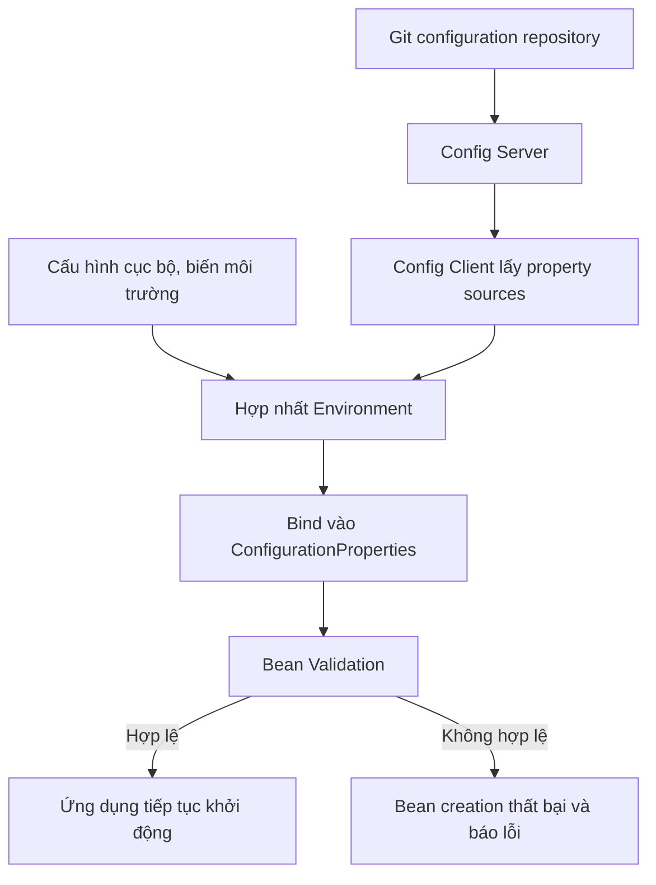

# Kiểm tra ràng buộc cấu hình bằng Bean Validation

Spring Cloud Config giúp phân phối cấu hình đến nhiều ứng dụng Spring Boot theo tên ứng dụng, profile và label. Tuy nhiên, việc một giá trị được lấy thành công từ Config Server hoặc Git chưa đảm bảo giá trị đó hợp lệ với ứng dụng nhận nó. Một timeout có thể bằng 0, URL có thể sai định dạng, số lần thử lại có thể âm hoặc một thuộc tính bắt buộc có thể bị bỏ trống.

Bean Validation giúp ứng dụng kiểm tra các điều kiện này ngay khi cấu hình được bind thành đối tượng Java. Nhờ vậy, lỗi cấu hình được phát hiện sớm trong quá trình khởi động hoặc khi cấu hình được nạp lại, thay vì xuất hiện muộn dưới dạng lỗi kết nối hay lỗi nghiệp vụ khó truy tìm.

## Mục tiêu học tập

Sau bài này, bạn có thể:

- Giải thích vị trí của Bean Validation trong luồng nạp cấu hình của Spring Boot và Spring Cloud Config.
- Khai báo `@ConfigurationProperties` kết hợp `@Validated` và các constraint phổ biến.
- Kiểm tra thuộc tính lồng nhau bằng `@Valid`.
- Phân biệt lỗi bind kiểu dữ liệu với lỗi vi phạm constraint.
- Thiết kế validation cho cấu hình theo profile và cấu hình được refresh.
- Kiểm thử trường hợp cấu hình hợp lệ và không hợp lệ, đồng thời tránh để bí mật xuất hiện trong log lỗi.

## Bean Validation nằm ở đâu trong luồng cấu hình?

Khi ứng dụng dùng Spring Cloud Config, Config Client lấy các property source từ Config Server. Các nguồn này được kết hợp với cấu hình cục bộ, biến môi trường và những nguồn khác theo quy tắc ưu tiên của Spring Boot. Sau đó, Spring Boot bind các thuộc tính có cùng prefix vào bean `@ConfigurationProperties`.

Bean Validation kiểm tra đối tượng đã bind dựa trên các constraint được khai báo. Nếu dữ liệu không thỏa mãn điều kiện, quá trình tạo bean cấu hình có thể thất bại và ứng dụng không khởi động thành công. Điều này tạo ra một hàng rào kiểm tra tại chính ứng dụng sử dụng cấu hình.



Config Server chịu trách nhiệm cung cấp cấu hình. Bean Validation thường chạy ở phía client, nơi ứng dụng có hiểu biết về ý nghĩa và giới hạn của từng thuộc tính. Vì vậy, cùng một kho cấu hình có thể được nhiều ứng dụng sử dụng, nhưng mỗi ứng dụng vẫn kiểm tra các điều kiện phù hợp với hợp đồng cấu hình của chính nó.

## Chuẩn bị dependency và đăng ký Configuration Properties

Với Spring Boot, cần có implementation của Jakarta Bean Validation trên classpath. Trong dự án Maven sử dụng Spring Boot 3, có thể thêm starter sau:

```xml
<dependency>
    <groupId>org.springframework.boot</groupId>
    <artifactId>spring-boot-starter-validation</artifactId>
</dependency>
```

Spring Boot 3 sử dụng namespace `jakarta.validation`. Dự án Spring Boot 2 cũ thường dùng namespace `javax.validation`; không trộn hai namespace trong cùng một cấu hình ứng dụng.

Để Spring quản lý các lớp cấu hình có kiểu mạnh, có thể bật quét bằng `@ConfigurationPropertiesScan`:

```java
@SpringBootApplication
@ConfigurationPropertiesScan
public class OrderServiceApplication {
    public static void main(String[] args) {
        SpringApplication.run(OrderServiceApplication.class, args);
    }
}
```

Một lựa chọn khác là đăng ký từng lớp bằng `@EnableConfigurationProperties(GatewayProperties.class)` trên một lớp cấu hình. Chọn một cách đăng ký phù hợp với cấu trúc dự án để tránh cấu hình trùng lặp.

## Khai báo constraint trên thuộc tính

Ví dụ dịch vụ đặt hàng cần URL của cổng thanh toán, khóa truy cập và thời gian timeout. Ta gom những giá trị liên quan vào một lớp cấu hình có prefix `payment.gateway`:

```java
import jakarta.validation.constraints.Max;
import jakarta.validation.constraints.Min;
import jakarta.validation.constraints.NotBlank;
import jakarta.validation.constraints.NotNull;
import org.springframework.boot.context.properties.ConfigurationProperties;
import org.springframework.validation.annotation.Validated;

@ConfigurationProperties(prefix = "payment.gateway")
@Validated
public class GatewayProperties {

    @NotBlank
    private String baseUrl;

    @NotBlank
    private String apiKey;

    @Min(1)
    @Max(10)
    private int connectTimeoutSeconds = 3;

    // getters và setters
}
```

`@Validated` yêu cầu Spring thực hiện validation cho bean cấu hình. Các annotation như `@NotBlank`, `@NotNull`, `@Min` và `@Max` mô tả điều kiện mà giá trị phải đáp ứng:

| Constraint | Ý nghĩa | Trường hợp sử dụng |
|---|---|---|
| `@NotNull` | Giá trị không được là `null` | Đối tượng hoặc giá trị bắt buộc phải có |
| `@NotBlank` | Chuỗi phải khác `null` và có ít nhất một ký tự không phải khoảng trắng | Tên, URL dạng chuỗi, mã định danh |
| `@NotEmpty` | Chuỗi, collection hoặc mảng không được rỗng | Danh sách phải có phần tử |
| `@Min` / `@Max` | Giá trị số nằm trong giới hạn | Timeout tính bằng giây, số worker, số lần retry |
| `@Positive` / `@PositiveOrZero` | Giá trị số phải dương hoặc không âm | Kích thước, số lượng hoặc ngưỡng số |
| `@Size` | Độ dài hoặc kích thước nằm trong khoảng | Chuỗi, danh sách, tập hợp |
| `@Pattern` | Chuỗi khớp biểu thức chính quy | Mã vùng, định dạng tên hoặc giá trị có quy ước |
| `@Email` | Chuỗi có định dạng email được provider chấp nhận | Địa chỉ email liên hệ |

Chọn constraint đúng với kiểu dữ liệu và quy tắc nghiệp vụ. Ví dụ, `@NotBlank` phù hợp với chuỗi bắt buộc, trong khi `@NotNull` phù hợp với một đối tượng. `@NotEmpty` chỉ đảm bảo có phần tử hoặc có ký tự, không đảm bảo nội dung chuỗi có ý nghĩa.

Trong ví dụ trên, `connectTimeoutSeconds` là kiểu `int`, vì vậy giá trị mặc định của Java là `0` nếu không được bind. Constraint `@Min(1)` sẽ loại giá trị đó. Nếu cần phân biệt rõ thuộc tính bị thiếu với giá trị bằng 0, hãy dùng kiểu wrapper `Integer` cùng `@NotNull` và `@Min(1)`.

## Kiểm tra thuộc tính lồng nhau

Cấu hình thường có cấu trúc phân cấp. Ví dụ, cổng thanh toán có thể chứa nhóm retry với số lần thử và khoảng nghỉ. Để constraint trong đối tượng con được kiểm tra, cần đánh dấu thuộc tính cha bằng `@Valid`:

```java
import jakarta.validation.Valid;
import jakarta.validation.constraints.NotNull;

@ConfigurationProperties(prefix = "payment.gateway")
@Validated
public class GatewayProperties {

    // Các thuộc tính baseUrl, apiKey và connectTimeoutSeconds như ví dụ trước

    @NotNull
    @Valid
    private Retry retry = new Retry();

    public static class Retry {
        @Min(0)
        @Max(5)
        private int maxAttempts = 3;

        @NotNull
        private Duration backoff;

        // getters và setters
    }

    // getters và setters
}
```

`@Valid` yêu cầu validator đi tiếp vào đối tượng con. Nếu thiếu `@Valid`, constraint đặt trên `Retry` có thể không được kiểm tra khi validate `GatewayProperties`. Kết hợp `@NotNull` với `@Valid` khi bản thân nhóm cấu hình con cũng bắt buộc phải tồn tại.

Với collection, có thể dùng validation theo phần tử. Ví dụ `List<URI>` có thể khai báo `List<@NotNull URI>` và đánh dấu thuộc tính bằng `@NotEmpty` nếu danh sách phải có ít nhất một địa chỉ. Khi mỗi phần tử là một đối tượng có constraint riêng, dùng `List<@Valid EndpointProperties>` hoặc `@Valid` trên thuộc tính collection tùy cách khai báo và phiên bản Jakarta Validation.

## Cấu hình từ Config Server theo profile

Các giá trị được bind có thể đến từ file cấu hình trong Git được Config Server phục vụ. Ví dụ:

```yaml
# order-service-prod.yml trong config repository
payment:
  gateway:
    base-url: https://payments.example.com
    api-key: ${PAYMENT_GATEWAY_API_KEY}
    connect-timeout-seconds: 4
    retry:
      max-attempts: 3
      backoff: 250ms
```

Trong ứng dụng, `spring.application.name=order-service` và profile `prod` giúp Config Client nhận bộ cấu hình tương ứng. Khi các giá trị được bind vào `GatewayProperties`, Bean Validation kiểm tra chúng theo constraint đã khai báo.

Các profile có thể có giá trị khác nhau nhưng phải cùng thỏa mãn hợp đồng cấu hình của ứng dụng. Ví dụ `dev` có thể dùng timeout 2 giây, còn `prod` dùng 4 giây; cả hai đều phải nằm trong khoảng từ 1 đến 10 giây. Nếu một profile quên khai báo thuộc tính bắt buộc, ứng dụng có thể thất bại khi khởi động, trừ khi giá trị đó có mặc định hợp lệ hoặc được cung cấp từ nguồn cấu hình khác.

Không lưu khóa API, mật khẩu hay token thật dưới dạng văn bản thuần trong Git. Ví dụ YAML chỉ khai báo URL và các tham số không nhạy cảm; bí mật nên được đưa vào từ biến môi trường, secret manager hoặc cơ chế bảo vệ phù hợp. Có thể áp dụng `@NotBlank` để buộc ứng dụng nhận được khóa từ nguồn an toàn, nhưng không ghi giá trị khóa vào thông báo validation hoặc log.

## Constraint cho quy tắc phức hợp

Các annotation có sẵn đáp ứng nhiều điều kiện đơn giản. Khi quy tắc liên quan đến nhiều thuộc tính, ví dụ `minPoolSize` không được lớn hơn `maxPoolSize`, có thể dùng class-level constraint tùy chỉnh.

Một cách đơn giản khác là kiểm tra trong constructor hoặc phương thức khởi tạo cấu hình:

```java
public PoolProperties(int minPoolSize, int maxPoolSize) {
    if (minPoolSize < 0 || maxPoolSize < 1 || minPoolSize > maxPoolSize) {
        throw new IllegalArgumentException(
            "Pool size must satisfy 0 <= minPoolSize <= maxPoolSize"
        );
    }
    this.minPoolSize = minPoolSize;
    this.maxPoolSize = maxPoolSize;
}
```

Với quy tắc cần tái sử dụng hoặc cần tích hợp thống nhất vào Bean Validation, hãy tạo annotation constraint ở cấp lớp, implementation của `ConstraintValidator` và đặt annotation trên lớp `@ConfigurationProperties`. Thông báo lỗi nên nêu tên thuộc tính hoặc quy tắc bị vi phạm, không chứa giá trị bí mật.

Một số kiểu dữ liệu cần kiểm tra ngữ nghĩa riêng. `@NotNull` trên `URI` chỉ xác nhận đối tượng đã tồn tại, không đảm bảo scheme là HTTPS. Tương tự, `@NotNull` trên `Duration` không đảm bảo thời lượng dương. Với các quy tắc như vậy, hãy dùng custom constraint hoặc kiểm tra bất biến trong constructor, đồng thời tạo thông báo dễ hiểu cho người vận hành.

## Phân biệt lỗi binding và lỗi validation

Hai loại lỗi này thường xuất hiện gần nhau nhưng nguyên nhân khác nhau:

| Loại lỗi | Ví dụ | Cách xử lý |
|---|---|---|
| Lỗi binding / chuyển kiểu | `connect-timeout-seconds: fast` không chuyển được thành số nguyên | Sửa kiểu hoặc định dạng giá trị trong nguồn cấu hình |
| Lỗi Bean Validation | `connect-timeout-seconds: 0` chuyển thành số thành công nhưng vi phạm `@Min(1)` | Sửa giá trị để thỏa mãn constraint |
| Thiếu thuộc tính bắt buộc | `base-url` không được cung cấp và không có giá trị mặc định | Bổ sung giá trị từ đúng nguồn cấu hình hoặc profile |
| Vi phạm quy tắc phức hợp | `minPoolSize` lớn hơn `maxPoolSize` | Sửa các giá trị liên quan để thỏa mãn bất biến |

Binding xác định liệu dữ liệu có thể chuyển thành kiểu Java hay không. Bean Validation kiểm tra liệu đối tượng sau khi bind có thỏa mãn các điều kiện đã định nghĩa hay không. Cần đọc nguyên nhân gốc trong exception và đường dẫn thuộc tính để sửa đúng nơi.

## Kiểm thử cấu hình hợp lệ và không hợp lệ

Không nên chỉ kiểm tra rằng ứng dụng khởi động được với một file cấu hình mặc định. Cần kiểm tra cả giá trị biên và các profile quan trọng. Một ví dụ kiểm thử binding và validation bằng `ApplicationContextRunner`:

```java
class GatewayPropertiesTests {

    private final ApplicationContextRunner contextRunner =
        new ApplicationContextRunner()
            .withUserConfiguration(TestConfiguration.class);

    @Test
    void startsWhenConfigurationIsValid() {
        contextRunner
            .withPropertyValues(
                "payment.gateway.base-url=https://payments.example.com",
                "payment.gateway.api-key=test-key",
                "payment.gateway.connect-timeout-seconds=4",
                "payment.gateway.retry.backoff=250ms"
            )
            .run(context -> assertThat(context).hasNotFailed());
    }

    @Test
    void failsWhenTimeoutIsOutsideAllowedRange() {
        contextRunner
            .withPropertyValues(
                "payment.gateway.base-url=https://payments.example.com",
                "payment.gateway.api-key=test-key",
                "payment.gateway.connect-timeout-seconds=0",
                "payment.gateway.retry.backoff=250ms"
            )
            .run(context -> assertThat(context).hasFailed());
    }

    @Configuration(proxyBeanMethods = false)
    @EnableConfigurationProperties(GatewayProperties.class)
    static class TestConfiguration {
    }
}
```

Đoạn kiểm thử giả định lớp `GatewayProperties` có các getter/setter, có thuộc tính `retry` như ví dụ lồng nhau ở trên và các dependency kiểm thử Spring Boot, JUnit, AssertJ đã được khai báo. Các test cung cấp `retry.backoff` để đối tượng con cũng thỏa mãn constraint `@NotNull`. Có thể bổ sung trường hợp thiếu `base-url`, giá trị timeout bằng giới hạn nhỏ nhất/lớn nhất, `maxAttempts` âm hoặc cấu hình con bị thiếu. Với từng profile, nên nạp đúng bộ property tương ứng để bảo đảm không profile nào vô tình vi phạm hợp đồng.

Khi cần kiểm tra riêng constraint, có thể inject `jakarta.validation.Validator` và gọi `validator.validate(properties)`. Cách này hữu ích cho custom constraint, nhưng không thay thế kiểm thử tích hợp quá trình binding từ các property source của Spring Boot.

## Validation khi refresh cấu hình

Spring Cloud Config hỗ trợ client lấy cấu hình mới. Endpoint refresh của Spring Boot Actuator hoặc Spring Cloud Bus có thể kích hoạt quá trình cập nhật cấu hình ở các instance. Khi cấu hình được bind hoặc rebind, các constraint vẫn cần được áp dụng để giá trị mới tuân thủ hợp đồng.

Ví dụ, `connect-timeout-seconds` đang là `4` và được đổi thành `0` trong Git. Sau khi client nhận giá trị mới, validation phải phát hiện vi phạm `@Min(1)`. Kết quả cụ thể của thao tác refresh phụ thuộc cách bean được quản lý, phiên bản Spring Boot/Spring Cloud và phạm vi refresh. Không nên giả định mọi bean đều được cập nhật nguyên tử hoặc mọi refresh thất bại đều tự động đưa toàn bộ hệ thống về phiên bản cấu hình trước.

Vì refresh có thể tác động đến instance đang phục vụ lưu lượng, nên quy trình thay đổi cần có các bước kiểm tra trước khi phát hành: review cấu hình, kiểm thử với profile mục tiêu, triển khai theo từng nhóm instance nếu phù hợp, theo dõi lỗi validation và chuẩn bị phương án quay lại label hoặc commit ổn định. Nếu cấu hình mới không hợp lệ, cần xử lý lỗi và khôi phục nguồn cấu hình phù hợp trước khi tiếp tục refresh.

## Các lưu ý khi thiết kế validation

- **Kiểm tra theo ý nghĩa nghiệp vụ:** timeout phải dương, số connection không vượt giới hạn tài nguyên, danh sách endpoint phải có phần tử nếu ứng dụng cần chúng.
- **Chọn kiểu dữ liệu rõ ràng:** dùng `Duration`, `URI`, `DataSize` hoặc kiểu miền phù hợp khi chúng biểu diễn đúng ý nghĩa, rồi bổ sung constraint cho các điều kiện mà kiểu dữ liệu không tự bảo đảm.
- **Quy định mặc định có chủ đích:** giá trị mặc định giúp ứng dụng hoạt động khi một thuộc tính tùy chọn bị thiếu; không dùng mặc định để che giấu một thuộc tính bắt buộc bị bỏ quên.
- **Kiểm tra tất cả profile:** `dev`, `test`, `staging` và `prod` đều phải đáp ứng cùng hợp đồng hoặc có hợp đồng riêng được thiết kế rõ ràng.
- **Không để lộ bí mật:** thông báo lỗi không nên chứa token, mật khẩu, private key hoặc toàn bộ object cấu hình.
- **Giữ validation dễ vận hành:** dùng thông báo rõ ràng, nêu prefix và thuộc tính bị lỗi; ghi nhận profile và phiên bản cấu hình khi phù hợp để truy nguyên thay đổi.
- **Đồng bộ thay đổi hợp đồng:** khi thêm constraint mới, kiểm tra các file cấu hình hiện có và quy trình phát hành để tránh làm hỏng đồng loạt những môi trường đang chạy.

## Kết luận

Bean Validation bổ sung kiểm tra tính hợp lệ về mặt nghiệp vụ cho cấu hình đã được Spring Boot bind vào `@ConfigurationProperties`. `@Validated` kích hoạt validation, các constraint mô tả giới hạn của từng thuộc tính và `@Valid` cho phép kiểm tra sâu các nhóm cấu hình lồng nhau.

Trong hệ thống dùng Spring Cloud Config, Config Server phân phối giá trị còn từng Config Client xác nhận rằng giá trị đó phù hợp với yêu cầu của ứng dụng. Kết hợp validation với kiểm thử theo profile, quản trị Git và quy trình refresh có kiểm soát giúp phát hiện cấu hình sai sớm, giảm lỗi khi vận hành nhiều dịch vụ và giữ cho thay đổi cấu hình có thể truy nguyên.
