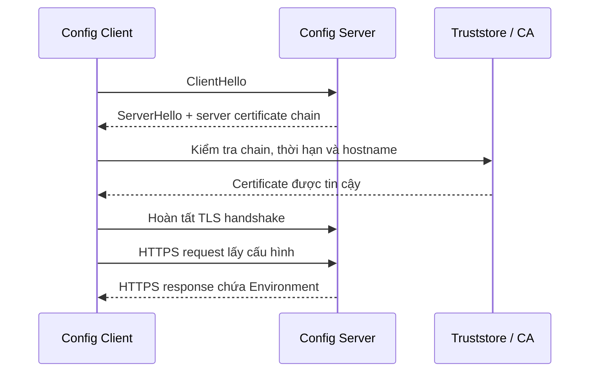
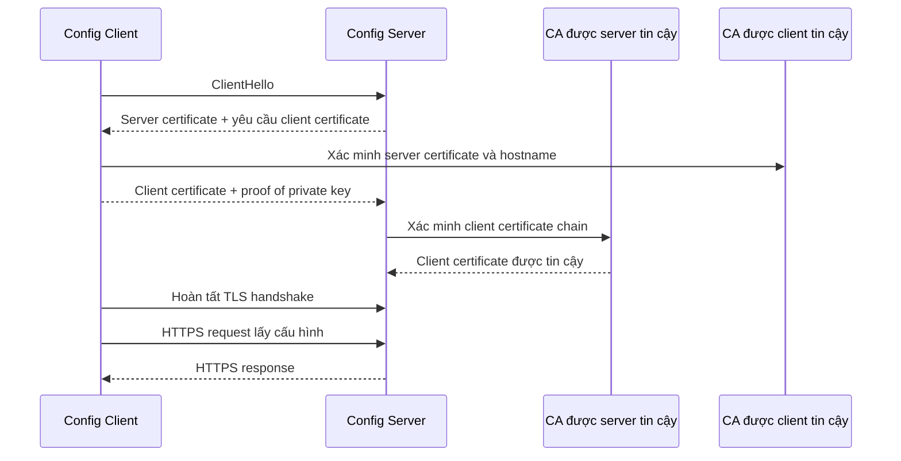
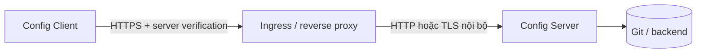

# TLS, mTLS, truststore và xác minh chứng thư máy chủ

Config Client thường kết nối đến Config Server trong giai đoạn khởi động và có thể tiếp tục lấy cấu hình khi refresh. Request này có thể chứa thông tin xác thực, còn response có thể chứa URL nội bộ, credential hoặc cấu hình nhạy cảm. Vì vậy, kết nối giữa client và server cần được bảo vệ bằng TLS để mã hóa dữ liệu trên đường truyền và xác minh danh tính đầu bên kia.

TLS một chiều xác minh chứng thư của máy chủ. mTLS (mutual TLS) bổ sung việc máy chủ yêu cầu và xác minh chứng thư của client. Để hai phía xác minh được nhau, cần phân biệt rõ keystore chứa danh tính và private key của chính mình với truststore chứa CA/chứng thư mà mình tin cậy. Chỉ bật HTTPS mà không kiểm tra trust chain và hostname vẫn có thể khiến client kết nối nhầm máy chủ.

## 1. Mục tiêu học tập

Sau bài học, bạn có thể:

- Giải thích TLS bảo vệ kết nối Config Client đến Config Server như thế nào.
- Phân biệt TLS một chiều với mTLS và xác định bên nào cần gửi chứng thư.
- Phân biệt keystore với truststore, certificate với private key và CA với leaf certificate.
- Cấu hình HTTPS cho Config Server bằng `server.ssl.*`.
- Cấu hình Config Client xác minh server certificate bằng `spring.cloud.config.tls.*`.
- Bật mTLS, cấp client certificate và xác minh client certificate ở Config Server.
- Kiểm tra certificate chain, thời hạn, SAN/hostname và mục đích sử dụng chứng thư.
- Chẩn đoán lỗi TLS phổ biến, xoay vòng chứng thư và vận hành an toàn trong production.

## 2. Vì sao Config Server cần TLS?

Config Server là nơi tập trung cấu hình cho nhiều ứng dụng. Client có thể gửi username/password, token hoặc client certificate để xác thực. Server có thể trả về các giá trị như:

- Database URL, username và password.
- Endpoint của dịch vụ nội bộ.
- API token hoặc khóa tích hợp.
- Feature flag, giới hạn giao dịch và chính sách vận hành.
- Cấu hình bảo mật theo môi trường.

Nếu kết nối dùng HTTP thuần trên mạng không tin cậy, người có khả năng quan sát hoặc can thiệp lưu lượng có thể đọc hoặc sửa dữ liệu truyền đi. TLS cung cấp ba thuộc tính quan trọng:

1. **Mã hóa:** dữ liệu trong phiên kết nối được mã hóa để người ngoài khó đọc.
2. **Toàn vẹn:** dữ liệu được bảo vệ khỏi việc sửa đổi âm thầm trong quá trình truyền.
3. **Xác thực peer:** client có thể xác minh danh tính server qua chứng thư; với mTLS, server cũng xác minh danh tính client qua chứng thư.

TLS bảo vệ kênh truyền. Nó không tự quyết định client được phép đọc cấu hình của application nào. Xác thực và phân quyền truy cập Config Server vẫn cần được thiết kế riêng.

## 3. TLS một chiều và mTLS

### TLS một chiều

Trong mô hình phổ biến, Config Server trình chứng thư máy chủ cho Config Client. Client kiểm tra certificate chain và hostname trước khi gửi dữ liệu ứng dụng. Server không bắt buộc client phải có certificate ở tầng TLS; client có thể được xác thực thêm bằng HTTP Basic, OAuth2, token hoặc cơ chế bảo mật khác.



Client phải tin CA đã ký chứng thư server và phải xác minh tên máy chủ khớp với hostname trong URL. Nếu chỉ mã hóa mà bỏ qua xác minh certificate, client có thể thiết lập TLS với một server giả mạo.

### Mutual TLS (mTLS)

mTLS bổ sung xác thực ở chiều ngược lại. Server yêu cầu client trình chứng thư và kiểm tra chứng thư đó có được CA mà server tin cậy ký hay không.



Trong mTLS:

- Client dùng truststore để xác minh chứng thư của Config Server.
- Client dùng keystore để giữ client certificate và private key của chính nó.
- Server dùng keystore để giữ server certificate và private key của server.
- Server dùng truststore để xác minh certificate chain do client trình lên.

mTLS xác thực danh tính ở tầng TLS. Sau handshake, ứng dụng vẫn cần ánh xạ danh tính client sang quyền truy cập phù hợp. Nếu mọi client được ký bởi cùng một CA đều được phép đọc mọi application, mTLS chưa đủ để tạo phân quyền theo service.

## 4. Phân biệt keystore và truststore

Hai loại store có mục đích khác nhau:

| Thành phần | Chứa gì? | Dùng để làm gì? | Ai cần bảo vệ? |
| --- | --- | --- | --- |
| Keystore | Private key và certificate chain của chính tiến trình | Chứng minh danh tính của server hoặc client khi handshake yêu cầu | Rất nhạy cảm; private key phải được giữ bí mật |
| Truststore | CA certificate hoặc certificate được chọn để tin cậy | Xác minh certificate chain mà peer trình lên | Không chứa private key; cần bảo vệ tính toàn vẹn và quyền sửa |
| Leaf/server certificate | Chứng thư định danh máy chủ | Gắn public key với DNS name của Config Server | Có thể công khai, nhưng phải bảo đảm chain và nội dung chính xác |
| Client certificate | Chứng thư định danh client/service | Cho phép server xác minh client trong mTLS | Có thể công khai; private key tương ứng phải được bảo vệ |
| CA certificate | Chứng thư của Certificate Authority | Là trust anchor hoặc trung gian để xác minh chain | Cần kiểm soát nguồn và thay đổi vì tin CA đồng nghĩa tin các chứng thư CA đó phát hành |

Một truststore thông thường chỉ cần CA root/intermediate phù hợp. Không cần đưa private key vào truststore. Ngược lại, keystore dùng để trình danh tính cần có private key tương ứng với certificate.

Java hỗ trợ nhiều định dạng như PKCS12 và JKS. PKCS12 thường là lựa chọn tương thích tốt cho triển khai mới. Phải khai báo đúng store type và alias nếu store có nhiều entry.

## 5. Certificate chain và CA trust

Một chứng thư máy chủ thường được CA trung gian ký; CA trung gian có thể được CA gốc ký. Khi client nhận chứng thư, nó cần xây dựng được một đường tin cậy từ leaf certificate đến trust anchor có trong truststore.

Ví dụ:

```text
Config Server certificate (leaf)
        |
        v
Internal Issuing CA (intermediate)
        |
        v
Company Root CA (trust anchor)
```

Các điểm cần kiểm tra:

- Server gửi đủ intermediate certificate cần thiết trong chain.
- Truststore của client chứa CA phù hợp để xây dựng chain.
- Certificate chưa hết hạn và chưa đến thời điểm hiệu lực.
- Certificate được cấp cho đúng mục đích server authentication (`serverAuth`) hoặc client authentication (`clientAuth`) tùy vai trò.
- Signature algorithm, key size và chính sách CA đáp ứng tiêu chuẩn của tổ chức.
- Certificate chưa bị thu hồi theo chính sách kiểm tra revocation đang áp dụng.

Không nên chỉ nhập leaf certificate vào truststore như một giải pháp lâu dài nếu hệ thống có CA nội bộ và quy trình cấp chứng thư. Tin trực tiếp leaf certificate tạo ra certificate pinning; khi certificate được cấp lại, client có thể phải cập nhật truststore. Tin CA giúp quản lý vòng đời linh hoạt hơn nhưng phải kiểm soát chặt CA nào được tin.

## 6. Xác minh hostname bằng SAN

Client không chỉ kiểm tra chữ ký CA. Nó còn phải xác minh tên host trong URL Config Server khớp với danh tính được ghi trong chứng thư.

Ví dụ client kết nối:

```text
https://config.example.internal
```

Certificate của server cần có Subject Alternative Name (SAN) phù hợp, ví dụ:

```text
DNS:config.example.internal
```

Nếu client truy cập bằng tên `config-server.internal` nhưng certificate chỉ có SAN `config.example.internal`, hostname verification có thể thất bại dù certificate được ký bởi CA tin cậy.

Nguyên tắc:

- Ưu tiên SAN DNS name hoặc IP SAN đúng với cách client truy cập.
- Dùng một DNS name ổn định cho Config Server thay vì IP thay đổi theo Pod.
- Nếu dùng load balancer hoặc reverse proxy, certificate phải khớp hostname client nhìn thấy ở đầu TLS.
- Không dựa vào Common Name (CN) như cách thay thế SAN trong hệ thống mới.
- Không tắt hostname verification hoặc cài trust-all manager để bỏ qua lỗi.

CA hợp lệ nhưng hostname sai vẫn phải bị từ chối. Đây là kiểm tra quan trọng để ngăn client kết nối đến một server khác có certificate do cùng CA ký.

## 7. Cấu hình HTTPS trên Config Server

Nếu TLS được kết thúc trực tiếp tại embedded web server của Config Server, Spring Boot dùng các thuộc tính `server.ssl.*`.

Ví dụ dùng PKCS12 keystore:

```yaml
server:
  port: 8888
  ssl:
    enabled: true
    key-store: file:/run/secrets/config-server.p12
    key-store-type: PKCS12
    key-store-password: ${CONFIG_SERVER_KEYSTORE_PASSWORD}
    key-alias: config-server
    enabled-protocols:
      - TLSv1.3
      - TLSv1.2
```

Keystore ở đây phải chứa private key của Config Server và certificate chain tương ứng. Certificate phải có SAN khớp hostname mà client dùng trong URI.

Nếu Config Server chỉ cần HTTPS một chiều, không cần cấu hình `server.ssl.client-auth` hoặc truststore dành cho client certificate. Client xác minh server certificate bằng JVM default truststore hoặc custom truststore ở phía client.

Nếu dùng CA công cộng được JVM tin cậy, thường không cần custom truststore ở Config Client. Với CA nội bộ, hãy cấp CA certificate qua truststore riêng cho các client.

## 8. Cấu hình Config Client xác minh server certificate

Spring Cloud Config Client hỗ trợ TLS bằng namespace `spring.cloud.config.tls`. Client cần dùng URI HTTPS và bật TLS support.

Ví dụ với CA nội bộ:

```yaml
spring:
  config:
    import: "configserver:https://config.example.internal:8888"
  cloud:
    config:
      tls:
        enabled: true
        trust-store: file:/run/secrets/config-server-ca.p12
        trust-store-type: PKCS12
        trust-store-password: ${CONFIG_SERVER_TRUSTSTORE_PASSWORD}
```

Trong ví dụ này:

- `spring.config.import` trỏ đến Config Server qua HTTPS.
- `spring.cloud.config.tls.enabled` bật TLS support của Config Client.
- `trust-store` chứa CA dùng để xác minh server certificate.
- Client kiểm tra chain và hostname trước khi gửi request cấu hình.

Nếu không khai báo `spring.cloud.config.tls.trust-store`, Config Client dùng JVM default truststore. Kiểu mặc định của `key-store-type` và `trust-store-type` trong cấu hình TLS của Config Client là `PKCS12`. Nếu không khai báo password, cấu hình mặc định giả định password rỗng; trong production nên khai báo rõ theo cách quản lý secret của tổ chức.

Với bootstrap legacy, URI và các thuộc tính Config Client có thể nằm trong `bootstrap.yml`; với Config Data API, sử dụng `spring.config.import`. Cách đặt thuộc tính cần phù hợp với cơ chế khởi động và phiên bản Spring Cloud đang dùng.

## 9. Cấu hình mTLS ở Config Server

Để bắt buộc client trình certificate, Config Server cần:

1. Server keystore chứa server private key và certificate chain.
2. Server truststore chứa CA được phép ký client certificate.
3. `server.ssl.client-auth: need` để yêu cầu client certificate trong TLS handshake.

Ví dụ:

```yaml
server:
  port: 8888
  ssl:
    enabled: true
    key-store: file:/run/secrets/config-server.p12
    key-store-type: PKCS12
    key-store-password: ${CONFIG_SERVER_KEYSTORE_PASSWORD}
    key-alias: config-server
    trust-store: file:/run/secrets/config-client-ca.p12
    trust-store-type: PKCS12
    trust-store-password: ${CONFIG_CLIENT_TRUSTSTORE_PASSWORD}
    client-auth: need
    enabled-protocols:
      - TLSv1.3
      - TLSv1.2
```

`client-auth` có ba lựa chọn phổ biến:

| Giá trị | Hành vi |
| --- | --- |
| `none` | Không yêu cầu client certificate ở tầng TLS |
| `want` | Yêu cầu client certificate nhưng có thể tiếp tục nếu client không gửi certificate, tùy server implementation |
| `need` | Bắt buộc client phải trình certificate hợp lệ |

Khi dùng `need`, client không có certificate hoặc certificate không được truststore của server tin cậy sẽ không hoàn tất handshake. Truststore server phải chứa CA cấp client certificate; không nhầm nó với truststore ở client dùng để tin server.

## 10. Cấu hình mTLS ở Config Client

Client cần truststore để xác minh Config Server và keystore để trình client identity.

Ví dụ:

```yaml
spring:
  config:
    import: "configserver:https://config.example.internal:8888"
  cloud:
    config:
      tls:
        enabled: true
        trust-store: file:/run/secrets/config-server-ca.p12
        trust-store-type: PKCS12
        trust-store-password: ${CONFIG_SERVER_TRUSTSTORE_PASSWORD}
        key-store: file:/run/secrets/orders-client.p12
        key-store-type: PKCS12
        key-store-password: ${ORDERS_CLIENT_KEYSTORE_PASSWORD}
        key-password: ${ORDERS_CLIENT_KEY_PASSWORD}
```

Client keystore cần chứa client private key và certificate chain được CA mà server tin cậy ký. Truststore client chứa CA xác minh server certificate. Hai store có thể chứa các CA khác nhau vì mỗi bên xác minh peer ở một chiều khác nhau.

Không dùng cùng một client private key cho tất cả ứng dụng nếu mỗi ứng dụng cần danh tính riêng. Dùng certificate riêng theo service giúp thu hồi, audit và phân quyền rõ ràng hơn.

## 11. Bảng tổng hợp: store nào đặt ở đâu?

| Kịch bản | Config Server | Config Client |
| --- | --- | --- |
| HTTPS một chiều | Keystore có server key/certificate | Truststore có CA server hoặc dùng JVM default truststore |
| mTLS | Keystore server; truststore có CA cấp client certificate; `client-auth=need` | Truststore có CA server; keystore có client key/certificate; `spring.cloud.config.tls.enabled=true` |
| Server dùng CA công cộng | Keystore server có chain phù hợp | Thường dùng JVM default truststore nếu CA đã được tin cậy |
| Server dùng CA nội bộ | Keystore server có certificate do CA nội bộ cấp | Custom truststore chứa CA nội bộ |
| TLS kết thúc tại reverse proxy | Proxy giữ server key/certificate; backend được bảo vệ theo network policy hoặc TLS nội bộ | Client xác minh certificate của proxy theo hostname public/internal đã cấu hình |

Điểm dễ nhầm nhất là truststore không chứa private key của chính tiến trình. Nó chỉ xác định CA hoặc certificate mà tiến trình chấp nhận khi xác minh peer.

## 12. TLS kết thúc tại reverse proxy hoặc load balancer

Nhiều hệ thống triển khai TLS ở ingress, API gateway hoặc load balancer thay vì embedded web server của Config Server.



Khi proxy kết thúc TLS:

- Certificate server mà client xác minh nằm ở proxy.
- `server.ssl.*` trên Config Server có thể không được dùng cho kết nối từ client nếu hop proxy-to-server là HTTP.
- Cần bảo vệ hop nội bộ bằng network policy, private network hoặc TLS/mTLS riêng nếu nó đi qua vùng không tin cậy.
- Nếu mTLS được xác minh tại proxy, proxy phải xác thực client certificate và truyền danh tính đến backend qua kênh đáng tin cậy.
- Config Server không được tin các header danh tính client do bất kỳ nguồn bên ngoài nào tự gửi; chỉ chấp nhận header từ proxy đã xác thực và giới hạn đường truy cập trực tiếp.

Không cấu hình TLS ở cả proxy và server theo kiểu chồng lớp mà chưa xác định rõ nơi kết thúc TLS. Hãy vẽ sơ đồ từng hop và xác định bên nào chịu trách nhiệm xác minh certificate ở mỗi kết nối.

## 13. Tạo và kiểm tra keystore/truststore

Trong production, certificate thường được cấp bởi CA nội bộ hoặc CA công cộng theo quy trình của tổ chức. Các lệnh dưới đây minh họa cách xem nội dung store và certificate, không thay thế quy trình cấp phát PKI.

### Liệt kê entry trong PKCS12

```bash
keytool -list -v \
  -keystore config-server.p12 \
  -storetype PKCS12
```

Kiểm tra alias, loại entry, certificate chain và thời hạn. Với keystore, xác nhận entry danh tính có private key. Với truststore, xác nhận các CA cần tin cậy đã được import.

### Xem SAN và thời hạn certificate

```bash
openssl x509 -in config-server.crt -noout -subject -issuer -dates -ext subjectAltName
```

Kết quả cần thể hiện hostname client dùng để kết nối nằm trong SAN. Đồng thời kiểm tra issuer và thời gian `notBefore`/`notAfter`.

### Kiểm tra certificate chain bằng OpenSSL

```bash
openssl s_client \
  -connect config.example.internal:8888 \
  -servername config.example.internal \
  -CAfile company-root-ca.pem \
  -showcerts \
  -verify_return_error
```

`-servername` gửi SNI phù hợp với hostname. `-CAfile` cung cấp CA để xác minh chain. `-verify_return_error` khiến lỗi xác minh được thể hiện rõ trong kết quả. Hãy kiểm tra dòng xác minh cuối cùng và thông tin certificate được server gửi.

### Kiểm tra mTLS

```bash
openssl s_client \
  -connect config.example.internal:8888 \
  -servername config.example.internal \
  -CAfile company-root-ca.pem \
  -cert orders-client.crt \
  -key orders-client.key \
  -verify_return_error
```

Lệnh này trình client certificate và private key trong quá trình handshake. Chỉ dùng file key được cấp cho môi trường kiểm thử và bảo vệ file đó bằng quyền truy cập phù hợp.

### Kiểm tra bằng curl

HTTPS một chiều với CA nội bộ:

```bash
curl --cacert company-root-ca.pem \
  https://config.example.internal:8888/orders/prod/main
```

mTLS với PEM client certificate:

```bash
curl --cacert company-root-ca.pem \
  --cert orders-client.crt \
  --key orders-client.key \
  https://config.example.internal:8888/orders/prod/main
```

Không dùng `curl -k` hoặc `--insecure` để kết luận TLS đã được cấu hình đúng. Tùy chọn đó tắt xác minh certificate và có thể che giấu lỗi trust chain hoặc hostname.

## 14. Chẩn đoán lỗi TLS phổ biến

| Lỗi/biểu hiện | Nguyên nhân thường gặp | Cách kiểm tra và xử lý |
| --- | --- | --- |
| `PKIX path building failed` | Client không xây dựng được chain đến CA tin cậy | Kiểm tra truststore, CA root/intermediate và chain server gửi |
| `unable to find valid certification path` | JVM không tin CA cấp server certificate | Import đúng CA vào truststore hoặc dùng JVM truststore phù hợp |
| `No subject alternative DNS name matching ...` | Hostname URL không có trong SAN | Cấp lại certificate có SAN đúng hoặc dùng DNS name đúng |
| `certificate has expired` | Certificate hết hạn | Cấp và triển khai certificate mới, kiểm tra đồng bộ thời gian |
| `NotBefore` ở tương lai | Certificate chưa hiệu lực hoặc đồng hồ sai | Kiểm tra thời gian hệ thống và thời điểm cấp certificate |
| `bad_certificate` hoặc handshake bị từ chối ở mTLS | Client certificate không hợp lệ hoặc server không tin CA cấp certificate | Kiểm tra client keystore, chain, EKU và server truststore |
| `certificate_required` | Server yêu cầu client certificate nhưng client không trình | Cấu hình client keystore và bật `spring.cloud.config.tls.enabled` |
| `handshake_failure` | Không thống nhất protocol/cipher, certificate hoặc chính sách TLS | Xem log TLS hai phía, protocol và cipher được hỗ trợ |
| Client kết nối được qua proxy nhưng không kết nối trực tiếp | TLS termination hoặc trust chain ở hai đường khác nhau | Xác định hostname, certificate và trust boundary của từng hop |
| Chỉ một số replica lỗi TLS | Replica mount truststore/keystore khác nhau hoặc dùng certificate cũ | So sánh secret version, file hash không nhạy cảm và thời điểm rollout |

Không ghi private key, password hoặc toàn bộ secret vào log khi chẩn đoán. Nếu cần bật SSL debug của JVM trong thời gian ngắn, hãy giới hạn môi trường, bảo vệ log và tắt sau khi thu thập đủ bằng chứng.

## 15. Quản lý và xoay vòng certificate

Certificate có thời hạn. Nếu không có quy trình theo dõi và thay thế, Config Client có thể đột ngột không khởi động được hoặc mất khả năng refresh cấu hình khi certificate hết hạn.

Quy trình xoay vòng CA hoặc server certificate nên có các bước:

1. Cấp CA/certificate mới theo quy trình PKI.
2. Nếu đổi CA, cập nhật truststore client để tin CA mới trước khi server chuyển certificate.
3. Trong giai đoạn chuyển tiếp, truststore có thể chứa cả CA cũ và CA mới nếu chính sách cho phép.
4. Triển khai server certificate mới với SAN, EKU, chain và thời hạn đúng.
5. Kiểm tra TLS từ từng nhóm client và từ các mạng triển khai khác nhau.
6. Sau khi mọi client đã chuyển, loại CA cũ khỏi truststore theo kế hoạch.
7. Với mTLS, xoay vòng client certificate tương tự và bảo đảm server truststore tin CA mới trước khi client dùng certificate mới.
8. Thu hồi certificate cũ nếu bị lộ hoặc không còn được phép sử dụng.

Theo dõi ngày hết hạn của cả server certificate, client certificate, intermediate CA và trust anchor. Xác định ai chịu trách nhiệm gia hạn và thời gian cảnh báo đủ sớm để xử lý.

Việc thay certificate trong keystore có được áp dụng ngay hay cần restart phụ thuộc web server, cách mount secret và cơ chế reload đang dùng. Nếu không có hot reload được xác nhận, hãy triển khai theo rolling restart có kiểm soát và kiểm tra health của từng instance.

## 16. Những sai lầm bảo mật cần tránh

- Dùng HTTP thuần cho kết nối Config Client qua mạng không tin cậy.
- Bật HTTPS nhưng tắt hostname verification hoặc trust mọi certificate.
- Chỉ kiểm tra certificate được CA ký mà không kiểm tra SAN.
- Đưa private key, keystore password hoặc truststore password vào Git.
- Dùng một client private key cho mọi service dù cần phân biệt danh tính.
- Nhầm truststore server với truststore client trong mTLS.
- Chỉ import leaf certificate trong khi quy trình cần tin CA và hỗ trợ xoay vòng.
- Đặt `server.ssl.client-auth=need` nhưng không cấp client certificate và truststore phù hợp.
- Cho rằng mTLS tự động phân quyền đọc cấu hình theo application.
- Để reverse proxy xác minh mTLS nhưng vẫn cho phép client truy cập trực tiếp backend bỏ qua proxy.
- Không theo dõi certificate expiry và không thử quy trình rotate/rollback.

## 17. Checklist triển khai TLS/mTLS cho Config Server

- [ ] Config Server được truy cập bằng HTTPS trên hostname ổn định.
- [ ] Server keystore có private key và certificate chain đúng.
- [ ] Certificate server có SAN khớp hostname trong Config Client URI.
- [ ] Client truststore chứa CA phù hợp hoặc JVM default truststore đã tin CA đó.
- [ ] Client không tắt certificate/hostname verification.
- [ ] Nếu dùng mTLS, server có truststore tin CA cấp client certificate.
- [ ] Nếu dùng mTLS, `server.ssl.client-auth` được đặt đúng chính sách (`want` hoặc `need`).
- [ ] Config Client có keystore chứa client certificate/private key và `spring.cloud.config.tls.enabled=true` khi mTLS được yêu cầu.
- [ ] Certificate có thời hạn, EKU và key usage phù hợp.
- [ ] TLS protocol/cipher theo chính sách bảo mật hiện hành.
- [ ] Private key và password được cấp qua secret manager hoặc secret volume, không commit vào Git.
- [ ] Nếu TLS kết thúc ở proxy, từng hop và trust boundary đều được bảo vệ.
- [ ] Đã kiểm thử bằng `openssl s_client` hoặc `curl` có xác minh certificate.
- [ ] Đã kiểm tra từ từng môi trường/replica và xác nhận Config Client lấy được cấu hình.
- [ ] Có cảnh báo expiry, quy trình rotate và kế hoạch rollback certificate.
- [ ] Xác thực HTTP và authorization của Config Server vẫn được cấu hình riêng.

## 18. Tài liệu tham khảo

- [Spring Cloud Config — Client-Side TLS](https://docs.spring.io/spring-cloud-config/reference/client.html)
- [Spring Cloud Config — Security and TLS/HTTPS](https://docs.spring.io/spring-cloud-config/reference/server/security.html)
- [Spring Boot — SSL](https://docs.spring.io/spring-boot/reference/features/ssl.html)
- [Spring Boot — Common Application Properties (`server.ssl.*`)](https://docs.spring.io/spring-boot/appendix/application-properties/)
