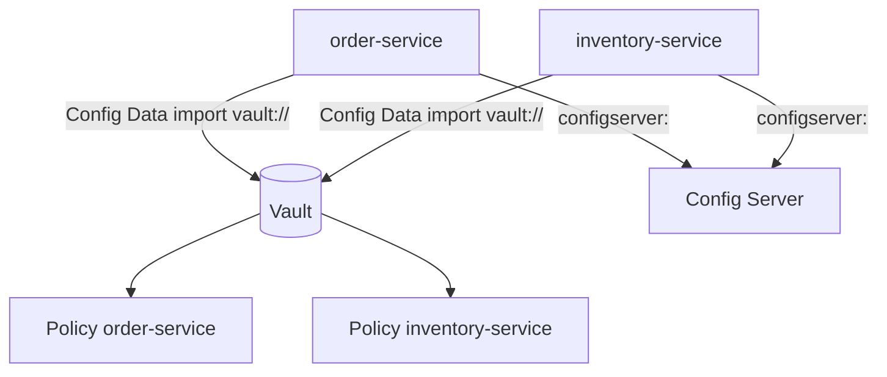
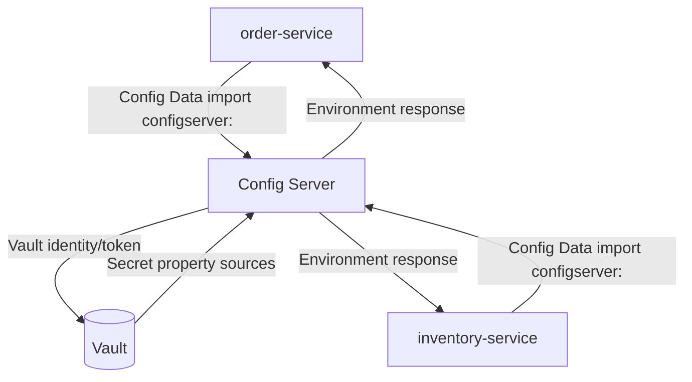

# Phân biệt Spring Cloud Vault trực tiếp với Vault backend của Config Server

Spring Cloud Vault và Spring Cloud Config Server đều có thể đưa secret từ HashiCorp Vault vào Spring `Environment`, nhưng hai cách tích hợp có kiến trúc và ranh giới tin cậy khác nhau. Với **Spring Cloud Vault trực tiếp**, từng ứng dụng Spring Boot kết nối tới Vault và xác thực bằng danh tính của chính ứng dụng. Với **Vault backend của Config Server**, Config Server kết nối tới Vault, đọc secret thay cho các client và phân phối property source qua Config Server API.

Lựa chọn này quyết định ứng dụng nào cần quyền truy cập Vault, credential được cấp ở đâu, ai chịu trách nhiệm refresh secret, cách áp dụng policy theo workload và cách xử lý khi Config Server hoặc Vault không sẵn sàng. Không nên chọn chỉ dựa trên việc cấu hình nào có ít dòng YAML hơn.

## 1. Hai kiến trúc khác nhau

### Spring Cloud Vault trực tiếp

Ứng dụng có `spring-cloud-starter-vault-config`, khai báo `spring.config.import: vault://` và tự kết nối tới Vault. Vault xác thực danh tính của workload, áp dụng policy cho ứng dụng đó rồi trả secret. Config Server có thể vẫn được dùng cho cấu hình thông thường từ Git, nhưng luồng lấy secret đi trực tiếp từ ứng dụng tới Vault.



Mỗi ứng dụng cần network access tới Vault và một cơ chế xác thực phù hợp, ví dụ Kubernetes Auth, AppRole hoặc cloud IAM. Vault có thể cấp policy chỉ cho path secret mà ứng dụng đó cần đọc.

### Vault backend của Config Server

Config Server có `VaultEnvironmentRepository` và kết nối tới Vault. Config Client chỉ cần gọi Config Server để lấy Environment; client không cần trực tiếp kết nối Vault cho luồng này.



Trong mô hình này, Config Server giữ trách nhiệm xác thực và đọc secret từ Vault. Các client tin cậy Config Server như một nguồn phân phối cấu hình. Quyền đọc Vault tập trung ở server, vì vậy phải kiểm soát cẩn thận ứng dụng nào được phép yêu cầu cấu hình nào.

## 2. So sánh nhanh

| Tiêu chí | Spring Cloud Vault trực tiếp | Vault backend của Config Server |
|---|---|---|
| Thành phần kết nối Vault | Từng ứng dụng | Config Server |
| Dependency chính | `spring-cloud-starter-vault-config` | `spring-cloud-config-server` với Vault backend |
| Khai báo nguồn | `spring.config.import: vault://` | Client dùng `configserver:`; server cấu hình `spring.cloud.config.server.vault.*` |
| Danh tính Vault | Mỗi workload có identity/policy riêng | Identity của Config Server hoặc token được chuyển tiếp theo request |
| Network | Mỗi ứng dụng cần kết nối Vault | Config Server cần kết nối Vault; client chỉ cần Config Server |
| Ranh giới quyền | Có thể cấp policy rất cụ thể theo ứng dụng | Cần kiểm soát quyền ở Config Server và phạm vi token server |
| Secret backend | KV và các backend được Spring Cloud Vault hỗ trợ khi thêm module | Vault Environment Repository chủ yếu cung cấp property source từ KV |
| Lease/dynamic secret | Có tích hợp lifecycle cho các secret backend được hỗ trợ; cần xử lý vòng đời credential ở ứng dụng | Không nên mặc định có cùng lifecycle/rotation behavior như Spring Cloud Vault trực tiếp |
| Profile | Được dùng để chọn context path trong Vault | Được dùng để chọn các Vault path tương ứng |
| Label | Không phải Git label; dùng Vault context/path và versioning của Vault | Mặc định không dùng label; có thể bật `enable-label` để đưa label vào path |
| Điểm tập trung | Vault policy và auth được phân tán theo workload | Config Server trở thành điểm trung gian và điểm cần bảo vệ cao |

## 3. Spring Cloud Vault trực tiếp với Config Data API

Với Spring Boot Config Data, ứng dụng khai báo Vault như một nguồn cấu hình import. Dependency thường dùng là:

```xml
<dependency>
    <groupId>org.springframework.cloud</groupId>
    <artifactId>spring-cloud-starter-vault-config</artifactId>
</dependency>
```

Ví dụ `application.yml`:

```yaml
spring:
  application:
    name: order-service
  config:
    import: "vault://"
  cloud:
    vault:
      uri: https://vault.internal:8200
      authentication: KUBERNETES
      kubernetes:
        role: order-service
      kv:
        enabled: true
        backend: secret
        backend-version: 2
        default-context: application
```

Trong ví dụ này, ứng dụng có tên `order-service`, dùng Kubernetes Auth với role tương ứng và đọc KV v2 từ mount `secret`. Token đăng nhập được tạo từ danh tính Kubernetes theo cấu hình Vault; không cần đặt root token trong file cấu hình.

`spring.config.import: vault://` là vị trí mặc định. Có thể dùng contextual location để chỉ rõ path:

```yaml
spring:
  config:
    import: "vault:///team/commerce/order-service"
```

Một contextual location được mount thành property source riêng. Có thể kết hợp nhiều location hoặc kết hợp Vault với Config Server, miễn là thứ tự property source và quy tắc xử lý khi nguồn không sẵn sàng được thiết kế rõ ràng.

### Path KV và profile

Với cấu hình mặc định, Spring Cloud Vault dùng application name và profile để tính các context path. Với KV mount tên `secret`, các path thường có dạng:

```text
secret/order-service
secret/order-service/production
secret/application
secret/application/production
```

Path profile-specific có thể ghi đè giá trị từ path chung theo thứ tự property source của Spring Cloud Vault. Tên context mặc định, application name, profile và profile separator có thể cấu hình qua `spring.cloud.vault.kv.*`.

Ví dụ secret KV:

```bash
vault kv put secret/application platform.region=ap-southeast-1
vault kv put secret/order-service checkout.timeout=2s
vault kv put secret/order-service/production checkout.timeout=5s
```

Đây là ví dụ lệnh CLI; policy của Vault phải giới hạn ứng dụng vào đúng path được phép. Không cấp quyền đọc toàn bộ `secret/*` chỉ để ứng dụng khởi động thuận tiện.

### KV v1 và KV v2

Spring Cloud Vault hiện hỗ trợ KV v1 và KV v2. Thuộc tính `spring.cloud.vault.kv.backend-version` xác định phiên bản mount. Config Data API có thể tự xây dựng request path phù hợp với API của backend đã cấu hình.

KV v2 có versioning cho dữ liệu secret và API path khác KV v1; API KV v2 thêm đoạn `data/` sau mount path. Không tự ghép `data/` vào context path khi thư viện đã xử lý phiên bản backend. Hãy xác minh mount thực tế và khai báo đúng `backend-version`.

## 4. Vault backend trong Spring Cloud Config Server

Ở mô hình này, Config Server dùng Vault như một `EnvironmentRepository`. Có thể bật Vault backend bằng profile `vault` hoặc khai báo Vault trong composite repository tùy kiến trúc.

Ví dụ dependency phía Config Server:

```xml
<dependency>
    <groupId>org.springframework.cloud</groupId>
    <artifactId>spring-cloud-config-server</artifactId>
</dependency>
```

Với cơ chế xác thực ngoài token đơn giản hoặc `X-Config-Token`, Config Server cần Spring Vault Core để ủy quyền xác thực cho Spring Vault:

```xml
<dependency>
    <groupId>org.springframework.vault</groupId>
    <artifactId>spring-vault-core</artifactId>
</dependency>
```

Ví dụ cấu hình Config Server dùng token được cấp từ môi trường triển khai:

```yaml
spring:
  profiles:
    active: vault
  cloud:
    config:
      server:
        vault:
          host: vault.internal
          port: 8200
          scheme: https
          backend: secret
          default-key: application
          profile-separator: ','
          kv-version: 2
          authentication: TOKEN
          token: ${VAULT_TOKEN}
          skip-ssl-validation: false
```

Config Server có các giá trị mặc định như host `127.0.0.1`, port `8200`, scheme `http`, backend `secret`, default key `application`, `kv-version` là `1`, và label bị tắt mặc định. Trong production nên khai báo rõ host, HTTPS, backend và KV version thay vì dựa vào mặc định.

Token phải được cấp từ secret manager hoặc injection an toàn của môi trường. Không commit `VAULT_TOKEN`, không dùng root token và không ghi token vào log. Nếu dùng AppRole, Kubernetes Auth hoặc phương thức khác, cấu hình `spring.cloud.config.server.vault.authentication` cùng các thuộc tính Spring Vault tương ứng và thêm Spring Vault Core theo yêu cầu phiên bản.

## 5. Config Client gọi Config Server khi Vault là backend

Config Client không cần `spring-cloud-starter-vault-config` nếu chỉ lấy secret thông qua Config Server Vault backend. Client dùng Config Client như bình thường:

```xml
<dependency>
    <groupId>org.springframework.cloud</groupId>
    <artifactId>spring-cloud-starter-config</artifactId>
</dependency>
```

Ví dụ `application.yml` phía client:

```yaml
spring:
  application:
    name: order-service
  profiles:
    active: production
  config:
    import: "configserver:https://config.internal"
```

Client yêu cầu Config Server theo application, profile và label. Ví dụ:

```text
GET /order-service/production
```

Config Server dùng các thông tin đó để tìm Vault context và trả property source trong Environment response. Client không cần biết mount path, KV version hay token Vault của server.

### Token truyền từ client bằng `X-Config-Token`

Vault backend của Config Server hỗ trợ cách client gửi Vault token qua header `X-Config-Token`. Config Server dùng token đó để đọc Vault trong request tương ứng. Cách này có thể giúp mỗi client dùng token/policy riêng, nhưng token phải đi qua Config Server.

Nếu dùng cách này, cần bảo đảm:

- Client chỉ gửi token có policy tối thiểu cho đúng path.
- TLS được bật từ client tới Config Server.
- Reverse proxy, tracing, access log và APM không ghi header `X-Config-Token`.
- Config Server không lưu hoặc phát tán token sang log, event hay response.
- Token có TTL và cơ chế thu hồi phù hợp.

Không dùng một Vault token rộng quyền cho tất cả client. Trong nhiều tổ chức, cách dễ vận hành hơn là Config Server xác thực bằng workload identity của chính nó, nhưng khi đó cần giới hạn quyền đọc và kiểm soát ứng dụng được phép truy cập Config Server.

## 6. Đường dẫn Vault, default context và thứ tự ưu tiên

Vault backend của Config Server có thể cung cấp nhiều property source theo application và profile. Ví dụ với backend `secret` và profile separator là dấu phẩy:

```text
secret/order-service,production
secret/order-service
secret/application,production
secret/application
```

Các path cụ thể được xây dựng từ application name, profile, default key và profile separator. Nguồn chuyên biệt cho ứng dụng/profile có ưu tiên cao hơn nguồn chung. Ví dụ `secret/order-service,production` có thể ghi đè cùng key trong `secret/application`.

Đối với Spring Cloud Vault trực tiếp, quy ước context path mặc định thường là `secret/{application}` và `secret/{application}/{profile}`, cùng default context. Dù hai mô hình đều hỗ trợ application/profile, đừng giả định path convention hoàn toàn giống nhau: direct integration dùng các thuộc tính `spring.cloud.vault.kv.*`, còn Config Server backend dùng `spring.cloud.config.server.vault.*` và `profile-separator` riêng.

Đặt tên path nhất quán, tránh lặp cùng key ở nhiều context nếu không cần. Nếu nhiều nguồn có cùng key, ghi lại nguồn nào có thẩm quyền và kiểm tra property source order qua response Environment.

## 7. Label không có cùng ý nghĩa trong hai mô hình

Với Git backend, label thường là branch, tag hoặc commit. Vault không phải Git repository, do đó label không tự nhiên tương đương một Git reference.

Đối với Config Server Vault backend:

- `enable-label` mặc định là `false`; khi đó Vault backend không dùng label để tìm secret.
- Có thể bật `enable-label: true` để đưa label thành một đoạn trong Vault path.
- Nếu bật label, cần lưu đủ các segment application, profile và label cho từng context.
- `default-label` mặc định là `main` khi label được bật và không khai báo giá trị khác.

Ví dụ khi bật label, các path có thể theo quy ước:

```text
secret/order-service,production,release-2026-11
secret/order-service,default,release-2026-11
secret/application,production,release-2026-11
secret/application,default,release-2026-11
```

Đây là cách ánh xạ label thành path, không phải Git checkout. Vault KV v2 có version history riêng cho secret data; version của KV v2 và label của Config Server là hai khái niệm khác nhau. Cần quyết định rõ quy ước phát hành, rollback và cách lưu path nếu muốn dùng label.

Với Spring Cloud Vault trực tiếp, ứng dụng thường chọn context path và profile; không có Git label trong `vault://`. Nếu cần pin phiên bản, phải thiết kế dựa trên tính năng versioning của Vault KV hoặc một path/version convention cụ thể.

## 8. KV v1/v2 có mặc định khác nhau

Một điểm dễ gây lỗi khi chuyển giữa hai mô hình là mặc định KV version không giống nhau:

| Tích hợp | Thuộc tính | Mặc định theo tài liệu hiện hành |
|---|---|---|
| Spring Cloud Vault trực tiếp | `spring.cloud.vault.kv.backend-version` | `2` |
| Config Server Vault backend | `spring.cloud.config.server.vault.kv-version` | `1` |

Vì vậy, cùng một mount `secret` có thể hoạt động với direct Spring Cloud Vault nhưng Config Server lại gọi sai API nếu không khai báo `kv-version: 2`. Hãy xác minh mount trong Vault trước khi cấu hình.

KV v1 lưu key-value không có version history theo cơ chế KV v2. KV v2 có versioning, soft delete và metadata; đường dẫn API cần đoạn `data/` cho thao tác đọc/ghi secret. Client library xử lý chi tiết API khi `backend-version`/`kv-version` được đặt đúng.

## 9. Dynamic secrets và lease lifecycle

Vault không chỉ lưu secret tĩnh trong KV. Vault còn có các secrets engine tạo credential động, chẳng hạn username/password database có TTL và lease.

Spring Cloud Vault trực tiếp có tích hợp thêm các backend khi cài module phù hợp, ví dụ `spring-cloud-vault-config-databases`. Spring Cloud Vault quản lý lease lifecycle cho các secret được hỗ trợ: renew lease trước khi hết hạn và xử lý revoke khi ứng dụng shutdown theo cấu hình. Tuy nhiên, việc lấy được credential mới không đồng nghĩa mọi connection pool đã tự động thay thế credential đang dùng. Cần thiết kế cách cập nhật DataSource/client, kiểm thử thời điểm lease hết hạn và có phương án restart/rotation an toàn.

Ví dụ bật database backend cho ứng dụng:

```yaml
spring:
  cloud:
    vault:
      database:
        enabled: true
        role: order-service-readonly
        backend: database
        username-property: spring.datasource.username
        password-property: spring.datasource.password
```

Với cách này, Vault có thể tạo credential theo role và Spring Cloud Vault đưa username/password vào property names được cấu hình. Cần thêm dependency database backend tương ứng và cấp policy cho đúng role/path.

Vault backend của Config Server chủ yếu được dùng như EnvironmentRepository để đọc KV property sources. Không nên mặc định nó cung cấp cùng các bean, lease renewal, secret rotation lifecycle và tích hợp DataSource như Spring Cloud Vault trực tiếp. Nếu yêu cầu là dynamic database credentials theo từng workload, direct integration thường phù hợp hơn; nếu vẫn muốn đi qua Config Server, cần xác minh cụ thể tính năng và tự thiết kế phần lifecycle còn thiếu.

## 10. Composite Git + Vault

Hai mô hình không nhất thiết loại trừ nhau ở cấp toàn hệ thống. Config Server có thể ghép Git với Vault: Git chứa cấu hình không nhạy cảm, Vault chứa secret. Config Client vẫn gọi một endpoint Config Server.

Ví dụ khái niệm:

```yaml
spring:
  profiles:
    active: composite
  cloud:
    config:
      server:
        composite:
          - type: git
            uri: https://git.example.internal/platform/config-repo.git
          - type: vault
            host: vault.internal
            port: 8200
            scheme: https
            backend: secret
            default-key: application
            kv-version: 2
            authentication: TOKEN
            token: ${VAULT_TOKEN}
```

Đây là ví dụ định hướng; cấu trúc composite và thứ tự property source cần khớp phiên bản Spring Cloud Config đang dùng. Nếu Git và Vault cùng khai báo một key, nguồn ưu tiên cao hơn theo thứ tự composite sẽ quyết định giá trị. Tránh khai báo trùng secret ở Git và Vault.

Với composite, `full-key-path` có thể cần bật cho Vault backend khi nhiều Vault repository có cùng key name để tránh trùng tên property source. Hãy kiểm tra response và thứ tự nguồn thực tế.

Mô hình composite làm Config Server trở thành điểm trung gian cho cả Git và Vault. Vì vậy, quyền truy cập Config Server phải đủ chặt để client không thể yêu cầu secret ngoài phạm vi của mình.

## 11. Bảo mật theo từng kiến trúc

### Khi ứng dụng kết nối Vault trực tiếp

- Mỗi workload có identity riêng, ví dụ Kubernetes ServiceAccount/role riêng hoặc AppRole riêng.
- Policy chỉ cho phép đọc path của ứng dụng và môi trường đó.
- Không cấp root token hoặc policy `read` toàn bộ mount.
- Dùng TLS và xác minh certificate Vault.
- Ưu tiên workload identity ngắn hạn thay cho static token dài hạn.
- Giám sát audit log Vault theo entity, role và path.
- Không ghi secret vào log hoặc expose qua Actuator `env`/`configprops`.

Ưu điểm là Vault có thể phân biệt rõ workload nào đọc secret nào. Đổi lại, mỗi ứng dụng cần được cấp quyền, network và cấu hình authentication tới Vault.

### Khi Config Server kết nối Vault

- Dùng một identity riêng cho Config Server, với policy hẹp nhất có thể.
- Bảo vệ Config Server bằng TLS, authentication và authorization theo application/profile.
- Không để client tùy ý yêu cầu application name khác để đọc secret của dịch vụ khác.
- Nếu dùng `X-Config-Token`, bảo vệ header như credential và không log nó.
- Không dùng root token hoặc token có quyền đọc toàn bộ Vault mount.
- Tách Config Server hoặc backend theo trust boundary nếu nhóm ứng dụng có quyền khác nhau.
- Audit cả request client tới Config Server và request Config Server tới Vault.

Điểm rủi ro của mô hình tập trung là Config Server có thể có quyền đọc nhiều secret hơn một ứng dụng đơn lẻ. Nếu endpoint không giới hạn client theo application/profile, một client có thể tìm cách yêu cầu cấu hình của ứng dụng khác. Tên application trong URL không phải cơ chế authorization.

## 12. Khả năng sẵn sàng và xử lý lỗi

| Tình huống | Vault trực tiếp | Vault backend Config Server |
|---|---|---|
| Vault không sẵn sàng lúc khởi động | Mỗi client bị ảnh hưởng nếu Vault là import bắt buộc; optional/fail-fast policy quyết định startup | Config Server không lấy được Vault property source; client nhận lỗi từ Config Server tùy fail-fast và backend behavior |
| Một ứng dụng mất quyền | Chỉ ứng dụng đó có thể bị ảnh hưởng nếu identity/policy tách riêng | Có thể ảnh hưởng request của ứng dụng đó; nếu server dùng identity chung, cần authorization ở lớp Config Server |
| Credential Vault hết hạn | Spring Cloud Vault quản lý token/lease theo cấu hình hỗ trợ | Config Server phải quản lý token/identity và renew/re-auth theo phương thức cấu hình |
| Config Server không sẵn sàng | Luồng Vault trực tiếp vẫn có thể hoạt động nếu client không phụ thuộc Config Server cho secret | Client không lấy được secret qua Config Server |
| Cần dynamic secret | Có backend integration và lease lifecycle ở client | Cần xác minh tính năng backend; không mặc định có cùng lifecycle |
| Nhiều replica | Mỗi workload cần identity và network tương ứng | Tất cả Config Server replica cần cấu hình auth, policy và kết nối Vault nhất quán |

Nên xác định startup policy rõ ràng. Secret bắt buộc không nên được đánh dấu optional nếu ứng dụng không thể hoạt động an toàn khi thiếu secret. Với secret tùy chọn, phải có fallback được thiết kế và kiểm tra trước khi nhận traffic.

## 13. Khi nào nên chọn mô hình nào?

Chọn **Spring Cloud Vault trực tiếp** khi:

- Cần policy và identity riêng theo từng workload.
- Ứng dụng cần dùng nhiều Vault secret engines, dynamic credentials hoặc lease lifecycle.
- Mạng và hạ tầng cho phép từng ứng dụng kết nối Vault.
- Muốn giảm phạm vi quyền tập trung ở Config Server.
- Nhóm nền tảng có thể quản lý auth/policy cho từng ứng dụng.

Chọn **Vault backend của Config Server** khi:

- Tổ chức muốn client chỉ giao tiếp với Config Server.
- Đã có quy trình authorization chặt chẽ theo application/profile tại Config Server.
- Muốn ghép cấu hình Git và Vault qua một Environment API.
- Có thể quản lý an toàn identity của Config Server và phạm vi secret nó được đọc.
- Secret chủ yếu là KV property source và không cần client-side lease lifecycle phức tạp.

Chọn **mô hình kết hợp** khi:

- Cấu hình thông thường nằm trong Git/Config Server.
- Các secret tĩnh hoặc nhóm secret được kiểm soát tập trung đi qua Vault backend.
- Một số workload cần dynamic credentials hoặc lease rotation riêng thì dùng Spring Cloud Vault trực tiếp.

Không nên dùng hai cơ chế cùng ghi một key nếu chưa xác định thứ tự ưu tiên. Ví dụ Config Server trả `spring.datasource.password` từ Vault, còn direct Vault cũng ghi cùng key; kết quả cuối phụ thuộc thứ tự property source import và có thể khác theo profile. Hãy chọn một nguồn có thẩm quyền cho mỗi secret.

## 14. Checklist triển khai

- [ ] Đã xác định ứng dụng kết nối Vault trực tiếp hay chỉ qua Config Server.
- [ ] Đã chọn đúng dependency cho vai trò: `spring-cloud-starter-vault-config` hoặc Config Server Vault backend.
- [ ] Đã xác định KV mount và version; khai báo rõ v1/v2.
- [ ] Đã xác định path convention cho application, default context và profile.
- [ ] Đã xác định label có được dùng trong Config Server Vault backend hay không.
- [ ] Đã tạo identity/role và policy tối thiểu cho từng workload hoặc Config Server.
- [ ] Đã dùng TLS và xác minh certificate; không bật skip SSL validation trong production.
- [ ] Không lưu token, AppRole secret hoặc root credential trong Git.
- [ ] Nếu dùng `X-Config-Token`, đã bảo vệ header khỏi log/tracing/proxy.
- [ ] Config Server authorization không cho phép client đọc secret của application khác.
- [ ] Đã kiểm thử fallback, fail-fast, Vault unavailable và token/lease expiry.
- [ ] Nếu dùng dynamic secrets, đã thiết kế cách cập nhật connection pool/client khi credential đổi.
- [ ] Đã kiểm tra property source order và tránh trùng key giữa Git/Vault.
- [ ] Đã kiểm tra audit log và khả năng thu hồi credential.

## 15. Mục tiêu cần đạt sau bài học

Sau bài này, người học cần có khả năng:

- Giải thích được khác biệt kiến trúc giữa Spring Cloud Vault trực tiếp và Vault backend của Config Server.
- Cấu hình `spring.config.import: vault://` và xác định application/profile context path.
- Cấu hình Config Server Vault backend bằng `spring.cloud.config.server.vault.*`.
- Phân biệt nơi xác thực Vault và nơi giữ credential trong từng mô hình.
- Giải thích KV v1/v2 và vì sao mặc định version giữa hai integration khác nhau.
- Phân biệt Git label với label được ánh xạ thành Vault path và version history của KV v2.
- Phân tích lợi ích của per-workload policy so với identity tập trung ở Config Server.
- Nhận diện yêu cầu dynamic secret/lease lifecycle và giới hạn của mỗi mô hình.
- Chọn direct, Config Server backend hoặc composite theo ranh giới bảo mật và vận hành.

**Tự kiểm tra:** `order-service` cần credential database động theo role riêng, còn mười dịch vụ khác chỉ cần secret KV tĩnh. Hãy đề xuất kiến trúc cho hai nhóm, mô tả nơi xác thực Vault, policy/path cần giới hạn, dependency và cách xử lý lease/connection pool. Nếu dùng Vault backend của Config Server cho cả mười một dịch vụ, rủi ro nào xuất hiện khi Config Server dùng một token có quyền đọc tất cả secret?

## Tài liệu tham khảo

- [Spring Cloud Vault — Config Data API](https://docs.spring.io/spring-cloud-vault/reference/config-data.html)
- [Spring Cloud Vault — Secret Backends](https://docs.spring.io/spring-cloud-vault/reference/secret-backends.html)
- [Spring Cloud Vault — Quick Start and Authentication](https://docs.spring.io/spring-cloud-vault/reference/quickstart.html)
- [Spring Cloud Config — Vault Backend](https://docs.spring.io/spring-cloud-config/reference/server/environment-repository/vault-backend.html)
- [Spring Cloud Vault — Lease Lifecycle Management](https://docs.spring.io/spring-cloud-vault/reference/advanced-topics.html)
