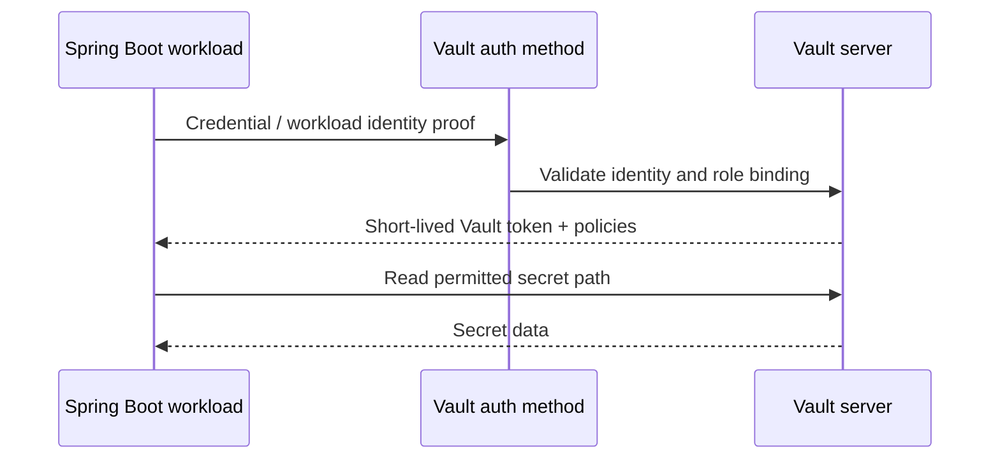

# Xác thực bằng token hoặc danh tính workload phù hợp môi trường

HashiCorp Vault có thể lưu secret và cung cấp chúng cho ứng dụng Spring Boot thông qua Spring Cloud Vault hoặc cho Spring Cloud Config Server thông qua Vault backend. Trước khi đọc secret, thành phần kết nối đến Vault phải chứng minh danh tính của nó bằng một phương thức xác thực. Hai lựa chọn thường gặp là **Vault token** và **workload identity** được cấp từ môi trường chạy như Kubernetes hoặc cloud IAM.

Chọn đúng phương thức xác thực giúp tránh nhúng credential dài hạn vào image hoặc Git, giới hạn quyền đọc theo ứng dụng và môi trường, đồng thời hỗ trợ thu hồi hoặc xoay vòng danh tính khi workload thay đổi. Cần phân biệt danh tính của Config Server khi nó đọc Vault với danh tính của Config Client khi client kết nối trực tiếp đến Vault: đây là hai kết nối và hai quyết định phân quyền riêng.

## 1. Xác thực và phân quyền trong Vault

Vault xác thực caller bằng một auth method. Khi xác thực thành công, Vault phát hành token gắn với policy và thời hạn nhất định. Token đó được dùng để gọi các API đọc secret hoặc thao tác được policy cho phép.

Luồng cơ bản:

1. Workload hoặc người vận hành cung cấp credential/identity proof cho Vault.
2. Vault kiểm tra credential theo auth method đã bật.
3. Vault ánh xạ danh tính vào role và policy tương ứng.
4. Vault phát hành token có TTL và quyền đã được cấp.
5. Ứng dụng dùng token để đọc secret trong phạm vi policy.
6. Token được gia hạn hoặc đăng nhập lại theo vòng đời đã cấu hình.

**Authentication** xác định caller là ai. **Authorization** quyết định caller được đọc path nào, ví dụ secret của `orders-service` trong môi trường `prod`. Một token hợp lệ không có nghĩa token đó được đọc mọi secret trong Vault.



## 2. Chọn token hay workload identity

Hai cách tiếp cận có đặc điểm khác nhau:

| Tiêu chí | Token authentication | Workload identity |
|---|---|---|
| Bằng chứng danh tính | Token Vault được cấp trước hoặc do hệ thống bootstrap cung cấp. | Identity proof từ runtime, ví dụ Kubernetes service account JWT hoặc cloud IAM identity. |
| Credential lưu trữ | Cần bảo vệ token và vòng đời token. | Thường tránh phải nhúng Vault token dài hạn vào image; runtime cung cấp bằng chứng để login. |
| Phù hợp | Phát triển cục bộ, môi trường đơn giản, tích hợp đã có quy trình cấp token an toàn. | Kubernetes, VM hoặc cloud có workload identity/IAM được quản lý. |
| Vận hành | Cần cấp, phân phối, gia hạn và thu hồi token. | Cần cấu hình role binding, trust relationship và quyền của workload. |
| Rủi ro chính | Token bị lộ hoặc có TTL/quyền quá rộng. | Role binding quá rộng hoặc runtime identity bị giả mạo/sử dụng sai. |

Workload identity không tự động an toàn nếu role của Vault cho phép mọi service account hoặc mọi workload trong một namespace đọc cùng một tập secret. Cần ràng buộc identity với đúng namespace, service account, audience, cloud role hoặc thuộc tính workload, rồi gắn policy tối thiểu.

## 3. Token authentication trong Spring Cloud Vault

Token authentication phù hợp khi một hệ thống cấp token Vault cho ứng dụng thông qua secret manager, Vault Agent hoặc quy trình bootstrap được kiểm soát. Với Spring Cloud Vault và Config Data API, cấu hình cơ bản có thể như sau:

```yaml
spring:
  application:
    name: orders-service
  config:
    import: "vault://"
  cloud:
    vault:
      uri: https://vault.internal:8200
      authentication: TOKEN
      token: ${VAULT_TOKEN}
      kv:
        backend: secret
        default-context: application
```

Trong ví dụ:

- `spring.config.import: "vault://"` yêu cầu Spring Cloud Vault nạp cấu hình từ Vault.
- `spring.cloud.vault.uri` chỉ định Vault endpoint.
- `authentication: TOKEN` chọn token auth method.
- `token` nhận token từ biến môi trường được runtime cung cấp.
- `kv.backend` chỉ định mount của KV secrets engine.

Tên property và hành vi cụ thể có thể khác theo phiên bản Spring Cloud Vault. Hãy dùng dependency/release train tương thích với Spring Boot và kiểm tra reference documentation của phiên bản dự án khi cấu hình thêm namespace, auth mount hoặc TLS.

Không đặt token thật trực tiếp trong `application.yml`, source code, Dockerfile, image hoặc tham số dòng lệnh dễ bị lộ qua process listing. Biến môi trường chỉ là một cách truyền giá trị; trong production, nên lấy token từ secret mount hoặc Vault Agent sink được bảo vệ theo chính sách nền tảng.

## 4. Cấp token với quyền tối thiểu

Token dùng cho ứng dụng nên có policy chỉ cho phép đọc các path cần thiết. Không dùng root token cho Config Server hoặc Config Client. Root token dành cho thao tác quản trị khẩn cấp và cần được bảo vệ, kiểm soát sử dụng riêng.

Ví dụ policy cho `orders-service` chỉ đọc secret KV v2 của môi trường production:

```hcl
path "secret/data/orders/prod/*" {
  capabilities = ["read"]
}
```

Nếu ứng dụng cần liệt kê metadata path, có thể cấp quyền metadata thật sự cần thiết ở path tương ứng; không cấp `list` rộng cho toàn bộ mount chỉ vì một thư viện cần truy vấn secret.

Token nên được cấp với:

- Policy gắn đúng application và environment.
- TTL ngắn phù hợp thời gian hoạt động và khả năng renew.
- Quyền renew/self-lookup tối thiểu nếu ứng dụng cần quản lý vòng đời token.
- Không có quyền tạo policy, tạo token tùy ý hoặc đọc secret của ứng dụng khác.
- Audit device được bật để truy vết các lần xác thực và đọc secret.

Vault token có thể là service token hoặc loại token khác tùy kiến trúc. Cần hiểu TTL, renewable, orphaning và accessor theo cách tổ chức đang sử dụng; không giả định mọi token đều tự gia hạn hoặc tồn tại vô thời hạn.

## 5. Vòng đời token, renewal và thu hồi

Token có thời hạn giúp giới hạn tác động nếu credential bị lộ. Ứng dụng hoặc thành phần quản lý token phải xử lý trường hợp token sắp hết hạn, hết hạn hoặc bị thu hồi.

Một vòng đời thường gặp:

1. Nhận token qua quy trình bootstrap an toàn.
2. Sử dụng token để đọc secret được policy cho phép.
3. Renew token nếu token renewable và policy cho phép.
4. Nếu token không thể renew hoặc đã hết hạn, thực hiện login lại qua auth method được cấu hình.
5. Khi workload bị xóa hoặc nghi ngờ bị xâm nhập, thu hồi token/credential và cấp danh tính mới.

Spring Cloud Vault có cơ chế quản lý session/token theo auth method và phiên bản. Nếu tự cung cấp một token tĩnh qua `spring.cloud.vault.token`, cần có quy trình bên ngoài để cập nhật token cho ứng dụng khi token bị thay thế; đổi secret ở hệ thống quản lý bí mật không nhất thiết làm tiến trình đang chạy tự đọc lại giá trị mới.

Vault Agent có thể đảm nhiệm Auto-Auth, renewal và ghi token vào sink được bảo vệ. Mô hình này tách việc đăng nhập khỏi ứng dụng, nhưng cần cấu hình quyền file, quyền truy cập sink và cách ứng dụng nhận token rõ ràng. Không để token sink có quyền đọc rộng cho các tiến trình không liên quan.

## 6. AppRole khi không có workload identity sẵn có

AppRole là phương thức xác thực cho máy hoặc ứng dụng không có identity provider phù hợp. AppRole thường dùng hai thành phần:

- `role_id`: định danh role.
- `secret_id`: credential bí mật chứng minh workload có quyền đăng nhập bằng role đó.

Ví dụ cấu hình Spring Cloud Vault:

```yaml
spring:
  config:
    import: "vault://"
  cloud:
    vault:
      uri: https://vault.internal:8200
      authentication: APPROLE
      app-role:
        role-id: ${VAULT_ROLE_ID}
        secret-id: ${VAULT_SECRET_ID}
```

`role_id` không nhất thiết là bí mật, nhưng `secret_id` phải được bảo vệ như credential. Nên giới hạn TTL, số lần sử dụng và phạm vi CIDR của SecretID nếu phù hợp; cân nhắc response wrapping để chuyển SecretID một lần qua kênh an toàn.

Không đóng gói `secret_id` trong image hoặc commit vào Git. Nếu dùng AppRole, phải có quy trình cấp, phân phối, thu hồi và xoay vòng SecretID. Với môi trường có Kubernetes hoặc cloud workload identity, nên cân nhắc auth method gắn trực tiếp với danh tính runtime để giảm việc phân phối secret tĩnh.

## 7. Kubernetes workload identity

Trong Kubernetes, Vault có thể xác thực workload bằng JWT của service account. Pod gửi service account token đến Vault; Vault xác minh JWT theo cấu hình Kubernetes auth method và kiểm tra role binding.

Một role nên ràng buộc tối thiểu:

- Tên service account được phép, ví dụ `orders-service`.
- Namespace cụ thể, ví dụ `production`.
- Audience phù hợp với Vault nếu cluster và cấu hình auth sử dụng audience binding.
- Policy chỉ đọc secret của ứng dụng và môi trường tương ứng.
- TTL token hợp lý.

Ví dụ cấu hình role trên Vault:

```bash
vault write auth/kubernetes/role/orders-prod \
  bound_service_account_names=orders-service \
  bound_service_account_namespaces=production \
  policies=orders-prod \
  ttl=1h
```

Đây là lệnh minh họa cho Kubernetes auth mount mặc định có tên `kubernetes`. Nếu auth method được mount ở path khác, cần thay path tương ứng. Vault administrator cũng phải cấu hình Kubernetes auth method để Vault có thể xác minh service account JWT của cluster.

Ví dụ cấu hình client:

```yaml
spring:
  application:
    name: orders-service
  config:
    import: "vault://"
  cloud:
    vault:
      uri: https://vault.internal:8200
      authentication: KUBERNETES
      kubernetes:
        role: orders-prod
```

Spring Cloud Vault thường đọc service account token từ vị trí mặc định trong pod; nếu cluster dùng đường dẫn token riêng, cấu hình thuộc tính token file theo phiên bản thư viện. Không mount một service account token có quyền rộng cho nhiều ứng dụng. Mỗi workload nên có service account riêng, và role Vault phải ràng buộc đúng namespace/service account.

## 8. Danh tính workload trên cloud

Trên cloud, ứng dụng có thể xác thực Vault bằng danh tính do nền tảng quản lý thay vì lưu một Vault token dài hạn trong cấu hình.

| Nền tảng | Cơ chế identity thường dùng | Điều cần ràng buộc |
|---|---|---|
| AWS | IAM auth, workload role hoặc instance profile | IAM role ARN, account, region và điều kiện role binding trong Vault. |
| Azure | Azure auth dựa trên managed identity/service principal | Tenant, subscription, resource và identity được phép. |
| Google Cloud | GCP IAM auth hoặc identity từ workload/compute service account | Project, service account, instance/workload attributes và audience phù hợp. |
| Kubernetes | Kubernetes auth với service account JWT | Namespace, service account name và audience. |

Các auth method cloud cần được bật và cấu hình trên Vault trước. Workload phải có đúng cloud role/managed identity; Vault role cần ánh xạ identity đó vào policy hẹp. Việc chạy trên AWS, Azure hoặc GCP không tự cấp quyền đọc secret nếu Vault chưa tin cậy identity và chưa gắn policy.

Tên authentication mode và các property cụ thể trong Spring Cloud Vault phụ thuộc phiên bản. Hãy kiểm tra enum auth method và cấu hình provider của release train đang dùng; không sao chép cấu hình AWS IAM sang Azure hoặc GCP vì mỗi provider có cách ký request và xác minh identity khác nhau.

## 9. Phân biệt danh tính của Config Server và Config Client

Có hai kiến trúc phổ biến khi kết hợp Vault với Spring Cloud Config:

**Config Server đọc Vault:** Config Server dùng Vault backend để lấy secret rồi trả cấu hình cho client. Trong mô hình này, Config Server là workload cần xác thực với Vault. Config Client xác thực riêng với Config Server bằng HTTP Basic, OAuth2, mTLS hoặc cơ chế phù hợp. Không phải client nào cũng cần credential Vault.

**Config Client đọc Vault trực tiếp:** mỗi ứng dụng tích hợp Spring Cloud Vault và tự xác thực với Vault để lấy secret của chính nó. Trong mô hình này, mỗi client cần workload identity hoặc token riêng và Vault policy riêng.

| Câu hỏi | Config Server đọc Vault | Config Client đọc Vault trực tiếp |
|---|---|---|
| Ai xác thực với Vault? | Config Server. | Từng Config Client. |
| Policy Vault gắn với | Workload Config Server hoặc identity của server. | Identity riêng của từng ứng dụng. |
| Ai kiểm soát quyền đọc theo app? | Config Server cần policy nội bộ để không trả secret sai ứng dụng; Vault có thể chỉ thấy identity chung của server. | Vault có thể áp dụng policy trực tiếp theo workload identity từng client. |
| Credential Vault nằm ở đâu? | Runtime của Config Server hoặc Vault Agent cạnh server. | Runtime của từng client hoặc agent tương ứng. |
| Phù hợp | Muốn tập trung truy cập secret và kiểm soát qua Config Server. | Muốn mỗi workload đọc secret trực tiếp với policy riêng. |

Nếu Config Server dùng một identity Vault chung có quyền đọc mọi secret, cần phân quyền chặt tại Config Server theo application/profile và bảo vệ endpoint. Nếu yêu cầu Vault tự xác minh danh tính riêng của từng workload, direct client access hoặc mô hình token exchange/identity propagation được thiết kế rõ ràng sẽ phù hợp hơn.

## 10. TLS, namespace và auth mount path

Xác thực workload không thay thế việc xác minh Vault server. Kết nối đến Vault production nên dùng HTTPS và truststore/certificate phù hợp:

```yaml
spring:
  cloud:
    vault:
      uri: https://vault.internal:8200
      ssl:
        trust-store: file:/run/secrets/vault-truststore.jks
        trust-store-password: ${VAULT_TRUSTSTORE_PASSWORD}
```

Các thuộc tính TLS chi tiết phụ thuộc phiên bản Spring Cloud Vault và HTTP client. Chỉ tắt xác minh certificate trong môi trường thử nghiệm cô lập; không vô hiệu hóa kiểm tra TLS để né lỗi certificate trong production.

Một số môi trường Vault Enterprise sử dụng namespace. Client phải gửi đúng namespace mà auth mount, role và secret engine được cấu hình. Sai namespace có thể dẫn đến lỗi không tìm thấy auth mount, role hoặc secret path dù token/identity hợp lệ ở namespace khác.

Auth method có thể được mount tại path mặc định như `auth/kubernetes` hoặc path tùy chỉnh. Khi thay đổi mount path, phải cập nhật cấu hình client tương ứng. Cần quản lý riêng ba khái niệm: Vault server URI, namespace và auth mount path; chúng giải quyết các phần khác nhau của quá trình định tuyến và xác thực.

## 11. Gắn policy theo application và environment

Một quy ước path rõ ràng giúp giới hạn quyền đọc. Ví dụ KV v2 mount tên `secret` với dữ liệu:

```text
secret/
├── orders/
│   ├── dev/
│   └── prod/
└── inventory/
    ├── dev/
    └── prod/
```

Policy cho workload orders production:

```hcl
path "secret/data/orders/prod/*" {
  capabilities = ["read"]
}
```

Policy cho orders development:

```hcl
path "secret/data/orders/dev/*" {
  capabilities = ["read"]
}
```

Không gắn cả hai policy vào một identity nếu workload chỉ cần một môi trường. Tương tự, không cấp quyền `secret/data/*` cho mọi service chỉ để đơn giản hóa cấu hình.

Với KV v2, đường dẫn API có segment `data` cho nội dung secret và `metadata` cho metadata/listing. Cấu hình policy phải khớp version của secrets engine. Nếu ứng dụng chỉ đọc một path đã biết, ưu tiên cấp `read` trên đúng data path; chỉ thêm quyền metadata khi thao tác thực tế yêu cầu.

## 12. Fail-fast, optional import và xử lý lỗi xác thực

Với Spring Cloud Vault Config Data, `spring.config.import: "vault://"` yêu cầu lấy cấu hình từ Vault trong quá trình nạp config. Nếu Vault là nguồn bắt buộc, để import không có `optional:` để ứng dụng phát hiện lỗi xác thực hoặc truy cập ngay khi khởi động.

Chỉ dùng:

```yaml
spring:
  config:
    import: "optional:vault://"
```

khi ứng dụng có thể hoạt động an toàn mà không có secret từ Vault. Nếu thiếu secret khiến kết nối database hoặc quyền truy cập bị sai, cho phép khởi động tiếp có thể che giấu lỗi cấu hình và làm dịch vụ hoạt động trong trạng thái không an toàn.

Các lỗi thường gặp:

| Lỗi | Nguyên nhân cần kiểm tra |
|---|---|
| `permission denied` | Token đã xác thực nhưng policy không cho phép đọc path. |
| `invalid token` hoặc `token expired` | Token sai, hết hạn, bị revoke hoặc không được renew. |
| Kubernetes login bị từ chối | Sai role, namespace, service account, JWT hoặc audience. |
| AppRole login thất bại | RoleID/SecretID sai, hết hạn, hết số lần sử dụng hoặc không khớp role. |
| Cloud IAM login thất bại | Workload thiếu IAM role, claim/metadata không khớp hoặc request signing sai. |
| Không tìm thấy secret | Sai Vault namespace, KV mount, KV version hoặc secret path. |
| TLS handshake thất bại | Truststore, CA chain, hostname hoặc certificate chưa đúng. |
| Hoạt động ở một instance nhưng lỗi ở instance khác | Credential, namespace, truststore, auth mount hoặc policy không đồng nhất. |

Phân biệt lỗi xác thực với lỗi phân quyền: lỗi xác thực xảy ra khi Vault không chấp nhận bằng chứng danh tính; lỗi phân quyền thường xuất hiện sau khi đã có token nhưng token không có capability trên path được yêu cầu.

## 13. Quy trình kiểm tra và vận hành

Trước khi đưa một ứng dụng vào production, xác minh theo trình tự:

1. Xác định thành phần nào kết nối trực tiếp tới Vault: Config Server hay từng Config Client.
2. Chọn auth method phù hợp với môi trường: token, AppRole, Kubernetes hoặc cloud IAM.
3. Bật auth method và tạo role trên đúng Vault namespace/mount path.
4. Ràng buộc role với identity cụ thể và gắn policy chỉ đọc application/environment cần thiết.
5. Cấu hình HTTPS, truststore, Vault URI và namespace cho workload.
6. Cấp credential theo cách an toàn; không nhúng token hoặc SecretID vào image/Git.
7. Kiểm tra login, token TTL/renewal và quyền đọc path cần thiết.
8. Kiểm tra client chỉ nhận đúng secret; xác minh log không chứa token hoặc plaintext.
9. Thử thu hồi credential hoặc làm mới workload để xác nhận quy trình recovery hoạt động.
10. Ghi nhận role, policy version, auth method, owner và lịch xoay vòng để audit.

Khi điều tra sự cố, ghi nhận auth method, role, namespace, mount path, workload identity và path bị từ chối. Không đưa token, SecretID, JWT đầy đủ hoặc nội dung secret vào ticket/log hỗ trợ.

## 14. Tổng kết

- Vault xác thực caller qua token hoặc auth method dựa trên workload identity, sau đó cấp token gắn policy và TTL.
- Token authentication đơn giản nhưng cần quy trình phân phối, renew, thu hồi và bảo vệ token.
- Workload identity như Kubernetes service account hoặc cloud IAM giúp giảm credential tĩnh; Vault role vẫn phải ràng buộc identity chính xác.
- Spring Cloud Vault có thể dùng `authentication: TOKEN`, `APPROLE` hoặc `KUBERNETES` theo môi trường và phiên bản.
- Không dùng root token cho ứng dụng; cấp policy chỉ đọc path của đúng application và environment.
- Phân biệt Config Server đọc Vault với Config Client đọc Vault trực tiếp; hai kiến trúc có danh tính và ranh giới phân quyền khác nhau.
- Bảo vệ HTTPS, namespace, auth mount path, secret mount và token renewal; không ghi credential hoặc plaintext vào log.
- Kiểm tra riêng authentication, authorization, TLS và secret path để xác định đúng nguyên nhân khi Vault từ chối request.
