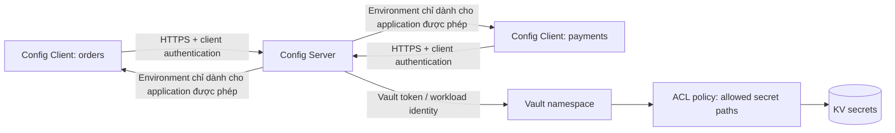

# Policy tối thiểu, namespace và ranh giới truy cập bí mật

Khi Spring Cloud Config Server dùng HashiCorp Vault làm backend, Config Server đọc các giá trị cấu hình và bí mật từ Vault rồi phân phối chúng cho Config Client. Thiết kế này tạo ra một ranh giới bảo mật quan trọng: Vault xác thực danh tính của Config Server và giới hạn những path mà server được đọc; Config Server lại xác thực các client và quyết định ứng dụng nào được phép nhận từng nhóm cấu hình.

Không nên cấp một token Vault có quyền đọc toàn bộ secrets cho Config Server rồi mặc định rằng mọi Config Client chỉ có thể xem dữ liệu của chính nó. Client thường không trực tiếp xác thực với Vault trong mô hình này. Nếu Config Server có quyền rộng, nó có thể trở thành trung gian có khả năng tiết lộ bí mật của nhiều ứng dụng. Cần thiết kế policy, namespace, danh tính runtime và authorization ở cả hai phía.

## 1. Mục tiêu học tập

Sau bài học, bạn có thể:

- Mô tả ranh giới truy cập giữa Config Client, Config Server và Vault.
- Thiết kế Vault ACL policy theo nguyên tắc quyền tối thiểu.
- Phân biệt policy path của KV v1 và KV v2, đặc biệt phần `/data/` và `/metadata/`.
- Tách secret theo application, profile và nhóm môi trường.
- Giải thích namespace của Vault và giới hạn phiên bản hỗ trợ.
- Cấp danh tính cho Config Server bằng token hoặc workload authentication phù hợp.
- Ngăn Config Client đọc nhầm bí mật của ứng dụng khác thông qua Config Server.
- Kiểm toán, xoay vòng token, backup và kiểm tra quyền truy cập an toàn.

## 2. Ranh giới bảo mật của mô hình Config Server – Vault

Trong mô hình phổ biến, Config Server là thành phần duy nhất kết nối đến Vault. Config Client gọi Config Server qua HTTP(S), còn Config Server dùng danh tính riêng để đọc secrets.



Có hai lớp phân quyền riêng:

1. **Vault → Config Server:** Vault kiểm tra danh tính của Config Server và ACL policy để quyết định server được đọc path nào.
2. **Config Server → Config Client:** Config Server xác thực client và giới hạn client được yêu cầu application/profile/label nào.

Vault policy không tự động áp dụng cho từng Config Client nếu client không trực tiếp gọi Vault. Vault nhìn thấy danh tính của Config Server, không nhất thiết nhìn thấy danh tính cuối cùng của ứng dụng đang yêu cầu cấu hình.

Ví dụ, nếu Config Server có token đọc `kv/data/orders/*` và `kv/data/payments/*`, một client không được bảo vệ đúng cách có thể thử yêu cầu `/payments/prod` dù nó là `orders`. Vì vậy, phải bảo vệ API Config Server bằng authentication/authorization và có thể tách Config Server hoặc Vault identity theo ranh giới tin cậy.

## 3. Nguyên tắc quyền tối thiểu trong Vault

Vault ACL policy mặc định từ chối thao tác không được cấp. Policy nên chỉ cấp capability cần thiết cho đúng path và đúng danh tính.

Các capability thường gặp:

| Capability | Ý nghĩa | Dùng cho Config Server đọc secret? |
| --- | --- | --- |
| `read` | Đọc dữ liệu tại path | Có, nếu backend cần lấy giá trị |
| `list` | Liệt kê các path/key con | Chỉ cấp khi luồng thực tế cần liệt kê |
| `create` | Tạo dữ liệu mới | Không cần cho Config Server chỉ đọc |
| `update` | Ghi hoặc cập nhật dữ liệu | Không cần cho Config Server chỉ đọc |
| `delete` | Xóa dữ liệu | Không cần cho Config Server chỉ đọc |
| `sudo` | Cho phép một số thao tác đặc quyền | Không cấp cho Config Server runtime thông thường |

Một policy read-only thường không cần `create`, `update`, `delete` hoặc `sudo`. Cũng không nên cấp `list` trên toàn bộ mount nếu server chỉ cần đọc các path đã biết. `list` có thể tiết lộ tên secret và cấu trúc ứng dụng ngay cả khi giá trị không được đọc.

Hãy tách danh tính theo nhiệm vụ:

- Config Server runtime: đọc đúng path cần phân phối.
- Pipeline cập nhật secret: ghi đúng path cần quản lý.
- Người vận hành Vault: quản trị auth method, policy, namespace và secret engine theo vai trò được phê duyệt.
- Quy trình backup/restore: quyền riêng, không dùng token runtime của Config Server.

Không sử dụng root token trong ứng dụng, container, CI/CD hoặc file cấu hình. Root token dành cho thao tác bootstrap/quản trị đặc biệt và cần được bảo vệ theo quy trình Vault.

## 4. Hiểu path của KV v1 và KV v2

Trước khi viết policy, cần biết secret engine đang dùng KV version nào. Cùng một secret có thể có đường dẫn API khác nhau giữa KV v1 và KV v2.

Giả sử mount path là `kv` và secret logic là `orders/prod`.

| Nội dung | KV v1 | KV v2 |
| --- | --- | --- |
| Đường dẫn dữ liệu trong ACL/API | `kv/orders/prod` | `kv/data/orders/prod` |
| Đường dẫn metadata | Không có lớp metadata KV v2 | `kv/metadata/orders/prod` |
| Đọc giá trị | `read` trên path secret | `read` trên path có `/data/` |
| Liệt kê secret | `list` trên path phù hợp | `list` trên path `/metadata/` |
| Versioning dữ liệu | Không có version history KV v2 | Có version, soft delete và metadata theo cấu hình |

Lệnh CLI `vault kv get -mount=kv orders/prod` che giấu phần `/data/` của API KV v2. Khi viết ACL policy, phải dùng API path đúng, không sao chép máy móc path hiển thị trong lệnh CLI.

Ví dụ policy KV v2:

```hcl
path "kv/data/orders/prod" {
  capabilities = ["read"]
}
```

Policy này chỉ cho phép đọc secret `orders/prod` trên mount `kv`. Nó không cho phép đọc `payments/prod`, cũng không cho phép tạo, sửa hoặc xóa secret.

Với KV v1, path tương ứng sẽ là:

```hcl
path "kv/orders/prod" {
  capabilities = ["read"]
}
```

Trước khi áp dụng policy, xác nhận mount path, KV version và cách Spring Cloud Config tạo path từ application/profile. Không giả định `secret` là mount name trong mọi môi trường.

## 5. Thiết kế path theo application và profile

Một cách tổ chức dễ quản trị là tách cấu hình chung, cấu hình riêng ứng dụng và cấu hình theo môi trường.

Ví dụ mount KV v2 tên `kv`:

```text
kv/
├── application
├── orders/
│   ├── default
│   ├── dev
│   └── prod
└── payments/
    ├── default
    ├── dev
    └── prod
```

Ý nghĩa:

- `application`: các thuộc tính dùng chung nếu nhóm có chủ đích chia sẻ.
- `orders/default`: secret nền cho `orders`.
- `orders/prod`: secret riêng của `orders` trong production.
- `payments/prod`: secret riêng của `payments` trong production.

Spring Cloud Config Vault backend có các thuộc tính như `backend`, `default-key`, `profile-separator` và `kv-version` để điều khiển mount, khóa mặc định, cách ghép profile và phiên bản KV. Ví dụ:

```yaml
spring:
  cloud:
    config:
      server:
        vault:
          host: vault.example.internal
          port: 8200
          scheme: https
          backend: kv
          kv-version: 2
          default-key: application
          profile-separator: /
```

Đây là cấu hình minh họa. Đường dẫn thực tế mà Config Server truy vấn phụ thuộc phiên bản Spring Cloud Config và cách đặt `profile-separator`. Hãy kiểm tra endpoint và log backend trong môi trường thử nghiệm trước khi tạo policy production.

Không dùng một path chung như `kv/data/shared/*` cho tất cả bí mật chỉ vì nhiều service cần một vài thuộc tính giống nhau. Nếu thật sự cần secret dùng chung, xác định chủ sở hữu, danh sách consumer và quyền đọc riêng; nếu chỉ cần cấu hình không nhạy cảm, cân nhắc để trong Git.

## 6. Ví dụ ACL policy cho một application

Giả sử Config Server chỉ phục vụ ứng dụng `orders` và cần đọc:

- Secret nền `application`.
- Secret nền của `orders`.
- Secret theo profile `orders/prod`.

Với KV v2 mount `kv`, policy có thể là:

```hcl
path "kv/data/application" {
  capabilities = ["read"]
}

path "kv/data/orders/default" {
  capabilities = ["read"]
}

path "kv/data/orders/prod" {
  capabilities = ["read"]
}
```

Policy này không cấp quyền đọc `kv/data/payments/prod`. Nếu backend thực tế đọc path với cấu trúc khác, hãy điều chỉnh đúng theo request đã quan sát. Không mở rộng thành:

```hcl
path "kv/data/*" {
  capabilities = ["read"]
}
```

trừ khi có một lý do được phê duyệt và ranh giới tin cậy thực sự yêu cầu quyền đọc toàn mount. Wildcard rộng làm tăng hậu quả khi Config Server bị xâm nhập hoặc authorization ở tầng Config Server cấu hình sai.

Nếu backend cần liệt kê secret, chỉ cấp `list` trên metadata path cụ thể cần thiết của KV v2. Ví dụ:

```hcl
path "kv/metadata/orders/*" {
  capabilities = ["list"]
}
```

Chỉ thêm rule này sau khi xác nhận backend hoặc thao tác quản trị thực sự cần list. Không cấp `list` rộng trên `kv/metadata/*` theo thói quen.

## 7. Policy dùng chung cho nhiều application: cân nhắc ranh giới

Một Config Server phục vụ nhiều ứng dụng có thể cần đọc nhiều path. Có thể tạo một policy với danh sách path cụ thể:

```hcl
path "kv/data/application" {
  capabilities = ["read"]
}

path "kv/data/orders/*" {
  capabilities = ["read"]
}

path "kv/data/payments/*" {
  capabilities = ["read"]
}
```

Policy này giới hạn ở một số nhánh application nhưng vẫn cho token của Config Server đọc bí mật của cả `orders` và `payments`. Nó chỉ phù hợp nếu Config Server được tin cậy như một broker bí mật chung và API Config Server có authorization đủ chặt.

Nếu cần ranh giới mạnh hơn, cân nhắc:

- Một Config Server instance hoặc deployment cho từng nhóm ứng dụng có mức độ tin cậy khác nhau.
- Một Vault identity/policy riêng cho từng Config Server deployment.
- Namespace riêng cho từng tenant hoặc domain nếu Vault Enterprise được sử dụng.
- Không phân phối secret qua Config Server nếu ứng dụng có thể lấy trực tiếp từ Vault bằng workload identity riêng và kiến trúc cho phép.

Không nên coi `spring.application.name` trong request là bằng chứng danh tính. Client có thể sửa URL request nếu Config Server không xác thực và giới hạn application mà client được phép yêu cầu.

## 8. Namespace trong Vault là gì?

Vault Enterprise hỗ trợ namespace để tạo các ranh giới quản trị và dữ liệu logic. Mỗi namespace có thể có auth methods, policies, secret engines, entities và cấu hình riêng. Namespace giúp nhiều nhóm hoặc tenant dùng chung một Vault cluster mà vẫn phân tách không gian quản lý.

Ví dụ cấu trúc:

```text
root
├── platform
│   ├── orders
│   │   └── kv (secret engine)
│   └── payments
│       └── kv (secret engine)
└── shared-services
    └── kv (secret engine)
```

Namespace `platform/orders` có thể có mount `kv` và policy riêng; namespace `platform/payments` cũng có thể có mount tên `kv` nhưng dữ liệu và policy được quản lý trong namespace khác.

Namespace không chỉ là một tiền tố thư mục. Nó là context quản trị và truy cập của Vault. Cùng một mount path như `kv` trong hai namespace khác nhau không có nghĩa là cùng một secret engine hoặc cùng dữ liệu.

Namespace là tính năng của Vault Enterprise và các dịch vụ Vault hỗ trợ namespace; không phải mọi bản Vault OSS đều có khả năng này. Nếu nền tảng không hỗ trợ namespace, cần dùng mount path, policy, auth method và có thể tách cluster để tạo ranh giới phù hợp.

## 9. Gắn Config Server vào đúng namespace

Khi Config Server truy cập Vault Enterprise namespace, request cần được gửi trong namespace phù hợp. Vault dùng header `X-Vault-Namespace` để chọn namespace. Spring Cloud Config Vault backend có thuộc tính namespace trong các phiên bản hỗ trợ; tên và cách cấu hình phải kiểm tra theo reference documentation của release đang dùng.

Ví dụ minh họa:

```yaml
spring:
  cloud:
    config:
      server:
        vault:
          host: vault.example.internal
          port: 8200
          scheme: https
          namespace: platform/orders
          backend: kv
          kv-version: 2
```

Nếu không cấu hình namespace, request có thể đi vào namespace mặc định/root tùy endpoint và cách triển khai. Điều này có thể dẫn đến lỗi `permission denied`, `secret not found` hoặc đọc nhầm vùng dữ liệu nếu policy ở namespace khác nhau.

Nguyên tắc:

- Xác định namespace rõ ràng cho từng Config Server deployment.
- Không nhận namespace tùy ý từ tham số request của Config Client.
- Không dùng một token có quyền xuyên nhiều namespace nếu ứng dụng chỉ cần một namespace.
- Kiểm tra cả namespace và mount path khi điều tra lỗi.
- Ghi namespace trong tài liệu vận hành nhưng không ghi token hoặc secret.

## 10. Namespace không thay thế policy

Namespace tạo ranh giới giữa các miền quản trị. Policy vẫn quyết định danh tính trong namespace được làm gì.

Ví dụ:

- Namespace `platform/orders` có thể chứa secret engine `kv`.
- Policy `orders-config-read` trong namespace đó chỉ cho đọc `kv/data/application` và `kv/data/orders/*`.
- Token của Config Server được cấp policy này.
- Token không được tự động đọc secret trong namespace `platform/payments`.

Không nên đặt mọi service trong một namespace rồi cấp một policy `read` toàn bộ mount nếu các service có mức độ tin cậy khác nhau. Ngược lại, cũng không cần tạo namespace cho mọi khóa nếu các ứng dụng cùng một domain, cùng chủ sở hữu và có chính sách bảo mật giống nhau. Chọn ranh giới theo tenant, nhóm vận hành, môi trường hoặc mức độ nhạy cảm.

## 11. Cấp danh tính cho Config Server

Config Server cần xác thực với Vault để lấy token hoặc credential. Một số cách thường gặp:

| Phương thức | Mô tả | Lưu ý vận hành |
| --- | --- | --- |
| Token | Config Server nhận Vault token được cấp sẵn | Token cần policy hẹp, TTL/renewal và quy trình thu hồi; tránh token dài hạn có quyền rộng |
| AppRole | Workload xác thực bằng Role ID và Secret ID | Bảo vệ Secret ID, giới hạn response wrapping/TTL và xoay vòng theo chính sách |
| Kubernetes auth | Pod dùng service account token để xác thực với Vault | Ràng buộc role với namespace, service account và audience phù hợp |
| Cloud IAM auth | Workload dùng danh tính máy của cloud provider | Tránh phát hành static credential; giới hạn role theo workload và môi trường |
| Vault Agent auto-auth | Agent lấy/renew token thay workload và cung cấp token theo sink | Bảo vệ sink, quyền file và vòng đời token |

Phương thức thực tế được hỗ trợ phụ thuộc phiên bản Spring Cloud Config, Spring Vault và nền tảng triển khai. Hãy chọn auth method mà release đang dùng hỗ trợ chính thức.

Ví dụ đơn giản cho môi trường phát triển dùng token đã cấp:

```yaml
spring:
  cloud:
    config:
      server:
        vault:
          host: vault.example.internal
          port: 8200
          scheme: https
          authentication: TOKEN
          token: ${CONFIG_SERVER_VAULT_TOKEN}
          backend: kv
          kv-version: 2
```

Token được truyền qua biến môi trường trong ví dụ, không viết trực tiếp vào YAML. Trong production, ưu tiên workload identity hoặc cơ chế cấp token ngắn hạn đã được tổ chức phê duyệt. Không đưa token vào Docker image, command line dễ bị lộ, Git hoặc log.

## 12. Giới hạn quyền của token runtime

Token Config Server chỉ cần capability để đọc các path mà Config Server thực sự phải phục vụ. Không cấp quyền quản trị auth method, tạo policy, mount secret engine hoặc đọc system endpoint nếu ứng dụng không cần.

Ví dụ tạo policy KV v2:

```bash
vault policy write orders-config-read orders-config-read.hcl
```

Sau đó cấp policy cho danh tính workload thông qua auth method đã chọn. Lệnh minh họa chỉ tạo policy; cách gắn policy vào role/token phụ thuộc auth method.

Nên có các giới hạn:

- Token TTL ngắn phù hợp khả năng renew và vận hành.
- Token có thể thu hồi khi Config Server bị xâm nhập.
- Policy không có `write`, `delete`, `sudo` hoặc `root` trừ khi có yêu cầu đặc biệt được phê duyệt.
- Auth role ràng buộc workload identity, namespace và service account đúng.
- Mỗi môi trường có danh tính riêng để giảm ảnh hưởng khi credential bị lộ.
- Theo dõi token renewal, expiry và lỗi xác thực.

Nếu dùng Vault Agent, cần bảo vệ file sink và bảo đảm tiến trình Config Server chỉ đọc được token của chính nó. Không mount một token quản trị dùng chung vào mọi Pod.

## 13. Bảo vệ ranh giới Config Server – Config Client

Đây là điểm quan trọng nhất khi Vault được dùng phía sau Config Server. Vault policy kiểm soát token mà Config Server dùng; nó không tự động lọc response theo danh tính Config Client.

Ví dụ không an toàn:

1. Config Server có token đọc `kv/data/orders/*` và `kv/data/payments/*`.
2. Config Server expose endpoint cấu hình mà không yêu cầu xác thực.
3. Một client có thể gọi `/payments/prod` và nhận secret thanh toán.

Các biện pháp cần có:

- Bật authentication cho Config Server bằng cơ chế phù hợp như OAuth2 resource server, mTLS hoặc cơ chế được nền tảng hỗ trợ.
- Xác định client principal/service identity và ánh xạ nó với danh sách application được phép.
- Không cho client tự chọn tùy ý application/profile/label nếu quyền của nó không cho phép.
- Giới hạn network access đến Config Server; chỉ các workload được phê duyệt mới được gọi.
- Bảo vệ endpoint Actuator, refresh và endpoint chẩn đoán.
- Dùng TLS/mTLS trên kết nối client–server và server–Vault theo yêu cầu bảo mật.
- Không ghi secret trong response log, trace, exception hoặc metric label.

Nếu không thể triển khai authorization theo application trong một Config Server chung, hãy tách Config Server deployment và Vault policy theo ranh giới tin cậy. Đây thường là lựa chọn rõ ràng hơn so với cố gắng suy ra quyền chỉ từ tên application trong URL.

## 14. Secret versioning và vòng đời thay đổi

KV v2 lưu nhiều version của secret theo cấu hình engine. Điều này hỗ trợ xem lại version, soft delete và khôi phục version trong giới hạn retention. Tuy nhiên, versioning không thay thế backup Vault và không tự tạo quy trình review giống Git.

Khi thay secret:

1. Xác định owner và lý do thay đổi.
2. Ghi secret mới qua pipeline hoặc quy trình quản trị được kiểm soát.
3. Kiểm tra policy và ứng dụng nhận secret.
4. Kích hoạt refresh hoặc rollout theo cách ứng dụng hỗ trợ.
5. Xác minh Config Server đọc đúng version và client đã áp dụng.
6. Theo dõi lỗi kết nối, xác thực và nghiệp vụ.
7. Thu hồi secret cũ sau thời gian chuyển tiếp phù hợp.

Không giả định Config Server tự động phát hiện mọi thay đổi Vault ngay tức thì. Cơ chế refresh phụ thuộc backend, thời điểm đọc, cache, client refresh và cách bean sử dụng giá trị. Với secret quan trọng, cần chủ động kích hoạt refresh và xác minh từng instance.

## 15. Audit và giám sát truy cập

Vault audit device ghi lại các request và response metadata phục vụ điều tra. Audit log có thể chứa path, operation, identity và metadata; không nên coi audit log là nơi lưu an toàn cho giá trị secret.

Nên giám sát:

- Danh tính Config Server đăng nhập Vault và token renewal.
- Path được đọc và capability được sử dụng.
- Các lần `permission denied` hoặc truy cập path ngoài policy.
- Thay đổi policy, auth role, namespace và secret engine.
- Secret version mới, thao tác delete/undelete và thay đổi retention.
- Lỗi TLS hoặc lỗi kết nối Vault.
- Config Server trả cấu hình cho application nào và client principal nào.

Audit log cần được bảo vệ khỏi sửa/xóa trái phép, lưu trữ theo chính sách và có quyền truy cập giới hạn. Cấu hình audit phải tránh ghi dữ liệu nhạy cảm không cần thiết và tuân thủ chính sách của tổ chức.

## 16. Kiểm tra policy trước khi triển khai

Vault cung cấp lệnh kiểm tra capability của token trên path cụ thể:

```bash
vault token capabilities kv/data/orders/prod
```

Lệnh trả về các capability mà token hiện tại có trên path. Khi kiểm thử, hãy dùng token của đúng Config Server role, không dùng root token vì kết quả của root không phản ánh quyền runtime.

Các trường hợp cần thử:

| Kiểm tra | Kết quả mong muốn |
| --- | --- |
| Đọc `kv/data/orders/prod` | `read` được phép |
| Đọc `kv/data/payments/prod` với policy orders-only | `deny` |
| Ghi `kv/data/orders/prod` bằng token Config Server | `deny` |
| Xóa secret bằng token Config Server | `deny` |
| List metadata path không cần thiết | `deny` |
| Truy cập cùng mount ở namespace khác | `deny` nếu token không được cấp quyền ở namespace đó |

Ngoài kiểm tra ACL, cần gọi Config Server bằng danh tính của client `orders` và thử yêu cầu application `payments`. Kết quả phải bị từ chối ở tầng Config Server nếu client không được phép. Kiểm thử này chứng minh ranh giới end-to-end chứ không chỉ policy Vault.

## 17. Backup và khôi phục

Policy và namespace chỉ có ý nghĩa khi dữ liệu, auth method và cấu hình cần thiết có thể phục hồi. Kế hoạch backup cần bao gồm:

- Secret data và version metadata.
- Policy ACL và auth role/method cần để cấp lại token.
- Namespace, mount path và cấu hình secret engine.
- Audit configuration và thông tin vận hành cần thiết.
- Snapshot/storage backup theo kiến trúc Vault đang dùng.

Với Integrated Storage (Raft), dùng snapshot theo hướng dẫn Vault, lưu ở vị trí tách biệt, mã hóa và giới hạn quyền truy cập. Với storage backend khác, dùng quy trình backup/restore của backend và Vault phiên bản đang triển khai.

Thử restore vào môi trường cô lập. Sau restore, xác minh:

1. Namespace và secret engine tồn tại.
2. Secret version cần thiết còn đọc được.
3. Policy và auth method được khôi phục đúng.
4. Config Server có thể xác thực bằng danh tính runtime mới.
5. Token chỉ đọc được path được phép.
6. Config Server trả đúng application/profile và không lộ secret sang application khác.

Replication giúp tăng tính sẵn sàng; backup hỗ trợ phục hồi khi dữ liệu bị xóa hoặc hỏng. Hai cơ chế không thay thế nhau.

## 18. Chẩn đoán lỗi thường gặp

| Biểu hiện | Nguyên nhân có thể | Cách kiểm tra |
| --- | --- | --- |
| Vault trả `permission denied` | Policy thiếu capability hoặc path sai | Kiểm tra KV version, mount path, `/data/` và namespace |
| Secret tồn tại nhưng Config Server báo không tìm thấy | Sai namespace, backend mount, application/profile hoặc profile separator | Xem request path trong log và kiểm tra bằng Vault CLI/API |
| Đọc được secret của application khác | Policy quá rộng hoặc Config Server authorization thiếu | Thu hẹp ACL và kiểm thử client principal/application mapping |
| KV v2 policy không cho đọc | Policy dùng path CLI thay vì API path có `/data/` | Sửa policy thành `mount/data/secret-path` |
| `list` bị từ chối | Backend hoặc thao tác quản trị cần list metadata | Chỉ cấp `list` trên metadata path hẹp nếu thực sự cần |
| Token hết hạn | TTL/renewal hoặc auto-auth chưa đúng | Kiểm tra auth method, token renewal và Vault Agent |
| AppRole login thất bại | Role ID/Secret ID sai, hết hạn hoặc ràng buộc role không khớp | Kiểm tra secret injection, wrapping TTL và role constraints |
| Pod truy cập nhầm namespace | Namespace header/property chưa đúng | Kiểm tra namespace Config Server và identity được cấp trong namespace đó |
| Config Client nhận cấu hình cũ | Config Server chưa đọc version mới hoặc client chưa refresh | Kiểm tra Vault value, Config Server response, refresh event và bean lifecycle |
| Audit log thiếu request | Audit device không hoạt động hoặc log sink lỗi | Kiểm tra audit device status, storage và cảnh báo |

Không xử lý `permission denied` bằng cách cấp `root` hoặc `*`. Xác định chính xác operation/path bị từ chối rồi thêm capability tối thiểu cần thiết.

## 19. Quy trình triển khai policy và namespace

1. **Phân loại secret:** xác định dữ liệu nào thực sự cần Vault, owner và consumer.
2. **Chọn ranh giới:** quyết định mount path, namespace và cách tách theo application/environment.
3. **Chọn KV version:** xác nhận KV v1/v2 và retention/versioning mong muốn.
4. **Thiết kế path:** ghi rõ path mà Config Server sẽ đọc cho application, default profile và active profile.
5. **Viết policy:** chỉ cấp `read` trên path cần thiết; thêm `list` trên metadata path hẹp nếu có bằng chứng cần thiết.
6. **Tạo auth identity:** dùng workload identity, AppRole hoặc token theo chính sách; không dùng root token.
7. **Cấu hình Config Server:** backend, namespace, KV version và auth method phù hợp release.
8. **Bảo vệ client boundary:** bật authentication/authorization và giới hạn application mà mỗi client được yêu cầu.
9. **Kiểm thử deny:** xác nhận không đọc được secret ngoài path, namespace hoặc application được phép.
10. **Bật audit và giám sát:** theo dõi login, path access, policy denial và secret changes.
11. **Thiết lập rotate/backup:** xác định TTL, token renewal, secret version retention, snapshot và restore test.
12. **Xác minh sau refresh:** kiểm tra Config Server response, Config Client Environment và hành vi bean trên từng instance.

## 20. Checklist production

- [ ] Config Server dùng danh tính Vault riêng, không dùng root token.
- [ ] ACL policy chỉ cấp path và capability cần thiết.
- [ ] Config Server runtime không có `create`, `update`, `delete` hoặc `sudo` nếu không có yêu cầu được duyệt.
- [ ] Đã phân biệt đúng KV v1 với KV v2 và dùng path `/data/`/`/metadata/` phù hợp.
- [ ] `list` chỉ được cấp trên metadata path hẹp khi cần.
- [ ] Secret được tách theo application, profile và mức độ nhạy cảm.
- [ ] Namespace được cấu hình rõ ràng nếu Vault Enterprise hỗ trợ.
- [ ] Không nhận namespace hoặc secret path tùy ý từ Config Client.
- [ ] Auth method ràng buộc danh tính workload và có token TTL/renewal phù hợp.
- [ ] Token, AppRole Secret ID và private credential không nằm trong Git, image hoặc log.
- [ ] Config Server xác thực client và giới hạn application/profile client được phép yêu cầu.
- [ ] Đã thử client `orders` yêu cầu secret `payments` và xác nhận bị từ chối.
- [ ] Kết nối Config Server–Vault và Config Client–Config Server được bảo vệ bằng TLS theo yêu cầu.
- [ ] Audit device và cảnh báo truy cập bị từ chối hoạt động.
- [ ] Có quy trình rotate token, certificate và secret.
- [ ] Có backup/snapshot và đã thử restore.
- [ ] Đã xác minh refresh đưa secret mới đến đúng application và instance.

## 21. Tài liệu tham khảo

- [Spring Cloud Config — Vault Backend](https://docs.spring.io/spring-cloud-config/reference/server/environment-repository/vault-backend.html)
- [HashiCorp Vault — Policies](https://developer.hashicorp.com/vault/docs/concepts/policies)
- [HashiCorp Vault — Namespaces](https://developer.hashicorp.com/vault/docs/enterprise/namespaces)
- [HashiCorp Vault — KV Secrets Engine Version 2](https://developer.hashicorp.com/vault/docs/secrets/kv/kv-v2)
- [HashiCorp Vault — Authentication](https://developer.hashicorp.com/vault/docs/auth)
- [HashiCorp Vault — Audit Devices](https://developer.hashicorp.com/vault/docs/audit)
