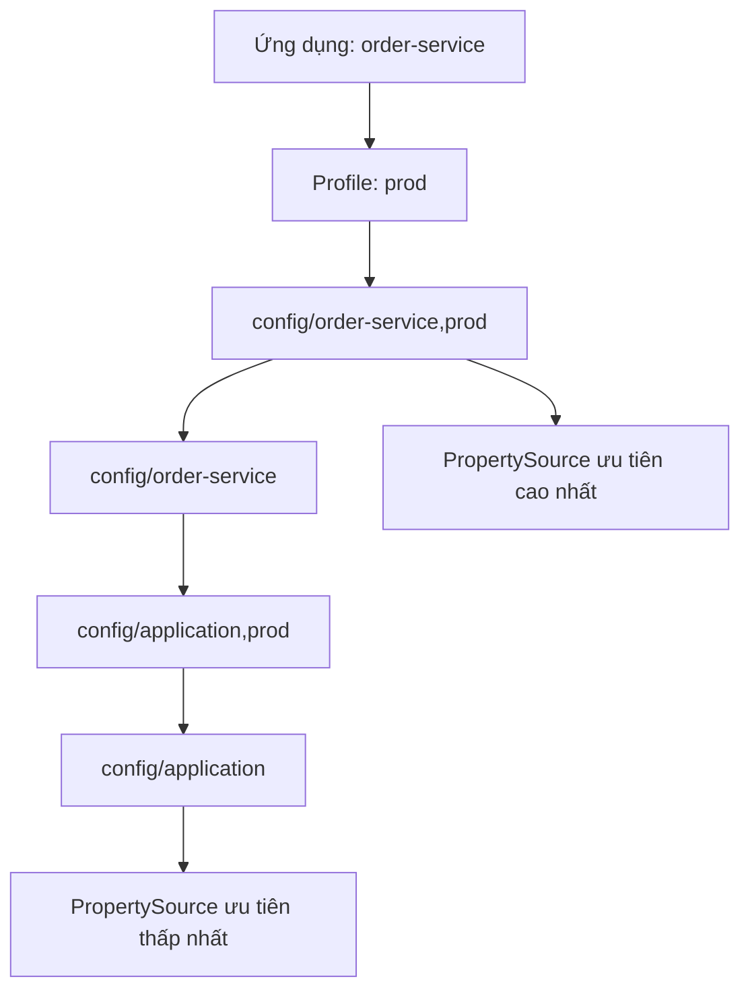

# Context dùng chung, context ứng dụng và context theo profile

Spring Cloud Consul Config dùng Consul Key/Value Store làm nguồn cung cấp cấu hình cho Spring Boot. Thay vì đặt mọi thuộc tính vào một key duy nhất, ứng dụng đọc nhiều **context** theo tên ứng dụng và profile đang hoạt động. Cách phân lớp này cho phép chia sẻ giá trị mặc định giữa các dịch vụ, ghi đè riêng cho một ứng dụng và tiếp tục ghi đè theo môi trường như `dev`, `test` hoặc `prod`.

Ba khái niệm cần phân biệt là **context dùng chung** (`default-context`), **context ứng dụng** (tên ứng dụng) và **context theo profile** (tên context kết hợp profile). Spring Cloud Consul tạo các `PropertySource` từ những context này theo thứ tự ưu tiên xác định. Hiểu đúng thứ tự giúp tránh đặt một giá trị vào nhầm tầng và tránh nghĩ rằng cấu hình `application,prod` luôn ghi đè cấu hình riêng của một ứng dụng.

## Mục tiêu học tập

Sau bài này, bạn có thể:

- Giải thích vai trò của prefix, default context, application context và profile context.
- Dự đoán các Consul KV path được truy vấn từ application name và active profile.
- Tổ chức giá trị dùng chung, giá trị riêng ứng dụng và giá trị theo môi trường.
- Hiểu thứ tự ưu tiên giữa bốn context tự động.
- Cấu hình `default-context`, `name`, `profile-separator` và `prefixes`.
- Chọn cách lưu cấu hình dạng key-value hoặc YAML/Properties blob.
- Kiểm tra property source và giá trị cuối cùng mà Spring `Environment` nhận được.

## Consul Config đưa dữ liệu vào Spring Environment như thế nào?

Consul cung cấp một Key/Value Store. Spring Cloud Consul Config đọc các key dưới những prefix được chỉ định, tạo nhiều `PropertySource` rồi thêm chúng vào Spring `Environment`. Ứng dụng tiếp tục sử dụng `@Value`, `Environment` hoặc `@ConfigurationProperties` như khi đọc cấu hình từ các nguồn Spring khác.

Spring Cloud Consul Config là một lựa chọn cung cấp cấu hình trực tiếp từ Consul KV. Nó không phải Spring Cloud Config Server backend: ứng dụng có Consul Config Client đọc Consul Agent/KV theo các context, không gọi endpoint `/{application}/{profile}/{label}` của Config Server.

Với Spring Boot 2.4 trở lên, cách mặc định để kết nối là Config Data import:

```yaml
spring:
  application:
    name: order-service
  profiles:
    active: prod
  config:
    import: "optional:consul:"
```

Dependency cần có trong ứng dụng:

```xml
<dependency>
    <groupId>org.springframework.cloud</groupId>
    <artifactId>spring-cloud-starter-consul-config</artifactId>
</dependency>
```

`optional:consul:` kết nối Consul Agent mặc định tại `localhost:8500` và cho phép ứng dụng tiếp tục nếu nguồn Consul không sẵn sàng. Bỏ `optional:` nếu Consul là nguồn bắt buộc và ứng dụng phải dừng khi không tải được cấu hình. Có thể chỉ định host/port trong import hoặc dùng `spring.cloud.consul.host` và `spring.cloud.consul.port`; địa chỉ nằm trong import có độ ưu tiên cao hơn host/port được khai báo riêng.

Với Config Data import, không cần `bootstrap.yml`. Nếu ứng dụng chủ động dùng bootstrap legacy, `spring-cloud-starter-bootstrap` hoặc `spring.config.use-legacy-processing=true`, các thuộc tính Consul Config cần được đặt trong `bootstrap.yml` theo hướng dẫn của phiên bản đó.

## Bốn context tự động

Spring Cloud Consul Config tạo bốn context dựa trên:

- `spring.cloud.consul.config.name`: tên dùng để tra cứu cấu hình; mặc định lấy từ `spring.application.name`.
- `spring.cloud.consul.config.default-context`: context dùng chung; mặc định là `application`.
- `spring.cloud.consul.config.profile-separator`: ký tự nối tên context với profile; mặc định là dấu phẩy `,`.
- Prefix của cấu hình: mặc định là `config`.

Giả sử ứng dụng có:

```yaml
spring:
  application:
    name: order-service
  profiles:
    active: prod
```

Với cấu hình mặc định, Spring Cloud Consul tìm các context theo thứ tự:

```text
config/order-service,prod/
config/order-service/
config/application,prod/
config/application/
```

Đây là thứ tự từ cụ thể nhất đến tổng quát nhất. Property source ở trên có độ ưu tiên cao hơn property source ở dưới. Các thuộc tính trong `config/application/` dùng chung cho các ứng dụng; `config/order-service/` chỉ áp dụng cho ứng dụng có tên `order-service`.



### Context dùng chung: `application`

Context mặc định `application` là nơi đặt các giá trị có thể áp dụng cho nhiều dịch vụ, ví dụ:

- Múi giờ mặc định, locale hoặc định dạng ngày giờ.
- Timeout mặc định cho kết nối nội bộ.
- Tên header tương quan hoặc chuẩn logging chung.
- Feature flag có cùng chính sách cho toàn hệ thống.

Ví dụ Consul KV:

```text
config/application/platform.time-zone = Asia/Ho_Chi_Minh
config/application/platform.request-timeout = 3s
config/application/logging.level.root = INFO
```

Các key này trở thành thuộc tính mặc định cho ứng dụng dùng Spring Cloud Consul Config và đọc prefix `config`. Không nên đặt password, token hoặc private key vào context dùng chung; một context được nhiều ứng dụng đọc sẽ mở rộng phạm vi truy cập của dữ liệu nhạy cảm.

### Context dùng chung theo profile: `application,prod`

Context này chứa giá trị dùng chung cho các ứng dụng khi chạy profile `prod`. Ví dụ:

```text
config/application,prod/platform.request-timeout = 5s
config/application,prod/logging.level.root = WARN
```

Ứng dụng `order-service` và `inventory-service` cùng dùng profile `prod` đều có thể nhận các giá trị này, trừ khi một context có độ ưu tiên cao hơn ghi đè.

### Context ứng dụng: `order-service`

Context ứng dụng chứa giá trị riêng của một dịch vụ, không phụ thuộc profile:

```text
config/order-service/orders.max-items = 40
config/order-service/payment.gateway.connect-timeout = 2s
```

Các dịch vụ khác không tự động nhận những key này nếu chúng dùng application name khác. Đây là nơi phù hợp cho cấu hình riêng của `order-service` nhưng giống nhau giữa các môi trường.

### Context ứng dụng theo profile: `order-service,prod`

Context cụ thể nhất kết hợp tên ứng dụng và profile:

```text
config/order-service,prod/orders.max-items = 80
config/order-service,prod/payment.gateway.connect-timeout = 4s
```

Các giá trị này chỉ dành cho `order-service` khi chạy profile `prod`. Nếu cùng key xuất hiện ở nhiều context, context cụ thể hơn có độ ưu tiên cao hơn theo thứ tự đã nêu.

## Thứ tự ưu tiên khi cùng một key xuất hiện nhiều nơi

Thứ tự bốn property source là điểm quan trọng nhất khi thiết kế context. Với `order-service` và profile `prod`:

| Thứ tự | Context | Phạm vi | Ưu tiên |
|---:|---|---|---|
| 1 | `config/order-service,prod/` | Một ứng dụng, một profile | Cao nhất |
| 2 | `config/order-service/` | Một ứng dụng, mọi profile | Cao |
| 3 | `config/application,prod/` | Mọi ứng dụng, một profile | Thấp |
| 4 | `config/application/` | Mọi ứng dụng, mọi profile | Thấp nhất |

Ví dụ cùng key `platform.request-timeout` có các giá trị:

```text
config/application/platform.request-timeout       = 3s
config/application,prod/platform.request-timeout  = 5s
config/order-service/platform.request-timeout     = 4s
config/order-service,prod/platform.request-timeout = 8s
```

Với `order-service` chạy `prod`, giá trị hiệu lực là `8s`. Nếu key không tồn tại trong `config/order-service,prod/` nhưng có trong `config/order-service/`, giá trị ứng dụng riêng sẽ thắng giá trị `application,prod`. Điều này có nghĩa một cấu hình riêng ứng dụng không theo profile có thể ghi đè cấu hình chung theo profile.

Khi một key không xuất hiện ở context ưu tiên cao hơn, Spring `Environment` tiếp tục lấy giá trị từ property source tiếp theo. Nếu key không có trong cả bốn context, ứng dụng có thể nhận giá trị từ `application.yml`, biến môi trường, system property hoặc một nguồn Spring khác theo thứ tự precedence chung của Spring Boot.

Không nên sao chép cùng một key vào cả bốn context nếu không có lý do. Việc đó làm khó truy nguyên giá trị cuối cùng và tăng nguy cơ môi trường có hành vi khác nhau ngoài dự kiến.

## Cấu hình tên và context

Có thể thay đổi các quy tắc mặc định:

```yaml
spring:
  application:
    name: order-service
  profiles:
    active: prod
  config:
    import: "optional:consul:"
  cloud:
    consul:
      config:
        enabled: true
        name: order-service
        default-context: application
        profile-separator: ','
        prefixes:
          - config
```

Ý nghĩa:

- `enabled`: bật hoặc tắt Consul Config; mặc định `true`.
- `name`: tên context ứng dụng; nếu bỏ qua, lấy từ `spring.application.name`.
- `default-context`: tên context dùng chung; mặc định `application`.
- `profile-separator`: ký tự nối tên context với profile; mặc định `,`.
- `prefixes`: một hoặc nhiều thư mục gốc chứa context. Mặc định dùng một prefix `config`.

Trong tài liệu Spring Cloud Consul 5.1, `prefixes` là thuộc tính được khuyến nghị để khai báo một hoặc nhiều base folder; `prefix` đơn lẻ đã deprecated để chuyển sang `prefixes`. Với release train cũ, kiểm tra appendix đúng phiên bản vì tên thuộc tính và khả năng hỗ trợ có thể khác.

Ví dụ đổi separator thành dấu gạch ngang:

```yaml
spring:
  cloud:
    consul:
      config:
        profile-separator: '-'
```

Khi đó, context profile của `order-service` và `prod` được đặt thành:

```text
config/order-service-prod/
config/application-prod/
```

Chọn một separator thống nhất trong toàn bộ môi trường. Nếu Consul KV đang có key theo dấu phẩy mà ứng dụng đổi sang dấu gạch ngang, client sẽ tìm context khác và có thể không tải được các giá trị cũ.

Nếu `spring.application.name` chưa được khai báo, context ứng dụng có thể không mang tên mong muốn. Hãy đặt tên ứng dụng ổn định và tránh đổi tên tùy tiện vì tên đó ảnh hưởng cả cấu hình lẫn các tích hợp Consul khác như service discovery.

## Nhiều prefix và context tùy chỉnh

Trong phiên bản hỗ trợ `prefixes`, có thể tách dữ liệu thành nhiều nhóm:

```yaml
spring:
  cloud:
    consul:
      config:
        prefixes:
          - config
          - shared-platform
```

Mỗi prefix tạo một vùng tìm kiếm cho các context tương ứng. Ví dụ có thể đặt cấu hình dịch vụ trong `config` và các giá trị nền tảng dùng chung trong `shared-platform`. Khi cùng một key xuất hiện ở nhiều prefix, hãy kiểm tra thứ tự property source thực tế của release train đang dùng; không tự giả định thứ tự chỉ từ thứ tự YAML nếu chưa xác minh.

Nếu muốn chọn các context cụ thể thay vì bốn context tự động, Config Data import cho phép khai báo đường dẫn:

```yaml
spring:
  config:
    import: "optional:consul:consul.internal:8500/shared-platform;/teams/commerce"
```

Ví dụ này yêu cầu đọc các context được chỉ định trong import. Khi tự khai báo context, cần quản lý rõ phạm vi chia sẻ và thứ tự; không mặc định rằng client vẫn tự tạo thêm bốn context từ `application` và `spring.application.name` như cấu hình tự động.

## Lưu dữ liệu dạng key-value hoặc YAML

Spring Cloud Consul Config hỗ trợ nhiều cách biểu diễn dữ liệu trong KV Store. Cách chọn format quyết định vị trí key và cấu trúc nội dung.

### `KEY_VALUE`: mỗi thuộc tính là một key

Đây là format mặc định. Mỗi property được lưu thành một entry riêng dưới context. Ví dụ:

```text
config/application/platform.time-zone = Asia/Ho_Chi_Minh
config/order-service/orders.max-items = 40
config/order-service,prod/orders.max-items = 80
```

Ưu điểm là có thể thay đổi từng thuộc tính và cấp ACL theo prefix/key. Cần thống nhất cách đặt tên property, dấu phân cấp và quy ước key để tránh nhiều nhóm ghi cùng một giá trị bằng tên khác nhau.

### `YAML`: một tài liệu dưới key `data`

Nếu muốn quản lý nhiều thuộc tính trong một blob YAML, cấu hình:

```yaml
spring:
  cloud:
    consul:
      config:
        format: YAML
        data-key: data
```

Với prefix `config`, các context được lưu bằng key cuối là `data`:

```text
config/application/data
config/application,prod/data
config/order-service/data
config/order-service,prod/data
```

Ví dụ nội dung tại `config/order-service,prod/data`:

```yaml
orders:
  max-items: 80
payment:
  gateway:
    connect-timeout: 4s
```

Spring Cloud Consul đọc YAML từ key `data` và đưa các property vào `Environment`. Có thể đổi tên key cuối bằng `spring.cloud.consul.config.data-key`.

### `PROPERTIES` và `FILES`

`PROPERTIES` dùng cách lưu một blob theo định dạng Java properties, cũng theo `data-key`. `FILES` dành cho mô hình dùng công cụ như `git2consul` đưa file trong Git thành các key Consul riêng; tên file trở thành key và file `.yml`/`.properties` được phân tích như tài liệu cấu hình. Chỉ chọn `FILES` khi quy trình đồng bộ Git vào Consul thực sự được triển khai.

Không trộn lẫn cách lưu blob `YAML` với cách lưu từng key `KEY_VALUE` trong cùng một context mà không có thiết kế rõ ràng. Chọn một format nhất quán để dễ kiểm tra quyền, thay đổi và precedence.

## Ví dụ tổ chức Consul KV cho nhiều dịch vụ

Giả sử hệ thống có `order-service` và `inventory-service`, cả hai chạy `prod`. Một cách tổ chức:

```text
config/
├── application/
│   ├── platform.time-zone
│   └── platform.request-timeout
├── application,prod/
│   └── logging.level.root
├── order-service/
│   ├── orders.max-items
│   └── payment.gateway.connect-timeout
├── order-service,prod/
│   └── orders.max-items
├── inventory-service/
│   └── inventory.batch-size
└── inventory-service,prod/
    └── inventory.batch-size
```

Giá trị dùng chung nằm trong `application`; các điều chỉnh chung cho production nằm trong `application,prod`; các thuộc tính riêng của từng dịch vụ nằm trong context ứng dụng; và các ngoại lệ theo môi trường nằm trong context ứng dụng-profile.

Một nguyên tắc hữu ích là chỉ đặt giá trị ở tầng hẹp nhất khi nó thực sự khác với tầng tổng quát. Nếu `orders.max-items` luôn là 40 ở mọi môi trường, giữ nó trong `order-service/`. Nếu production cần 80, thêm override trong `order-service,prod/`.

## Kiểm tra context và giá trị cuối cùng

Sau khi ghi key vào Consul, kiểm tra theo đúng application name và profile đang chạy:

1. Xác nhận `spring.application.name` và `spring.profiles.active` có giá trị mong đợi.
2. Xác nhận `spring.cloud.consul.config.name`, `default-context`, `profile-separator` và `prefixes` không bị override bởi environment/JVM option.
3. Kiểm tra các KV path tồn tại trong Consul UI hoặc API với ACL token phù hợp.
4. Khởi động ứng dụng hoặc kích hoạt reload theo cơ chế được cấu hình.
5. Kiểm tra các property source Consul được thêm vào `Environment` và thứ tự của chúng.
6. So sánh giá trị cuối cùng với giá trị mong muốn trong từng profile.

Ví dụ gọi Consul HTTP API để đọc key theo prefix (cần token/ACL phù hợp nếu Consul bật ACL):

```bash
curl -sS \
  -H "X-Consul-Token: $CONSUL_HTTP_TOKEN" \
  "http://localhost:8500/v1/kv/config/order-service,prod?recurse"
```

API KV trả dữ liệu dạng Base64 trong trường `Value`; dùng Consul UI hoặc công cụ giải mã được tổ chức phê duyệt để xem nội dung. Không đưa ACL token vào shell history, log hoặc ví dụ chia sẻ.

Để xác minh phía Spring, có thể dùng Actuator `env` trong môi trường thử nghiệm để xem property source và origin của một key. Endpoint này có thể lộ cấu hình nội bộ, nên chỉ bật tạm thời, bảo vệ bằng xác thực/phân quyền và tắt sau khi kiểm tra. Không dựa vào việc key tồn tại trong Consul KV để kết luận ứng dụng đã nhận đúng giá trị; cần kiểm tra `Environment` thực tế.

## Profile và nhiều profile đang hoạt động

Spring Cloud Consul tạo context theo active profile của Spring. Nếu ứng dụng kích hoạt nhiều profile, mỗi profile có thể tạo context profile-specific tương ứng; thứ tự profile có thể ảnh hưởng thứ tự các property source. Ví dụ ứng dụng dùng `prod` và `region-hcm` có thể có các context theo từng profile bên cạnh context không gắn profile.

Hãy kiểm tra log và `Environment` của đúng release train để xác nhận thứ tự khi có nhiều profile. Không tự gộp hai tên profile thành một context `order-service,prod,region-hcm` trừ khi phiên bản/tài liệu đang dùng quy định cách đó. Nếu một thuộc tính phải có giá trị theo tổ hợp nhiều profile, hãy kiểm thử cách phân giải thực tế hoặc thiết kế một profile tổng hợp rõ ràng.

## Các lỗi thường gặp

| Hiện tượng | Nguyên nhân có thể gặp | Cách xử lý |
|---|---|---|
| Không đọc được cấu hình dùng chung | Sai `prefix`/`prefixes` hoặc `default-context` không khớp key trong KV | Kiểm tra prefix và context thực tế |
| Chỉ cấu hình chung có hiệu lực, app context không được đọc | `spring.application.name` hoặc `spring.cloud.consul.config.name` khác tên folder | Đồng bộ tên ứng dụng và key path |
| Profile-specific không được áp dụng | Sai `profile-separator`, profile chưa active hoặc key nằm sai context | Kiểm tra active profiles và separator |
| Giá trị application context thắng giá trị `application,prod` | Đây là thứ tự mặc định: app context đứng trên shared profile context | Đặt override vào `application,prod` chỉ khi không có app-specific key; hoặc đặt ở app profile context |
| Đổi separator khiến toàn bộ profile config biến mất | Key cũ vẫn dùng dấu phẩy, client tìm dấu khác | Đồng bộ migration key và client cùng thời điểm |
| YAML không được parse | Chọn `format: YAML` nhưng nội dung không nằm trong key `data` (hoặc data-key đã đổi) | Kiểm tra `data-key` và cấu trúc YAML |
| Config Data import không kết nối Consul | Sai địa chỉ import, host/port hoặc ACL token | Kiểm tra import URI, network, ACL và log |
| Một ứng dụng nhận nhầm context | `name` hoặc import context tùy chỉnh không đúng | Kiểm tra context đã resolve và application name |

## Nguyên tắc thiết kế và vận hành

- Dùng `application` cho giá trị mặc định thật sự dùng chung.
- Dùng `application,profile` cho điều chỉnh theo môi trường áp dụng cho nhiều dịch vụ.
- Dùng `<application>` cho giá trị riêng ứng dụng, không phụ thuộc profile.
- Dùng `<application><separator><profile>` cho ngoại lệ hẹp nhất.
- Giữ tên ứng dụng ổn định và separator nhất quán giữa môi trường.
- Chỉ thêm nhiều prefix khi có ranh giới quản trị rõ ràng; kiểm thử thứ tự precedence.
- Chọn `KEY_VALUE` khi muốn quản lý từng property; chọn `YAML`/`PROPERTIES` khi muốn quản lý blob theo context.
- Không lưu secret tùy tiện trong context dùng chung; dùng ACL và secret backend phù hợp.
- Thay đổi Consul KV cần có review, audit, backup và quy trình hoàn nguyên như các thay đổi cấu hình khác.
- Sau khi thay đổi, xác nhận ứng dụng đã reload và bean thực sự dùng giá trị mới; cập nhật KV không đồng nghĩa mọi singleton tự thay đổi.

## Kết luận

Spring Cloud Consul Config xây dựng cấu hình từ các context theo prefix, application name, default context và active profile. Với mặc định, bốn context là `config/{application},{profile}/`, `config/{application}/`, `config/application,{profile}/` và `config/application/`, theo thứ tự ưu tiên từ cao xuống thấp.

Thiết kế phân lớp hợp lý giúp chia sẻ giá trị mặc định mà vẫn cho phép từng ứng dụng và từng môi trường ghi đè khi cần. Hãy giữ nhất quán `spring.application.name`, `default-context`, `profile-separator` và `prefixes`; chọn format KV phù hợp; rồi kiểm chứng property source và giá trị hiệu lực trong Spring `Environment` trước khi phát hành.

## Tài liệu tham khảo

- [Spring Cloud Consul – Distributed Configuration with Consul](https://docs.spring.io/spring-cloud-consul/reference/config.html)
- [Spring Cloud Consul – Common Application Properties](https://docs.spring.io/spring-cloud-consul/reference/appendix.html)
- [Consul – Key/Value Store HTTP API](https://developer.hashicorp.com/consul/api-docs/kv)
