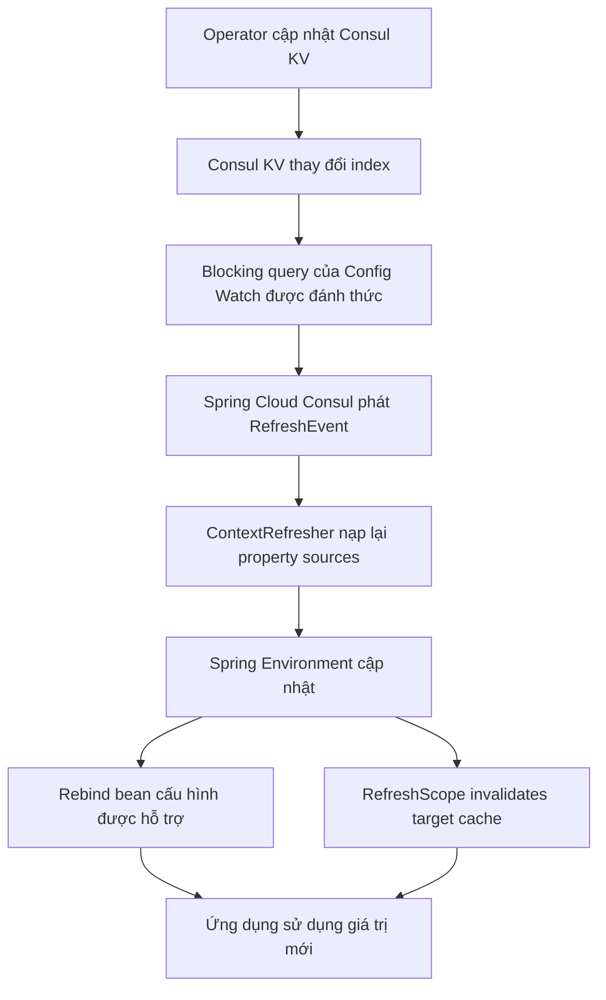
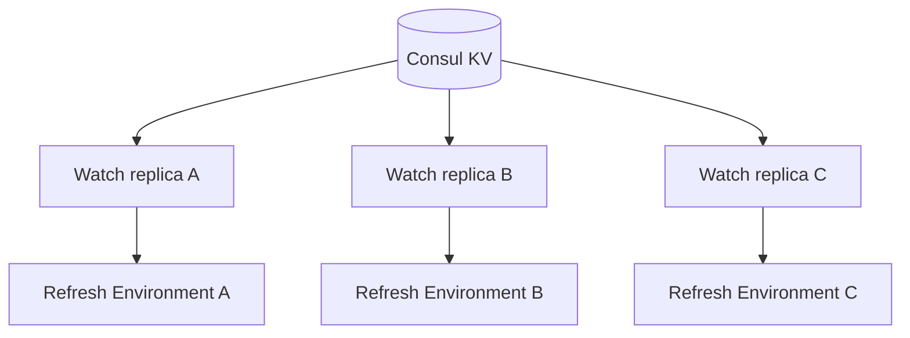

# Config Watch, truy vấn chờ thay đổi và sự kiện làm mới

Spring Cloud Consul Config có thể theo dõi các key prefix trong Consul KV để phát hiện cấu hình thay đổi. Thay vì gửi request đọc liên tục theo chu kỳ ngắn, Config Watch sử dụng **blocking query**: client gửi truy vấn kèm chỉ số trạng thái đã quan sát và yêu cầu Consul chờ tới khi dữ liệu thay đổi hoặc hết thời gian chờ. Khi phát hiện dữ liệu cấu hình liên quan đã thay đổi, Spring Cloud Consul phát `RefreshEvent` để ứng dụng nạp lại Environment.

Điểm cần hiểu là Config Watch không tự đẩy toàn bộ giá trị mới vào bean. Nó phát tín hiệu để Spring Cloud Context làm mới nguồn cấu hình và cập nhật những bean có hỗ trợ refresh. Mỗi instance ứng dụng có thể chạy watcher riêng, vì vậy cần tính đến số lượng kết nối dài hạn, quyền đọc Consul KV, thời gian chờ và cách kiểm tra kết quả trên từng instance.

## 1. Config Watch nằm trong luồng cấu hình như thế nào?

Spring Cloud Consul Config đọc dữ liệu từ Consul KV và đưa các giá trị vào Spring `Environment`. Config Watch theo dõi prefix mà ứng dụng đang dùng. Khi dữ liệu trong prefix thay đổi, watcher phát một sự kiện refresh; ứng dụng sau đó nạp lại các property source từ Consul.



Luồng này khác với việc Config Server nhận webhook hoặc Spring Cloud Bus phát sự kiện. Mỗi Config Client kết nối Consul trực tiếp và theo dõi prefix của chính nó. Không cần một broker trung tâm để chuyển tiếp sự kiện giữa các instance trong mô hình Config Watch cơ bản.

## 2. Kích hoạt Consul Config và Config Data import

Thêm starter `spring-cloud-starter-consul-config` và dùng Spring Cloud BOM tương thích với phiên bản Spring Boot của dự án.

Ví dụ Maven:

```xml
<dependencyManagement>
    <dependencies>
        <dependency>
            <groupId>org.springframework.cloud</groupId>
            <artifactId>spring-cloud-dependencies</artifactId>
            <version>${spring-cloud.version}</version>
            <type>pom</type>
            <scope>import</scope>
        </dependency>
    </dependencies>
</dependencyManagement>

<dependencies>
    <dependency>
        <groupId>org.springframework.cloud</groupId>
        <artifactId>spring-cloud-starter-consul-config</artifactId>
    </dependency>
</dependencies>
```

Với Spring Boot Config Data, khai báo Consul bằng `spring.config.import`. Ví dụ:

```yaml
spring:
  application:
    name: order-service
  profiles:
    active: production
  config:
    import: "consul:"
  cloud:
    consul:
      host: consul-agent.internal
      port: 8500
      config:
        enabled: true
        prefix: config
        default-context: application
        profile-separator: ","
        format: YAML
        data-key: data
        watch:
          enabled: true
          delay: 1000
          wait-time: 55
```

`consul:` là import bắt buộc. Nếu môi trường cho phép ứng dụng khởi động khi Consul chưa có cấu hình và đã có fallback an toàn, có thể dùng `optional:consul:`. Không đánh dấu optional cho nguồn chứa thuộc tính bắt buộc nếu thiếu chúng khiến ứng dụng hoạt động sai.

Spring Boot Config Data không cần `bootstrap.yml`. Nếu dự án vẫn bật bootstrap legacy bằng `spring-cloud-starter-bootstrap`, `spring.cloud.bootstrap.enabled=true` hoặc `spring.config.use-legacy-processing=true`, các thuộc tính bootstrap phải được đặt trong `bootstrap.yml` theo mô hình đang sử dụng. Tránh trộn lẫn hai cơ chế mà không kiểm tra phiên bản.

## 3. Cấu trúc key trong Consul KV

Spring Cloud Consul tạo các property source theo application name, default context và active profiles. Với prefix `config`, application `order-service` và profile `production`, các context phổ biến gồm:

```text
config/order-service,production/
config/order-service/
config/application,production/
config/application/
```

Property source cụ thể nhất được đặt ưu tiên cao hơn nguồn chung. Vì vậy, `order-service,production` có thể ghi đè cùng key trong `order-service` hoặc `application`.

Khi dùng định dạng YAML, dữ liệu được lưu trong key con `data` của từng context:

```text
config/application/data
config/application,production/data
config/order-service/data
config/order-service,production/data
```

Ví dụ nội dung tại `config/order-service,production/data`:

```yaml
checkout:
  timeout: 5s
  max-retries: 3
```

Các key prefix, default context, profile separator và data key có thể tùy chỉnh qua `spring.cloud.consul.config.*`. Nếu thay đổi một trong các quy ước này, phải bảo đảm dữ liệu KV và cấu hình ứng dụng cùng khớp.

## 4. Blocking query là gì?

Consul hỗ trợ blocking query trên nhiều HTTP API. Cơ chế này dùng long polling để client chờ một thay đổi tiềm năng mà không phải gửi request đọc mới liên tục.

Một blocking query thường sử dụng hai tham số:

- `index`: giá trị `X-Consul-Index` mà client nhận được từ lần truy vấn trước. Nó đại diện cho trạng thái của tài nguyên đã đọc; hãy xem đây là một token opaque do Consul cấp, không tự diễn giải nó như số phiên bản cấu hình hay thực hiện phép tính trên giá trị này.
- `wait`: thời gian tối đa Consul chờ trước khi trả response, kể cả khi chưa có thay đổi.

Ví dụ ở mức Consul HTTP API:

```http
GET /v1/kv/config/order-service?recurse&index=12345&wait=55s
```

Response có header `X-Consul-Index`. Client dùng giá trị này cho lần truy vấn tiếp theo. Nếu index thay đổi trong lúc request đang chờ, Consul trả response sớm; nếu không, request kết thúc khi đạt thời gian `wait`.

Spring Cloud Consul quản lý chi tiết việc theo dõi index và gọi API. Người dùng ứng dụng thường không cần tự viết vòng lặp HTTP hoặc lưu `X-Consul-Index` trong code nghiệp vụ.

Một response blocking query kết thúc không nhất thiết có nghĩa dữ liệu đã thay đổi. Request có thể kết thúc do hết thời gian chờ hoặc do một cập nhật idempotent không làm kết quả truy vấn thay đổi. Vì vậy, không nên coi mỗi lần request trả response là một lần cấu hình thay đổi; watcher chỉ phát refresh khi phát hiện dữ liệu liên quan đã thay đổi.

## 5. Phân biệt `watch.delay` và `watch.wait-time`

Hai thuộc tính điều khiển hai phần khác nhau của vòng đời watcher:

| Thuộc tính | Mặc định theo tài liệu Spring Cloud Consul | Đơn vị | Ý nghĩa |
|---|---:|---|---|
| `spring.cloud.consul.config.watch.enabled` | `true` | boolean | Bật hoặc tắt Config Watch |
| `spring.cloud.consul.config.watch.delay` | `1000` | mili giây | Khoảng delay cố định sau khi lần thực thi trước kết thúc trước khi bắt đầu lần tiếp theo |
| `spring.cloud.consul.config.watch.wait-time` | `55` | giây | Thời gian tối đa một blocking query chờ trước khi trả về |

`delay=1000` không có nghĩa cứ mỗi giây ứng dụng lại gửi một request đọc ngắn. Một request có thể chờ gần 55 giây; sau khi request kết thúc, scheduler mới đợi thêm khoảng delay trước lần tiếp theo. Nếu có thay đổi, blocking query có thể trả về sớm và lần kiểm tra kế tiếp được lên lịch sau delay.

`wait-time` cần nhỏ hơn timeout HTTP của Consul client. Giá trị mặc định là 55 giây trong khi timeout client mặc định thường là 60 giây, tạo khoảng đệm để client nhận response trước khi kết nối bị timeout. Nếu muốn tăng thời gian chờ, cần điều chỉnh Consul client/HTTP client tương ứng; không chỉ tăng `wait-time` một cách độc lập.

Ví dụ thay đổi delay nhưng giữ thời gian chờ mặc định:

```yaml
spring:
  cloud:
    consul:
      config:
        watch:
          enabled: true
          delay: 2000
          wait-time: 55
```

Tăng delay có thể giảm tần suất tạo request mới sau mỗi lần truy vấn kết thúc, nhưng cũng làm tăng khoảng chờ sau khi request trả về. Tăng wait-time giúp một request chờ lâu hơn trước khi timeout tự nhiên; nó không làm Consul phát hiện thay đổi nhanh hơn khi thay đổi đã xảy ra.

## 6. Từ thay đổi KV tới `RefreshEvent`

Khi watcher phát hiện dữ liệu cấu hình liên quan đã thay đổi, Spring Cloud Consul phát `RefreshEvent`. Sự kiện này tương đương với việc yêu cầu refresh thông qua endpoint `/refresh` của Spring Cloud Context.

Refresh làm mới các property source được hỗ trợ và cập nhật Spring `Environment`. Những bean cấu hình có cơ chế rebinding có thể nhận giá trị mới; bean thuộc `@RefreshScope` được làm mới target khi truy cập tiếp theo.

Ví dụ một bean cấu hình:

```java
import java.time.Duration;

import org.springframework.boot.context.properties.ConfigurationProperties;

@ConfigurationProperties(prefix = "checkout")
public class CheckoutProperties {

    private Duration timeout = Duration.ofSeconds(2);
    private int maxRetries = 2;

    public Duration getTimeout() {
        return timeout;
    }

    public void setTimeout(Duration timeout) {
        this.timeout = timeout;
    }

    public int getMaxRetries() {
        return maxRetries;
    }

    public void setMaxRetries(int maxRetries) {
        this.maxRetries = maxRetries;
    }
}
```

Đăng ký bean qua `@ConfigurationPropertiesScan` hoặc `@EnableConfigurationProperties`. Khi giá trị `checkout.timeout` trong Consul thay đổi và refresh thành công, bean được hỗ trợ rebinding có thể nhận giá trị mới.

Với bean cần tái tạo, có thể dùng `@RefreshScope`:

```java
import java.time.Duration;

import org.springframework.beans.factory.annotation.Value;
import org.springframework.cloud.context.config.annotation.RefreshScope;
import org.springframework.stereotype.Component;

@Component
@RefreshScope
public class CheckoutPolicy {

    @Value("${checkout.timeout:2s}")
    private Duration timeout;

    public Duration timeout() {
        return timeout;
    }
}
```

Không phải mọi bean đều tự thay đổi. Singleton thông thường đã inject `@Value` khi khởi tạo có thể tiếp tục giữ giá trị cũ; thay đổi cấu trúc nguồn, active profile hoặc một số tài nguyên có trạng thái có thể cần restart. Hãy kiểm tra hành vi của bean thay vì chỉ kiểm tra watcher đã phát sự kiện.

## 7. Watch là theo từng instance, không phải broadcast tập trung

Giả sử `order-service` chạy ba replica. Mỗi replica có Config Watch riêng và theo dõi các prefix liên quan trong Consul.



Khi dữ liệu thay đổi, các watcher có thể nhận biết thay đổi và refresh từng tiến trình độc lập. Đây không phải một request refresh duy nhất được gửi tới load balancer rồi tự lan truyền tới tất cả replica.

Hệ quả vận hành:

- Mỗi instance tạo một blocking query tới Consul cho phạm vi cấu hình của nó.
- Số lượng instance tăng làm tăng số watcher và kết nối chờ dài hạn.
- Một instance mất kết nối Consul có thể chưa nhận được thay đổi cho tới khi watcher hoạt động lại.
- Cần quan sát refresh theo từng instance nếu thay đổi có ảnh hưởng lớn.

Spring Cloud Bus là một cơ chế khác để phân phối sự kiện giữa nhiều node qua broker. Config Watch cơ bản không cần Bus để mỗi instance trực tiếp phát hiện thay đổi trong Consul KV. Có thể kết hợp các cơ chế trong một kiến trúc, nhưng cần tránh tạo hai luồng refresh trùng nhau mà không có lý do.

## 8. Watch scheduler và tài nguyên

Config Watch dùng Spring `TaskScheduler`. Mặc định Spring Cloud Consul tạo `ThreadPoolTaskScheduler` với pool size 1 cho watcher. Có thể cung cấp `TaskScheduler` riêng theo tên bean được cấu hình bởi `ConsulConfigAutoConfiguration.CONFIG_WATCH_TASK_SCHEDULER_NAME` nếu ứng dụng có nhu cầu điều chỉnh.

Không nên tăng thread pool chỉ vì muốn refresh nhanh hơn. Trước tiên cần đo số watcher, thời gian blocking query, số lần refresh và thời gian xử lý refresh. Một thread scheduler có thể đủ vì mỗi ứng dụng chỉ cần theo dõi một tập cấu hình; nếu tùy chỉnh, phải xác minh scheduler không bị dùng chung với tác vụ dài khác làm chậm watcher.

Ở quy mô nhiều nghìn instance, hãy xem xét tổng số blocking query, phân bố thời điểm kết thúc wait, Consul agent/server capacity, network connection và ACL. Consul có thể xử lý blocking query hiệu quả khi thay đổi không xảy ra liên tục, nhưng việc cập nhật key quá dày có thể làm nhiều watcher thức dậy cùng lúc và tạo tải lên Consul cũng như ứng dụng.

## 9. Thay đổi, thêm và xóa key

Khi thêm hoặc cập nhật key trong prefix mà ứng dụng đang theo dõi, watcher có thể phát hiện thay đổi và yêu cầu refresh. Khi xóa key, hành vi cuối cùng phụ thuộc phiên bản Spring Cloud Consul, format và cách property source được dựng lại. Cần kiểm thử việc xóa key trong đúng release train, đặc biệt nếu key cũ có thể còn xuất hiện trong property source khác hoặc có giá trị mặc định trong ứng dụng.

Ví dụ thay đổi một cấu hình:

```bash
consul kv put config/order-service,production/data "checkout:\n  timeout: 5s\n  max-retries: 3"
```

Với dữ liệu YAML, nội dung được lưu dưới key `data` theo `spring.cloud.consul.config.data-key`. Cú pháp quoting của shell có thể khác giữa Bash và PowerShell; hãy dùng file đầu vào hoặc cơ chế ghi KV phù hợp để tránh thay đổi newline ngoài ý muốn.

Để xóa một key, cần hiểu cấu trúc dữ liệu đang dùng. Nếu cả document YAML được lưu trong `data`, xóa một thuộc tính đồng nghĩa ghi lại toàn bộ document không còn thuộc tính đó; nếu dùng format key-value, có thể xóa riêng key. Trong cả hai trường hợp, kiểm tra property source cuối cùng và bean sau refresh.

## 10. Cấu hình format và tác động tới watch

Spring Cloud Consul hỗ trợ nhiều cách lưu dữ liệu:

| Format | Cách lưu | Khi nào phù hợp |
|---|---|---|
| Key-value mặc định | Từng thuộc tính được lưu dưới key riêng | Cập nhật từng key độc lập |
| `YAML` | Một document YAML đặt trong `data-key` của context | Muốn quản lý nhóm thuộc tính như một file cấu hình |
| `PROPERTIES` | Một document properties đặt trong `data-key` | Hệ thống hiện dùng format properties |
| `FILES` | Các file YAML/properties được đưa vào key riêng, thường qua công cụ như git2consul | Đồng bộ cấu hình từ repository theo quy ước tên file |

Watch theo dõi prefix/context liên quan, nên cập nhật một key trong phạm vi đó có thể kích hoạt refresh cho ứng dụng đang đọc prefix. Với format YAML/PROPERTIES, thay đổi một thuộc tính thường là cập nhật cả blob `data`; với key-value, từng key được thay đổi riêng.

Không nên giả định chỉ một key logic thay đổi thì chỉ một bean được refresh. Refresh event làm mới Environment theo cơ chế chung; ứng dụng phải xác định các bean nào phụ thuộc các key đó và có thể cập nhật nóng an toàn.

## 11. Bảo mật kết nối và quyền đọc Consul

Ứng dụng cần quyền đọc các prefix cấu hình được cấp. Consul ACL token có thể cấu hình bằng `spring.cloud.consul.config.acl-token` hoặc cơ chế cấp token tương ứng của môi trường.

Ví dụ:

```yaml
spring:
  cloud:
    consul:
      host: consul-agent.internal
      port: 8500
      config:
        acl-token: ${CONSUL_CONFIG_ACL_TOKEN}
```

`CONSUL_CONFIG_ACL_TOKEN` phải được cấp từ secret manager hoặc injection an toàn của nền tảng. Không commit token vào Git hoặc lưu trong Consul KV mà chính token đó cho phép đọc.

Policy nên chỉ cấp quyền đọc các prefix ứng dụng cần, ví dụ:

```hcl
key_prefix "config/application" {
  policy = "read"
}

key_prefix "config/order-service" {
  policy = "read"
}
```

Đây là ví dụ policy theo prefix; cần bổ sung path/profile thực tế và kiểm tra quy tắc ACL của phiên bản Consul. Không cấp quyền ghi cho ứng dụng chỉ cần đọc cấu hình. Quyền ghi nên thuộc nhóm phát hành hoặc automation riêng.

Trong production:

- Dùng HTTPS/TLS và xác minh certificate khi kết nối tới Consul agent.
- Bảo vệ ACL token và giới hạn thời hạn/quyền theo workload.
- Tách prefix hoặc namespace theo môi trường nếu cần cô lập staging/production.
- Không đặt password, token hoặc private key vào property source rộng hơn phạm vi ứng dụng.
- Không expose Actuator `env` hoặc `configprops` công khai vì có thể tiết lộ giá trị cấu hình.
- Audit thay đổi KV, danh tính ghi dữ liệu và các lần refresh.

## 12. Fail-fast và khi Consul tạm thời không sẵn sàng

`spring.cloud.consul.config.fail-fast` quyết định hành vi khi không thể tải cấu hình từ Consul trong quá trình nạp cấu hình. Mặc định là `true`: lỗi lookup có thể làm quá trình khởi động thất bại. Đặt `false` sẽ ghi cảnh báo và cho phép ứng dụng tiếp tục khởi động theo các nguồn cấu hình còn lại.

Ví dụ môi trường phát triển có fallback:

```yaml
spring:
  cloud:
    consul:
      config:
        fail-fast: false
```

Không nhầm `fail-fast` với `watch.enabled`:

- `fail-fast` điều khiển lỗi khi lấy cấu hình.
- `watch.enabled` bật/tắt việc theo dõi thay đổi sau khi ứng dụng đã nạp cấu hình.
- `optional:consul:` trong Config Data import quyết định nguồn Consul có bắt buộc để hoàn tất Config Data import hay không.

Nếu Consul tạm thời mất kết nối khi ứng dụng đang chạy, watcher không thể phát hiện thay đổi trong thời gian lỗi. Environment hiện tại có thể tiếp tục được dùng; khi kết nối phục hồi, watcher có thể tiếp tục truy vấn và nhận thay đổi mới. Không nên xem đây là cơ chế đảm bảo không bỏ lỡ mọi trạng thái trung gian: ứng dụng thường quan tâm trạng thái cấu hình hiện hành, không nhất thiết xử lý từng phiên bản KV đã tồn tại trong thời gian mất kết nối.

## 13. Phân biệt Config Watch với Consul Catalog Watch

Spring Cloud Consul có cả watcher cho cấu hình và watcher cho service catalog. Hai watcher có mục tiêu khác nhau:

| Cơ chế | Theo dõi | Sự kiện/kết quả |
|---|---|---|
| Config Watch | Key prefix trong Consul KV | Phát `RefreshEvent` để nạp lại cấu hình |
| Catalog Watch | Danh sách service trong Consul Catalog | Phát heartbeat/discovery event khi dữ liệu service thay đổi |

Không dùng `spring.cloud.consul.discovery.catalog-services-watch-delay` để điều chỉnh Config Watch. Thuộc tính đó thuộc Service Discovery. Config Watch dùng `spring.cloud.consul.config.watch.delay`, `watch.wait-time` và `watch.enabled`.

## 14. Chẩn đoán khi thay đổi không được refresh

Đi theo từng lớp thay vì chỉ tăng tần suất watcher:

1. Xác nhận key được ghi đúng prefix/context, application name và profile.
2. Xác nhận ứng dụng có quyền đọc prefix đó bằng ACL token đang dùng.
3. Kiểm tra `spring.cloud.consul.config.watch.enabled` có đang bật không.
4. Kiểm tra log watcher, lỗi kết nối, HTTP timeout và Consul agent/server.
5. Xác minh `wait-time` nhỏ hơn timeout của Consul HTTP client.
6. Kiểm tra `RefreshEvent`/refresh log có được phát sau thay đổi hay không.
7. Kiểm tra Environment đã nhận property source mới chưa.
8. Kiểm tra bean có hỗ trợ rebinding hoặc `@RefreshScope` hay vẫn giữ giá trị inject cũ.
9. Nếu có nhiều replica, kiểm tra từng instance thay vì chỉ gọi qua load balancer.

| Hiện tượng | Nguyên nhân có thể | Cách xử lý |
|---|---|---|
| Khởi động không lấy được cấu hình | Sai host/port, import hoặc ACL; Consul không sẵn sàng | Kiểm tra Config Data import, network, token và fail-fast policy |
| Không phát hiện thay đổi KV | Watch bị tắt, sai prefix/profile hoặc watcher lỗi | Kiểm tra `watch.enabled`, context path và log |
| Request watch timeout thường xuyên | `wait-time` lớn hơn HTTP client timeout hoặc network không ổn định | Đồng bộ wait-time với client timeout và kiểm tra network |
| Refresh xảy ra chậm | Delay lớn, blocking query chưa được đánh thức hoặc scheduler bận | Kiểm tra delay, wait-time, Consul index và scheduler |
| Environment đổi nhưng bean giữ giá trị cũ | Bean không hỗ trợ refresh hoặc singleton `@Value` giữ giá trị lúc khởi tạo | Dùng `@ConfigurationProperties`/`@RefreshScope` phù hợp hoặc restart |
| Chỉ một số replica cập nhật | Replica mất kết nối, ACL khác nhau hoặc watcher không hoạt động | Kiểm tra log và trạng thái từng instance |
| Catalog event xuất hiện nhưng config không đổi | Đang xem nhầm Catalog Watch với Config Watch | Theo dõi đúng property namespace và event loại refresh |

## 15. Kiểm thử Config Watch trong môi trường staging

Một bài kiểm thử có kiểm soát có thể thực hiện như sau:

1. Khởi động Consul agent/cluster và xác minh ứng dụng đọc được KV.
2. Khởi động hai replica `order-service` với cùng application name và profile `production`.
3. Ghi nhận giá trị ban đầu của `checkout.timeout` trong Consul và kiểm tra bean ở cả hai replica.
4. Cập nhật giá trị trong đúng context KV, ví dụ từ `2s` thành `5s`.
5. Quan sát log watcher và thời điểm `RefreshEvent` được phát.
6. Xác minh Environment của cả hai replica có giá trị mới.
7. Gọi luồng nghiệp vụ để xác nhận bean thực sự dùng giá trị mới.
8. Tạm ngắt kết nối Consul trên một replica, thay đổi KV, sau đó khôi phục kết nối và quan sát khả năng bắt kịp trạng thái hiện tại.
9. Thử xóa một key trong môi trường kiểm thử và xác minh fallback/default theo đúng phiên bản đang dùng.

Không kiểm thử bằng cách ghi password thật hoặc expose Environment response. Dùng giá trị không nhạy cảm và endpoint quan sát được bảo vệ.

## 16. Checklist vận hành

- [ ] Ứng dụng dùng đúng `spring-cloud-starter-consul-config` và Spring Cloud BOM tương thích.
- [ ] Đã khai báo `spring.config.import` theo Config Data hoặc cấu hình bootstrap legacy đúng chỗ.
- [ ] Application name, profile, prefix, default context và profile separator khớp với key trong KV.
- [ ] Format và `data-key` khớp cách lưu dữ liệu.
- [ ] `watch.enabled` được bật hoặc tắt theo chủ đích.
- [ ] `watch.delay` và `watch.wait-time` được chọn theo độ trễ và timeout HTTP client.
- [ ] Consul ACL token chỉ có quyền đọc các prefix cần thiết.
- [ ] TLS/certificate được xác minh.
- [ ] Đã kiểm tra refresh event và bean thực tế, không chỉ kiểm tra KV đã đổi.
- [ ] Đã kiểm tra tất cả replica và trạng thái khi Consul gián đoạn.
- [ ] Đã phân biệt Config Watch với Catalog Watch.
- [ ] Có metric/log cho watcher failure, refresh failure và thời gian áp dụng cấu hình.
- [ ] Đã kiểm thử cập nhật, xóa key, timeout, ACL failure và phục hồi kết nối.

## 17. Mục tiêu cần đạt sau bài học

Sau bài này, người học cần có khả năng:

- Giải thích được Config Watch theo dõi prefix Consul KV và phát `RefreshEvent` khi có thay đổi liên quan.
- Mô tả blocking query, `X-Consul-Index`, `index` và `wait` ở mức Consul HTTP API.
- Phân biệt `watch.delay` với `watch.wait-time` và chọn giá trị phù hợp timeout HTTP client.
- Cấu hình `spring-cloud-starter-consul-config`, Config Data import và watch properties.
- Xác định các context theo application, profile, default context và property source precedence.
- Phân biệt Config Watch với Catalog Watch và Spring Cloud Bus.
- Giải thích refresh Environment, rebinding bean và giới hạn của singleton `@Value`.
- Thiết kế ACL, TLS, monitoring và kiểm thử cho nhiều replica.
- Chẩn đoán trường hợp KV đã đổi nhưng ứng dụng chưa áp dụng cấu hình mới.

**Tự kiểm tra:** `order-service` có `watch.delay=1000` và `watch.wait-time=55`. Một người vận hành thấy ứng dụng không gửi request đọc Consul mỗi giây và kết luận watcher bị treo. Hãy giải thích blocking query hoạt động thế nào, vì sao hai giá trị trên không có nghĩa polling mỗi giây, cách một KV update tạo `RefreshEvent`, và các bước xác minh khi chỉ một trong ba replica nhận giá trị mới.

## Tài liệu tham khảo

- [Spring Cloud Consul — Distributed Configuration and Config Watch](https://docs.spring.io/spring-cloud-consul/docs/current/reference/html/index.html#distributed-configuration-with-consul)
- [Spring Cloud Consul — Common Application Properties](https://docs.spring.io/spring-cloud-consul/docs/current/reference/html/appendix.html)
- [HashiCorp Consul — Blocking Queries](https://developer.hashicorp.com/consul/api-docs/features/blocking)
- [HashiCorp Consul — KV HTTP API](https://developer.hashicorp.com/consul/api-docs/kv)
