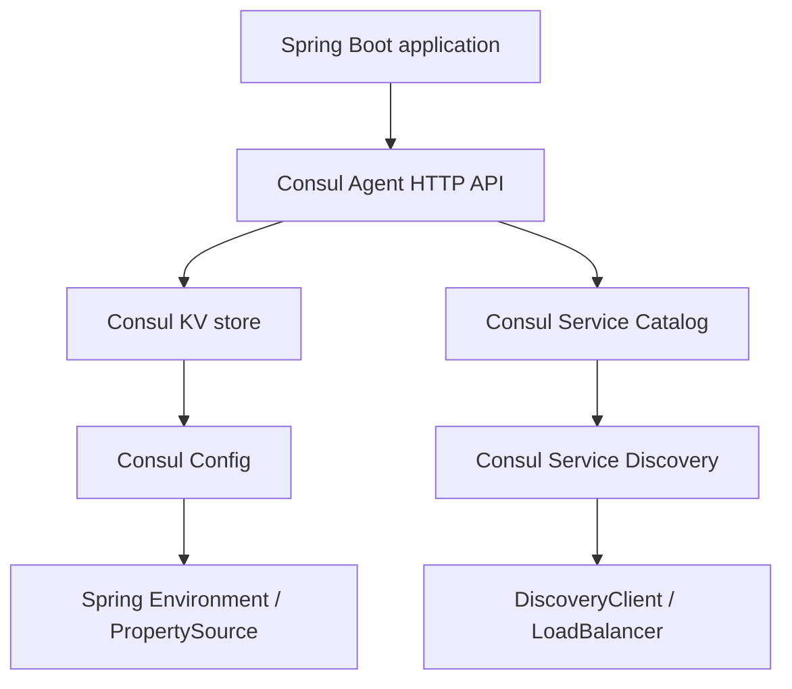

# Tách chức năng Consul Config khỏi Consul Service Discovery

Spring Cloud Consul tích hợp Consul với ứng dụng Spring Boot qua nhiều chức năng độc lập. **Consul Config** đọc cấu hình từ Consul Key/Value (KV) và đưa các giá trị vào Spring `Environment`. **Consul Service Discovery** đăng ký instance vào service catalog, kiểm tra health và cho phép ứng dụng tìm địa chỉ các service khác. Hai chức năng cùng kết nối đến Consul Agent nhưng phục vụ hai mục đích khác nhau.

Một ứng dụng có thể dùng Config mà không đăng ký service, dùng Discovery mà không đọc KV, hoặc bật cả hai. Việc chọn đúng starter và thuộc tính `enabled` giúp giảm dependency, quyền ACL và hành vi khởi động không cần thiết. Đặc biệt, không nên xem việc ứng dụng kết nối được Consul là bằng chứng rằng nó đã đăng ký service hoặc đã nạp cấu hình.

## Mục tiêu học tập

Sau bài học, bạn có thể:

- Phân biệt Consul KV configuration với Consul service catalog.
- Chọn starter chỉ cho Config, chỉ cho Discovery hoặc cho cả hai.
- Nạp cấu hình từ Consul bằng `spring.config.import`.
- Hiểu context path theo application name, profile và default context.
- Phân biệt Config Watch với Catalog Watch.
- Bật hoặc tắt Config và Discovery độc lập.
- Kiểm tra ACL token, health check, service registration và cấu hình được nạp.

## 1. Hai chức năng, hai loại dữ liệu

Consul cung cấp nhiều API. Spring Cloud Consul dùng các API khác nhau cho cấu hình và discovery:

| Chức năng | Dữ liệu Consul sử dụng | Kết quả trong ứng dụng |
|---|---|---|
| Consul Config | KV store: key, value và các context cấu hình | `PropertySource` trong Spring `Environment`. |
| Consul Service Discovery | Service catalog, instance metadata và health checks | `DiscoveryClient`, service instances và tích hợp Spring Cloud LoadBalancer. |

Ví dụ, `catalog-service` có thể đọc `catalog.search.timeout` từ KV nhưng không cần đăng ký chính nó vào service catalog. Một batch worker không mở HTTP port vẫn có thể cần Consul Config để đọc lịch chạy hoặc thông tin kết nối; worker đó có thể không cần Discovery.

Ngược lại, một API có thể đăng ký vào Consul để các service khác tìm thấy nó, trong khi cấu hình được cung cấp hoàn toàn qua file, environment variables hoặc Spring Cloud Config Server. API đó không cần Consul Config.



Hai chức năng có thể cùng dùng địa chỉ Consul Agent, thường là `localhost:8500` khi agent chạy cạnh ứng dụng. Việc dùng chung agent không làm cho Config và Discovery trở thành một chức năng duy nhất.

## 2. Chọn dependency theo nhu cầu

Spring Cloud Consul cung cấp starter riêng cho từng chức năng:

| Nhu cầu | Starter |
|---|---|
| Chỉ đọc cấu hình từ Consul KV | `spring-cloud-starter-consul-config` |
| Chỉ đăng ký và tìm service | `spring-cloud-starter-consul-discovery` |
| Cả Config và Discovery | Thêm cả hai starter hoặc dùng `spring-cloud-starter-consul-all`. |

Ví dụ Gradle cho ứng dụng chỉ dùng Config:

```groovy
dependencies {
    implementation 'org.springframework.cloud:spring-cloud-starter-consul-config'
}
```

Ứng dụng chỉ dùng Discovery:

```groovy
dependencies {
    implementation 'org.springframework.cloud:spring-cloud-starter-consul-discovery'
}
```

Ứng dụng cần cả hai:

```groovy
dependencies {
    implementation 'org.springframework.cloud:spring-cloud-starter-consul-config'
    implementation 'org.springframework.cloud:spring-cloud-starter-consul-discovery'
}
```

Dùng Spring Cloud BOM để quản lý phiên bản starter tương thích với Spring Boot. Tránh tự ghim các phiên bản Spring Cloud Consul khác nhau cho từng dependency. Nếu ứng dụng chỉ cần một chức năng, dùng starter chuyên biệt thay vì `spring-cloud-starter-consul-all` để tránh kích hoạt các tích hợp không cần thiết.

## 3. Consul Config đọc KV trực tiếp

Consul Config là một cách cung cấp cấu hình phân tán thay thế cho mô hình Spring Cloud Config Server/Client. Với starter `spring-cloud-starter-consul-config`, mỗi Config Client kết nối đến Consul Agent và đọc các context trong KV store.

Ở cơ chế Spring Boot Config Data hiện đại, khai báo import trong `application.yml`:

```yaml
spring:
  application:
    name: catalog-service
  config:
    import: "optional:consul:"
  cloud:
    consul:
      host: consul-agent.internal
      port: 8500
      config:
        enabled: true
        prefix: config
        default-context: application
        profile-separator: ','
```

`spring.config.import=optional:consul:` yêu cầu Spring Boot nạp Config Data từ Consul. Tiền tố `optional:` cho phép ứng dụng tiếp tục khởi động nếu Consul Config không thể cung cấp nguồn này. Bỏ `optional:` nếu cấu hình Consul là bắt buộc và ứng dụng không được khởi động khi không truy cập được Consul.

Với Config Data import từ Spring Boot 2.4 trở lên, không cần tạo `bootstrap.yml` chỉ để kết nối Consul. Nếu dự án chủ động bật legacy bootstrap processing hoặc dùng `spring-cloud-starter-bootstrap`, các thuộc tính điều khiển Consul Config cần được đặt ở bootstrap context theo cơ chế legacy đang sử dụng.

Consul Config đọc trực tiếp KV; nó không yêu cầu ứng dụng phải đăng ký vào service catalog. Vì vậy, ứng dụng chỉ dùng Config có thể không thêm `spring-cloud-starter-consul-discovery`.

## 4. Context path được tạo từ application và profile

Consul Config tổ chức cấu hình theo các context trong KV. Mặc định, prefix là `config`, application name lấy từ `spring.application.name`, default context là `application` và profile separator là dấu phẩy.

Ví dụ `catalog-service` chạy với profile `prod` sẽ tìm các context theo thứ tự từ cụ thể đến tổng quát:

```text
config/catalog-service,prod/
config/catalog-service/
config/application,prod/
config/application/
```

| Context | Phạm vi |
|---|---|
| `config/catalog-service,prod/` | Cấu hình riêng Catalog ở profile `prod`. |
| `config/catalog-service/` | Cấu hình mặc định riêng Catalog. |
| `config/application,prod/` | Cấu hình chung cho profile `prod`. |
| `config/application/` | Cấu hình mặc định dùng chung. |

Property source cụ thể hơn được đặt trước nguồn tổng quát hơn. Do đó, giá trị trong `config/catalog-service,prod/` có thể ghi đè giá trị cùng khóa trong `config/application/`.

Các thuộc tính tùy chỉnh:

| Thuộc tính | Ý nghĩa | Mặc định thường dùng |
|---|---|---|
| `spring.cloud.consul.config.prefix` | Prefix gốc trong KV | `config` |
| `spring.cloud.consul.config.default-context` | Context chung cho các ứng dụng | `application` |
| `spring.cloud.consul.config.name` | Tên context ứng dụng thay cho `spring.application.name` | Tên ứng dụng |
| `spring.cloud.consul.config.profile-separator` | Ký tự phân cách profile | `,` |
| `spring.cloud.consul.config.enabled` | Bật/tắt Consul Config | `true` khi Config starter được dùng |

Ví dụ đổi prefix và separator:

```yaml
spring:
  cloud:
    consul:
      config:
        prefix: platform-config
        default-context: shared
        profile-separator: '-'
```

Khi đó, context theo profile có thể có dạng `platform-config/catalog-service-prod/` và `platform-config/shared-prod/`. Cần thống nhất quy ước path với nhóm quản trị Consul trước khi đổi prefix hoặc separator, vì ứng dụng sẽ tìm các key ở vị trí mới.

## 5. Lưu key/value hoặc một tài liệu YAML

Consul Config hỗ trợ nhiều format. Với format mặc định `KEY_VALUE`, mỗi key trong context có thể đại diện cho một property. Ví dụ:

```text
config/catalog-service,prod/catalog.search.timeout = 2s
config/catalog-service,prod/catalog.search.retry-count = 3
```

Nếu muốn lưu một tài liệu YAML hoặc Properties trong một key, đặt `format` tương ứng. Ví dụ YAML:

```yaml
spring:
  cloud:
    consul:
      config:
        format: YAML
        data-key: data
```

Lưu nội dung YAML vào key `data` của context tương ứng, ví dụ `config/catalog-service,prod/data`:

```yaml
catalog:
  search:
    timeout: 2s
    retry-count: 3
```

Với format `PROPERTIES`, cách lưu cũng dùng key dữ liệu được chỉ định bởi `data-key`. `data-key` mặc định là `data`. Không nhầm key `data` này với toàn bộ context; nó là nơi chứa blob YAML/Properties bên trong context.

Nếu dùng `git2consul` để đồng bộ file từ Git sang các key riêng lẻ trong Consul, có thể xem xét format `FILES`. Khi đó tên file trở thành key và các file `.yml` hoặc `.properties` được phân tích theo quy tắc của Config Watch/Config loader. Chọn một cách lưu thống nhất để tránh cùng một thuộc tính xuất hiện ở nhiều định dạng khó kiểm soát.

## 6. Config Watch chỉ theo dõi cấu hình KV

Consul Config có Config Watch. Watch dùng blocking query trên một prefix KV để phát hiện dữ liệu cấu hình thay đổi. Khi có thay đổi liên quan đến context của ứng dụng, Spring Cloud Consul phát refresh event tương đương việc gọi endpoint `/refresh` của ứng dụng.

Ví dụ cấu hình:

```yaml
spring:
  cloud:
    consul:
      config:
        watch:
          enabled: true
          delay: 1000
          wait-time: 55
```

| Thuộc tính | Ý nghĩa |
|---|---|
| `spring.cloud.consul.config.watch.enabled` | Bật/tắt theo dõi thay đổi KV; mặc định thường bật. |
| `spring.cloud.consul.config.watch.delay` | Khoảng delay giữa các lần chạy watch, tính bằng mili giây; mặc định `1000`. |
| `spring.cloud.consul.config.watch.wait-time` | Thời gian blocking query chờ thay đổi, tính bằng giây; mặc định thường là `55`. |

Có thể tắt Config Watch nếu ứng dụng chỉ cần đọc cấu hình lúc khởi động hoặc muốn điều khiển refresh bằng một quy trình riêng:

```yaml
spring:
  cloud:
    consul:
      config:
        watch:
          enabled: false
```

Config Watch chỉ theo dõi KV context. Nó không đăng ký service, không cập nhật danh sách instance và không thực hiện health check cho service catalog.

## 7. Consul Service Discovery đăng ký và tìm service

Service Discovery dùng service catalog của Consul. Khi ứng dụng đăng ký, Consul nhận metadata như service name, instance ID, host, port và tags. Ứng dụng khác có thể dùng `DiscoveryClient` hoặc Spring Cloud LoadBalancer để tìm instance theo tên logic thay vì hard-code địa chỉ IP/port.

Ví dụ dependency:

```groovy
dependencies {
    implementation 'org.springframework.cloud:spring-cloud-starter-consul-discovery'
}
```

Ví dụ cấu hình đăng ký service:

```yaml
spring:
  application:
    name: catalog-service
  cloud:
    consul:
      host: consul-agent.internal
      port: 8500
      discovery:
        enabled: true
        register: true
        service-name: catalog-service
        health-check-path: /actuator/health
        health-check-interval: 10s
```

Consul Discovery thường đăng ký HTTP health check tới `/actuator/health` và mặc định kiểm tra định kỳ. Nếu health check thất bại, instance có thể được đánh dấu critical trong catalog. Cần có Actuator health endpoint hoặc cấu hình health check khác phù hợp với ứng dụng.

Trong mã Java, ứng dụng có thể dùng `DiscoveryClient`:

```java
import java.util.List;
import org.springframework.cloud.client.ServiceInstance;
import org.springframework.cloud.client.discovery.DiscoveryClient;
import org.springframework.stereotype.Service;

@Service
public class InventoryEndpointLookup {
    private final DiscoveryClient discoveryClient;

    public InventoryEndpointLookup(DiscoveryClient discoveryClient) {
        this.discoveryClient = discoveryClient;
    }

    public List<ServiceInstance> inventoryInstances() {
        return discoveryClient.getInstances("inventory-service");
    }
}
```

Discovery trả về danh sách instance đã đăng ký. Việc chọn instance và cân bằng tải có thể do Spring Cloud LoadBalancer thực hiện khi dùng client được đánh dấu `@LoadBalanced`.

## 8. Catalog Watch khác Config Watch

Spring Cloud Consul có các cơ chế watch khác nhau:

| Cơ chế | Theo dõi | Kết quả |
|---|---|---|
| Consul Config Watch | Thay đổi KV trong các context cấu hình | Phát refresh event để cập nhật Environment. |
| Consul Catalog Watch | Thay đổi danh sách service trong catalog | Phát heartbeat/event để discovery client cập nhật thông tin service. |
| Health check | Trạng thái một instance/service | Consul đánh dấu trạng thái passing, warning hoặc critical theo check. |

Catalog Watch không đọc `config/` và không thay đổi `PropertySource`. Config Watch không đăng ký hoặc deregister service. Health check không tự làm mới cấu hình.

Điều này quan trọng khi chẩn đoán. Nếu một key KV thay đổi nhưng `Environment` chưa cập nhật, kiểm tra Config Watch và refresh processing. Nếu một service mới đã đăng ký nhưng client chưa tìm thấy instance, kiểm tra Catalog Watch, service name, ACL và trạng thái health check.

## 9. Bật Config nhưng tắt Discovery

Đây là cấu hình phù hợp cho batch worker hoặc ứng dụng cần lấy cấu hình từ KV nhưng không cần xuất hiện trong service catalog.

Dependency chỉ gồm Config:

```groovy
dependencies {
    implementation 'org.springframework.cloud:spring-cloud-starter-consul-config'
}
```

Cấu hình:

```yaml
spring:
  application:
    name: report-worker
  config:
    import: "optional:consul:"
  cloud:
    consul:
      config:
        enabled: true
      discovery:
        enabled: false
```

Nếu ứng dụng đang dùng starter gộp hoặc dependency khác đã kéo Discovery vào, `spring.cloud.consul.discovery.enabled=false` tắt Discovery Client. Nếu chỉ cần tắt đăng ký nhưng vẫn muốn dùng DiscoveryClient để tra cứu service, dùng:

```yaml
spring:
  cloud:
    consul:
      discovery:
        register: false
```

`register: false` không tương đương `enabled: false`: nó ngăn đăng ký local service nhưng Discovery Client vẫn có thể được dùng để lookup. Khi dùng Config-only, không cần cấu hình health check đăng ký service vì ứng dụng không đăng ký instance.

## 10. Bật Discovery nhưng tắt Config

Một API có thể đăng ký vào Consul để các service khác tìm thấy, nhưng lấy cấu hình từ Config Server hoặc file ngoài. Dependency chỉ gồm Discovery:

```groovy
dependencies {
    implementation 'org.springframework.cloud:spring-cloud-starter-consul-discovery'
}
```

Cấu hình:

```yaml
spring:
  application:
    name: inventory-service
  cloud:
    consul:
      discovery:
        enabled: true
        register: true
      config:
        enabled: false
```

Nếu Config starter không nằm trên classpath, không cần `spring.config.import=consul:`. Nếu ứng dụng đang dùng starter gộp hoặc dependency kéo Consul Config vào, `spring.cloud.consul.config.enabled=false` tắt tích hợp Config.

Ứng dụng vẫn có thể dùng `spring.config.import=configserver:...` để đọc từ Spring Cloud Config Server. Việc tắt Consul Config không ảnh hưởng đến Config Client của Spring Cloud Config nếu hai cơ chế được cấu hình độc lập.

## 11. Dùng đồng thời Config và Discovery

Một microservice có thể cần cả hai chức năng: đọc cấu hình từ Consul KV và đăng ký địa chỉ vào service catalog. Khi đó, thêm cả hai starter và cấu hình hai nhánh riêng:

```yaml
spring:
  application:
    name: catalog-service
  config:
    import: "optional:consul:"
  cloud:
    consul:
      host: consul-agent.internal
      port: 8500
      config:
        enabled: true
        prefix: config
        default-context: application
      discovery:
        enabled: true
        register: true
        service-name: catalog-service
```

Trong mô hình này:

- Config đọc `config/catalog-service...` và `config/application...` từ KV.
- Discovery đăng ký `catalog-service` vào service catalog.
- Config Watch theo dõi KV để phát refresh event.
- Health check và Catalog Watch theo dõi trạng thái/danh sách service.

Nếu chỉ một chức năng gặp lỗi, không nên mặc định chức năng còn lại cũng hỏng. Kiểm tra log và health của từng tích hợp riêng biệt.

## 12. ACL token và quyền truy cập riêng

Consul ACL kiểm soát quyền đọc/ghi KV và quyền đăng ký/tìm service. Nếu ứng dụng chỉ cần Config, cấp quyền `read` cho đúng prefix KV và không cấp quyền ghi hoặc đăng ký service nếu không cần.

Spring Cloud Consul có thể cấu hình token riêng cho từng chức năng:

```yaml
spring:
  cloud:
    consul:
      config:
        acl-token: ${CONSUL_CONFIG_TOKEN}
      discovery:
        acl-token: ${CONSUL_DISCOVERY_TOKEN}
```

Các biến token phải được cấp qua secret manager hoặc nền tảng triển khai; không commit giá trị thật vào Git. Dùng token có quyền tối thiểu và tách token Config với Discovery nếu chính sách bảo mật yêu cầu.

Một policy KV chỉ đọc có thể có dạng minh họa:

```hcl
key_prefix "config/catalog-service" {
  policy = "read"
}

key_prefix "config/application" {
  policy = "read"
}
```

Policy này chỉ minh họa quyền đọc context Catalog và cấu hình chung. Cần kiểm tra chính xác prefix, profile path và quyền cần thiết theo phiên bản Consul. Pipeline cập nhật cấu hình nên dùng danh tính khác có quyền write trên path cần quản lý; không cấp write cho mọi Config Client.

Discovery cần quyền đọc catalog để lookup service; workload đăng ký service cần quyền write phù hợp với service name và node/agent theo chính sách Consul. Không cấp quyền KV write chỉ vì ứng dụng có quyền đăng ký service, và ngược lại.

## 13. Fail-fast và hành vi khi Consul không sẵn sàng

Consul Config có thể được cấu hình để ứng dụng dừng khởi động nếu không lấy được cấu hình. Với Config Data import:

```yaml
spring:
  config:
    import: "consul:"
```

Không có `optional:` nghĩa là nguồn được yêu cầu; nếu không thể kết nối hoặc tải dữ liệu, quá trình khởi động có thể thất bại. Với môi trường local hoặc test không yêu cầu Consul, có thể dùng `optional:consul:`.

Thuộc tính `spring.cloud.consul.config.fail-fast` cũng điều khiển hành vi khi truy vấn cấu hình thất bại trong các cơ chế hỗ trợ thuộc tính này. Khi đặt `false`, module có thể ghi warning và cho ứng dụng tiếp tục khởi động. Hãy xác định rõ cơ chế Config Data hay legacy bootstrap đang dùng và kiểm thử hành vi thực tế; không dựa vào một thuộc tính fail-fast để vô tình bỏ qua cấu hình bắt buộc trong production.

Discovery có chính sách riêng cho đăng ký service, ví dụ `spring.cloud.consul.discovery.fail-fast`. Nếu Config đọc KV thành công nhưng Discovery không thể đăng ký, hoặc ngược lại, log của từng tích hợp sẽ cho biết nhánh nào thất bại.

## 14. Chẩn đoán khi Config và Discovery bị nhầm lẫn

| Triệu chứng | Nên kiểm tra | Không nên kết luận ngay |
|---|---|---|
| Ứng dụng đọc được KV nhưng không xuất hiện trong catalog | Có `consul-discovery` starter không, `discovery.enabled`, `register`, ACL và agent | Consul Config đã kết nối không có nghĩa service đã đăng ký. |
| Service đã đăng ký nhưng thiếu property | Config starter, `spring.config.import`, prefix, context, profile và KV ACL | Service registration thành công không có nghĩa KV đã được đọc. |
| Sửa KV nhưng Environment chưa đổi | Config Watch, watch delay/wait-time, refresh event và bean refresh support | Catalog Watch không theo dõi KV. |
| Service mới không xuất hiện trong lookup | Service name, health status, Catalog Watch và discovery ACL | Config Watch không cập nhật service catalog. |
| 403 khi đọc KV | Config ACL token và key prefix policy | Discovery ACL token không tự cấp quyền đọc KV. |
| 403 khi đăng ký hoặc lookup | Discovery ACL token và service/node policy | Config ACL token không tự cấp quyền service catalog. |
| Ứng dụng fail lúc khởi động | `optional:consul:`, Config fail-fast, agent host/port và network | Không phải mọi lỗi Consul đều là lỗi discovery. |

Quy trình điều tra:

1. Xác định starter Config, Discovery hay cả hai đang có trên classpath.
2. Kiểm tra `spring.config.import` và `spring.cloud.consul.config.enabled` nếu cần Config.
3. Kiểm tra service registration và `spring.cloud.consul.discovery.enabled/register` nếu cần Discovery.
4. Kiểm tra host/port và kết nối tới Consul Agent.
5. Kiểm tra ACL token tương ứng với API KV hoặc service catalog.
6. Với Config, kiểm tra context KV, profile, format và Config Watch.
7. Với Discovery, kiểm tra service name, instance ID, health check và Catalog Watch.

## 15. Kiểm thử ba kiểu triển khai

Nên có kiểm thử riêng cho Config-only, Discovery-only và combined để xác nhận hai chức năng thật sự độc lập.

| Kịch bản | Cấu hình kiểm thử | Kết quả mong đợi |
|---|---|---|
| Config-only | Config starter, KV context có property, Discovery tắt | Property xuất hiện trong Environment; service không tự đăng ký vào catalog. |
| Discovery-only | Discovery starter, registration bật, Config tắt | Service xuất hiện trong catalog và health check hoạt động; không yêu cầu KV context. |
| Combined | Cả hai starter, KV context và registration | Property được nạp, service được đăng ký và hai watch hoạt động độc lập. |

Các bài test nên xác minh thêm:

- Config đọc đúng application/profile và thứ tự context.
- Config Watch phát refresh event khi KV thay đổi.
- Tắt Config Watch không làm tắt Catalog Watch.
- Tắt Discovery registration không làm Config Data import ngừng hoạt động.
- Token chỉ có quyền KV read không thể đăng ký service.
- Token chỉ có quyền service catalog không thể đọc secret KV.
- Khi Consul không sẵn sàng, hành vi optional/required phù hợp với môi trường.

## 16. Những điểm cần ghi nhớ

- Consul Config đọc KV và tạo `PropertySource`; Consul Service Discovery làm việc với service catalog, registration và health checks.
- Hai chức năng dùng chung Consul Agent nhưng có starter, thuộc tính, ACL và watch riêng.
- Dùng `spring-cloud-starter-consul-config` khi chỉ cần cấu hình; dùng `spring-cloud-starter-consul-discovery` khi chỉ cần discovery.
- `spring.config.import=optional:consul:` là cách Config Data hiện đại để nạp KV; bỏ `optional:` khi nguồn bắt buộc.
- Config contexts mặc định dựa trên application name, profile, default context và prefix.
- Config Watch theo dõi KV; Catalog Watch theo dõi service catalog; health check đánh giá instance.
- `spring.cloud.consul.config.enabled` và `spring.cloud.consul.discovery.enabled` cho phép bật/tắt độc lập.
- `spring.cloud.consul.discovery.register=false` ngăn đăng ký local service nhưng vẫn có thể giữ Discovery Client để lookup.
- ACL token và policy nên tách theo quyền KV và service catalog.
- Kiểm thử Config-only, Discovery-only và combined để tránh phụ thuộc ngoài ý muốn.

Tách Consul Config khỏi Consul Service Discovery giúp mỗi ứng dụng chỉ mang theo tích hợp mà nó cần. Khi chọn starter, bật/tắt đúng nhánh, phân quyền ACL riêng và theo dõi đúng loại watch, nhóm vận hành có thể dùng Consul làm nguồn cấu hình, service registry hoặc cả hai mà không nhầm lẫn trạng thái giữa chúng.

## Tài liệu tham khảo

- [Spring Cloud Consul – Distributed Configuration](https://docs.spring.io/spring-cloud-consul/reference/config.html)
- [Spring Cloud Consul – Service Discovery](https://docs.spring.io/spring-cloud-consul/reference/discovery.html)
- [Spring Cloud Consul – Common Application Properties](https://docs.spring.io/spring-cloud-consul/reference/appendix.html)
